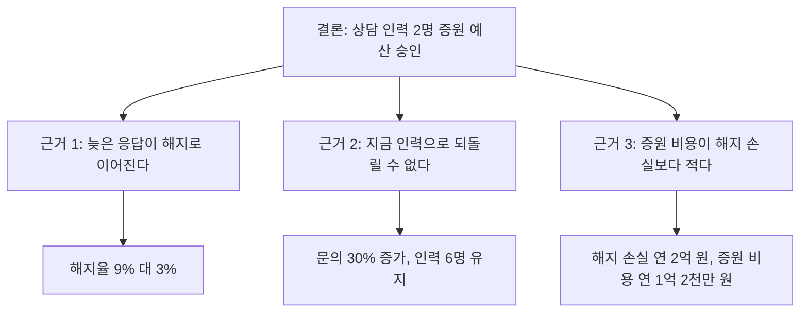

보고서를 분석한 순서대로 쓰면 결론은 맨 끝에 나온다. 읽는 사람은 그 전에 지치거나, 중간에 엉뚱한 결론을 혼자 내린다. 피라미드 원칙은 이 순서를 뒤집어 답을 맨 위에 두고, 답이 왜 맞는지를 아래층에 차례로 쌓는다.

## 무엇인가

Barbara Minto가 McKinsey에서 보고서 작성법을 가르치며 정리한 구조다. 세 층으로 나뉜다.

| 층 | 내용 | 읽는 사람이 얻는 것 |
| --- | --- | --- |
| 결론 | 하나의 주장이나 권고. 듣는 사람의 질문에 대한 직접적인 답 | 무엇을 하자는지 |
| 핵심 근거 | 결론이 왜 맞는지 보여 주는 3~4개의 주장 | 왜 그런지 |
| 데이터 | 근거마다 붙는 사실, 수치, 분석 | 믿어도 되는지 |

층을 잇는 규칙은 두 가지다.

- 세로 규칙: 위층의 문장은 읽는 사람에게 "왜?" 또는 "어떻게?"라는 질문을 남기고, 바로 아래층이 그 질문에 답한다. 층과 층이 질문과 답으로 대화하는 셈이다.
- 가로 규칙: 같은 층에 묶인 항목은 같은 종류여야 하고, 시간 순서, 구조(전체의 부분), 중요도 중 하나의 기준으로 정렬한다. 묶음은 MECE(Mutually Exclusive, Collectively Exhaustive)를 지킨다. 서로 겹치지 않고, 합치면 빠진 것이 없어야 한다.

생각은 아래에서 위로 하고, 전달은 위에서 아래로 한다. 데이터를 모아 패턴을 찾고 결론에 이르는 것은 분석 순서이고, 보고할 때는 그 순서를 거꾸로 꺼낸다. 군대에서 쓰던 BLUF(Bottom Line Up Front, 결론 먼저)와 같은 생각이다.

### 묶는 방식: 귀납과 연역

근거를 결론에 묶는 방식은 두 가지다.

| 방식 | 모양 | 장점 | 언제 쓰나 |
| --- | --- | --- | --- |
| 귀납(묶음) | 같은 종류의 근거 여러 개가 나란히 같은 결론을 가리킨다 | 빨리 읽히고, 근거 하나가 반박돼도 결론이 버틴다 | 대부분의 보고, 경영진 메모 |
| 연역(사슬) | 대전제, 소전제, 결론이 한 줄로 이어진다 | 앞의 전제에 동의하면 결론을 거부하기 어렵다 | 결론에 반대가 예상되는 자리 |

연역은 사슬 하나가 끊기면 결론 전체가 흔들리고, 결론이 맨 뒤에 나오므로 꼭대기 층에서는 귀납 묶음을 쓰고 연역은 근거 하나 안에서 쓰는 편이 읽기 쉽다. 이 배치 기준은 필자의 판단이다.

## 왜 효과가 있나

- 바쁜 사람은 앞부분만 읽고 멈춘다. 결론이 맨 앞에 있으면 어디서 멈춰도 핵심은 가져간다.
- 결론을 먼저 알면 뒤따르는 근거를 "이 결론을 받치는가"라는 기준 하나로 읽는다. 결론을 모른 채 근거를 읽으면 읽는 사람이 스스로 결론을 추측하며 읽어야 한다.
- 근거가 MECE면 "그럼 그건?"이라는 질문이 줄고, 반박이 나와도 특정 근거 하나로 좁혀진다. 회의가 그 근거만 다루고 끝난다.
- 쓰는 사람의 생각을 점검한다. 결론이 한 문장으로 나오지 않으면 아직 분석이 끝나지 않았다는 뜻이다.

## 쓰는 순서

1. 듣는 사람이 지금 가진 질문을 한 문장으로 적는다. 예: "상담 인력을 늘려야 하나?"
2. 그 질문에 대한 답을 한 문장으로 적는다. 이것이 결론이다.
3. 결론을 읽은 사람이 던질 "왜?" 또는 "어떻게?"를 적고, 그 답을 3~4개 쓴다.
4. 근거를 MECE로 점검한다. 겹치는 항목은 합치고, 비용, 사람, 일정, 위험처럼 빠진 축이 없는지 본다.
5. 근거의 정렬 기준을 시간, 구조, 중요도 중 하나로 정한다.
6. 근거마다 데이터를 붙인다. 어느 근거도 받치지 않는 데이터는 부록으로 뺀다.
7. 위에서 아래로 읽으며 각 층이 바로 위층의 질문에 답하는지 확인한다.

## 예시

### 예산 증액 요청 메모

상담 인력을 늘리는 예산을 요청하는 메모다. 수치는 설명을 위한 가상 값이다.

BEFORE: 분석한 순서대로 쓴 메모

```text
제목: 3분기 고객 상담 현황

- 3분기 상담 문의 1만 2천 건, 전 분기 대비 30% 증가
- 신규 요금제 출시 뒤 요금 관련 문의 비중 증가
- 상담 인력 6명 유지, 평균 첫 응답 시간 1.5시간에서 4시간으로 늘어남
- 첫 응답이 4시간을 넘긴 고객의 3개월 내 해지율 9%, 나머지 고객 3%
- 상담 인력 2명 증원 검토 필요
```

읽는 사람은 다섯째 줄에 와서야 무엇을 결정해야 하는지 알고, 그마저 "검토 필요"라서 요청인지 보고인지 분명하지 않다.

AFTER: 피라미드로 다시 쓴 메모

```text
제목: 상담 인력 2명 증원 예산(연 1억 2천만 원) 승인 요청

결론: 4분기 시작 전에 상담 인력을 2명 늘린다. 늘어나는 인건비가
      늦은 응답 때문에 생기는 해지 손실보다 적다.

1. 늦은 응답이 해지로 이어진다
   - 첫 응답 4시간 초과 고객의 3개월 내 해지율 9%, 나머지 3%
2. 지금 인력으로는 응답 시간을 되돌릴 수 없다
   - 문의는 30% 늘었고 인력은 6명 그대로다
3. 증원 비용이 해지 손실보다 적다
   - 해지 손실 추정 연 2억 원, 증원 비용 연 1억 2천만 원 (계산 근거 첨부)
```

제목만 읽어도 무엇을 결정해야 하는지 알고, 근거 세 개는 "왜 지금 사람을 늘려야 하나"라는 하나의 질문에 각각 다른 방향(원인, 대안 없음, 비용)에서 답한다.

### 사무실 이전 검토의 근거 묶기

BEFORE: 겹치고 빠진 근거

| 근거 | 문제 |
| --- | --- |
| 임대료가 싸다 | 다음 줄과 겹친다 |
| 비용이 줄어든다 | 임대료와 같은 축 |
| 교통이 편하다 | 다음 줄과 겹친다 |
| 출퇴근 시간이 준다 | 교통과 같은 축 |
| 직원 만족도가 오른다 | 결과일 뿐 근거가 아니다 |
| (없음) | 이전 비용과 공사 기간이 빠졌다 |

AFTER: 축으로 다시 묶은 근거

| 근거 | 데이터 |
| --- | --- |
| 비용: 이전 비용을 포함해도 14개월이면 회수한다 | 임대료와 관리비 연 15% 절감, 이전 비용 견적 |
| 직원: 출퇴근 부담이 준다 | 직원 주소 기준 평균 편도 시간 12분 감소 |
| 운영: 회의 공간 부족이 풀린다 | 회의실 4개 추가, 외부 대관 월 20건 중단 |

## 다이어그램

예산 증액 요청 메모를 피라미드로 그리면 다음과 같다.



결론에서 근거로 내려가는 선은 "왜?"라는 질문이고, 근거에서 데이터로 내려가는 선은 "정말 그런가?"라는 질문이다.

## 흔한 실수

- 결론 자리에 주제를 쓴다. "3분기 상담 현황"은 주제이고, "상담 인력을 2명 늘린다"가 결론이다.
- 분석한 순서 그대로 쓴다. 생각의 순서와 전달의 순서를 구분하지 않으면 결론이 맨 뒤로 간다.
- 결론처럼 보이지만 내용이 없는 문장을 쓴다. "문제가 세 가지 있다"는 개수만 알려 줄 뿐 무엇을 해야 하는지 말하지 않는다. Minto는 이런 문장이 덜 끝난 생각을 가린다고 지적했다.
- 근거가 7개를 넘는다. 묶음이 덜 됐다는 신호다. 비슷한 것끼리 한 단계 더 묶는다.
- 근거끼리 축이 섞인다. 비용 근거 옆에 일정 근거가 오고, 다음에 다시 비용 근거가 오면 읽는 사람이 축을 다시 맞춰야 한다.
- 근거를 받치지 않는 데이터를 넣는다. 만들어 둔 표라서 넣은 표는 부록으로 보낸다.
- 반대가 뻔한 자리에서 결론만 던진다. 이럴 때는 동의할 수 있는 사실부터 쌓는 연역 순서나 [SCQA 도입부](../02-scqa-scr/)를 먼저 쓴다.

## 점검 목록

- [ ] 결론이 한 문장이고, 듣는 사람이 가진 질문에 직접 답한다.
- [ ] 결론에 동사가 있다. 무엇을 하자는지, 또는 무엇이 사실인지 말한다.
- [ ] 결론 바로 아래 근거가 3~4개이고, 각 근거도 한 문장 주장이다.
- [ ] 근거끼리 겹치지 않고, 합치면 결론을 받치기에 빠진 축이 없다.
- [ ] 근거가 시간, 구조, 중요도 중 하나의 기준으로 정렬돼 있다.
- [ ] 모든 데이터가 특정 근거 하나를 받친다.
- [ ] 제목과 첫 문단만 읽은 사람도 무엇을 결정해야 하는지 안다.

## 출처

- Barbara Minto, 『The Pyramid Principle』
- [Minto Pyramid, untools](https://untools.co/minto-pyramid/)
- [The Pyramid Principle - Applied, Management Consulted](https://managementconsulted.com/pyramid-principle/)
- [The Minto Pyramid Principle: How to Communicate Like a McKinsey Consultant, StrategyPunk](https://www.strategypunk.com/the-minto-pyramid-principle-how-to-communicate-like-a-mckinsey-consultant-pdf/)
- [Action titles: how to write slide titles that carry the argument, StrategyU](https://strategyu.co/action-titles/)

[시리즈 목차](../), [다음: 02. SCQA와 SCR](../02-scqa-scr/)
