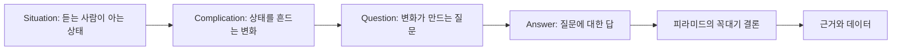

결론을 먼저 말하라는 조언을 따르다 보면 듣는 사람이 왜 그 결론이 필요한지 모르는 채로 답을 받는 일이 생긴다. SCQA는 듣는 사람이 이미 아는 상황에서 출발해 짧은 도입부 안에 문제와 질문을 세우고, 그 질문의 답으로 결론을 내놓는다.

## 무엇인가

Barbara Minto가 피라미드의 도입부를 쓰는 방법으로 제시한 구조다. 도입부의 끝에 나오는 답이 피라미드 꼭대기의 결론이 된다.

| 요소 | 역할 | 쓰는 기준 |
| --- | --- | --- |
| Situation(상황) | 듣는 사람이 이미 알고 동의하는 현재 상태 | 이견이 나올 내용은 넣지 않는다 |
| Complication(문제) | 그 상태를 흔드는 변화, 위협, 기회 | 듣는 사람에게 왜 지금 중요한지 보여 준다 |
| Question(질문) | 문제가 자연스럽게 만드는 질문 | 답이 하나로 나올 수 있게 좁힌다 |
| Answer(답) | 질문에 대한 결론 | 피라미드의 꼭대기 문장과 같아야 한다 |

질문이 뻔해서 말하지 않아도 되면 Q를 빼고 SCR(Situation, Complication, Resolution)로 쓴다. 회의 시작, 보고서 첫 문단, 제안서 첫 장, 메일 첫 문단 모두에 쓸 수 있고, 요소마다 한두 문장이면 충분하다.

### 순서 바꾸기

같은 네 요소를 듣는 사람에 따라 다른 순서로 배치할 수 있다. Minto의 책에 도입부 순서의 변형이 나온다고 소개하는 2차 자료가 있지만 원문을 다시 확인하지 못했으므로, 아래 표의 이름과 쓰임은 필자의 정리다.

| 순서 | 모양 | 어울리는 듣는 사람 |
| --- | --- | --- |
| S, C, Q, A | 기본형 | 배경 공유가 필요한 대부분의 자리 |
| A, S, C | 답 먼저 | 상황을 이미 아는 경영진, 시간이 짧은 보고 |
| C, S, A | 문제 먼저 | 문제를 이미 체감해 빨리 본론을 원하는 사람 |
| Q, S, C, A | 질문 먼저 | 회의 안건이 질문 하나로 정해진 자리 |

## 왜 효과가 있나

- 듣는 사람이 아는 사실에서 시작하므로 처음부터 고개를 끄덕이게 된다. 첫 문장에서 반박이 나오면 나머지를 들을 준비가 깨진다.
- 문제가 긴장을 만든다. 이야기의 갈등과 같은 역할이다. 답을 들을 이유가 생긴다.
- 질문이 답의 범위를 정한다. 듣는 사람과 말하는 사람이 같은 질문을 놓고 답을 평가하게 된다.
- 도입부가 짧게 끝나므로 피라미드 원칙의 "답 먼저"와 충돌하지 않는다. 몇 문장 안에 답이 나온다.

## 쓰는 순서

1. 답(A)을 먼저 정한다. 피라미드의 꼭대기 문장이다.
2. 그 답이 해결하는 질문(Q)을 적는다. 답과 질문이 짝이 맞는지 확인한다.
3. 그 질문이 왜 지금 생겼는지, 무엇이 바뀌었는지(C)를 적는다.
4. 변화 이전의 안정된 상태(S)를 한두 문장으로 적는다. 듣는 사람이 이미 아는 것만 넣는다.
5. S, C, Q, A 순서로 이어 읽고, 듣는 사람에 따라 순서를 바꿀지 정한다.
6. 질문이 뻔하면 Q를 지워 SCR로 줄인다.

쓰는 순서가 A에서 S로 거꾸로 가는 이유는, 답이 정해지지 않은 상태에서 상황부터 쓰면 상황 설명이 끝없이 길어지기 때문이다. 이 순서는 필자가 실무에서 쓰는 방법이다.

## 예시

### 신규 서비스 출시 지연 보고

BEFORE: 진행 상황을 나열한 보고

```text
제목: 신규 예약 앱 진행 상황

- 화면 디자인 완료
- 서버 개발 80% 진행
- 본인 인증 업체 계약 변경으로 연동 작업 재시작
- QA 일정 조정 중
- 출시일 관련 추가 논의 필요
```

출시가 늦어진다는 사실과 결정이 필요하다는 사실이 넷째, 다섯째 줄에 묻혀 있다. 읽는 사람은 "그래서 출시가 늦어지는가?"를 직접 물어야 한다.

AFTER: SCQA로 다시 쓴 보고

```text
제목: 신규 예약 앱 출시를 12월 21일로 3주 연기 요청

S: 신규 예약 앱은 11월 30일 출시를 목표로 개발 중이다.
C: 10월에 본인 인증 업체가 바뀌어 연동을 처음부터 다시 해야 하고,
   이 작업에 3주가 더 든다.
Q: 출시일을 지킬 방법이 있는가, 아니면 출시일을 옮겨야 하는가.
A: 출시를 12월 21일로 옮긴다. 인증 없이 쓸 수 있는 기능만 먼저 여는 안도
   검토했지만, 회원 가입부터 인증이 필요해 효과가 없다.
   금요일까지 연기 승인이 필요하다.
```

같은 내용을 SCR 한 문단으로 줄이면 메일 첫 문단이 된다.

```text
신규 예약 앱은 11월 30일 출시를 목표로 개발 중이었다. 그런데 10월에 본인
인증 업체가 바뀌어 연동을 다시 해야 하고, 여기에 3주가 더 든다. 그래서
출시를 12월 21일로 옮기려 하며, 금요일까지 승인이 필요하다.
```

상황을 이미 아는 본부장에게 보고한다면 답 먼저(A, S, C) 순서가 더 빠르다.

```text
출시를 12월 21일로 3주 미루는 것을 승인해 달라. 원래 11월 30일 출시
예정이었으나, 10월에 본인 인증 업체가 바뀌어 연동을 다시 하는 데 3주가 든다.
```

### 회의 첫 발언

BEFORE

```text
오늘은 교육 프로그램 관련해서 이것저것 이야기해 보려고 한다.
설문 결과도 있고, 강사 의견도 있고, 예산 문제도 있다.
```

AFTER (S, C, Q)

```text
신입 교육은 4주 집합 교육으로 3년째 운영 중이다(S). 그런데 올해 설문에서
"현업에 바로 쓸 수 있었다"는 응답이 41%로 작년보다 20%p 떨어졌다(C).
오늘은 4주 중 무엇을 줄이고 무엇을 현업 실습으로 바꿀지 정하려 한다(Q).
```

이 회의에서 답(A)은 회의의 결과물이므로, 회의 시작에서는 질문까지만 세운다.

## 다이어그램



| 요소 | 출시 지연 보고 | 회의 첫 발언 |
| --- | --- | --- |
| S | 11월 30일 출시 목표로 개발 중 | 4주 집합 교육 3년째 운영 |
| C | 인증 업체 변경으로 연동에 3주 추가 | 현업 적용 응답 41%, 20%p 하락 |
| Q | 출시일을 지킬 수 있나 | 무엇을 줄이고 무엇을 실습으로 바꿀까 |
| A | 12월 21일로 연기, 금요일까지 승인 | 회의에서 정함 |

## 흔한 실수

- 상황이 길다. 회사 연혁, 프로젝트 배경, 조직도를 다 넣으면 듣는 사람은 문제에 닿기 전에 지친다. 상황은 두 문장을 넘기지 않는다.
- 상황에 논쟁거리를 넣는다. "현재 프로세스는 비효율적이다"는 듣는 사람이 동의하지 않을 수 있으므로 상황이 아니라 문제다.
- 문제가 약하다. 듣는 사람이 체감하지 못하는 문제면 답을 들을 이유가 없다. 수치나 기한으로 무게를 보여 준다.
- 문제 안에 해결책을 섞는다. "인증 업체가 바뀌어 일정을 3주 미뤄야 한다"는 C와 A를 한 문장에 넣은 것이다.
- 질문과 답이 짝이 안 맞는다. "출시일을 지킬 수 있나"에 "인증 업체 계약 조건을 검토하겠다"로 답하면 질문에 답하지 않은 것이다.
- 답이 여러 개다. SCQA의 답은 하나이고, 여러 안은 답 아래 근거나 비교 장표로 내린다.

## 점검 목록

- [ ] 상황은 듣는 사람이 이미 알고 동의하는 내용이고 두 문장 이내다.
- [ ] 문제는 무엇이 바뀌었는지를 수치, 기한, 영향으로 보여 준다.
- [ ] 질문은 문제에서 자연스럽게 나오고, 답이 하나로 나올 만큼 좁다.
- [ ] 답은 질문에 직접 답하고, 피라미드 꼭대기 문장과 같다.
- [ ] 듣는 사람이 상황을 이미 안다면 답 먼저 순서를 검토했다.
- [ ] 질문이 뻔하면 SCR로 줄였다.

## 출처

- Barbara Minto, 『The Pyramid Principle』
- [SCQA Framework, Management Consulted](https://managementconsulted.com/scqa-framework/)
- [Minto Pyramid & SCQA, ModelThinkers](https://www.modelthinkers.com/mental-model/minto-pyramid-scqa)
- [The Minto Pyramid Principle: How to Communicate Like a McKinsey Consultant, StrategyPunk](https://www.strategypunk.com/the-minto-pyramid-principle-how-to-communicate-like-a-mckinsey-consultant-pdf/)

[이전: 01. 피라미드 원칙](../01-pyramid-principle/), [시리즈 목차](../), [다음: 03. 수평·수직 논리](../03-horizontal-vertical-logic/)
