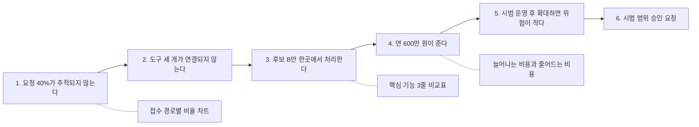

피라미드로 결론과 근거를 정해도 덱으로 옮기는 과정에서 흐름이 무너지는 일이 많다. 장마다 제목이 "현황", "비교", "계획"처럼 주제만 말하면 듣는 사람은 장과 장 사이의 연결을 스스로 만들어야 한다. 수평·수직 논리는 제목과 본문으로 이 연결을 드러내는 점검 방법이다.

## 무엇인가

컨설팅 장표에서 쓰는 네 가지 도구다.

| 도구 | 뜻 |
| --- | --- |
| 결론형 제목(action title) | 장 제목을 주제가 아니라 그 장이 말하는 결론 문장으로 쓴다. McKinsey에서는 lead라고도 부른다 |
| 수평 논리 | 제목만 처음부터 끝까지 이어 읽어도 하나의 이야기가 된다 |
| 수직 논리 | 한 장 안의 표, 차트, 글머리가 모두 그 장의 제목을 증명한다 |
| 고스트 덱(ghost deck) | 분석 전에 제목과 증거 스케치만 있는 빈 덱을 먼저 만든다 |

Minto는 제목에 명사구 대신 문장을 쓰라고 권했다. "매출 전망"은 읽는 사람이 좋다는 건지 나쁘다는 건지 추측하게 만들고, "매출 전망이 밝다"는 그 여지를 없앤다. 고스트 덱은 Paul Friga가 『The McKinsey Engagement』에서 고스트 차트로 설명한 방법으로, 장마다 가설을 문장 제목으로 적고 그 아래에 필요한 데이터의 모양만 그려 둔다.

용어 하나를 짚어 둔다. 피라미드 원칙에서 수직 논리는 층 사이의 질문과 답, 수평 논리는 같은 층 항목의 묶음을 가리킨다. 덱 작성에서는 같은 말을 장과 장 사이(수평), 장 안(수직)의 흐름으로 쓴다. 이 글은 덱 작성의 뜻으로 쓴다.

### 한 장에 메시지 하나

한 장에는 주장 하나만 둔다. 제목에 "그리고"로 이어진 주장이 두 개 있으면 두 장으로 나눈다. 같은 결론을 두 장에 나눠 담았으면 한 장으로 합친다. Ethan Rasiel은 『The McKinsey Way』에서 차트 하나에 메시지 하나를 원칙으로 들었다.

### 명사구 제목 관례가 있을 때

국내 보고서는 제목을 "추진 배경", "현황 분석"처럼 명사구로 쓰는 관례가 많다. 관례를 바꾸기 어렵다면 제목은 그대로 두고, 제목 바로 아래 리드 문장에 결론을 쓴다. 수평 점검은 제목 대신 리드 문장만 이어 읽어서 한다. 이 적용 방식은 필자의 정리다.

## 왜 효과가 있나

- 사람은 장표에서 제목을 가장 먼저 본다. 결론형 제목은 그 자리에 가장 중요한 정보를 둔다.
- 제목이 주장이면 듣는 사람이 본문을 "이 주장이 맞나"라는 기준으로 읽는다. 주제형 제목은 본문을 보고 결론을 직접 끌어내라고 요구한다.
- 제목만 이어 읽는 점검은 덱 전체를 한 쪽짜리 요약으로 바꿔 보는 것과 같다. 순서가 틀렸거나 빠진 단계가 있으면 바로 드러난다.
- 고스트 덱은 분석 전에 필요한 데이터를 정해 준다. 무엇을 모을지 모르고 데이터부터 모으는 낭비가 준다.
- 제목이 주장이면 반박할 수 있다. 반박할 수 없는 제목은 아직 라벨이라는 신호다.

## 쓰는 순서

1. 피라미드로 결론과 근거를 정한다. 근거 하나가 대개 섹션 하나가 된다.
2. 장마다 제목 문장만 적은 고스트 덱을 만든다. 모르는 숫자는 [X]%처럼 비워 둔다.
3. 제목만 문서에 붙여 메모처럼 읽는다. 결론과 이유가 이어지는지, 순서가 맞는지 본다.
4. 장마다 제목을 증명할 증거의 모양(표, 막대 차트, 인용)과 필요한 데이터를 적는다. 이 목록이 데이터 요청서가 된다.
5. 데이터를 채운 뒤 제목을 다시 쓴다. 데이터가 가설과 다르면 제목을 바꾸고, 수평 점검을 다시 한다.
6. 수직 점검을 한다. 제목을 가리고 본문만 본 사람이 같은 결론에 이르는지 확인한다.
7. 10초 점검을 한다. 장을 10초 보여 주고 "그래서 무슨 말인가"를 물어 제목과 같은 답이 나오는지 본다.

## 예시

### 팀 협업 도구 교체 제안 덱의 제목 목록

BEFORE: 주제형 제목

| 장 | 제목 |
| --- | --- |
| 1 | 추진 배경 |
| 2 | 현행 도구 현황 |
| 3 | 후보 도구 비교 |
| 4 | 비용 분석 |
| 5 | 전환 계획 |
| 6 | 기대 효과 |

제목만 읽으면 무엇을 제안하는지, 왜인지 알 수 없다. 어느 보고서에나 붙일 수 있는 목차다.

AFTER: 결론형 제목

| 장 | 제목 |
| --- | --- |
| 1 | 업무 요청의 40%가 메일과 메신저에 흩어져 아무도 끝까지 추적하지 않는다 |
| 2 | 지금 쓰는 도구 세 개가 연결되지 않아 같은 내용을 두 번씩 입력한다 |
| 3 | 후보 셋 중 B만 요청 접수, 일정, 문서를 한곳에서 처리한다 |
| 4 | 라이선스는 연 1,800만 원 늘지만 기존 도구 해지로 연 2,400만 원 준다 |
| 5 | 두 팀이 4주 시범 운영한 뒤 전사로 넓히면 전환 위험이 작다 |
| 6 | 12월 둘째 주까지 시범 운영 범위를 승인해 달라 |

여섯 문장을 이어 읽으면 문제, 원인, 해법, 비용, 위험 관리, 요청이 한 쪽 메모가 된다.

### 명사구 제목을 유지한 버전

| 제목(관례 유지) | 리드 문장 |
| --- | --- |
| 추진 배경 | 업무 요청의 40%가 메일과 메신저에 흩어져 추적되지 않는다 |
| 현행 도구 현황 | 도구 세 개가 연결되지 않아 같은 내용을 두 번 입력한다 |
| 후보 도구 비교 | 후보 B만 요청 접수, 일정, 문서를 한곳에서 처리한다 |
| 비용 분석 | 라이선스가 늘어도 기존 도구 해지로 연 600만 원이 준다 |
| 전환 계획 | 두 팀이 4주 시범 운영한 뒤 전사로 넓힌다 |
| 요청 사항 | 12월 둘째 주까지 시범 운영 범위 승인이 필요하다 |

### 한 장의 수직 논리

BEFORE

```text
제목: 후보 도구 비교
본문: 기능 24개 x 후보 3개 비교표, 모든 칸에 O, X, 세모
```

24줄 중 무엇이 결정에 중요한지 듣는 사람이 골라야 한다.

AFTER

```text
제목: 후보 셋 중 B만 요청 접수, 일정, 문서를 한곳에서 처리한다
본문: 결정에 영향을 주는 기능 3줄 x 후보 3개, B 열만 강조
      나머지 21줄은 부록 3번
```

### 고스트 덱 한 장

```text
제목: 업무 요청의 [X]%가 메일과 메신저에 흩어져 추적되지 않는다
증거 스케치: 요청 접수 경로별 비율 막대(메일, 메신저, 회의, 협업 도구)
필요한 데이터: 2주간 팀별 요청 접수 기록 표본, 처리 완료 여부
```

## 다이어그램



실선은 수평 논리로, 제목끼리 이어지는 흐름이다. 점선은 수직 논리로, 각 제목을 증명하는 본문이다.

## 흔한 실수

- 문장이지만 내용이 없는 제목을 쓴다. "인터뷰에서 발견한 세 가지"는 개수만 알려 준다. 세 가지가 합쳐서 무엇을 말하는지 쓴다.
- 제목이 본문보다 크게 말한다. "모든 팀이 B를 원한다"고 쓰고 본문에는 한 팀 설문만 있다면 제목이 과장된 것이다.
- 제목이 너무 길다. 두 줄을 넘기면 주장 두 개가 섞였는지 본다.
- 제목에 "그리고"로 주장 두 개를 넣는다. 두 장으로 나누거나, 말줄임으로 다음 장에 이어 쓴다.
- 고스트 덱을 만들고 데이터가 들어온 뒤에도 제목을 고치지 않는다. 고스트 덱의 제목은 가설이다.
- 명사구 관례를 지키면서 리드 문장도 비워 둔다. 그러면 수평 점검을 할 수단이 없다.

## 점검 목록

- [ ] 모든 장의 제목(또는 리드 문장)이 주어와 서술어가 있는 주장이다.
- [ ] 제목만 이어 읽으면 결론과 이유가 한 쪽 메모처럼 읽힌다.
- [ ] 각 장의 본문이 제목만 증명하고, 증명하지 않는 요소는 빠져 있다.
- [ ] 제목을 가리고 본문만 봐도 같은 결론이 나온다.
- [ ] 한 장에 주장이 하나다.
- [ ] 누군가 반박할 수 있는 제목이다.
- [ ] 고스트 덱의 가설 제목을 데이터에 맞게 고쳤다.

## 출처

- Barbara Minto, 『The Pyramid Principle』
- Paul Friga, 『The McKinsey Engagement』
- Ethan Rasiel, 『The McKinsey Way』
- [Action titles: how to write slide titles that carry the argument, StrategyU](https://strategyu.co/action-titles/)
- [Ghost deck: how consultants write the presentation before the analysis, StrategyU](https://strategyu.co/ghost-deck/)
- [The Minto Pyramid Principle: How to Communicate Like a McKinsey Consultant, StrategyPunk](https://www.strategypunk.com/the-minto-pyramid-principle-how-to-communicate-like-a-mckinsey-consultant-pdf/)

[이전: 02. SCQA와 SCR](../02-scqa-scr/), [시리즈 목차](../), [다음: 04. Sparkline](../04-sparkline/)
