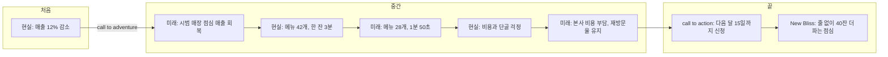

보고는 결정을 받는 자리지만, 변화를 제안하는 발표는 듣는 사람이 지금의 방식을 떠나도록 설득해야 한다. 근거를 아무리 잘 쌓아도 듣는 사람이 지금 상태에 머무는 편이 편하다고 느끼면 움직이지 않는다. Sparkline은 현재와 가능한 미래의 차이를 반복해 보여 주며 그대로 있는 비용을 키운다.

## 무엇인가

Nancy Duarte가 키노트, 제품 발표, 정치 연설을 분석해 찾은 패턴이다. Steve Jobs의 iPhone 발표와 Martin Luther King Jr.의 "I Have a Dream" 연설이 대표 사례로 소개된다. 좋은 발표는 "지금의 현실(what is)"과 "바뀔 수 있는 모습(what could be)"을 번갈아 오간다. 이 움직임을 종이에 그리면 골짜기(현실)와 봉우리(가능한 미래)가 반복되는 선이 되고, Duarte는 이를 Presentation Sparkline이라 불렀다.

『Resonate』가 설명하는 구조는 처음, 중간, 끝의 3막과 겹친다.

| 구간 | 하는 일 |
| --- | --- |
| 처음 | 듣는 사람이 아는 현실(what is)을 말해 공감대를 만든다. 그다음 현실과 가능한 미래의 차이를 처음 드러내는 전환점, call to adventure가 온다 |
| 중간 | 현실과 가능한 미래를 여러 번 오간다. 현실 쪽에는 문제, 장애물, 반론을 두고, 미래 쪽에는 해법과 그 효과를 둔다 |
| 끝 | 두 번째 전환점인 call to action에서 무엇을 해 달라는지 분명히 말하고, 아이디어가 받아들여진 세계(New Bliss)를 그려 마무리한다 |

Duarte는 발표의 주인공이 발표자가 아니라 듣는 사람이라고 본다. 그래서 준비 단계에서 듣는 사람이 들어올 때 어떤 상태이고, 나갈 때 어떤 상태가 되기를 바라는지를 먼저 정하라고 권한다.

## 왜 효과가 있나

- 대비가 긴장을 만든다. 현실과 미래를 오갈 때마다 둘 사이의 간격이 넓어지고, 그대로 있는 비용이 커 보인다.
- 현실에서 시작하므로 발표자의 신뢰가 생긴다. 듣는 사람이 겪는 문제를 정확히 말하면 "이 사람은 우리 사정을 안다"는 인식이 생긴다.
- 반론을 현실 쪽 골짜기로 다룬다. 듣는 사람이 속으로 하는 반론을 먼저 꺼내고 답하므로, 발표가 끝난 뒤 남는 저항이 줄어든다. 이 해석은 필자의 정리다.
- 마지막에 남는 장면이 New Bliss다. Duarte는 사람들이 처음이나 중간보다 마지막에 들은 것을 더 잘 기억한다고 말한다.

## 쓰는 순서

1. 듣는 사람이 들어올 때의 상태와 나갈 때 바라는 상태를 한 문장씩 적는다.
2. 듣는 사람을 분석한다. 무엇이 가장 골치 아픈가, 무엇을 시도했다가 실패했나, 아무것도 바꾸지 않으면 무엇을 잃나.
3. what is 목록을 만든다. 현재의 문제, 불편, 숫자, 예상 반론을 적는다.
4. what could be 목록을 만든다. 각 현실 항목에 짝이 되는 바뀐 모습을 적는다. 시범 결과나 사례가 있으면 붙인다.
5. 현실과 미래를 짝지어 번갈아 배치한다. 처음 오가는 지점(call to adventure)은 가장 공감을 얻을 차이로 고른다.
6. call to action을 쓴다. 누가, 언제까지, 무엇을 하는지 구체적으로 쓴다.
7. New Bliss를 쓴다. 듣는 사람 입장에서 바뀐 하루나 장면으로 쓴다.

## 예시

### 카페 프랜차이즈 점주 설명회

본사가 가맹점주에게 모바일 사전 주문과 메뉴 축소를 함께 도입하자고 설득하는 발표다. 수치는 가상 값이다.

BEFORE: 기능 소개 순서

| 순서 | 내용 |
| --- | --- |
| 1 | 본사 소개와 올해 성과 |
| 2 | 가맹점 매출 현황 |
| 3 | 모바일 사전 주문 기능 소개(화면 12장) |
| 4 | 메뉴 개편안 |
| 5 | 도입 일정과 비용 |
| 6 | 질의응답 |

듣는 사람은 기능 화면을 보는 동안 "이걸 왜 해야 하나", "비용은 누가 내나"를 생각하고, 그 답은 다섯째 순서에서야 나온다.

AFTER: Sparkline 순서

| 순서 | 구간 | 내용 |
| --- | --- | --- |
| 1 | what is | 지난 1년 점포당 월 매출 12% 감소, 점심 대기 줄에서 돌아가는 손님 |
| 2 | what could be (call to adventure) | 사전 주문을 시범 도입한 3개 매장은 점심 매출이 회복됐다 |
| 3 | what is | 메뉴가 42개라 한 잔에 평균 3분이 걸리고 아르바이트 교육이 길다 |
| 4 | what could be | 메뉴를 28개로 줄인 시범 매장은 평균 제조 시간이 1분 50초다 |
| 5 | what is | 점주들의 걱정: 초기 비용, 단골이 낯설어할 메뉴 변화 |
| 6 | what could be | 본사가 태블릿과 첫 3개월 수수료를 부담하고, 시범 매장 단골 재방문율은 그대로였다 |
| 7 | call to action | 다음 달 15일까지 1차 도입 매장 신청 |
| 8 | New Bliss | 점심 한 시간에 지금보다 40잔 더 팔고, 줄 때문에 돌아가는 손님이 없는 매장 |

기능 화면은 6번 뒤에 필요한 만큼만 넣거나 부록으로 보낸다. 점주가 궁금한 것은 기능 목록이 아니라 자기 매장의 매출과 비용이다.

### 발표 첫 30초

BEFORE

```text
오늘은 새로운 모바일 주문 시스템의 기능을 소개한다.
```

AFTER

```text
지난달 점심시간, 강남 1호점 앞에서 줄을 보고 돌아간 손님을 세어 봤다.
한 시간에 23명이었다. 오늘은 그 23명을 다시 매장 안으로 들이는 방법을 이야기한다.
```

BEFORE는 발표자가 하고 싶은 일로 시작하고, AFTER는 듣는 사람이 아는 현실로 시작한다. 실제 발표에서는 자리에 맞는 말투로 바꿔 쓴다.

## 다이어그램

Sparkline은 현실과 미래를 오가는 선이다. 아래 그림은 카페 예시를 그 순서대로 그린 것이다.



## 흔한 실수

- 미래만 계속 말한다. 듣는 사람의 현실을 다루지 않으면 판매 홍보처럼 들린다.
- 현실만 계속 말한다. 문제를 나열하다 끝나면 불만 보고가 된다.
- 현실과 미래의 차이가 작다. "조금 더 편해진다"로는 지금 방식을 떠날 이유가 생기지 않는다. 수치나 장면으로 차이를 보여 준다.
- 현실을 발표자 시점으로 쓴다. "본사의 주문 데이터가 분산돼 있다"는 점주의 현실이 아니다.
- call to action이 모호하다. "적극 검토 바란다"는 행동이 아니다.
- New Bliss가 발표자의 이익이다. "본사 시스템 통합 완료"는 점주가 바라는 미래가 아니다.
- 결정만 받으면 되는 짧은 보고에 억지로 쓴다. 이럴 때는 [피라미드 원칙](../01-pyramid-principle/)이 빠르다.

## 점검 목록

- [ ] 듣는 사람이 들어올 때와 나갈 때의 상태를 한 문장씩 정했다.
- [ ] 첫 장면이 듣는 사람이 아는 현실이다.
- [ ] 현실과 미래가 최소 두 번 이상 오간다.
- [ ] 예상 반론이 현실 쪽에 들어가 있고, 각각에 짝이 되는 미래가 있다.
- [ ] call to action에 누가, 언제까지, 무엇을이 있다.
- [ ] New Bliss가 듣는 사람 입장의 구체적인 장면이다.

## 출처

- Nancy Duarte, 『Resonate』
- [The Storytelling Framework Every Business Leader Should Know, Duarte](https://www.duarte.com/resources/storytelling-framework/)
- [How to move presentation audiences with structure and story, Duarte](https://www.duarte.com/blog/move-presentation-audience-with-story-techniques-in-presentations/)
- [The secret structure of great talks, Nancy Duarte, TEDxEast](https://www.ted.com/talks/nancy_duarte_the_secret_structure_of_great_talks)

[이전: 03. 수평·수직 논리](../03-horizontal-vertical-logic/), [시리즈 목차](../), [다음: 05. ABT](../05-abt/)
