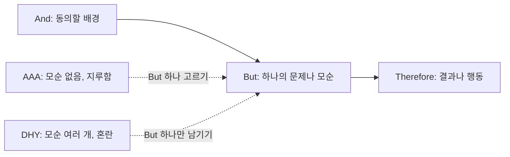

메일 첫 문단이나 장표 리드는 한두 문장으로 맥락, 문제, 할 일을 모두 전해야 한다. 사실을 "그리고"로 이어 붙이면 지루하고, "하지만"과 "그럼에도"를 여러 번 쓰면 무엇이 문제인지 흐려진다. ABT는 이 한 문단을 접속어 세 개로 정리한다.

## 무엇인가

과학자 출신 영화감독 Randy Olson이 만든 서사 틀이다. 빈칸 세 개를 And, But, Therefore로 잇는다.

```text
___ 이고(And) ___ 다. 그런데(But) ___. 그래서(Therefore) ___.
```

| 연결어 | 역할 | 서사의 힘 |
| --- | --- | --- |
| And | 배경을 세운다 | 동의 |
| But | 문제나 모순을 드러낸다 | 모순 |
| Therefore | 결과나 행동을 내놓는다 | 귀결 |

Olson은 이 틀을 애니메이션 South Park 제작자들이 이야기를 쓰는 방식에서 처음 얻었고, 뒤에 시나리오 작법 교육자 Frank Daniel까지 거슬러 올라간다고 설명한다. 정리된 형태는 2015년 책 『Houston, We Have a Narrative』에 실렸다.

### Narrative Spectrum

Olson은 글의 서사 정도를 세 형태로 나눈다.

| 형태 | 연결어 | 서사의 양 | 느낌 |
| --- | --- | --- | --- |
| AAA | And, And, And | 너무 적다. 모순이 없어 서사가 없다 | 지루하다 |
| ABT | And, But, Therefore | 알맞다 | 흥미롭다 |
| DHY | Despite, However, Yet | 너무 많다. 모순이 여러 개다 | 헷갈린다 |

사실을 그냥 나열하는 AAA와 반전을 겹겹이 넣는 DHY 사이에서 But 하나를 고르는 것이 ABT의 일이다.

## 왜 효과가 있나

- But이 긴장을 만든다. 모순이 생기면 듣는 사람은 해결을 기다리고, Therefore가 그 기대에 답한다.
- But을 하나만 고르게 만든다. 문제를 하나로 좁히지 못하면 ABT가 완성되지 않으므로, 쓰는 사람이 핵심 문제를 정하게 된다.
- 길이에 상관없이 쓸 수 있다. Olson은 한 문장부터 논문 전체까지 같은 구조가 적용된다고 본다.
- SCR을 한 문장으로 줄인 모양이라 피라미드나 SCQA와 함께 쓰기 쉽다. And는 상황(S), But은 문제(C), Therefore는 답(R)에 대응한다. 이 대응은 필자의 정리다.
- Olson의 교육 자료에는 "A와 B를 빨리 지나갈수록 듣는 사람은 T를 더 듣고 싶어 한다"는 취지의 조언이 있다. 배경을 길게 쓰지 말라는 뜻이다.

## 쓰는 순서

1. 하고 싶은 말을 아무렇게나 적는다. 대개 AAA가 나온다.
2. 그 안에서 가장 중요한 모순이나 문제 하나를 고른다. 이것이 But이다.
3. But이 성립하는 데 꼭 필요한 배경만 남겨 And로 묶는다. 나머지 배경은 지운다.
4. But에서 나오는 결과나 행동을 Therefore로 쓴다. 듣는 사람이 해야 할 일이면 더 좋다.
5. 소리 내어 읽고 But이 두 개 이상이면 하나를 지운다.
6. And가 길면 줄인다. Therefore가 짧으면 구체적으로 늘린다.

Olson의 교육 과정에서는 몇 가지 확장도 쓴다. And 안에 "만약 ___면 ___다"로 목표를 세우거나, But 뒤에 "___때문에"를 붙여 문제의 원인을 보이는 식이다.

## 예시

### 채용 계획 보고의 첫 문단

AAA: 사실 나열

```text
개발팀은 8명이고, 올해 기존 서비스 운영과 신규 프로젝트 두 개를 맡았다.
운영 요청은 주 65건이고, 신규 프로젝트 일정도 있으며, 내년 채용 계획을 공유한다.
```

DHY: 반전 과잉

```text
인력이 부족함에도 불구하고 일정은 대체로 지켜왔으나, 운영 요청이 늘었고,
그럼에도 채용 예산은 동결됐지만, 신규 프로젝트는 연기할 수 없는 상황이다.
```

ABT

```text
개발팀 8명은 기존 서비스 운영과 신규 프로젝트 두 개를 함께 맡고 있다(And).
그런데 운영 요청이 주 40건에서 65건으로 늘어 신규 프로젝트에 쓰는 시간이
절반으로 줄었다(But). 그래서 1분기에 운영 전담 인력 2명을 먼저 채용하는
계획을 올린다(Therefore).
```

AAA는 무엇이 문제인지 말하지 않고, DHY는 문제가 네 개라 무엇에 답해야 할지 모른다. ABT는 문제 하나와 행동 하나를 남긴다.

### 사무실 이전 검토 장표 리드

BEFORE

```text
현 사무실 임대 계약 현황 및 이전 후보지 3곳 검토 결과
```

AFTER

```text
현 사무실 계약은 내년 6월에 끝나고 재계약하면 임대료가 18% 오른다.
그런데 후보지 3곳 중 두 곳은 입주가 9월이라 석 달이 빈다.
그래서 입주 시기가 맞는 C 건물로 좁혀 협상을 시작한다.
```

### 고객 이탈률 분석 메일 한 줄 요약

BEFORE

```text
3분기 고객 이탈률 분석 결과를 첨부한다. 여러 요인이 복합적으로 작용한 것으로 보인다.
```

AFTER

```text
3분기 이탈률은 5%에서 3%로 떨어졌고 마케팅 캠페인 효과로 보고됐다. 그런데 월
구독자만 따로 보면 이탈률은 4.8%로 거의 그대로다. 그래서 캠페인 예산을 늘리기 전에
연간 요금제 전환이 숫자를 바꾼 것인지 먼저 확인하자고 제안한다.
```

## 다이어그램



| 형태 | 채용 계획 보고에서 |
| --- | --- |
| AAA | 인원, 업무, 요청 건수, 일정을 나열한다 |
| ABT | 운영 요청 증가라는 문제 하나와 운영 전담 채용이라는 행동 하나 |
| DHY | 인력 부족, 일정, 요청 증가, 예산 동결, 연기 불가가 모두 반전으로 엮인다 |

## 흔한 실수

- And가 길다. 배경을 다 설명하려 하면 But에 닿기 전에 듣는 사람이 떠난다.
- But이 문제가 아니다. "그런데 다음 주에 회의가 있다"는 모순이 아니라 일정이다.
- But이 여러 개다. 문제를 하나로 좁히지 못하면 DHY가 된다.
- Therefore가 행동이 아니다. "그래서 검토가 필요하다"는 아무 일도 정하지 않는다. 누가 무엇을 하는지 쓴다.
- 접속어를 기계적으로 쓴다. 한국어 문장에 "그리고, 그런데, 그래서"를 매번 넣을 필요는 없다. 구조가 살아 있으면 접속어는 생략해도 된다.
- 모든 문단을 ABT로 쓴다. 근거를 나열하는 문단은 AAA가 맞을 때도 있다. ABT는 첫 문단, 요약, 리드처럼 방향을 잡는 자리에 쓴다. 이 판단은 필자의 정리다.

## 점검 목록

- [ ] 문단에 But에 해당하는 문제가 정확히 하나다.
- [ ] And에는 But을 이해하는 데 필요한 배경만 있다.
- [ ] Therefore가 구체적인 결과나 행동이고, 가능하면 주체와 기한이 있다.
- [ ] 소리 내어 읽었을 때 30초 안에 끝난다.
- [ ] 같은 문단을 SCR 표로 옮겨도 칸이 하나씩 채워진다.

## 출처

- Randy Olson, 『Houston, We Have a Narrative』
- [ABT Narrative Training, Randy Olson](https://abtnarrative.com/)
- [ABT Framework Basics 참고 카드, A Grand Challenge Agenda for Entomology](https://entomologychallenges.org/wp-content/uploads/2018/10/abt-shorthand-reference-card.pdf)
- [And, But, Therefore: The Powerful Narrative Framework Transforming Scientific Communication, WashU CRTC](https://crtc.wustl.edu/and-but-therefore-the-powerful-narrative-framework-transforming-scientific-communication/)

[이전: 04. Sparkline](../04-sparkline/), [시리즈 목차](../), [다음: 06. SUCCESs](../06-made-to-stick-success/)
