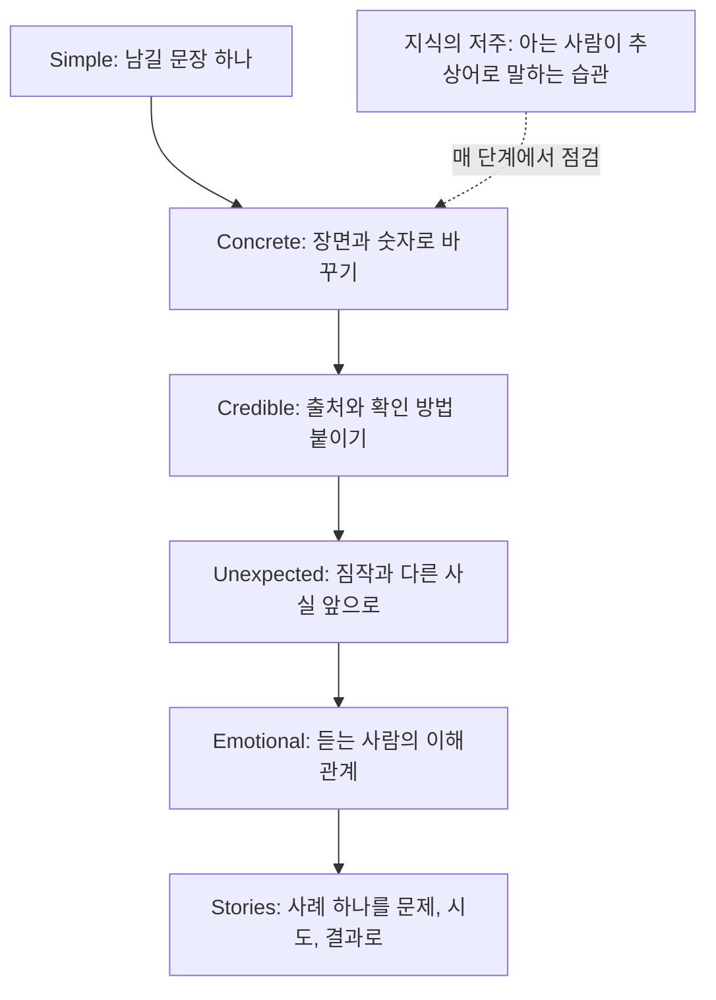

구조와 순서가 맞아도 장 하나하나가 추상적인 문장으로 채워져 있으면 발표가 끝난 뒤 남는 것이 없다. SUCCESs는 덱 전체의 구조가 아니라 각 장, 각 문장의 내용을 다듬을 때 쓰는 기준이다.

## 무엇인가

Chip Heath와 Dan Heath가 『Made to Stick』에서 오래 기억되고 퍼지는 아이디어의 공통점을 여섯 가지로 정리했다. 머리글자를 모으면 SUCCESs가 된다(마지막 s는 단어를 맞추려고 붙인 것이다).

| 조건 | 뜻 | 덱과 문서에서 |
| --- | --- | --- |
| Simple | 핵심 하나를 골라 짧게 말한다 | 한 장에 메시지 하나, 우선순위가 드러나는 문장 |
| Unexpected | 예상을 깨서 주의를 끌고, 궁금증의 빈칸을 만든다 | 듣는 사람의 짐작과 다른 사실을 먼저 보여 준다 |
| Concrete | 머릿속에 그려지는 장면과 숫자로 말한다 | "효율 저하" 대신 실제로 일어난 일 |
| Credible | 믿을 근거를 준다 | 출처, 검증할 수 있는 숫자, 시범 결과 |
| Emotional | 듣는 사람이 신경 쓰게 만든다 | 듣는 사람의 이해관계, 한 사람의 사례 |
| Stories | 이야기로 따라 해 볼 수 있게 한다 | 실제 사례의 전개, 문제를 푼 과정 |

책은 이 조건들을 막는 공통의 적으로 지식의 저주(curse of knowledge)를 든다. 이미 아는 사람은 모르는 사람의 상태를 떠올리지 못해 추상적인 말로 설명하게 된다. 책 소개는 고정관념(스키마)을 깨는 법, 궁금증의 빈칸(curiosity gap), 많은 사람보다 한 사람의 이야기에 마음이 움직이는 현상(Mother Teresa Effect)을 주요 장치로 소개한다.

## 왜 효과가 있나

- 단순하면 우선순위가 생긴다. 모든 것이 중요하다고 말하면 듣는 사람은 무엇을 기억할지 고르지 못한다.
- 예상 밖의 사실은 주의를 끈다. 짐작과 다른 정보는 "왜?"라는 질문을 만들어 다음 설명을 듣게 한다.
- 구체적인 장면은 기억에 걸릴 고리가 많다. 책은 기억을 여러 갈고리가 걸리는 벨크로에 빗댄다.
- 검증할 수 있는 근거는 반론을 줄인다. 듣는 사람이 직접 확인할 수 있으면 권위에 기대지 않아도 된다.
- 감정과 이해관계는 행동으로 이어진다. 듣는 사람은 숫자보다 자신과 사람에게 반응한다.
- 이야기는 머릿속 시뮬레이션이다. 듣는 사람이 비슷한 상황에서 어떻게 할지 미리 연습하게 한다.

## 쓰는 순서

여섯 조건을 한 번에 다 맞추려 하면 문장이 무거워진다. 아래 순서는 필자가 장표를 다듬을 때 쓰는 방법이다.

1. Simple: 이 장에서 남길 문장 하나를 적는다. 둘이면 장을 나눈다.
2. Concrete: 그 문장의 추상어(효율, 개선, 경험, 역량)를 찾아 실제 장면이나 숫자로 바꾼다.
3. Credible: 숫자마다 출처와 조건을 붙인다. 듣는 사람이 직접 확인할 방법이 있으면 적는다.
4. Unexpected: 듣는 사람이 이 주제에 대해 짐작하는 것을 적고, 그 짐작과 다른 사실이 있으면 앞으로 뺀다.
5. Emotional: 듣는 사람이 이 내용으로 무엇을 얻거나 잃는지 한 문장으로 쓴다.
6. Stories: 덱 전체에서 사례 하나를 골라 문제, 시도, 결과 순서로 쓴다.

## 예시

### 조건별 고쳐 쓰기

| 조건 | BEFORE | AFTER |
| --- | --- | --- |
| Simple | 고객 경험 전반을 개선하기 위해 응대, 배송, 앱, 가격 정책을 종합적으로 검토한다 | 첫 주문 고객이 두 번째 주문을 하게 만드는 것 하나에 집중한다 |
| Unexpected | 3분기 고객 이탈률이 5%에서 3%로 개선됐다 | 이탈률은 3%로 떨어졌지만 월 구독자만 보면 4.8%로 그대로다. 줄어든 것은 이탈이 아니라 계산에 들어간 고객이다 |
| Concrete | 신입 교육의 현업 적용도가 낮다 | 교육을 마친 신입 12명 중 9명이 첫 주에 견적서 양식을 다시 물어봤다 |
| Credible | 업계 최고 수준의 만족도를 얻었다 | 시범 운영한 두 팀 34명 중 29명이 계속 쓰겠다고 답했다. 설문 원문은 부록 2에 있다 |
| Emotional | 전사 생산성이 향상된다 | 매주 금요일 오후 두 시간씩 하던 주간 보고 취합이 없어진다 |
| Stories | 고객 응대 원칙 10가지 | 환불을 거절당한 고객이 다음 날 다시 전화했을 때 한 상담원이 한 일, 그 고객이 1년 뒤에도 남아 있는 이유 |

### 교육 프로그램 개편 제안의 첫 문단

BEFORE

```text
변화하는 업무 환경에 대응하고 구성원의 역량을 강화하기 위해 신입 교육
프로그램을 전면 개편하고자 한다. 이를 통해 현업 적용도를 높이고 조직
경쟁력을 제고할 수 있을 것으로 기대된다.
```

추상어(변화하는 업무 환경, 역량 강화, 현업 적용도, 조직 경쟁력)만 있고 장면, 숫자, 놀라움, 이해관계가 없다.

AFTER

```text
지난 기수 신입 12명 중 9명이 현업 첫 주에 견적서 양식을 다시 물어봤다.
4주 집합 교육 중 견적서 작성 실습은 40분이었다. 4주 중 1주를 현업
선배와 함께 실제 견적서를 쓰는 실습으로 바꾸면, 팀장들이 첫 달에
신입을 다시 가르치는 시간이 줄어든다.
```

| 조건 | AFTER에서 맡은 부분 |
| --- | --- |
| Simple | 1주를 실습으로 바꾼다는 제안 하나 |
| Unexpected | 4주를 교육받고도 가장 기본 양식을 다시 묻는다 |
| Concrete | 12명 중 9명, 견적서 양식, 40분 |
| Credible | 지난 기수 실제 기록 |
| Emotional | 팀장이 신입을 다시 가르치는 시간이 준다 |
| Stories | 신입이 첫 주에 겪는 장면 |

## 다이어그램



## 흔한 실수

- 여섯 조건을 한 장에 다 넣는다. 놀라운 사실, 숫자, 인용, 감정 호소, 사례가 한 장에 몰리면 Simple이 깨진다.
- 의외성을 꾸민다. 놀라게 하려고 숫자를 과장하거나 맥락을 빼면 Credible을 잃는다.
- 구체적인 숫자를 너무 많이 쓴다. 숫자 열 개는 하나도 기억나지 않는다. 결론을 받치는 숫자 한두 개만 남긴다.
- 감정을 듣는 사람이 아니라 발표자 기준으로 쓴다. "우리 팀이 고생했다"는 듣는 사람의 이해관계가 아니다.
- 이야기가 결론과 관계없다. 재미있는 사례라도 장의 메시지를 받치지 않으면 뺀다.
- 권위만 내세운다. "글로벌 컨설팅사도 권장한다"보다 듣는 사람이 확인할 수 있는 결과가 더 믿을 만하다.

## 점검 목록

- [ ] 장마다 남길 문장이 하나다.
- [ ] 효율, 개선, 경험, 역량 같은 추상어가 장면이나 숫자로 바뀌었다.
- [ ] 숫자마다 출처, 기간, 조건이 있다.
- [ ] 듣는 사람의 짐작과 다른 사실이 있으면 앞쪽에 있다.
- [ ] 듣는 사람이 무엇을 얻거나 잃는지 한 문장으로 말할 수 있다.
- [ ] 덱 전체에 결론을 받치는 실제 사례가 하나 이상 있다.

## 출처

- Chip Heath, Dan Heath, 『Made to Stick』
- [Made to Stick, Heath Brothers](https://heathbrothers.com/books/made-to-stick/)
- [Made To Stick Model, Heath Brothers](https://heathbrothers.com/member-content/made-to-stick-model/)

[이전: 05. ABT](../05-abt/), [시리즈 목차](../), [다음: 07. tell-tell-tell과 구조 고르기](../07-tell-tell-tell-and-choosing/)
