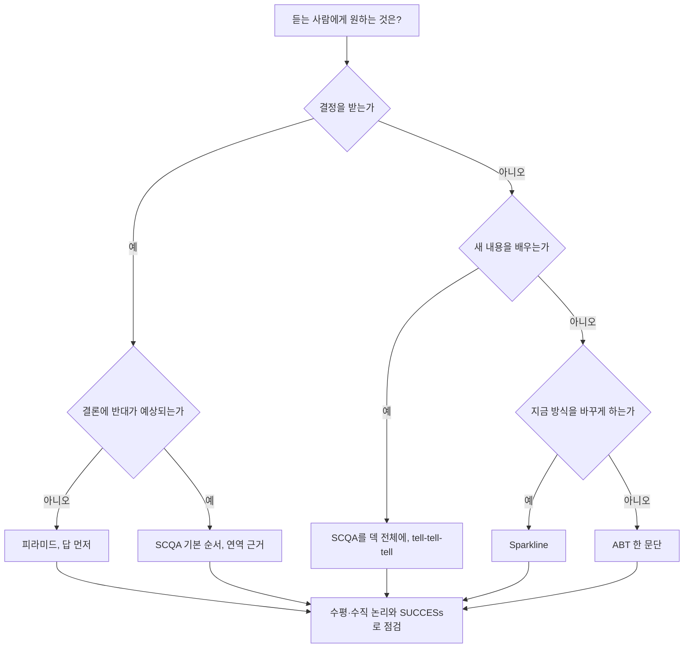
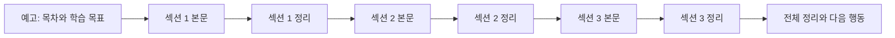

글은 독자가 앞으로 돌아가 다시 읽을 수 있지만, 발표와 교육은 듣는 사람이 지나간 장을 다시 볼 수 없다. 처음 듣는 내용이 많을수록 듣는 사람은 지금 어디쯤인지 알아야 따라온다. 이 글은 그 길잡이 구조인 tell-tell-tell을 정리하고, 앞의 원칙들을 상황에 따라 고르는 기준과 실제 덱을 다시 배치하는 예를 다룬다.

## 무엇인가

"무엇을 말할지 말하고, 말하고, 무엇을 말했는지 말하라"는 세 단계 구조다.

| 단계 | 하는 일 | 덱에서 |
| --- | --- | --- |
| 예고(preview) | 무엇을 다룰지, 끝나면 무엇을 할 수 있는지 알린다 | 목차, 학습 목표 |
| 본문(content) | 예고한 순서대로 말한다 | 섹션 구분 장과 본문 |
| 정리(recap) | 말한 것을 다시 묶는다 | 섹션 끝 요약 장, 전체 정리 장 |

흔히 Aristotle이나 Dale Carnegie의 말로 알려져 있지만, Quote Investigator의 조사에 따르면 확인된 가장 이른 기록은 1908년 영국 신문에 실린 설교 준비법이다. 한 노련한 평신도 설교자가 설교를 세 부분으로 나눈다고 말한 것을 J. H. Jowett가 전했다. Aristotle은 『수사학』에서 연설의 마지막 부분에 논증을 요약하라고 했지만 이 세 단계 공식을 쓰지는 않았다.

## 왜 효과가 있나

- 예고는 듣는 사람에게 지도를 준다. 지금 듣는 내용이 전체의 어디에 붙는지 알면 세부를 놓쳐도 흐름은 따라온다.
- 정리는 기억을 되살린다. 섹션이 끝날 때마다 핵심을 다시 들으면 앞 내용을 잊고 다음 섹션으로 넘어가는 일이 준다.
- 말로 하는 전달은 되감기가 없다. 글에서는 지나친 반복이 발표에서는 필요한 확인이 된다.

위 세 가지는 필자의 해석이다. 교육과 설교에서 오래 쓰인 이유도 같은 데 있다고 본다.

## 쓰는 순서

1. 덱의 섹션을 3~5개로 정한다. 섹션 이름은 피라미드의 근거나 SCQA 단계와 맞춘다.
2. 첫머리에 목차 장을 둔다. 섹션 이름과 교육이 끝난 뒤 할 수 있는 일을 쓴다.
3. 섹션마다 시작 장에 목차를 다시 보여 주고 현재 섹션을 강조한다.
4. 섹션 끝에 그 섹션의 결론을 한 장으로 정리한다. 새 정보는 넣지 않는다.
5. 마지막에 전체 정리 장을 둔다. 섹션별 결론을 다시 묶고, 다음 행동을 적는다.
6. 예고와 정리의 문장이 본문 제목과 같은 말을 쓰는지 확인한다. 다른 말로 바꾸면 듣는 사람은 다른 내용으로 듣는다.

## 예시

### 교육 첫 2분

BEFORE

```text
오늘 교육 시작한다. 먼저 회사 연혁부터 보자.
```

AFTER

```text
오늘 90분 동안 세 가지를 한다. 고객이 지금 구매를 망설이는 이유 세 가지를 보고,
신제품이 그 이유를 어떻게 없애는지 보고, 상담에서 실제로 어떻게 말하는지
연습한다. 끝나면 거절 사유 세 가지에 각각 한 문장으로 답할 수 있게 된다.
```

### 섹션 끝 정리 장

BEFORE: 정리 장 없이 다음 섹션으로 넘어간다.

AFTER

```text
제목: 고객이 망설이는 이유는 필터 비용, 설치 공간, 위생 걱정 세 가지다
본문: 거절 사유 3개와 각각의 상담 기록 비율 한 줄씩
```

## 상황별 구조 고르기

앞의 원칙들은 같이 쓰인다. 아래 표는 주 구조와 함께 쓰는 원칙을 상황별로 정리한 것이며, 선택 기준은 필자의 판단이다.

| 상황 | 주 구조 | 함께 쓰는 원칙 | 이유 |
| --- | --- | --- | --- |
| 경영진 보고, 의사결정 요청 | 피라미드(답 먼저), 첫 장은 SCQA 한 장 요약 | 수평·수직 논리 | 시간이 짧고 판단이 목적이다 |
| 상황을 이미 아는 상사에게 짧은 보고 | SCQA 답 먼저 순서 | ABT | 배경 설명이 필요 없다 |
| 결론에 반대가 예상되는 자리 | SCQA 기본 순서, 근거는 연역 순서 | SUCCESs의 Credible | 동의할 사실부터 쌓아야 한다 |
| 처음 배우는 사람 대상 교육, 세미나 | SCQA를 덱 전체에 펼침 | tell-tell-tell | 문제를 먼저 겪어 봐야 답을 받아들인다 |
| 새 방식 도입 제안, 비전 발표 | Sparkline | SUCCESs | 지금 방식을 떠날 이유를 느껴야 움직인다 |
| 메일 첫 문단, 장표 리드, 한 줄 요약 | ABT | 피라미드 | 한 문단에 맥락, 문제, 행동을 담는다 |
| 모든 덱의 마무리 점검 | 수평·수직 논리 | SUCCESs | 순서와 장별 내용을 검증한다 |



## 적용 예시: 30장짜리 신제품 교육 덱 재구성

가정용 정수기 신모델을 영업 담당자 40명에게 교육하는 30장짜리 덱이 있다고 하자. 내용과 수치는 설명을 위해 만든 것이다.

### BEFORE: 만든 사람이 아는 순서

| 순서 | 장 수 | 내용 | 문제 |
| --- | --- | --- | --- |
| 표지 | 1 | 제목 | |
| 1. 회사와 제품 라인업 | 6 | 연혁, 공장, 기존 모델 | 왜 들어야 하는지 모르는 채 6장을 본다 |
| 2. 기술 사양 | 12 | 필터 구조, 유량, 인증, 크기 | 사양이 고객의 어떤 질문에 답하는지 연결되지 않는다 |
| 3. 가격 정책 | 5 | 출고가, 렌탈 요금, 할인 | 앞의 사양과 따로 논다 |
| 4. 경쟁 제품 비교 | 4 | 경쟁 3사 사양표 | 상담에서 쓰려면 사양 섹션을 다시 떠올려야 한다 |
| 5. 판매 목표 | 2 | 분기 목표 | 마지막에 나온다 |

장 제목만 이어 읽으면 "회사 소개, 필터 구조, 유량, 인증, 렌탈 요금, 경쟁사 비교, 목표"가 된다. 수평 논리가 없다.

### 구조 고르기

듣는 사람은 신제품을 처음 보는 영업 담당자이고, 교육의 목표는 상담에서 고객의 거절에 답하게 만드는 것이다. 결정을 받는 자리가 아니라 새 내용을 배우는 자리이므로 SCQA를 덱 전체에 펼치고 tell-tell-tell로 길잡이를 단다. 섹션 리드는 ABT로 쓴다.

### AFTER: 듣는 사람이 궁금해하는 순서

| 순서 | 장 수 | SCQA | 들어간 장 |
| --- | --- | --- | --- |
| 0. 오늘 다룰 것 | 1 | 예고 | 세 섹션과 교육 후 할 수 있게 되는 일 |
| 1. 고객이 망설이는 이유 | 5 | S, C | 기존 모델 상담 기록의 거절 사유 상위 3개(필터 교체 비용, 설치 공간, 위생 걱정), 경쟁 제품으로 간 사례 하나, 섹션 정리 |
| 2. 신제품이 답하는 방식 | 9 | Q, A | 거절 사유마다 해당 사양 1~2개만, 사양은 고객의 말로 바꿔 씀, 섹션 정리 |
| 3. 상담에서 쓰는 법 | 8 | A | 가격 질문과 경쟁 제품 질문에 답하는 대본, 경쟁 비교는 질문별로 다시 나눔, 역할극 |
| 4. 정리와 목표 | 2 | 정리 | 거절 사유 3개와 답을 한 장에, 분기 판매 목표 |
| 부록 | 5 | 근거 | 전체 사양표, 인증서, 회사 연혁과 라인업 |

장 수는 30장 그대로다. 줄인 것은 장이 아니라 듣는 사람이 앞 내용을 기억해 다시 꺼내야 하는 횟수다.

### 제목 몇 장의 BEFORE와 AFTER

| BEFORE 제목 | AFTER 제목 |
| --- | --- |
| 필터 구조 | 필터가 하나로 합쳐져 교체 비용이 연 4만 원 준다 |
| 제품 크기 | 폭이 18cm라 기존 모델이 안 들어가던 싱크대 옆에 들어간다 |
| 살균 기능 | 매일 새벽 자동 살균 기록을 앱으로 보여 줘 위생 걱정에 답한다 |
| 경쟁 제품 비교 | 경쟁 제품이 싸다는 질문에는 3년 총비용으로 답한다 |

### 바꾸면서 함께 고친 것

- 장을 옮기자 발표자 노트에 있던 "앞 장의 수치와 같다", "7번 장 참고" 같은 참조가 틀어졌다. 참조를 장 번호가 아니라 장 제목으로 쓰면 순서를 바꿀 때 고칠 곳이 준다.
- 회사 연혁과 라인업을 부록으로 보내자 첫 장에서 바로 고객의 문제로 들어갈 수 있었다. 정말 필요한 정보는 섹션 3의 경쟁 비교에서 한 줄로 다시 꺼낸다.
- 전체 그림을 세부보다 앞에 둔다. 섹션 2를 시작할 때 제품 전체 구성을 한 장으로 먼저 보여 주고 필터, 크기, 살균으로 확대해 들어가야 세부가 어디에 붙는지 안다.
- 고스트 덱으로 순서를 먼저 확인했다. 30장 제목만 적은 문서를 영업팀장에게 보여 주고 순서에 동의를 받은 뒤 본문을 고쳤다.

## 다이어그램



## 흔한 실수

- 목차와 실제 섹션 이름이 다르다. 목차에는 "제품 이해", 섹션 제목에는 "기술 사양"이라고 쓰면 듣는 사람이 같은 것인지 헷갈린다.
- 정리 장에 새 정보를 넣는다. 정리는 다시 묶는 자리이고, 새 내용은 본문에 넣는다.
- 짧은 보고에도 예고와 정리를 넣는다. 5분 보고에 목차와 정리 장을 넣으면 같은 말을 세 번 듣게 된다.
- 예고가 주제만 말한다. "제품 소개, 가격, 경쟁사"보다 "끝나면 거절 사유 세 가지에 답할 수 있다"가 듣는 이유를 준다.
- 구조를 하나만 고집한다. 경영진 보고에 Sparkline을 쓰거나 교육에 답 먼저 피라미드만 쓰면 듣는 사람의 상태와 맞지 않는다.

## 점검 목록

- [ ] 듣는 사람이 결정을 내리는지, 배우는지, 바꾸는지 정했고 그에 맞는 주 구조를 골랐다.
- [ ] 목차의 섹션 이름과 본문 섹션 제목이 같은 말이다.
- [ ] 섹션마다 끝에 정리 장이 있고 새 정보가 없다.
- [ ] 첫 장이 듣는 사람의 문제나 학습 목표로 시작한다.
- [ ] 발표자 노트의 상호 참조가 장 번호가 아니라 장 제목으로 되어 있다.
- [ ] 제목만 이어 읽어 수평 논리를 확인했다.

## 출처

- [Quote Origin: Tell 'Em What You're Going To Tell 'Em, Quote Investigator](https://quoteinvestigator.com/2017/08/15/tell-em/)
- Barbara Minto, 『The Pyramid Principle』
- Nancy Duarte, 『Resonate』
- Randy Olson, 『Houston, We Have a Narrative』
- [Ghost deck: how consultants write the presentation before the analysis, StrategyU](https://strategyu.co/ghost-deck/)

[이전: 06. SUCCESs](../06-made-to-stick-success/), [시리즈 목차](../)
