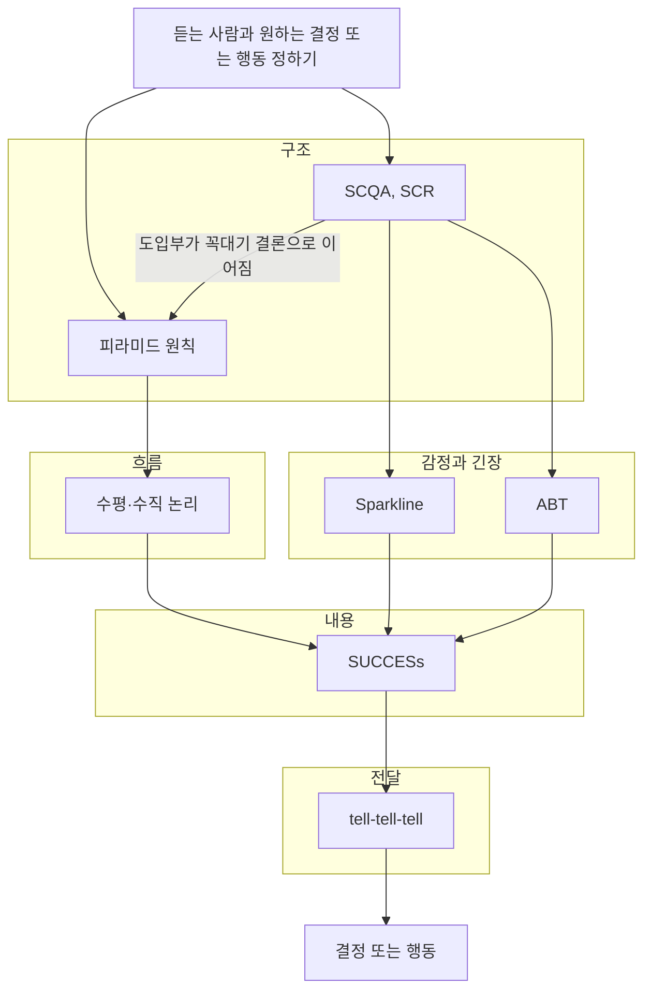

장표 하나하나가 맞아도 순서가 틀리면 듣는 사람은 결론에 도착하지 못한다. 컨설팅 회사와 발표 전문가들이 정리한 스토리 구조는 모두 "듣는 사람이 다음에 무엇을 궁금해할까"에 답하는 순서를 만든다. 이 시리즈는 원칙마다 쓰는 순서, 고쳐 쓰기 전후 예시, 흔한 실수, 점검 목록을 따로 정리한다. 마지막 글은 상황별로 구조를 고르는 기준과 30장짜리 신제품 교육 덱을 다시 배치하는 과정을 다룬다.

## 원칙 한눈에 보기

| 원칙 | 한 줄 요약 | 언제 쓰나 | 문서 |
| --- | --- | --- | --- |
| 피라미드 원칙 | 결론 하나를 맨 위에 두고 겹치지 않는 근거로 받친다 | 보고, 의사결정 요청, 업무 메일 | [01. 피라미드 원칙](/docs/business/consulting-storytelling/01-pyramid-principle/) |
| SCQA, SCR | 이견 없는 상황에서 출발해 문제와 질문을 거쳐 답에 닿는다 | 보고서 도입부, 회의 시작, 제안서 첫 장 | [02. SCQA와 SCR](/docs/business/consulting-storytelling/02-scqa-scr/) |
| 수평·수직 논리 | 제목만 이어 읽어도 이야기가 되고, 각 장은 제목을 증명한다 | 덱을 만들기 전 설계와 만든 뒤 점검 | [03. 수평·수직 논리](/docs/business/consulting-storytelling/03-horizontal-vertical-logic/) |
| Sparkline | 지금의 현실과 가능한 미래를 오가며 바꿀 이유를 키운다 | 변화 제안, 비전 발표, 키노트 | [04. Sparkline](/docs/business/consulting-storytelling/04-sparkline/) |
| ABT | And, But, Therefore 한 문장으로 맥락, 문제, 행동을 묶는다 | 메일 첫 문단, 장표 리드, 한 줄 요약 | [05. ABT](/docs/business/consulting-storytelling/05-abt/) |
| SUCCESs | 단순, 의외성, 구체성, 신뢰성, 감정, 이야기로 기억에 남긴다 | 장 하나하나의 내용 다듬기 | [06. SUCCESs](/docs/business/consulting-storytelling/06-made-to-stick-success/) |
| tell-tell-tell | 말할 것을 예고하고, 말하고, 말한 것을 정리한다 | 교육, 긴 세미나, 처음 듣는 내용이 많은 자리 | [07. tell-tell-tell과 구조 고르기](/docs/business/consulting-storytelling/07-tell-tell-tell-and-choosing/) |

## 원칙끼리 맞물리는 방식

원칙들은 서로 대체하지 않고 맡는 층이 다르다. 아래 그림은 이 시리즈에서 쓰는 구분이며, 원저자들이 이렇게 나눈 것은 아니고 필자가 정리한 것이다.

구조는 무엇을 어떤 위계로 말할지 정하고, 흐름은 그 위계를 장 순서와 제목으로 옮긴다. 감정과 긴장은 듣는 사람이 답을 기다리게 만들고, 내용은 각 장이 기억에 남게 다듬으며, 전달은 듣는 사람이 길을 잃지 않게 한다.

## 문서 목록


