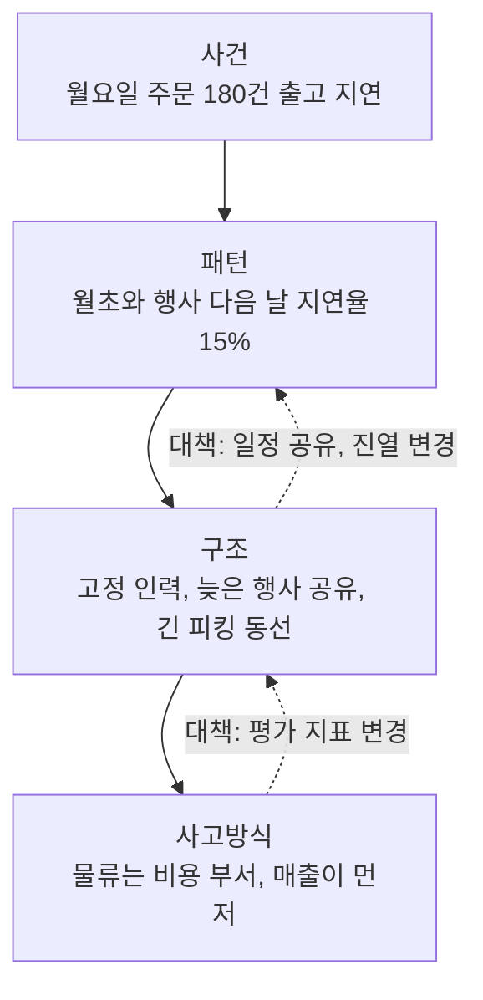
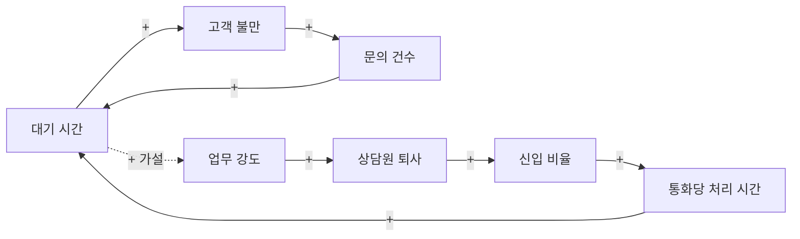
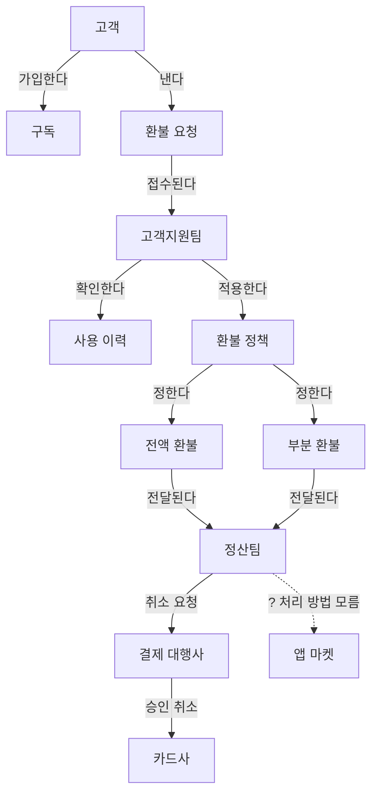
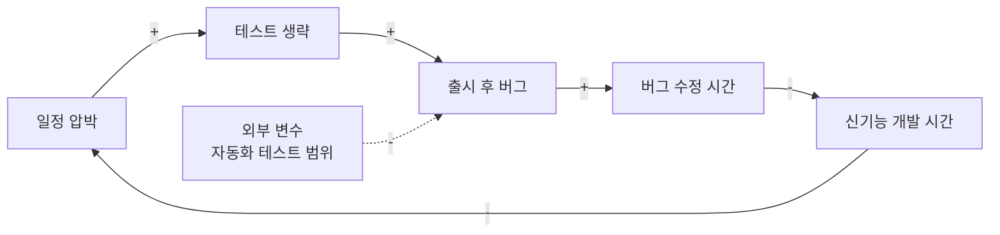
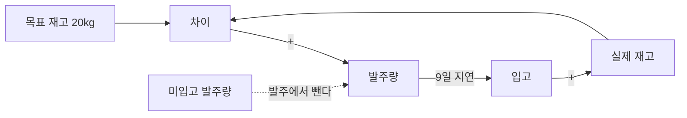

문제 하나를 고쳤는데 비슷한 문제가 한 달 뒤 다른 곳에서 다시 터지는 일이 있다. 시스템 사고 도구는 눈앞의 사건보다 그 사건을 반복해서 만들어 내는 요소 사이의 관계와 순환을 본다. 대책을 넣었는데 엉뚱한 곳이 나빠지거나 같은 문제가 계속 돌아올 때 꺼내 쓴다. 예시에 나오는 회사와 숫자는 모두 설명을 위해 지어낸 것이다.

| 도구 | 보는 것 | 결과물 | 그림 |
| --- | --- | --- | --- |
| Iceberg Model(빙산 모델) | 사건 아래의 패턴, 구조, 사고방식 | 네 층으로 정리한 원인 | 층 구조 흐름도 |
| Connection circles(연결 원) | 요소 사이 증감 관계와 닫힌 고리 | 인과 화살표가 그려진 원 | 인과 흐름도 |
| Concept map(개념 지도) | 개념을 이루는 개체와 관계 | 문장으로 읽히는 관계도 | 관계 흐름도 |
| Reinforcing feedback loop(강화 피드백 루프) | 서로를 키우는 변수 | 증폭 고리와 끊을 지점 | 순환 흐름도 |
| Balancing feedback loop(균형 피드백 루프) | 목표와 실제의 차이를 줄이는 동작 | 숨은 목표와 교정 행동 | 순환 흐름도 |

## Iceberg Model(빙산 모델) {#iceberg-model}

사람들이 알아채는 사건은 빙산의 물 위 부분이다. 그 아래에는 시간에 걸쳐 반복되는 패턴, 패턴을 만드는 구조, 구조를 떠받치는 사고방식이 있다. 사건과 패턴은 무슨 일이 일어나는지를, 구조와 사고방식은 왜 일어나는지를 알려 준다. 아래층에서 손을 쓸수록 같은 노력으로 더 큰 변화를 만든다.

### 쓰는 법

1. 사건: 지금 무슨 일이 일어났는지 적는다.
2. 패턴: 언제부터, 얼마나 자주 반복됐는지, 추세가 있는지 적는다.
3. 구조: 패턴을 만드는 규칙, 절차, 조직, 의존 관계를 찾는다.
4. 사고방식: 구조를 그대로 두게 만드는 가치관과 가정을 찾는다.
5. 대책마다 어느 층에 거는 것인지 표시한다.

### 쓸 때와 한계

- 회고나 반복 이슈 리뷰처럼 "또 이거냐"는 말이 나올 때 맞다.
- 아래로 갈수록 근거가 줄고 추측이 늘어난다. 사고방식 층은 회의록, 인터뷰, 의사결정 기록처럼 확인 가능한 자료로 뒷받침한다.
- 사고방식을 다루다 보면 특정인 탓으로 흐르기 쉽다. 사람이 아니라 그 생각을 유지시키는 조건을 적는다.

### 예시: 반복되는 배송 지연

온라인 생활용품 쇼핑몰에서 "주문한 지 닷새가 지났는데 아직 안 왔다"는 문의가 하루 40건 넘게 들어왔다.

**1단계. 사건.** 이번 주 월요일 주문 1,200건 중 180건이 약속한 2일 안에 출고되지 못했다.

**2단계. 패턴.** 지난 6개월 출고 기록을 보니 지연은 매달 첫째 주 월요일과 행사 다음 날에 몰렸다. 평소 지연율은 3% 안팎이고 이런 날은 15%까지 올랐다.

**3단계. 구조.**

| 구조 요소 | 확인한 내용 |
| --- | --- |
| 인력 배치 | 창고 인원을 요일과 상관없이 고정으로 배치한다 |
| 행사 일정 | 마케팅팀이 행사 일정을 창고에 사흘 전에야 알린다 |
| 재고 위치 | 행사 상품을 평소 위치에 그대로 둬 피킹 동선이 길어진다 |
| 평가 지표 | 창고는 인건비, 마케팅은 행사 매출로만 평가받는다 |

**4단계. 사고방식.** 회의록에 "물류는 비용 부서라 인원은 최소로 유지한다", "행사는 매출부터 잡고 물류는 맞춰 주면 된다"는 발언이 반복해 나왔다.

**5단계. 대책의 층 표시.**

| 대책 | 층 |
| --- | --- |
| 지연 고객에게 사과 쿠폰 발송 | 사건 |
| 월초와 행사 다음 날 단기 인력 추가 | 패턴 |
| 행사 일정을 2주 전에 창고와 공유하고 행사 상품 진열 위치를 바꾼다 | 구조 |
| 마케팅 행사 평가에 "약속한 날 출고율"을 함께 넣는다 | 사고방식 |

쿠폰은 당장 필요하지만 다음 달에도 같은 일이 생긴다. 구조와 사고방식 층 대책 두 개를 다음 분기 과제로 올렸다.

### 다이어그램

원문: [untools - Iceberg Model](https://untools.co/iceberg-model/)

## Connection circles(연결 원) {#connection-circles}

원 둘레에 시스템의 핵심 요소를 적고, 한 요소가 다른 요소를 늘리는지 줄이는지 화살표로 잇는 도구다. 그림을 다 그리면 출발점으로 돌아오는 닫힌 고리가 보이고, 이 고리가 피드백 루프다.

### 쓰는 법

1. 종이에 큰 원을 그린다.
2. 늘거나 줄어드는 양을 가진 핵심 요소를 명사로 골라 원 둘레에 적는다. 10개를 넘기지 않는다.
3. 한 요소가 다른 요소를 직접 늘리거나 줄이면 화살표를 긋고, 결과 쪽이 늘면 `+`, 줄면 `-`를 붙인다.
4. 데이터로 확인한 관계와 가설인 관계를 구분한다.
5. 화살표를 따라가 출발점으로 돌아오는 고리를 찾는다.

### 쓸 때와 한계

- 상황을 이야기로 들었는데 무엇이 무엇을 부추기는지 정리가 안 될 때 쓴다.
- 요소가 많아지면 화살표가 엉켜 읽기 어렵다. 범위를 좁혀 원을 여러 개 그린다.
- 효과가 나타나기까지 걸리는 시간 지연은 그림에 드러나지 않는다. 지연이 큰 관계는 따로 메모한다.

### 예시: 고객센터 대기 시간이 계속 늘어난다

통신 판매 회사 고객센터의 평균 대기 시간이 3개월 사이 4분에서 11분으로 늘었다. 팀장은 상담원을 더 뽑자고 했지만 지난달 두 명을 뽑고도 나아지지 않았다.

**1단계. 원 그리기.** 화이트보드에 원을 하나 그렸다.

**2단계. 요소 고르기.** 문의 건수, 대기 시간, 고객 불만, 상담원 업무 강도, 상담원 퇴사, 신입 상담원 비율, 통화당 처리 시간. 일곱 개다.

**3단계. 관계 긋기.**

| 원인 | 결과 | 부호 | 근거 |
| --- | --- | --- | --- |
| 대기 시간 | 고객 불만 | + | 만족도 조사 |
| 고객 불만 | 문의 건수 | + | 재문의 비율 32% |
| 문의 건수 | 대기 시간 | + | 콜 로그 |
| 대기 시간 | 상담원 업무 강도 | + | 가설 |
| 상담원 업무 강도 | 상담원 퇴사 | + | 퇴사 면담 기록 |
| 상담원 퇴사 | 신입 상담원 비율 | + | 인사 기록 |
| 신입 상담원 비율 | 통화당 처리 시간 | + | 신입 평균 9분, 숙련자 5분 |
| 통화당 처리 시간 | 대기 시간 | + | 콜 로그 |

**4단계. 근거 구분.** 대기 시간이 업무 강도를 높인다는 관계만 가설이라 점선으로 표시하고, 상담원 설문으로 확인하기로 했다.

**5단계. 고리 찾기.** 고리가 두 개 나왔다. 대기 시간, 불만, 재문의가 서로를 키우는 고리와, 업무 강도, 퇴사, 신입 비율, 처리 시간이 대기 시간을 다시 키우는 고리다. 두 고리 모두 `-`가 없어 강화 고리다. 채용만 하면 신입 비율이 올라 두 번째 고리가 오히려 빨라진다. 재문의를 줄이는 첫 통화 해결률 개선과 신입 교육 기간 확보를 먼저 하기로 했다.

### 다이어그램

원문: [untools - Connection circles](https://untools.co/connection-circles/)

## Concept map(개념 지도) {#concept-map}

Joseph Novak과 Alberto Cañas가 만든 도구로, 개념을 이루는 개체를 늘어놓고 개체 사이를 동사구로 이어 머릿속 이해를 그림으로 꺼낸다. 혼자 정리할 때도 쓰지만 여럿이 그리면 같은 개념을 사람마다 다르게 이해하고 있다는 사실이 드러난다.

### 쓰는 법

1. 초점 질문을 정한다. "X는 어떻게 동작하나", "Y는 어떤 맥락에 놓여 있나" 같은 형태다.
2. 질문과 관련된 개체를 15~25개 정도 나열한다. 사람, 조직, 절차, 활동, 규칙이 모두 대상이다.
3. 가장 일반적인 개체부터 구체적인 개체 순으로 정렬한다.
4. 개체를 옮길 수 있는 메모로 배치하고, 선에 "~에 속한다", "~를 요청한다" 같은 동사구를 붙인다.
5. 두 개체를 이어 읽으면 뜻이 통하는 문장이 되도록 나머지를 채운다. 막히는 곳은 모르는 부분이므로 따로 적는다.

### 쓸 때와 한계

- 새 부서나 새 업무 영역에 와서 구조를 빨리 파악해야 할 때 쓴다.
- 해당 분야를 어느 정도 알아야 지도가 정확해진다. 처음 그린 지도는 틀린 곳이 많다는 전제로 고친다.
- 개체가 수십 개를 넘으면 그림이 읽히지 않는다. 초점 질문을 쪼갠다.

### 예시: 구독 서비스의 환불은 어떻게 처리되나

음악 구독 서비스 회사의 고객지원팀에 새로 온 사람이 환불 업무를 맡았다.

**1단계. 초점 질문.** "고객이 환불을 요청하면 돈이 돌아가기까지 무슨 일이 일어나나"로 정했다.

**2단계. 개체 나열.** 고객, 구독, 요금제, 결제 수단, 환불 요청, 고객지원팀, 환불 정책, 사용 이력, 전액 환불, 부분 환불, 정산팀, 결제 대행사, 카드사, 앱 마켓, 환불 완료 알림. 15개다.

**3단계. 정렬.** 일반적인 것에서 구체적인 것 순으로 놓았다. 고객, 구독, 환불 정책, 환불 요청, 고객지원팀, 사용 이력, 전액 환불과 부분 환불, 정산팀, 결제 대행사, 카드사와 앱 마켓, 환불 완료 알림 순이다.

**4단계. 배치와 연결.** "고객은 구독에 가입한다", "고객은 환불 요청을 낸다", "고객지원팀은 사용 이력으로 환불 정책을 적용한다", "환불 정책은 전액 환불과 부분 환불을 정한다", "정산팀은 결제 대행사에 취소를 요청한다"처럼 이었다.

**5단계. 빈칸 찾기.** 앱 마켓에서 결제한 고객 부분에서 선이 끊겼다. 앱 마켓 결제는 회사가 직접 취소할 수 없다는 사실을 몰랐던 것이다. "앱 마켓 결제 환불은 누가 어떻게 안내하나"를 정산팀에 묻는 첫 질문으로 정했다.

### 다이어그램

원문: [untools - Concept map](https://untools.co/concept-map/)

## Reinforcing feedback loop(강화 피드백 루프) {#reinforcing-feedback-loop}

한 바퀴의 출력이 다음 바퀴의 입력이 되고, 그 입력이 출력을 더 키우는 고리다. 변화가 직선이 아니라 지수 곡선을 그리며 커지거나 줄어든다. untools는 Donella Meadows의 『Thinking in Systems』를 주요 출처로 든다. 복리 이자처럼 좋은 쪽으로 도는 선순환도 있고, 나쁜 쪽으로 도는 악순환도 있다.

### 쓰는 법

1. 서로를 키우는 변수 두 개 이상을 찾는다.
2. 한 변수가 늘면 다른 변수도 늘어나는지, 그 결과가 처음 변수로 되돌아오는지 확인한다.
3. 고리 밖에서 고리의 속도를 정하는 외부 변수를 찾는다.
4. 선순환이면 외부 변수를 키우고, 악순환이면 고리를 끊거나 늦출 지점을 고른다.

### 쓸 때와 한계

- 지표가 갑자기 가파르게 치솟거나 무너지는 현상을 설명할 때 쓴다.
- 강화 루프는 현실에서 끝없이 돌지 않는다. 자원 한계 같은 균형 루프가 언젠가 막아서므로 둘을 함께 본다.
- 고리를 찾았다고 원인이 확정되지는 않는다. 각 연결을 지표로 확인한다.

### 예시: 쌓이는 기술 부채

모바일 앱 개발팀의 스프린트당 버그 수정 시간이 6개월 사이 전체 작업 시간의 15%에서 40%로 늘었다.

**1단계. 변수 찾기.** 일정 압박, 테스트 생략, 출시 후 버그, 버그 수정 시간, 신기능 개발 시간.

**2단계. 고리 확인.** 일정이 빠듯하면 테스트를 생략하고, 테스트를 생략하면 출시 후 버그가 늘고, 버그 수정에 시간을 뺏기면 신기능 개발 시간이 줄어 일정이 더 빠듯해진다. 스프린트 기록으로 보니 분기마다 버그 수정 비중이 앞 분기의 1.5배 가까이 됐다.

| 분기 | 버그 수정 비중 |
| --- | --- |
| 1분기 | 15% |
| 2분기 | 22% |
| 3분기 | 31% |
| 4분기 | 40% |

**3단계. 외부 변수.** 자동화 테스트 범위와 출시 주기가 고리의 속도를 정한다. 자동화 테스트가 넓으면 테스트를 생략해도 잡히는 버그가 늘고, 출시 주기가 짧을수록 고리가 빨리 돈다.

**4단계. 끊을 지점.** 다음 두 스프린트 동안 신기능 범위를 20% 줄이고 핵심 결제와 로그인 흐름에 자동화 테스트를 붙였다. 테스트 생략에서 출시 후 버그로 가는 연결을 약하게 만드는 선택이다.

### 다이어그램

원문: [untools - Reinforcing feedback loop](https://untools.co/reinforcing-feedback-loop/)

## Balancing feedback loop(균형 피드백 루프) {#balancing-feedback-loop}

목표 수준과 실제 수준의 차이를 감지하고, 그 차이를 줄이는 쪽으로 움직이는 고리다. 변화를 밀어내 시스템을 안정시킨다. 온도 조절기처럼 사람이 설계한 루프도 있고, 뜨거운 차가 실온까지 식는 것처럼 저절로 생기는 루프도 있다. 강화 루프와 마찬가지로 untools는 Donella Meadows의 책을 출처로 든다.

### 쓰는 법

1. 루프가 맞추려는 목표 수준을 찾는다. 문서에 없는 숨은 목표인 경우가 많다.
2. 지금 측정되는 실제 수준을 적는다.
3. 목표와 실제의 차이를 계산한다.
4. 차이를 줄이려고 일어나는 교정 행동과 그 지연을 적는다.
5. 지연이나 잘못 잡힌 목표 때문에 생기는 부작용이 없는지 본다.

### 쓸 때와 한계

- 개선 활동을 했는데 지표가 원래 수준으로 돌아올 때, 무엇이 끌어당기는지 찾는 데 쓴다.
- 교정 행동에 지연이 있으면 목표를 지나쳤다 돌아오기를 반복하며 출렁인다.
- 목표가 잘못 잡혀 있으면 시스템은 그 잘못된 목표에 정확히 맞춰 안정된다.

### 예시: 카페 원두 재고가 출렁인다

카페 한 곳을 운영하는 사장은 원두가 떨어졌다 남았다를 반복한다고 했다.

**1단계. 목표 수준.** 매장 창고에 원두 20kg을 유지하는 것이 목표다.

**2단계. 실제 수준.** 원두는 매주 10kg 정도 쓴다. 최근 6주 월요일 재고는 12kg, 2kg, 0kg, 8kg, 18kg, 20kg이었다.

**3단계. 차이.** 매주 월요일 직원이 "20kg에서 모자란 만큼" 발주한다. 1주 차 차이는 8kg, 2주 차는 18kg이었다.

**4단계. 교정 행동과 지연.** 발주한 원두는 로스터리에서 볶아 9일 뒤 수요일에 들어온다. 직원은 아직 안 들어온 발주를 계산에 넣지 않아 재고가 빌 때 발주를 겹쳐 넣었고, 그 물량이 연달아 들어온 4주 차 수요일 직후에는 재고가 25kg 안팎까지 올랐다.

| 주 | 월요일 재고 | 발주량 | 그 주 수요일 입고 |
| --- | --- | --- | --- |
| 1주 | 12kg | 8kg | 없음 |
| 2주 | 2kg | 18kg | 8kg |
| 3주 | 0kg | 20kg | 18kg |
| 4주 | 8kg | 12kg | 20kg |
| 5주 | 18kg | 2kg | 12kg |
| 6주 | 20kg | 0kg | 2kg |

**5단계. 부작용 점검.** 지연을 무시한 발주 규칙 때문에 루프가 출렁였다. 3주 차에는 원두가 떨어져 메뉴 일부를 내렸고, 남은 원두는 향이 빠져 폐기량이 늘었다. 발주량을 "목표 재고 - 현재 재고 - 아직 안 들어온 발주량"으로 바꿨다. 2주 차에 이 규칙을 썼다면 18kg이 아니라 10kg만 발주했을 것이다.

### 다이어그램

원문: [untools - Balancing feedback loop](https://untools.co/balancing-feedback-loop/)

## 출처

- [untools](https://untools.co/)
- [untools - Systems thinking](https://untools.co/systems-thinking/)
- [untools - Iceberg Model](https://untools.co/iceberg-model/)
- [untools - Connection circles](https://untools.co/connection-circles/)
- [untools - Concept map](https://untools.co/concept-map/)
- [untools - Reinforcing feedback loop](https://untools.co/reinforcing-feedback-loop/)
- [untools - Balancing feedback loop](https://untools.co/balancing-feedback-loop/)
