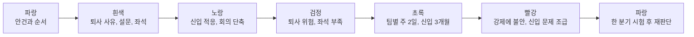
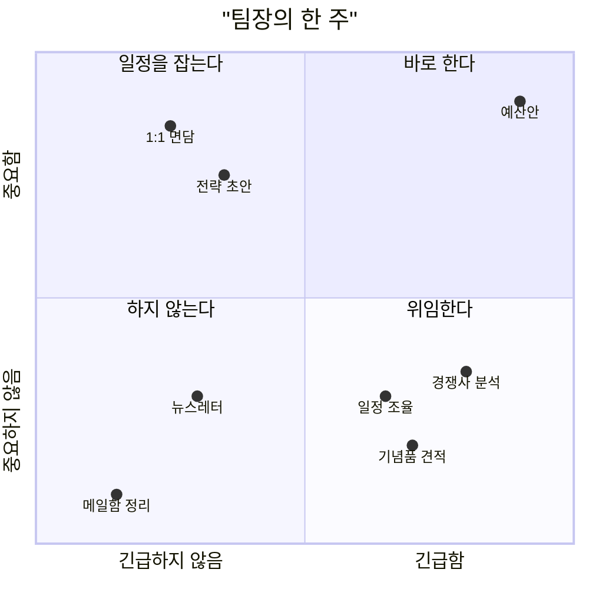
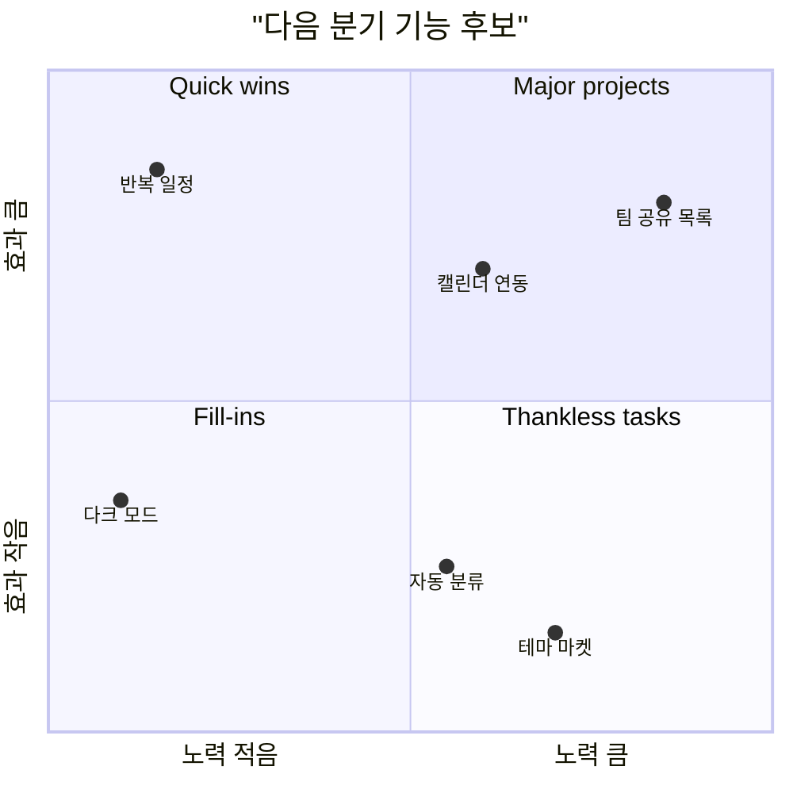
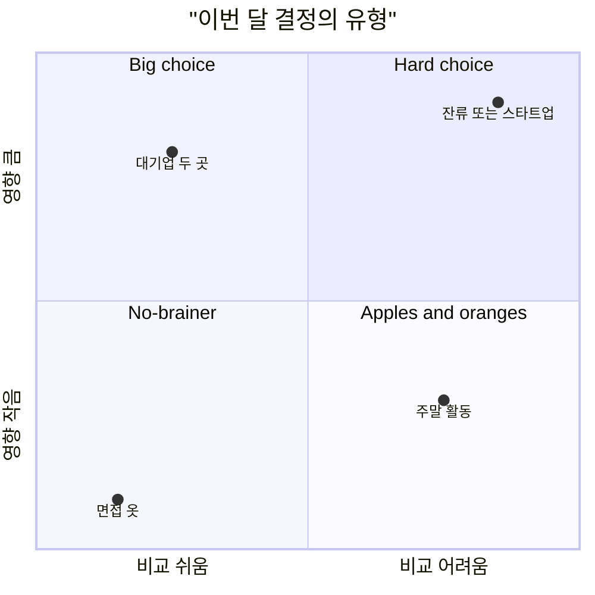
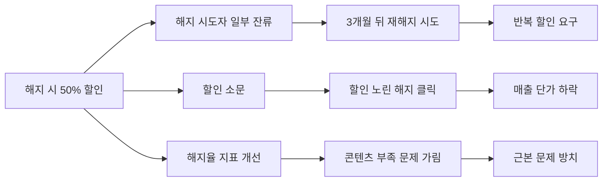
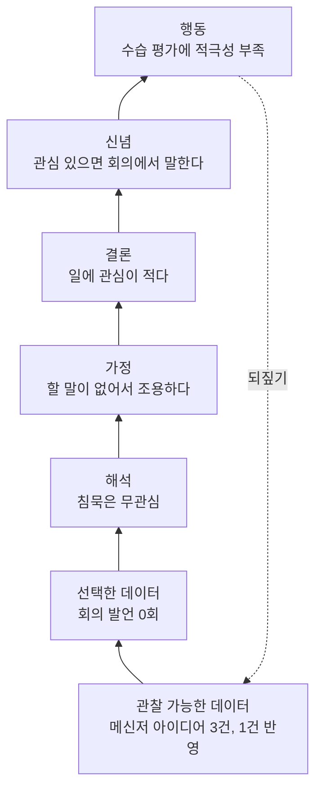
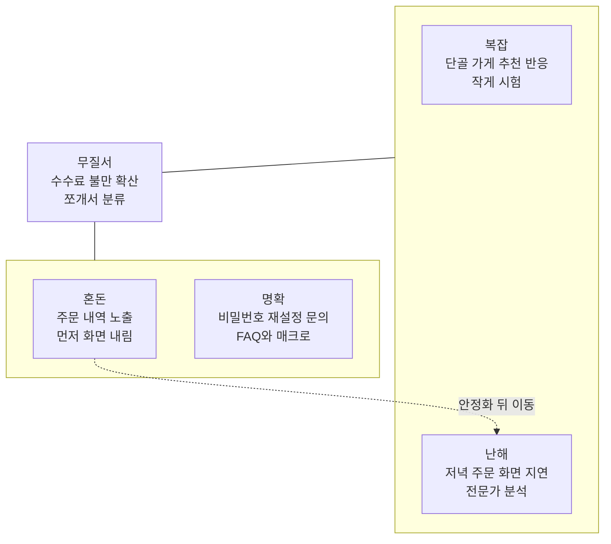
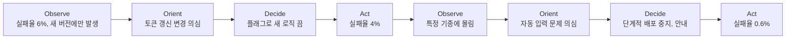
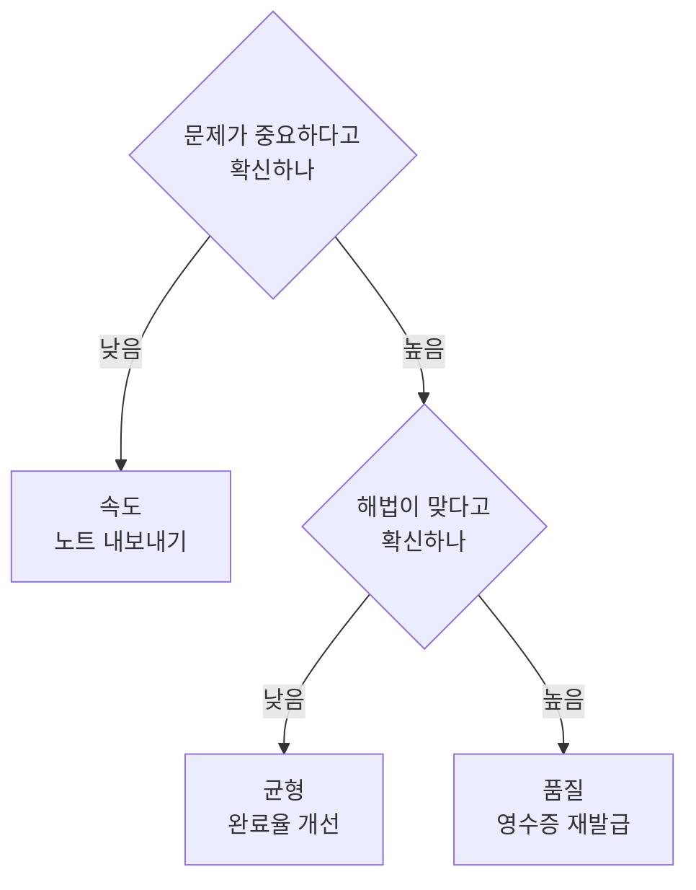

의사결정 도구는 무엇을 먼저 할지, 여러 안 중 무엇을 고를지, 내 결론이 근거 위에 서 있는지를 따질 때 쓴다. untools에서 가장 많은 도구가 이 범주에 있다. 우선순위를 정하는 도구, 선택지를 비교하는 도구, 생각의 빈틈을 점검하는 도구, 상황의 성격에 맞춰 대응 방식을 고르는 도구로 나눠 읽으면 편하다. 예시에 나오는 회사, 사람, 숫자는 모두 설명을 위해 지어낸 것이다.

| 도구 | 쓰임 | 입력 | 결과물 | 그림 |
| --- | --- | --- | --- | --- |
| Six Thinking Hats(여섯 색깔 모자) | 관점 나누기 | 결정할 안건 | 관점별 의견 | 진행 순서 흐름도 |
| Eisenhower Matrix(아이젠하워 매트릭스) | 우선순위 | 할 일 목록 | 할 일, 일정, 위임, 버림 | 사분면 차트 |
| Impact-Effort Matrix(효과-노력 매트릭스) | 우선순위 | 과제 목록 | 착수 순서 | 사분면 차트 |
| Decision matrix(의사결정 매트릭스) | 선택지 비교 | 선택지와 기준 | 가중 점수 | 점수표 |
| Hard choice model(어려운 선택 모델) | 결정 유형 판별 | 결정 여러 개 | 들일 시간과 접근법 | 사분면 차트 |
| Second-order thinking(2차 사고) | 장기 결과 점검 | 결정 하나 | 결과의 연쇄 | 결과 트리 |
| Ladder of inference(추론의 사다리) | 결론 점검 | 내린 결론 | 빠진 데이터와 가정 | 사다리 흐름도 |
| Cynefin framework(커네빈 프레임워크) | 상황 판단 | 상황 목록 | 영역과 대응 순서 | 영역 배치도 |
| OODA loop(OODA 루프) | 빠른 반복 결정 | 변하는 상황 | 관측, 판단, 결정, 실행의 반복 | 순환 흐름도 |
| Confidence determines speed vs. quality | 속도와 품질 배분 | 문제와 해법에 대한 확신 | 속도, 품질, 균형 중 선택 | 판단 흐름도 |

## Six Thinking Hats(여섯 색깔 모자) {#six-thinking-hats}

Edward de Bono가 만든 도구다. 결정 하나를 여섯 가지 관점으로 나눠 차례로 본다. 회의에서 위험만 말하는 사람과 기회만 말하는 사람이 부딪치는 대신, 모두가 같은 시간에 같은 색 모자를 쓰고 한 방향으로 생각한다.

| 모자 | 관점 | 던지는 질문 |
| --- | --- | --- |
| 흰색 | 데이터 | 확인된 사실과 숫자는 무엇인가 |
| 빨간색 | 감정과 직관 | 이 안에 대해 어떤 느낌이 드나 |
| 검은색 | 위험 | 무엇이 잘못될 수 있나 |
| 노란색 | 이점 | 무엇을 얻고 어떤 기회가 생기나 |
| 초록색 | 아이디어 | 다른 방법은 없나 |
| 파란색 | 진행 관리 | 지금 어떤 모자를 쓸 차례이고 언제 정리하나 |

### 쓰는 법

1. 파란 모자로 안건과 모자 순서, 시간을 정한다.
2. 흰 모자로 사실과 숫자를 모은다.
3. 노란 모자로 이점을 찾는다.
4. 검은 모자로 위험을 찾는다.
5. 초록 모자로 위험을 줄이거나 이점을 키우는 대안을 낸다.
6. 빨간 모자로 각자의 느낌을 짧게 말한다.
7. 파란 모자로 돌아와 결론과 다음 행동을 정리한다.

혼자 쓸 때는 모자를 차례로 바꿔 쓰며 메모한다. 그룹에서는 진행자가 파란 모자를 맡고 나머지는 모두 같은 모자를 함께 쓴다. 순서는 안건에 맞게 바꿔도 된다.

### 쓸 때와 한계

- 이해관계자가 많은 결정, 관점이 한쪽으로 쏠린 회의에 맞다.
- 형식만 돌리면 시간만 든다. 파란 모자가 시간을 끊고 결론을 정리해야 한다.
- 검은 모자를 늘 같은 사람에게 맡기면 그 사람이 반대론자로 굳는다. 모두가 같은 모자를 쓰는 방식이 낫다.

### 예시: 주 3일 출근제를 도입할지

직원 40명인 소프트웨어 회사가 전면 재택에서 주 3일 출근으로 바꿀지 논의했다. 팀장 다섯 명과 인사 담당이 모였다.

**1단계. 파란 모자.** 안건은 "다음 분기부터 주 3일 출근제를 도입할지"로 정했다. 모자당 10분, 전체 70분으로 잡았다.

**2단계. 흰 모자.**

- 최근 1년 퇴사자 6명 중 2명이 퇴사 면담에서 "동료와 교류 부족"을 이유로 들었다.
- 직원 설문에서 출근 확대에 찬성 35%, 반대 45%, 무관 20%가 나왔다.
- 사무실은 25석이라 40명이 같은 날 나오면 자리가 모자란다.
- 신입 8명의 첫 3개월 코드 리뷰 대기 시간이 경력 직원의 두 배였다.

**3단계. 노란 모자.**

- 신입이 옆자리에서 바로 질문할 수 있어 적응이 빨라진다.
- 기획 회의처럼 화이트보드가 필요한 논의가 짧아진다.

**4단계. 검은 모자.**

- 반대가 45%라 출근을 강제하면 추가 퇴사가 생길 수 있다.
- 25석으로는 주 3일 출근을 감당하지 못하고, 사무실을 넓히면 임대료가 늘어난다.
- 출근해서 하루 종일 화상회의만 하면 출근의 이점이 사라진다.

**5단계. 초록 모자.**

- 팀별 "같이 출근하는 날"을 주 2일로 정하고 나머지는 자율로 둔다.
- 신입은 첫 3개월만 주 3일 출근하고 멘토가 같은 날 나온다.
- 출근일에는 화상회의 대신 대면 회의를 우선 잡는다.

**6단계. 빨간 모자.** 두 팀장은 강제 출근에 불안을 말했고, 인사 담당은 신입 적응 문제를 더 미루면 안 된다는 조급함을 말했다. 팀별 출근일 안에는 모두 괜찮다는 느낌이었다.

**7단계. 파란 모자.** 전사 주 3일 출근은 보류하고, 팀별 주 2일 공통 출근일과 신입 3개월 출근을 한 분기 시험하기로 했다. 분기 말에 신입 리뷰 대기 시간과 설문 결과로 다시 판단한다.

### 다이어그램

원문: [untools - Six Thinking Hats](https://untools.co/six-thinking-hats/)

## Eisenhower Matrix(아이젠하워 매트릭스) {#eisenhower-matrix}

미국 대통령 Dwight D. Eisenhower의 이름을 딴 우선순위 도구다. 할 일을 중요도와 긴급도 두 축으로 나눠 네 칸에 넣고, 칸마다 처리 방식을 정한다. 하루 종일 바빴는데 남은 게 없다는 느낌이 들 때 쓴다.

| | 긴급함 | 긴급하지 않음 |
| --- | --- | --- |
| 중요함 | 바로 한다 | 일정을 잡아 한다 |
| 중요하지 않음 | 위임한다. 못 하면 뒤로 미룬다 | 하지 않는다 |

### 쓰는 법

1. 할 일을 모두 적는다.
2. 항목마다 긴급한지, 중요한지 판정한다. 긴급한 일은 마감이 있거나 바로 반응해야 하는 일이고, 중요한 일은 장기 목표나 프로젝트를 앞으로 미는 일이다.
3. 판정 결과대로 네 칸에 넣는다.
4. "중요하고 긴급함", "중요하지만 긴급하지 않음", "긴급하지만 중요하지 않음" 순으로 처리한다. 중요한 일이 긴급하기만 한 일보다 앞선다.

### 쓸 때와 한계

- 주간 계획을 세우거나 일이 몰린 날 아침에 쓴다.
- 긴급한 일은 중요해 보이는 착시를 만든다. "이걸 안 하면 한 달 뒤 무엇이 달라지나"로 중요도를 따로 묻는다.
- 위임할 사람이 없는 1인 역할이면 버릴 일을 더 적극적으로 찾아야 한다.

### 예시: 새로 팀장이 된 사람의 한 주

마케팅팀 팀장을 맡은 지 2주 된 사람이 월요일 아침 할 일을 정리했다.

**1단계. 할 일 목록.** 분기 예산안 제출(수요일 마감), 팀원 1:1 면담, 경쟁사 캠페인 분석, 행사 기념품 견적 비교, 사내 뉴스레터 원고, 전 팀장의 메일함 정리, 다음 분기 브랜드 전략 초안, 업체 미팅 일정 조율.

**2단계. 판정.**

| 할 일 | 긴급 | 중요 | 판단 근거 |
| --- | --- | --- | --- |
| 분기 예산안 제출 | 예 | 예 | 수요일 마감, 다음 분기 활동 전체가 걸림 |
| 팀원 1:1 면담 | 아니오 | 예 | 마감은 없지만 팀 운영의 기반 |
| 브랜드 전략 초안 | 아니오 | 예 | 다음 달 임원 보고 |
| 경쟁사 캠페인 분석 | 예 | 아니오 | 사업부장이 오늘 요청, 참고용 |
| 기념품 견적 비교 | 예 | 아니오 | 금요일 발주 |
| 업체 미팅 일정 조율 | 예 | 아니오 | 이번 주 안 |
| 사내 뉴스레터 원고 | 아니오 | 아니오 | 자원한 일 |
| 전 팀장 메일함 정리 | 아니오 | 아니오 | 필요할 때 검색하면 됨 |

**3단계. 배치.** 예산안은 바로 한다. 1:1 면담은 목요일 오후, 전략 초안은 금요일 오전으로 일정을 잡았다. 경쟁사 분석과 견적 비교, 일정 조율은 팀원 두 명에게 나눠 맡겼다. 뉴스레터는 다음 분기로 넘기겠다고 알리고 메일함 정리는 하지 않는다.

**4단계. 처리.** 월요일과 화요일은 예산안에 쓰고, 위임한 일은 목요일 아침에 결과만 확인했다.

### 다이어그램

원문: [untools - Eisenhower Matrix](https://untools.co/eisenhower-matrix/)

## Impact-Effort Matrix(효과-노력 매트릭스) {#impact-effort-matrix}

과제를 기대 효과와 드는 노력 두 축에 놓고 어디부터 손댈지 정하는 도구다. 할 일 목록이 길고 자원이 한정돼 있을 때 들인 노력 대비 돌아오는 것이 큰 일을 먼저 찾는다.

| | 노력 적음 | 노력 큼 |
| --- | --- | --- |
| 효과 큼 | Quick wins. 먼저 한다 | Major projects. 계획을 세워 진행한다 |
| 효과 작음 | Fill-ins. 틈날 때 한다 | Thankless tasks. 피하거나 줄인다 |

### 쓰는 법

1. 과제 후보를 나열한다.
2. 과제마다 효과를 추정한다. 어떤 지표가 얼마나 움직일지로 적는다.
3. 노력을 추정한다. 해 본 사람이나 외부 의견으로 낙관을 보정한다.
4. 네 칸에 배치한다.
5. Quick wins부터 착수 순서를 정한다.
6. 언제 다시 배치할지 정한다. 상황이 바뀌면 칸도 바뀐다.

### 쓸 때와 한계

- 개선 과제 백로그, 기능 후보, 업무 개선 아이디어의 순서를 정할 때 맞다.
- 효과와 노력 모두 낙관적으로 추정하기 쉽다.
- 과제 사이 의존 관계는 보이지 않는다. 큰 과제의 선행 작업이 따로 있는지 확인한다.

### 예시: 할 일 관리 앱의 다음 분기 기능

월간 사용자 20만 명인 할 일 관리 앱 팀이 다음 분기 기능 후보 여섯 개를 놓고 정했다. 개발 인력은 분기에 60인일이다.

**1단계. 후보.** 반복 일정, 캘린더 연동, 다크 모드, 팀 공유 목록, 할 일 자동 분류, 테마 마켓.

**2단계와 3단계. 효과와 노력.**

| 후보 | 기대 효과(가설) | 효과 | 노력 |
| --- | --- | --- | --- |
| 반복 일정 | 요청 1위, 7일 재방문율 +3%p | 큼 | 8인일 |
| 캘린더 연동 | 유료 전환 +1%p | 큼 | 35인일 |
| 다크 모드 | 요청 3위, 만족도 소폭 상승 | 작음 | 5인일 |
| 팀 공유 목록 | 새 고객층, 유료 전환 +2%p | 큼 | 50인일 |
| 자동 분류 | 효과 불확실 | 작음 | 30인일 |
| 테마 마켓 | 매출 미미 | 작음 | 40인일 |

캘린더 연동은 담당 개발자가 20인일로 봤지만, 지난해 비슷한 연동 작업 기록이 32인일이라 35인일로 고쳤다.

**4단계. 배치.** 반복 일정은 Quick wins, 캘린더 연동과 팀 공유 목록은 Major projects, 다크 모드는 Fill-ins, 자동 분류와 테마 마켓은 Thankless tasks에 들어갔다.

**5단계. 순서.** 반복 일정(8인일)을 먼저 하고, Major projects 중 60인일 안에 들어가는 캘린더 연동(35인일)을 붙였다. 남는 17인일 중 5인일을 다크 모드에 쓴다. 팀 공유 목록은 다음 분기로 넘기고 설계만 시작한다.

**6단계. 재검토.** 반복 일정 출시 2주 뒤 재방문율을 보고 다시 배치한다.

### 다이어그램

원문: [untools - Impact-Effort Matrix](https://untools.co/impact-effort-matrix/)

## Decision matrix(의사결정 매트릭스) {#decision-matrix}

선택지를 행, 판단 기준을 열로 둔 표에 점수와 가중치를 매겨 합산하는 도구다. 기준이 여러 개라 머릿속 비교로는 결론이 흔들릴 때 판단 과정을 눈에 보이게 만든다.

### 쓰는 법

1. 내려야 할 결정을 한 문장으로 적는다.
2. 선택지를 나열한다.
3. 판단 기준을 정한다.
4. 기준별 가중치를 정한다.
5. 선택지마다 기준별 점수를 매긴다.
6. 점수에 가중치를 곱해 더한다.
7. 합계가 가장 높은 선택지를 후보로 놓고 결과를 다시 검토한다.

가중치는 점수를 매기기 전에 정한다. 점수를 본 뒤 가중치를 정하면 원하는 결론에 맞춰 숫자를 고치게 된다.

### 쓸 때와 한계

- 채용 순서, 도구 선택, 업체 비교처럼 기준이 여러 개인 결정에 맞다.
- 점수와 가중치 모두 주관이 들어간다. 숫자가 객관성을 가장하지 않도록 점수마다 근거를 한 줄씩 남긴다.
- 합계 차이가 작으면 표가 답을 주지 못한다. 가중치를 조금 바꿔도 순위가 유지되는지 본다.

### 예시: 다음 채용 한 자리를 어디에 쓸지

직원 15명인 스타트업에 올해 남은 채용 예산이 한 자리분뿐이다.

**1단계. 결정.** "올해 남은 한 자리를 어느 직무에 쓸까"

**2단계. 선택지.** 백엔드 개발자, 프로덕트 디자이너, 데이터 분석가.

**3단계. 기준.** 출시 일정에 미치는 영향, 지금 비어 있는 업무량, 채용 난이도, 연봉 부담.

**4단계. 가중치.** 출시 일정 5, 업무 공백 4, 연봉 부담 3, 채용 난이도 2. 채용 난이도와 연봉 부담은 쉬울수록, 낮을수록 높은 점수를 준다.

**5단계와 6단계. 점수와 합계(1~5점).**

| 기준(가중치) | 백엔드 개발자 | 프로덕트 디자이너 | 데이터 분석가 |
| --- | --- | --- | --- |
| 출시 일정(5) | 5 × 5 = 25 | 3 × 5 = 15 | 2 × 5 = 10 |
| 업무 공백(4) | 4 × 4 = 16 | 5 × 4 = 20 | 3 × 4 = 12 |
| 연봉 부담(3) | 2 × 3 = 6 | 3 × 3 = 9 | 3 × 3 = 9 |
| 채용 난이도(2) | 2 × 2 = 4 | 4 × 2 = 8 | 3 × 2 = 6 |
| 합계 | 51 | 52 | 37 |

**7단계. 다시 검토.** 디자이너가 1점 앞섰지만 차이가 너무 작다. 업무 공백 가중치를 4에서 3으로 내리면 백엔드 47, 디자이너 47로 같아진다. 표만으로 정할 수 없어 빠진 기준을 찾았고, "외부 인력으로 메울 수 있나"가 나왔다. 디자인은 프리랜서로 일부 메울 수 있고 백엔드는 핵심 코드를 맡겨야 해 어렵다. 이 기준을 더해 백엔드 개발자를 뽑고, 디자인은 프리랜서 계약으로 공백을 줄이기로 했다. 데이터 분석가는 두 안 모두와 차이가 커 이번에는 제외했다.

### 다이어그램

이 도구는 점수표 자체가 그림이다. 위 표에서 가중치 민감도를 함께 보면 다음과 같다.

| 업무 공백 가중치 | 백엔드 개발자 | 프로덕트 디자이너 | 데이터 분석가 |
| --- | --- | --- | --- |
| 4(원안) | 51 | 52 | 37 |
| 3 | 47 | 47 | 34 |
| 2 | 43 | 42 | 31 |

원문: [untools - Decision matrix](https://untools.co/decision-matrix/)

## Hard choice model(어려운 선택 모델) {#hard-choice-model}

지금 내리려는 결정이 어떤 종류인지 먼저 가르는 도구다. 결정의 영향이 얼마나 큰지, 선택지끼리 얼마나 쉽게 비교되는지 두 축으로 네 유형을 나눈다. untools는 Wes O'Haire의 글 "Mental models for designers"를 출처로 든다.

| 유형 | 영향 | 비교 | 접근 |
| --- | --- | --- | --- |
| No-brainer | 작음 | 쉬움 | 바로 정한다. 최적화에 시간을 쓰지 않는다 |
| Apples and oranges | 작음 | 어려움 | 지금 우선순위에 맞는 쪽을 고른다 |
| Big choice | 큼 | 쉬움 | 정보를 충분히 모아 꼼꼼히 비교한다 |
| Hard choice | 큼 | 어려움 | 정답이 없다고 받아들이고, 기준을 나눠 따지고, 작게 시험해 본다 |

### 쓰는 법

1. 결정을 나열한다.
2. 결정마다 "이 결정의 영향은 얼마나 큰가"를 묻는다.
3. "선택지를 같은 잣대로 잴 수 있나"를 묻는다.
4. 두 답으로 유형을 정하고, 유형에 맞는 접근과 시간을 배정한다.

### 쓸 때와 한계

- 작은 결정에 시간을 끄는 사람, 큰 결정을 감으로 넘기는 사람 모두에게 쓸모가 있다.
- 영향의 크기는 사람마다 다르게 본다. 되돌리는 데 드는 비용으로 영향을 가늠하면 판단이 덜 흔들린다.

### 예시: 이직을 고민하는 개발자의 결정들

7년 차 개발자가 이번 달 내려야 할 결정 네 개를 놓고 고민이 길어졌다.

**1단계. 결정 나열.**

- 이직 면접에 입고 갈 옷
- 주말에 이직 준비를 할지 사이드 프로젝트를 할지
- 연봉 제안이 다른 두 대기업 중 어디를 갈지
- 지금 회사에 남을지, 30명 규모 스타트업으로 갈지

**2단계와 3단계. 영향과 비교.**

| 결정 | 영향 | 비교 | 이유 |
| --- | --- | --- | --- |
| 면접 옷 | 작음 | 쉬움 | 결과에 거의 영향 없음 |
| 주말 활동 | 작음 | 어려움 | 둘 다 의미 있고 성격이 다름 |
| 대기업 두 곳 | 큼 | 쉬움 | 연봉, 출퇴근 시간, 직무를 같은 표에 놓을 수 있음 |
| 잔류 또는 스타트업 | 큼 | 어려움 | 안정성과 성장 기회를 같은 잣대로 잴 수 없음 |

**4단계. 접근.**

- 면접 옷은 5분 안에 정했다.
- 주말은 이번 달 우선순위인 이직 준비에 쓰기로 했다.
- 대기업 두 곳은 연봉, 출퇴근, 직무, 팀 평판을 표로 비교하고 현직자 두 명에게 물어보기로 했다.
- 잔류와 스타트업은 정답이 없다고 인정했다. 스타트업 대표에게 한 달 동안 주말 자문 형태로 일해 볼 수 있는지 물어 작게 시험하기로 했다.

### 다이어그램

원문: [untools - Hard choice model](https://untools.co/hard-choice-model/)

## Second-order thinking(2차 사고) {#second-order-thinking}

결정의 바로 다음 결과에서 멈추지 않고 "그다음에는 어떻게 되나"를 이어 묻는 도구다. 지금 이득으로 보이는 결정이 시간이 지나 부담으로 바뀌는 경우를 미리 걸러 낸다.

### 쓰는 법

1. 결정의 직접적인 결과를 적는다. 이것이 1차 결과다.
2. 각 결과에 "그래서 그다음은?"을 묻고 2차, 3차 결과를 적는다.
3. 시간 축으로도 본다. 다음 주, 6개월 뒤, 2년 뒤 이 결정은 어떤 결과를 낳나.
4. 받아들일 수 없는 후속 결과가 나오면 결정을 바꾸거나 완화책을 붙인다.

### 쓸 때와 한계

- 가격, 규칙, 제도처럼 한 번 정하면 오래 가는 결정에 쓴다.
- 끝없이 파고들면 결정을 못 한다. 보통 2~3단계에서 멈춘다.
- 먼 결과일수록 추측이 섞인다. 근거가 있는 결과와 상상한 결과를 구분해 둔다.

### 예시: 해지하려는 고객에게 50% 할인을 줄지

월 1만 원짜리 온라인 영어 회화 구독 서비스의 월 해지율이 6%다. 해지 버튼을 누르면 "3개월 50% 할인"을 띄우자는 안이 나왔다.

**1단계. 1차 결과.** 해지하려던 고객 일부가 남는다. 비슷한 서비스 사례를 보면 해지 시도자의 25% 정도가 할인을 받아들인다.

**2단계. 2차, 3차 결과.**

| 1차 결과 | 2차 결과 | 3차 결과 |
| --- | --- | --- |
| 해지 시도자 일부가 남는다 | 3개월 뒤 정가로 돌아가면 다시 해지를 시도한다 | 할인을 반복 요구하는 고객이 생긴다 |
| 할인 소문이 퍼진다 | 해지 의사가 없던 고객도 할인을 받으려 해지 버튼을 누른다 | 정가 고객 비중이 줄어 매출 단가가 떨어진다 |
| 해지율 지표가 좋아진다 | 팀이 해지 원인인 콘텐츠 부족을 덜 보게 된다 | 근본 문제가 남은 채 할인 비용만 쌓인다 |

**3단계. 시간 축.** 다음 주에는 해지율이 내려가 보고하기 좋다. 6개월 뒤에는 할인 경험 고객의 재해지가 몰린다. 2년 뒤에는 "버티면 할인해 준다"는 인식이 가격 정책을 흔든다.

**4단계. 판단.** 무조건 할인은 하지 않기로 했다. 해지 사유를 먼저 묻고 "가격" 사유를 고른 고객에게만 1회 한정 할인을 주며, "콘텐츠" 사유는 콘텐츠 팀에 매주 공유한다.

### 다이어그램

원문: [untools - Second-order thinking](https://untools.co/second-order-thinking/)

## Ladder of inference(추론의 사다리) {#ladder-of-inference}

Harvard 교수였던 Chris Argyris가 만든 도구다. 관찰에서 행동까지 생각이 거치는 일곱 단을 사다리로 그리고, 결론으로 건너뛴 단이 없는지 한 단씩 내려가며 확인한다.

| 단(아래부터) | 내려가며 묻는 질문 |
| --- | --- |
| 관찰 가능한 데이터 | 전체 데이터는 무엇이었나 |
| 선택한 데이터 | 무엇을 보지 않았나. 다른 데이터 출처는 없나 |
| 해석 | 이 데이터를 달리 읽을 방법은 없나 |
| 가정 | 이 가정은 맞나. 왜 이렇게 가정했나 |
| 결론 | 이 결론은 어떤 가정에서 나왔나 |
| 신념 | 이 생각은 어떤 결론에 기대고 있나 |
| 행동 | 왜 이 행동이 맞다고 보나. 다른 선택지는 없나 |

### 쓰는 법

1. 지금 사다리의 어느 단에 서 있는지 확인한다.
2. 위 표의 질문으로 한 단씩 내려가 맨 아래까지 간다.
3. 바닥에서 빠진 데이터를 더한 뒤, 한 단씩 의식하며 다시 올라온다.

### 쓸 때와 한계

- 사람에 대한 평가, 강한 항의처럼 되돌리기 어려운 행동 직전에 쓴다.
- 혼자 하면 자기 결론을 정당화하는 쪽으로 흐른다. 다른 사람에게 질문을 맡기면 효과가 크다.
- 상대의 추론을 짚을 때는 공격으로 들리지 않게 "어떤 데이터를 보고 그렇게 판단했는지" 묻는 형태로 쓴다.

### 예시: 회의에서 말이 없는 신입

입사 6주 된 신입이 주간 기획 회의 다섯 번 동안 한 번도 발언하지 않았다. 팀장은 수습 평가에 "적극성 부족"을 적으려 했다.

**1단계. 지금 선 단.** 수습 평가에 적는 행동 단에 서 있었다.

**2단계. 내려가기.**

| 단 | 질문에 대한 답 |
| --- | --- |
| 행동 | 수습 평가에 적극성 부족을 적는다. 다른 선택지로 직접 대화가 있다 |
| 신념 | 일에 관심 있는 사람은 회의에서 말한다고 믿고 있다 |
| 결론 | 이 신입은 일에 관심이 적다 |
| 가정 | 회의에서 말하지 않는 것은 할 말이 없어서라고 가정했다 |
| 해석 | 침묵을 무관심으로 읽었다. 회의 진행 방식이 낯설어서, 아직 맥락을 몰라서일 수도 있다 |
| 선택한 데이터 | 회의 발언 횟수만 봤다. 메신저 질문, 회의 뒤 보낸 의견, 과제 결과물은 보지 않았다 |
| 관찰 가능한 데이터 | 신입은 회의 뒤 메신저로 아이디어를 세 번 보냈고, 그중 하나는 이번 캠페인에 반영됐다 |

**3단계. 다시 올라가기.** 신입은 생각이 있지만 회의에서 말하지 않을 뿐이다. 그 이유를 직접 물었더니 "선배들 대화가 빨라 끼어들 틈을 못 찾았다"고 했다. 평가는 보류하고, 회의 안건을 하루 전에 공유하고 회의 끝에 돌아가며 한 마디씩 하는 순서를 만들었다.

### 다이어그램

원문: [untools - Ladder of inference](https://untools.co/ladder-of-inference/)

## Cynefin framework(커네빈 프레임워크) {#cynefin-framework}

Dave Snowden이 1999년에 만든 프레임워크다. 상황을 원인과 결과가 얼마나 분명한지에 따라 다섯 영역으로 나누고, 영역마다 다른 대응 순서를 쓴다. 같은 팀이 같은 날 다른 영역의 문제를 동시에 겪기도 한다.

| 영역 | 특징 | 대응 순서 |
| --- | --- | --- |
| Clear(명확) | 원인과 결과가 분명하고 정답이 알려져 있다 | 파악하고, 분류하고, 모범 사례를 적용한다 |
| Complicated(난해) | 답은 있지만 분석과 전문 지식이 필요하다 | 파악하고, 분석하고, 대응한다 |
| Complex(복잡) | 무엇을 물어야 할지조차 모른다 | 작게 시험하고, 파악하고, 대응한다 |
| Chaotic(혼돈) | 통제가 안 되고 인과가 보이지 않는다 | 먼저 행동해 안정시키고, 파악하고, 대응한다 |
| Disorder(무질서) | 어느 영역인지 모른다 | 문제를 쪼개 조각마다 영역을 정한다 |

### 쓰는 법

1. 다뤄야 할 상황을 나열한다.
2. 상황마다 "원인을 아는가", "상황을 통제하고 있나", "얼마나 알고 있나", "전문 지식이 필요한가"를 묻고 영역을 정한다.
3. 영역에 맞는 대응 순서와 담당을 정한다.
4. 시간이 지나면 다시 분류한다. 복잡 영역은 실험으로 배워 난해 영역으로 옮기고, 혼돈 영역은 상황을 묶어 복잡 영역으로 끌어내리는 것이 목표다.

### 쓸 때와 한계

- 할 일이 섞여 있을 때 누가 어떤 방식으로 대응할지 정하는 데 쓴다.
- 영역 경계가 흐리고, 상황은 시간이 지나며 영역을 옮겨 다닌다.
- 복잡한 상황을 난해한 상황으로 착각해 분석만 계속하는 실수가 흔하다.

### 예시: 음식 배달 앱 운영팀의 월요일

배달 앱 운영팀 앞에 다섯 가지 일이 동시에 쌓였다.

**1단계. 상황 나열.**

- 비밀번호 재설정 문의가 평소보다 많다.
- 저녁 시간대에만 주문 화면이 느리다는 불만이 있다.
- 새로 넣은 "단골 가게 추천"을 사용자가 어떻게 받아들일지 모른다.
- 오늘 오전 일부 사용자에게 다른 사람의 주문 내역이 보인다는 신고가 들어왔다.
- 가맹점 수수료 불만 글이 커뮤니티에 퍼지고 있는데, 원인이 정책인지 정산 오류인지 모른다.

**2단계. 분류.**

| 상황 | 원인을 아나 | 통제 중인가 | 영역 |
| --- | --- | --- | --- |
| 비밀번호 재설정 문의 | 안다. 비밀번호 정책 변경 공지 직후 | 그렇다 | 명확 |
| 저녁 주문 화면 지연 | 분석하면 알 수 있다 | 그렇다 | 난해 |
| 단골 가게 추천 반응 | 모른다. 무엇을 물을지도 불분명 | 그렇다 | 복잡 |
| 다른 사람 주문 내역 노출 | 모른다 | 아니다 | 혼돈 |
| 수수료 불만 확산 | 어느 쪽인지 모른다 | 일부 | 무질서 |

**3단계. 대응.**

- 명확: 안내 문구를 FAQ에 올리고 상담 매크로를 쓴다.
- 난해: 백엔드 개발자가 저녁 시간대 쿼리와 서버 지표를 분석한다.
- 복잡: 사용자 10%에게만 추천을 켜고 2주 동안 클릭률과 주문 전환을 본다.
- 혼돈: 주문 내역 화면을 먼저 내려 노출을 멈추고, 그다음 원인을 찾는다.
- 무질서: 정책 불만과 정산 오류 확인을 두 조각으로 나눠, 정산 오류는 난해 영역으로 회계 담당에게 넘긴다.

**4단계. 재분류.** 주문 내역 노출은 화면을 내린 뒤 캐시 설정 실수로 확인돼 난해 영역으로 옮겼다.

### 다이어그램

원문: [untools - Cynefin framework](https://untools.co/cynefin-framework/)

## OODA loop(OODA 루프) {#ooda-loop}

미 공군 대령이자 전략가였던 John Boyd가 만든 의사결정 순환이다. 관측(Observe), 상황 판단(Orient), 결정(Decide), 실행(Act)을 반복한다. 정보가 다 모일 때까지 기다릴 수 없고 상황이 계속 바뀌는 환경을 전제로 한다.

### 쓰는 법

1. Observe: 지금 얻을 수 있는 데이터와 직전 루프의 결과를 모은다. 오래된 데이터는 버린다.
2. Orient: 모은 정보를 경험과 지식에 비춰 해석한다. 기존 가정을 의심하고 다른 관점도 들인다.
3. Decide: 행동 하나를 고른다. 이 결정은 검증할 가설로 다룬다.
4. Act: 실행하고, 실행 결과를 다음 Observe의 입력으로 넘긴다.

한 바퀴의 속도보다 루프를 끊김 없이 계속 돌리는 리듬이 중요하다. 경쟁 상황에서는 상대보다 빠르게 루프를 돌면 상대가 상황을 따라잡기 어렵다.

### 쓸 때와 한계

- 서비스 장애 대응, 경쟁사 대응처럼 늦은 정답보다 빠른 시도가 나은 상황에 쓴다.
- 속도에 쫓기면 Orient가 얕아진다. 같은 판단을 반복하면 루프를 돌아도 나아지지 않는다.
- 데이터 삭제처럼 되돌릴 수 없는 결정에는 맞지 않는다.

### 예시: 앱 새 버전 배포 후 로그인 오류 증가

쇼핑 앱 새 버전을 오후 2시에 배포했다. 2시 40분부터 로그인 실패율이 평소 0.5%에서 6%로 올랐다.

**1단계. Observe(1회차).** 로그인 실패율 그래프, 오늘 배포 목록, 고객센터 문의를 모았다. 실패는 새 버전 앱 사용자에게만 몰렸고, 구버전 사용자는 정상이었다.

**2단계. Orient(1회차).** 서버는 같은데 새 버전에서만 실패하니 앱 쪽 변경이 원인일 가능성이 크다고 봤다. 이번 버전에는 로그인 화면 개편과 토큰 갱신 로직 변경이 들어 있었다.

**3단계. Decide(1회차).** "토큰 갱신 로직 변경이 원인"이라는 가설을 세우고, 서버 쪽 기능 플래그로 새 갱신 로직을 끄기로 했다.

**4단계. Act(1회차).** 3시 5분에 플래그를 껐다. 3시 20분 실패율은 6%에서 4%로 줄었지만 정상 수준까지는 내려오지 않았다.

**다음 루프.** 다시 관측하니 남은 실패는 안드로이드 특정 기종에 몰렸다. 개편한 로그인 화면의 자동 입력 기능이 그 기종에서 비밀번호 칸을 비운다고 판단했다. 앱 마켓의 단계적 배포를 멈추고, 해당 기종 사용자에게 수동 입력 안내를 띄웠다. 4시 실패율은 0.6%로 돌아왔다.

### 다이어그램

원문: [untools - OODA loop](https://untools.co/ooda-loop/)

## Confidence determines speed vs. quality(확신에 따른 속도와 품질) {#confidence-determines-speed-vs-quality}

무언가를 만들 때 속도와 품질 중 어디에 무게를 둘지 정하는 도구다. untools는 Brandon Chu의 글 "Product management mental models for everyone"을 출처로 든다. 판단 기준은 두 가지 확신이다. 풀려는 문제가 정말 중요한지, 고른 해법이 맞는지.

| 문제의 중요도 확신 | 해법 확신 | 무게 |
| --- | --- | --- |
| 낮음 | 상관없음 | 속도. 빨리 내놓고 문제가 진짜인지 확인한다 |
| 높음 | 낮음 | 균형. 작게 시험하되 기본 품질은 지킨다 |
| 높음 | 높음 | 품질. 제대로 만든다 |

### 쓰는 법

1. 문제가 중요하다는 확신과 그 근거를 적는다.
2. 해법이 맞다는 확신과 그 근거를 적는다.
3. 위 표에 놓아 속도, 균형, 품질 중 하나를 고른다.
4. 고른 쪽에 맞춰 범위와 완성 기준을 정한다.

확신은 감이 아니라 데이터에 기대야 한다. 확신은 켜고 끄는 스위치가 아니라 정도의 문제라 결론도 중간값이 될 수 있다.

### 쓸 때와 한계

- 기능 범위, 시제품 수준, 내부 도구의 완성도를 정할 때 쓴다.
- 확신을 데이터 없이 매기면 하고 싶은 쪽으로 기운다.
- 개인정보, 안전처럼 품질 하한이 정해진 영역은 확신이 낮아도 그 하한 아래로 내려가지 않는다.

### 예시: 온라인 강의 플랫폼의 기능 세 개

온라인 강의 플랫폼 팀이 다음 달 작업할 기능 세 개의 완성 수준을 정했다.

**1단계. 문제 확신.**

| 기능 | 문제 근거 | 문제 확신 |
| --- | --- | --- |
| 강의 노트 내보내기 | 요청 2건 | 낮음 |
| 결제 영수증 재발급 | 월 문의 300건, 회계 감사 지적 | 높음 |
| 수강 완료율 개선 | 완료율 18%, 설문에서 "진도 관리가 어렵다" 1위 | 높음 |

**2단계. 해법 확신.** 영수증 재발급은 마이페이지에 버튼을 다는 것으로 해법이 분명하다. 완료율 개선은 진도 알림, 학습 계획표, 짧은 강의 분할 중 무엇이 통할지 모른다.

**3단계. 배치.** 노트 내보내기는 속도, 영수증 재발급은 품질, 완료율 개선은 균형이다.

**4단계. 범위.**

- 노트 내보내기: 텍스트 파일 다운로드만 하루 만에 만들고 사용량을 본다.
- 영수증 재발급: 세금 계산 검증과 테스트를 갖춰 정식 출시한다.
- 완료율 개선: 진도 알림을 수강생 10%에게 먼저 켜되, 알림 수신 거부와 발송 시간 제한은 처음부터 넣는다.

### 다이어그램

원문: [untools - Confidence determines speed vs. quality](https://untools.co/confidence-determines-speed-vs-quality/)

## 출처

- [untools](https://untools.co/)
- [untools - Decision making](https://untools.co/decision-making/)
- [untools - Six Thinking Hats](https://untools.co/six-thinking-hats/)
- [untools - Eisenhower Matrix](https://untools.co/eisenhower-matrix/)
- [untools - Impact-Effort Matrix](https://untools.co/impact-effort-matrix/)
- [untools - Decision matrix](https://untools.co/decision-matrix/)
- [untools - Hard choice model](https://untools.co/hard-choice-model/)
- [untools - Second-order thinking](https://untools.co/second-order-thinking/)
- [untools - Ladder of inference](https://untools.co/ladder-of-inference/)
- [untools - Cynefin framework](https://untools.co/cynefin-framework/)
- [untools - OODA loop](https://untools.co/ooda-loop/)
- [untools - Confidence determines speed vs. quality](https://untools.co/confidence-determines-speed-vs-quality/)
