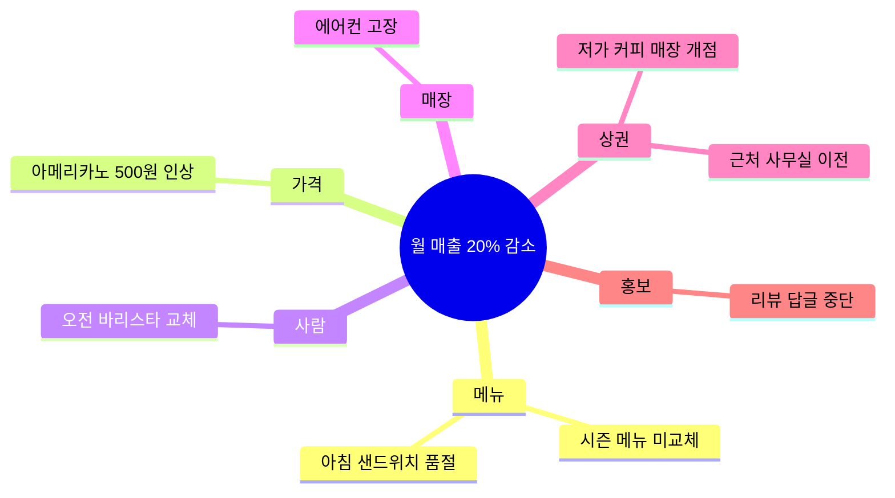
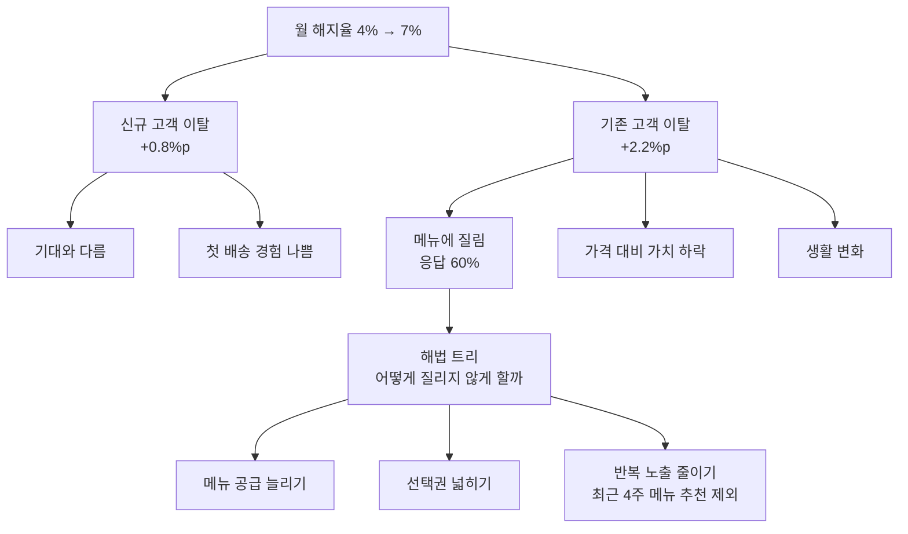
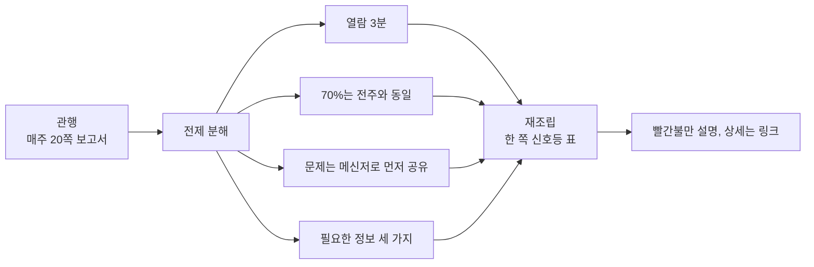
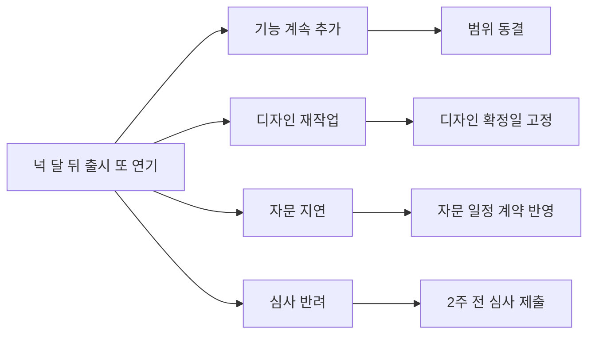
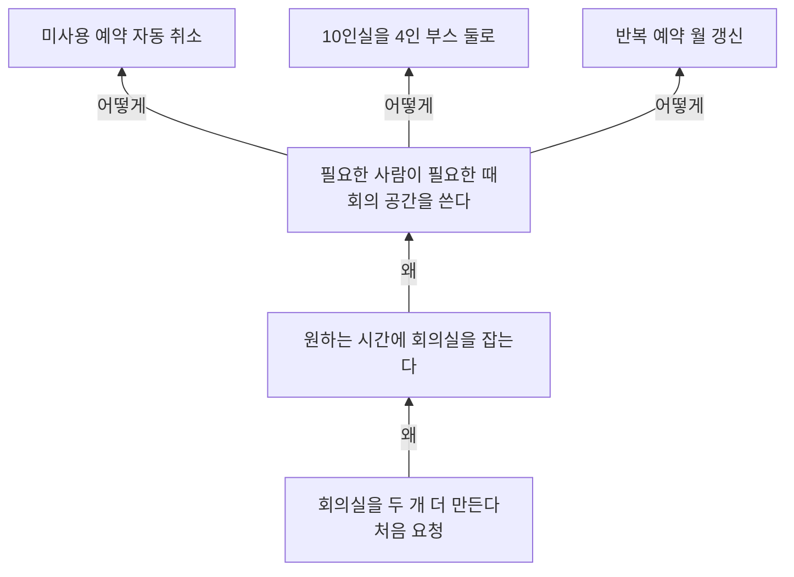
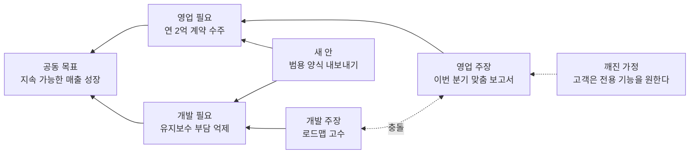
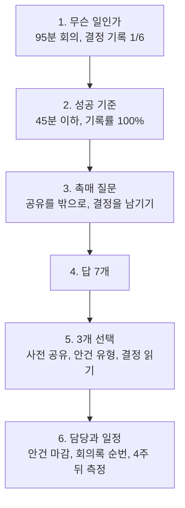

문제 해결 도구는 원인을 찾고, 문제를 제대로 정의하고, 해법 후보를 넓히는 데 쓴다. 원인을 좁혀 가는 도구와 요구 재정의나 대안 탐색처럼 생각을 넓히는 도구가 섞여 있다. 문제를 어느 단계에서 다루고 있는지에 따라 골라 쓴다. 예시에 나오는 회사, 사람, 숫자는 모두 설명을 위해 지어낸 것이다.

| 도구 | 단계 | 쓰임 | 결과물 | 그림 |
| --- | --- | --- | --- | --- |
| Ishikawa Diagram(이시카와 다이어그램) | 원인 분석 | 원인 후보를 범주별로 모은다 | 생선뼈 모양 원인도 | 마인드맵 |
| Issue trees(이슈 트리) | 원인 분석, 해법 탐색 | 문제를 겹치지 않게 쪼갠다 | 문제 트리, 해법 트리 | 트리 흐름도 |
| First principles(제1원리 사고) | 재설계 | 전제를 걷어내고 기본 사실에서 다시 짠다 | 새 설계안 | 분해와 재조립 흐름도 |
| Inversion(역발상) | 위험 점검 | 실패를 상상해 피할 일을 찾는다 | 위험 목록과 대책 | 실패와 대책 흐름도 |
| Abstraction laddering(추상화 사다리) | 문제 정의 | "왜"와 "어떻게"로 문제의 높이를 바꾼다 | 다시 쓴 문제 진술 | 사다리 흐름도 |
| Zwicky box(츠비키 박스) | 대안 탐색 | 속성별 값을 조합한다 | 조합 후보 목록 | 속성표 |
| Conflict Resolution Diagram(갈등 해소 다이어그램) | 갈등 해소 | 대립하는 요구 뒤의 공동 목표를 찾는다 | 양쪽 필요를 채우는 안 | 구름 다이어그램 |
| Productive Thinking Model(생산적 사고 모델) | 해법 설계와 실행 | 여섯 단계로 실행 계획까지 간다 | 담당자와 자원이 붙은 계획 | 단계 흐름도 |

## Ishikawa Diagram(이시카와 다이어그램) {#ishikawa-diagram}

일본의 Kaoru Ishikawa 교수가 만든 원인 분석 도구로, 특성요인도 또는 fishbone diagram이라고도 부른다. 문제를 머리에 두고 원인 범주를 뼈대로 뻗은 다음, 범주마다 가능한 원인을 붙인다. 원인이 하나가 아닐 수 있는 복잡한 문제에 맞다.

### 쓰는 법

1. 문제를 구체적으로 정의하고 가로선 끝에 적는다.
2. 원인 범주를 정해 가로선에 가지로 붙인다. 사람, 장비, 방법, 측정, 재료, 환경 같은 일반 범주를 쓰거나 상황에 맞게 새로 정한다.
3. 범주마다 "왜 이런 일이 생기나"를 묻고 원인 후보를 잔가지로 적는다. 부분적으로만 설명하는 후보도 빼지 않는다.
4. 완성된 그림을 보고 어느 후보부터 데이터로 확인할지 정한다.

### 쓸 때와 한계

- 회고, 반복되는 품질 문제, 매출이나 지표 하락의 원인 후보를 여럿이 함께 모을 때 쓴다.
- 그림이 완성돼도 답이 나온 것은 아니다. 각 후보는 데이터로 검증해야 원인이 된다.
- 원인끼리 서로 영향을 주는 관계는 잘 드러나지 않는다. 그런 경우는 연결 원이나 이슈 트리로 이어 간다.

### 예시: 동네 카페 매출 하락

주택가 카페의 월 매출이 석 달 사이 1,500만 원에서 1,200만 원으로 20% 줄었다.

**1단계. 문제 정의.** "석 달 사이 월 매출 20% 감소. 평일 오전 매출 감소 폭이 가장 크다"로 적었다.

**2단계. 범주.** 카페 상황에 맞게 메뉴, 가격, 사람, 매장, 상권, 홍보 여섯 개로 정했다.

**3단계. 원인 후보.**

| 범주 | 원인 후보 |
| --- | --- |
| 메뉴 | 시즌 메뉴를 바꾸지 않았다. 아침 샌드위치 품절이 잦다 |
| 가격 | 넉 달 전 아메리카노를 500원 올렸다 |
| 사람 | 오전 바리스타가 바뀌고 음료가 늦게 나온다는 말이 있다 |
| 매장 | 에어컨 고장으로 여름 내내 매장이 더웠다 |
| 상권 | 길 건너에 저가 커피 매장이 생겼다. 근처 사무실 하나가 이사했다 |
| 홍보 | 지도 앱 리뷰 답글을 중단했다 |

**4단계. 분석.** 데이터로 먼저 확인할 수 있는 것부터 봤다. 포스 기록에서 평일 7~9시 테이크아웃 주문이 40% 줄었고, 저가 매장 개점 주부터 감소가 시작됐다. 샌드위치 품절은 하루 평균 9시 이전이었다. 상권 변화와 아침 메뉴 품절을 주된 원인 후보로 두고, 가격 인상은 감소 시작 시점과 맞지 않아 뒤로 미뤘다.

### 다이어그램

원문: [untools - Ishikawa Diagram](https://untools.co/ishikawa-diagram/)

## Issue trees(이슈 트리) {#issue-trees}

문제를 나무 모양으로 쪼개 작은 문제로 나누는 도구다. "왜?"를 물어 원인을 쪼개면 문제 트리, "어떻게?"를 물어 해법을 쪼개면 해법 트리가 된다. 문제 전체를 한 장에 담기 때문에 다른 사람과 범위를 맞출 때도 쓸모가 있다.

### 쓰는 법

1. 문제를 맨 위에 둔다.
2. MECE 원칙으로 가지를 나눈다. 가지끼리 겹치지 않고(mutually exclusive), 합치면 문제 전체를 덮어야 한다(collectively exhaustive).
3. 큰 범주부터 잡고 한 단계씩 내려간다.
4. 데이터를 보고 영향이 큰 소수의 가지에 집중한다. 80/20 규칙이다.
5. 집중할 가지로 해법 트리를 만든다. "어떻게 개선하나"를 묻고 해법 범주를 나눈 뒤 범주마다 아이디어를 낸다.

### 쓸 때와 한계

- 고객 문제 진단, 초기 가설 수립, 비용이나 지표 하락 분해에 맞다.
- MECE를 정확히 맞추기는 어렵다. 첫 분기를 "A인가, A가 아닌가"처럼 둘로 나누면 빠짐을 줄일 수 있다.
- 첫 분기가 잘못되면 아래가 모두 기운다. 첫 단계는 데이터를 보고 다시 검토한다.

### 예시: 밀키트 구독 서비스의 이탈률 증가

주간 밀키트 구독 서비스의 월 해지율이 반년 사이 4%에서 7%로 올랐다.

**1단계. 문제.** "월 해지율 4%에서 7%로 상승"

**2단계. 첫 분기.** 해지는 첫 달 안에 떠나는 신규 고객과 석 달 넘게 쓰다 떠나는 기존 고객으로 나뉜다. 겹치지 않고 모든 해지를 덮는다.

**3단계. 아래 단계.**

- 신규 고객 이탈: 기대와 실제가 다르다, 첫 배송 경험이 나쁘다
- 기존 고객 이탈: 메뉴에 질렸다, 가격 대비 가치가 떨어졌다, 생활 변화로 필요가 사라졌다

**4단계. 집중할 가지.** 해지 설문과 주문 데이터를 붙였다. 늘어난 해지 3%p 중 2.2%p가 기존 고객이었고, 그중 "메뉴 반복" 응답이 60%였다. 같은 기간 신규 메뉴 출시는 월 8개에서 3개로 줄어 있었다.

**5단계. 해법 트리.** "어떻게 하면 기존 고객이 메뉴에 질리지 않게 할까"를 맨 위에 두고 메뉴 공급 늘리기, 고객 선택권 넓히기, 반복 노출 줄이기로 나눴다. 이 중 비용이 적은 "최근 4주 받은 메뉴는 추천에서 빼기"를 먼저 하기로 했다.

### 다이어그램

원문: [untools - Issue trees](https://untools.co/issue-trees/)

## First principles(제1원리 사고) {#first-principles}

문제를 더는 쪼갤 수 없는 기본 사실까지 분해하고, 그 사실들만 가지고 해법을 다시 조립하는 사고법이다. 관행이나 유추로 굳은 전제를 걷어내는 데 쓴다.

파고드는 데 쓰는 질문 기법이 두 가지 있다.

| 기법 | 방법 |
| --- | --- |
| Five Whys | "왜"를 다섯 번 안팎 반복해 근본 원인까지 내려간다 |
| 소크라테스식 질문 | 뜻 명확히 하기, 가정 의심하기, 근거 묻기, 결과 따지기, 다른 관점 찾기, 질문 자체 다시 묻기 |

### 쓰는 법

1. 문제와 지금의 해법을 적는다.
2. 해법이 기대는 전제를 하나씩 꺼내고, 전제마다 "이것이 정말 사실인가"를 묻는다.
3. 남은 기본 사실만으로 해법을 다시 짠다.

### 쓸 때와 한계

- 비용이나 시간이 과하게 드는 관행, "원래 그렇게 한다"는 절차를 다시 볼 때 맞다.
- 시간이 많이 든다. 모든 결정에 쓰면 아무것도 못 정한다.
- 기본 사실이라고 둔 것도 다시 보면 가정일 수 있다. 출처를 확인한다.

### 예시: 매주 20쪽짜리 주간 보고서

프로젝트 팀 여섯 개가 매주 금요일 각자 20쪽 안팎의 주간 보고서를 쓴다. 팀마다 반나절이 들어간다.

**1단계. 지금의 해법.** "경영진이 프로젝트 상황을 알려면 매주 상세 보고서가 필요하다"

**2단계. 전제 점검.**

| 전제 | 질문 | 확인한 사실 |
| --- | --- | --- |
| 경영진은 상세 내용을 읽는다 | 근거가 있나 | 문서 열람 기록상 평균 열람 시간이 3분이다 |
| 매주 모든 항목이 바뀐다 | 정말 그런가 | 지난 8주 보고서의 70%가 전주와 같은 문장이다 |
| 보고서가 있어야 문제를 안다 | 다른 경로는 없나 | 지난 분기 문제 6건 중 5건은 메신저로 먼저 알려졌다 |
| 경영진이 알아야 할 것 | 무엇인가 | 일정 위험, 예산 이탈, 경영진 결정이 필요한 사항 세 가지다 |

**3단계. 다시 짜기.** 남은 기본 사실은 "경영진은 세 가지를 빨리 알아야 하고, 보고서를 읽는 시간은 몇 분이다"였다. 주간 보고를 한 쪽짜리 신호등 표(일정, 예산, 결정 필요)로 바꾸고, 빨간불 항목에만 반 쪽 설명을 붙인다. 상세 기록은 팀 문서에 두고 링크만 건다. 팀별 작성 시간이 반나절에서 30분으로 줄 것으로 보고 한 달 시험하기로 했다.

### 다이어그램

원문: [untools - First principles](https://untools.co/first-principles/)

## Inversion(역발상) {#inversion}

문제를 거꾸로 본다. 어떻게 성공할지 대신 어떻게 하면 확실히 실패할지를 묻고, 그 실패 원인을 피하는 쪽으로 해법을 만든다. 이상적인 시나리오만 생각하고 있다는 느낌이 들 때 꺼낸다.

### 쓰는 법

1. 이 상황에서 최악의 결정이나 결과는 무엇인지 적는다. 프로젝트라면 "몇 달 뒤 실패했다"고 가정하는 pre-mortem을 쓴다.
2. 그것이 왜 일어났을지 이유를 적는다.
3. 이유를 뒤집어 대책을 만들고 계획 안으로 넣는다.

"어떻게 하면 이게 틀어질까", "정반대는 무엇일까" 같은 질문도 쓴다.

### 쓸 때와 한계

- 프로젝트 킥오프, 큰 변경 작업, 행사 준비 전에 맞다.
- 위험 목록만 쌓으면 아무도 움직이지 않는다. 항목마다 대책과 담당자를 붙인다.
- 낙관적인 분위기에서 혼자 실패 이야기를 꺼내기 어렵다. 회의 형식으로 정해 두면 말하기 쉬워진다.

### 예시: 출시 일정이 계속 밀리는 신규 앱

반려동물 건강 기록 앱의 출시일이 이미 두 번 밀렸다. 세 번째 출시일을 정하는 회의에서 pre-mortem을 했다.

**1단계. 최악의 결과.** "넉 달 뒤, 출시일이 또 밀려 투자사가 추가 자금을 보류했다"

**2단계. 이유.** 팀원 일곱 명이 5분 동안 각자 적은 이유를 모았다.

| 실패 이유 | 적은 사람 수 |
| --- | --- |
| 출시 범위에 기능이 계속 추가됐다 | 6 |
| 디자인 확정 전에 개발을 시작해 다시 만들었다 | 4 |
| 외부 수의사 자문 검토가 늦었다 | 3 |
| 앱 마켓 심사 반려에 대비하지 않았다 | 2 |

**3단계. 대책.**

| 실패 이유 | 대책 | 담당 |
| --- | --- | --- |
| 기능 추가 | 출시 범위를 지금 동결하고, 새 요청은 출시 후 목록으로 보낸다 | 제품 책임자 |
| 디자인 재작업 | 화면별 디자인 확정 날짜를 개발 시작 3일 전으로 못 박는다 | 디자인 리드 |
| 자문 지연 | 자문 검토 일정을 지금 계약서에 넣는다 | 대표 |
| 심사 반려 | 출시 2주 전 심사 제출, 반려 대응 1주 여유 | 모바일 개발자 |

### 다이어그램

원문: [untools - Inversion](https://untools.co/inversion/)

## Abstraction laddering(추상화 사다리) {#abstraction-laddering}

처음 받은 문제 진술을 사다리 가운데에 두고, "왜"를 물어 위로 올라가 더 추상적인 목적을 찾고, "어떻게"를 물어 아래로 내려가 구체적인 해법을 찾는 도구다. 위로 가면 숲이 보이고, 아래로 가면 바로 할 수 있는 일이 보인다. 혼자서든 워크숍에서든 몇 분이면 한다.

### 쓰는 법

1. 처음 문제 진술을 가운데 칸에 적는다.
2. "왜 이것이 필요한가"를 묻고 답을 위 칸에 적는다. 한두 번 반복한다.
3. 위 칸 중 하나를 골라 "어떻게 하면 이것을 이룰까"를 묻고, 처음과 다른 구체 진술을 아래 칸에 적는다.
4. 새로 나온 진술 중 어느 것을 풀지 고른다.

### 쓸 때와 한계

- 요청이 해법 형태로 들어올 때 맞다. "회의실 늘려 달라", "사람 더 뽑아 달라" 같은 요청이다.
- 너무 높이 올라가면 "회사가 성장한다"처럼 손댈 수 없는 진술이 된다. 팀이 영향을 줄 수 있는 높이에서 멈춘다.

### 예시: 회의실을 두 개 더 만들어 달라는 요청

직원 80명 회사의 총무팀에 "회의실을 두 개 더 만들어 달라"는 요청이 여러 팀에서 들어왔다. 공사비는 3천만 원으로 추산됐다.

**1단계. 처음 진술.** "회의실을 두 개 더 만든다"

**2단계. 왜.**

- 왜 회의실이 더 필요한가. 원하는 시간에 회의실을 잡지 못한다.
- 왜 잡지 못하나. 예약 기록을 보니 예약의 35%가 실제로는 쓰이지 않았고, 4인 이하 회의가 10인실을 차지하는 경우가 많았다. 그 위 칸은 "필요한 사람이 필요한 때 회의 공간을 쓴다"였다.

**3단계. 어떻게.** "어떻게 하면 필요한 사람이 필요한 때 회의 공간을 쓸까"를 물었다.

- 예약 후 10분 안에 체크인하지 않으면 자동 취소한다.
- 10인실 하나를 4인용 부스 두 개로 나눈다.
- 반복 예약은 한 달마다 갱신하게 한다.

**4단계. 선택.** 자동 취소와 반복 예약 갱신은 비용이 거의 들지 않아 바로 하고, 한 달 뒤 예약 실패 건수를 보고 부스 공사를 판단하기로 했다. 회의실 신설은 보류했다.

### 다이어그램

원문: [untools - Abstraction laddering](https://untools.co/abstraction-laddering/)

## Zwicky box(츠비키 박스) {#zwicky-box}

스위스 천문학자 Fritz Zwicky가 만든 방법으로, morphological box(형태 분석 상자)라고도 부른다. 문제를 서로 독립적인 속성으로 분해하고, 속성마다 가능한 값을 채운 표에서 값을 하나씩 골라 조합해 해법 후보를 만든다. 분해와 강제 결합으로 익숙한 답 밖의 조합을 끌어낸다.

### 쓰는 법

1. 풀 문제를 정의한다.
2. 문제를 이루는 속성을 고른다. 속성끼리 논리적으로 독립이어야 자유롭게 조합할 수 있다. 기존 사례의 구성 요소를 나열해 거꾸로 속성을 뽑아도 된다.
3. 속성을 열로 둔 표를 만들고 열마다 값을 최대한 많이 적는다. 이 단계에서는 거르지 않는다.
4. 열마다 값을 하나씩 골라 조합을 만든다. 모든 조합을 훑어도 되고, 무작위로 뽑아도 되고, 특정 속성을 고정해도 된다.
5. 이상해 보이는 조합도 바로 버리지 않고 쓸모를 따져 본다.

### 쓸 때와 한계

- 차원이 여러 개인 기획 문제, 일반 브레인스토밍으로 아이디어가 고갈됐을 때 맞다.
- 속성과 값이 늘면 조합 수가 폭발한다. 평가 기준을 따로 세워 걸러야 한다.
- 표가 주는 것은 원재료다. 쓸 만한 해법으로 다듬는 일은 따로 남는다.

### 예시: 동네 서점의 새 수익원

책 판매만으로는 임대료를 감당하기 어려운 동네 서점이 새 수익원을 찾았다.

**1단계. 문제.** "책 판매 외에 월 300만 원의 추가 매출을 만들 방법"

**2단계. 속성.** 누구에게(고객), 무엇을(상품), 언제(시간), 어디서(장소), 어떻게 돈을 받나(과금).

**3단계. 값 채우기.**

| 고객 | 상품 | 시간 | 장소 | 과금 |
| --- | --- | --- | --- | --- |
| 동네 주민 | 독서 모임 | 평일 저녁 | 서점 안 | 회당 참가비 |
| 초등학생 학부모 | 글쓰기 수업 | 주말 오전 | 근처 학교 | 월 구독 |
| 근처 회사 | 책 큐레이션 | 점심시간 | 고객 사무실 | 기업 계약 |
| 작가 지망생 | 공간 대여 | 심야 | 온라인 | 시간당 요금 |

**4단계. 조합.** 값 4개씩 속성 5개라 조합은 1,024개다. 고객 열을 하나씩 고정해 조합 여덟 개를 뽑았다.

- 조합 A: 근처 회사 + 책 큐레이션 + 점심시간 + 고객 사무실 + 기업 계약. 회사 휴게실 책장을 월 단위로 채워 주고 점심시간에 짧은 책 소개를 한다.
- 조합 B: 작가 지망생 + 공간 대여 + 심야 + 서점 안 + 시간당 요금. 영업이 끝난 밤 시간에 서점을 집필 공간으로 빌려준다.
- 조합 C: 초등학생 학부모 + 글쓰기 수업 + 주말 오전 + 서점 안 + 월 구독.

**5단계. 따져 보기.** 처음에는 엉뚱해 보였던 조합 A가 회사 두 곳과 월 60만 원씩 계약하면 120만 원이 된다. 조합 C는 정원 12명에 월 15만 원이면 180만 원이다. 두 조합을 합쳐 목표 300만 원을 맞추는 안으로 시범 운영하기로 했다.

### 다이어그램

츠비키 박스는 속성표 자체가 그림이다. 고른 조합을 표에 표시하면 다음과 같다.

| 조합 | 고객 | 상품 | 시간 | 장소 | 과금 | 예상 월 매출 |
| --- | --- | --- | --- | --- | --- | --- |
| A | 근처 회사 | 책 큐레이션 | 점심시간 | 고객 사무실 | 기업 계약 | 120만 원 |
| B | 작가 지망생 | 공간 대여 | 심야 | 서점 안 | 시간당 요금 | 보류 |
| C | 초등학생 학부모 | 글쓰기 수업 | 주말 오전 | 서점 안 | 월 구독 | 180만 원 |

원문: [untools - Zwicky box](https://untools.co/zwicky-box/)

## Conflict Resolution Diagram(갈등 해소 다이어그램) {#conflict-resolution-diagram}

Eliyahu Goldratt가 제약 이론(Theory of Constraints)의 사고 도구로 만든 것으로, Evaporating Cloud라고도 부른다. 서로 배타적인 두 주장 뒤에 있는 필요와, 그 필요들이 함께 바라보는 공동 목표를 찾아 양쪽 필요를 모두 채우는 안을 만든다.

### 쓰는 법

다이어그램은 주장에서 출발해 목표 쪽으로 거슬러 채운다.

1. 양쪽이 각자 무엇을 하자고 주장하는지 적는다.
2. 각 주장이 채우려는 필요를 적는다.
3. 두 필요를 모두 채우면 이뤄지는 공동 목표를 찾는다. 같은 편이라는 사실을 확인하는 단계다.
4. 두 주장이 동시에 성립할 수 없다고 본 가정을 꺼내 따진다.
5. 깨진 가정 위에서 양쪽 필요를 모두 채우는 새 안을 만든다.

### 쓸 때와 한계

- 어느 한쪽 안을 받아들이는 방식으로는 풀리지 않는 대립에 쓴다. 팀 사이 갈등에도, 혼자 하는 고민에도 쓸 수 있다.
- 공동 목표가 정말 없으면 쓸 수 없다.
- 힘의 차이가 큰 관계에서는 한쪽이 필요를 솔직히 말하지 않는다. 진행자를 중립적인 사람으로 둔다.

### 예시: 영업팀과 개발팀의 맞춤 기능 갈등

B2B 예약 관리 소프트웨어 회사에서 영업팀은 대형 고객이 요구한 맞춤 보고서 기능을 이번 분기에 넣자고 했고, 개발팀은 로드맵에 없는 기능은 넣을 수 없다고 맞섰다.

**1단계. 주장.** 영업팀은 "이번 분기에 맞춤 보고서를 만든다", 개발팀은 "로드맵대로 간다, 맞춤 기능은 안 만든다".

**2단계. 필요.** 영업팀의 필요는 연 매출 2억 원 규모의 계약을 따는 것이다. 개발팀의 필요는 한 고객만 쓰는 코드를 늘리지 않아 유지보수 부담을 막는 것이다. 지난해 맞춤 기능 다섯 개가 지금 버그 문의의 30%를 차지했다.

**3단계. 공동 목표.** "회사가 지속 가능하게 매출을 늘린다"

**4단계. 가정.** 대립 밑에는 "고객이 원하는 것은 그 고객만을 위한 기능이다"라는 가정이 있었다. 영업 담당이 고객에게 다시 물으니, 원하는 것은 맞춤 기능이 아니라 기존 데이터를 자기 회사 양식으로 뽑는 것이었다.

**5단계. 새 안.** 모든 고객이 쓸 수 있는 "보고서 양식 내보내기" 기능을 만들고, 이 고객의 양식을 첫 번째 템플릿으로 넣었다. 로드맵에 있던 내보내기 개선 항목을 앞당긴 것이라 개발팀의 필요도 채웠다.

### 다이어그램

원문: [untools - Conflict Resolution Diagram](https://untools.co/conflict-resolution-diagram/)

## Productive Thinking Model(생산적 사고 모델) {#productive-thinking-model}

Tim Hurson이 만든 여섯 단계 문제 해결 틀이다. 문제가 어느 정도 정의된 상태에서 창의적인 해법을 내고, 그 해법을 실행 계획까지 끌고 간다.

### 쓰는 법

1. 무슨 일인가: 문제, 영향, 아는 것, 관련된 사람을 정리하고 문제가 풀린 미래(Target Future)를 그린다.
2. 무엇이 성공인가: DRIVE로 성공 기준을 정한다. 해법이 할 일(Do), 하면 안 되는 일(Restrictions), 투입할 자원(Invest), 지킬 가치(Values), 꼭 얻을 결과(Essential outcomes)다.
3. 무엇을 물어야 하나: Target Future에 닿으려면 답해야 할 질문을 "어떻게 하면 ~할까" 형태로 만든다. Hurson은 이를 촉매 질문이라 부른다.
4. 답 만들기: 질문마다 판단 없이 답을 많이 낸다.
5. 해법 다듬기: 2단계 기준으로 답을 평가해 고르고, 기준에 더 맞도록 보강한다. 의사결정 매트릭스가 쓸모 있다.
6. 자원 맞추기: 필요한 행동, 자원, 담당자를 정해 실행 계획을 만든다.

### 쓸 때와 한계

- 팀 단위 개선 과제처럼 해법을 내고 실행까지 가야 하는 문제에 맞다.
- 단계가 많아 작은 문제에는 과하다.
- 문제 정의가 흐린 상태라면 추상화 사다리나 이슈 트리로 문제를 먼저 잡는다.

### 예시: 길어지기만 하고 결론이 안 나는 팀 회의

12명인 기획팀의 주간 회의가 평균 95분으로 늘었고, 회의 뒤 "그래서 뭘 하기로 했지"라는 질문이 반복됐다.

**1단계. 무슨 일인가.** 회의 여섯 번을 기록해 보니 안건이 미리 공유된 적이 없고, 시간의 60%가 진행 상황 공유였다. 결정 사항이 기록된 회의는 여섯 번 중 한 번이었다. Target Future는 "45분 안에 끝나고, 모두가 결정 사항과 담당자를 아는 회의"로 정했다.

**2단계. 무엇이 성공인가.**

| DRIVE | 내용 |
| --- | --- |
| Do | 결정이 필요한 안건에 회의 시간을 쓴다 |
| Restrictions | 팀원이 정보를 놓치면 안 된다. 회의를 없애지는 않는다 |
| Invest | 팀장 주당 1시간 준비, 회의 진행 도구 비용 없음 |
| Values | 누구나 안건을 낼 수 있다 |
| Essential outcomes | 회의 45분 이하, 결정 사항 기록률 100% |

**3단계. 촉매 질문.**

- 어떻게 하면 진행 상황 공유를 회의 밖으로 뺄까
- 어떻게 하면 회의 끝에 결정 사항이 남을까

**4단계. 답.** 공유 문서에 미리 진행 상황 쓰기, 회의 전날까지 안건 접수, 안건마다 "공유, 논의, 결정" 표시, 회의 마지막 5분 결정 사항 읽기, 서서 하는 회의, 타이머, 회의록 담당 순번제.

**5단계. 해법 다듬기.** DRIVE 기준으로 점수를 매겨 사전 진행 상황 공유, 안건 유형 표시, 마지막 5분 결정 읽기 세 개를 골랐다. 서서 하는 회의는 팀원 반응이 나빠 뺐다.

**6단계. 자원 맞추기.** 팀장이 회의 전날 오후 3시까지 안건을 모으고, 회의록 담당은 매주 돌아가며 맡는다. 4주 뒤 회의 시간과 결정 기록률을 다시 잰다.

### 다이어그램

원문: [untools - Productive Thinking Model](https://untools.co/productive-thinking-model/)

## 출처

- [untools](https://untools.co/)
- [untools - Problem solving](https://untools.co/problem-solving/)
- [untools - Ishikawa Diagram](https://untools.co/ishikawa-diagram/)
- [untools - Issue trees](https://untools.co/issue-trees/)
- [untools - First principles](https://untools.co/first-principles/)
- [untools - Inversion](https://untools.co/inversion/)
- [untools - Abstraction laddering](https://untools.co/abstraction-laddering/)
- [untools - Zwicky box](https://untools.co/zwicky-box/)
- [untools - Conflict Resolution Diagram](https://untools.co/conflict-resolution-diagram/)
- [untools - Productive Thinking Model](https://untools.co/productive-thinking-model/)
