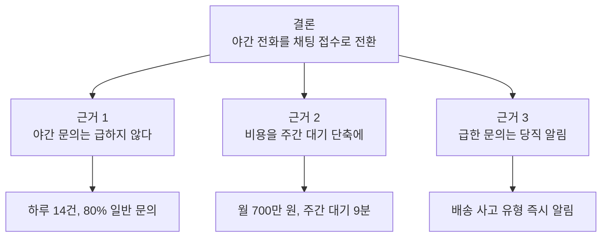
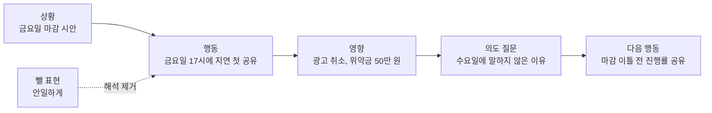

커뮤니케이션 도구는 생각을 상대에게 넘기는 방식을 다룬다. 바쁜 사람에게 보고할 때는 결론을 앞에 두고, 사람에게 피드백할 때는 해석 대신 관찰한 사실을 전한다. untools는 이 범주에 두 도구를 둔다. 예시에 나오는 회사, 사람, 숫자는 모두 설명을 위해 지어낸 것이다.

| 도구 | 쓰임 | 구조 | 그림 |
| --- | --- | --- | --- |
| Minto Pyramid(민토 피라미드) | 보고서, 메일, 발표 | 결론, 핵심 근거, 세부 자료 | 피라미드 흐름도 |
| Situation-Behavior-Impact(SBI) | 동료와 팀원에게 주는 피드백 | 상황, 행동, 영향, 의도 질문 | 단계 흐름도 |

## Minto Pyramid(민토 피라미드) {#minto-pyramid}

Barbara Minto가 정리한 글쓰기 구조다. 결론을 맨 위에 두고, 결론을 받치는 핵심 근거를 그 아래에, 근거를 뒷받침하는 사실과 숫자를 맨 아래에 둔다. 군에서 쓰던 BLUF(bottom line up front)와 같은 생각이다. 읽는 사람은 첫 문단만 읽어도 무엇을 결정해야 하는지 안다.

| 층 | 내용 | 분량 |
| --- | --- | --- |
| 결론 | 요청, 권고, 결론 한 가지 | 한두 문장 |
| 핵심 근거 | 결론이 맞는 이유. 각 근거를 한 문장 요약으로 쓴다 | 두세 개 |
| 세부 자료 | 근거를 믿게 만드는 데이터, 기록, 결과 | 필요한 만큼 |

### 쓰는 법

1. 읽는 사람이 이 글을 읽고 무엇을 해야 하는지 정하고, 그것을 결론 한두 문장으로 쓴다.
2. 결론이 맞는 이유를 두세 개의 핵심 근거로 쓴다. 근거끼리 겹치지 않게 한다.
3. 근거마다 세부 자료를 붙인다. 받는 사람이 배경을 잘 알면 링크나 첨부로 뺀다.
4. 위에서 아래로 읽어 보며 결론만 읽고 멈춰도 뜻이 통하는지 확인한다.

### 쓸 때와 한계

- 경영진 보고, 다른 팀에 보내는 요청 메일, 승인 요청처럼 읽는 사람의 시간이 짧은 글에 맞다.
- 아직 결론이 없는 탐색 단계의 문서에는 억지로 맞추지 않는다. "결론 미정, 결정에 필요한 정보"를 결론 자리에 둔다.
- 나쁜 소식을 맥락 없이 맨 앞에 던지면 방어적인 반응이 나온다. 결론 앞에 상황을 한 줄 붙인다.

### 예시: 고객센터 야간 상담 운영 방식 변경 제안

온라인 가구 쇼핑몰의 고객센터 팀장이 대표에게 야간 전화 상담을 바꾸자는 제안을 보낸다. 처음 초안은 지난 1년 상담 통계부터 시작해 결론이 마지막 문단에 있었다.

**1단계. 결론.** 대표가 할 일은 승인 여부 결정이다. "다음 달부터 밤 10시 이후 전화 상담을 채팅 접수와 다음 날 오전 회신으로 바꾸자고 제안한다"로 썼다.

**2단계. 핵심 근거.**

1. 야간 문의는 급한 일이 적다.
2. 야간 인력 비용을 줄여 주간 대기 시간을 줄이는 데 쓸 수 있다.
3. 급한 문의는 따로 받는 장치를 둔다.

**3단계. 세부 자료.**

| 근거 | 세부 자료 |
| --- | --- |
| 1 | 밤 10시 이후 문의는 하루 평균 14건, 그중 배송 일정과 교환 절차 문의가 80% |
| 2 | 야간 상담원 2명 인건비 월 700만 원, 주간 대기 시간은 평균 9분 |
| 3 | "배송 사고" 유형은 채팅에서 바로 당직자에게 알림 |

**4단계. 확인.** 대표가 첫 문장만 읽어도 무엇을 결정해야 하는지 알 수 있는지 다시 읽었다. 완성한 메일은 다음과 같다.

```text
제목: [승인 요청] 야간 전화 상담을 채팅 접수로 전환

다음 달부터 밤 10시 이후 전화 상담을 채팅 접수와 다음 날 오전 회신으로
바꾸자고 제안한다.

1. 야간 문의는 하루 14건이고 80%가 배송 일정과 교환 절차 문의다.
2. 야간 인력 월 700만 원을 주간으로 옮기면 주간 대기 시간 9분을 줄일 수 있다.
3. 배송 사고 유형은 채팅에서 당직자에게 바로 알림이 간다.

첨부: 시간대별 문의 통계, 인력 재배치 안
```

### 다이어그램



원문: [untools - Minto Pyramid](https://untools.co/minto-pyramid/)

## Situation-Behavior-Impact(SBI) {#situation-behavior-impact}

Center for Creative Leadership이 만든 피드백 구조다(SBI는 이 기관의 상표다). 상대의 행동을 두고 섣불리 이유를 짐작하면 피드백에 판단이 섞이고, 받는 사람은 방어적이 된다. SBI는 언제 어디서(상황), 무엇을 했는지(행동), 그 결과 무엇이 일어났는지(영향)만 말하게 해 판단을 걷어 낸다. 부정적인 피드백에 특히 쓸모가 있지만 칭찬에도 같은 구조를 쓴다.

### 쓰는 법

1. 상황: 행동이 일어난 때와 장소를 구체적으로 말한다.
2. 행동: 본 것과 들은 것만 말한다. "무책임하게" 같은 해석은 뺀다.
3. 영향: 그 행동으로 내가 느낀 것, 팀이나 고객에게 생긴 결과를 말한다.
4. 의도 묻기: 그렇게 한 이유를 묻는다. 내가 모르는 사정이 있을 수 있고, 의도와 영향의 차이가 대화의 출발점이 된다.
5. 다음에 어떻게 할지 상대가 스스로 생각하게 한다.

### 쓸 때와 한계

- 회의 직후, 작업 직후처럼 기억이 생생할 때 쓴다. 시간이 지나면 상황과 행동을 구체적으로 말하기 어렵다.
- 행동을 묘사하는 문장에 해석이 끼어들기 쉽다. 말하기 전에 행동 부분을 적어 보고 형용사를 지운다.
- 공식처럼 읽으면 기계적으로 들린다. 구조는 지키되 평소 말투로 한다.

### 예시: 마감 당일에야 지연을 알린 팀원

디자인팀 팀원이 금요일 마감인 랜딩 페이지 시안을 금요일 오후 5시에 "다음 주 화요일까지 걸린다"고 알렸다. 팀장은 처음에 "일정 관리를 너무 안일하게 한다"고 말하려 했다.

**1단계. 상황.** "이번 주 금요일 마감이던 랜딩 페이지 시안 건으로 이야기하고 싶다."

**2단계. 행동.** 초안은 "일정 관리를 안일하게 했다"였다. 해석이 섞였다는 것을 알아채고 "금요일 오후 5시에 화요일까지 늦어진다고 처음 알려 줬다"로 고쳤다.

**3단계. 영향.** "마케팅팀이 월요일 광고 집행을 잡아 둔 상태라, 금요일 저녁에 광고 일정을 취소하고 광고 대행사에 위약금 50만 원을 물었다. 나도 미리 알았으면 다른 방법을 찾았을 텐데 그럴 시간이 없어 답답했다."

**4단계. 의도 묻기.** "수요일쯤에는 늦어질 걸 알았을 것 같은데, 그때 말하지 않은 이유가 있었나?" 팀원은 주말에 작업하면 맞출 수 있을 거라 생각했고, 늦어진다고 말하면 능력이 부족해 보일까 걱정했다고 답했다.

**5단계. 다음 행동.** 팀원은 마감 이틀 전에 진행률을 짧게 공유하겠다고 했고, 팀장은 지연을 일찍 알리는 것을 평가에 불리하게 보지 않겠다고 말했다.

### 다이어그램



원문: [untools - Situation-Behavior-Impact](https://untools.co/situation-behavior-impact/)

## 출처

- [untools](https://untools.co/)
- [untools - Communication](https://untools.co/communication/)
- [untools - Minto Pyramid](https://untools.co/minto-pyramid/)
- [untools - Situation-Behavior-Impact](https://untools.co/situation-behavior-impact/)
