사고 도구 하나로 문제가 끝나는 경우는 드물다. 상황을 파악하는 도구, 원인을 좁히는 도구, 대안을 고르는 도구, 결과를 전하는 도구가 각자 맡는 단계가 다르고, 앞 도구의 결과물이 다음 도구의 입력이 된다. 이 글은 세 가지 사례로 도구를 이어 쓰는 흐름을 보여 준다. 사례의 회사, 사람, 숫자는 모두 설명을 위해 지어낸 것이다.

| 사례 | 문제 유형 | 도구 순서 |
| --- | --- | --- |
| 1. 온라인 쇼핑몰 재구매율 하락 | 원인 분석 | 빙산 모델, 이시카와, 이슈 트리, 2차 사고, 효과-노력, 민토 피라미드 |
| 2. 협업 도구 교체 여부 | 의사결정 | 커네빈, 추상화 사다리, 의사결정 매트릭스, 역발상, 확신에 따른 속도와 품질, 민토 피라미드 |
| 3. 신입 온보딩 프로그램 재설계 | 기획과 전달 | 개념 지도, 이슈 트리와 민토 피라미드, 여섯 색깔 모자, 추론의 사다리, OODA 루프 |

## 사례 1. 온라인 쇼핑몰의 재구매율이 6개월째 떨어진다

스킨케어 온라인 쇼핑몰의 90일 재구매율이 6개월 사이 38%에서 29%로 떨어졌다. 같은 기간 신규 고객 수는 30% 늘어 매출은 유지됐지만, 고객 한 명을 데려오는 비용이 계속 오르고 있었다.

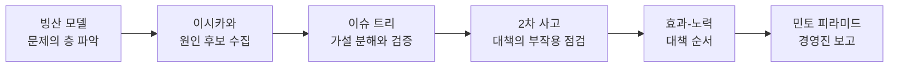

### 1단계. 빙산 모델로 문제의 층을 본다

**고른 이유.** 재구매율 하락은 이미 여섯 달째 이어진 패턴이다. 이번 달 숫자에만 반응하지 않으려고 사건 아래의 층부터 봤다.

**결과물.**

| 층 | 내용 |
| --- | --- |
| 사건 | 이번 달 90일 재구매율 29% |
| 패턴 | 6개월 연속 하락. 첫 구매 고객 중 할인 행사로 들어온 비중이 25%에서 55%로 늘었다 |
| 구조 | 마케팅팀 목표가 신규 고객 수뿐이다. 첫 구매 뒤 고객에게 가는 연락은 일괄 광고 문자다. 넉 달 전 배송 업체를 바꿨다 |
| 사고방식 | "신규 고객 수가 성장의 지표다", "제품이 좋으면 재구매는 따라온다" |

**결정.** 원인 분석 범위를 "첫 구매부터 90일 동안의 고객 경험"으로 잡았다. 마케팅 목표 같은 구조 층 요인도 원인 후보에 넣기로 했다.

### 2단계. 이시카와 다이어그램으로 원인 후보를 모은다

**고른 이유.** 마케팅, 물류, 고객지원, 상품팀이 각자 다른 원인을 말하고 있었다. 범주를 나눠 모든 후보를 한 장에 모아야 한쪽 의견에 쏠리지 않는다.

**결과물.**

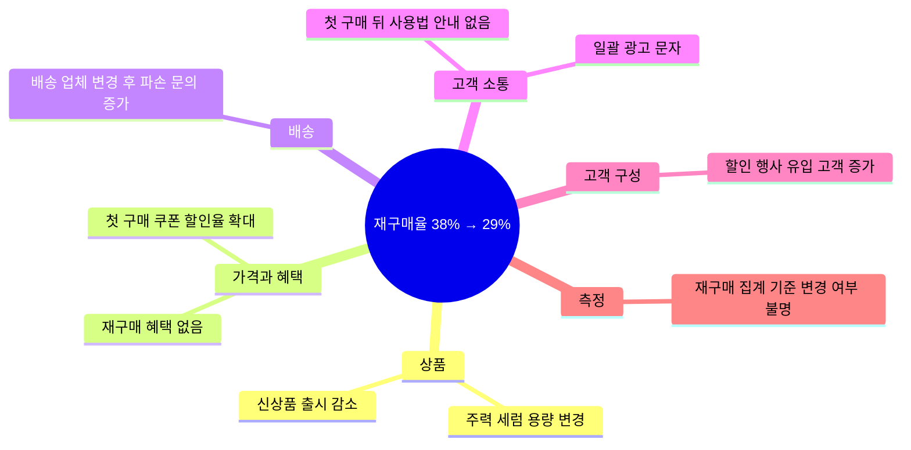

**결정.** 데이터로 바로 확인할 수 있는 후보 여섯 개를 골랐다. 고객 구성, 쿠폰 할인율, 배송 파손, 사용법 안내 부재, 신상품 감소, 집계 기준이다.

### 3단계. 이슈 트리로 가설을 나누고 검증한다

**고른 이유.** 후보끼리 겹치는 부분이 있어 어느 쪽이 얼마나 영향을 줬는지 가리기 어려웠다. 겹치지 않게 가지를 나누면 데이터로 하나씩 지울 수 있다.

**결과물.** 재구매율 하락을 "고객 구성이 바뀌었다"와 "같은 고객군의 재구매가 줄었다"로 먼저 나눴다.

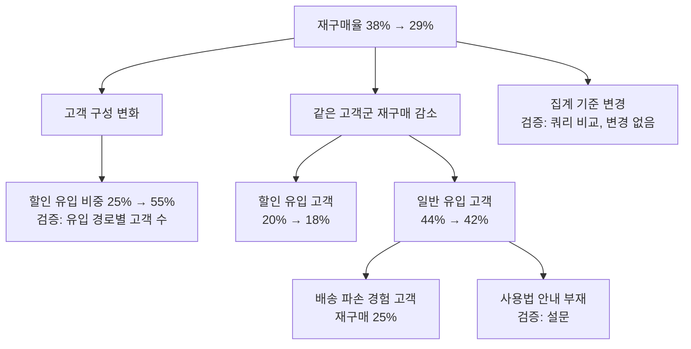

| 가설 | 검증 방법 | 결과 |
| --- | --- | --- |
| 집계 기준이 바뀌었다 | 6개월 전 쿼리와 지금 쿼리 비교 | 변경 없음, 가지 삭제 |
| 할인 유입 비중이 늘었다 | 유입 경로별 고객 수 | 25%에서 55%로 증가 |
| 할인 유입 고객은 재구매가 낮다 | 유입 경로별 재구매율 | 18%, 일반 유입은 42% |
| 배송 파손이 재구매를 낮춘다 | 파손 문의 고객의 재구매율 | 25%, 해당 고객은 전체의 6% |

6개월 전에는 25% × 20% + 75% × 44%로 약 38%였고, 지금은 55% × 18% + 45% × 42%로 약 29%다. 하락분 9%p 가운데 대부분은 할인 유입 고객 비중이 늘어난 데서 나왔다. 일반 유입 고객의 2%p 하락은 배송 파손과 사용법 안내 부재가 겹친 결과로 봤다.

**결정.** 대책은 두 방향으로 잡았다. 할인 유입 고객이 두 번째 구매까지 오게 만들고, 첫 구매 경험의 결함을 고친다.

### 4단계. 2차 사고로 대책의 부작용을 걸러낸다

**고른 이유.** 회의에서 가장 먼저 나온 대책은 "할인 행사 중단"과 "재구매 쿠폰 대량 발송"이었다. 둘 다 바로 효과가 보일 만한 안이라 뒤따르는 결과를 먼저 따졌다.

**결과물.**

| 대책 | 1차 결과 | 2차 결과 | 3차 결과 |
| --- | --- | --- | --- |
| 할인 행사 중단 | 할인 유입 비중이 줄어 재구매율 숫자가 오른다 | 신규 고객이 줄어 매출이 떨어진다 | 마케팅팀 목표와 충돌해 다른 할인 경로가 생긴다 |
| 재구매 쿠폰 대량 발송 | 다음 달 재구매율이 반짝 오른다 | 고객이 할인 없이는 사지 않는 습관을 배운다 | 마진이 줄고 쿠폰 없이는 재구매율이 다시 떨어진다 |
| 첫 구매 뒤 사용법 안내 | 제품을 제대로 쓰는 고객이 는다 | 효과를 본 고객이 정가로 재구매한다 | 리뷰가 쌓여 할인 없이 들어오는 고객이 는다 |

**결정.** 행사 중단과 쿠폰 대량 발송은 뺐다. 할인 유입 고객에게도 할인보다 사용 경험으로 두 번째 구매를 유도하는 쪽을 택했다.

### 5단계. 효과-노력 매트릭스로 대책 순서를 정한다

**고른 이유.** 남은 대책이 여섯 개였고, 다음 분기에 쓸 수 있는 인력은 마케팅 1명과 개발 1명뿐이었다.

**결과물.**

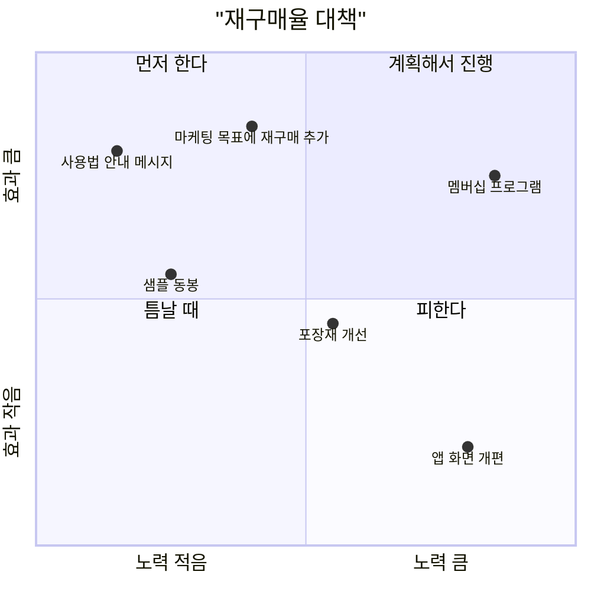

**결정.** 사용법 안내 메시지와 샘플 동봉을 이번 달에 시작하고, 마케팅 목표에 "90일 재구매율"을 넣는 안을 경영진 결정 사항으로 올린다. 포장재 개선은 배송 업체와 협의해 다음 분기에 하고, 멤버십은 재구매율이 회복된 뒤 다시 본다. 앱 화면 개편은 뺐다.

### 6단계. 민토 피라미드로 경영진에게 한 장으로 보고한다

**고른 이유.** 대표와 마케팅 이사가 결정할 것은 목표 변경 하나다. 분석 과정을 처음부터 설명하면 결정할 내용이 맨 끝에 묻힌다.

**결과물.**

```text
제목: [결정 요청] 마케팅 목표에 90일 재구매율 추가

다음 분기부터 마케팅 목표에 신규 고객 수와 함께 90일 재구매율 35%를 넣자고 요청한다.

1. 재구매율 하락 9%p의 대부분은 할인 행사 유입 고객 비중이 25%에서 55%로
   늘어난 데서 나왔다. 이 고객의 재구매율은 18%다.
2. 신규 고객 수만 목표로 두면 할인 유입이 계속 늘어 재구매율이 더 떨어진다.
3. 사용법 안내 메시지와 샘플 동봉은 이번 달 시작한다. 추가 비용은 월 150만 원이다.

첨부: 유입 경로별 재구매율, 원인 분석표, 대책 우선순위
```

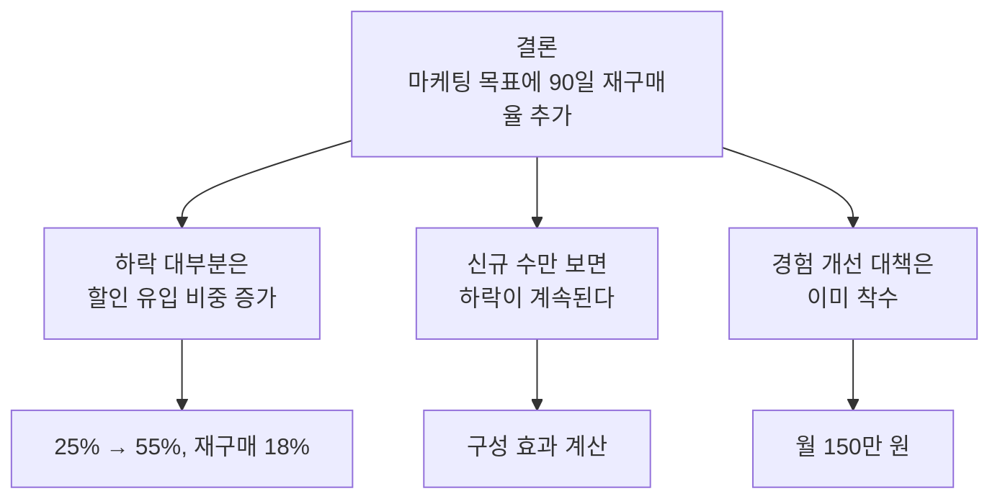

**결정.** 경영진은 재구매율 목표를 32%로 낮춰 승인했고, 석 달 뒤 다시 보기로 했다.

## 사례 2. 새 협업 도구로 바꿀지, 지금 도구를 고쳐 쓸지

직원 50명인 제품 조직이 메신저, 문서 위키, 이슈 관리 도구를 따로 쓰고 있다. 일부 팀장이 세 기능을 묶은 통합 협업 도구로 갈아타자고 제안했다. 연 비용은 지금보다 1,200만 원 늘어난다.

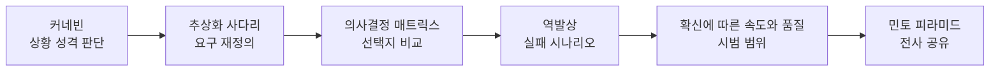

### 1단계. 커네빈 프레임워크로 상황의 성격을 가른다

**고른 이유.** 찬반이 "기능 비교표"로만 오가고 있었다. 이 문제가 분석으로 답이 나오는 문제인지, 해 봐야 아는 문제인지부터 갈라야 했다.

**결과물.**

| 하위 질문 | 원인과 결과를 아나 | 영역 | 대응 |
| --- | --- | --- | --- |
| 기능, 비용, 보안 요건 비교 | 분석하면 안다 | 난해 | 담당자가 비교 분석 |
| 사람들이 실제로 정보를 남기고 찾는 습관이 바뀔지 | 해 봐야 안다 | 복잡 | 작게 시범 운영 |
| 데이터 이전 절차 | 알려진 방법이 있다 | 명확 | 체크리스트대로 |

**결정.** 비교 분석만으로 결론 내지 않고, 습관 변화는 시범으로 확인하기로 했다.

### 2단계. 추상화 사다리로 요구를 다시 정의한다

**고른 이유.** "새 도구로 바꾼다"는 이미 해법이다. 왜 바꾸고 싶은지 올라가 보면 다른 해법도 비교할 수 있다.

**결과물.**

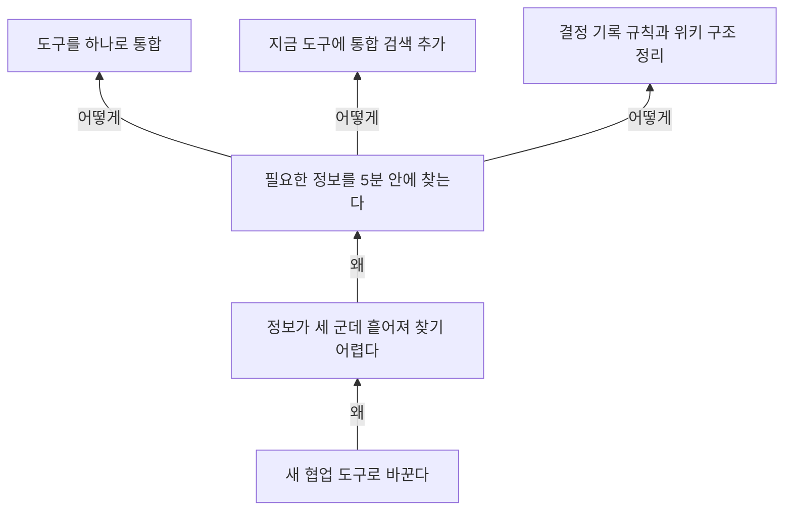

직원 설문에서 하루 평균 40분을 정보 찾기에 쓴다는 답이 나왔고, 최근 입사자 다섯 명 모두 "과거 결정의 이유를 찾기 어렵다"를 꼽았다.

**결정.** 목표를 "필요한 정보를 5분 안에 찾는다"로 다시 쓰고, 선택지를 세 개로 넓혔다.

### 3단계. 의사결정 매트릭스로 선택지를 비교한다

**고른 이유.** 선택지가 셋이고 기준이 여럿이라 말로 비교하면 목소리 큰 쪽으로 기운다.

**결과물.** 가중치는 점수를 매기기 전에 정했다. 점수는 1~5점이다.

| 기준(가중치) | A. 통합 도구 전환 | B. 현재 도구와 기록 규칙 | C. 현재 도구와 통합 검색 |
| --- | --- | --- | --- |
| 정보 찾기 개선(5) | 5 × 5 = 25 | 2 × 5 = 10 | 4 × 5 = 20 |
| 전환 부담(3) | 2 × 3 = 6 | 5 × 3 = 15 | 4 × 3 = 12 |
| 연 비용(2) | 2 × 2 = 4 | 5 × 2 = 10 | 3 × 2 = 6 |
| 외부 협업 호환(2) | 3 × 2 = 6 | 4 × 2 = 8 | 4 × 2 = 8 |
| 합계 | 41 | 43 | 46 |

**결정.** C가 앞섰지만 B와 차이가 크지 않다. 기록 규칙이 없으면 검색해도 찾을 것이 없다는 의견이 나와 C에 B의 기록 규칙을 더한 안을 후보로 삼았다.

### 4단계. 역발상으로 실패 시나리오를 미리 막는다

**고른 이유.** 후보안은 새 도구를 사지 않아 위험이 작아 보인다. 그래서 오히려 대충 시작했다가 흐지부지될 가능성이 컸다.

**결과물.** "1년 뒤, 통합 검색을 붙였는데 아무도 쓰지 않는다"를 가정하고 이유와 대책을 적었다.

| 실패 이유 | 대책 |
| --- | --- |
| 위키 문서 절반이 낡아 검색 결과를 믿지 않는다 | 시작 전 2주 동안 문서 정리, 1년 넘은 문서에 "오래됨" 표시 |
| 권한 설정 때문에 검색 결과가 비어 보인다 | 팀별 권한을 먼저 점검 |
| 결정이 여전히 메신저 대화에만 남는다 | 결정 기록 템플릿, 회의 끝에 링크 남기기 |
| 관리하는 사람이 없다 | 팀마다 문서 담당 1명 지정 |

**결정.** 네 대책을 시범 계획에 넣었다.

### 5단계. 확신에 따른 속도와 품질로 시범 범위를 정한다

**고른 이유.** 전사에 한 번에 펼칠지, 작게 시험할지 정해야 했다.

**결과물.**

| 질문 | 판단 | 근거 |
| --- | --- | --- |
| 문제가 중요하다는 확신 | 높음 | 하루 40분, 신규 입사자 다섯 명 모두 같은 불만 |
| 해법이 맞다는 확신 | 중간 이하 | 검색 도구가 습관을 바꿀지는 모른다 |
| 무게 | 균형 | 작게 시험하되 권한과 보안 검토는 처음부터 지킨다 |

**결정.** 두 팀 15명이 6주 동안 시범 운영한다. 성공 기준은 "정보 찾는 시간 하루 20분 이하", "결정 기록률 80% 이상"이다.

### 6단계. 민토 피라미드로 전사에 공유한다

**고른 이유.** 통합 도구 전환을 기대한 사람들에게 다른 결론을 알려야 한다. 결론과 이유를 먼저 밝혀야 소문이 앞서지 않는다.

**결과물.**

```text
제목: 협업 도구 검토 결과와 다음 6주 계획

협업 도구는 지금 그대로 쓰고, 통합 검색과 결정 기록 규칙을 두 팀에서
6주 동안 먼저 시험한다.

1. 우리가 풀 문제는 도구 수가 아니라 정보를 찾는 데 하루 40분이 드는 것이다.
2. 세 가지 안을 비교한 결과 지금 도구에 검색과 기록 규칙을 더하는 안이
   비용과 전환 부담 대비 효과가 가장 컸다.
3. 6주 뒤 정보 찾는 시간이 20분 이하로 줄지 않으면 통합 도구 전환을 다시 검토한다.

첨부: 비교표, 시범 운영 계획, 문서 정리 일정
```

**결정.** 시범 팀은 다음 주 월요일부터 문서 정리를 시작한다.

## 사례 3. 신입 온보딩 프로그램을 다시 설계한다

직원 300명인 회사가 해마다 신입 40명을 뽑는다. 입사 3개월 안에 퇴사하는 비율이 15%이고, 첫 독립 업무를 맡기까지 평균 4개월이 걸린다. 지금 온보딩은 인사팀이 진행하는 1주 집체 교육뿐이다.

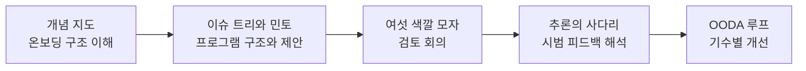

### 1단계. 개념 지도로 온보딩에 관여하는 것을 그린다

**고른 이유.** 인사팀, 현업 팀장, 선배 직원이 온보딩을 서로 다르게 이해하고 있었다. 누가 무엇을 맡는지부터 한 장으로 맞춰야 했다.

**결과물.** 초점 질문은 "신입이 혼자 일할 수 있게 되기까지 무엇이 관여하나"로 잡았다.

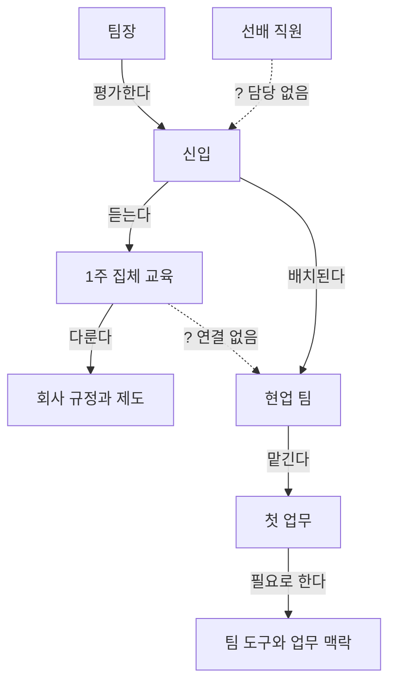

**결정.** 끊긴 선 두 개가 문제의 핵심 후보였다. 신입을 챙기는 선배가 정해져 있지 않고, 인사 교육과 팀 실무 사이에 다리가 없다.

### 2단계. 이슈 트리로 프로그램을 나누고 민토 피라미드로 제안을 짠다

**고른 이유.** 프로그램 구성 요소를 빠짐없이 나눠야 하고, 그 결과를 경영진이 한 번에 승인할 수 있는 제안서로 바꿔야 했다.

**결과물.** 해법 트리는 "어떻게 하면 신입이 3개월 안에 혼자 일할 수 있을까"를 맨 위에 두고 네 가지로 나눴다.

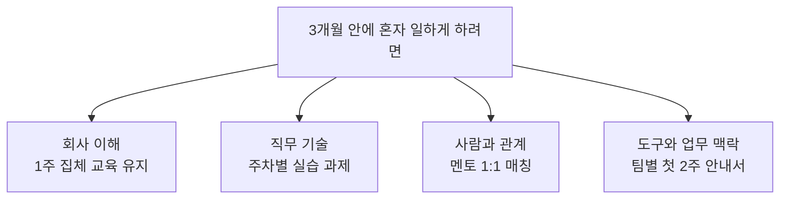

이 트리를 민토 피라미드 순서로 옮겨 제안서를 만들었다.

| 층 | 내용 |
| --- | --- |
| 결론 | 온보딩을 1주 집체 교육에서 12주 팀 중심 프로그램으로 바꾼다 |
| 근거 1 | 3개월 내 퇴사자의 퇴사 면담에서 "물어볼 사람이 없었다"가 1위였다 |
| 근거 2 | 첫 독립 업무까지 4개월은 팀 실무 안내가 없는 데서 생긴다 |
| 근거 3 | 멘토 시간 주 3시간을 업무로 인정하면 추가 인력 없이 운영할 수 있다 |
| 세부 자료 | 퇴사 면담 요약, 팀별 첫 업무 시점, 멘토 시간 산정표 |

**결정.** 다음 기수 8명을 대상으로 시범 운영하는 안을 검토 회의에 올렸다.

### 3단계. 여섯 색깔 모자로 검토 회의를 연다

**고른 이유.** 검토 회의에는 인사팀장, 현업 팀장 세 명, 2년 차 직원 한 명이 참석했다. 현업 팀장들은 멘토 부담을 걱정했고 인사팀은 일정에 쫓기고 있어 논의가 엇갈릴 가능성이 컸다.

**결과물.**

| 모자 | 나온 말 |
| --- | --- |
| 파랑 | 안건은 "다음 기수 시범 운영 여부", 모자당 8분 |
| 흰색 | 지난해 3개월 내 퇴사 6명, 그중 4명이 "물어볼 사람 없음" |
| 노랑 | 멘토 경험이 선배 직원의 리더십 훈련이 된다 |
| 검정 | 멘토가 마감에 쫓기면 1:1이 가장 먼저 취소된다. 과제가 팀마다 들쭉날쭉할 수 있다 |
| 초록 | 멘토 1:1을 달력에 고정 일정으로 넣는다. 공통 과제 틀을 인사팀이 만든다 |
| 빨강 | 2년 차 직원은 "내가 신입일 때 이런 게 있었으면" 하고 반겼고, 팀장 한 명은 여전히 부담스러워했다 |
| 파랑 | 시범 운영은 승인. 부담을 느끼는 팀은 이번 기수에서 빠진다 |

**결정.** 신입 8명 중 두 팀 6명과 멘토 6명으로 시범을 시작했다.

### 4단계. 추론의 사다리로 시범 피드백을 다시 읽는다

**고른 이유.** 시범 1기 설문 평균이 5점 만점에 3.1점이 나오자 팀장 한 명이 "프로그램이 실패했다, 원래대로 돌리자"고 했다. 결론이 너무 빨랐다.

**결과물.**

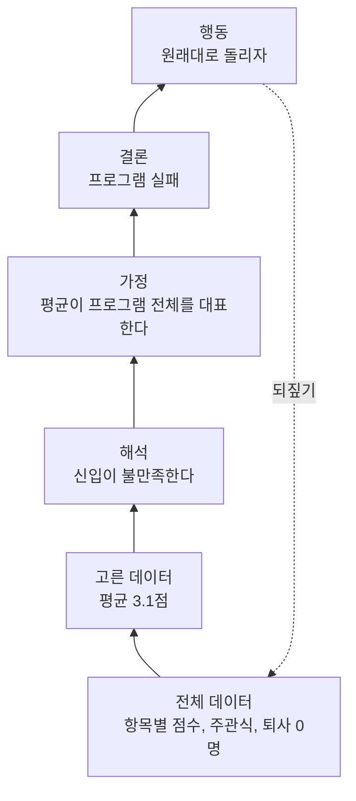

항목별로 보니 멘토 1:1은 4.5점, 주차별 과제는 2.2점이었다. 주관식에는 "과제가 실무와 별개라 두 배로 일하는 느낌"이 여섯 명 중 다섯 명에게서 나왔다. 시범 기간 퇴사자는 없었다.

**결정.** 프로그램 전체가 아니라 과제 설계가 문제라고 결론을 고쳤다. 과제를 실제 팀 업무의 일부로 바꾸기로 했다.

### 5단계. OODA 루프로 기수마다 고친다

**고른 이유.** 신입은 두 달마다 들어온다. 완벽한 설계를 기다리기보다 기수마다 관측하고 고치는 리듬이 맞다.

**결과물.**

| 단계 | 2기 | 3기 |
| --- | --- | --- |
| Observe | 과제를 실무로 바꾼 뒤 과제 점수 3.9점. 4주 차에 질문이 몰린다 | 4주 차 질문은 줄었다. 멘토 두 명이 시간 부족을 호소한다 |
| Orient | 4주 차는 팀 업무를 처음 혼자 맡는 시점이다 | 멘토 한 명이 신입 두 명을 맡은 경우였다 |
| Decide | 4주 차에 멘토 1:1을 한 번 더 넣는다 | 멘토 한 명당 신입 한 명으로 제한한다 |
| Act | 3기부터 적용 | 4기부터 적용 |

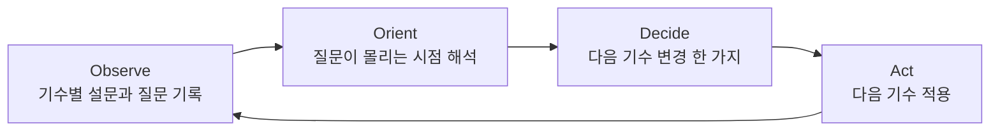

**결정.** 1년 뒤 3개월 내 퇴사율은 15%에서 5%로, 첫 독립 업무까지 걸리는 시간은 4개월에서 2.5개월로 줄었다. 프로그램을 전사로 넓히고, 기수별 OODA 점검은 인사팀 정례 업무로 넣었다.

## 도구 고르는 순서

세 사례 모두 상황 파악, 원인, 대안, 결정, 전달, 실행과 학습 순으로 흘렀다. 단계별로 쓸 수 있는 도구는 다음과 같다. 모든 단계를 다 거칠 필요는 없고, 지금 막힌 단계의 도구를 꺼내면 된다.

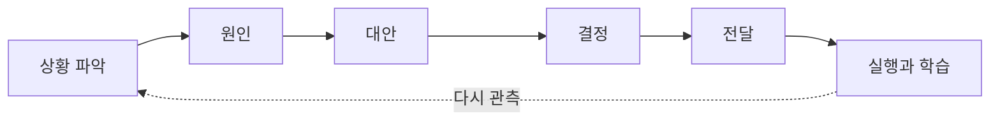

| 단계 | 묻는 질문 | 도구 |
| --- | --- | --- |
| 상황 파악 | 어떤 성격의 문제인가. 무엇이 관여하나 | [Cynefin framework](/docs/business/thinking-tools/02-decision-making/#cynefin-framework), [Iceberg Model](/docs/business/thinking-tools/01-systems-thinking/#iceberg-model), [Concept map](/docs/business/thinking-tools/01-systems-thinking/#concept-map), [Abstraction laddering](/docs/business/thinking-tools/03-problem-solving/#abstraction-laddering) |
| 원인 | 왜 일어나나. 무엇이 서로를 키우나 | [Ishikawa Diagram](/docs/business/thinking-tools/03-problem-solving/#ishikawa-diagram), [Issue trees](/docs/business/thinking-tools/03-problem-solving/#issue-trees), [Connection circles](/docs/business/thinking-tools/01-systems-thinking/#connection-circles), [Reinforcing feedback loop](/docs/business/thinking-tools/01-systems-thinking/#reinforcing-feedback-loop), [Balancing feedback loop](/docs/business/thinking-tools/01-systems-thinking/#balancing-feedback-loop), [First principles](/docs/business/thinking-tools/03-problem-solving/#first-principles) |
| 대안 | 어떤 방법이 있나 | [Zwicky box](/docs/business/thinking-tools/03-problem-solving/#zwicky-box), [Productive Thinking Model](/docs/business/thinking-tools/03-problem-solving/#productive-thinking-model), [Conflict Resolution Diagram](/docs/business/thinking-tools/03-problem-solving/#conflict-resolution-diagram), [Six Thinking Hats](/docs/business/thinking-tools/02-decision-making/#six-thinking-hats) |
| 결정 | 무엇을 먼저, 무엇을 고르나. 무엇이 잘못될 수 있나 | [Decision matrix](/docs/business/thinking-tools/02-decision-making/#decision-matrix), [Impact-Effort Matrix](/docs/business/thinking-tools/02-decision-making/#impact-effort-matrix), [Eisenhower Matrix](/docs/business/thinking-tools/02-decision-making/#eisenhower-matrix), [Hard choice model](/docs/business/thinking-tools/02-decision-making/#hard-choice-model), [Second-order thinking](/docs/business/thinking-tools/02-decision-making/#second-order-thinking), [Inversion](/docs/business/thinking-tools/03-problem-solving/#inversion), [Confidence determines speed vs. quality](/docs/business/thinking-tools/02-decision-making/#confidence-determines-speed-vs-quality) |
| 전달 | 어떻게 전하나 | [Minto Pyramid](/docs/business/thinking-tools/04-communication/#minto-pyramid), [Situation-Behavior-Impact](/docs/business/thinking-tools/04-communication/#situation-behavior-impact) |
| 실행과 학습 | 결과를 어떻게 읽고 다음에 반영하나 | [OODA loop](/docs/business/thinking-tools/02-decision-making/#ooda-loop), [Ladder of inference](/docs/business/thinking-tools/02-decision-making/#ladder-of-inference) |

## 출처

- [untools](https://untools.co/)
- [untools - Systems thinking](https://untools.co/systems-thinking/)
- [untools - Decision making](https://untools.co/decision-making/)
- [untools - Problem solving](https://untools.co/problem-solving/)
- [untools - Communication](https://untools.co/communication/)
