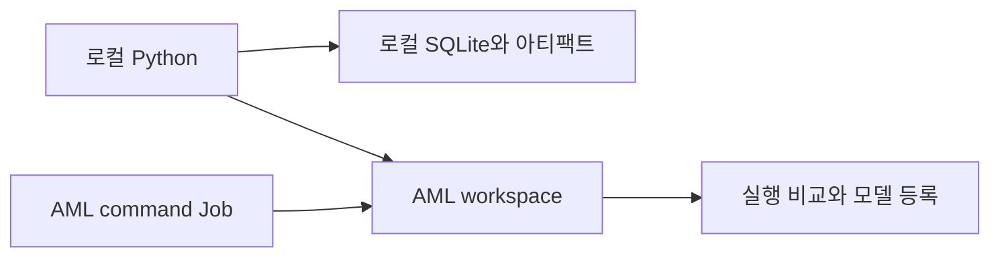

책에서 MLflow를 읽으며 모델 파일을 남기는 일과 실험을 설명할 기록을 남기는 일을 구분하게 됐다. 모델이 있어도 어떤 데이터와 설정으로 만들었는지 모르면 결과를 비교하거나 다시 실행하기 어렵다.

MLflow 자체의 기록 방식을 익힌 뒤 Azure Machine Learning을 붙이는 순서로 학습 과정을 정리했다. Azure Machine Learning은 아래에서 AML로 줄여 쓴다. 기준으로 삼은 자료는 [실험과 모델을 MLflow로 추적하는 공식 가이드](https://learn.microsoft.com/en-us/azure/machine-learning/how-to-use-mlflow-cli-runs?view=azureml-api-2&tabs=interactive%2Ccli)다.

AML을 붙인다는 말을 두 단계로 나눠 두었다. 로컬에서 학습하면서 기록만 AML에 보내는 것과, 학습 자체를 AML의 컴퓨팅에서 실행하는 것은 다르다.

## 1. 학습 순서와 확인할 결과

| 단계 | 학습 실행 위치 | 기록 위치 | 확인할 결과 |
| --- | --- | --- | --- |
| 1. 로컬 기록 | 로컬 Python | 로컬 SQLite와 파일 | 파라미터, 메트릭, 아티팩트가 실행별로 남는지 |
| 2. 비교와 모델 등록 | 로컬 Python | 같은 로컬 저장소 | 실행을 비교하고 선택한 모델을 다시 읽을 수 있는지 |
| 3. AML 원격 기록 | 로컬 Python | AML workspace | 학습 코드를 바꾸지 않고 기록 위치를 옮길 수 있는지 |
| 4. AML 학습 Job | AML CPU 클러스터 | 같은 AML workspace | 실행 환경과 학습 작업까지 서비스에 맡길 수 있는지 |

데이터는 scikit-learn에 포함된 Wine 분류 데이터셋을 쓴다. 별도 파일 다운로드나 고객 데이터가 없어도 실행할 수 있다. 목표는 분류 모델의 성능을 높이는 것보다 실험의 입력과 결과를 연결하는 데 있다.



## 2. MLflow에서 구분할 개념

| 개념 | 이 실습에서의 의미 | 예시 |
| --- | --- | --- |
| Experiment | 비교할 실행을 묶는 단위 | `mlflow-wine-study` |
| Run | 한 번의 학습과 기록 | `C=0.1`인 학습 한 번 |
| Parameter | 실행에 사용한 설정 | `C`, 분할 시드, 데이터 지문 |
| Metric | 실행 결과의 수치 | 검증 정확도, 검증 log loss |
| Artifact | 파일 형태의 결과 | 분류 보고서, 학습 코드 |
| MLflow Model | 모델과 입출력 및 환경 정보의 묶음 | `model` 경로의 Pipeline |
| Registered Model | 이름 아래 버전으로 관리할 모델 | `wine-logistic-study`의 특정 버전 |

Tracking URI는 기록을 보낼 대상을 가리킨다. 학습을 실행할 컴퓨터를 정하는 값은 아니다. 이 구분이 로컬 실습에서 AML로 넘어갈 때의 기준이다.

모델을 아티팩트로 올리는 것과 MLflow 모델로 기록하는 것도 다르다. `log_artifact()`는 파일을 올리고, `mlflow.sklearn.log_model()`은 모델 파일에 더해 `MLmodel`, 의존성, 입출력 signature 같은 정보를 묶는다.

## 3. 실습 환경과 파일 구성

명령은 Windows PowerShell을 기준으로 적었다. 별도 실습 폴더에서 실행하며, Python 3.11이 설치되어 있다는 전제다. 가상환경 활성화 없이 해당 환경의 실행 파일을 직접 호출한다.

```powershell
New-Item -ItemType Directory -Path mlflow-aml-lab
Set-Location .\mlflow-aml-lab
py -3.11 -m venv .venv
New-Item -ItemType Directory -Path src
```

작업 폴더의 구성은 다음과 같다. 아래 절의 코드를 각 파일명으로 저장한다. `conda.yml`과 `job.yml`은 AML 학습 Job 단계에서 추가한다.

```text
mlflow-aml-lab
  requirements.txt
  requirements-azure.txt
  compare.py
  finalize.py
  conda.yml
  job.yml
  src
    train.py
```

### 3.1 패키지 버전

이 예제는 MLflow 전체의 최신 기능보다 AML 모델 연동 경로에 맞췄다. [공식 모델 로깅 문서](https://learn.microsoft.com/en-us/azure/machine-learning/how-to-log-mlflow-models?view=azureml-api-2)는 현재 MLflow 2.16.x 이하를 사용하도록 명시하고 있어 `2.16.2`로 고정했다. MLflow 3.x의 예제를 섞지 않는다.

`requirements.txt`:

```text
mlflow==2.16.2
scikit-learn==1.5.1
pandas==2.2.3
numpy==1.26.4
sqlalchemy==2.0.43
```

```powershell
.\.venv\Scripts\python.exe -m pip install -r .\requirements.txt
.\.venv\Scripts\python.exe -m pip check
```

AML 연결에 필요한 플러그인은 원격 기록 단계에서 설치한다.

`requirements-azure.txt`:

```text
-r requirements.txt
azureml-mlflow==1.62.0.post6
```

SQLite 저장소에 사용하는 SQLAlchemy도 함께 고정했다. MLflow 버전만 고정해도 나머지 패키지의 새 버전이 설치되면서 실행이 달라질 수 있기 때문이다. 직접 지정하지 않은 의존성은 설치 시점에 결정되므로, 같은 조합으로 환경을 다시 만들려면 설치 후 `pip freeze` 결과도 보관한다.

```powershell
.\.venv\Scripts\python.exe -m pip freeze | Set-Content -Encoding utf8 .\requirements.local.lock.txt
```

이 버전 고정은 예제의 실행 기준이다. 공개 MLflow 서버 운영을 위한 보안 기준이나 최신 버전 권고를 뜻하지 않는다. 아래 UI는 로컬 루프백 주소에서만 사용한다.

## 4. 로컬에서 한 번의 학습 기록

### 4.1 데이터와 평가 기준

전체 데이터를 학습 60%, 검증 20%, 테스트 20% 비율로 나눈다. 표본 수는 분할 과정에서 정수로 조정된다. 시드와 분할 방식은 실행마다 같게 유지하고, `C`만 바꾼다.

`C`는 Logistic Regression의 규제 강도와 반대 방향으로 움직이는 값이다. 이 실습에서는 검증 정확도가 높은 후보를 고르고, 정확도가 같으면 검증 log loss가 낮은 후보를 고른다. 테스트 데이터는 후보 선택에 쓰지 않는다.

전처리인 `StandardScaler`와 분류기를 하나의 Pipeline으로 묶는다. 학습 데이터로만 전처리를 학습하고, 검증과 테스트에는 이미 학습한 변환을 적용하기 위해서다.

### 4.2 학습 코드

`src\train.py`:

```python
import argparse
import hashlib
import platform
from importlib.metadata import version
from time import perf_counter

import mlflow
import mlflow.sklearn
from mlflow.models import infer_signature
from sklearn.datasets import load_wine
from sklearn.linear_model import LogisticRegression
from sklearn.metrics import accuracy_score, classification_report, log_loss
from sklearn.model_selection import train_test_split
from sklearn.pipeline import Pipeline
from sklearn.preprocessing import StandardScaler


def load_data():
    dataset = load_wine(as_frame=True)
    fingerprint = hashlib.sha256(
        dataset.frame.to_csv(index=False).encode("utf-8")
    ).hexdigest()
    X_train, X_holdout, y_train, y_holdout = train_test_split(
        dataset.data,
        dataset.target,
        test_size=0.4,
        random_state=42,
        stratify=dataset.target,
    )
    X_val, X_test, y_val, y_test = train_test_split(
        X_holdout,
        y_holdout,
        test_size=0.5,
        random_state=42,
        stratify=y_holdout,
    )
    return X_train, X_val, X_test, y_train, y_val, y_test, fingerprint


def main():
    parser = argparse.ArgumentParser()
    parser.add_argument("--C", type=float, required=True)
    parser.add_argument("--autolog", action="store_true")
    args = parser.parse_args()
    if args.C <= 0:
        parser.error("--C must be greater than zero")

    X_train, X_val, _, y_train, y_val, _, fingerprint = load_data()
    model = Pipeline([
        ("scale", StandardScaler()),
        ("classifier", LogisticRegression(
            C=args.C, max_iter=1000, random_state=42
        )),
    ])

    if args.autolog:
        mlflow.sklearn.autolog(log_models=False, log_datasets=False)

    with mlflow.start_run() as run:
        mlflow.set_tags({
            "study": "mlflow-aml",
            "model_type": "scaled-logistic-regression",
        })
        mlflow.log_params({
            "C": args.C,
            "split_seed": 42,
            "dataset": "sklearn.load_wine",
            "dataset_sha256": fingerprint,
            "train_rows": len(X_train),
            "validation_rows": len(X_val),
        })

        started = perf_counter()
        model.fit(X_train, y_train)
        fit_seconds = perf_counter() - started
        predictions = model.predict(X_val)
        probabilities = model.predict_proba(X_val)
        mlflow.log_metrics({
            "validation_accuracy": accuracy_score(y_val, predictions),
            "validation_log_loss": log_loss(y_val, probabilities),
            "fit_seconds": fit_seconds,
        })
        mlflow.log_dict(
            classification_report(
                y_val, predictions, output_dict=True, zero_division=0
            ),
            "reports/validation.json",
        )
        mlflow.log_artifact(__file__, artifact_path="source")
        mlflow.log_dict(
            {
                "python": platform.python_version(),
                "packages": {
                    name: version(name)
                    for name in [
                        "mlflow", "scikit-learn", "pandas", "numpy",
                        "cloudpickle",
                    ]
                },
            },
            "environment.json",
        )
        mlflow.sklearn.log_model(
            sk_model=model,
            artifact_path="model",
            signature=infer_signature(X_train, model.predict(X_train)),
            input_example=X_train.head(3),
        )
        print(f"tracking_uri={mlflow.get_tracking_uri()}")
        print(f"run_id={run.info.run_id}")


if __name__ == "__main__":
    main()
```

Tracking URI와 experiment 이름을 학습 코드에 고정하지 않았다. 로컬에서는 환경 변수로 지정하고, AML Job에서는 서비스가 제공하는 실행 문맥을 사용한다.

`with mlflow.start_run()`은 실행의 시작과 종료를 묶는다. 예외가 발생하면 정상 완료와 구분된 실행 상태가 남는다. 실행 하나에서 `C`를 계속 덮어쓰는 대신 값마다 별도 run을 만든다.

### 4.3 세 번의 실행

모든 명령은 실습 폴더의 루트에서 실행한다. 상대 SQLite 경로를 사용하므로 작업 폴더가 바뀌면 다른 DB를 읽게 된다.

```powershell
$env:MLFLOW_TRACKING_URI = "sqlite:///mlflow.db"
$env:MLFLOW_REGISTRY_URI = $env:MLFLOW_TRACKING_URI
$env:MLFLOW_EXPERIMENT_NAME = "mlflow-wine-study"

foreach ($c in @("0.01", "0.1", "1.0")) {
    .\.venv\Scripts\python.exe .\src\train.py --C $c
    if ($LASTEXITCODE -ne 0) { throw "Training failed for C=$c" }
}
```

SQLite에는 실행 메타데이터가, 로컬 아티팩트 저장소에는 보고서와 모델 파일이 남는다. 이 예제의 기본 로컬 아티팩트 위치는 `mlruns`다. DB 파일만 복사하면 모델 파일까지 옮겨지는 것은 아니다.

### 4.4 UI에서 확인할 항목

같은 폴더에서 별도 PowerShell 창을 열고 실행한다.

```powershell
.\.venv\Scripts\mlflow.exe ui --backend-store-uri sqlite:///mlflow.db --host 127.0.0.1 --port 5000
```

브라우저에서 `http://127.0.0.1:5000`을 연다. UI 종료는 해당 터미널의 `Ctrl+C`로 처리한다.

| 확인 위치 | 남아 있어야 할 내용 |
| --- | --- |
| Experiment | `mlflow-wine-study` 아래 세 번의 실행 |
| Parameters | 서로 다른 `C`, 같은 데이터 지문과 분할 시드 |
| Metrics | 검증 정확도, 검증 log loss, 학습 시간 |
| Artifacts | `reports/validation.json`, `source/train.py`, `environment.json` |
| Model | `model` 아래 `MLmodel`과 모델 파일 및 환경 정보 |

Signature는 모델이 기대하는 열과 타입을 설명한다. 입력 예시는 호출 형태를 확인하는 자료다. 두 정보가 데이터 품질이나 업무상 정확성까지 보장하지는 않는다.

## 5. 실행 비교와 선택 기록

UI에서 좋은 실행을 찾는 것과 같은 기준으로 다시 선택할 수 있는 것은 다르다. 비교 기준을 코드로 남겨 두었다.

`compare.py`:

```python
import json
from pathlib import Path

import mlflow


experiment = mlflow.get_experiment_by_name("mlflow-wine-study")
if experiment is None:
    raise RuntimeError("Experiment not found in the current tracking backend")

runs = mlflow.search_runs(
    experiment_ids=[experiment.experiment_id],
    filter_string="tags.study = 'mlflow-aml'",
    max_results=1000,
)
if runs.empty:
    raise RuntimeError("No study runs found")

completed = runs.loc[runs["status"].str.upper().eq("FINISHED")].copy()
if completed.empty:
    raise RuntimeError("No completed runs found")

for key in ["params.dataset_sha256", "params.split_seed"]:
    if completed[key].nunique(dropna=False) != 1:
        raise RuntimeError(f"Runs have different comparison conditions: {key}")

ranked = completed.sort_values(
    ["metrics.validation_accuracy", "metrics.validation_log_loss"],
    ascending=[False, True],
)
columns = [
    "run_id", "params.C", "metrics.validation_accuracy",
    "metrics.validation_log_loss",
]
print(ranked[columns].to_string(index=False))

selected = {
    "tracking_uri": mlflow.get_tracking_uri(),
    "run_id": str(ranked.iloc[0]["run_id"]),
}
Path("selected-run.json").write_text(
    json.dumps(selected, indent=2), encoding="utf-8"
)
print("Selection written to selected-run.json")
```

```powershell
.\.venv\Scripts\python.exe .\compare.py
```

고정한 환경에서 로컬로 실행했을 때의 결과는 다음과 같았다. 표의 수치는 이 작은 데이터셋의 한 번의 분할에서 얻은 값이지, 다른 데이터의 성능 목표는 아니다.

| C | 검증 정확도 | 검증 log loss |
| --- | --- | --- |
| 0.01 | 0.972222 | 0.479026 |
| 0.1 | 0.972222 | 0.182284 |
| 1.0 | 1.000000 | 0.081011 |

이 결과에서는 `C=1.0`인 실행을 선택한다. `C=0.01`과 `0.1`은 정확도가 같지만 log loss에는 차이가 있다. 같은 정확도만으로 예측 확률의 품질까지 같다고 볼 수는 없다.

이 조회는 해당 experiment의 조건에 맞는 최대 1,000개 실행을 비교한다. 학습 코드나 평가 방식까지 바뀐다면 같은 그룹에 섞지 않고 experiment나 tag로 비교 범위를 나눌 필요가 있다.

정렬은 조회 후 DataFrame에서 처리했다. [AML의 실행 조회 문서](https://learn.microsoft.com/en-us/azure/machine-learning/how-to-track-experiments-mlflow?view=azureml-api-2#order-runs)는 서버의 `order_by`에서 `metrics.*` 정렬을 지원하지 않는다고 명시한다. 로컬에서 동작하는 조회 문법이 원격 서비스에서도 모두 같다고 가정하지 않았다.

`selected-run.json`에는 run ID와 기록 위치를 함께 남긴다. 서로 다른 저장소에 있는 같은 이름의 experiment를 혼동하지 않기 위해서다.

## 6. 모델 재로딩과 버전 등록

학습 때 사용한 Python 객체가 아니라 저장된 모델을 다시 읽어 예측한다. 테스트 데이터는 이 단계에서 선택된 후보에만 적용한다. 테스트 결과를 보며 계속 다른 `C`를 고르면 이 데이터도 모델 선택에 사용된 셈이 된다.

`finalize.py`:

```python
import json
from pathlib import Path

import mlflow
import mlflow.pyfunc
import numpy as np
from sklearn.metrics import accuracy_score

from src.train import load_data


selection = json.loads(
    Path("selected-run.json").read_text(encoding="utf-8")
)
if selection["tracking_uri"] != mlflow.get_tracking_uri():
    raise RuntimeError("Tracking backend changed; run compare.py again")
if mlflow.get_registry_uri() != mlflow.get_tracking_uri():
    raise RuntimeError("This lab requires tracking and registry in the same backend")

run_id = selection["run_id"]
run = mlflow.get_run(run_id)
_, _, X_test, _, _, y_test, fingerprint = load_data()
if run.data.params["dataset_sha256"] != fingerprint:
    raise RuntimeError("Current dataset differs from the selected run")

model = mlflow.pyfunc.load_model(f"runs:/{run_id}/model")
predictions = model.predict(X_test)
print(f"test_accuracy={accuracy_score(y_test, predictions):.4f}")

registered = mlflow.register_model(
    model_uri=f"runs:/{run_id}/model",
    name="wine-logistic-study",
)
model_uri = f"models:/{registered.name}/{registered.version}"
registered_model = mlflow.pyfunc.load_model(model_uri)
np.testing.assert_array_equal(
    predictions, registered_model.predict(X_test)
)
print(f"registered_model_uri={model_uri}")
```

```powershell
.\.venv\Scripts\python.exe .\finalize.py
```

| URI | 가리키는 대상 |
| --- | --- |
| `runs:/<run-id>/model` | 특정 실행에 기록한 모델 |
| `models:/wine-logistic-study/<version>` | 이름과 버전으로 등록한 모델 |

등록 후에는 처리 결과로 받은 구체적인 버전을 사용한다. 다시 실행하면 새 버전이 만들어지므로 항상 `1`이라고 가정하지 않는다.

모델 등록은 배포가 아니다. 아직 HTTP API나 추론용 VM을 만든 것은 아니다. 학습 환경과 다른 Python 환경에서 모델을 읽을 때는 필요한 의존성을 별도로 갖춰야 한다. 직렬화된 모델을 읽는 작업이므로, 출처를 신뢰할 수 없는 모델 파일을 가져와 실행하지 않는다.

## 7. Autologging을 더했을 때의 차이

수동 기록을 확인한 뒤 자동 기록을 더하는 순서로 잡았다.

```powershell
.\.venv\Scripts\python.exe .\src\train.py --C 0.1 --autolog
```

`--autolog`는 `mlflow.sklearn.autolog()`를 켠다. 이 예제에서는 모델의 자동 기록을 끄고, 같은 `log_model()`에서 signature와 입력 예시를 기록한다. 자동 기록과 수동 기록으로 같은 모델을 중복해서 남기지 않기 위해서다.

자동 기록으로 늘어나는 항목은 프레임워크와 버전에 따라 달라진다. 업무상 평가 기준, 데이터 이용 조건, 선택 이유까지 자동으로 기록되는 것은 아니다. 이 실습의 검증 메트릭과 데이터 지문은 수동으로 남긴다.

## 8. 로컬 학습의 기록 위치를 AML로 변경

여기부터는 AML workspace가 필요하다. workspace가 없다면 [초기 리소스 만들기](https://learn.microsoft.com/en-us/azure/machine-learning/quickstart-create-resources?view=azureml-api-2)를 별도의 준비 작업으로 둔다. workspace의 생성과 사용에는 연결된 스토리지 등의 비용도 관계된다.

### 8.1 인증과 권한

로컬 실행은 Azure CLI에 로그인한 사용자로 인증한다. workspace의 실험과 Job을 다룰 권한, 모델 등록 권한이 필요하다. workspace 범위의 `AzureML Data Scientist` 역할이 학습용 권한의 한 예다. 실제 부여는 조직의 권한 관리에 맞춘다.

```powershell
.\.venv\Scripts\python.exe -m pip install -r .\requirements-azure.txt
.\.venv\Scripts\python.exe -m pip check

az login
az extension add --name ml --upgrade

$subscription = "<subscription-id>"
$resourceGroup = "<resource-group>"
$workspace = "<workspace-name>"
az account set --subscription $subscription
```

이 로그인은 직접 실행하는 학습용 절차다. 무인 CI에 사용자의 브라우저 인증을 가져가는 방식은 아니다. 자동화할 때의 인증과 권한은 별도로 설계하고, 비밀 정보를 학습 코드나 Job YAML에 넣지 않는다.

### 8.2 Tracking URI 조회

```powershell
$trackingUri = az ml workspace show --name $workspace --resource-group $resourceGroup --subscription $subscription --query mlflow_tracking_uri --output tsv
if ($LASTEXITCODE -ne 0 -or [string]::IsNullOrWhiteSpace($trackingUri)) {
    throw "Could not read the workspace tracking URI"
}

$env:MLFLOW_TRACKING_URI = $trackingUri.Trim()
$env:MLFLOW_REGISTRY_URI = $env:MLFLOW_TRACKING_URI
$env:MLFLOW_EXPERIMENT_NAME = "mlflow-wine-study"
```

Tracking URI는 CLI가 반환한 값을 그대로 쓴다. 리전 이름 등으로 직접 조립하지 않는다. Private Link를 사용하는 workspace에서는 클라이언트의 네트워크 접근 경로와 이름 확인도 필요하다.

Tracking URI를 설정한 것만으로 인증과 통신이 확인되지는 않는다. 실제 experiment 조회나 run 시작처럼 서비스에 접근하는 작업에서 연결이 확인된다.

### 8.3 같은 코드로 재실행

```powershell
foreach ($c in @("0.01", "0.1", "1.0")) {
    .\.venv\Scripts\python.exe .\src\train.py --C $c
    if ($LASTEXITCODE -ne 0) { throw "AML tracking failed for C=$c" }
}
.\.venv\Scripts\python.exe .\compare.py
.\.venv\Scripts\python.exe .\finalize.py
```

학습은 계속 로컬 PC에서 실행된다. AML 학습 클러스터를 사용한 것은 아니다. Azure Machine Learning studio의 Jobs에서 experiment를 열어 파라미터, 메트릭, 파일과 모델을 확인한다.

AML workspace는 MLflow 호환 API를 제공한다. workspace 안에 MLflow 서버용 VM을 직접 만드는 절차가 아니다.

URI를 바꾸는 것만으로 기존 로컬 run과 모델이 이전되지는 않는다. 여기서는 같은 코드를 다시 실행해 AML에 새 run을 만든다. `compare.py`를 다시 실행하는 이유도 AML 쪽의 run ID를 선택하기 위해서다.

이 실습에서는 Tracking과 Registry를 같은 workspace에 맞췄다. 로컬의 `runs:/...`를 그대로 AML Registry에 넘기는 방식이 아니다.

## 9. 학습 실행 위치를 AML Job으로 변경

이 단계는 기존 AML CPU compute cluster를 사용한다. 아래의 `cpu-cluster`는 실제 이름으로 바꾼다. 클러스터가 없다면 [compute cluster 만들기](https://learn.microsoft.com/en-us/azure/machine-learning/how-to-create-attach-compute-cluster?view=azureml-api-2)를 준비 작업으로 둔다.

학습용이라도 리전의 SKU와 할당량, 최소 노드 수, 최대 노드 수, 유휴 시 축소 설정을 확인한다. 로컬에서 원격 기록만 보내던 단계와 달리, 여기부터는 원격 학습용 컴퓨팅도 사용한다.

### 9.1 실행 환경

`conda.yml`:

```yaml
name: mlflow-wine-study
channels:
  - conda-forge
dependencies:
  - python=3.11
  - pip
  - pip:
      - mlflow==2.16.2
      - azureml-mlflow==1.62.0.post6
      - scikit-learn==1.5.1
      - pandas==2.2.3
      - numpy==1.26.4
      - sqlalchemy==2.0.43
```

로컬에 설치한 플러그인이 Job 컨테이너에도 있는 것은 아니다. 원격 환경에도 `azureml-mlflow`와 같은 학습 의존성을 포함한다.

### 9.2 Job 정의

`job.yml`:

```yaml
$schema: https://azuremlschemas.azureedge.net/latest/commandJob.schema.json
type: command
display_name: mlflow-wine-study
experiment_name: mlflow-wine-study
code: ./src
command: python train.py --C ${{inputs.c}}
inputs:
  c: 0.1
environment:
  image: mcr.microsoft.com/azureml/openmpi4.1.0-ubuntu22.04:latest
  conda_file: ./conda.yml
compute: azureml:cpu-cluster
limits:
  timeout: 1800
tags:
  study: mlflow-aml
```

`code`는 `src`만 지정했다. 실습 폴더 전체를 올리면 가상환경, 로컬 DB, 인증용 파일이 함께 전송될 수 있다.

학습 코드에 Tracking URI나 `set_experiment()`를 추가하지 않는다. AML Job에서는 실행하는 workspace가 추적 대상으로 설정되고, `experiment_name`과 `display_name`은 Job 정의에서 정한다. `start_run()`에 별도의 `run_name`도 전달하지 않는다.

이 YAML은 학습용 설정 예시이며 베이스 이미지의 `latest` 태그는 나중에 바뀔 수 있다. 같은 환경을 고정해 운영하는 단계에서는 이미지 digest와 등록된 AML Environment의 버전도 관리할 대상이다.

### 9.3 Job 제출과 결과 확인

8절과 같은 PowerShell 세션에서 실행한다. 다른 터미널이라면 subscription, resource group, workspace 변수를 다시 설정한다.

```powershell
$jobNames = foreach ($c in @("0.01", "0.1", "1.0")) {
    $name = az ml job create --file .\job.yml --resource-group $resourceGroup --workspace-name $workspace --subscription $subscription --set "inputs.c=$c" --query name --output tsv
    if ($LASTEXITCODE -ne 0) { throw "Job submission failed for C=$c" }
    $name
}

foreach ($name in $jobNames) {
    az ml job stream --name $name --resource-group $resourceGroup --workspace-name $workspace --subscription $subscription
}
```

Job 제출 성공과 학습 완료는 다른 상태다. studio 또는 아래 명령으로 각 Job이 `Completed`인지 확인한다. 실패했다면 비교로 넘어가기 전에 로그에서 원인을 확인한다.

```powershell
foreach ($name in $jobNames) {
    az ml job show --name $name --resource-group $resourceGroup --workspace-name $workspace --subscription $subscription --query status --output tsv
}
```

완료 후에는 로컬에서 같은 `compare.py`로 AML 쪽 결과를 조회할 수 있다. 8절의 로컬 학습과 같은 experiment를 사용하므로 그 실행도 비교 대상에 포함된다.

```powershell
.\.venv\Scripts\python.exe .\compare.py
.\.venv\Scripts\python.exe .\finalize.py
```

이 실습은 AML CLI v2의 command Job을 사용한다. `MLproject` 파일을 이용한 AML 학습 제출 경로와는 구분했다. [공식 MLflow 개요](https://learn.microsoft.com/en-us/azure/machine-learning/concept-mlflow?view=azureml-api-2#training-with-mlflow-projects-preview)에는 해당 경로의 2026년 9월 종료와 Jobs로의 전환이 안내되어 있다. MLflow Tracking 자체가 종료된다는 뜻은 아니다.

## 10. 연결할 때 나누어 확인할 부분

| 증상 | 확인할 범위 |
| --- | --- |
| `azureml://`를 처리할 수 없다는 오류 | 실행 중인 Python 환경에 `azureml-mlflow`가 있는지 |
| 로컬에만 run이 나타남 | 실제 `mlflow.get_tracking_uri()`와 환경 변수를 설정한 터미널 |
| 401 또는 403 | 로그인한 tenant와 subscription, workspace에 대한 권한 |
| 시간 초과나 이름 확인 오류 | workspace와 관련 스토리지의 통신, Private Link와 DNS |
| 메트릭은 있지만 모델 기록에 실패 | MLflow와 플러그인 버전, 아티팩트 접근 |
| AML Job에 기대한 설정이 없음 | `job.yml`의 inputs와 command, 업로드한 코드 |
| 비교할 run을 찾지 못함 | experiment 이름, 추적 대상, 실행 상태와 tag |
| `finalize.py`가 추적 대상 차이로 중단됨 | 같은 추적 대상에서 `compare.py`를 다시 실행했는지 |

기록 후 UI에서 다른 workspace를 보고 있을 수도 있다. experiment 이름뿐 아니라 subscription, workspace, run ID의 조합으로 확인한다.

학습 코드에는 예외를 숨기는 처리를 넣지 않았다. 모델을 저장하지 못한 실행에서 정확도만 표시하고 성공한 것처럼 다루지 않기 위해서다.

## 11. 비용과 정리

이 절차에서는 온라인 추론 엔드포인트를 만들지 않는다. 모델을 등록했다고 HTTP 서비스가 시작되는 것은 아니다.

| 대상 | 학습 후 확인할 것 |
| --- | --- |
| 로컬 UI | 터미널에서 종료했는지 |
| AML compute cluster | 실행 중인 Job과 노드 수, 최소 노드 수, 축소 설정 |
| Compute instance | 별도로 켰다면 중지할 대상인지 |
| 모델과 아티팩트 | 저장량과 보존 기간, 남겨 둘 비교 결과 |
| Workspace 관련 리소스 | 스토리지 등 컴퓨팅 중지 후에도 남는 비용 |

Job이 끝나도 모든 관련 비용이 0이 되는 것은 아니다. 공유 workspace나 공유 클러스터는 실습 종료를 이유로 삭제하지 않는다.

## 12. 생각할 점

### 기록 대상과 실행 대상 중 바꾼 것

로컬 학습의 기록을 AML에 보낸 단계와 AML Job을 다시 실행한 단계를 별도로 확인한다. 둘을 나누면 인증과 추적 API 문제를 컨테이너와 컴퓨팅 문제로부터 구분하기 쉽다.

### 자동 기록으로 부족한 정보

데이터 지문은 이번 표의 내용을 식별하는 정보이지 데이터 이용 권한이나 수집 시점을 설명하는 정보는 아니다. 실제 데이터라면 저장 위치, 스냅샷, 사용 범위, 라벨 정의도 필요하다.

### 모델 등록과 출시 판단 사이

등록 성공이 성능, 지연, 입력 품질, 접근 제어를 충족했다는 뜻은 아니다. 이 실습의 검증 점수를 그대로 프로덕션 승인 기준으로 쓰지는 않는다.

### 기록의 재조회와 실험의 재현

저장한 모델을 읽는 것, 같은 코드를 실행하는 것, 같은 수치를 얻는 것은 다른 확인이다. 데이터와 분할 조건에 더해 Python, 의존성, 실행 환경까지 기록하는 이유로 남았다.

### 직접 바꿔 볼 조건

- `C`를 바꾼 실행에서 설정과 결과가 별도 run으로 남는지 확인한다.
- 저장한 모델에 필수 입력 열을 뺀 DataFrame을 전달해 signature 검사가 어떻게 실패하는지 확인한다.
- 기록 위치를 바꾼 뒤 기존 선택 파일로 모델을 읽으려 할 때 `finalize.py`가 중단되는지 확인한다.

로컬 예제는 학습, 비교, 모델 재로딩과 등록, 자동 기록까지 실행한 범위다. AML 연결 명령과 Job 정의는 공식 문서를 기준으로 정리했으며, 실제 workspace 접속과 원격 Job 실행은 별도로 확인할 범위로 남겨 둔다.

## 참고 자료

- [MLflow로 실험과 모델 추적](https://learn.microsoft.com/en-us/azure/machine-learning/how-to-use-mlflow-cli-runs?view=azureml-api-2&tabs=interactive%2Ccli)
- [Azure Machine Learning의 MLflow 연결 설정](https://learn.microsoft.com/en-us/azure/machine-learning/how-to-use-mlflow-configure-tracking?view=azureml-api-2)
- [MLflow 모델 기록과 버전 조건](https://learn.microsoft.com/en-us/azure/machine-learning/how-to-log-mlflow-models?view=azureml-api-2)
- [실험과 실행 조회 및 비교](https://learn.microsoft.com/en-us/azure/machine-learning/how-to-track-experiments-mlflow?view=azureml-api-2)
- [MLflow를 이용한 모델 Registry 관리](https://learn.microsoft.com/en-us/azure/machine-learning/how-to-manage-models-mlflow?view=azureml-api-2)
- [AML command Job YAML 명세](https://learn.microsoft.com/en-us/azure/machine-learning/reference-yaml-job-command?view=azureml-api-2)

MLflow API, AML 서비스의 지원 범위, 플러그인의 의존성은 따로 바뀐다. 환경을 다시 만들 때는 이 노트의 고정 버전과 공식 문서의 버전 조건을 함께 확인한다.
