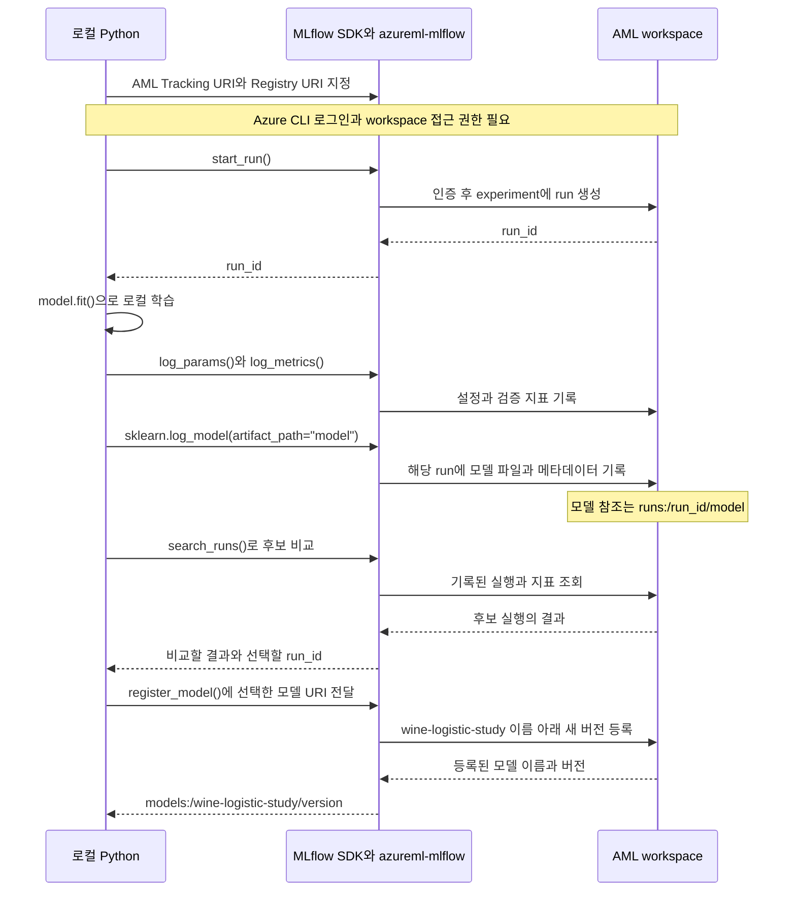
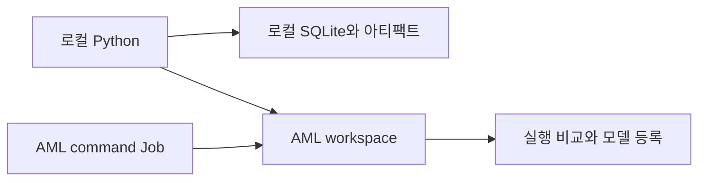
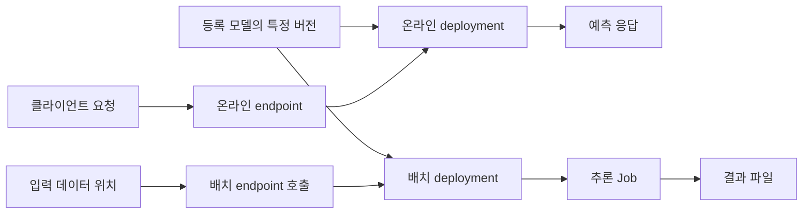

책에서 MLflow를 읽으며 모델 파일을 남기는 일과 실험을 설명할 기록을 남기는 일을 구분하게 됐다. 모델이 있어도 어떤 데이터와 설정으로 만들었는지 모르면 결과를 비교하거나 다시 실행하기 어렵다.

MLflow 자체의 기록 방식을 익힌 뒤 Azure Machine Learning을 붙이는 순서로 학습 과정을 정리했다. Azure Machine Learning은 아래에서 AML로 줄여 쓴다. [MLflow와 AML의 관계](https://learn.microsoft.com/en-us/azure/machine-learning/concept-mlflow?view=azureml-api-2), [아티팩트와 모델 형식](https://learn.microsoft.com/en-us/azure/machine-learning/concept-mlflow-models?view=azureml-api-2), [실험과 실행 추적](https://learn.microsoft.com/en-us/azure/machine-learning/how-to-use-mlflow-cli-runs?view=azureml-api-2&tabs=interactive%2Ccli)을 출발점으로 연결 설정, 조회, 모델 등록과 배포 문서까지 함께 읽었다.

AML을 붙인다는 말을 두 단계로 나눠 두었다. 로컬에서 학습하면서 기록만 AML에 보내는 것과, 학습 자체를 AML의 컴퓨팅에서 실행하는 것은 다르다.

## 전체 흐름: 로컬 학습 결과를 AML 모델로 등록하기

이 예제에서 MLflow는 로컬 Python 코드가 호출하는 라이브러리다. 별도의 로컬 MLflow 서버에 모델을 보낸 뒤 그 서버가 AML로 옮기는 구조가 아니다. `azureml-mlflow` 플러그인을 설치하고 기록 대상을 AML workspace로 지정하면, 같은 Python 코드의 MLflow 호출이 AML에 실행 정보와 모델을 남긴다.

학습, 실행 기록, 모델 등록을 나누어 보니 흐름을 이해하기 쉬웠다. `model.fit()`은 모델을 학습하고, `log_model()`은 학습한 모델을 특정 run의 결과물로 기록하며, `register_model()`은 그 결과물을 모델 이름 아래의 버전으로 등록한다. 모델을 학습했다는 사실만으로 뒤의 두 작업까지 수행되지는 않는다.

### 로컬 Python과 AML 사이의 호출 순서

아래는 8절의 AML 원격 기록 단계를 기준으로 그린 흐름이다. 학습과 비교 코드는 로컬에서 실행하고, 기록과 등록은 같은 AML workspace를 대상으로 한다. SDK와 플러그인도 로컬 Python 프로세스 안에서 동작하는 라이브러리이며, 그림에서 나눈 칸은 별도 서버를 뜻하지 않는다.



AML이 실행 메타데이터를 관리하고, 모델 파일과 보고서는 workspace에 연결된 아티팩트 저장소에 보관한다. `log_model()` 단계에서는 모델 파일도 원격에 기록한다. 모델 이름과 버전을 부여하는 등록 요청은 이 예제의 `register_model()` 단계에서 별도로 보낸다.

### 각 호출이 만드는 결과

| 순서 | 코드나 설정 | 남는 결과 |
| --- | --- | --- |
| 1. 대상 지정 | 두 URI를 AML workspace로 설정 | 이후 기록과 등록을 보낼 대상이 정해짐. 아직 학습이나 모델 등록은 없음 |
| 2. 실행 시작 | `mlflow.start_run()` | experiment 아래에 run이 생기고 `run_id`를 받음 |
| 3. 학습과 평가 | `model.fit()`, 검증 코드 | 로컬 메모리에 학습한 모델과 평가 결과가 생김 |
| 4. 결과 기록 | `log_params()`, `log_metrics()`, `sklearn.log_model()` | AML에 설정, 지표, 모델이 해당 run의 결과로 남음 |
| 5. 후보 선택 | `compare.py`의 `search_runs()` | 검증 결과로 선택한 `run_id`를 `selected-run.json`에 남김 |
| 6. 버전 등록 | `finalize.py`의 `register_model()` | `wine-logistic-study`라는 모델 이름 아래 새 버전이 생김 |

`finalize.py`에서 등록에 사용하는 호출은 다음 부분이다. 아래는 전체 파일에서 등록 요청만 뽑은 코드이며, `run_id`는 같은 AML workspace에서 선택한 실행의 ID다.

```python
registered = mlflow.register_model(
    model_uri=f"runs:/{run_id}/model",
    name="wine-logistic-study",
)
```

`runs:/<run_id>/model`은 로컬 폴더 경로가 아니다. 현재 Tracking URI가 가리키는 저장소에서 특정 run에 기록한 `model`을 참조한다. Registry URI도 같은 AML workspace로 맞췄으므로 그 모델이 같은 workspace의 모델 버전으로 등록된다.

AML studio에서는 실행과 지표를 Jobs의 experiment에서, 등록한 모델 이름과 버전을 Models에서 확인한다. 로컬에서 학습한 실행도 Jobs에 보일 수 있다. 화면에 Job으로 표시된다는 사실과 AML 클러스터가 학습을 수행했다는 사실은 구분한다.

### 이 가이드의 로컬 연습과 AML 연결

1. 1~7절에서는 같은 API를 로컬 SQLite와 파일 저장소에 연결해 연습한다. 이때 등록한 모델도 로컬에 있으며 AML에 등록된 것은 아니다.
2. 8절에서는 Tracking URI와 Registry URI를 AML로 바꾼 뒤 `train.py`, `compare.py`, `finalize.py`를 다시 실행한다. 이 과정에서 AML에 새 run과 모델 버전이 생긴다. 이전 로컬 기록이 자동으로 이전되는 것은 아니다.
3. 9절에서는 `train.py`의 실행 위치도 AML compute cluster로 옮긴다. 학습 위치가 바뀌어도 결과 기록과 모델 등록의 구분은 같다.

모델 버전이 등록된 뒤에도 추론 서비스는 별도의 작업이다. 이 가이드의 등록 단계에서는 온라인 엔드포인트를 만들거나 모델에 요청을 보내는 서비스를 시작하지 않는다.

## 공식 문서를 연결해 읽는 순서

개요 문서 하나가 연결, 모델 파일 구조, 등록과 배포의 세부 조건을 모두 설명하지는 않는다. 각 문서에서 확인한 내용을 아래 흐름에 연결했다. 학습용 실행 코드는 1~9절에, 등록한 모델을 소비하는 방식은 10절에 정리했다.

| 읽는 순서 | 묶어서 볼 문서 | 이해할 내용 | 이 노트에서 확인할 부분 |
| --- | --- | --- | --- |
| 서비스와 도구의 관계 | MLflow 개요와 연결 설정 | 클라이언트, 플러그인, workspace가 맡는 일 | 전체 흐름과 2절, 8절 |
| 모델의 계약 | 아티팩트와 모델, 모델 로깅, 기존 모델 변환 | 모델 파일 외에 flavor, signature, 의존성이 필요한 이유 | 2절, 4절, 6절 |
| 실행과 기록 | 실행 추적, 메트릭과 파일 기록 | experiment와 run, 수동 기록과 자동 기록의 구분 | 4~7절 |
| 조회와 등록 | 실행 조회, 모델 Registry 관리 | 기록을 다시 읽어 후보를 고르고 구체 버전을 만드는 과정 | 5~6절, 8절 |
| 실행 환경의 이동 | 연결 설정과 command Job 명세 | 로컬 학습과 원격 기록, AML 학습 Job의 차이 | 8~9절 |
| 모델의 소비 | 배포 지침, 온라인 및 배치 배포, 점진적 전환 | 모델 버전, 배포, 요청 형식과 실행 결과의 연결 | 10절 |

문서별 URL과 학습 후 확인할 결과는 마지막의 자료 표에 모았다. Databricks와 Synapse 연결은 로컬 실습을 이해한 뒤 볼 별도 경로로 구분했다.

## 1. 학습 순서와 확인할 결과

| 단계 | 학습 실행 위치 | 기록 위치 | 확인할 결과 |
| --- | --- | --- | --- |
| 1. 로컬 기록 | 로컬 Python | 로컬 SQLite와 파일 | 파라미터, 메트릭, 아티팩트가 실행별로 남는지 |
| 2. 비교와 모델 등록 | 로컬 Python | 같은 로컬 저장소 | 실행을 비교하고 선택한 모델을 다시 읽을 수 있는지 |
| 3. AML 원격 기록 | 로컬 Python | AML workspace | 학습 코드를 바꾸지 않고 기록 위치를 옮길 수 있는지 |
| 4. AML 학습 Job | AML CPU 클러스터 | 같은 AML workspace | 실행 환경과 학습 작업까지 서비스에 맡길 수 있는지 |
| 5. 추론 방식 검토 | AML 온라인 배포 또는 배치 Job | 배포 설정과 추론 결과 | 등록한 모델을 어떤 입력 계약과 컴퓨팅으로 사용할지 |

데이터는 scikit-learn에 포함된 Wine 분류 데이터셋을 쓴다. 별도 파일 다운로드나 고객 데이터가 없어도 실행할 수 있다. 목표는 분류 모델의 성능을 높이는 것보다 실험의 입력과 결과를 연결하는 데 있다.

1~4단계는 같은 학습 코드를 옮기는 실습이다. 5단계는 별도 비용과 운영 조건이 생기는 후속 학습 범위이며, 아래 학습 스크립트가 엔드포인트까지 자동 생성하지는 않는다.



## 2. MLflow에서 구분할 개념

| 개념 | 이 실습에서의 의미 | 예시 |
| --- | --- | --- |
| Experiment | 비교할 실행을 묶는 단위 | `mlflow-wine-study` |
| Run | 한 번의 학습과 기록 | `C=0.1`인 학습 한 번 |
| Parameter | 실행에 사용한 설정 | `C`, 분할 시드, 데이터 지문 |
| Metric | 실행 결과의 수치 | 검증 정확도, 검증 log loss |
| Artifact | 파일 형태의 결과 | 분류 보고서, 학습 코드 |
| MLflow Model | 모델과 입출력 및 환경 정보의 묶음 | `model` 경로의 Pipeline |
| Registered Model | 이름 아래 버전으로 관리할 모델 | `wine-logistic-study`의 특정 버전 |

Tracking URI는 기록을 보낼 대상을 가리킨다. 학습을 실행할 컴퓨터를 정하는 값은 아니다. 이 구분이 로컬 실습에서 AML로 넘어갈 때의 기준이다.

모델을 아티팩트로 올리는 것과 MLflow 모델로 기록하는 것도 다르다. `log_artifact()`는 파일을 올리고, `mlflow.sklearn.log_model()`은 모델 파일에 더해 `MLmodel`, 의존성, 입출력 signature 같은 정보를 묶는다.

### 2.1 라이브러리와 서비스의 역할

[MLflow 개요](https://learn.microsoft.com/en-us/azure/machine-learning/concept-mlflow?view=azureml-api-2)는 AML이 오픈소스 MLflow 서버 인스턴스를 호스팅하는 것이 아니라 호환 API를 제공한다고 설명한다. 그래서 서버 프로세스의 설치와 AML workspace 연결을 같은 작업으로 보지 않았다.

| 구성 요소 | 맡는 일 | 이 예제의 사용 위치 |
| --- | --- | --- |
| `mlflow` | 실행 기록, 조회, 모델 패키징과 로딩 | 학습 및 비교 스크립트 |
| `azureml-mlflow` | `azureml://` 대상과의 연동, 인증과 아티팩트 처리 | AML에 연결하는 Python 환경 |
| `azure-ai-ml`의 `MLClient` 또는 Azure CLI의 `ml` 확장 | workspace, compute, Job, 모델 자산과 배포 관리 | 이 예제에서는 CLI로 URI 조회와 Job 제출 |
| AML workspace | 실험과 실행, 모델 자산을 관리하는 서비스 범위 | 기록과 등록의 대상 |
| 아티팩트 저장소 | 모델과 보고서 등의 실제 파일 보관 | workspace에 연결된 저장소 |

AML SDK v2의 `MLClient`를 만든다고 학습 메트릭이 자동으로 기록되는 것은 아니다. 리소스와 Job 관리는 CLI나 SDK v2로, 학습 결과의 구조화된 기록은 MLflow로 나누었다. 이 실습은 CLI를 사용하므로 로컬에 `azure-ai-ml`을 별도로 설치하지 않는다.

### 2.2 MLflow 모델 폴더의 구조

모델의 기준은 폴더 이름이 아니라 안에 있는 `MLmodel` 파일이다. 이 실습에서는 `model`이라는 경로를 선택했지만, 이름을 `classifier`로 바꾸어도 같은 형식을 쓸 수 있다.

```text
model
  MLmodel
  model.pkl
  conda.yaml
  requirements.txt
  python_env.yaml
  input_example.json
  serving_input_example.json
```

위 목록은 이번 scikit-learn 예제의 구조다. 다른 프레임워크는 가중치 파일이나 추가 코드의 형식이 달라질 수 있다.

| 구성 | 설명하는 것 | 확인할 이유 |
| --- | --- | --- |
| `MLmodel` | flavor, 모델 파일 위치, signature 등 | 어떤 방식으로 모델을 읽고 실행할지 판단 |
| `model.pkl` | 이번 Pipeline의 학습된 상태 | 전처리와 분류기가 함께 저장되었는지 확인 |
| 환경 파일 | Python과 패키지 의존성 | 학습 시점과 추론 시점의 환경 비교 |
| 입력 예시 파일 | 모델에 전달할 데이터의 예 | 열 이름, 형태, 요청 예시 확인 |

모델 파일 하나를 임의의 폴더에 넣고 이름만 `mlflow_model`로 지정해도 이 구조가 생기는 것은 아니다. MLflow의 저장 또는 로깅 API로 모델의 로딩 방식과 의존성까지 표현해야 한다.

### 2.3 Flavor와 signature

Flavor는 모델을 저장하고 읽는 방법이다. 이번 모델의 `MLmodel`에는 `sklearn`과 `python_function` 두 flavor가 들어간다.

| 읽는 방법 | 얻는 대상 | 사용할 때의 차이 |
| --- | --- | --- |
| `mlflow.sklearn.load_model()` | 원래의 scikit-learn Pipeline | `predict()`와 `predict_proba()` 등 원래 인터페이스 사용 |
| `mlflow.pyfunc.load_model()` | 공통 `predict()` 인터페이스의 모델 래퍼 | 프레임워크에 덜 의존하는 추론 호출 |

이 예제의 PyFunc `predict()`는 클래스 번호를 반환한다. PyFunc로 읽었다고 예측 확률로 바뀌지는 않는다. 확률이나 후처리 결과를 반환하려면 로깅 단계에서 예측 동작을 바꾸거나 별도 래퍼로 패키징해야 한다.

Signature는 그 인터페이스가 기대하는 입력과 출력을 설명한다. Wine 예제는 13개 수치 열을 가진 DataFrame을 받는 column 기반 signature다. 이미지나 다차원 배열은 tensor 기반 signature로 차원과 타입을 표현할 수 있다. 타입 검사를 통과했다는 사실과 값이 업무상 올바르다는 사실은 다르다.

### 2.4 모델 환경과 AML 실행 환경

MLflow 모델의 `conda.yaml`은 모델을 읽고 예측하는 데 필요한 의존성이다. 9절에서 만드는 실습 루트의 `conda.yml`은 AML 학습 Job의 실행 환경이다. 이름이 비슷해도 적용 대상이 다르다.

| 환경 | 적용 대상 | 확인할 내용 |
| --- | --- | --- |
| 로컬 가상환경 | 학습과 조회를 실행하는 로컬 Python | MLflow와 플러그인이 실제 인터프리터에 설치되었는지 |
| MLflow 모델 환경 | 저장된 모델의 로딩과 추론 | 모델 패키지의 의존성이 충분한지 |
| AML Job 환경 | 원격 학습 컨테이너 | 학습 코드와 패키지, 이미지가 맞는지 |
| AML 배포 환경 | 온라인 또는 배치 추론 런타임 | 추론 서버와 모델 의존성, 네트워크 조건이 맞는지 |

환경 파일이 있다고 로컬의 `load_model()`이 의존성을 자동 설치하는 것은 아니다. AML의 no-code 배포가 모델 환경으로 추론 환경을 구성하는 것과도 구분한다.

## 3. 실습 환경과 파일 구성

명령은 Windows PowerShell을 기준으로 적었다. 별도 실습 폴더에서 실행하며, Python 3.11이 설치되어 있다는 전제다. 가상환경 활성화 없이 해당 환경의 실행 파일을 직접 호출한다.

```powershell
New-Item -ItemType Directory -Path mlflow-aml-lab
Set-Location .\mlflow-aml-lab
py -3.11 -m venv .venv
New-Item -ItemType Directory -Path src
```

작업 폴더의 구성은 다음과 같다. 아래 절의 코드를 각 파일명으로 저장한다. `conda.yml`과 `job.yml`은 AML 학습 Job 단계에서 추가한다.

```text
mlflow-aml-lab
  requirements.txt
  requirements-azure.txt
  compare.py
  inspect_run.py
  finalize.py
  make_request.py
  conda.yml
  job.yml
  src
    train.py
```

### 3.1 패키지 버전

이 예제는 MLflow 전체의 최신 기능보다 AML 모델 연동 경로에 맞췄다. [공식 모델 로깅 문서](https://learn.microsoft.com/en-us/azure/machine-learning/how-to-log-mlflow-models?view=azureml-api-2)는 현재 MLflow 2.16.x 이하를 사용하도록 명시하고 있어 `2.16.2`로 고정했다. MLflow 3.x의 예제를 섞지 않는다.

연결된 모델 변환 문서에는 `name=`을 사용하는 예시도 있다. 이 노트의 실행 코드는 2.16.2 기준의 `artifact_path=`로 통일했다. 서로 다른 문서의 예제를 가져올 때 호출 인자와 설치 버전을 함께 확인할 부분이다.

`requirements.txt`:

```text
mlflow==2.16.2
scikit-learn==1.5.1
pandas==2.2.3
numpy==1.26.4
sqlalchemy==2.0.43
```

```powershell
.\.venv\Scripts\python.exe -m pip install -r .\requirements.txt
.\.venv\Scripts\python.exe -m pip check
```

AML 연결에 필요한 플러그인은 원격 기록 단계에서 설치한다.

`requirements-azure.txt`:

```text
-r requirements.txt
azureml-mlflow==1.62.0.post6
```

SQLite 저장소에 사용하는 SQLAlchemy도 함께 고정했다. MLflow 버전만 고정해도 나머지 패키지의 새 버전이 설치되면서 실행이 달라질 수 있기 때문이다. 직접 지정하지 않은 의존성은 설치 시점에 결정되므로, 같은 조합으로 환경을 다시 만들려면 설치 후 `pip freeze` 결과도 보관한다.

```powershell
.\.venv\Scripts\python.exe -m pip freeze | Set-Content -Encoding utf8 .\requirements.local.lock.txt
```

이 버전 고정은 예제의 실행 기준이다. 공개 MLflow 서버 운영을 위한 보안 기준이나 최신 버전 권고를 뜻하지 않는다. 아래 UI는 로컬 루프백 주소에서만 사용한다.

원격 기록용 클라이언트만 필요하면 `mlflow-skinny`를 검토할 수 있다. 다만 SQLite 저장소, 로컬 서버와 UI를 포함하는 이번 실습에서는 전체 `mlflow` 패키지를 사용한다.

## 4. 로컬에서 한 번의 학습 기록

### 4.1 데이터와 평가 기준

전체 데이터를 학습 60%, 검증 20%, 테스트 20% 비율로 나눈다. 표본 수는 분할 과정에서 정수로 조정된다. 시드와 분할 방식은 실행마다 같게 유지하고, `C`만 바꾼다.

`C`는 Logistic Regression의 규제 강도와 반대 방향으로 움직이는 값이다. 이 실습에서는 검증 정확도가 높은 후보를 고르고, 정확도가 같으면 검증 log loss가 낮은 후보를 고른다. 테스트 데이터는 후보 선택에 쓰지 않는다.

전처리인 `StandardScaler`와 분류기를 하나의 Pipeline으로 묶는다. 학습 데이터로만 전처리를 학습하고, 검증과 테스트에는 이미 학습한 변환을 적용하기 위해서다.

### 4.2 학습 코드

`src\train.py`:

```python
import argparse
import hashlib
import platform
from importlib.metadata import version
from time import perf_counter

import mlflow
import mlflow.sklearn
from mlflow.models import infer_signature
from sklearn.datasets import load_wine
from sklearn.linear_model import LogisticRegression
from sklearn.metrics import accuracy_score, classification_report, log_loss
from sklearn.model_selection import train_test_split
from sklearn.pipeline import Pipeline
from sklearn.preprocessing import StandardScaler


def load_data():
    dataset = load_wine(as_frame=True)
    fingerprint = hashlib.sha256(
        dataset.frame.to_csv(index=False).encode("utf-8")
    ).hexdigest()
    X_train, X_holdout, y_train, y_holdout = train_test_split(
        dataset.data,
        dataset.target,
        test_size=0.4,
        random_state=42,
        stratify=dataset.target,
    )
    X_val, X_test, y_val, y_test = train_test_split(
        X_holdout,
        y_holdout,
        test_size=0.5,
        random_state=42,
        stratify=y_holdout,
    )
    return X_train, X_val, X_test, y_train, y_val, y_test, fingerprint


def main():
    parser = argparse.ArgumentParser()
    parser.add_argument("--C", type=float, required=True)
    parser.add_argument("--autolog", action="store_true")
    args = parser.parse_args()
    if args.C <= 0:
        parser.error("--C must be greater than zero")

    X_train, X_val, _, y_train, y_val, _, fingerprint = load_data()
    model = Pipeline([
        ("scale", StandardScaler()),
        ("classifier", LogisticRegression(
            C=args.C, max_iter=1000, random_state=42
        )),
    ])

    if args.autolog:
        mlflow.sklearn.autolog(log_models=False, log_datasets=False)

    with mlflow.start_run() as run:
        mlflow.set_tags({
            "study": "mlflow-aml",
            "model_type": "scaled-logistic-regression",
        })
        mlflow.log_params({
            "C": args.C,
            "split_seed": 42,
            "dataset": "sklearn.load_wine",
            "dataset_sha256": fingerprint,
            "train_rows": len(X_train),
            "validation_rows": len(X_val),
        })

        started = perf_counter()
        model.fit(X_train, y_train)
        fit_seconds = perf_counter() - started
        predictions = model.predict(X_val)
        probabilities = model.predict_proba(X_val)
        mlflow.log_metrics({
            "validation_accuracy": accuracy_score(y_val, predictions),
            "validation_log_loss": log_loss(y_val, probabilities),
            "fit_seconds": fit_seconds,
        })
        mlflow.log_dict(
            classification_report(
                y_val, predictions, output_dict=True, zero_division=0
            ),
            "reports/validation.json",
        )
        mlflow.log_artifact(__file__, artifact_path="source")
        mlflow.log_dict(
            {
                "python": platform.python_version(),
                "packages": {
                    name: version(name)
                    for name in [
                        "mlflow", "scikit-learn", "pandas", "numpy",
                        "cloudpickle",
                    ]
                },
            },
            "environment.json",
        )
        mlflow.sklearn.log_model(
            sk_model=model,
            artifact_path="model",
            signature=infer_signature(X_train, model.predict(X_train)),
            input_example=X_train.head(3),
        )
        print(f"tracking_uri={mlflow.get_tracking_uri()}")
        print(f"run_id={run.info.run_id}")


if __name__ == "__main__":
    main()
```

Tracking URI와 experiment 이름을 학습 코드에 고정하지 않았다. 로컬에서는 환경 변수로 지정하고, AML Job에서는 서비스가 제공하는 실행 문맥을 사용한다.

`with mlflow.start_run()`은 실행의 시작과 종료를 묶는다. 예외가 발생하면 정상 완료와 구분된 실행 상태가 남는다. 실행 하나에서 `C`를 계속 덮어쓰는 대신 값마다 별도 run을 만든다.

### 4.3 세 번의 실행

모든 명령은 실습 폴더의 루트에서 실행한다. 상대 SQLite 경로를 사용하므로 작업 폴더가 바뀌면 다른 DB를 읽게 된다.

```powershell
$env:MLFLOW_TRACKING_URI = "sqlite:///mlflow.db"
$env:MLFLOW_REGISTRY_URI = $env:MLFLOW_TRACKING_URI
$env:MLFLOW_EXPERIMENT_NAME = "mlflow-wine-study"

foreach ($c in @("0.01", "0.1", "1.0")) {
    .\.venv\Scripts\python.exe .\src\train.py --C $c
    if ($LASTEXITCODE -ne 0) { throw "Training failed for C=$c" }
}
```

SQLite에는 실행 메타데이터가, 로컬 아티팩트 저장소에는 보고서와 모델 파일이 남는다. 이 예제의 기본 로컬 아티팩트 위치는 `mlruns`다. DB 파일만 복사하면 모델 파일까지 옮겨지는 것은 아니다.

### 4.4 UI에서 확인할 항목

같은 폴더에서 별도 PowerShell 창을 열고 실행한다.

```powershell
.\.venv\Scripts\mlflow.exe ui --backend-store-uri sqlite:///mlflow.db --host 127.0.0.1 --port 5000
```

브라우저에서 `http://127.0.0.1:5000`을 연다. UI 종료는 해당 터미널의 `Ctrl+C`로 처리한다.

| 확인 위치 | 남아 있어야 할 내용 |
| --- | --- |
| Experiment | `mlflow-wine-study` 아래 세 번의 실행 |
| Parameters | 서로 다른 `C`, 같은 데이터 지문과 분할 시드 |
| Metrics | 검증 정확도, 검증 log loss, 학습 시간 |
| Artifacts | `reports/validation.json`, `source/train.py`, `environment.json` |
| Model | `model` 아래 `MLmodel`과 모델 파일 및 환경 정보 |

Signature는 모델이 기대하는 열과 타입을 설명한다. 입력 예시는 호출 형태를 확인하는 자료다. 두 정보가 데이터 품질이나 업무상 정확성까지 보장하지는 않는다.

### 4.5 기록 API를 고르는 기준

[메트릭과 파일 기록 문서](https://learn.microsoft.com/en-us/azure/machine-learning/how-to-log-view-metrics?view=azureml-api-2)는 기록의 타입에 따라 API를 나눈다. 보고서를 출력한 것과 구조화된 메트릭으로 저장한 것은 다르다.

| 남길 정보 | 사용할 API | 이번 예제와의 연결 |
| --- | --- | --- |
| 실행 설정 | `log_param()`, `log_params()` | `C`, 분할 시드, 데이터 지문 |
| 숫자로 비교할 결과 | `log_metric()`, `log_metrics()` | 검증 정확도와 log loss |
| 단계별로 변하는 숫자 | `log_metric()`의 `step` | epoch별 손실 등을 기록할 때 확장 |
| JSON 또는 YAML 보고서 | `log_dict()` | 클래스별 검증 보고서 |
| 기존 파일 | `log_artifact()`, `log_artifacts()` | 학습 코드와 추가 결과 파일 |
| 이미지와 그래프 | `log_image()`, `log_figure()` | 혼동행렬이나 시각화로 확장 |
| 실행을 분류할 정보 | `set_tag()`, `set_tags()` | 이번 학습을 구분하는 `study` tag |

AML Job의 `print()` 출력은 진단 로그에서 볼 수 있지만 메트릭 차트의 값으로 자동 변환되지는 않는다. 코드의 오류나 진행 상황은 로그에, 실행 간 비교할 숫자는 MLflow 메트릭에 남기는 식으로 나누었다.

## 5. 실행 비교와 선택 기록

UI에서 좋은 실행을 찾는 것과 같은 기준으로 다시 선택할 수 있는 것은 다르다. 비교 기준을 코드로 남겨 두었다.

### 5.1 비교 대상과 정렬 기준

`compare.py`:

```python
import json
from pathlib import Path

import mlflow


experiment = mlflow.get_experiment_by_name("mlflow-wine-study")
if experiment is None:
    raise RuntimeError("Experiment not found in the current tracking backend")

runs = mlflow.search_runs(
    experiment_ids=[experiment.experiment_id],
    filter_string="tags.study = 'mlflow-aml'",
    max_results=1000,
)
if runs.empty:
    raise RuntimeError("No study runs found")

completed = runs.loc[runs["status"].str.upper().eq("FINISHED")].copy()
if completed.empty:
    raise RuntimeError("No completed runs found")

for key in ["params.dataset_sha256", "params.split_seed"]:
    if completed[key].nunique(dropna=False) != 1:
        raise RuntimeError(f"Runs have different comparison conditions: {key}")

ranked = completed.sort_values(
    ["metrics.validation_accuracy", "metrics.validation_log_loss"],
    ascending=[False, True],
)
columns = [
    "run_id", "params.C", "metrics.validation_accuracy",
    "metrics.validation_log_loss",
]
print(ranked[columns].to_string(index=False))

selected = {
    "tracking_uri": mlflow.get_tracking_uri(),
    "run_id": str(ranked.iloc[0]["run_id"]),
}
Path("selected-run.json").write_text(
    json.dumps(selected, indent=2), encoding="utf-8"
)
print("Selection written to selected-run.json")
```

```powershell
.\.venv\Scripts\python.exe .\compare.py
```

고정한 환경에서 로컬로 실행했을 때의 결과는 다음과 같았다. 표의 수치는 이 작은 데이터셋의 한 번의 분할에서 얻은 값이지, 다른 데이터의 성능 목표는 아니다.

| C | 검증 정확도 | 검증 log loss |
| --- | --- | --- |
| 0.01 | 0.972222 | 0.479026 |
| 0.1 | 0.972222 | 0.182284 |
| 1.0 | 1.000000 | 0.081011 |

이 결과에서는 `C=1.0`인 실행을 선택한다. `C=0.01`과 `0.1`은 정확도가 같지만 log loss에는 차이가 있다. 같은 정확도만으로 예측 확률의 품질까지 같다고 볼 수는 없다.

이 조회는 해당 experiment의 조건에 맞는 최대 1,000개 실행을 비교한다. 학습 코드나 평가 방식까지 바뀐다면 같은 그룹에 섞지 않고 experiment나 tag로 비교 범위를 나눌 필요가 있다.

정렬은 조회 후 DataFrame에서 처리했다. [AML의 실행 조회 문서](https://learn.microsoft.com/en-us/azure/machine-learning/how-to-track-experiments-mlflow?view=azureml-api-2#order-runs)는 서버의 `order_by`에서 `metrics.*` 정렬을 지원하지 않는다고 명시한다. 로컬에서 동작하는 조회 문법이 원격 서비스에서도 모두 같다고 가정하지 않았다.

`selected-run.json`에는 run ID와 기록 위치를 함께 남긴다. 서로 다른 저장소에 있는 같은 이름의 experiment를 혼동하지 않기 위해서다.

### 5.2 마지막 메트릭과 전체 기록

`get_run()`과 `search_runs()`의 메트릭에는 이름별 마지막 기록 값이 들어간다. 같은 이름으로 여러 step을 남긴 학습 곡선 전체를 보려면 `MlflowClient.get_metric_history()`를 사용한다.

아티팩트도 run 객체 안에 파일 내용이 들어 있는 것은 아니다. 목록 조회와 실제 다운로드를 구분한다. 다음 코드는 5.1절에서 선택한 run을 대상으로 기록과 모델 폴더를 확인한다.

`inspect_run.py`:

```python
import json
from pathlib import Path

import mlflow
from mlflow.tracking import MlflowClient


selection = json.loads(
    Path("selected-run.json").read_text(encoding="utf-8")
)
if selection["tracking_uri"] != mlflow.get_tracking_uri():
    raise RuntimeError("Tracking backend changed; run compare.py again")

run_id = selection["run_id"]
client = MlflowClient()
run = client.get_run(run_id)
print("parameters:", run.data.params)
print("latest metrics:", run.data.metrics)

for point in client.get_metric_history(run_id, "validation_accuracy"):
    print("metric history:", point.step, point.value)

for artifact in client.list_artifacts(run_id):
    print("artifact:", artifact.path, "directory:", artifact.is_dir)

model_path = mlflow.artifacts.download_artifacts(
    run_id=run_id,
    artifact_path="model",
)
print("downloaded model folder:", model_path)
```

```powershell
.\.venv\Scripts\python.exe .\inspect_run.py
```

이번 학습은 검증 정확도를 한 번 기록하므로 그 메트릭의 이력도 한 점이다. epoch별 기록을 추가하면 같은 조회 API로 여러 step을 볼 수 있다. 다운로드한 폴더의 `MLmodel`과 환경 파일을 읽으면 2절의 모델 계약을 실제 결과물에서 확인할 수 있다.

### 5.3 조회와 기록을 확장할 때의 조건

| 확장 | 확인할 조건 |
| --- | --- |
| 조회 필터 | AML 지원 표에 맞춰 metric, parameter, tag와 비교 연산자 사용 |
| 복합 필터 | `AND`와 달리 `OR`는 지원하지 않으므로 같은 문법으로 기대하지 않음 |
| 하위 run | `mlflow.parentRunId` tag로 부모와 자식 실행을 연결해 조회 |
| 많은 메트릭 기록 | 개별 동기 호출의 반복과 배치 기록 또는 비동기 기록을 비교 |
| 비동기 기록 직후 조회 | 호출 반환과 저장 완료가 같지 않으므로 필요 시 반환된 작업의 `wait()` 사용 |

이 실습은 한 번에 몇 개의 메트릭만 남기므로 동기 기록을 유지했다. 비동기 기록이나 nested run은 기본 흐름을 이해한 뒤 확장할 기능이지, AML 연결의 필수 조건은 아니다.

## 6. 모델 재로딩과 버전 등록

학습 때 사용한 Python 객체가 아니라 저장된 모델을 다시 읽어 예측한다. 테스트 데이터는 이 단계에서 선택된 후보에만 적용한다. 테스트 결과를 보며 계속 다른 `C`를 고르면 이 데이터도 모델 선택에 사용된 셈이 된다.

`finalize.py`:

```python
import json
from pathlib import Path

import mlflow
import mlflow.pyfunc
import numpy as np
from sklearn.metrics import accuracy_score

from src.train import load_data


selection = json.loads(
    Path("selected-run.json").read_text(encoding="utf-8")
)
if selection["tracking_uri"] != mlflow.get_tracking_uri():
    raise RuntimeError("Tracking backend changed; run compare.py again")
if mlflow.get_registry_uri() != mlflow.get_tracking_uri():
    raise RuntimeError("This lab requires tracking and registry in the same backend")

run_id = selection["run_id"]
run = mlflow.get_run(run_id)
_, _, X_test, _, _, y_test, fingerprint = load_data()
if run.data.params["dataset_sha256"] != fingerprint:
    raise RuntimeError("Current dataset differs from the selected run")

model = mlflow.pyfunc.load_model(f"runs:/{run_id}/model")
predictions = model.predict(X_test)
print(f"test_accuracy={accuracy_score(y_test, predictions):.4f}")

registered = mlflow.register_model(
    model_uri=f"runs:/{run_id}/model",
    name="wine-logistic-study",
)
model_uri = f"models:/{registered.name}/{registered.version}"
registered_model = mlflow.pyfunc.load_model(model_uri)
np.testing.assert_array_equal(
    predictions, registered_model.predict(X_test)
)
print(f"registered_model_uri={model_uri}")
```

```powershell
.\.venv\Scripts\python.exe .\finalize.py
```

| URI | 가리키는 대상 |
| --- | --- |
| `runs:/<run-id>/model` | 특정 실행에 기록한 모델 |
| `models:/wine-logistic-study/<version>` | 이름과 버전으로 등록한 모델 |

등록 후에는 처리 결과로 받은 구체적인 버전을 사용한다. 다시 실행하면 새 버전이 만들어지므로 항상 `1`이라고 가정하지 않는다.

모델 등록은 배포가 아니다. 아직 HTTP API나 추론용 VM을 만든 것은 아니다. 학습 환경과 다른 Python 환경에서 모델을 읽을 때는 필요한 의존성을 별도로 갖춰야 한다. 직렬화된 모델을 읽는 작업이므로, 출처를 신뢰할 수 없는 모델 파일을 가져와 실행하지 않는다.

### 6.1 저장, 기록, 등록의 차이

| 작업 | 대표 API | 달라지는 것 |
| --- | --- | --- |
| 로컬 모델 폴더 생성 | `mlflow.sklearn.save_model()` | 지정한 로컬 경로에 MLflow 모델 형식으로 저장 |
| 실행 결과로 모델 기록 | `mlflow.sklearn.log_model()` | 현재 추적 대상의 run에 모델 연결 |
| 관리할 버전 등록 | `mlflow.register_model()` | Registry에 모델 이름과 버전 생성 |
| 모델 재사용 | `mlflow.pyfunc.load_model()` | 참조한 모델을 읽고 현재 Python에서 추론 |

`log_model()`에 `registered_model_name`을 지정해 기록과 등록을 함께 수행하는 방식도 있다. 이번 예제는 여러 후보를 기록한 뒤 선택한 것만 등록하려고 두 단계를 분리했다. 자동 기록이 모든 후보를 곧바로 출시 가능한 모델로 만든다는 뜻은 아니다.

### 6.2 이미 학습한 모델을 가져오는 경로

AML에 모델을 등록하기 위해 언제나 다시 학습해야 하는 것은 아니다. [모델 관리 문서](https://learn.microsoft.com/en-us/azure/machine-learning/how-to-manage-models-mlflow?view=azureml-api-2)는 기존 run에서의 등록과 로컬 MLflow 모델 폴더에서의 등록을 모두 다룬다.

| 현재 가진 것 | 필요한 과정 | 남길 출처 |
| --- | --- | --- |
| 같은 AML workspace의 run 모델 | `runs:/run_id/model`로 등록 | 원래 학습 run과 연결 |
| `MLmodel`이 있는 로컬 모델 폴더 | 로컬 폴더의 파일 URI로 등록 | 원래 학습 코드와 데이터의 이력을 별도 확인 |
| 가중치나 pickle 파일만 있는 기존 모델 | 지원 flavor의 `save_model()` 또는 PyFunc 래퍼로 패키징 후 등록 | 전처리, 의존성, 입력 계약과 기존 결과의 동등성 |

예를 들어 `exported_model`이 이미 완성된 MLflow 모델 폴더이고 Tracking과 Registry가 AML로 설정된 상태라면 아래처럼 등록할 수 있다. 이 코드는 앞의 학습 실습과 별개인 기존 모델 가져오기 예시다.

```python
from pathlib import Path

import mlflow


model_directory = Path("exported_model").resolve()
registered = mlflow.register_model(
    model_uri=model_directory.as_uri(),
    name="wine-logistic-import",
)
```

폴더를 가져와 등록했다고 이전 학습의 코드, 데이터, 메트릭이 새로운 AML run으로 복원되지는 않는다. 모델을 실행할 수 있다는 확인과 학습 이력을 복원했다는 확인은 다르다.

### 6.3 Workspace 모델과 공유 Registry

이 노트의 Registry는 같은 AML workspace 안의 Models를 뜻한다. 여러 workspace 사이에서 자산을 공유하는 별도 AML registry 리소스와 같지 않다.

[모델 관리 지원 표](https://learn.microsoft.com/en-us/azure/machine-learning/how-to-manage-models-mlflow?view=azureml-api-2#review-supported-capabilities-for-managing-models)에 따르면 MLflow의 run 참조를 이용한 등록은 같은 workspace 안에서 수행하며, 조직 단위 registry 관리는 AML CLI나 SDK 등 별도 경로로 다룬다. Tracking URI와 Registry URI를 각각 임의의 다른 workspace로 바꿔도 같은 run을 등록할 수 있다고 일반화하지 않는다.

MLflow stage도 배포 상태와 다르다. AML에서는 stage를 MLflow SDK로 다루는 범위와 studio 또는 배포에서 쓰는 범위가 같지 않다. 모델을 `Production` stage로 표시하는 작업이 온라인 트래픽 전환을 실행하는 것은 아니다. 이 예제는 배포나 재로딩의 대상을 설명할 때 구체적인 모델 버전을 사용한다.

## 7. Autologging을 더했을 때의 차이

수동 기록을 확인한 뒤 자동 기록을 더하는 순서로 잡았다.

```powershell
.\.venv\Scripts\python.exe .\src\train.py --C 0.1 --autolog
```

`--autolog`는 `mlflow.sklearn.autolog()`를 켠다. 이 예제에서는 모델의 자동 기록을 끄고, 같은 `log_model()`에서 signature와 입력 예시를 기록한다. 자동 기록과 수동 기록으로 같은 모델을 중복해서 남기지 않기 위해서다.

자동 기록으로 늘어나는 항목은 프레임워크와 버전에 따라 달라진다. 업무상 평가 기준, 데이터 이용 조건, 선택 이유까지 자동으로 기록되는 것은 아니다. 이 실습의 검증 메트릭과 데이터 지문은 수동으로 남긴다.

기본 flavor가 없거나 예측 반환값을 바꾸려는 경우는 자동 기록만으로 해결되지 않을 수 있다. [기존 모델의 MLflow 변환](https://learn.microsoft.com/en-us/azure/machine-learning/how-to-convert-custom-model-to-mlflow?view=azureml-api-2)과 [사용자 정의 모델 로깅](https://learn.microsoft.com/en-us/azure/machine-learning/how-to-log-mlflow-models?view=azureml-api-2#log-custom-models)은 `PythonModel`의 로딩과 `predict()` 구현, 모델 파일, signature, 환경을 함께 패키징하는 방식으로 연결해 읽었다. 변환 전후의 같은 입력에서 예측이 유지되는지 별도 확인할 대상이다.

## 8. 로컬 학습의 기록 위치를 AML로 변경

여기부터는 AML workspace가 필요하다. workspace가 없다면 [초기 리소스 만들기](https://learn.microsoft.com/en-us/azure/machine-learning/quickstart-create-resources?view=azureml-api-2)를 별도의 준비 작업으로 둔다. workspace의 생성과 사용에는 연결된 스토리지 등의 비용도 관계된다.

### 8.1 인증과 권한

로컬 실행은 Azure CLI에 로그인한 사용자로 인증한다. workspace의 실험과 Job을 다룰 권한, 모델 등록 권한이 필요하다. workspace 범위의 `AzureML Data Scientist` 역할이 학습용 권한의 한 예다. 실제 부여는 조직의 권한 관리에 맞춘다.

[Workspace 권한 문서](https://learn.microsoft.com/en-us/azure/machine-learning/how-to-assign-roles?view=azureml-api-2#mlflow-operations)는 실험과 Job, 모델 조회, 모델 생성 및 갱신의 권한을 나누어 설명한다. 기록 권한만 있어도 모델 등록까지 가능한 것으로 보지 않는다. 또한 `AzureML Data Scientist`는 compute 생성과 삭제를 포함하지 않으므로, 새 클러스터가 필요하면 그 준비 권한도 별도로 확인한다.

```powershell
.\.venv\Scripts\python.exe -m pip install -r .\requirements-azure.txt
.\.venv\Scripts\python.exe -m pip check

az login
az extension add --name ml --upgrade

$subscription = "<subscription-id>"
$resourceGroup = "<resource-group>"
$workspace = "<workspace-name>"
az account set --subscription $subscription
```

이 로그인은 직접 실행하는 학습용 절차다. 무인 CI에 사용자의 브라우저 인증을 가져가는 방식은 아니다. 자동화할 때의 인증과 권한은 별도로 설계하고, 비밀 정보를 학습 코드나 Job YAML에 넣지 않는다.

### 8.2 Tracking URI 조회

```powershell
$trackingUri = az ml workspace show --name $workspace --resource-group $resourceGroup --subscription $subscription --query mlflow_tracking_uri --output tsv
if ($LASTEXITCODE -ne 0 -or [string]::IsNullOrWhiteSpace($trackingUri)) {
    throw "Could not read the workspace tracking URI"
}

$env:MLFLOW_TRACKING_URI = $trackingUri.Trim()
$env:MLFLOW_REGISTRY_URI = $env:MLFLOW_TRACKING_URI
$env:MLFLOW_EXPERIMENT_NAME = "mlflow-wine-study"
```

Tracking URI는 CLI가 반환한 값을 그대로 쓴다. 리전 이름 등으로 직접 조립하지 않는다. Private Link를 사용하는 workspace에서는 클라이언트의 네트워크 접근 경로와 이름 확인도 필요하다.

Tracking URI를 설정한 것만으로 인증과 통신이 확인되지는 않는다. 실제 experiment 조회나 run 시작처럼 서비스에 접근하는 작업에서 연결이 확인된다.

[연결 설정 문서](https://learn.microsoft.com/en-us/azure/machine-learning/how-to-use-mlflow-configure-tracking?view=azureml-api-2)의 인증은 실행 환경에 따라 Azure CLI 로그인, 환경 자격 증명, 관리 ID 등 사용 가능한 방식을 이용한다. 이 로컬 실습은 CLI 로그인을 사용한다. URI에 사용자 비밀이나 토큰을 붙여 인증하는 구조로 이해하지 않는다.

### 8.3 같은 코드로 재실행

```powershell
foreach ($c in @("0.01", "0.1", "1.0")) {
    .\.venv\Scripts\python.exe .\src\train.py --C $c
    if ($LASTEXITCODE -ne 0) { throw "AML tracking failed for C=$c" }
}
.\.venv\Scripts\python.exe .\compare.py
.\.venv\Scripts\python.exe .\finalize.py
```

학습은 계속 로컬 PC에서 실행된다. AML 학습 클러스터를 사용한 것은 아니다. Azure Machine Learning studio의 Jobs에서 experiment를 열어 파라미터, 메트릭, 파일과 모델을 확인한다.

AML workspace는 MLflow 호환 API를 제공한다. workspace 안에 MLflow 서버용 VM을 직접 만드는 절차가 아니다.

URI를 바꾸는 것만으로 기존 로컬 run과 모델이 이전되지는 않는다. 여기서는 같은 코드를 다시 실행해 AML에 새 run을 만든다. `compare.py`를 다시 실행하는 이유도 AML 쪽의 run ID를 선택하기 위해서다.

이 실습에서는 Tracking과 Registry를 같은 workspace에 맞췄다. 로컬의 `runs:/...`를 그대로 AML Registry에 넘기는 방식이 아니다.

## 9. 학습 실행 위치를 AML Job으로 변경

이 단계는 기존 AML CPU compute cluster를 사용한다. 아래의 `cpu-cluster`는 실제 이름으로 바꾼다. 클러스터가 없다면 [compute cluster 만들기](https://learn.microsoft.com/en-us/azure/machine-learning/how-to-create-attach-compute-cluster?view=azureml-api-2)를 준비 작업으로 둔다.

학습용이라도 리전의 SKU와 할당량, 최소 노드 수, 최대 노드 수, 유휴 시 축소 설정을 확인한다. 로컬에서 원격 기록만 보내던 단계와 달리, 여기부터는 원격 학습용 컴퓨팅도 사용한다.

### 9.1 실행 환경

`conda.yml`:

```yaml
name: mlflow-wine-study
channels:
  - conda-forge
dependencies:
  - python=3.11
  - pip
  - pip:
      - mlflow==2.16.2
      - azureml-mlflow==1.62.0.post6
      - scikit-learn==1.5.1
      - pandas==2.2.3
      - numpy==1.26.4
      - sqlalchemy==2.0.43
```

로컬에 설치한 플러그인이 Job 컨테이너에도 있는 것은 아니다. 원격 환경에도 `azureml-mlflow`와 같은 학습 의존성을 포함한다.

### 9.2 Job 정의

`job.yml`:

```yaml
$schema: https://azuremlschemas.azureedge.net/latest/commandJob.schema.json
type: command
display_name: mlflow-wine-study
experiment_name: mlflow-wine-study
code: ./src
command: python train.py --C ${{inputs.c}}
inputs:
  c: 0.1
environment:
  image: mcr.microsoft.com/azureml/openmpi4.1.0-ubuntu22.04:latest
  conda_file: ./conda.yml
compute: azureml:cpu-cluster
limits:
  timeout: 1800
tags:
  study: mlflow-aml
```

`code`는 `src`만 지정했다. 실습 폴더 전체를 올리면 가상환경, 로컬 DB, 인증용 파일이 함께 전송될 수 있다.

학습 코드에 Tracking URI나 `set_experiment()`를 추가하지 않는다. AML Job에서는 실행하는 workspace가 추적 대상으로 설정되고, `experiment_name`과 `display_name`은 Job 정의에서 정한다. `start_run()`에 별도의 `run_name`도 전달하지 않는다.

공식 실행 추적 문서는 AML Job에서 `start_run()`을 명시적으로 쓰더라도 해당 Job의 실행 문맥을 재사용할 수 있다고 설명한다. 로컬 코드를 옮긴다는 이유로 새 run을 중첩해서 만들거나, 로컬 SQLite URI를 Job 환경에 넣지 않는다.

이 YAML은 학습용 설정 예시이며 베이스 이미지의 `latest` 태그는 나중에 바뀔 수 있다. 같은 환경을 고정해 운영하는 단계에서는 이미지 digest와 등록된 AML Environment의 버전도 관리할 대상이다.

### 9.3 Job 제출과 결과 확인

8절과 같은 PowerShell 세션에서 실행한다. 다른 터미널이라면 subscription, resource group, workspace 변수를 다시 설정한다.

```powershell
$jobNames = foreach ($c in @("0.01", "0.1", "1.0")) {
    $name = az ml job create --file .\job.yml --resource-group $resourceGroup --workspace-name $workspace --subscription $subscription --set "inputs.c=$c" --query name --output tsv
    if ($LASTEXITCODE -ne 0) { throw "Job submission failed for C=$c" }
    $name
}

foreach ($name in $jobNames) {
    az ml job stream --name $name --resource-group $resourceGroup --workspace-name $workspace --subscription $subscription
}
```

Job 제출 성공과 학습 완료는 다른 상태다. studio 또는 아래 명령으로 각 Job이 `Completed`인지 확인한다. 실패했다면 비교로 넘어가기 전에 로그에서 원인을 확인한다.

```powershell
foreach ($name in $jobNames) {
    az ml job show --name $name --resource-group $resourceGroup --workspace-name $workspace --subscription $subscription --query status --output tsv
}
```

완료 후에는 로컬에서 같은 `compare.py`로 AML 쪽 결과를 조회할 수 있다. 8절의 로컬 학습과 같은 experiment를 사용하므로 그 실행도 비교 대상에 포함된다.

```powershell
.\.venv\Scripts\python.exe .\compare.py
.\.venv\Scripts\python.exe .\finalize.py
```

이 실습은 AML CLI v2의 command Job을 사용한다. `MLproject` 파일을 이용한 AML 학습 제출 경로와는 구분했다. [공식 MLflow 개요](https://learn.microsoft.com/en-us/azure/machine-learning/concept-mlflow?view=azureml-api-2#training-with-mlflow-projects-preview)에는 해당 경로의 2026년 9월 종료와 Jobs로의 전환이 안내되어 있다. MLflow Tracking 자체가 종료된다는 뜻은 아니다.

## 10. 등록된 모델을 추론에 연결

여기부터는 [배포 지침](https://learn.microsoft.com/en-us/azure/machine-learning/how-to-deploy-mlflow-models?view=azureml-api-2), [온라인 배포](https://learn.microsoft.com/en-us/azure/machine-learning/how-to-deploy-mlflow-models-online-endpoints?view=azureml-api-2), [배치 배포](https://learn.microsoft.com/en-us/azure/machine-learning/how-to-mlflow-batch?view=azureml-api-2)를 묶어 읽었다. 앞의 스크립트는 등록까지 수행한다. 아래에서는 그 모델을 소비하는 구조와 후속 실습에서 확인할 조건을 정리한다.

### 10.1 등록 모델, deployment, endpoint

| 대상 | 나타내는 것 | 모델을 바꿀 때의 관계 |
| --- | --- | --- |
| 등록 모델 버전 | 특정 모델 패키지 | 배포가 사용할 모델의 구체 버전 |
| Deployment | 모델을 실행하는 구현과 자원 설정 | 모델, 실행 환경, 컴퓨팅 등의 조합 |
| Endpoint | 사용자가 호출하는 접점 | 어떤 deployment로 요청이나 작업을 보낼지 관리 |

Registry에서 새 버전을 만들었다고 기존 deployment가 그 버전으로 교체되지는 않는다. 등록한 버전을 선택해 배포하고, 필요하면 endpoint의 연결을 변경하는 별도 과정이 있다.



### 10.2 No-code 배포에서 자동화되는 범위

No-code는 추론 코드와 환경이 필요 없다는 뜻보다, 모델 계약을 읽어 AML이 기본 추론 코드와 환경을 구성한다는 뜻으로 이해했다. 자동 추론 경로에서는 `python_function`인 PyFunc flavor가 기준이 된다.

| 자동으로 처리하는 부분 | 여전히 정할 부분 |
| --- | --- |
| MLflow 모델의 로딩과 `predict()` 호출 | 어떤 모델 버전을 사용할지 |
| 모델 의존성을 바탕으로 한 추론 환경 구성 | 자원 크기, 개수, 확장과 네트워크 조건 |
| Signature를 이용한 입력 형식 확인 | 업무상 유효한 입력과 허용할 오류 |
| 기본 요청 처리 코드 | 인증, 배포 권한, 트래픽 전환과 복구 |

추론 환경을 직접 정의하는 경로에서는 모델 패키지 외에 추론 서버 패키지도 필요하다. 공식 배포 지침의 `azureml-inference-server-http`, `azureml-ai-monitoring` 등 요구 조건을 배포 방식에 맞춰 확인한다. 학습용 `conda.yml`을 그대로 추론 환경이라고 가정하지 않는다.

전처리와 후처리가 모델 안에 없거나 다른 flavor의 로딩 API가 필요하면 사용자 정의 scoring script를 선택할 수 있다. 이 경우 실행 환경도 함께 지정해야 한다. 기본 배포와 사용자 정의 배포의 책임이 달라지는 지점이다.

### 10.3 온라인 추론의 흐름

온라인 endpoint는 요청을 받고 예측을 응답하는 경로다. 후속 실습의 작업 순서는 다음과 같이 정리했다.

1. AML Models에서 배포할 이름과 구체 버전을 확인한다.
2. Endpoint의 이름, 인증 방식과 접근 범위를 정한다.
3. 해당 버전의 모델과 컴퓨팅을 사용하는 deployment를 만든다.
4. Deployment 상태와 로그를 확인하고 지정한 deployment에 테스트 요청을 보낸다.
5. 일반 요청이 해당 deployment로 가도록 트래픽을 설정한다.
6. 지연, 오류, 예측 결과를 확인한 뒤 유지 또는 복구를 판단한다.

트래픽이 배정되지 않은 deployment를 직접 지정해 테스트하는 것과 endpoint의 일반 요청을 받게 만드는 것은 다르다. 배포 완료만으로 서비스 연결까지 확인했다고 보지 않는다.

#### 요청 데이터의 형태

로컬 `model.predict(DataFrame)` 호출에는 HTTP 본문이 없다. 이를 endpoint 호출로 바꿀 때는 서버가 기대하는 JSON 구조를 확인해야 한다.

| 실행 방식 | 표 데이터 입력의 바깥 구조 |
| --- | --- |
| 로컬 Python `predict()` | DataFrame 객체 |
| MLflow 내장 서버의 표 데이터 요청 | `dataframe_split` 안에 `columns`, `data` 등 |
| AML no-code 온라인 endpoint | `input_data` 안에 `columns`, `data` 등 |

따라서 모델 폴더에 있는 serving 입력 예시를 모든 서버에 그대로 보내도 된다고 가정하지 않는다. 다음 코드는 같은 Wine 테스트 데이터에서 AML 요청 파일만 만든다. Endpoint를 생성하거나 호출하는 코드는 아니다.

`make_request.py`:

```python
import json
from pathlib import Path

from src.train import load_data


_, _, X_test, _, _, _, _ = load_data()
samples = X_test.head(2)
payload = {
    "input_data": json.loads(
        samples.to_json(orient="split", index=False)
    )
}
Path("sample-request.json").write_text(
    json.dumps(payload, indent=2), encoding="utf-8"
)
print("AML request written to sample-request.json")
```

```powershell
.\.venv\Scripts\python.exe .\make_request.py
```

후속 실습에서 workspace에 온라인 endpoint와 deployment를 만든 뒤에는 다음 형태로 특정 deployment를 테스트할 수 있다. 아래 이름은 실제 생성한 값으로 바꾸며, workspace 변수는 8절과 같다.

```powershell
$endpoint = "<created-endpoint-name>"
$deployment = "<created-deployment-name>"
az ml online-endpoint invoke --name $endpoint --deployment-name $deployment --request-file .\sample-request.json --resource-group $resourceGroup --workspace-name $workspace --subscription $subscription
```

같은 두 행을 로컬의 등록 모델에 전달한 결과와 비교하면 저장 모델과 서빙 모델이 같은 입력 계약을 따르는지 확인할 수 있다. 이 비교와 별개로 동시 요청, 큰 입력, 초기화 지연, 잘못된 입력의 동작은 추가 검증 대상이다.

### 10.4 배치 추론의 흐름

배치 endpoint 호출은 요청 안의 몇 행을 바로 예측해 응답하는 온라인 호출과 다르다. 처리할 데이터 위치를 받아 비동기 추론 Job을 만들고, 결과를 저장소에 남긴다.

1. 등록한 MLflow 모델 버전과 사용할 compute cluster를 확인한다.
2. Batch endpoint와 model deployment를 만든다.
3. 입력 파일 위치, 접근 권한, 지원 형식과 signature를 확인한다.
4. Endpoint를 호출해 추론 Job ID를 받는다.
5. Job 상태와 실패한 파일, 재시도 결과를 확인한다.
6. 완료 후 결과 파일을 내려받아 입력 파일과 예측을 연결한다.

기본 MLflow 배치 경로에서 표 데이터는 CSV와 Parquet 계열을 DataFrame으로 읽고, 지원 이미지 파일은 배열로 읽는다. 그 밖의 파일 형식이나 행 단위 분할, 특별한 전처리가 필요하면 scoring script를 사용하는 경로를 검토한다.

`mini_batch_size`는 기본 경로에서 행 수가 아니라 파일 수다. CSV 파일 하나에 많은 행이 들어 있으면 작은 mini-batch 설정이어도 큰 메모리가 필요할 수 있다. 입력 파일을 나눌 단위와 각 파일의 처리 시간을 함께 봐야 한다.

Batch endpoint를 호출해 받은 Job ID는 완료된 예측 결과가 아니다. 입력 파일명과 행, 결과 파일의 예측을 연결할 기준도 남겨야 한다. Endpoint를 삭제해도 이미 만들어진 scoring Job과 결과가 함께 지워지는 것은 아니다.

### 10.5 배포 도구와 모델 전환

MLflow 형식의 모델을 배포하는 것과 모든 배포를 MLflow SDK로 관리하는 것은 다른 선택이다.

| 배포 작업 | 도구 선택 |
| --- | --- |
| 기본 온라인 배포 | MLflow 배포 클라이언트 또는 AML CLI, SDK, studio |
| 사용자 정의 scoring script를 쓰는 온라인 배포 | AML CLI, SDK, studio |
| 배치 endpoint 배포 | AML CLI, SDK, studio |
| 선언적 설정과 자동화 | YAML을 관리하는 AML CLI 또는 SDK 경로 검토 |

[점진적 전환 문서](https://learn.microsoft.com/en-us/azure/machine-learning/how-to-deploy-mlflow-models-online-progressive?view=azureml-api-2)는 같은 endpoint 아래에 기존 deployment와 새 deployment를 두는 방법을 다룬다. 새 deployment를 일반 트래픽 0% 상태에서 직접 테스트한 뒤 일부 트래픽을 옮기고, 문제가 없으면 비중을 늘린다.

이때 바꾸는 것은 Registry의 stage 이름이 아니라 endpoint의 트래픽 설정이다. 트래픽을 이전 deployment로 돌려도 새 deployment의 자원이 자동으로 삭제되지는 않는다. 두 배포를 유지하는 기간의 비용과 제거 시점도 별도 결정이다.

## 11. 연결할 때 나누어 확인할 부분

| 증상 | 확인할 범위 |
| --- | --- |
| `azureml://`를 처리할 수 없다는 오류 | 실행 중인 Python 환경에 `azureml-mlflow`가 있는지 |
| 로컬에만 run이 나타남 | 실제 `mlflow.get_tracking_uri()`와 환경 변수를 설정한 터미널 |
| 401 또는 403 | 로그인한 tenant와 subscription, workspace에 대한 권한 |
| 시간 초과나 이름 확인 오류 | workspace와 관련 스토리지의 통신, Private Link와 DNS |
| 메트릭은 있지만 모델 기록에 실패 | MLflow와 플러그인 버전, 아티팩트 접근 |
| AML Job에 기대한 설정이 없음 | `job.yml`의 inputs와 command, 업로드한 코드 |
| 비교할 run을 찾지 못함 | experiment 이름, 추적 대상, 실행 상태와 tag |
| `finalize.py`가 추적 대상 차이로 중단됨 | 같은 추적 대상에서 `compare.py`를 다시 실행했는지 |

기록 후 UI에서 다른 workspace를 보고 있을 수도 있다. experiment 이름뿐 아니라 subscription, workspace, run ID의 조합으로 확인한다.

학습 코드에는 예외를 숨기는 처리를 넣지 않았다. 모델을 저장하지 못한 실행에서 정확도만 표시하고 성공한 것처럼 다루지 않기 위해서다.

## 12. 비용과 정리

1~9절의 학습 코드는 온라인 추론 엔드포인트를 만들지 않는다. 모델을 등록했다고 HTTP 서비스가 시작되는 것은 아니다. 10절의 후속 배포 실습을 진행한다면 추론 자원과 정리 범위가 추가된다.

| 대상 | 학습 후 확인할 것 |
| --- | --- |
| 로컬 UI | 터미널에서 종료했는지 |
| AML compute cluster | 실행 중인 Job과 노드 수, 최소 노드 수, 축소 설정 |
| Compute instance | 별도로 켰다면 중지할 대상인지 |
| 모델과 아티팩트 | 저장량과 보존 기간, 남겨 둘 비교 결과 |
| 온라인 deployment | 트래픽이 없어도 유지되는 추론 자원, 전환 후 남은 이전 배포 |
| 배치 추론 | 실행 중인 scoring Job, 공유 compute, 입력과 결과 파일 |
| Workspace 관련 리소스 | 스토리지 등 컴퓨팅 중지 후에도 남는 비용 |

Job이 끝나도 모든 관련 비용이 0이 되는 것은 아니다. 공유 workspace나 공유 클러스터는 실습 종료를 이유로 삭제하지 않는다.

## 13. 생각할 점

### 기록 대상과 실행 대상 중 바꾼 것

로컬 학습의 기록을 AML에 보낸 단계와 AML Job을 다시 실행한 단계를 별도로 확인한다. 둘을 나누면 인증과 추적 API 문제를 컨테이너와 컴퓨팅 문제로부터 구분하기 쉽다.

### 자동 기록으로 부족한 정보

데이터 지문은 이번 표의 내용을 식별하는 정보이지 데이터 이용 권한이나 수집 시점을 설명하는 정보는 아니다. 실제 데이터라면 저장 위치, 스냅샷, 사용 범위, 라벨 정의도 필요하다.

### 모델 등록과 출시 판단 사이

등록 성공이 성능, 지연, 입력 품질, 접근 제어를 충족했다는 뜻은 아니다. 이 실습의 검증 점수를 그대로 프로덕션 승인 기준으로 쓰지는 않는다.

### 기록의 재조회와 실험의 재현

저장한 모델을 읽는 것, 같은 코드를 실행하는 것, 같은 수치를 얻는 것은 다른 확인이다. 데이터와 분할 조건에 더해 Python, 의존성, 실행 환경까지 기록하는 이유로 남았다.

### 직접 바꿔 볼 조건

- `C`를 바꾼 실행에서 설정과 결과가 별도 run으로 남는지 확인한다.
- 저장한 모델에 필수 입력 열을 뺀 DataFrame을 전달해 signature 검사가 어떻게 실패하는지 확인한다.
- 기록 위치를 바꾼 뒤 기존 선택 파일로 모델을 읽으려 할 때 `finalize.py`가 중단되는지 확인한다.

로컬 예제는 학습, 비교, 모델 재로딩과 등록, 자동 기록까지 실행한 범위다. AML 연결 명령과 Job 정의는 공식 문서를 기준으로 정리했으며, 실제 workspace 접속과 원격 Job 실행은 별도로 확인할 범위로 남겨 둔다.

## 14. 다른 Azure 실행 환경으로 확장

로컬 Python에서 기록 대상과 모델 등록 대상을 구분한 뒤에는 실행 환경을 Databricks나 Synapse로 옮겨 볼 수 있다. 학습이 실행되는 제품과 모델을 관리하거나 배포하는 제품이 반드시 같아야 하는 것은 아니다.

| 확장 경로 | 문서에서 구분하는 것 | 앞의 실습과 다른 준비 |
| --- | --- | --- |
| Azure Databricks | 양쪽 workspace에 기록하는 dual tracking과 AML 전용 기록, 별도로 선택하는 모델 Registry | Databricks 실행 환경, 라이브러리와 인증, 두 추적 대상의 관계 |
| Azure Synapse Analytics | Spark 환경에서 AML로 기록한 뒤 AML 배포나 Spark 추론으로 소비하는 경로 | Spark pool의 패키지, 추적 URI, 인증과 데이터 접근 |
| 기본 flavor가 없는 모델 | 원래 모델의 로딩과 `predict()`를 감싸는 PyFunc 패키지 | 전처리와 후처리, 추가 파일과 의존성, 입출력 동등성 |

Databricks의 dual tracking이 모델 Registry에도 자동으로 이중 등록한다는 뜻은 아니다. 기록 대상과 등록 대상을 별도로 확인해야 한다. 해당 문서는 Private Link를 사용하는 AML workspace에 대한 dual tracking 제약도 설명하므로, 같은 설정을 모든 네트워크에 적용하지 않는다.

Synapse에서는 패키지를 로컬 PC에 설치한 것만으로 Spark 세션에서 사용할 수 있는 것은 아니다. 관리 대상인 pool 또는 실행 환경의 의존성과 인증을 확인해야 한다. Spark UDF로 모델을 실행하는 것과 AML endpoint에 모델을 배포하는 것도 별도 경로다.

## 참고 자료와 학습 후 확인할 결과

아래는 세 출발 문서와 직접 연결된 주요 문서를 읽으며 정리한 범위다. AML의 모든 기능을 같은 실습에 넣지는 않고, 기본 경로와 후속 확장 경로를 나누었다. 확인 기준은 2026-10-21이다.

### 개념과 기본 학습 경로

| 공식 문서 | 정리한 논점 | 학습 후 확인할 것 |
| --- | --- | --- |
| [MLflow와 Azure Machine Learning](https://learn.microsoft.com/en-us/azure/machine-learning/concept-mlflow?view=azureml-api-2) | 호환 API와 도구별 책임, Tracking과 Jobs의 관계 | MLflow 서버 설치와 AML 연결을 구분할 수 있는지 |
| [아티팩트와 모델](https://learn.microsoft.com/en-us/azure/machine-learning/concept-mlflow-models?view=azureml-api-2) | `MLmodel`, flavor, signature, 모델 환경과 로딩 방식 | 저장한 폴더를 보고 실행 계약을 설명할 수 있는지 |
| [실험과 실행 추적](https://learn.microsoft.com/en-us/azure/machine-learning/how-to-use-mlflow-cli-runs?view=azureml-api-2&tabs=interactive%2Ccli) | 대화형 실행과 AML Job의 experiment 및 run 설정 | 실행 주체가 달라도 같은 학습 기록을 남길 수 있는지 |
| [MLflow 연결 설정](https://learn.microsoft.com/en-us/azure/machine-learning/how-to-use-mlflow-configure-tracking?view=azureml-api-2) | Tracking URI, 인증, 자동 설정되는 실행 문맥 | 대상 workspace와 실제 실행 환경을 확인할 수 있는지 |
| [메트릭, 파라미터, 파일 기록](https://learn.microsoft.com/en-us/azure/machine-learning/how-to-log-view-metrics?view=azureml-api-2) | 수동 기록, 자동 기록, 파일과 메트릭, 비동기 기록 | stdout와 구조화된 기록, 최신 값과 이력을 구분하는지 |
| [MLflow 모델 로깅](https://learn.microsoft.com/en-us/azure/machine-learning/how-to-log-mlflow-models?view=azureml-api-2) | 모델 형식, signature와 의존성, 버전 조건, 사용자 정의 모델 | 원시 파일 업로드와 모델 기록이 왜 다른지 |
| [실행 조회와 비교](https://learn.microsoft.com/en-us/azure/machine-learning/how-to-track-experiments-mlflow?view=azureml-api-2) | 검색, 필터, 메트릭 이력, 아티팩트 조회와 지원 표 | 비교 조건을 고정하고 필요한 파일을 다시 읽을 수 있는지 |
| [모델 Registry 관리](https://learn.microsoft.com/en-us/azure/machine-learning/how-to-manage-models-mlflow?view=azureml-api-2) | run 또는 로컬 폴더의 등록, 버전과 stage, workspace 경계 | 등록할 모델의 원천과 대상, 구체 버전을 설명할 수 있는지 |

### 모델 소비와 후속 확장

| 공식 문서 | 정리한 논점 | 학습 후 확인할 것 |
| --- | --- | --- |
| [MLflow 모델 배포 지침](https://learn.microsoft.com/en-us/azure/machine-learning/how-to-deploy-mlflow-models?view=azureml-api-2) | No-code 범위, 환경과 입력 계약, 배포 도구의 차이 | 모델 등록과 실행 서비스를 구분할 수 있는지 |
| [온라인 endpoint 배포](https://learn.microsoft.com/en-us/azure/machine-learning/how-to-deploy-mlflow-models-online-endpoints?view=azureml-api-2) | 모델 선택, endpoint와 deployment 생성, 요청과 트래픽 | 같은 입력의 로컬 및 원격 결과를 비교할 수 있는지 |
| [배치 endpoint 배포](https://learn.microsoft.com/en-us/azure/machine-learning/how-to-mlflow-batch?view=azureml-api-2) | 입력 데이터, 비동기 scoring Job, 파일 단위 분산과 결과 | 호출 성공과 Job 완료, 결과 파일을 구분하는지 |
| [온라인 배포의 점진적 전환](https://learn.microsoft.com/en-us/azure/machine-learning/how-to-deploy-mlflow-models-online-progressive?view=azureml-api-2) | 복수 deployment의 직접 테스트와 트래픽 이동 | 모델 버전 변경과 트래픽 전환, 복구를 구분하는지 |
| [기존 모델을 MLflow로 변환](https://learn.microsoft.com/en-us/azure/machine-learning/how-to-convert-custom-model-to-mlflow?view=azureml-api-2) | 기존 모델 파일을 PyFunc, 환경과 signature로 패키징 | 변환 전후 같은 입력에서 예측이 유지되는지 |
| [Azure Databricks 연결](https://learn.microsoft.com/en-us/azure/machine-learning/how-to-use-mlflow-azure-databricks?view=azureml-api-2) | Dual tracking, AML 전용 기록, 별도의 Registry 대상 | 어느 쪽에 기록하고 등록했는지 설명할 수 있는지 |
| [Azure Synapse Analytics 연결](https://learn.microsoft.com/en-us/azure/machine-learning/how-to-use-mlflow-azure-synapse?view=azureml-api-2) | Spark 환경의 패키지와 인증, AML 기록과 모델 소비 | Spark 실행과 AML 모델 관리의 경계를 확인하는지 |

### 리소스와 실행 준비

| 공식 문서 | 이 실습에서 확인한 부분 |
| --- | --- |
| [Workspace와 초기 리소스](https://learn.microsoft.com/en-us/azure/machine-learning/quickstart-create-resources?view=azureml-api-2) | workspace 준비와 compute instance의 역할, 생성 비용과 정리 |
| [Compute cluster 만들기](https://learn.microsoft.com/en-us/azure/machine-learning/how-to-create-attach-compute-cluster?view=azureml-api-2) | 학습 실행 자원, 최소 및 최대 노드 수, 유휴 시 축소 |
| [Workspace 권한](https://learn.microsoft.com/en-us/azure/machine-learning/how-to-assign-roles?view=azureml-api-2) | 실험과 Job, 모델 관리, compute와 배포 권한의 구분 |
| [Command Job YAML 명세](https://learn.microsoft.com/en-us/azure/machine-learning/reference-yaml-job-command?view=azureml-api-2) | 코드 업로드 범위, inputs, 환경, compute와 Job 이름 |

MLflow API, AML 서비스의 지원 범위, 플러그인의 의존성은 따로 바뀐다. 환경을 다시 만들 때는 이 노트의 고정 버전과 공식 문서의 버전 조건을 함께 확인한다.
