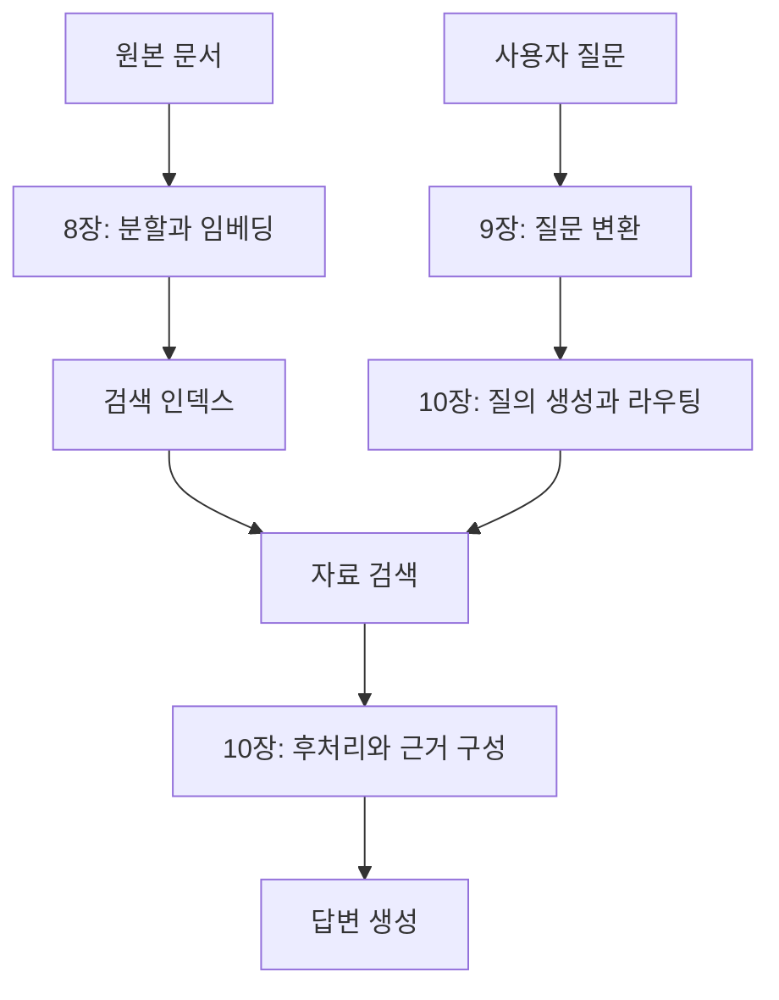

『AI Agents and Applications』은 모델을 학습시키는 책보다 **이미 있는 모델로 애플리케이션을 만드는 책**에 가깝다. Roberto Infante가 썼으며, 프롬프트에 검색과 대화 이력, 도구 실행을 붙이면서 프로그램의 구조가 어떻게 달라지는지 다룬다.

5개 Part와 14개 챕터를 거치며 앞에서 만든 웹 리서치 엔진과 여행 챗봇을 계속 확장한다. 장마다 새 예제를 만드는 방식이 아니라 기존 구조에서 막히는 부분을 확인하고 다음 기능을 붙이는 흐름으로 정리했다.

## 두 프로젝트를 따라 읽는 방법

이 책은 개별 라이브러리 기능을 모은 목록으로 읽기보다, 두 프로그램이 어떻게 확장되는지 따라가면 연결이 잘 보이다.

| 흐름 | 출발점 | 드러나는 한계 | 다음에 붙이는 구성 |
| --- | --- | --- | --- |
| 조사 보고서 | 문서 한 개 요약 | 문맥 길이와 정보 손실 | 3장의 분할, MapReduce, Refine |
| 조사 보고서 | 웹 자료를 모아 요약 | 검색, 수집, 출처 연결 필요 | 4장의 단계별 리서치 체인 |
| 조사 보고서 | 한 번 검색하고 보고서 작성 | 근거가 부족해도 그대로 종료 | 5장의 상태, 관련성 평가, 재검색 |
| 여행 도우미 | 문서로 질문에 답하기 | 전체 문서를 매번 넣기 어려움 | 6장의 검색 인덱스와 RAG |
| 여행 도우미 | 한 질문에 답하는 RAG | 후속 질문의 대상과 조건 누락 | 7장의 이력, 질의 복원, 실행 추적 |
| 여행 도우미 | 기본 검색 | 근거를 못 찾거나 조건을 잃음 | 8~10장의 색인, 질의, 라우팅 개선 |
| 여행 도우미 | 고정된 검색 순서 | 상황에 따라 다른 기능 필요 | 11~13장의 도구 루프, 위임, MCP |
| 여행 도우미 | 한 번 실행되는 에이전트 | 대화 지속, 승인, 복구 필요 | 14장의 상태 저장과 실행 통제 |


## Part 1. LLM 애플리케이션의 기초

| 장 | 다루는 내용 | 구분할 개념 |
| --- | --- | --- |
| [1. AI 애플리케이션과 에이전트](../01-introduction/) | 애플리케이션 유형과 LangChain의 구성 요소 | 엔진, 챗봇, 에이전트 |
| [2. 프롬프트 실행](../02-prompts/) | API 호출, 템플릿, 예시 기반 프롬프트 | 지시, 입력 데이터, 출력 형식 |

LLM은 자연어를 입력받고 출력하지만 프로그램은 구조화된 값과 명확한 실행 조건을 필요로 한다. 따라서 좋은 문장을 작성하는 일뿐 아니라 모델 입력을 조립하고 응답을 검증하는 과정이 중요하다.

프롬프트 엔지니어링, RAG, 파인튜닝도 서로 다른 문제를 푼다. 프롬프트는 현재 요청에서 할 일을 정하고, RAG는 외부 근거를 공급하며, 파인튜닝은 모델의 학습된 동작을 조정한다. 새 지식을 넣는 문제와 응답 형식을 맞추는 문제를 같은 방식으로 해결하려고 하면 비용과 복잡도가 커질 수 있다.

## Part 2. 요약과 리서치

| 장 | 다루는 내용 | 중심 문제 |
| --- | --- | --- |
| [3. 문서 요약](../03-summarization/) | 긴 문서와 여러 문서의 요약 | 문맥 길이 제한과 정보 손실 |
| [4. 리서치 요약 엔진](../04-research-engine/) | 검색, 본문 수집, 요약, 보고서 생성 | 단계별 입출력과 출처 유지 |
| [5. LangGraph 워크플로](../05-langgraph-workflows/) | 상태와 조건부 분기 | 고정된 순서에서 반복 가능한 흐름으로 전환 |

문서를 나눠 요약하는 MapReduce와 기존 요약에 다음 문서를 반영하는 Refine은 처리 방식이 다르다. 전자는 독립 처리가 쉬운 대신 조각 사이의 연결을 잃기 쉽고, 후자는 앞선 요약을 다음 단계에 전달하지만 순서의 영향을 받는다.

4장에서는 웹 검색 결과를 자동으로 수집해 보고서를 만든다. 5장은 같은 작업을 그래프로 옮긴다. 검색 결과가 부족하면 다시 검색하고, 충분하면 작성 단계로 이동하는 식으로 실행 경로를 명시할 수 있다.

## Part 3. RAG 질의응답

| 장 | 다루는 내용 | 중심 문제 |
| --- | --- | --- |
| [6. RAG와 ChromaDB](../06-rag-fundamentals/) | 임베딩과 벡터 검색을 이용한 기본 RAG | 검색할 자료를 준비하는 과정과 질문 처리 과정 |
| [7. 대화형 RAG와 LangSmith](../07-conversational-rag/) | 문서 적재, 후속 질문, 대화 이력, 추적 | 이전 대화와 현재 검색의 연결 |

RAG는 전체 자료를 모델에 학습시키는 방식이 아니다. 질문과 관련된 자료를 찾아 현재 프롬프트에 넣는다. 그래서 문서가 바뀔 때 검색 자료를 갱신할 수 있지만, 필요한 자료를 못 찾으면 생성 모델만 바꿔도 문제가 해결되지 않는다.

대화 이력과 문서 지식도 다르다. 이력은 사용자가 앞에서 무엇을 물었는지 알려 주고, 문서는 답을 뒷받침할 사실을 제공한다. “그곳의 교통편은?” 같은 후속 질문에서는 대화로 대상 장소를 복원한 뒤 검색해야 한다.

## Part 4. 고급 RAG

| 장 | 다루는 내용 | 바꾸는 위치 |
| --- | --- | --- |
| [8. 고급 인덱싱](../08-advanced-indexing/) | 청크 분할, 부모와 자식 청크, 표와 이미지 | 검색 자료를 준비하는 방법 |
| [9. 질문 변환](../09-question-transformations/) | 재작성, 다중 질의, Step-back, HyDE, 분해 | 검색에 넣는 질문 |
| [10. 질의 생성과 라우팅](../10-query-routing/) | 메타데이터 필터, SQL, 그래프, 결과 후처리 | 검색 대상과 결과의 조합 |

RAG의 품질 문제를 세 위치로 나눠 볼 수 있다. 자료가 잘못 나뉘었다면 인덱싱을, 질문이 검색 자료와 맞지 않으면 질의를, 검색 결과가 많고 중복되면 후처리를 바꾸는 식이다.



고급 기법을 많이 넣는다고 반드시 좋아지는 것은 아니다. 질의가 늘면 호출 수와 중복 결과가 늘고, 검색 범위를 넓히면 관련 없는 내용도 들어온다. 어떤 실패를 해결하려는지와 변경 전후의 검색 결과를 함께 봐야 한다.

## Part 5. 에이전트

| 장 | 다루는 내용 | 중심 문제 |
| --- | --- | --- |
| [11. 도구 기반 에이전트](../11-tool-agents/) | 모델의 도구 선택과 LangGraph 실행 루프 | 도구 호출 요청과 실제 실행의 분리 |
| [12. 다중 에이전트](../12-multi-agent-systems/) | Router와 Supervisor | 작업 위임과 결과 회수 |
| [13. MCP 서버](../13-mcp-servers/) | 도구를 표준 프로토콜로 제공하고 소비 | Host, Client, Server의 역할 |
| [14. 프로덕션 에이전트](../14-production-agents/) | 메모리, 체크포인트, 가드레일 | 상태 보존과 실행 통제 |

도구를 사용할 수 있는 모델도 외부 함수를 스스로 실행하는 것은 아니다. 모델은 도구 이름과 인자를 내고 애플리케이션이 실행한다. 실행 결과를 모델에 돌려주면 추가 호출이나 최종 답변을 결정하는 루프가 된다.

다중 에이전트도 이 경계 위에 있다. 역할을 나누는 것과 결과를 통합하는 것은 다른 문제라서, 한 경로를 고르는 Router와 결과를 보고 다음 위임을 결정하는 Supervisor를 구분해서 봤다.

## 프레임워크의 역할

| 구성 요소 | 맡는 역할 | 대신 해결하지 않는 것 |
| --- | --- | --- |
| LangChain | 모델, 프롬프트, 검색기와 도구의 인터페이스 및 조합 | 데이터 품질과 올바른 업무 요구 |
| LCEL | 실행 단위를 연결하는 표현 방식 | 입력과 출력의 의미적 일치 |
| LangGraph | 상태, 노드, 분기와 반복 실행 | 무제한 자율 실행의 안전성 |
| LangSmith | 실행 추적과 평가 | 평가 기준의 자동 결정 |
| ChromaDB | 임베딩과 관련 데이터 저장 및 검색 | 검색 결과의 사실성 보증 |
| MCP | 도구와 문맥 제공자의 연결 규약 | 사용자 인증과 작업 승인 전체 |

라이브러리의 역할과 모델의 능력은 분리해서 봐야 한다. 프레임워크가 실행을 잘 기록하더라도 답이 맞는지는 평가가 필요하고, 모델이 적절한 도구를 골라도 그 도구의 권한과 입력을 검사해야 한다.

## 부록

부록 A는 Jupyter 환경에서 LangChain과 LCEL을 실행하는 작은 예제이다. 부록 B는 Python, 가상환경, Jupyter 설치를 다룬다. 부록 C는 모델 선택 기준과 모델 유형을 비교한다.

예제의 클래스와 패키지 경로는 설치 버전과 함께 확인해야 한다. 특히 LangChain과 LangGraph의 사전 구성 에이전트 API, MCP의 전송과 연결 방식은 버전에 따라 달라질 수 있다. 동작 원리와 특정 버전의 호출 문법을 같은 것으로 외우지 않는 편이 낫다.

## 실습 환경 준비하기

각 장의 예제는 작은 여행 안내와 시간표를 바탕으로 연결했다. 정보의 정확성을 직접 확인하게 안내 데이터는 합성했고, 모델 호출은 Ollama의 로컬 `llama3.2:latest`로 실행했다. 영문 안내문을 사용해 작은 모델의 한국어 표현 능력과 실행 구조를 나눠 살펴봤다.

Python 3.12 환경에서 다음 버전을 사용한다.

```powershell
python -m venv .venv
.\.venv\Scripts\Activate.ps1
python -m pip install langchain-core==1.7.0 langchain-ollama==1.1.0 langgraph==1.2.17 langchain-text-splitters==1.1.3 chromadb==1.5.9 mcp==1.17.0 pydantic==2.11.7 beautifulsoup4==4.15.0
$env:LANGSMITH_TRACING = "false"
$env:PYTHONUTF8 = "1"
ollama pull llama3.2
ollama list
```

MCP 1.17.0은 더 최신 Pydantic의 내부 함수 변경과 충돌할 수 있어, 함께 동작하는 `pydantic==2.11.7`도 고정했다.

Ollama가 실행 중이어야 하며 기본 로컬 주소는 `http://127.0.0.1:11434`이다. 모델이 없으면 처음 한 번 내려받는다. 모델 파일과 Chroma 임베딩 모델 다운로드, 4장의 공개 문서 수집에 인터넷이 필요하고, LLM 추론은 로컬에서 수행한다.

이번 실행의 모델 ID는 `a80c4f17acd5`였다. `latest` 태그의 대상은 바뀔 수 있으므로 다시 비교할 때는 `ollama list`의 ID도 기록한다. `temperature=0`도 서로 다른 모델, 런타임에서 같은 문장을 보장하지는 않다.

각 장의 코드를 `ch01.py`처럼 별도 파일로 저장하고 `python ch01.py`로 실행한다. 13장만 서버와 클라이언트 두 파일을 같은 폴더에 둔다. 네트워크 오류나 스키마 검증 실패를 빈 정상 결과로 바꾸지 않고, 실패한 단계에서 원인을 확인하도록 구성했다.

| 장 | 실습 범위 | 오류와 한계 |
| --- | --- | --- |
| 1 | 프롬프트, 메시지, 문자열의 자료형 | 템플릿 변수 누락 |
| 2 | 분류 결과의 JSON과 허용 범주 | 존재하지 않는 범주 |
| 3 | MapReduce 4회 호출과 예외 보존 | 부분 요약의 사실 누락 |
| 4 | 공개 문서 수집과 출처 연결 | 본문 선택자 불일치 |
| 5 | LangGraph 분기와 두 번의 시도 한도 | 반복 횟수 갱신 누락 |
| 6 | Chroma 의미 검색 후 근거로 답변 | 요금 근거가 없는 질문 |
| 7 | 후속 질문의 대상 복원 | 검색기에 대명사만 전달 |
| 8 | 검색용 자식에서 부모 원문 복원 | 부모 ID 연결 누락 |
| 9 | 질문 분해와 근거 수 비교 | 검색어에서 지역 조건 소실 |
| 10 | 자연어 필터와 바인딩된 SQL | 허용하지 않은 지역, 가격 |
| 11 | 모델의 도구 요청과 ToolNode 실행 | 잘못된 도구 인자 |
| 12 | 역할별 결과 회수와 순차 위임 | 다른 지역을 숙박 역할에 전달 |
| 13 | 실제 MCP 프로세스의 발견, 호출 | 없는 장소의 오류 응답 |
| 14 | 체크포인트, 승인, 재개 | 거절과 중복 방지 키 충돌 |

모델이 관여하는 예제는 문장을 암기하기보다 **입력, 중간 결과, 검증 조건**을 비교한다. 그래프 제어와 프로토콜 예제는 모델을 넣지 않아도 시험할 수 있으므로, 같은 실패를 반복해 확인했다.

## 시스템을 구분하는 기준

각 시스템을 구분하는 기준은 모델에 전달되는 정보, 검색 원문과 최종 답변의 연결, 다음 실행 경로를 결정하는 주체, 저장된 상태의 복원 시점이다.

이 기준으로 보면 요약 엔진과 RAG 챗봇, 도구 기반 에이전트는 별개의 유행어가 아니라 같은 구성 요소를 다르게 연결한 시스템이다.

[시리즈 목차](../) / [1. AI 애플리케이션과 에이전트](../01-introduction/)
