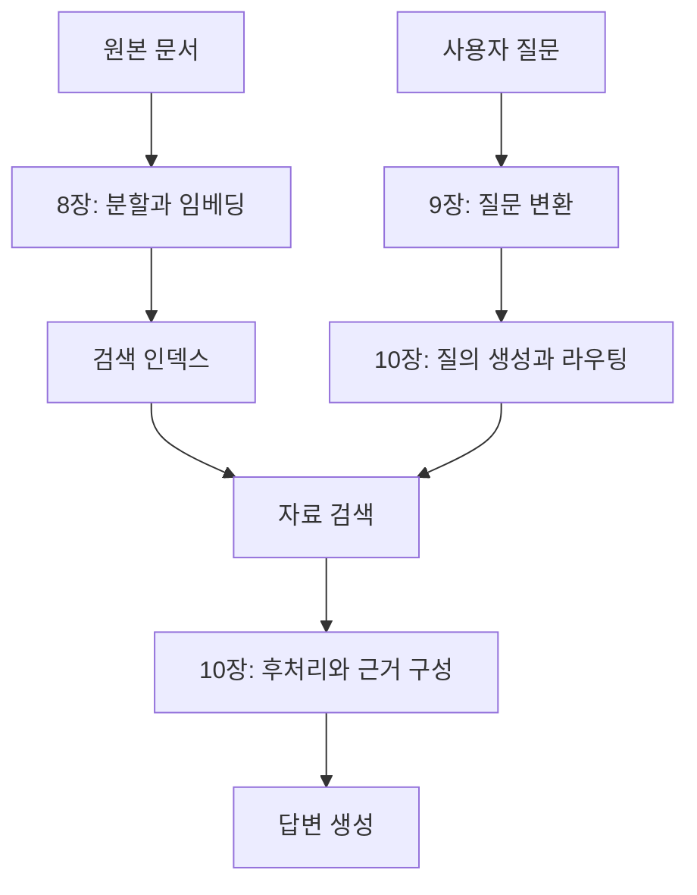

『AI Agents and Applications』은 Roberto Infante가 쓴 책이다. LLM 자체를 학습하는 방법보다 이미 존재하는 모델을 애플리케이션의 구성 요소로 사용하는 방법에 집중한다. 프롬프트를 코드에서 호출하는 일부터 문서 요약, 검색 기반 질의응답, 도구 실행과 여러 에이전트의 협업까지 이어진다.

전체는 5개 Part와 14개 챕터로 구성된다. 앞부분에서 만든 웹 리서치 엔진과 여행 정보 챗봇이 뒤에서 다시 등장한다. 기능을 처음부터 새로 만드는 대신 기존 구조의 한계를 확인하고, 그 한계를 해결하는 구성 요소를 붙이는 흐름이다.

## Part 1. LLM 애플리케이션의 기초

| 장 | 다루는 내용 | 구분할 개념 |
| --- | --- | --- |
| [1. AI 애플리케이션과 에이전트](../01-introduction/) | 애플리케이션 유형과 LangChain의 구성 요소 | 엔진, 챗봇, 에이전트 |
| [2. 프롬프트 실행](../02-prompts/) | API 호출, 템플릿, 예시 기반 프롬프트 | 지시, 입력 데이터, 출력 형식 |

LLM은 자연어를 입력받고 출력하지만 프로그램은 구조화된 값과 명확한 실행 조건을 필요로 한다. 따라서 좋은 문장을 작성하는 일뿐 아니라 모델 입력을 조립하고 응답을 검증하는 과정이 중요하다.

프롬프트 엔지니어링, RAG, 파인튜닝도 서로 다른 문제를 푼다. 프롬프트는 현재 요청에서 할 일을 정하고, RAG는 외부 근거를 공급하며, 파인튜닝은 모델의 학습된 동작을 조정한다. 새 지식을 넣는 문제와 응답 형식을 맞추는 문제를 같은 방식으로 해결하려고 하면 비용과 복잡도가 커질 수 있다.

## Part 2. 요약과 리서치

| 장 | 다루는 내용 | 중심 문제 |
| --- | --- | --- |
| [3. 문서 요약](../03-summarization/) | 긴 문서와 여러 문서의 요약 | 문맥 길이 제한과 정보 손실 |
| [4. 리서치 요약 엔진](../04-research-engine/) | 검색, 본문 수집, 요약, 보고서 생성 | 단계별 입출력과 출처 유지 |
| [5. LangGraph 워크플로](../05-langgraph-workflows/) | 상태와 조건부 분기 | 고정된 순서에서 반복 가능한 흐름으로 전환 |

문서를 나눠 요약하는 MapReduce와 기존 요약에 다음 문서를 반영하는 Refine은 처리 방식이 다르다. 전자는 독립 처리가 쉬운 대신 조각 사이의 연결을 잃기 쉽고, 후자는 앞선 요약을 다음 단계에 전달하지만 순서의 영향을 받는다.

4장에서는 웹 검색 결과를 자동으로 수집해 보고서를 만든다. 5장은 같은 작업을 그래프로 옮긴다. 검색 결과가 부족하면 다시 검색하고, 충분하면 작성 단계로 이동하는 식으로 실행 경로를 명시할 수 있다.

## Part 3. RAG 질의응답

| 장 | 다루는 내용 | 중심 문제 |
| --- | --- | --- |
| [6. RAG와 ChromaDB](../06-rag-fundamentals/) | 임베딩과 벡터 검색을 이용한 기본 RAG | 검색할 자료를 준비하는 과정과 질문 처리 과정 |
| [7. 대화형 RAG와 LangSmith](../07-conversational-rag/) | 문서 적재, 후속 질문, 대화 이력, 추적 | 이전 대화와 현재 검색의 연결 |

RAG는 전체 자료를 모델에 학습시키는 방식이 아니다. 질문과 관련된 자료를 찾아 현재 프롬프트에 넣는다. 그래서 문서가 바뀔 때 검색 자료를 갱신할 수 있지만, 필요한 자료를 못 찾으면 생성 모델만 바꿔도 문제가 해결되지 않는다.

대화 이력과 문서 지식도 다르다. 이력은 사용자가 앞에서 무엇을 물었는지 알려 주고, 문서는 답을 뒷받침할 사실을 제공한다. “그곳의 교통편은?” 같은 후속 질문에서는 대화로 대상 장소를 복원한 뒤 검색해야 한다.

## Part 4. 고급 RAG

| 장 | 다루는 내용 | 바꾸는 위치 |
| --- | --- | --- |
| [8. 고급 인덱싱](../08-advanced-indexing/) | 청크 분할, 부모와 자식 청크, 표와 이미지 | 검색 자료를 준비하는 방법 |
| [9. 질문 변환](../09-question-transformations/) | 재작성, 다중 질의, Step-back, HyDE, 분해 | 검색에 넣는 질문 |
| [10. 질의 생성과 라우팅](../10-query-routing/) | 메타데이터 필터, SQL, 그래프, 결과 후처리 | 검색 대상과 결과의 조합 |

RAG의 품질 문제를 세 위치로 나눠 볼 수 있다. 자료가 잘못 나뉘었다면 인덱싱을, 질문이 검색 자료와 맞지 않으면 질의를, 검색 결과가 많고 중복되면 후처리를 바꾸는 식이다.

고급 기법을 많이 넣는다고 반드시 좋아지는 것은 아니다. 질의가 늘면 호출 수와 중복 결과가 늘고, 검색 범위를 넓히면 관련 없는 내용도 들어온다. 어떤 실패를 해결하려는지와 변경 전후의 검색 결과를 함께 봐야 한다.

## Part 5. 에이전트

| 장 | 다루는 내용 | 중심 문제 |
| --- | --- | --- |
| [11. 도구 기반 에이전트](../11-tool-agents/) | 모델의 도구 선택과 LangGraph 실행 루프 | 도구 호출 요청과 실제 실행의 분리 |
| [12. 다중 에이전트](../12-multi-agent-systems/) | Router와 Supervisor | 작업 위임과 결과 회수 |
| [13. MCP 서버](../13-mcp-servers/) | 도구를 표준 프로토콜로 제공하고 소비 | Host, Client, Server의 역할 |
| [14. 프로덕션 에이전트](../14-production-agents/) | 메모리, 체크포인트, 가드레일 | 상태 보존과 실행 통제 |

도구를 사용할 수 있는 모델도 외부 함수를 스스로 실행하는 것은 아니다. 모델은 도구 이름과 인자를 내고 애플리케이션이 실행한다. 실행 결과를 모델에 돌려주면 추가 호출이나 최종 답변을 결정하는 루프가 된다.

다중 에이전트도 이 경계 위에 있다. 역할을 나누는 것과 여러 작업의 결과를 통합하는 것은 다른 문제다. Router가 한 경로를 고르는 구조와 Supervisor가 결과를 받아 다음 위임을 결정하는 구조를 비교하면 차이가 분명해진다.

## 프레임워크의 역할

| 구성 요소 | 맡는 역할 | 대신 해결하지 않는 것 |
| --- | --- | --- |
| LangChain | 모델, 프롬프트, 검색기와 도구의 인터페이스 및 조합 | 데이터 품질과 올바른 업무 요구 |
| LCEL | 실행 단위를 연결하는 표현 방식 | 입력과 출력의 의미적 일치 |
| LangGraph | 상태, 노드, 분기와 반복 실행 | 무제한 자율 실행의 안전성 |
| LangSmith | 실행 추적과 평가 | 평가 기준의 자동 결정 |
| ChromaDB | 임베딩과 관련 데이터 저장 및 검색 | 검색 결과의 사실성 보증 |
| MCP | 도구와 문맥 제공자의 연결 규약 | 사용자 인증과 작업 승인 전체 |

라이브러리의 역할과 모델의 능력은 분리해서 봐야 한다. 프레임워크가 실행을 잘 기록하더라도 답이 맞는지는 평가가 필요하고, 모델이 적절한 도구를 골라도 그 도구의 권한과 입력을 검사해야 한다.

## 부록

부록 A는 Jupyter 환경에서 LangChain과 LCEL을 실행하는 작은 예제다. 부록 B는 Python, 가상환경, Jupyter 설치를 다룬다. 부록 C는 모델 선택 기준과 모델 유형을 비교한다.

예제의 클래스와 패키지 경로는 설치 버전과 함께 확인해야 한다. 특히 LangChain과 LangGraph의 사전 구성 에이전트 API, MCP의 전송과 연결 방식은 버전에 따라 달라질 수 있다. 동작 원리와 특정 버전의 호출 문법을 같은 것으로 외우지 않는 편이 낫다.

## 계속 확인할 질문

어떤 정보가 모델에 들어갔는가? 검색한 원문과 최종 답변은 어떻게 연결되는가? 다음 실행 경로는 코드와 모델 중 누가 정하는가? 상태를 저장했다면 어떤 시점으로 복원할 수 있는가?

이 네 질문을 따라가면 요약 엔진과 RAG 챗봇, 도구 기반 에이전트가 별개의 유행어가 아니라 같은 구성 요소를 다르게 연결한 시스템이라는 점이 보인다.

[시리즈 목차](../) / [1. AI 애플리케이션과 에이전트](../01-introduction/)
