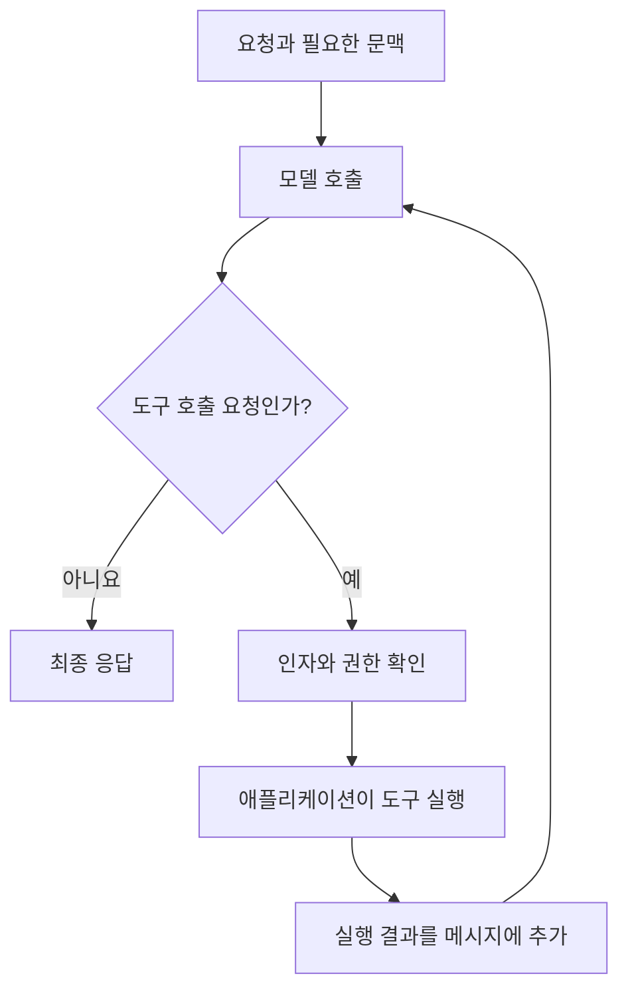

LLM을 호출하는 코드와 LLM 애플리케이션은 범위가 다르다. 모델은 입력을 받아 출력을 생성하지만, 어떤 자료를 넣고 결과를 어디에 쓰며 실패하면 어떻게 처리할지는 주변 프로그램의 책임이다. 이 경계를 구분해야 프롬프트의 문제와 시스템 구성의 문제를 따로 볼 수 있다.

## 1.1 LLM 기반 애플리케이션과 에이전트

기본 흐름은 입력을 받고, 필요한 문맥을 모아 프롬프트를 구성한 뒤, 모델 응답을 다음 단계로 넘기는 것이다. 여기에 대화 이력을 붙이면 챗봇이 되고, 모델의 판단으로 도구를 선택하고 실행 결과를 다시 처리하면 에이전트가 된다.

### 1.1.1 요약 엔진과 질의응답 엔진

엔진은 특정 자연어 처리를 다른 프로그램에 제공한다. 문서 저장 시스템이 새 보고서를 받으면 요약 엔진을 호출해 요약문을 저장하는 식이다. 사람이 대화창 앞에 있을 필요는 없다.

입력이 문서와 원하는 요약 조건이라면 출력은 요약문이다. 질의응답 엔진은 문서와 질문을 받아 답을 생성한다. REST API로 제공할 수도 있고 배치 작업 내부에서 호출할 수도 있다. API는 접근 방식이고 요약이나 질의응답은 수행할 기능이다.

처리 결과가 자연어라는 점도 중요하다. 출력이 다음 프로그램의 입력이 된다면 빈 응답, 잘못된 형식, 근거 없는 내용을 검사해야 한다. 모델이 응답했다는 사실만으로 처리가 성공했다고 볼 수는 없다.

### 1.1.2 챗봇

챗봇은 사람과 여러 차례 대화한다. “그 내용을 더 짧게 해 줘”처럼 이전 답변을 가리키는 요청이 가능하려면 과거 메시지나 그 요약을 다음 모델 호출에 넣어야 한다.

모델이 대화창 밖에 있는 이력을 자동으로 아는 것은 아니다. 애플리케이션이 어떤 이력을 저장하고 다시 보낼지 정한다. 대화가 길어지면 모든 내용을 계속 넣을 수도 없으므로 문맥 길이와 비용, 개인정보를 함께 고려해야 한다.

메시지에는 system, user, assistant 등의 역할이 붙는다. 역할은 서비스 지침, 사용자 요청, 이전 응답을 구분하는 구조다. 문서를 검색해 넣는 경우에도 문서 본문과 시스템 지침을 같은 신뢰 수준으로 취급하면 안 된다.

### 1.1.3 AI 에이전트

에이전트는 결과만 생성하지 않고 다음에 할 일을 선택하는 루프를 가진다. 여행 요청에서 관광 정보를 검색한 뒤 날씨를 확인하고, 필요한 정보가 모이면 답을 작성하는 식이다.

여기서 모델이 외부 함수를 직접 실행하는 것은 아니다. 모델은 도구 이름과 인자를 포함한 호출 요청을 내고, 프로그램이 요청을 검증한 뒤 실행한다. 도구 결과를 모델에 돌려주면 추가 작업이 필요한지 또는 답을 끝낼지 판단한다.

자율성은 권한과 별개다. 모델이 예약 도구를 골랐다고 실제 결제까지 허용해야 하는 것은 아니다. 호출 횟수와 종료 조건, 실행 권한은 프로그램이 통제해야 한다.

## 1.2 LangChain

LLM 애플리케이션에는 반복되는 작업이 많다. 문서를 읽고 나누는 일, 임베딩을 만들고 검색하는 일, 프롬프트를 조립하고 응답을 해석하는 일이 그렇다. LangChain은 이 구성 요소를 공통 인터페이스로 연결한다.

### 1.2.1 아키텍처

문서를 적재하는 과정과 질문에 답하는 과정을 나눠 보면 구조가 단순해진다.

문서 적재에서는 원본을 읽고 청크로 나눈 뒤 임베딩과 원문을 저장한다. 질문 처리에서는 질문과 관련된 청크를 검색하고, 검색한 원문을 질문과 함께 생성 모델에 전달한다.

임베딩 모델과 생성 모델은 역할이 다르다. 임베딩 모델은 비교할 벡터를 만들고, 생성 모델은 문맥을 읽고 답을 작성한다. 검색에 사용한 벡터 자체를 자연어 근거처럼 읽는 것이 아니다.

LangChain을 쓰면 저장소나 모델 구현을 교체하기 쉬워질 수 있다. 다만 인터페이스가 같아도 출력 품질, 지원 기능, 지연과 오류는 달라진다. 구현 교체가 곧 동작의 동등성을 뜻하지는 않는다.

### 1.2.2 핵심 객체 모델

중심 객체인 `Document`는 본문과 메타데이터를 묶는다. 본문은 검색이나 요약에 쓰고, 메타데이터는 파일명, 출처, 페이지, 문서 식별자 등을 보존하는 데 쓴다.

| 구성 요소 | 입력과 출력 | 역할 |
| --- | --- | --- |
| Loader | 파일이나 URL에서 `Document` 목록 생성 | 자료 형식을 공통 형태로 바꾸기 |
| Splitter | 문서를 여러 `Document`로 분할 | 문맥 길이와 검색 단위 조정 |
| Embedding model | 텍스트를 숫자 벡터로 변환 | 의미적 유사도 비교의 기반 |
| Vector store | 벡터와 관련 자료를 저장하고 검색 | 가까운 문서 후보 찾기 |
| Retriever | 질문을 받아 문서 목록 반환 | 검색 구현을 호출 측에서 분리 |
| Prompt template | 변수로 프롬프트나 메시지 구성 | 고정 지침과 요청별 데이터 결합 |
| Language model | 프롬프트를 받아 모델 응답 생성 | 분류, 요약, 답변 등의 생성 |
| Output parser | 모델 응답을 문자열이나 구조화된 값으로 해석 | 후속 코드가 사용할 형태 만들기 |

`Runnable`은 이런 실행 단위를 조합하는 인터페이스다. LCEL의 `|`는 앞 구성 요소의 결과를 다음 구성 요소로 넘긴다. 셸 파이프와 비슷해 보이지만 텍스트만 흐르는 것은 아니다. 사전, 문서 목록, 프롬프트 값, 메시지 객체처럼 각 단계의 자료형이 바뀔 수 있다.

예를 들어 `prompt | model | parser`에서 템플릿은 변수가 담긴 사전을 받고, 모델은 완성된 프롬프트를 받으며, 파서는 모델 메시지를 해석한다. 체인이 실패하면 각 단계의 입력과 출력 형태부터 확인할 필요가 있다.

## 1.3 대표 사용 사례

LLM의 활용은 자유로운 글 생성에만 한정되지 않는다.

| 작업 | 예시 | 확인할 조건 |
| --- | --- | --- |
| 분류와 감정 분석 | 문의 유형이나 리뷰의 감정 분류 | 허용 범주와 애매한 입력 처리 |
| 이해와 생성 | 문서 요약, 문체 변환, 설명 작성 | 원문 사실과 생성한 표현의 구분 |
| 의미 검색 | 표현이 다른 질문으로 관련 문서 찾기 | 유사도가 실제 관련성을 나타내는지 |
| 추론과 작업 실행 | 여러 조건을 확인해 여행 일정 구성 | 계산과 외부 사실의 검증 |
| 구조화된 정보 추출 | 계약서에서 날짜와 당사자 추출 | 스키마와 누락 값, 출처 위치 |
| 코드 이해와 생성 | 함수 설명이나 수정안 작성 | 실행 결과와 테스트 |

같은 모델을 사용해도 성공 기준은 다르다. 생성 문장이 자연스러운지와 추출한 날짜가 맞는지, 적절한 도구를 선택했는지는 서로 다른 평가다.

## 1.4 목적에 맞게 LLM을 조정하는 방법

### 1.4.1 프롬프트 엔지니어링

현재 요청에서 수행할 작업과 근거, 제약, 출력 형식을 정한다. 입력 안에 예시를 넣어 패턴을 보여 주는 in-context learning도 여기에 포함된다.

이때 모델 가중치가 바뀌지는 않는다. 예시를 제거하면 그 예시에 의존하던 동작도 달라질 수 있다. “프롬프트로 학습했다”는 표현과 모델을 실제로 훈련한 것을 구분해야 한다.

반복되는 지침은 템플릿으로 두고 문서나 질문처럼 매번 바뀌는 부분을 변수로 넣는다. 템플릿으로 관리하면 어느 조건을 바꿨는지 비교하기도 쉽다.

### 1.4.2 RAG

RAG는 답에 필요한 자료를 검색해 프롬프트에 넣는다. 사내 규정처럼 자주 바뀌는 정보를 다룰 때 모델의 사전학습 내용만 믿지 않고 현재 문서를 제공할 수 있다.

검색은 필요한 근거를 찾는 일이고 생성은 그 근거로 답을 만드는 일이다. 검색 결과가 틀렸는데 모델의 문장 생성 능력만 높여도 원하는 답을 얻기 어렵다. 검색된 문서와 실제 프롬프트, 최종 답변을 나눠 볼 수 있어야 한다.

RAG가 곧 벡터 검색만을 뜻하지는 않는다. 키워드, 메타데이터, 관계형 DB 등에서 얻은 자료도 근거가 될 수 있다. 이 책은 벡터 검색으로 출발해 뒤에서 검색 방식을 확장한다.

### 1.4.3 파인튜닝

파인튜닝은 예제 데이터로 모델의 학습된 동작을 조정한다. 특정 응답 형식이나 전문 작업의 일관성을 개선할 때 검토할 수 있다.

RAG와 달리 모델을 학습하고 버전을 관리하는 과정이 추가된다. 좋은 학습 데이터와 별도 평가 데이터가 필요하며, 운영 정보를 갱신하는 문제를 모두 파인튜닝으로 해결하려 하면 변경 비용이 커질 수 있다.

| 방법 | 주로 바꾸는 것 | 잘 맞는 문제 |
| --- | --- | --- |
| 프롬프트 | 현재 호출의 지침과 예시 | 작업과 응답 형식 지정 |
| RAG | 현재 호출에 들어가는 외부 근거 | 최신 문서와 출처 기반 답변 |
| 파인튜닝 | 모델의 학습된 동작 | 반복되는 특화 작업과 형식의 일관성 |

세 방법은 상호 배타적이지 않다. 파인튜닝한 모델에 검색 자료를 넣을 수도 있다. 핵심은 부족한 것이 지시인지, 정보인지, 학습된 수행 능력인지 구분하는 것이다.

## 1.5 모델 선택

모델 선택은 벤치마크 점수 하나로 끝나지 않는다. 입력 길이, 도구 호출 지원, 구조화된 출력, 응답 지연, 비용, 배포 환경과 데이터 처리 조건을 함께 본다.

문맥 창은 한 번에 처리할 수 있는 토큰 예산이다. 토큰은 단어와 같지 않으며 언어와 인코더에 따라 수가 달라진다. 문서 외에도 시스템 지침, 대화 이력, 도구 정의와 생성할 답변이 예산을 사용한다.

작은 모델은 짧은 분류나 요약에 충분할 수 있지만 복잡한 질의 분해에서는 부족할 수 있다. 반대로 모든 단계에 가장 큰 모델을 쓰면 비용과 지연이 커진다. 단계별로 다른 모델을 쓰더라도 각 단계의 품질을 따로 확인해야 한다.

외부 API와 자체 호스팅의 차이도 있다. API는 모델 운영 부담을 줄일 수 있지만 요청 제한과 제공자의 데이터 처리 조건이 중요하다. 자체 호스팅은 환경 통제가 쉬운 대신 연산 자원과 모델 서버 운영을 맡아야 한다.

## 1.6 뒤의 프로젝트로 이어지는 흐름

프롬프트 호출은 요약 체인의 구성 요소가 된다. 요약 체인은 웹 검색과 결합해 리서치 엔진이 되고, 상태와 조건부 분기를 붙이면 LangGraph 워크플로로 바뀐다.

다른 흐름에서는 문서를 검색 가능한 형태로 준비한 뒤 질의응답에 사용한다. 검색기를 도구로 제공하면 에이전트가 필요할 때 호출할 수 있다. MCP는 그 도구를 별도 서버에서 제공하는 연결 규약이고, 체크포인트와 가드레일은 실행을 보존하고 통제하는 기반이다.

새 프레임워크 이름을 외우기보다 입력, 상태, 검색 근거, 실행 권한이 어디에 있는지 따라가는 것이 중요하다.

## 질문

### 문서 검색 기능이 있으면 에이전트일까?

검색과 답변 생성이 고정된 순서라면 RAG 파이프라인일 수 있다. 모델이 도구를 고르고 결과에 따라 다음 행동을 정하는지까지 봐야 한다.

### 모델이 모든 지식을 학습하면 외부 데이터가 필요 없을까?

학습 시점 이후의 변경과 접근 권한, 답의 출처는 남는다. 기억하고 있는 내용과 현재 확인할 수 있는 근거는 다른 문제다.

[이전: 책의 구성](../00-overview/) / [시리즈 목차](../) / [다음: 프롬프트 실행](../02-prompts/)
