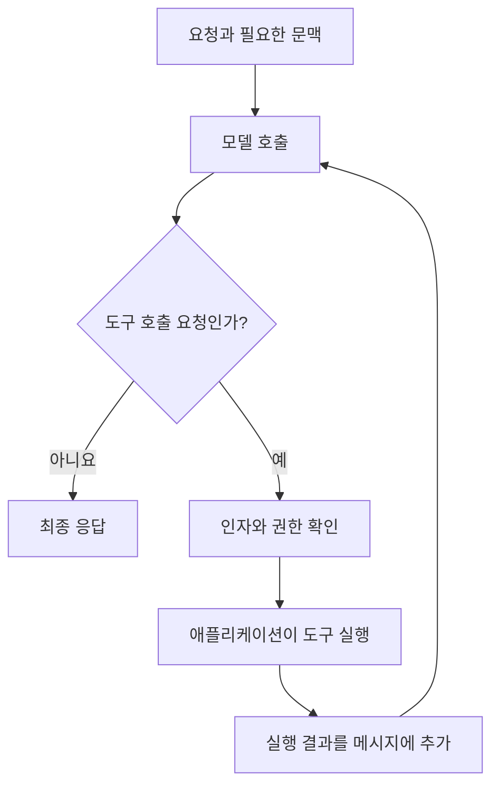

같은 요리사에게 주문을 해도, 주문서만 건네는 가게와 지난 주문을 기억하는 가게, 재료가 부족하면 직접 재고를 확인하는 가게는 다르게 움직입니다. LLM은 요리사이고, 입력과 기억·도구를 연결하는 코드는 가게의 운영 방식입니다.

이 장에서는 **엔진·챗봇·에이전트를 모델의 종류가 아니라 실행 구조로 구분**합니다. 먼저 입력과 출력이 어떻게 바뀌는지 살펴보고, 작은 LangChain 체인에서 자료형을 직접 확인했습니다.

## 1.1 LLM 기반 애플리케이션과 에이전트

기본 흐름은 입력을 받고, 필요한 문맥을 모아 프롬프트를 구성한 뒤, 모델 응답을 다음 단계로 넘기는 것입니다. 여기에 대화 이력을 붙이면 챗봇이 되고, 모델의 판단으로 도구를 선택하고 실행 결과를 다시 처리하면 에이전트가 됩니다.

### 1.1.1 요약 엔진과 질의응답 엔진

엔진은 특정 자연어 처리를 다른 프로그램에 제공합니다. 문서 저장 시스템이 새 보고서를 받으면 요약 엔진을 호출해 요약문을 저장하는 식입니다. 사람이 대화창 앞에 있을 필요는 없습니다.

입력이 문서와 원하는 요약 조건이라면 출력은 요약문입니다. 질의응답 엔진은 문서와 질문을 받아 답을 생성합니다. REST API로 제공할 수도 있고 배치 작업 내부에서 호출할 수도 있습니다. API는 접근 방식이고 요약이나 질의응답은 수행할 기능입니다.

처리 결과가 자연어라는 점도 중요합니다. 출력이 다음 프로그램의 입력이 된다면 빈 응답, 잘못된 형식, 근거 없는 내용을 검사해야 합니다. 모델이 응답했다는 사실만으로 처리가 성공했다고 볼 수는 없습니다.

### 1.1.2 챗봇

챗봇은 사람과 여러 차례 대화합니다. “그 내용을 더 짧게 해 줘”처럼 이전 답변을 가리키는 요청이 가능하려면 과거 메시지나 그 요약을 다음 모델 호출에 넣어야 합니다.

모델이 대화창 밖에 있는 이력을 자동으로 아는 것은 아닙니다. 애플리케이션이 어떤 이력을 저장하고 다시 보낼지 정합니다. 대화가 길어지면 모든 내용을 계속 넣을 수도 없으므로 문맥 길이와 비용, 개인정보를 함께 고려해야 합니다.

메시지에는 system, user, assistant 등의 역할이 붙습니다. 역할은 서비스 지침, 사용자 요청, 이전 응답을 구분하는 구조입니다. 문서를 검색해 넣는 경우에도 문서 본문과 시스템 지침을 같은 신뢰 수준으로 취급하면 안 됩니다.

### 1.1.3 AI 에이전트

에이전트는 결과만 생성하지 않고 다음에 할 일을 선택하는 루프를 가집니다. 여행 요청에서 관광 정보를 검색한 뒤 날씨를 확인하고, 필요한 정보가 모이면 답을 작성하는 식입니다.

여기서 모델이 외부 함수를 직접 실행하는 것은 아닙니다. 모델은 도구 이름과 인자를 포함한 호출 요청을 내고, 프로그램이 요청을 검증한 뒤 실행합니다. 도구 결과를 모델에 돌려주면 추가 작업이 필요한지 또는 답을 끝낼지 판단합니다.



자율성은 권한과 별개입니다. 모델이 예약 도구를 골랐다고 실제 결제까지 허용해야 하는 것은 아닙니다. 호출 횟수와 종료 조건, 실행 권한은 프로그램이 통제해야 합니다.

## 1.2 LangChain

LLM 애플리케이션에는 반복되는 작업이 많습니다. 문서를 읽고 나누는 일, 임베딩을 만들고 검색하는 일, 프롬프트를 조립하고 응답을 해석하는 일이 그렇습니다. LangChain은 이 구성 요소를 공통 인터페이스로 연결합니다.

### 1.2.1 아키텍처

문서를 적재하는 과정과 질문에 답하는 과정을 나눠 보면 구조가 단순해집니다.


그림은 도서관의 자료 정리와 안내 데스크를 함께 그린 지도처럼 읽으면 쉽습니다. 왼쪽의 Loader·Splitter·Embedding은 자료를 검색할 수 있게 준비하고, 가운데 Retriever는 질문에 맞는 자료를 꺼내 Prompt로 보냅니다. 오른쪽 LLM client와 Output parser는 답을 만들고 프로그램이 쓸 형태로 바꿉니다. 번호가 있다고 모든 요청이 1번부터 9번까지 다시 실행되는 것은 아닙니다.

문서 적재에서는 원본을 읽고 청크로 나눈 뒤 임베딩과 원문을 저장합니다. 질문 처리에서는 질문과 관련된 청크를 검색하고, 검색한 원문을 질문과 함께 생성 모델에 전달합니다.

임베딩 모델과 생성 모델은 역할이 다릅니다. 임베딩 모델은 비교할 벡터를 만들고, 생성 모델은 문맥을 읽고 답을 작성합니다. 검색에 사용한 벡터 자체를 자연어 근거처럼 읽는 것이 아닙니다.

LangChain을 쓰면 저장소나 모델 구현을 교체하기 쉬워질 수 있습니다. 다만 인터페이스가 같아도 출력 품질, 지원 기능, 지연과 오류는 달라집니다. 구현 교체가 곧 동작의 동등성을 뜻하지는 않습니다.

### 1.2.2 핵심 객체 모델

중심 객체인 `Document`는 본문과 메타데이터를 묶습니다. 본문은 검색이나 요약에 쓰고, 메타데이터는 파일명, 출처, 페이지, 문서 식별자 등을 보존하는 데 씁니다.

| 구성 요소 | 입력과 출력 | 역할 |
| --- | --- | --- |
| Loader | 파일이나 URL에서 `Document` 목록 생성 | 자료 형식을 공통 형태로 바꾸기 |
| Splitter | 문서를 여러 `Document`로 분할 | 문맥 길이와 검색 단위 조정 |
| Embedding model | 텍스트를 숫자 벡터로 변환 | 의미적 유사도 비교의 기반 |
| Vector store | 벡터와 관련 자료를 저장하고 검색 | 가까운 문서 후보 찾기 |
| Retriever | 질문을 받아 문서 목록 반환 | 검색 구현을 호출 측에서 분리 |
| Prompt template | 변수로 프롬프트나 메시지 구성 | 고정 지침과 요청별 데이터 결합 |
| Language model | 프롬프트를 받아 모델 응답 생성 | 분류, 요약, 답변 등의 생성 |
| Output parser | 모델 응답을 문자열이나 구조화된 값으로 해석 | 후속 코드가 사용할 형태 만들기 |

`Runnable`은 이런 실행 단위를 조합하는 인터페이스입니다. LCEL의 `|`는 앞 구성 요소의 결과를 다음 구성 요소로 넘깁니다. 셸 파이프와 비슷해 보이지만 텍스트만 흐르는 것은 아닙니다. 사전, 문서 목록, 프롬프트 값, 메시지 객체처럼 각 단계의 자료형이 바뀔 수 있습니다.

예를 들어 `prompt | model | parser`에서 템플릿은 변수가 담긴 사전을 받고, 모델은 완성된 프롬프트를 받으며, 파서는 모델 메시지를 해석합니다. 체인이 실패하면 각 단계의 입력과 출력 형태부터 확인할 필요가 있습니다.

## 1.3 대표 사용 사례

LLM의 활용은 자유로운 글 생성에만 한정되지 않습니다.

| 작업 | 예시 | 확인할 조건 |
| --- | --- | --- |
| 분류와 감정 분석 | 문의 유형이나 리뷰의 감정 분류 | 허용 범주와 애매한 입력 처리 |
| 이해와 생성 | 문서 요약, 문체 변환, 설명 작성 | 원문 사실과 생성한 표현의 구분 |
| 의미 검색 | 표현이 다른 질문으로 관련 문서 찾기 | 유사도가 실제 관련성을 나타내는지 |
| 추론과 작업 실행 | 여러 조건을 확인해 여행 일정 구성 | 계산과 외부 사실의 검증 |
| 구조화된 정보 추출 | 계약서에서 날짜와 당사자 추출 | 스키마와 누락 값, 출처 위치 |
| 코드 이해와 생성 | 함수 설명이나 수정안 작성 | 실행 결과와 테스트 |

같은 모델을 사용해도 성공 기준은 다릅니다. 생성 문장이 자연스러운지와 추출한 날짜가 맞는지, 적절한 도구를 선택했는지는 서로 다른 평가입니다.

## 1.4 목적에 맞게 LLM을 조정하는 방법

### 1.4.1 프롬프트 엔지니어링

현재 요청에서 수행할 작업과 근거, 제약, 출력 형식을 정합니다. 입력 안에 예시를 넣어 패턴을 보여 주는 in-context learning도 여기에 포함됩니다.

이때 모델 가중치가 바뀌지는 않습니다. 예시를 제거하면 그 예시에 의존하던 동작도 달라질 수 있습니다. “프롬프트로 학습했다”는 표현과 모델을 실제로 훈련한 것을 구분해야 합니다.

반복되는 지침은 템플릿으로 두고 문서나 질문처럼 매번 바뀌는 부분을 변수로 넣습니다. 템플릿으로 관리하면 어느 조건을 바꿨는지 비교하기도 쉽습니다.

### 1.4.2 RAG

RAG는 답에 필요한 자료를 검색해 프롬프트에 넣습니다. 사내 규정처럼 자주 바뀌는 정보를 다룰 때 모델의 사전학습 내용만 믿지 않고 현재 문서를 제공할 수 있습니다.

검색은 필요한 근거를 찾는 일이고 생성은 그 근거로 답을 만드는 일입니다. 검색 결과가 틀렸는데 모델의 문장 생성 능력만 높여도 원하는 답을 얻기 어렵습니다. 검색된 문서와 실제 프롬프트, 최종 답변을 나눠 볼 수 있어야 합니다.

RAG가 곧 벡터 검색만을 뜻하지는 않습니다. 키워드, 메타데이터, 관계형 DB 등에서 얻은 자료도 근거가 될 수 있습니다. 이 책은 벡터 검색으로 출발해 뒤에서 검색 방식을 확장합니다.

### 1.4.3 파인튜닝

파인튜닝은 예제 데이터로 모델의 학습된 동작을 조정합니다. 특정 응답 형식이나 전문 작업의 일관성을 개선할 때 검토할 수 있습니다.

RAG와 달리 모델을 학습하고 버전을 관리하는 과정이 추가됩니다. 좋은 학습 데이터와 별도 평가 데이터가 필요하며, 운영 정보를 갱신하는 문제를 모두 파인튜닝으로 해결하려 하면 변경 비용이 커질 수 있습니다.

| 방법 | 주로 바꾸는 것 | 잘 맞는 문제 |
| --- | --- | --- |
| 프롬프트 | 현재 호출의 지침과 예시 | 작업과 응답 형식 지정 |
| RAG | 현재 호출에 들어가는 외부 근거 | 최신 문서와 출처 기반 답변 |
| 파인튜닝 | 모델의 학습된 동작 | 반복되는 특화 작업과 형식의 일관성 |

세 방법은 상호 배타적이지 않습니다. 파인튜닝한 모델에 검색 자료를 넣을 수도 있습니다. 핵심은 부족한 것이 지시인지, 정보인지, 학습된 수행 능력인지 구분하는 것입니다.

### 같은 실패를 세 가지 방법으로 고쳐 보기

“일요일에도 셔틀이 운행하나요?”에 모델이 “매일 운행합니다”라고 답했다고 생각해 보겠습니다. 바로 더 큰 모델을 고르기보다 **무엇을 받았고 무엇을 잘못했는지**부터 나눠 봅니다.

| 확인한 상황 | 먼저 바꿀 부분 | 바꾸는 이유 |
| --- | --- | --- |
| 시간표를 전혀 제공하지 않음 | 자료 연결과 검색 | 모델에게 현재 시간표를 알 근거가 없습니다. |
| 다른 지역의 시간표가 검색됨 | 문서 범위·메타데이터·검색 질의 | 잘못된 근거를 정확하게 읽어도 오답입니다. |
| 올바른 예외 문장을 받고도 무시함 | 지침과 문맥 구성, 모델 평가 | 정보 부족이 아니라 제공한 정보를 사용하는 문제입니다. |
| 답은 맞지만 늘 정해진 응답 규격을 어김 | 구조화된 출력과 검증, 필요하면 특화 학습 | 내용의 정확성과 프로그램의 출력 계약은 다릅니다. |

파인튜닝으로 시간표를 외우게 해도 다음 달 변경을 반영하려면 다시 갱신해야 합니다. 반대로 RAG로 최신 시간표를 줘도 모델이 예외를 계속 잘못 읽는다면 검색만 개선해서는 부족합니다. 이 구분이 뒤의 장에서 검색과 생성, 도구 실행을 따로 평가하는 출발점입니다.

### 모델이 담당할 일과 프로그램이 담당할 일

여행 안내 요청을 처리한다고 모든 단계를 모델에게 맡길 필요는 없습니다. 자연어에서 “차 없이 갈 수 있는 곳”이라는 의도를 해석하는 일에는 모델이 유용합니다. 하지만 출발 시각의 정렬, 금액 합계, 허용된 장소인지 확인하는 일은 일반 코드로 정확하게 처리할 수 있습니다.

```text
자연어 요청: "차 없이 갈 수 있고 100파운드 이하인 숙소"
의도 해석: 교통 접근성 + 숙소 예산 조건
근거 조회: 교통 안내문 + 숙소 가격 데이터
규칙 검사: 같은 장소인가? 가격 단위가 1박인가? 예산 이내인가?
답변 작성: 확인한 결과와 확인하지 못한 조건 설명
```

여기서 중요한 설계 단위는 “모델 호출 한 번”이 아니라 **각 단계가 책임지는 판단**입니다. 가격이 140인데 100 이하라고 답하면 계산·검증 문제이고, 교통 안내가 아예 없는데 가능하다고 답하면 근거 문제입니다. 둘을 구분하면 고칠 위치도 달라집니다.

## 1.5 모델 선택

모델 선택은 벤치마크 점수 하나로 끝나지 않습니다. 입력 길이, 도구 호출 지원, 구조화된 출력, 응답 지연, 비용, 배포 환경과 데이터 처리 조건을 함께 봅니다.

문맥 창은 한 번에 처리할 수 있는 토큰 예산입니다. 토큰은 단어와 같지 않으며 언어와 인코더에 따라 수가 달라집니다. 문서 외에도 시스템 지침, 대화 이력, 도구 정의와 생성할 답변이 예산을 사용합니다.

작은 모델은 짧은 분류나 요약에 충분할 수 있지만 복잡한 질의 분해에서는 부족할 수 있습니다. 반대로 모든 단계에 가장 큰 모델을 쓰면 비용과 지연이 커집니다. 단계별로 다른 모델을 쓰더라도 각 단계의 품질을 따로 확인해야 합니다.

외부 API와 자체 호스팅의 차이도 있습니다. API는 모델 운영 부담을 줄일 수 있지만 요청 제한과 제공자의 데이터 처리 조건이 중요합니다. 자체 호스팅은 환경 통제가 쉬운 대신 연산 자원과 모델 서버 운영을 맡아야 합니다.

### 문맥 창과 응답 비용을 실제 입력으로 계산하기

문맥 창은 가방의 전체 용량이라고 생각하면 쉽습니다. 문서만 들어가는 것이 아니라 지침, 질문, 이력, 도구 정의와 답변을 위한 자리도 필요합니다.

```text
입력에 필요한 토큰 = 지침 + 현재 질문 + 선택한 이력 + 검색 문맥 + 도구 정의
전체 예산 확인 = 입력 토큰 + 생성에 예약할 토큰
```

예를 들어 가상의 8,000토큰 예산에서 지침·질문 700, 이력 1,500, 도구 정의 800, 답변 예약 1,000을 쓰면 검색 자료에 남는 몫은 4,000입니다. 이 숫자는 특정 모델의 사양이 아니라 예산을 나누는 계산 예시입니다. 문서 8,000토큰을 그대로 넣고 답변 자리까지 남는다고 생각하면 안 됩니다.

모델 비교도 같은 입력으로 해야 합니다. 짧은 분류, 예외가 있는 문서 답변, 도구 인자 생성처럼 필요한 작업을 나눠 시험합니다. 먼저 형식 준수와 정답 여부를 확인하고, 그 조건을 만족한 모델 사이에서 지연과 비용을 비교합니다. 모델이 커졌다는 이유만으로 모든 단계의 오류가 같은 비율로 줄어들지는 않습니다.

## 1.6 뒤의 프로젝트로 이어지는 흐름

프롬프트 호출은 요약 체인의 구성 요소가 됩니다. 요약 체인은 웹 검색과 결합해 리서치 엔진이 되고, 상태와 조건부 분기를 붙이면 LangGraph 워크플로로 바뀝니다.

다른 흐름에서는 문서를 검색 가능한 형태로 준비한 뒤 질의응답에 사용합니다. 검색기를 도구로 제공하면 에이전트가 필요할 때 호출할 수 있습니다. MCP는 그 도구를 별도 서버에서 제공하는 연결 규약이고, 체크포인트와 가드레일은 실행을 보존하고 통제하는 기반입니다.

새 프레임워크 이름을 외우기보다 입력, 상태, 검색 근거, 실행 권한이 어디에 있는지 따라가는 것이 중요합니다.

## 직접 해보기: 파이프의 각 구간에 무엇이 흐를까요?

주방에 주문서 대신 완성된 접시를 넘기면 다음 작업자가 당황합니다. `prompt | model | parser`도 각 구간이 받는 자료형을 맞춰야 합니다. [공통 실행 환경](../00-overview/#실습-환경-준비하기)을 준비하고 `ch01.py`로 저장합니다.

```python
from langchain_core.documents import Document
from langchain_core.prompts import ChatPromptTemplate
from langchain_core.output_parsers import StrOutputParser
from langchain_ollama import ChatOllama

document = Document(
    page_content="The shuttle leaves at 09:00. It does not run on Sundays.",
    metadata={"source": "study-shuttle", "version": 1},
)
prompt = ChatPromptTemplate.from_messages([
    ("system", "Answer only from the supplied notes. Keep exceptions."),
    ("human", "Notes: {notes}\nQuestion: {question}"),
])
inputs = {
    "notes": document.page_content,
    "question": "Does the shuttle run on Sunday?",
}
messages = prompt.invoke(inputs)
model = ChatOllama(
    model="llama3.2:latest", temperature=0, num_predict=100,
)
reply = model.invoke(messages)
answer = StrOutputParser().invoke(reply)
print(type(document).__name__, document.metadata)
print(type(messages).__name__, type(reply).__name__, type(answer).__name__)
print(answer)
assert isinstance(answer, str) and answer.strip()
```

```powershell
python ch01.py
```

이번 버전에서는 `ChatPromptValue → AIMessage → TextAccessor` 순서로 표시됐습니다. 마지막 값은 `str`을 상속하는 문자열이므로 문자열 검사도 통과했습니다. 라이브러리의 구체 클래스 이름보다 다음 단계가 받는 계약을 확인하는 것이 중요합니다.

모델에는 문서의 본문을 넣었고, 출처는 프로그램의 `metadata`에 남겼습니다. 출처까지 답변에 필요하다면 프롬프트나 반환 객체에도 명시적으로 연결해야 합니다.

### 예제의 객체를 순서대로 따라가기

처음의 `Document`는 “시간표 본문 + 출처 봉투”입니다. `inputs`에는 그중 본문만 꺼내 넣습니다. `prompt.invoke(inputs)`는 아직 답을 만드는 호출이 아니라 변수 값을 system·human 메시지 자리에 채우는 단계입니다. 이 지점까지는 LLM 추론이 일어나지 않습니다.

`model.invoke(messages)`에서 모델이 실행되고, 그 결과인 `AIMessage`를 파서가 문자열 인터페이스로 바꿉니다. 따라서 일요일 운행 여부를 틀리게 답했다면 메시지 조립 결과와 모델 응답을 확인해야 합니다. 파서는 답의 진위를 판단하지 않습니다.

실습을 읽을 때는 두 가지 질문을 분리했습니다. “체인이 끝까지 실행됐는가?”는 자료형 연결과 호출의 문제이고, “일요일 미운행이라는 조건을 지켰는가?”는 내용의 문제입니다. 이 예제의 `assert`는 앞쪽 계약 일부만 검사하므로, 문장이 비어 있지 않다는 사실을 정답의 증거로 사용하지 않습니다.

| 바꿔 볼 부분 | 관찰할 결과 | 이유 |
| --- | --- | --- |
| `notes` 키 제거 | 템플릿 입력 오류 | 모델 호출 전에 입력 계약이 깨집니다. |
| 파서 제거 | 결과가 `AIMessage` | 채팅 모델 응답은 문자열만이 아닙니다. |
| 문서의 일요일 예외 제거 | 답변 근거가 부족해짐 | 프레임워크는 없는 사실을 보충하지 않습니다. |

직접 확인할 질문: “출처 메타데이터를 객체에 넣었으니 모델도 출처를 알까요?” 모델 호출에 전달하지 않았다면 모릅니다.

한 줄 정리: LangChain 체인은 문자열을 잇는 코드가 아니라 **서로 다른 입력·출력 계약을 연결하는 코드**입니다.

## 질문

### 북클럽 적용: 요금이 자주 바뀌고 출력 형식도 일정해야 한다면?

최신 요금의 공급과 출력 형식의 유지를 나눠 설계합니다. 요금은 갱신되는 문서나 DB에서 조회하고, 답변 형식은 템플릿과 구조 검증으로 관리하는 것이 출발점입니다. 파인튜닝은 이런 기본 구성을 평가한 뒤 반복되는 수행 문제가 남을 때 검토할 수 있습니다.

토론에서는 “모델을 바꾼다”보다 **지시·정보·수행 능력 중 무엇이 부족한지** 먼저 설명해 봅니다. 같은 최종 오답도 원인에 따라 필요한 해결책은 다릅니다.

### 문서 검색 기능이 있으면 에이전트일까?

검색과 답변 생성이 고정된 순서라면 RAG 파이프라인일 수 있습니다. 모델이 도구를 고르고 결과에 따라 다음 행동을 정하는지까지 봐야 합니다.

### 모델이 모든 지식을 학습하면 외부 데이터가 필요 없을까?

학습 시점 이후의 변경과 접근 권한, 답의 출처는 남습니다. 기억하고 있는 내용과 현재 확인할 수 있는 근거는 다른 문제입니다.

[이전: 책의 구성](../00-overview/) / [시리즈 목차](../) / [다음: 프롬프트 실행](../02-prompts/)
