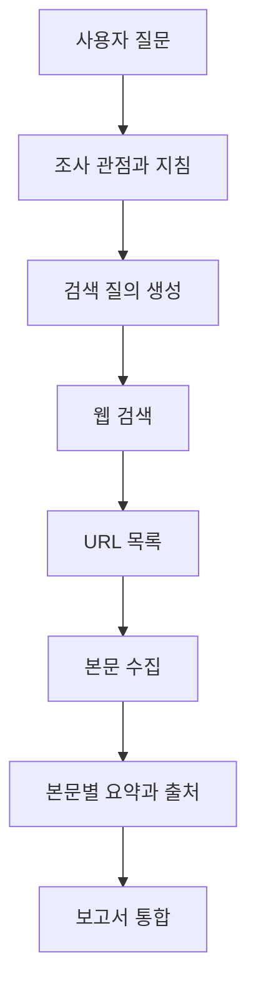

검색 결과를 찾았다고 조사에 필요한 본문까지 확보한 것은 아니다. 이 장의 리서치 엔진은 검색 → 수집 → 요약 → 작성으로 이어지는데, **각 단계가 다음 단계에 실제로 무엇을 넘기는지**를 중심으로 정리했다. 제목만 모아 요약한 결과와 원문을 읽은 보고서는 구분해서 봐야 한다.


## 4.1 리서치 요약 엔진의 구성

작업을 나누면 검색 질의 만들기, 검색 결과 URL 수집, 웹 본문 추출, 페이지별 요약, 최종 보고서 작성이다. 질문에서 곧바로 완성된 보고서를 생성하는 것과 달리 중간 근거가 남는다.



검색 결과의 제목과 짧은 설명은 원문 전체가 아니다. URL을 얻는 단계와 본문을 읽는 단계를 분리해야 한다. 최종 보고서에서도 수집한 사실과 모델이 덧붙인 해석을 구분할 수 있어야 한다.

## 4.2 프로젝트 설정

가상환경과 의존성, 실행 인터프리터를 프로젝트 단위로 정한다. 노트북의 셀 상태에 의존하는 코드에서 실행 파일로 옮기면 환경 변수와 초기화 순서가 더 명확해야 한다.

검색과 스크래핑, 모델 생성, 프롬프트를 각각 나누면 개별 기능을 독립적으로 확인할 수 있다. 예를 들어 웹 수집이 실패했을 때 모델 호출까지 실행할 필요 없이 수집 함수만 재현할 수 있다.

API 키는 환경 변수 등으로 전달하고 설정 파일을 버전 관리에 넣을 때 비밀이 포함되지 않게 한다. 실행 결과를 비교하려면 모델과 패키지 버전, 검색과 요약의 제한값도 남겨야 한다.

## 4.3 핵심 기능

### 4.3.1 웹 검색

검색 함수는 질의를 받아 관련 결과의 URL 목록을 반환한다. 책은 DuckDuckGo 검색 래퍼를 사용하지만 다른 검색 서비스로 바꿀 수도 있다.

서비스를 바꾸면 반환 필드와 검색 결과의 품질, 제한과 인증 방식도 달라진다. URL을 공통 구조로 정규화해 두면 이후 수집 코드가 검색 제공자에 덜 의존한다.

검색에 성공했다고 유효한 자료를 확보한 것은 아니다. 중복 URL, 접근할 수 없는 페이지, 광고성 페이지가 섞일 수 있다. 검색 결과 수와 최종 근거 수는 구분해서 봐야 한다.

### 4.3.2 웹 스크래핑

스크래핑은 HTML에서 처리할 본문을 꺼내는 과정이다. Beautiful Soup 같은 파서는 문서 구조를 읽지만 어느 영역이 유용한 기사 본문인지 자동으로 보장하지는 않다.

메뉴와 푸터, 쿠키 안내가 많이 섞이면 요약 토큰을 낭비하고 중요한 내용이 잘릴 수 있다. JavaScript로 본문을 불러오는 페이지에서는 최초 HTML에 필요한 내용이 없을 수도 있다.

시간 제한과 HTTP 상태, 빈 본문을 명시적으로 다뤄야 한다. 수집 실패를 빈 문자열로 숨긴 뒤 그럴듯한 보고서를 만들면 근거가 없는 상태를 알아차리기 어렵다.

수집 범위와 이용 조건도 확인해야 한다. URL, 페이지 제목과 수집 시점을 남기면 원문 변경과 출처를 추적할 수 있다.

### 4.3.3 LLM 클라이언트

모델 초기화를 한곳에 모으면 생성 설정을 관리하기 쉽다. 검색 질의 생성과 페이지 요약, 보고서 작성에 같은 모델을 쓸 수도 있지만 필요한 성능과 비용이 다를 수 있다.

클라이언트를 만들었다는 사실은 키와 모델, 할당량이 유효하다는 보장이 아니다. 인증 오류와 요청 제한, 출력 제한을 각각 확인해야 한다.

### 4.3.4 JSON 응답 변환

검색 질의 목록처럼 다음 코드가 순회할 값은 구조화된 출력이 필요하다. 문자열 JSON을 Python 객체로 바꾼 뒤 예상한 필드와 타입을 검증한다.

책의 단순 변환 함수는 잘못된 JSON을 빈 사전으로 처리하는 예를 보이다. 실제 흐름에서 이 방식은 “검색할 항목이 없었다”와 “모델 출력 해석에 실패했다”를 섞을 수 있다. 문법 오류와 스키마 오류를 구분해 실패를 보고하는 편이 낫다.

유효한 JSON이어도 질의가 원래 질문과 무관할 수 있다. 형식 검증과 조사 목적의 일치는 별도의 문제이다.

### 단계마다 같은 식별자를 이어 가기

조사 메모에 책 이름이 빠져 있으면 마지막에 인용을 붙이기 어렵다. 리서치 엔진도 문자열 목록만 넘기는 대신 **질의, URL, 원문, 요약의 관계**를 유지해야 한다.

| 단계 | 받는 값 | 내보낼 값의 예 | 다음 단계가 필요한 이유 |
| --- | --- | --- | --- |
| 질의 생성 | 원래 질문과 조사 지침 | 질의 ID, 검색 문장 | 어떤 관점을 조사했는지 구분 |
| 검색 | 검색 문장 | URL, 제목, 질의 ID | 자료를 찾은 경로 유지 |
| 수집 | URL | 원문 ID, 본문, 수집 시점, 추출 상태 | 실제 읽은 내용 확인 |
| 요약 | 원문과 조사 목적 | 사실 요약, 원문 ID | 요약을 원문에 연결 |
| 통합 | 출처별 요약 | 주장과 출처 목록, 미확인 항목 | 보고서의 근거와 빈틈 표시 |

같은 URL이 두 질의에서 나왔다면 본문은 한 번 수집해도 된다. 그렇다고 그 URL을 발견한 질의 관계까지 하나로 버릴 필요는 없다. 본문 중복 제거와 조사 관점의 추적은 다른 일이다.

또한 URL이 같아도 페이지가 바뀔 수 있다. 다시 읽은 내용을 비교하려면 수집 시점과 본문 버전 또는 해시가 도움이 된다. 이것은 모델을 더 잘 지시하는 문제가 아니라, 어떤 입력으로 결과를 만들었는지 재현하는 문제이다.

## 4.4 검색 질의 재작성


그림의 번호를 따라가면 모델의 세 역할이 분리된다. 2~3번은 **무엇을 검색할지 정하기**, 6~7번은 **찾은 자료를 읽기**, 8~9번은 **보고서로 합치기**이다. 인터넷에서 실제로 자료를 찾는 것은 위쪽 Search Engine API이다. 모델이 검색어를 만들었다는 사실을 검색 실행이나 사실 확인과 혼동하지 않아야 한다.

사용자의 자연어 요청을 그대로 검색어로 쓰는 대신 조사할 관점을 나눠 여러 질의를 만든다. 관광지 질문이라면 역사, 교통, 주요 명소처럼 나눌 수 있다.

검색 범위를 넓힐 수 있지만 관점을 잘못 나누면 질문의 의도를 바꾸거나 중요한 조건을 잃을 수 있다. 사용자 질문을 중간 상태에 계속 남겨야 최종 작성에서 원래 목적을 다시 확인할 수 있다.

질의 수를 늘리면 검색 호출과 URL 수, 요약 호출이 함께 늘어난다. 같은 자료를 여러 질의가 반환할 수 있으므로 중복 제거도 중요하다.

## 4.5 단계별 프롬프트

### 4.5.1 검색 프롬프트

책은 먼저 질문에 맞는 조사 관점과 지침을 만들고, 그 지침으로 검색 질의를 생성한다. 질문, 조사 목적과 출력 질의 목록이 이어지는 구조이다.

역할을 동적으로 고르는 것이 항상 필요한 것은 아니다. 특정 업무만 다루는 서비스라면 고정된 지침이 더 단순할 수 있다. 동적 역할이 사실의 신뢰도를 높여 주는 것도 아니다.

검색 질의에는 대상과 필요한 조건이 들어가야 한다. 특정 지역이나 시점이 빠지면 같은 단어의 다른 의미나 오래된 정보가 섞일 수 있다.

### 4.5.2 페이지 요약 프롬프트

페이지 요약은 일반적인 원문 요약보다 현재 조사 질문과 관련된 사실을 뽑는 데 초점을 둔다. 관계없는 배경을 길게 남기면 최종 보고서의 문맥 예산을 낭비한다.

요약을 저장할 때 원래 URL과 어떤 질의로 찾았는지도 함께 보존해야 한다. 요약문만 이어 붙이면 최종 작성 단계에서 개별 사실의 출처를 복원하기 어렵다.

원문에 없는 판단과 수치를 보충하지 않도록 해야 한다. 자료 안에 포함된 명령문은 조사할 데이터이지 서비스 지침이 아니다.

### 4.5.3 보고서 프롬프트

보고서 생성은 부분 요약에서 반복을 줄이고 공통 내용과 차이를 종합하는 단계이다. 모든 요약이 서로 같은 사실을 말한다고 가정해서는 안 된다.

서로 다른 날짜의 자료나 상충하는 수치가 있다면 그 차이를 남겨야 한다. 자료가 없는 항목은 빈틈으로 드러내는 편이 근거 없는 문장으로 채우는 것보다 낫다.

URL을 문장 옆에 붙였다는 사실만으로 인용이 정확해지는 것은 아니다. 해당 페이지가 그 주장을 실제로 뒷받침하는지 확인해야 한다.

### 한 조사 요청이 여러 호출로 바뀌는 과정

“차 없이 갈 수 있는 해안 마을의 교통과 숙박을 비교해 달라”는 요청을 생각해 보자. 검색어를 “해안 마을 추천” 하나로만 만들면 풍경 소개는 많이 찾고 교통편, 숙박 조건은 놓칠 수 있다. 먼저 필요한 근거를 교통과 숙박으로 나누고, 각 질의가 어느 요구를 충족하는지 연결한다.

페이지 요약은 “이 페이지를 요약하라”보다 “이 페이지에서 접근 방법, 운행 조건, 숙소 가격의 단위처럼 이번 비교에 필요한 사실을 추출하라”에 가깝다. 역사만 다룬 페이지는 읽기에 좋은 자료여도 이 요청의 필수 근거를 채우지는 못한다.

최종 보고서에서는 자료 수를 세는 대신 요구별로 근거가 있는지 확인한다. 교통 자료 세 개와 숙박 자료 0개를 얻었다면 “네 가지 장점을 종합한 완성 보고서”가 아니라 **숙박 조건을 확인하지 못한 조사 결과**이다. 다음 장의 관련성 평가는 이 빈틈을 보고 재검색할 수 있게 만드는 장치이다.

상충하는 자료도 보존해야 한다. 한 페이지의 버스 요금과 다른 페이지의 요금이 다르면 평균값을 내는 것이 아니라 적용 날짜, 노선과 편도, 왕복 단위를 비교한다. 요약에서 단위를 지웠다면 마지막 모델은 차이의 이유를 알아낼 수 없다.

## 4.6 순차 구현

### 4.6.1 함수와 프롬프트 연결

검색, 본문 수집, 모델 초기화, 출력 해석 함수를 준비하고 각 단계가 어떤 값을 주고받는지 정한다. 이 단계에서 공통 구조가 없으면 단계마다 필드명을 바꾸는 접착 코드가 늘어난다.

### 4.6.2 설정값과 입력

검색 질의 수, 질의당 결과 수, 본문 길이 제한을 설정으로 둔다. 사용자의 질문은 이 제한값과 달리 실행마다 들어오는 입력이다.

본문을 문자 수로 자르는 것은 토큰 제한과 같지 않다. 중요한 내용이 문서 뒤에 있다면 앞부분만 자르는 방식으로 핵심 근거를 잃을 수 있다.

예를 들어 질의 2개에 결과를 각각 3개씩 수집하면 중복이 없을 때 최대 6개 URL을 요약한다. 역할 선택 1회, 질의 생성 1회, 페이지 요약 6회, 보고서 작성 1회라면 모델 호출은 최소 9회이다. 웹 검색과 본문 요청은 이와 별도의 외부 호출이다.

### 4.6.3 모델 초기화

선택한 모델과 생성 설정을 공통 클라이언트에 적용한다. 출력 길이와 비용을 제한하더라도 요약이 중간에서 끊겼는지 확인해야 한다. 짧게 잘린 출력은 간결한 요약과 다르다.

### 4.6.4 검색 질의 생성과 URL 수집

사용자 질문으로 조사 지침을 만들고 검색 질의를 생성한다. 각 질의를 검색 서비스에 보내 결과 URL을 모은다.

질의가 달라도 같은 URL이 나올 수 있다. URL뿐 아니라 질의와 결과의 관계를 남겨야 어느 관점에서 자료가 충분하거나 부족한지 알 수 있다.

### 4.6.5 본문 수집

URL에서 본문을 추출하고 길이를 제한한다. 수집 결과에는 본문, URL, 질의를 함께 둔다.

일부 URL만 실패했다면 전체를 중단할지, 남은 자료로 계속하되 부족함을 표시할지 정책이 필요하다. 실패한 자료가 정상적인 빈 문서처럼 섞이지 않아야 한다.

### 4.6.6 자료별 요약

각 페이지를 조사 질문에 맞게 요약하고 출처를 연결한다. 페이지별 요약이 이미 틀렸다면 최종 통합도 그 오류를 이어받을 수 있다.

요약 전의 본문과 요약 후의 결과를 연결해 두면 누락과 왜곡을 확인하기 쉽다. 저장 비용과 민감한 자료의 보존 범위는 별도로 정해야 한다.

### 4.6.7 최종 보고서

모은 요약으로 보고서를 작성한다. 입력은 더 이상 웹페이지 전체가 아니라 앞 단계가 선택한 정보이다.

따라서 보고서에서 빠진 내용의 원인이 마지막 모델 호출에만 있는 것은 아니다. 질의 생성, 검색 순위, 본문 추출, 길이 제한과 부분 요약 중 어디서 사라졌는지 거슬러 올라가야 한다.

## 4.7 LCEL로 구성하기

LCEL은 실행 단위를 연결하는 방식이다. 순차 구현에서 중간 변수로 전달하던 값을 Runnable의 입력과 출력으로 표현한다.

### 4.7.1 Assistant Instructions 체인

질문에서 조사 지침을 만드는 작은 체인이다. 출력에는 이후 단계가 사용할 지침과 원래 질문이 필요하다.

각 단계를 나눈다는 것은 모델 호출을 잘게 늘리는 것과 다르다. 실제로 독립적인 판단이 필요한지, 고정 설정으로 충분한지를 먼저 봐야 한다.

### 4.7.2 Web Searches 체인

지침과 사용자 질문을 받아 검색 질의 목록을 생성한다. 출력이 다음 반복 처리의 입력이므로 목록의 구조를 명확히 해야 한다.

이 단계에서 원래 질문을 버리면 뒤에서 보고서 프롬프트를 조립할 때 문맥을 다시 전달해야 한다. 필요한 상태를 어떤 체인에서 보존할지 정하는 문제이다.

### 4.7.3 Search and Summarization 체인

하나의 검색 질의에서 URL을 얻고 각 페이지를 수집하고 요약하는 하위 체인이다. URL별 작업은 서로 독립적일 수 있으므로 `.map()` 등으로 같은 처리를 적용할 수 있다.

`RunnableParallel`은 같은 입력을 여러 분기로 보내고 결과를 이름별로 모으는 데 쓴다. `.map()`이 목록의 각 원소에 같은 처리를 적용하는 것과 구분해야 한다.

### LCEL에서 목록과 사전을 혼동하지 않기

컨베이어 벨트의 한 상자에 무엇이 들어 있는지부터 확인해 보자. 질의 목록을 받는 단계와 질의 하나를 받는 단계는 같지 않다.

```text
질의 목록: [Q1, Q2]
  → 질의별 처리.map()
  → [Q1의 요약 목록, Q2의 요약 목록]
  → 중복 제거·필요한 구조로 평탄화
  → 보고서 입력

페이지 한 개:
  → 출처 보존 분기 + 본문 요약 분기
  → {"source": 원래 URL, "summary": 요약문}
```

첫 흐름에서 `.map()`은 목록의 각 원소에 같은 처리를 적용한다. 두 번째 흐름의 병렬 분기는 같은 페이지에서 서로 다른 결과를 만든다. 전자의 결과가 중첩 목록인데 보고서 템플릿이 문자열을 기대한다면, 체인을 연결하기 전에 문맥을 어떻게 합칠지 명시해야 한다.

출처를 그대로 보존하는 분기는 모델 호출이 필요 없다. Python 함수로 값을 꺼내면 된다. 모든 화살표를 LLM 호출로 만들지 않는 것이 비용뿐 아니라 정확성에도 유리하다. URL처럼 이미 아는 값을 모델에게 재작성하게 하면 오히려 바뀔 위험이 생긴다.

병렬화는 독립 작업의 대기 시간을 줄일 수 있지만 호출 수와 토큰을 없애지는 않다. 동시 호출 수를 제한하고 어떤 하위 작업이 실패했는지 식별할 수 있어야 한다.

### 4.7.4 Web Research 체인

검색 질의 생성, 질의별 검색과 요약, 최종 통합을 하나로 연결한다. 사용자는 질문 하나를 보내지만 내부에서는 여러 종류의 I/O와 모델 호출이 발생한다.

| 실행 위치 | 확인할 입력과 결과 |
| --- | --- |
| 질문 해석 | 원래 질문과 생성한 조사 지침 |
| 검색 | 질의 목록과 URL, 중복과 실패 |
| 수집 | 원문 길이와 실제 추출된 내용 |
| 요약 | 원문과 부분 요약의 대응 |
| 통합 | 어떤 출처가 어떤 주장을 뒷받침하는지 |

모듈로 나눈 장점은 재사용뿐 아니라 실패 위치를 좁힐 수 있다는 것이다. 다만 체인만으로는 증거가 부족할 때 어떤 단계로 돌아갈지 표현하기 번거로울 수 있다. 다음 장의 그래프가 이 제어 흐름을 다룬다.

## 실습: 수집과 요약 사이의 출처 보존

웹 검색과 본문 수집을 한꺼번에 붙이기보다, Python 공식 문서의 URL을 직접 골라 수집 단계부터 확인했다. 검색 API는 이 예제에 포함하지 않는다. 수집과 요약이 동작하면 앞에 검색 함수를 연결할 수 있다.

`ch04.py`로 저장한다. 문서 요청에만 인터넷을 사용하고, 요약은 로컬 모델에서 처리한다.

```python
from urllib.request import Request, urlopen
from bs4 import BeautifulSoup
from langchain_core.documents import Document
from langchain_core.runnables import RunnableLambda
from langchain_core.prompts import ChatPromptTemplate
from langchain_core.output_parsers import StrOutputParser
from langchain_ollama import ChatOllama

def fetch(url):
    request = Request(url, headers={"User-Agent": "BookStudy/1.0"})
    with urlopen(request, timeout=20) as response:
        html = response.read(2_000_001)
    if len(html) > 2_000_000:
        raise ValueError("Page exceeds the study download budget")
    soup = BeautifulSoup(html, "html.parser")
    section = soup.find("section", id="module-sqlite3")
    if section is None:
        raise ValueError("Expected documentation section was not found")
    paragraphs = [p.get_text(" ", strip=True) for p in section.find_all("p")[:4]]
    text = "\n".join(paragraphs)
    if not text.strip():
        raise ValueError("No documentation text was extracted")
    return Document(page_content=text, metadata={"source": url})

prompt = ChatPromptTemplate.from_template(
    "Summarize only these notes in two sentences. "
    "Do not invent capabilities. Notes: {text}"
)
summarize = prompt | ChatOllama(
    model="llama3.2:latest", temperature=0, num_predict=180,
) | StrOutputParser()

def report(document):
    return {
        "source": document.metadata["source"],
        "summary": summarize.invoke({"text": document.page_content}),
    }

chain = RunnableLambda(fetch) | RunnableLambda(report)
result = chain.invoke("https://docs.python.org/3/library/sqlite3.html")
print("Source:", result["source"])
print("Summary:", result["summary"])
assert result["summary"].strip()
```

```powershell
python ch04.py
```

출처는 모델에게 다시 만들어 달라고 하지 않고 수집한 `Document.metadata`에서 가져왔다. 요약은 생성 결과이고 URL은 프로그램이 보존한 값이므로, 두 값의 출처가 다르다.

이 코드는 첫 네 문단을 읽는 작은 수집 예제이다. 페이지 전체 조사로 확대하려면 제목별 분할과 페이지별 범위, 수집 시점을 보존해야 한다. 문서 끝의 사용법까지 요약했다고 해석하지 않는다.

### 수집 함수부터 읽어 보는 이유

`read(2_000_001)`은 허용 다운로드 크기보다 한 바이트 더 읽어 초과 여부를 판단한다. 제한에 걸리면 잘린 HTML을 정상 문서처럼 처리하지 않고 멈춘다. 그다음 `section` 선택과 문단 추출이 진행되므로, HTTP 요청 성공과 유효한 본문 확보는 별도 검사이다.

`report()`는 생성한 요약과 원래 출처를 사전으로 묶는다. 이 작은 함수가 수집 단계와 모델 사이의 계약이다. 검색 API를 앞에 붙이더라도 반환 자료를 같은 `Document` 형태로 맞추면 요약 부분을 재사용할 수 있다. 다만 사이트마다 본문 선택자가 다르므로 현재의 `fetch()`를 범용 웹 수집기로 생각해서는 안 된다.

여러 URL로 확장할 때에는 먼저 정상, 빈 본문, 선택자 변경, 시간 초과를 각각 수집 함수에서 재현한다. 그 뒤 자료별 요약과 전체 통합을 붙여야 어느 단계에서 근거가 사라졌는지 구분하기 쉽다.

URL이 존재한다는 사실만으로 그 페이지가 요약의 모든 주장을 뒷받침하지는 않다. 인용의 정확성은 요약의 문장과 실제로 추출한 문단을 대조해야 판단할 수 있다.

section ID가 존재하지 않으면 모델 호출 전에 `ValueError`로 멈춘다. 빈 문서로 요약을 생성하는 대신 **수집 실패를 수집 단계에서 드러내도록** 했다.

리서치 파이프라인은 보고서뿐 아니라 **무엇을 읽고 무엇을 읽지 못했는지** 남겨야 한다.

## 수집 범위와 병렬화의 한계

### 검색 URL 수와 유효한 근거 수

검색 결과 여섯 개와 읽은 근거 두 개를 구분한다. 접근 실패, 빈 본문, 중복 자료를 각각 기록하고 남은 두 자료가 요청의 필수 항목을 채우는지 확인한다. 채우지 못했다면 다른 검색, 수집을 시도하거나 미확인 항목을 명시해야 한다.

요약 모델을 다시 호출하기 전에 실제 본문이 존재하는지 확인하는 것이 순서이다. 입력에서 빠진 자료는 마지막 보고서 모델이 정확하게 복원할 수 없다.

### 병렬화의 지연과 비용

대기 시간은 줄어들 수 있지만 요청 수와 토큰 사용량은 그대로이거나 재시도로 늘 수 있다. 시간과 비용은 따로 측정해야 한다.

### 링크 수와 인용의 정확성

링크 수보다 주장과 근거의 대응이 중요하다. 같은 내용의 중복 자료나 실제 주장과 무관한 인용도 있을 수 있다.

[이전: 문서 요약](../03-summarization/) / [시리즈 목차](../) / [다음: LangGraph 워크플로](../05-langgraph-workflows/)
