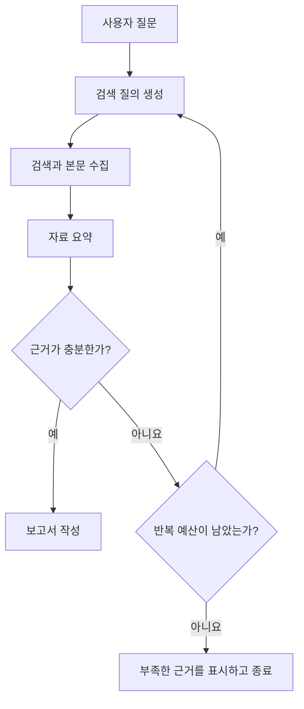

앞 장의 리서치 엔진은 질문에서 보고서까지 정해진 순서로 진행했다. 검색 결과가 부실해도 다음 단계로 넘어간다면 자동화된 보고서가 자동화된 오류가 될 수 있다. 이번 장은 중간 결과에 따라 다시 검색하거나 작업을 끝내는 경로를 명시한다.

## 5.1 워크플로와 에이전트

두 구조 모두 LLM을 사용하지만 다음 행동을 결정하는 범위가 다르다. 워크플로는 개발자가 정한 경로 안에서 작업을 수행하고, 에이전트는 목표와 현재 결과를 보고 어떤 도구를 다음에 사용할지 더 넓게 선택한다.

### 5.1.1 워크플로

워크플로는 고정된 순서만 뜻하지 않는다. 미리 정의한 분기와 반복도 포함할 수 있다. 분류 결과가 A이면 요약하고 B이면 검색하는 구조, 평가가 부족하면 재시도하는 구조도 워크플로다.

Controller-Worker에서는 제어 역할이 작업을 나누고 작업자에게 맡긴다. Router는 요청을 보고 적합한 처리 경로를 고른다. 경로 선택에 LLM을 쓸 수 있지만, 선택할 수 있는 경로 자체는 프로그램에 정의되어 있다.

예를 들어 “자료가 부족하면 질의 재작성, 충분하면 보고서 작성”이라는 두 경로가 있다면 모델은 현재 자료의 관련성을 평가할 수 있다. 그러나 실제로 어느 노드를 실행할지와 허용되는 반복 수는 그래프의 제어 규칙으로 제한할 수 있다.

### 5.1.2 에이전트

에이전트에서는 모델이 도구 목록과 현재 상황을 보고 다음 행동을 고른다. 검색 결과로 장소를 알아낸 뒤 그 장소의 날씨를 조회하는 것처럼, 앞 작업의 결과가 뒤 작업의 입력을 결정할 수 있다.

유연성은 늘지만 실행 횟수와 실패 경로도 늘어난다. 잘못된 질의를 반복하거나 이미 확보한 정보를 다시 검색할 수 있다. 자율적인 판단과 무제한 실행을 같은 것으로 보면 안 된다.

### 5.1.3 언제 필요한가

작업이 한 번의 호출로 충분하면 그래프를 도입해도 이점이 작다. 조건부 분기, 재실행, 명시적인 상태, 긴 작업의 추적이 필요할 때 가치가 커진다.

여기서 비교할 대상은 “프레임워크가 있는 코드와 없는 코드”다. 일반 Python으로도 상태와 분기를 구현할 수 있다. LangGraph의 장점은 그 실행 구조를 공통 모델로 표현하고 상태 저장이나 추적 같은 기능과 연결하기 쉽다는 점이다.

### 5.1.4 에이전트 프레임워크

책은 LangGraph 외에도 CrewAI, AutoGen, Semantic Kernel, LlamaIndex와 시각적 워크플로 도구 등을 소개한다. 제품별 기능은 바뀌므로 이름의 목록보다 어떤 책임을 추상화하는지 보는 편이 낫다.

일부는 역할별 에이전트를 조합하는 편의성에, 일부는 검색과 문서 처리에, 일부는 상태와 제어 흐름에 집중한다. 도구가 제공하는 기본 루프와 수정 가능한 범위, 상태 저장 방식과 관측 기능을 비교해야 한다.

## 5.2 LangGraph의 기본 개념

그래프는 상태, 노드와 엣지로 구성된다. 상태는 작업 중 보관할 정보, 노드는 그 정보를 읽고 처리하는 단계, 엣지는 다음 실행 경로다.

리서치 엔진의 상태에는 원래 질문, 조사 지침, 검색 질의, 검색 결과와 최종 보고서가 들어갈 수 있다. 검색 노드가 질문을 새로 만드는 것이 아니라 현재 질의로 자료를 찾고, 보고서 노드는 모인 자료를 사용한다.

그래프의 모양과 데이터의 모양은 다른 문제다. 화살표가 연결되어 있어도 다음 노드가 필요한 필드가 없다면 실패한다. 노드마다 필요한 입력과 생성하는 상태 항목을 확인해야 한다.

## 5.3 체인에서 그래프로

LCEL은 단순한 선형 처리만 가능한 도구는 아니다. 병렬 분기와 조건부 처리도 만들 수 있다. 다만 반복되는 흐름과 실행 상태를 여러 단계에서 관리할 때는 그래프가 제어 관계를 더 분명하게 드러낼 수 있다.

재검색 경로에는 이전 시도가 무엇이었는지 남아 있어야 한다. 같은 질의로 같은 결과를 반복해 받는다면 루프가 존재한다는 사실만으로 품질이 좋아지지 않는다. 어떤 정보가 부족한지도 다음 질의의 입력이 되어야 한다.

## 5.4 핵심 구성 요소

### 5.4.1 StateGraph

`StateGraph`는 어떤 상태 구조를 사용하고 어떤 노드와 경로를 가질지 정의하는 빌더다. 노드와 엣지를 등록한 뒤 compile하면 실행 가능한 그래프가 된다.

compile은 업무 로직이 옳다는 검증이 아니다. 모델이 맞게 판단하는지, 외부 API가 동작하는지, 종료 조건이 유효한지는 실행과 테스트가 필요하다.

### 5.4.2 상태와 타입

상태 스키마는 노드가 어떤 필드를 읽고 갱신할지 명시한다. `TypedDict`를 사용하면 정적 타입 도구가 구조를 이해하는 데 도움이 되지만, 그 자체가 모든 실행 시점의 값을 검증하는 것은 아니다.

노드는 보통 전체 상태를 새로 반환하기보다 변경할 항목을 반환한다. 같은 필드의 여러 갱신을 어떻게 합칠지는 reducer에 따라 달라진다. 목록이라도 기본 동작이 무조건 이어 붙이기인 것은 아니다.

예를 들어 검색 결과를 누적할 것인지 새 시도의 결과로 교체할 것인지 정해야 한다. 무작정 누적하면 중복과 오래된 자료가 늘고, 무작정 교체하면 이전 시도의 유효한 근거를 잃을 수 있다.

| 상태 항목 | 용도 | 확인할 조건 |
| --- | --- | --- |
| 질문 | 원래 목적 보존 | 재작성 질의와 혼동하지 않기 |
| 질의 목록 | 검색할 관점 | 이전 시도와 중복 여부 |
| 검색 결과 | 원문과 출처 | 실패와 빈 결과의 구분 |
| 평가 결과 | 다음 경로 선택 | 판단 기준과 불확실성 |
| 반복 횟수 | 실행 예산 통제 | 종료 조건과 함께 갱신 |
| 보고서 | 최종 결과 | 사용한 근거와 연결 |

### 5.4.3 노드와 엣지

노드는 상태를 받아 실제 작업을 수행하고 갱신 내용을 반환한다. 일반 엣지는 정해진 다음 노드로 연결하고, 조건부 엣지는 현재 상태의 판단 결과에 따라 다른 경로를 선택한다.

LLM이 생성한 자유로운 문자열을 그대로 노드 이름으로 쓰면 정의되지 않은 경로로 갈 수 있다. 라우팅 결과는 허용된 값으로 제한하고 예상 밖의 출력은 명시적으로 처리해야 한다.

노드 경계를 나누면 외부 요청 실패와 모델 출력 오류, 관련성 평가 실패를 구분하기 쉽다. 다만 지나치게 잘게 나누면 작은 변환마다 상태 필드를 늘리고 연결을 추적하는 부담이 커진다.

### 5.4.4 시작점과 종료 조건

시작점은 처음 실행할 노드이고 종료 조건은 작업이 끝났음을 나타내는 기준이다. 그래프에 `END`가 있다는 사실만으로 모든 경로가 그곳에 도달하는 것은 아니다.

정상 완료, 근거 부족, 외부 서비스 실패와 예산 초과를 구분해야 한다. 근거가 부족한 상태를 성공 보고서와 같은 형태로 감추면 사용자가 한계를 알 수 없다.

재귀나 반복 제한은 마지막 안전장치다. 사용자가 기다릴 수 있는 시간과 호출 비용을 기준으로 더 구체적인 예산을 두는 편이 낫다.

## 5.5 리서치 엔진의 전환

### 5.5.1 기존 구조

기존 엔진은 조사 지침 생성, 검색 질의 생성, 검색, 요약과 보고서 작성을 순서대로 수행했다. 구현이 간단하고 정상 경로를 이해하기 쉽지만 중간 평가 뒤 되돌아가는 흐름은 눈에 덜 드러난다.

### 5.5.2 노드로 나눌 작업

책은 Assistant Selector, Query Generator, Web Searcher, Content Summarizer, Relevance Evaluator와 Report Writer로 역할을 나눈다.

추가된 핵심은 관련성 평가다. 모인 자료가 질문에 답할 만큼 유효한지 보고 작성으로 갈지 검색으로 돌아갈지 결정한다. 단순히 검색 결과가 몇 개 있는지는 충분한 근거의 기준이 아니다.

### 5.5.3 상태와 경로 설계

먼저 전체 작업에 필요한 상태를 정의하고 기존 함수를 상태를 받는 노드로 감싼다. 검색 결과와 요약, 평가를 상태 필드로 연결한 뒤 분기와 종료를 정한다.

관련성 점수가 높아도 잘못된 출처일 수 있고, 평가 모델이 근거의 허점을 놓칠 수 있다. 평가 결과를 사실의 보증으로 쓰기보다 명시된 수용 기준에 따라 다음 행동을 결정하는 입력으로 보는 편이 정확하다.

반복할 때는 횟수와 질의 이력, 실패 원인을 상태에 남긴다. 보고서 작성 노드가 한계 정보도 받아야 근거가 부족한 부분을 최종 답에 반영할 수 있다.

### 5.5.4 얻는 것과 남는 책임

그래프는 어느 상태에서 어떤 노드가 실행됐는지 추적하기 쉽다. 관련성 평가나 보고서 작성만 따로 시험하고 새 경로를 추가할 수도 있다.

그러나 상태 스키마와 그림이 있다고 자동으로 복구와 영속성이 생기는 것은 아니다. 체크포인터, 외부 부작용의 중복 처리, 데이터 보존과 권한은 별도 설계다. 저장과 복원은 14장에서 다시 다룬다.

## 질문

### 그래프로 옮기면 모두 에이전트가 되는가?

고정된 단계를 그래프로 표현할 수도 있다. 모델이 결정하는 범위와 프로그램이 보장하는 경로를 봐야 한다.

### 관련성이 부족하면 계속 재검색하면 될까?

자료 자체가 없거나 수집이 불가능할 수 있다. 같은 실패를 반복하지 않도록 한도와 종료 응답이 필요하다.

참고: [LangGraph 개요](https://docs.langchain.com/oss/python/langgraph/overview).

[이전: 리서치 요약 엔진](../04-research-engine/) / [시리즈 목차](../) / [다음: RAG와 ChromaDB](../06-rag-fundamentals/)
