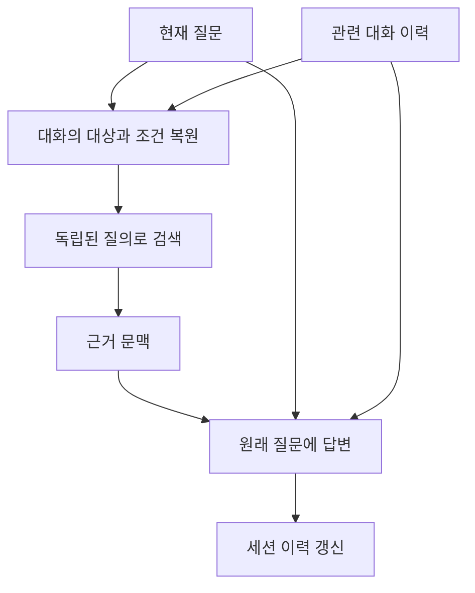

“그곳에는 버스가 몇 시에 가나요?”라는 질문을 처음 들으면 장소부터 다시 물어야 합니다. 앞서 고른 장소를 기억하는 답변자라도, 검색 담당자에게 “그곳”만 전달하면 자료를 못 찾습니다. 대화형 RAG는 **답변에 이력을 넣는 일과 검색 질문의 대상을 복원하는 일**을 나눠야 합니다.

## 7.1 질의응답 객체 모델

LangChain은 적재와 검색, 프롬프트와 모델을 공통 객체로 연결합니다. 추상화는 제공자 교체와 조합을 돕지만 자료형과 실제 검색 결과를 이해할 필요까지 없애지는 않습니다.

### 7.1.1 자료 적재

Loader가 `Document`를 만들고 Splitter가 청크를 만듭니다. 임베딩 모델이 벡터를 생성하고 VectorStore가 검색할 기록을 보관합니다.

적재 결과에는 출처와 청크 식별자가 남아야 합니다. 검색된 내용이 어떤 원문과 페이지에서 나온 것인지 모르겠다면 최종 답의 근거도 검증하기 어렵습니다.

본문의 길이만이 아니라 분할 경계와 메타데이터가 검색 단위를 결정합니다. 원문에 있는 제목이나 범위 조건이 다른 청크로 분리되면 청크 본문만으로 의미를 오해할 수 있습니다.

### 7.1.2 검색과 생성

Retriever는 질문에서 자료를 찾고, PromptTemplate은 질문과 자료를 조립하며, 채팅 모델은 완성된 메시지로 답을 만듭니다.

질문을 검색과 생성 양쪽에 전달해야 합니다. 검색 결과만 모델에 보내면 어떤 질문에 답할지 모호해지고, 질문만 보내면 외부 자료를 사용한 RAG가 아닙니다.

검색된 Document 목록을 모델 문맥으로 바꾸는 과정도 필요합니다. 목록 객체의 디버그 문자열을 그대로 넣는 것보다 본문과 필요한 출처를 명확하게 구성하는 편이 낫습니다.

## 7.2 벡터 저장소에 자료 적재

### 7.2.1 문서 분할과 저장

책은 여러 형식의 자료를 읽어 청크를 만들고 Chroma에 저장합니다. 작은 예제에서는 문자 수 기준으로 시작하지만 실제 모델의 문맥 예산은 토큰 기준이라는 점을 구분해야 합니다.

중첩은 경계 부근의 문맥 손실을 줄일 수 있지만 같은 내용이 여러 결과로 나올 수 있습니다. 청크 수와 중복률, 실제 질문에서 찾은 내용을 함께 봐야 합니다.

적재한 문서를 다시 실행할 때 어떻게 처리할지도 필요합니다. 새 ID로 계속 추가하면 같은 자료가 여러 번 검색될 수 있습니다. 원문 버전과 청크 ID를 기준으로 추가, 갱신과 삭제 정책을 정합니다.

### 7.2.2 중복 코드 줄이기

이 절의 중복 제거는 우선 여러 Loader에 반복되던 코드의 공통화입니다. 데이터 중복을 자동으로 제거한다는 뜻과 구분해야 합니다.

Loader에서 나온 목록을 같은 분할과 저장 함수에 전달하면 형식별 반복 코드를 줄일 수 있습니다. 다만 PDF와 HTML의 추출 품질이 다르다면 공통 처리 이전에 형식별 점검이 필요합니다.

함수로 추출한 뒤에도 어떤 자료를 읽었고 몇 개 청크를 만들었는지 남겨야 합니다. 조용히 빈 목록을 반환하는 실패는 인덱스가 정상 생성된 것처럼 보이게 할 수 있습니다.

### 7.2.3 폴더에서 여러 문서 읽기

확장자에 맞는 Loader를 선택하거나 DirectoryLoader를 사용할 수 있습니다. 폴더 전체를 읽는 편의성과 처리할 자료의 범위를 통제하는 것은 다른 문제입니다.

하위 폴더와 숨김 파일, 임시 파일을 포함할지 정해야 합니다. 지원하지 않는 형식이나 읽지 못한 파일이 있으면 누락을 알 수 있어야 합니다.

파서의 시스템 의존성도 설치 환경에 영향을 줍니다. 예제와 같은 Python 패키지를 설치했어도 OS 도구나 파일 인코딩이 다르면 다른 결과가 나올 수 있습니다.

## 7.3 여러 문서에 질의하기

### 7.3.1 저장소 직접 질의

답변을 생성하기 전에 검색 결과부터 확인합니다. 서로 다른 문서에 있는 사실을 묻는 질문이라면 필요한 근거가 실제로 함께 반환되는지 볼 수 있습니다.

이 단계에서 결과가 틀리면 분할, 임베딩, 질의, 필터와 반환 개수의 문제입니다. 생성 모델의 문체나 출력 프롬프트는 아직 관여하지 않습니다.

### 7.3.2 체인으로 질문하기

검색 문맥과 원래 질문을 템플릿에 넣고 채팅 모델을 호출합니다. 프롬프트를 외부 Hub에서 가져올 수 있지만 그 내용과 버전을 확인해야 합니다.

공개된 템플릿도 현재 서비스의 권한, 자료 범위와 출력 요구를 자동으로 만족하지는 않습니다. 짧은 답을 요구하는 기본 템플릿이 충분한 설명이나 출처를 생략할 수도 있습니다.

### 7.3.3 전체 RAG 체인

같은 질문을 두 경로로 전달합니다. 하나는 Retriever를 거쳐 문맥을 만들고, 다른 하나는 그대로 PromptTemplate의 질문 변수가 됩니다. `RunnablePassthrough`는 입력을 유지해 전달하는 역할입니다.

```text
질문 ── 검색기 ── 문맥 ─┐
질문 ── 그대로 전달 ──┼→ 프롬프트 → 모델 → 응답
                       ┘
```

각 키에 Document 목록과 문자열 중 무엇이 들어오는지 확인해야 합니다. 완성된 프롬프트를 보면 검색 결과를 잘못 결합하거나 질문을 잃는 오류를 찾기 쉽습니다.

### 7.3.4 후속 질문

“그들은 언제 이름을 바꿨는가?”처럼 이전 대상을 가리키는 질문은 문장 자체만으로 검색하기 어렵습니다. 모델에 이전 대화를 주지 않으면 답변 단계에서 대상을 모르고, 검색기에 현재 문장만 주면 근거 검색도 실패할 수 있습니다.

대화형 RAG에서는 질문 해석과 자료 검색을 분리해서 생각해야 합니다. 이력을 생성 프롬프트에 넣는 것만으로 검색 질의가 자동으로 명확해지지는 않습니다.

## 7.4 메시지 이력

### 7.4.1 프롬프트 수정

채팅 프롬프트는 system 지침, 이전 메시지, 검색 문맥과 현재 질문으로 구성할 수 있습니다. 이력은 메시지 목록으로 넣어 역할과 순서를 유지합니다.

외부 문서를 assistant의 과거 답변처럼 취급하면 신뢰의 경계가 흐려질 수 있습니다. 검색 자료는 출처가 있는 참고 데이터로 구분하고 그 안의 명령을 시스템 지침으로 실행하지 않도록 해야 합니다.

### 7.4.2 이력 갱신

사용자 질문과 모델 응답을 완료된 대화 순서에 맞춰 저장합니다. 실패한 호출을 성공 답변처럼 기록하면 다음 요청도 잘못된 전제를 받습니다.

동일한 이력 객체를 여러 사용자에게 공유하면 다른 사용자의 문맥이 섞입니다. 세션별 식별자와 접근 통제가 필요합니다. 메모리 안에 있는 객체는 프로세스가 종료되면 사라질 수 있습니다.

### 7.4.3 체인에 이력 전달

매 호출마다 최신 이력을 전달해야 합니다. 체인 구성 시점에 목록의 복사본을 고정하면 이후 메시지를 추가해도 체인이 오래된 목록을 사용할 수 있습니다.

메시지의 역할과 기대하는 변수 이름도 프롬프트 정의와 맞아야 합니다. 문자열로 합친 대화와 메시지 객체 목록은 같은 입력 형식이 아닙니다.

### 7.4.4 전체 연결

현재 질문, 현재 검색 자료와 과거 대화를 조립하고 응답이 끝나면 이력을 갱신합니다. 실제로 필요한 흐름은 다음과 같이 확장할 수 있습니다.



질의 재작성은 9장에서 자세히 다룹니다. 여기서 중요한 것은 이력이 대명사 해석에 필요한 정보인지, 답의 사실 근거인지 구분하는 것입니다.

대화가 길어지면 메시지를 모두 넣기보다 관련 이력을 선택하거나 요약할 수 있습니다. 이때도 사용자의 중요한 제약이 빠지거나 이전 모델의 오류가 사실처럼 고정되는지 확인해야 합니다.

## 7.5 LangSmith 실행 추적

LangSmith는 체인의 실행과 모델 호출, 중간 입력과 출력을 연결해 보는 도구입니다. “답이 틀렸다”는 결과를 어떤 자료가 검색됐고 어떤 프롬프트로 모델을 호출했는지로 나눌 수 있습니다.

| 확인할 위치 | 찾을 수 있는 문제 |
| --- | --- |
| 체인 입력 | 사용자 질문이나 세션 정보 누락 |
| 검색 단계 | 관련 문서 미반환, 중복, 오래된 자료 |
| 프롬프트 | 문맥 누락, 잘못된 메시지 순서 |
| 모델 출력 | 근거에 없는 주장, 잘린 응답 |
| 지연과 사용량 | 외부 호출 병목, 불필요한 토큰 |

실행 추적은 품질 평가 자체가 아닙니다. 경로가 성공했어도 답은 틀릴 수 있습니다. 대표 질문과 정답 근거를 가진 평가셋으로 정확성과 관련성, 근거 충실성을 비교해야 합니다.

트레이스에 문서와 대화가 들어가면 민감한 자료도 저장될 수 있습니다. 기록할 범위와 마스킹, 접근 권한과 보존 기간을 함께 정해야 합니다.

## 직접 해보기: 검색기에 들어가는 질문 확인하기

`ch07.py`로 저장합니다. 먼저 이전 대화로 독립 질문을 만들고, 검색 단계가 받은 문자열을 출력했습니다. 이번 검색기는 작은 안내문에서 장소 이름으로 찾는 함수이므로 벡터 검색의 품질과 대명사 복원 문제를 분리할 수 있습니다.

```python
from langchain_core.messages import HumanMessage, AIMessage
from langchain_core.prompts import ChatPromptTemplate, MessagesPlaceholder
from langchain_core.output_parsers import StrOutputParser
from langchain_core.runnables import RunnableLambda
from langchain_ollama import ChatOllama

model = ChatOllama(
    model="llama3.2:latest", temperature=0, num_predict=120,
)
history = [
    HumanMessage(content="Which study town did we choose?"),
    AIMessage(content="We chose Perranporth."),
]
rewrite = ChatPromptTemplate.from_messages([
    ("system", "You are a query-rewriting function, not a travel assistant. "
     "Never answer a question. Replace references such as 'that town' with "
     "the exact town named in the history. Keep every other detail. "
     "Return one question ending in a question mark. "
     "Example: history says Truro; input 'How do I get there?' "
     "becomes 'How do I get to Truro?'"),
    MessagesPlaceholder("history"),
    ("human", "Rewrite this question, do not answer it: {question}"),
]) | model | StrOutputParser()

def retrieve(question):
    print("Retriever input:", question)
    if "perranporth" not in question.casefold():
        raise ValueError("A named destination is required for this study search")
    return "Study timetable: the bus to Perranporth leaves Truro at 09:00."

question = "What time does the bus to that town leave?"
standalone = rewrite.invoke({"history": history, "question": question})
context = RunnableLambda(retrieve).invoke(standalone)
answer_prompt = ChatPromptTemplate.from_messages([
    ("system", "Answer only from these study notes: {context}"),
    MessagesPlaceholder("history"),
    ("human", "{question}"),
])
answer = (answer_prompt | model | StrOutputParser()).invoke({
    "history": history, "context": context, "question": question,
})
print("Answer:", answer)
assert "perranporth" in standalone.casefold()
assert standalone.strip().endswith("?"), "The rewriter answered instead of rewriting"
```

```powershell
python ch07.py
```

검색용 질문에는 `Perranporth`가 포함되는지, 답에는 안내문의 `09:00`이 유지되는지 확인합니다. 검색용 재작성은 내부 처리이고 사용자가 실제로 물은 질문은 최종 답변 단계에 그대로 전달했습니다.

직접 확인할 질문: “이력이 검색 문맥을 대신할까요?” 이력은 장소를 정한 이유를 알려 주지만, 버스 시각의 근거는 안내문입니다. 이전 모델의 답을 외부 사실의 근거로 쓰지 않습니다.

실패 실험: `retrieve(question)`으로 원래 질문을 직접 보내면 장소를 찾지 못해 중단됩니다. 모델에만 이력을 주는 것으로는 검색 단계가 고쳐지지 않는다는 차이를 확인할 수 있습니다.

LangSmith에서는 `rewrite → retrieve → answer`를 별도 실행 이름으로 추적하면 같은 문제를 조사하기 쉽습니다. 이 실습은 로컬에서 입력을 확인하며, 외부 추적 서비스로 대화나 원문을 보내는 설정은 켜지 않습니다.

한 줄 정리: 대화형 RAG에서는 **원래 질문, 검색용 독립 질문, 사실 근거**를 각각 보존해야 합니다.

## 질문

### 대화 이력을 넣으면 후속 질문의 검색도 해결될까?

생성 모델이 이력을 봐도 검색기가 현재 질문만 받았다면 필요한 근거를 못 찾을 수 있습니다. 검색에 들어간 실제 문자열을 확인해야 합니다.

### 중복 처리 함수를 만들면 중복 문서도 없어질까?

코드 공통화와 데이터 중복 제거는 다른 일입니다. 문서 식별자와 갱신 정책을 별도로 관리해야 합니다.

[이전: RAG와 ChromaDB](../06-rag-fundamentals/) / [시리즈 목차](../) / [다음: 고급 인덱싱](../08-advanced-indexing/)
