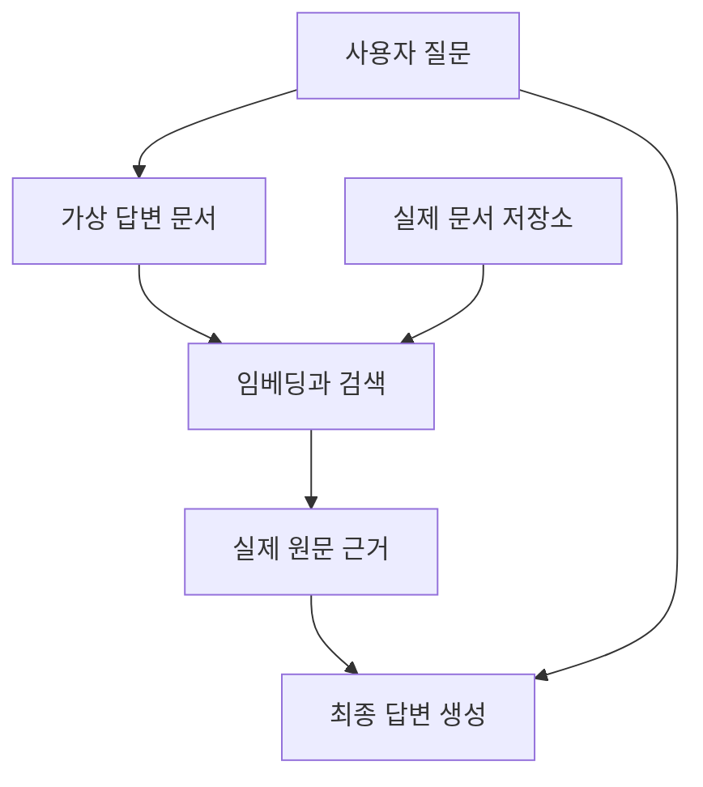

가게에서 “기차로 갈 수 있고 저렴하게 잘 곳”을 한 번에 물으면, 교통 안내와 숙박 요금표 두 곳을 확인해야 합니다. 단어만 바꾸는 재작성과, 서로 다른 자료가 필요한 질문을 나누는 분해는 다릅니다. 이번에는 **질의를 늘리기 전후에 필요한 근거가 모두 모였는지** 비교했습니다.

검색용 질의와 사용자에게 답해야 할 질문은 구분해야 합니다. 검색어를 바꾸더라도 최종 응답의 목적은 원래 질문에 답하는 것입니다.

## 9.1 Rewrite-Retrieve-Read

기본 RAG는 질문을 바로 검색에 넣고 결과로 답합니다. 여기에 검색 전 재작성 단계를 붙인 구조가 Rewrite-Retrieve-Read입니다.

### 9.1.1 원래 질문으로 검색

먼저 원문 질문의 검색 결과를 기준선으로 확인합니다. “Cornwall에서 재미있게 할 만한 일”은 자연스럽지만 취미, 가족 활동, 축제와 해변 중 어떤 내용을 찾는지 넓습니다.

검색 결과가 부족한 이유가 표현 때문인지, 자료 자체가 없기 때문인지 구분해야 합니다. 질의를 바꾸기 전에 어떤 근거를 기대하는지와 현재 반환된 자료를 남겨야 비교가 가능합니다.

### 9.1.2 재작성 체인

질문을 검색에 적합한 형태로 바꾸도록 모델에 요청합니다. 불필요한 대화 표현을 줄이고, 지역과 주제, 조건을 명시하는 방식입니다.

재작성은 원래 질문의 조건을 유지해야 합니다. “차 없이 방문할 곳”에서 교통 조건이 사라지거나 “주말”이 특정 날짜로 잘못 바뀌면 검색이 풍부해져도 목적에 맞지 않습니다.

모호한 부분을 모델이 임의로 확정하는 것과 질의를 명료하게 만드는 것도 다릅니다. 날짜나 대상이 반드시 필요한데 알 수 없다면 사용자에게 확인하는 편이 맞을 수 있습니다.

### 9.1.3 재작성된 질의로 검색

같은 검색기와 반환 개수로 원래 질문과 새 질의를 비교합니다. 어떤 근거가 새로 들어왔고 무엇이 빠졌는지 볼 수 있습니다.

응답 문장이 좋아 보인다는 이유만으로 재작성이 성공했다고 판단하면 안 됩니다. 최종 생성의 변화와 검색 결과의 변화를 나눠 봐야 합니다.

### 9.1.4 전체 체인

검색 경로에는 재작성 질의를, 최종 생성에는 원래 질문을 전달합니다. 원래 질문을 보존하지 않으면 답변도 검색어를 작성한 모델의 해석에 끌려갈 수 있습니다.

```text
원래 질문 → 재작성 → 검색 → 근거
원래 질문 ──────────────────┐
근거 ──────────────────────┴→ 최종 답변
```

재작성으로 추가된 조건과 실제 검색 문장을 기록하면 의도 왜곡을 조사하기 쉽습니다.

### 검색어를 바꿔도 바꾸면 안 되는 것

친구에게 대신 질문해 달라고 맡겼는데 예산과 날짜를 빼먹으면 다른 여행을 추천받습니다. 질의 재작성에서도 반드시 유지할 조건과 바꿔도 되는 표현을 나눕니다.

```text
원래 요청: "일요일에 차 없이 Falmouth에 가서 100파운드 이하로 묵고 싶어요."
보존할 조건: 장소=Falmouth, 요일=일요일, 교통=자가용 제외, 예산≤100
바꿔도 되는 표현: "차 없이" → 대중교통 접근성
아직 모르는 것: 여행 날짜, 예산이 1박인지 전체인지
```

질문을 명료하게 만든다는 이유로 “일요일”을 임의의 날짜로 바꾸거나 예산 단위를 만들어 내면 안 됩니다. 필요한 정보가 없다면 확인 질문을 하거나, 확인되지 않은 조건임을 상태에 남깁니다. 특히 상대적인 표현인 “다음 주말”은 기준 날짜와 시간대가 있어야 해석할 수 있습니다.

질의 변환의 평가에서는 원래 조건 목록과 변환 후 조건을 대조합니다. 더 많은 문서가 검색됐더라도 조건을 잃었다면 성공이라고 보기 어렵습니다. 검색 범위를 넓히는 일과 사용자 의도를 바꾸는 일은 다릅니다.

## 9.2 여러 질의 생성

한 가지 표현으로 관련 자료를 모두 찾기 어려울 때 여러 관점이나 표현으로 검색합니다. 같은 질문의 표현 변형과 복합 질문의 하위 문제 분해는 목적이 조금 다릅니다.

표현 변형은 같은 정보를 다른 말로 찾는 방식입니다. 분해는 교통, 숙박, 활동처럼 각각 다른 정보를 모으는 방식입니다. 둘을 섞어 쓰더라도 원래 요구가 모두 다뤄졌는지 확인해야 합니다.

### 9.2.1 질의 생성 체인

원래 질문으로 여러 검색 문장을 생성합니다. 질의 수를 고정하면 실행 예산을 관리하기 쉽지만 모든 질문에 같은 개수가 필요한 것은 아닙니다.

예를 들어 “기차로 이동하기 좋은 해안 마을과 가족 숙소”라면 장소 접근성과 숙박 정보를 나눠 찾을 수 있습니다. 유사한 문장만 다섯 개 만들었다면 검색 범위는 기대만큼 넓어지지 않을 수 있습니다.

### 9.2.2 사용자 정의 MultiQueryRetriever

질의 생성 프롬프트와 출력 파서, 실제 검색기를 직접 조합합니다. 각 질의 결과를 합칠 때 동일 문서나 동일 청크의 중복을 구분해야 합니다.

질의가 4개이고 각각 5개를 받으면 후보는 최대 20개지만 유효한 근거가 20개라는 뜻은 아닙니다. 중복과 주제 이탈, 문맥 예산을 고려해 반환할 자료를 선택해야 합니다.

`MultiQueryRetriever`는 일반적으로 질의 생성과 검색 결과 통합을 담당합니다. 최종 자연어 답변은 그 결과를 프롬프트와 모델에 연결하는 별도 생성 단계입니다.

### 9.2.3 기본 구성 사용

표준 생성 함수를 사용하면 질의 변형과 검색을 빠르게 조합할 수 있습니다. 그러나 기본 프롬프트가 서비스의 언어와 대상, 날짜 조건에 맞는지는 확인해야 합니다.

사용자 정의와 기본 구성의 차이는 코드 양만이 아닙니다. 어떤 질의가 생성됐고 중복을 어떻게 합쳤는지 관측할 수 있어야 문제를 개선할 수 있습니다.

### 여러 질의의 결과를 합치는 두 가지 의미

첫 질의가 문서 `[A, B]`, 둘째가 `[B, C]`를 찾았다고 해 보겠습니다. 단순 합집합은 `[A, B, C]`로 중복을 제거합니다. 하지만 이 목록만으로 A와 C 중 무엇을 먼저 넣을지는 정해지지 않습니다. 질의마다 거리 점수의 분포도 다를 수 있습니다.

여기에는 두 결정이 있습니다. **어떤 서로 다른 근거를 확보했는가**와 **최종 문맥에 무엇을 어떤 순서로 넣을 것인가**입니다. 전자는 중복 제거와 요구별 근거 확보의 문제이고, 후자는 재정렬과 문맥 예산의 문제입니다. 10장의 RRF는 여러 순위를 결합하는 후자의 방법 중 하나입니다.

중복 키는 제목보다 원문·버전·청크 ID처럼 명확한 식별자를 쓰는 편이 낫습니다. 제목이 같은 개정 문서를 하나로 합치거나, 내용은 같은데 URL만 달라 서로 다른 근거처럼 세지 않도록 해야 합니다.

## 9.3 Step-back 질문

세부 질문을 더 일반적인 질문으로 바꿔 배경 원리나 넓은 문맥을 검색합니다. 특정 장소의 특정 교통편만 찾는 대신 해당 지역의 교통 체계를 함께 확인하는 식입니다.

세부 조건을 없애는 것이 목적은 아닙니다. 일반 배경과 구체 근거를 함께 얻어 답변의 맥락을 보완합니다.

### 9.3.1 Step-back 생성

질문에서 핵심 개념을 추려 덜 구체적인 질문을 만듭니다. 특정 상품 환불 사례라면 해당 상품군의 환불 정책을 묻는 질문으로 넓힐 수 있습니다.

너무 넓히면 실제 문제와 관련 없는 문서가 나옵니다. 어떤 배경이 부족한지 모른 채 무조건 일반 질문을 추가하면 비용과 잡음만 늘 수 있습니다.

### 9.3.2 RAG에 통합

원래 질문의 검색 결과와 Step-back 질문의 결과를 함께 사용할 수 있습니다. 어떤 자료가 배경이고 어떤 자료가 직접 답을 뒷받침하는지 구분해 구성합니다.

넓은 규칙과 구체적 예외가 충돌할 수 있습니다. 일반적인 정책을 찾았다고 특정 계약의 예외를 덮어쓰면 안 됩니다. 최종 답은 원래 질문의 대상과 조건을 기준으로 작성해야 합니다.

## 9.4 HyDE

HyDE는 Hypothetical Document Embeddings입니다. 질문에 답할 법한 가상 문서를 생성하고 그 문서를 검색용 임베딩으로 사용하는 방식입니다.

8장의 가상 질문 임베딩은 문서 적재 시 원문에서 예상 질문을 만드는 쪽입니다. HyDE는 질문이 들어올 때 가상 답변이나 문서를 만듭니다. 처리 시점과 바꾸는 대상이 다릅니다.

### 9.4.1 가상 문서 생성

질문이 짧거나 실제 자료의 서술 방식과 다를 때, 답변 형태의 문장을 만들어 문서 표현에 가까워지도록 합니다.

중요한 점은 이 문장이 근거가 아니라 검색 도구라는 것입니다. 모델이 상상한 요금과 장소가 들어갈 수 있습니다. 그 내용을 사실로 사용자에게 보내거나 근거 문서와 섞으면 환각을 검색 단계에서 확대할 수 있습니다.

### 9.4.2 전체 RAG 연결

가상 문서로 실제 저장소를 검색한 뒤, 반환된 실제 원문과 원래 질문으로 최종 답을 생성합니다.



가상 문서가 잘못된 방향을 잡으면 검색도 그쪽으로 끌릴 수 있습니다. 원래 질문으로 검색한 결과와 비교해 어떤 질문 유형에서 도움이 되는지 확인해야 합니다.

## 9.5 단일 단계와 다단계 분해

독립적인 하위 질문은 한 번에 나눠 병렬 처리할 수 있습니다. 두 지역의 교통수단을 비교한다면 각각의 정보를 독립적으로 모을 수 있습니다.

반면 “조건에 맞는 마을을 고르고 그곳의 숙박을 찾아라”는 앞 단계에서 마을이 정해져야 다음 검색을 할 수 있습니다. 이를 독립 질의 두 개로 무조건 병렬화하면 두 번째 질의에 필요한 대상이 없습니다.


릴레이에서 앞 주자의 바통을 받아야 출발할 수 있는 것처럼 `Q2+C1`, `Q3+C2`를 읽으면 됩니다. 앞 검색에서 얻은 값이 뒤 검색의 조건을 채웁니다. 아래 실습의 두 질의는 독립적으로 필요한 근거를 모으는 예제이며, 이 그림처럼 앞 결과를 다음 질의에 주입하는 다단계 실행과는 구분합니다.

| 방식 | 의존성 | 예시 |
| --- | --- | --- |
| 표현 변형 | 같은 목적의 다른 검색 문장 | 같은 정책을 다른 말로 검색 |
| 독립 분해 | 하위 질문을 따로 처리 가능 | 두 지역의 교통 비교 |
| 순차 분해 | 이전 결과가 다음 입력 | 장소 선정 후 해당 장소의 숙소 검색 |

여러 단계를 수행하면 앞의 오류가 뒤로 전파됩니다. 장소를 잘못 골랐는데 숙박 검색이 정확해도 전체 요청은 실패입니다. 중간 결과가 원래 조건을 만족하는지 확인해야 합니다.

## 선택할 때의 기준

질의가 모호하면 재작성, 표현 차이가 크면 다중 질의나 HyDE, 배경이 부족하면 Step-back, 정보가 여러 영역에 흩어져 있으면 분해를 검토할 수 있습니다.

이 구분은 고정된 정답표는 아닙니다. 대표 질문으로 검색 근거의 적중률과 중복, 최종 답의 정확도, 호출 수와 지연을 비교해야 합니다. 개선 기법마다 추가되는 모델 호출도 비용입니다.

### 같은 질문에 다섯 기법을 적용하면 무엇이 달라질까요?

| 기법 | 입력에서 만드는 것 | 검색 뒤 최종 답에 사용할 것 |
| --- | --- | --- |
| 재작성 | 장소·조건을 명시한 한 질의 | 원래 질문 + 실제 근거 |
| 다중 질의 | 같은 목적의 여러 표현 | 중복 제거한 실제 근거 |
| Step-back | 교통 정책 같은 더 일반적인 질문 | 구체 근거 + 배경 근거 |
| HyDE | 답처럼 생긴 가상 문서 | 가상 문서가 아니라 검색된 실제 원문 |
| 분해 | 교통·숙박 등 하위 질문 또는 순차 계획 | 요구별 근거와 단계 간 결과 |

Step-back은 문제를 이해할 배경을 더하고, HyDE는 검색에 사용할 표현을 문서 형태로 바꿉니다. 둘 다 모델이 텍스트를 하나 더 만든다는 점만 보면 비슷하지만, 추가 텍스트의 역할이 다릅니다. 배경 질문도 실제 자료에서 검색해야 하고, 가상 답변은 사실 근거로 사용하지 않습니다.

기법을 모두 겹치면 호출 수가 빠르게 늘어납니다. 먼저 원래 질문에서 후보 수를 늘린 기준선과 비교하고, 그다음 가장 뚜렷한 실패 하나를 해결하는 변환을 선택합니다. 독립 하위 질문을 병렬 실행할 수 있어도 최종 후보 수와 입력 토큰이 늘어난다는 사실은 남습니다.

## 직접 해보기: 질문 하나를 두 자료의 검색으로 나누기

`ch09.py`로 저장합니다. 모델이 하위 질문을 만들고 같은 Chroma 컬렉션에서 각각 검색합니다. 검색 결과는 문서 ID로 합칩니다.

```python
import chromadb
from chromadb.config import Settings
from pydantic import BaseModel, Field
from langchain_core.prompts import ChatPromptTemplate
from langchain_core.output_parsers import JsonOutputParser
from langchain_ollama import ChatOllama

class SearchPlan(BaseModel):
    queries: list[str] = Field(min_length=2, max_length=2)

question = "How do I reach Falmouth by train, and what does a hotel cost?"
prompt = ChatPromptTemplate.from_template(
    'Split the request into exactly two independent search queries: '
    'one about rail travel, one about hotel prices. Preserve the place. '
    'Return JSON with key "queries", an array of two strings. Request: {question}'
)
plan = SearchPlan.model_validate((
    prompt | ChatOllama(
        model="llama3.2:latest", temperature=0, format="json", num_predict=180,
    ) | JsonOutputParser()
).invoke({"question": question}))
if any(not query.strip() for query in plan.queries):
    raise ValueError("Empty search query")
client = chromadb.Client(Settings(anonymized_telemetry=False))
collection = client.create_collection("study-decomposition")
collection.add(
    ids=["rail", "hotel", "museum"],
    documents=[
        "Rail transport: trains from Truro to Falmouth run every 30 minutes.",
        "Accommodation: the study hotel in Falmouth costs 80 pounds per night.",
        "The museum in Truro opens at 10:00.",
    ],
)
baseline = collection.query(query_texts=[question], n_results=1)["ids"][0]
merged = {}
for query in plan.queries:
    found = collection.query(query_texts=[query], n_results=1)
    print("Query:", query, "=>", found["ids"][0])
    merged.update(zip(found["ids"][0], found["documents"][0]))
expected = {"rail", "hotel"}
print("Original question:", question)
print("Baseline coverage:", len(set(baseline) & expected), "/ 2")
print("Decomposed coverage:", len(set(merged) & expected), "/ 2")
assert expected.issubset(merged), "A required source was not retrieved"
```

```powershell
python ch09.py
```

이번 실행에서는 원래 질문이 필요한 두 근거 중 하나를 찾았고(`1 / 2`), 분해한 질의는 `rail`과 `hotel`을 각각 찾아 두 근거를 모두 모았습니다(`2 / 2`).

한 질의에서 후보를 하나만 받는 기준선과, 두 하위 질의에서 각각 하나씩 받는 경우를 비교했습니다. 후자는 검색 호출과 후보 예산이 두 배입니다. 결과가 좋아져도 **같은 비용에서 우수하다는 결론은 낼 수 없습니다.** 공정한 다음 비교는 원래 질문에서도 두 개를 받는 경우입니다.

코드의 `SearchPlan`은 질의가 정확히 두 개라는 형식을 검사합니다. 그러나 두 문장이 각각 교통과 숙박을 묻는지, 둘 다 Falmouth를 유지하는지까지 자동 검증하지는 않습니다. 그래서 생성한 질의와 검색 ID를 함께 출력해 확인합니다.

`merged`는 문서 ID를 키로 삼기 때문에 같은 자료가 두 번 검색돼도 한 번만 남습니다. 마지막 검사는 `rail`과 `hotel`이라는 필요한 두 근거를 모두 확보했는지 봅니다. 최종 여행 답변을 생성하는 코드는 없으므로, 이번 결과는 **근거 확보의 비교이지 완성된 여행 상담의 품질 비교는 아닙니다.**

더 공정한 비교에서는 원래 질문 top-2, 두 질의 각각 top-1을 같은 후보 예산으로 놓고 질문 수를 늘립니다. 추가로 교통·숙박 어느 쪽이 빠졌는지, 중복 후보가 얼마나 생겼는지, 질의 생성 호출의 시간과 비용이 얼마인지 기록하면 분해의 이득을 구체적으로 판단할 수 있습니다.

직접 확인할 질문: “호텔 가격을 검색하는 대신 모델이 가격을 만들어 주면 빠르지 않을까요?” 그 값은 근거가 아닙니다. HyDE에서도 생성 문장은 검색의 단서로만 쓰고 최종 가격은 실제 문서에서 가져와야 합니다.

실패 실험: 모델이 만든 질의에서 `Falmouth`를 지운 뒤 다른 지역의 안내를 추가합니다. 자료를 더 많이 찾았더라도 대상 지역을 잃었다면 재작성이 실패한 것입니다.

한 줄 정리: 질문 변환은 **원래 요구를 보존하면서 필요한 근거의 범위를 늘리는지**, 추가 비용과 함께 평가합니다.

## 질문

### 분해 후 근거가 늘었으니 곧바로 더 좋은 방식일까요?

원래 질문이 top-1이고 두 하위 질문이 각각 top-1이라면 검색 예산이 달라졌습니다. 원래 질문 top-2와도 비교해야 변환 자체의 효과를 더 잘 구분할 수 있습니다. 여기에 질의 생성 모델의 시간과 비용도 더합니다.

자료가 늘었지만 지역이나 요일 조건을 잃지 않았는지 함께 봅니다. 근거 수 증가와 사용자 요구 충족을 별도로 판단해야 합니다.

### HyDE가 만든 문장을 최종 답에 사용해도 될까?

검색을 돕기 위해 생성한 가설일 뿐입니다. 실제 근거와 구분해야 합니다.

### 여러 질의를 만들면 질문 분해가 끝난 것일까?

하위 질문이 독립적인지, 결과를 어떤 순서로 연결해야 하는지까지 정해야 합니다.

[이전: 고급 인덱싱](../08-advanced-indexing/) / [시리즈 목차](../) / [다음: 질의 생성과 라우팅](../10-query-routing/)
