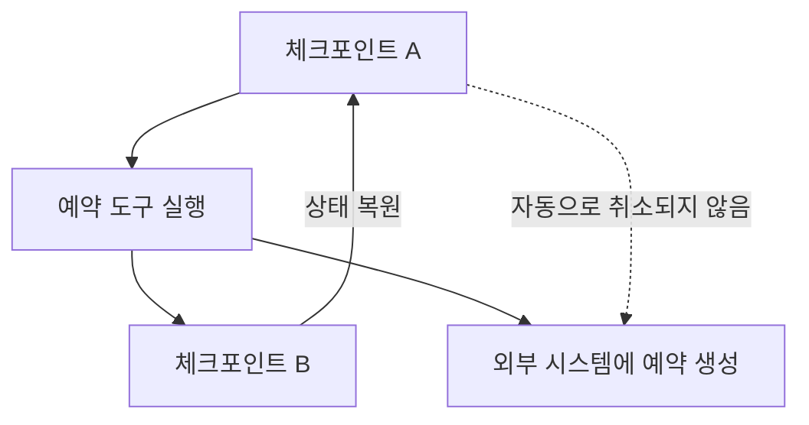

게임의 저장 지점을 불러오면 캐릭터 위치는 돌아가지만, 현실에서 이미 결제한 물건까지 취소되지는 않습니다. 에이전트의 체크포인트도 저장된 상태를 복원할 뿐입니다. 외부 행동의 중복 방지와 취소는 따로 설계해야 합니다.

이번에는 체크포인트를 붙인 그래프를 **승인 직전에 중단하고 같은 Thread에서 재개**했습니다. 승인하지 않은 작업이 실행되지 않는지도 함께 확인했습니다.

## 14.1 메모리

메모리는 모델의 가중치에 모든 대화를 새로 학습시키는 기능이 아닙니다. 애플리케이션이 필요한 상태를 저장하고 다음 실행의 입력으로 복원하는 구조입니다.

### 14.1.1 메모리의 범위

| 범위 | 예시 | 별도로 정할 것 |
| --- | --- | --- |
| 단기 대화 | 이번 여행에서 선택한 마을과 날짜 | Thread 구분과 문맥 예산 |
| 장기 사용자 | 여러 대화에서 사용할 선호 | 동의, 수정과 삭제, 사용자 격리 |
| 장기 애플리케이션 | 공통 정책과 여행 정보 | 출처, 유효 시점과 갱신 |

단기와 장기는 무조건 저장 매체로 구분되지 않습니다. 대화 범위의 상태도 디스크 DB에 오래 보관할 수 있습니다. 무엇을 어느 범위에서 재사용하는지가 먼저입니다.

### 14.1.2 단기 메모리가 필요한 이유

“같은 마을에서 객실을 찾아 줘”라는 질문은 앞에서 고른 마을을 알아야 합니다. 매 요청마다 새 상태로 호출하면 그 연결이 사라집니다.

도구 호출 대화에서는 사용자와 모델의 문장만이 아니라 호출 요청과 도구 결과의 관계도 중요합니다. 일부 메시지만 보관하면 프로토콜상 대응이 끊기거나 결과를 잘못 해석할 수 있습니다.

메모리가 있다고 모든 과거 메시지를 매번 모델에 넣어야 하는 것은 아닙니다. 필요한 범위를 선택하고 요약할 수 있지만 중요한 날짜와 제약, 미확인 사항을 잃지 않아야 합니다.

### 14.1.3 LangGraph 체크포인트


게임의 저장 슬롯 번호를 따라가듯 오른쪽 Checkpointer 열을 보면 됩니다. 첫 대화의 저장 화살표와 두 번째 대화의 `Load last checkpoint by thread_id`가 같은 Thread를 연결합니다. 그림은 순차 실행의 개념을 보여 주며, 실제 저장 경계는 아래에서 설명하는 super-step 기준으로 이해해야 합니다. 외부 예약이나 결제를 되돌리는 화살표는 없습니다.

체크포인트는 특정 실행 경계의 그래프 상태 스냅샷입니다. 대화뿐 아니라 노드의 중간 결과와 다음 실행에 필요한 정보를 포함할 수 있습니다.

LangGraph의 실행은 super-step이라는 단위로 이해할 수 있습니다. 같은 단계에서 병렬 노드가 실행될 수도 있으므로 “항상 함수 한 줄마다 저장” 또는 “무조건 각 개별 노드 직후에 독립 스냅샷”으로 외우는 것은 부정확합니다.

Thread ID는 상태를 이어 갈 실행 묶음의 식별자입니다. 같은 Thread에 새 질문을 넣으면 저장된 상태를 바탕으로 이어 가고, 다른 Thread면 별도 대화가 됩니다.

### 14.1.4 체크포인터 연결

그래프를 compile할 때 체크포인터를 연결하고 호출 설정에 Thread ID를 제공합니다. 인메모리 저장은 실습에 편하지만 프로세스를 재시작하면 사라집니다.

운영에서는 영속 저장소와 접근 정책, 보존 기간을 정해야 합니다. Thread ID를 알고 있다는 사실만으로 그 상태를 읽을 권한이 있다고 봐서는 안 됩니다. 인증된 사용자와 Thread 소유권의 연결이 필요합니다.

### 대화·실행·업무 요청의 식별자를 나누기

책갈피 번호, 오늘의 작업 번호, 주문 번호는 다릅니다. 에이전트에서도 비슷해 보이는 식별자가 서로 다른 수명을 가집니다.

| 식별자 | 묶는 대상 | 같은 값을 재사용할 때의 의미 |
| --- | --- | --- |
| Thread ID | 이어지는 그래프 상태와 대화 | 같은 대화의 저장 상태를 이어 감 |
| 실행 식별자 | 한 번의 호출·실행 기록 | 특정 실행의 관측과 추적 |
| Checkpoint ID | 저장된 특정 상태 | 그 시점의 상태를 선택 |
| 업무 요청 ID | 외부 행동의 논리적 요청 | 같은 행동의 중복 여부 확인 |

아래 실습은 단순하게 Thread 이름을 `request_id`로도 사용하지만, 일반적인 서비스에서는 같다고 가정하면 안 됩니다. 같은 대화에서 두 번의 서로 다른 예약을 할 수 있기 때문입니다. 반대로 네트워크 재시도로 실행이 두 번 시작돼도 같은 예약 요청이라면 업무 ID는 같아야 할 수 있습니다.

저장된 상태에는 메시지뿐 아니라 사용자가 선택한 장소, 도구 결과와 처리 상태가 들어갈 수 있습니다. 이 값을 오래 보관하면 편리하지만, 오래된 가격과 재고를 현재 값처럼 재사용할 위험도 생깁니다. **상태를 복원하는 일과 외부 사실을 재검증하는 일**을 분리해야 합니다.

모델 제공자의 이전 응답 ID를 사용하는 방식과 LangGraph의 상태 저장은 다른 계층입니다. 제공자와 라이브러리 버전에 따라 메시지 전달 규칙이 다르므로 특정 설정이 모든 조합에서 반드시 필요하다고 일반화하지 않습니다.

### 14.1.5 연속 실행

첫 요청에서 장소를 정하고 같은 Thread로 후속 질문을 보내 대상이 유지되는지 확인합니다. 다른 Thread에서는 그 정보가 섞이지 않아야 합니다.

저장소에 상태가 남는 것과 모델이 적절한 문맥을 받는 것도 별개입니다. 모델 호출 전에 메시지를 줄이거나 재구성한다면 실제 전달한 내용을 확인해야 합니다.

### 14.1.6 과거 상태로 돌아가기

이전 체크포인트를 선택해 당시 상태를 확인하거나 다른 방향으로 실행을 이어 갈 수 있습니다. 같은 질문에서 다른 선택을 했을 때를 비교하는 데 유용합니다.

그러나 상태를 되감는다고 외부 세계도 되돌아가지는 않습니다. 이미 보낸 메시지나 완료한 결제, 생성한 예약은 별도의 작업입니다.



재실행 가능한 노드에는 중복 방지 키와 이미 실행한 결과를 확인하는 절차가 필요합니다. 읽기 전용 조회와 부작용이 있는 행동의 복구 정책을 나눠야 합니다.

## 14.2 가드레일


입구에서 맞지 않는 주문을 돌려보내면 주방이 불필요하게 움직이지 않는 것처럼, 오른쪽 거절 경로는 전문 에이전트와 도구를 호출하기 전에 끝납니다. 다만 주제에 맞는 질문도 권한을 위반할 수 있습니다. 이 그림의 범위 검사만으로 개별 도구의 권한 검사나 사람의 승인을 대체하지 않습니다.

가드레일은 입력과 처리, 출력에 적용하는 범위와 정책 검사입니다. 잘못된 요청을 일찍 막고 모델이나 도구의 결과가 허용 조건을 만족하는지 확인합니다.

단순한 주제 분류, 구조 검증과 민감정보 검사, 도구 권한 통제는 서로 다른 역할입니다. 모델에게 “규칙을 지켜라”라고 말하는 것만으로 모두 해결되지 않습니다.

### 14.2.1 여행과 무관한 요청 차단

입력에서 서비스 범위에 맞는 질문인지 분류합니다. 여행 도우미를 일반적인 무료 모델 호출 창구처럼 사용하는 것을 줄일 수 있습니다.

그렇지만 분류 모델도 틀릴 수 있습니다. 정상 요청을 막는 오차단과 범위 밖 요청을 통과시키는 미차단을 함께 평가해야 합니다.

주제 검사는 권한 검사가 아닙니다. 여행 질문이라는 이유로 다른 사용자의 예약 정보에 접근해도 되는 것은 아닙니다. 허용 자료와 작업은 실행 계층에서 강제합니다.

### 14.2.2 에이전트별 추가 제한

상위 입력이 여행 관련이어도 전문 에이전트가 지원하는 지역과 기능은 더 좁을 수 있습니다. Cornwall 자료만 가진 도구가 다른 지역의 사실을 추측하지 않도록 범위를 확인합니다.

상위 Router의 검사와 하위 에이전트의 검사는 역할이 다릅니다. 내부 경로가 바뀌거나 도구가 직접 호출되더라도 필요한 제약을 유지해야 합니다.

검사 서비스가 실패했을 때의 정책도 필요합니다. 위험한 작업에서 확인 실패를 정상 통과로 처리하면 통제가 사라집니다. 제한 응답이나 사람의 검토 등 실패 동작을 명시합니다.

## 14.3 운영에서 더 필요한 것

### 14.3.1 장기 사용자와 애플리케이션 메모리

장기 메모리는 여러 Thread에서 재사용할 정보입니다. 사용자 선호와 공통 지식을 같은 범위에 저장하면 정보가 섞일 수 있습니다.

저장할 사실의 출처와 유효 시점, 수정과 삭제 경로를 정해야 합니다. 과거 모델의 추측을 사용자에 대한 확정 사실로 저장하지 않습니다.

체크포인터는 Thread의 그래프 상태를, Store는 Thread 밖의 애플리케이션 데이터를 보관하는 역할로 구분할 수 있습니다. [LangGraph 영속성 문서](https://docs.langchain.com/oss/python/langgraph/persistence)도 두 저장 체계를 나눠 설명합니다.

### 14.3.2 Human-in-the-loop

사람의 검토는 모호한 요청이나 외부 행동 전에 실행을 멈추고 확인받는 과정입니다. 사용자가 원하는 최종 조건과 실제 실행할 인자를 보여 줘야 의미 있는 승인이 됩니다.

예약이라면 숙소, 날짜와 인원, 가격 및 취소 조건을 승인 대상에 연결합니다. 승인 뒤 내용이 바뀌었다면 이전 승인을 새 요청에 재사용해서는 안 됩니다.

중단된 실행을 누가 재개할 수 있고 얼마나 기다릴지, 승인 거절과 만료를 어떻게 처리할지도 필요합니다.

### 사람의 승인은 정확히 어떤 행동에 대한 것일까요?

“진행할까요?”라는 질문만으로는 사용자가 무엇을 승인하는지 알기 어렵습니다. 숙박 요청이라면 장소·숙소·날짜·인원·금액·통화·취소 조건처럼 실행에 영향을 주는 값을 보여 줘야 합니다. 사용자가 승인한 값과 실제 도구에 보낼 값이 같은지 프로그램이 확인합니다.

승인 대기 중 가격이 바뀌면 이전 승인을 그대로 재사용해서는 안 됩니다. 바뀐 값을 다시 보여 주고 확인받거나 만료 처리하는 정책이 필요합니다. 승인 결과를 단순한 `True`로만 저장하기보다 무엇을 승인했는지 연결해야 하는 이유입니다.

```text
행동 초안 생성
  → 실행 인자 검증
  → 승인 대상 고정
  → 사용자 확인을 기다리며 중단
  → 같은 대상에 대한 유효한 승인인지 확인
  → 필요한 외부 조건 재검증
  → 중복 방지와 함께 실행
```

이 흐름에서 모델의 자신감은 승인 권한을 대신하지 않습니다. 사용자에게 보여 주는 문장과 외부 시스템에 보내는 인자가 다르면, 설명을 잘했어도 의미 있는 승인이 되지 않습니다.

### 14.3.3 출력 가드레일

출력에서는 민감한 정보, 근거 없는 주장과 잘못된 형식을 확인합니다. 사용자에게 보여 주는 자연어와 외부 도구에 보낼 구조화된 행동 요청은 다른 기준이 필요합니다.

존재하지 않는 인용을 검사할 때는 링크 문법뿐 아니라 해당 문서가 실제 주장을 뒷받침하는지 봐야 합니다. 구조 검증만으로 의미적 안전을 보장할 수는 없습니다.

사후 검사는 이미 실행한 행동을 막을 수 없습니다. 예약과 결제의 승인과 검증은 실행 전에 있어야 합니다.

### 가드레일은 한 번의 분류가 아니라 여러 경계의 검사입니다

| 경계 | 확인할 예 | 실패 시 처리의 예 |
| --- | --- | --- |
| 요청 입력 | 서비스 주제·지원 지역 | 확인 질문 또는 범위 안내 |
| 자료 접근 | 사용자에게 허용된 문서·행 | 접근 거절 |
| 도구 실행 전 | 인자, 권한, 승인 대상 | 실행 중단 |
| 도구 결과 | 상태, 단위, 유효 시점 | 재확인 또는 미확인 표시 |
| 최종 응답 | 형식, 출처, 민감정보 | 수정·제한 응답 |

여행 질문이라는 분류를 통과했다고 다른 사람의 예약을 읽을 권한이 생기지는 않습니다. 또한 출력에서 개인정보를 제거하더라도 이미 부적절한 도구에 전달했다면 늦습니다. 검사는 해당 위험이 발생하는 경계 앞에 있어야 합니다.

모델 분류를 쓰는 범위 검사에는 오차단과 미차단이 생길 수 있습니다. 정상 여행 문의를 막은 비율과 범위 밖 문의를 통과시킨 비율을 따로 측정합니다. 하나의 전체 정확도만 보면 데이터 구성에 따라 중요한 실패가 가려질 수 있습니다.

### 14.3.4 평가

| 평가 | 확인할 것 |
| --- | --- |
| 기능 | 질문에 맞는 근거와 완전한 답 |
| 행동 | 범위와 정책 준수, 올바른 거절 |
| 도구 | 선택, 인자, 실행 결과와 호출 순서 |
| 대화 | 후속 질문의 문맥, 사용자 격리 |
| 복구 | 중단 뒤 재개, 중복 실행 방지 |
| 성능과 비용 | 지연, 호출 수, 토큰과 외부 API 비용 |
| 회귀 | 모델과 프롬프트, 도구 변경 전후 비교 |

최종 답만 맞았어도 필요 없는 도구를 수십 번 호출했다면 운영 비용이 클 수 있습니다. 반대로 지정한 경로를 모두 따랐어도 근거를 잘못 읽으면 답이 틀립니다. 결과와 실행 경로를 함께 평가해야 합니다.

실시간 정보는 정답이 바뀝니다. 회귀 시험에서는 고정된 도구 응답을 사용해 비교하고, 실제 연동 시험에서는 현재 서비스의 연결과 데이터 유효성을 별도로 확인하는 방법이 유용합니다.

### 14.3.5 배포

책은 LangGraph 기반 플랫폼과 호스팅 선택을 소개합니다. 관리형 환경을 사용해도 서비스의 데이터 경계와 모델 품질, 권한과 비용을 모두 대신 결정해 주지는 않습니다.

자체 배포에서는 API 서버와 실행 워커, 상태 저장소와 도구 연결의 수명을 관리해야 합니다. 긴 실행의 취소와 재개, 버전 변경 시 저장된 상태의 호환성도 필요합니다.

트레이스와 체크포인트에는 대화와 도구 결과가 남습니다. 인증과 접근 통제, 암호화와 보존 정책을 적용하고 실제로 삭제할 수 있는지까지 확인해야 합니다.

### 장애가 난 시점에 따라 복구가 달라집니다

체크포인트와 외부 거래는 보통 같은 저장 작업이 아닙니다. 외부 예약은 성공했는데 그 결과를 상태에 저장하기 전에 프로세스가 멈출 수 있습니다. 이때 마지막 상태만 보고 예약을 다시 실행하면 중복될 수 있습니다.

| 중단 시점 | 확인할 것 | 단순 재실행의 위험 |
| --- | --- | --- |
| 승인 전 | 아직 부작용이 없는지 | 승인하지 않은 행동이 실행될 수 있음 |
| 승인 후, 도구 요청 전 | 승인 대상·만료 여부 | 변경된 인자에 과거 승인 사용 |
| 도구 요청 후, 응답 확인 전 | 외부 시스템의 실제 처리 상태 | 성공 여부를 모른 채 중복 호출 |
| 외부 성공 후, 상태 저장 전 | 업무 ID로 기존 결과 조회 | 같은 거래를 다시 생성 |

중복 방지는 동일한 키를 저장하는 것만으로 끝나지 않습니다. 동시 요청에서도 한 번만 처리되는 저장소 제약, 같은 키의 입력 일치 검사, 결과 조회와 복구 경로가 필요합니다. 체크포인터를 영속 DB로 바꿨다는 사실만으로 외부 거래까지 정확히 한 번 실행된다고 보장할 수는 없습니다.

회귀 평가에도 이런 경계를 넣습니다. 승인·거절·만료·중복 재요청·원천 서비스 장애를 고정된 조건으로 시험하고, 실제 외부 연동에서는 현재 인증과 데이터 유효성을 따로 확인합니다. 테스트 환경의 재현성과 운영 연결의 검증은 목적이 다릅니다.

## 직접 해보기: 승인 전에는 다음 작업을 실행하지 않기

`ch14.py`로 저장합니다. 외부 예약 대신 프로세스 내부의 발송 대기 목록에 안내를 넣습니다. `interrupt()`로 사용자 확인을 기다리고, 재개 시에만 작업합니다.

```python
from typing import TypedDict
from langgraph.checkpoint.memory import InMemorySaver
from langgraph.graph import StateGraph, START, END
from langgraph.types import Command, interrupt

class State(TypedDict):
    request_id: str
    town: str
    status: str

outbox = {}

def approve(state):
    accepted = interrupt({
        "action": "prepare_study_quote",
        "town": state["town"],
        "price_gbp": 80,
    })
    return {"status": "approved" if accepted is True else "rejected"}

def prepare(state):
    key = state["request_id"]
    quote = {"town": state["town"], "price_gbp": 80}
    if key in outbox and outbox[key] != quote:
        raise ValueError("Idempotency key reused with different input")
    outbox[key] = quote
    return {"status": "prepared"}

builder = StateGraph(State)
builder.add_node("approve", approve)
builder.add_node("prepare", prepare)
builder.add_edge(START, "approve")
builder.add_conditional_edges(
    "approve", lambda state: state["status"],
    {"approved": "prepare", "rejected": END},
)
builder.add_edge("prepare", END)
graph = builder.compile(checkpointer=InMemorySaver())

for thread, consent in (("approved-study", True), ("rejected-study", False)):
    config = {"configurable": {"thread_id": thread}}
    paused = graph.invoke({
        "request_id": thread, "town": "Falmouth", "status": "pending",
    }, config)
    assert paused["__interrupt__"]
    assert thread not in outbox
    result = graph.invoke(Command(resume=consent), config)
    print(thread, result["status"], "queued:", thread in outbox)
assert len(outbox) == 1
print("Approved thread:", graph.get_state({
    "configurable": {"thread_id": "approved-study"},
}).values["status"])
```

```powershell
python ch14.py
```

승인한 Thread는 `prepared`, 거절한 Thread는 `rejected`로 끝났고 대기 목록에는 한 건만 남았습니다. 중단 시점에는 작업이 실행되지 않았습니다. **중단과 재개는 같은 Thread ID**를 사용해야 이어집니다.

여기서 `InMemorySaver`와 `outbox`는 모두 메모리 안에 있습니다. 프로세스를 다시 시작하면 사라집니다. 운영의 영속 체크포인터와 거래 시스템의 중복 방지를 구현한 것으로 확대 해석하지 않습니다.

`interrupt()`가 있는 노드는 재개할 때 처음부터 다시 실행될 수 있습니다. 그러므로 결제나 전송을 `interrupt()`보다 앞에 두면 승인 전에 실행되거나 재개 시 중복될 수 있습니다. 이 코드에서는 부작용을 별도 `prepare` 노드로 분리했습니다.

### 실습의 상태 전이를 따라가기

처음 `graph.invoke()`는 `approve()`에서 멈추고 승인할 행동 정보를 반환합니다. 아직 `prepare()`로 이동하지 않았으므로 `outbox`에는 아무것도 없습니다. 같은 설정의 `thread_id`로 `Command(resume=...)`를 보내면 중단 지점에 응답을 전달하고 이후 분기를 진행합니다.

정확히 `True`인 값만 승인으로 처리하므로 문자열 `"yes"` 같은 값을 임의로 승인으로 해석하지 않습니다. 승인 경로에서는 `prepare()`가 업무 ID로 같은 내용이 들어왔는지 확인하고 상태를 `prepared`로 바꿉니다. 거절 경로는 곧바로 종료하므로 대기 항목을 만들지 않습니다.

`outbox`는 이름 그대로 이 실습에서 발송할 안내를 보관하는 메모리 사전입니다. DB 트랜잭션과 발송 워커를 가진 영속 outbox 패턴을 구현한 것은 아닙니다. 이 작은 예제에서 확인한 것은 **승인 전에 행동하지 않는 순서와 같은 키에 다른 입력을 허용하지 않는 규칙**입니다.

직접 확인할 질문: “과거 체크포인트를 불러오면 대기 목록의 항목도 지워질까요?” 그래프 상태 밖의 값이므로 그렇지 않습니다. 실제 예약 취소는 별도 API와 정책이 필요합니다.

실패 실험: 같은 `request_id`로 다른 `town`을 `prepare()`에 넘기면 같은 중복 방지 키의 의미가 바뀌었으므로 실패합니다. 단순히 키가 있다는 이유로 다른 요청을 성공 처리하지 않습니다.

한 줄 정리: **상태 저장·사용자 승인·외부 행동의 중복 방지**는 세 가지 다른 책임입니다.

## 질문

### 북클럽 적용: 외부 예약은 성공했는데 마지막 체크포인트가 없다면?

마지막 그래프 상태만 보고 같은 예약을 새로 만들면 중복될 수 있습니다. 먼저 업무 요청 ID로 외부 시스템의 처리 결과를 확인하고, 이미 성공했다면 그 결과를 복원하는 경로가 필요합니다.

체크포인트 영속화, 사람의 승인, 외부 거래의 중복 방지를 각각 누가 보장할지 나눠 봅니다. 세 책임 중 하나만 구현한 상태를 전체 복구가 보장된 상태로 부르면 안 됩니다.

### 체크포인트가 있으면 실패한 작업을 그대로 재실행해도 될까?

외부 부작용이 이미 발생했을 수 있습니다. 저장된 그래프 상태와 외부 시스템의 실제 상태를 함께 확인해야 합니다.

### 메모리와 가드레일을 붙이면 프로덕션 준비가 끝날까?

평가, 관측, 권한과 비용, 복구 및 운영 책임이 남습니다. 기능이 존재하는 것과 실제 요구에서 검증한 것은 다릅니다.

[이전: MCP 서버](../13-mcp-servers/) / [시리즈 목차](../) / [책의 구성](../00-overview/)
