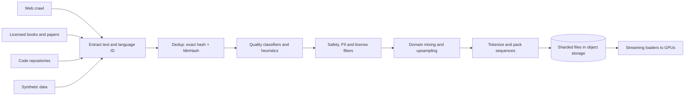
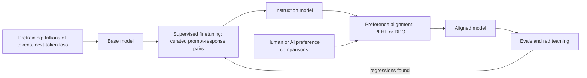
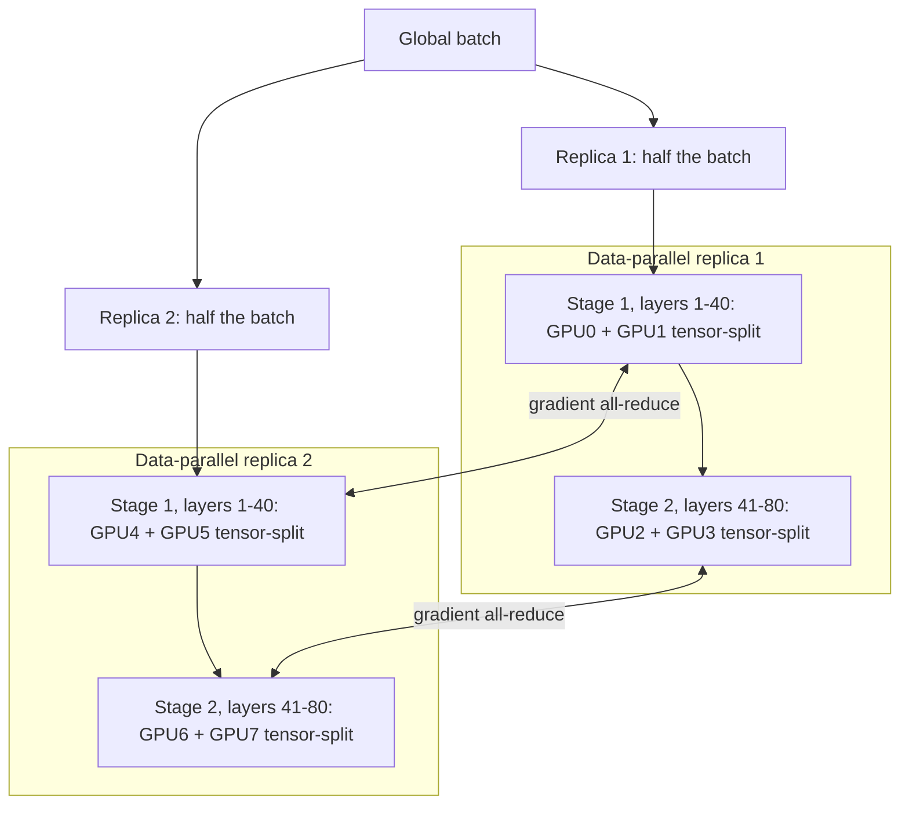
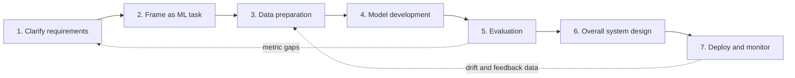

Every later chapter assumes a shared toolkit: how generative models differ from classifiers, how the four generator families sample, how to estimate parameters, FLOPs and GPU-hours, why scaling laws set model size, how huge models train across thousands of GPUs, and how to judge outputs with no single right answer. The chapter also gives an outline for the interview itself.

The tension: the model is the most interesting box, so candidates spend twenty minutes on it and run out of time for data, evaluation and serving. People rarely fail for picking the "wrong" architecture. They fail when they cannot tie a requirement to a decision or put a number on cost. These notes aim at both.

## Discriminative and generative models

A discriminative model learns the conditional distribution \( p(y \mid x) \): given an input, what label, score or value is most likely. A generative model learns the data distribution itself, \( p(x) \), or a conditional version \( p(x \mid c) \) where \( c \) is a prompt, a class, an image or any other context. Because it models what inputs look like, it can draw new samples.

$$
\text{discriminative: } \hat{y} = \arg\max_y p_\theta(y \mid x) \qquad \text{generative: } x \sim p_\theta(x \mid c)
$$

Here \( \theta \) are the model weights, \( x \) is the input (or the generated artifact), \( y \) is a label and \( c \) is the conditioning signal.

The practical test is the shape of the output. A class, a score or a ranking of existing items means discriminative, usually trained on labels and evaluated exactly (F1, AUC, NDCG). New text, pixels, audio, video or code means generative, mostly self-supervised and evaluated by proxies, because many outputs are valid. Classical generative methods (naive Bayes, Gaussian mixtures, HMMs) still suit small structured problems; interviews care about the deep families below.

Real GenAI products are mixtures: one large generator ringed by classifiers for language ID, intent routing, prompt-injection detection, reranking and output safety.

## The four generative families and how each produces a sample

### Variational autoencoders

A VAE has an encoder that maps an input to a distribution over a low-dimensional latent \( z \), and a decoder that maps \( z \) back to data space. Training maximizes the evidence lower bound:

$$
\mathcal{L}_{\text{VAE}} = \mathbb{E}_{q_\phi(z \mid x)}\big[\log p_\theta(x \mid z)\big] - D_{\text{KL}}\big(q_\phi(z \mid x)\,\|\,p(z)\big)
$$

The first term rewards reconstruction; the second keeps the encoder's posterior \( q_\phi \) near a simple prior \( p(z) \), usually a standard Gaussian, so random prior draws decode into plausible data. Sampling is made differentiable by writing \( z = \mu + \sigma \odot \epsilon \).

VAEs train stably but blur, because a Gaussian pixel likelihood averages plausible outputs. Their main job today is compression inside latent diffusion, turning a 512x512x3 image into a 64x64x4 latent.

### Generative adversarial networks

A GAN pairs a generator \( G \), which maps noise to a sample, with a discriminator \( D \), which tries to tell real from fake. They play a minimax game:

$$
\min_G \max_D \; \mathbb{E}_{x \sim p_{\text{data}}}\big[\log D(x)\big] + \mathbb{E}_{z \sim p(z)}\big[\log\big(1 - D(G(z))\big)\big]
$$

\( D(x) \) is the discriminator's probability that \( x \) is real and \( G(z) \) is a sample made from noise \( z \). At equilibrium the generator matches the data and \( D \) outputs 0.5.

GANs sample in one forward pass and produce sharp images, so they survive in face generation and super-resolution. The costs are oscillating training, mode collapse (a few outputs that fool \( D \)) and weak text conditioning.

### Autoregressive models

An autoregressive model factorizes the joint distribution with the chain rule and predicts one element at a time:

$$
p_\theta(x_1, \dots, x_T) = \prod_{t=1}^{T} p_\theta(x_t \mid x_{<t}), \qquad \mathcal{L}_{\text{AR}} = -\sum_{t=1}^{T} \log p_\theta(x_t \mid x_{<t})
$$

\( x_t \) is the token at position \( t \) and \( x_{<t} \) is everything before it. The loss is plain cross-entropy on the next token, which is why any pile of text becomes training data without labels.

Decoder-only Transformers trained this way are today's LLMs, and the recipe extends to images or audio once a VQ-VAE or audio codec turns them into tokens. It scales very well, but generation is sequential: 1,000 tokens means 1,000 forward passes, and early errors propagate.

### Diffusion models

A diffusion model defines a forward process that gradually adds Gaussian noise to data over \( T \) steps, and learns to reverse it. With a noise schedule \( \bar\alpha_t \), any noisy version can be sampled in closed form, and the network \( \epsilon_\theta \) learns to predict the added noise:

$$
x_t = \sqrt{\bar\alpha_t}\,x_0 + \sqrt{1-\bar\alpha_t}\,\epsilon, \qquad \mathcal{L}_{\text{diff}} = \mathbb{E}_{x_0, \epsilon, t}\big[\,\|\epsilon - \epsilon_\theta(x_t, t, c)\|^2\,\big]
$$

\( x_0 \) is a clean sample, \( \epsilon \sim \mathcal{N}(0, I) \) the noise, \( t \) a random timestep and \( c \) the conditioning such as a text embedding. Generation starts from pure noise and applies the denoiser repeatedly.

Diffusion gives the best image and video quality, conditions well through cross-attention and covers modes better than GANs. The price is tens of network evaluations per image, doubled by classifier-free guidance.

```mermaid
flowchart TB
  accTitle: How each generative family produces one sample
  accDescr: VAE decodes one prior sample, GAN maps noise once, autoregressive models loop one token at a time, diffusion denoises over many steps.
  subgraph VAE
    V1["sample z from N(0, I)"] --> V2[Decoder] --> V3[Output]
  end
  subgraph GAN
    G1["sample noise z"] --> G2[Generator] --> G3[Output]
  end
  subgraph Autoregressive
    A1[Prompt tokens] --> A2[Transformer predicts next token]
    A2 --> A3[Append sampled token]
    A3 -->|"until end token"| A2
    A3 --> A4[Output sequence]
  end
  subgraph Diffusion
    D1["pure noise x_T"] --> D2["denoiser predicts noise at step t"]
    D2 -->|"t = t - 1"| D2
    D2 --> D3["clean sample x_0"]
  end
```

### Comparing the families

| Criterion | VAE | GAN | Autoregressive | Diffusion |
|---|---|---|---|---|
| Training signal | Reconstruction + KL | Adversarial game | Next-token cross-entropy | Noise-prediction MSE |
| Training stability | High | Low, needs tricks | High | High |
| Sample quality | Blurry alone | Sharp, narrow | Best for text, good for tokenized media | Best for images and video |
| Diversity / mode coverage | Good | Mode collapse risk | Good, tunable by sampling | Good |
| Network passes per sample | 1 | 1 | One per token | One per denoising step (20-50 typical) |
| Exact likelihood | Lower bound | No | Yes | Lower bound |
| Text conditioning | Weak | Weak to moderate | Native (prompt is the prefix) | Strong via cross-attention |

Justify a family choice with the rows that matter for the requirements: a real-time phone filter favors single-pass generation, open-ended text favors autoregressive.

## Model capacity: parameters and FLOPs

Two numbers describe size, and they answer different questions. **Parameters** measure storage: a dense layer with \( n \) inputs and \( m \) outputs holds about \( nm \) weights, at 2 bytes each in BF16, 1 in INT8, half in 4-bit. **FLOPs** measure work: the same layer costs about \( 2nm \) FLOPs per input (a multiply and an add per weight), so a dense Transformer needs about \( 2N \) FLOPs per token plus an attention term that grows with context.

The two decouple in mixture-of-experts (MoE) models, where a router sends each token to a few expert blocks. Mixtral 8x7B holds about 47B parameters but activates roughly 13B per token, so memory is sized by the total and throughput by the active count.

### Worked example: counting a Transformer's parameters

Each Transformer block has an attention module with four \( d \times d \) projections (Q, K, V, output), so \( 4d^2 \), and a feed-forward block with hidden width \( 4d \), so \( 2 \cdot d \cdot 4d = 8d^2 \). Ignoring biases and norms, one block is about \( 12d^2 \).

For \( d = 4096 \) and \( L = 32 \) layers:

- Per block: \( 12 \times 4096^2 \approx 201\text{M} \); all 32 blocks: about 6.44B.
- Embeddings for a 32K vocabulary: \( 32{,}000 \times 4096 \approx 131\text{M} \), doubled if untied.
- Total: about 6.6 to 6.7B, the familiar "7B" class.

Forward cost is about \( 2 \times 6.7\text{B} \approx 13 \) GFLOPs per token, and BF16 weights take about 13.4 GB: fine for inference on one 24 GB GPU, far too much for training, as shown next.

## Training compute and what it costs

The standard estimate for total training compute is

$$
C \approx 6ND
$$

where \( N \) is parameters and \( D \) training tokens: about 2 FLOPs per parameter per token forward and 4 backward. Inference costs about \( 2N \) per generated token.

### Worked example: a 405B model on 15T tokens

Roughly Llama 3's largest configuration:

- Compute: \( 6 \times 4.05 \times 10^{11} \times 1.5 \times 10^{13} = 3.6 \times 10^{25} \) FLOPs.
- An H100 peaks near \( 10^{15} \) BF16 FLOP/s; at 40% utilization (MFU), \( 4 \times 10^{14} \) sustained.
- \( 3.6 \times 10^{25} / 4 \times 10^{14} = 9 \times 10^{10} \) GPU-seconds, about 25M GPU-hours.
- On 16,384 GPUs, about \( 5.5 \times 10^{6} \) seconds, or 64 days; at \$2 per GPU-hour, about \$50M.

Meta reported around 30M GPU-hours, close to this estimate.

### Worked example: training memory for a 70B model

Mixed-precision Adam stores per parameter 2 bytes of BF16 weights, 2 of gradients, 4 of FP32 master weights and 8 of Adam moments: 16 bytes before activations. So \( 70 \times 10^9 \times 16 = 1.12 \) TB, versus 80 GB on one GPU; sharded over 64 GPUs it is 17.5 GB each.

The optimizer state, not the weights, is the biggest item, which is why ZeRO and FSDP show up in every large design. This scale became possible only when three things met: self-supervised objectives that need no labels, matmul-focused accelerators with fast interconnects, and distributed training software that survives hardware faults.

## Scaling laws: Kaplan, Chinchilla and compute-optimal sizing

Scaling laws fit test loss against model size, data and compute, so small experiments can predict a big run and answer the budget question: how to split \( C \) between \( N \) and \( D \).

### Kaplan et al. (2020)

[Kaplan et al.](https://arxiv.org/abs/2001.08361) fit loss as separate power laws when the other factors are not the bottleneck:

$$
L(N) \approx \left(\frac{N_c}{N}\right)^{\alpha_N}, \quad L(D) \approx \left(\frac{D_c}{D}\right)^{\alpha_D}, \quad \alpha_N \approx 0.076,\; \alpha_D \approx 0.095
$$

\( N_c \) and \( D_c \) are fitted constants and the exponents set how fast loss falls. Their recipe grew parameters much faster than data, roughly \( N_{\text{opt}} \propto C^{0.73} \): 10x budget meant a 5x model on about 2x tokens, the thinking behind GPT-3's 175B parameters on 300B tokens. Their finding that depth-versus-width details matter far less than total scale held up.

### Chinchilla (Hoffmann et al., 2022)

[Hoffmann et al.](https://arxiv.org/abs/2203.15556) trained over 400 models with learning-rate schedules matched to each run's length, which Kaplan's setup had not done. They fit a joint form:

$$
L(N, D) = E + \frac{A}{N^{\alpha}} + \frac{B}{D^{\beta}}
$$

\( E \) is the irreducible loss and the other terms penalize finite model and data, with fitted \( \alpha \approx 0.34 \), \( \beta \approx 0.28 \). Minimizing under \( C = 6ND \) gives \( N_{\text{opt}} \propto C^{0.5} \) and \( D_{\text{opt}} \propto C^{0.5} \), about 20 tokens per parameter. Chinchilla (70B, 1.4T tokens) beat the 280B Gopher at equal compute.

### Worked example: compute-optimal size for \( 10^{24} \) FLOPs

With \( D = 20N \) and \( C = 6ND \):

$$
C = 6N(20N) = 120N^2 \;\Rightarrow\; N_{\text{opt}} = \sqrt{C / 120}
$$

- \( N_{\text{opt}} = \sqrt{10^{24} / 120} = \sqrt{8.3 \times 10^{21}} \approx 9.1 \times 10^{10} \), about 91B parameters.
- \( D_{\text{opt}} = 20 \times 91\text{B} \approx 1.8\text{T} \) tokens.

A Kaplan-style split of the same budget would pick a several-times-larger model on far fewer tokens, which Chinchilla showed is undertrained.

### Beyond compute-optimal

Chinchilla optimizes training compute only. Products pay for inference on every request, so teams "overtrain" small models: Llama 3 8B saw 15T tokens, about 1,900 per parameter. Lifetime cost is roughly \( 6ND + 2N \cdot D_{\text{infer}} \), and when served tokens \( D_{\text{infer}} \) reach trillions, smaller \( N \) wins. A newer axis is test-time compute: reasoning models spend extra tokens thinking and verifying, so latency and cost budgets now trade directly against answer quality.

## Data at scale

In classical ML the data work is ETL and feature engineering over tables. In GenAI the inputs are mostly unstructured, the volumes are in terabytes to petabytes, and the work shifts to collection, filtering, deduplication, safety and throughput.

### Sources and synthetic data

Web crawls give breadth; books, papers and encyclopedic text give quality; code helps reasoning even for non-code tasks; image-text pairs come from alt text and captions. Finetuning relies on smaller curated sets where quality beats volume. Synthetic data from a strong model fills gaps cheaply, but copies the teacher's errors and biases, under-represents rare cases, and can narrow the distribution when model output is fed back repeatedly (model collapse). Mix it with real data, filter it with verifiers, and evaluate only on real data.

### Filtering, storage and throughput

- **Deduplication.** Exact hashes for copies, MinHash with LSH for near-duplicates. Duplicates waste compute and raise memorization.
- **Quality.** Heuristics (length, symbol ratio, repeated lines) plus a small quality classifier; check afterwards that dialects and niche domains survived.
- **Safety and privacy.** Toxicity and NSFW classifiers, PII scrubbing, source blocklists, opt-out handling.
- **Decontamination.** Drop documents overlapping benchmark test sets.

Raw files sit in object storage or HDFS, metadata (URL, language, quality score, license) in Parquet, and pre-tokenized data in many shards so thousands of workers read in parallel, with hot shards cached on local NVMe.

### Worked example: how much data is 15T tokens?

At about 4 bytes of text per token, 15T tokens is roughly 60 TB. Over the 64-day run above the cluster reads \( 1.5 \times 10^{13} / 5.5 \times 10^{6} \approx 2.7\text{M} \) tokens per second, only about 11 MB/s of token IDs. Media is different: 2B image-text pairs at 500 KB each is about 1 PB, which is why image and video pipelines precompute latents once and train on those.

## Training: stages, objectives and efficiency

Each family has its own objective (shown above), but the stage structure is similar across modern systems. LLMs are the clearest case.

Pretraining builds capability and uses most of the compute. Supervised finetuning teaches format and instruction following. RLHF then trains a reward model \( r_\phi \) on human comparisons and optimizes the policy against it with a KL penalty:

$$
\max_\pi \; \mathbb{E}_{x, y \sim \pi}\big[r_\phi(x, y)\big] - \beta\, D_{\text{KL}}\big(\pi(\cdot \mid x)\,\|\,\pi_{\text{ref}}(\cdot \mid x)\big)
$$

\( \pi \) is the model being tuned, \( \pi_{\text{ref}} \) the frozen SFT model, and \( \beta \) limits drift. DPO reaches a similar optimum directly from preference pairs. Diffusion systems follow the same arc: broad pretraining, aesthetic finetuning, sometimes preference tuning.

### Efficiency techniques

- **Mixed precision.** BF16 or FP16 matmuls run 2x or more faster and halve activation memory, while FP32 master weights keep updates accurate. FP16 needs loss scaling to stop gradient underflow; BF16 has FP32's exponent range and usually does not.
- **Activation checkpointing.** Keep activations only at block boundaries and recompute the rest in the backward pass, for roughly 30% more compute and far less memory.
- **Gradient accumulation.** Sum gradients over micro-batches to reach a large effective batch.
- **FlashAttention.** Exact attention computed in SRAM tiles, so the \( T \times T \) matrix never hits HBM.

Common failures: loss spikes from a bad batch or too high a learning rate (rewind, skip the batch, clip gradients, lower LR), FP16 NaNs (switch to BF16), low MFU from communication stalls (overlap comms with compute), and frequent node failures at scale (frequent async checkpoints and automatic restart).

## Distributed training

Once the model state or the compute does not fit on one device, the work is split along three axes, and production runs combine all three ("3D parallelism") with sharded optimizer state on top.

### Data parallelism

Every worker holds a full copy, processes a slice of the batch, and gradients are averaged with an all-reduce. Synchronous updates keep weights identical but wait for the slowest worker; asynchronous updates (parameter-server style) keep GPUs busy but apply stale gradients that hurt convergence at scale. LLM training is almost always synchronous with straggler handling.

### Pipeline parallelism

Layers are split into stages on different devices. Micro-batching (GPipe, 1F1B schedules) keeps stages busy; the idle bubble is about \( (p-1)/(m+p-1) \) for \( p \) stages and \( m \) micro-batches, so 8 stages with 32 micro-batches idle \( 7/39 \approx 18\% \). Only boundary activations cross devices, so slower inter-node links are fine.

### Tensor parallelism

Single weight matrices are split across devices: Megatron-style, the first feed-forward matrix by columns and the second by rows, with one all-reduce per block, and attention heads divided the same way. Per-layer communication keeps it inside an NVLink node.

### ZeRO and FSDP

[ZeRO](https://arxiv.org/abs/1910.02054) removes data parallelism's duplicated 16 bytes per parameter: stage 1 shards optimizer state, stage 2 adds gradients, stage 3 adds weights, gathered layer by layer when needed. PyTorch FSDP implements stage 3. Memory per GPU falls almost linearly with workers, at the cost of all-gather traffic.

| Strategy | What is split | Communication | Main benefit | Main cost |
|---|---|---|---|---|
| Data parallel | Batch | Gradient all-reduce per step | Near-linear throughput | Full model copy on each GPU |
| ZeRO / FSDP | Optimizer state, grads, weights | All-gather + reduce-scatter per layer | Memory scales down with workers | More network traffic |
| Pipeline parallel | Layers into stages | Activations between stages | Fits deep models, light bandwidth | Pipeline bubbles, scheduling complexity |
| Tensor parallel | Matrices inside a layer | All-reduce per layer | Fits wide layers, cuts per-GPU latency | Needs very fast intra-node links |

A sensible default for 70B on 8-GPU nodes: tensor parallel 8 inside the node, pipeline across a few nodes if needed, and data parallel with FSDP on the outside. Justify each placement by bandwidth.

## Sampling basics

A trained generator defines a distribution; a sampling strategy decides which outputs you actually get. For autoregressive models the model emits logits \( z_i \) over the vocabulary at each step, turned into probabilities with a temperature \( \tau \):

$$
p_i = \frac{\exp(z_i / \tau)}{\sum_j \exp(z_j / \tau)}
$$

\( \tau < 1 \) sharpens the distribution toward the top token, \( \tau > 1 \) flattens it, and \( \tau \to 0 \) is greedy decoding.

| Strategy | How it picks | Good for | Watch out for |
|---|---|---|---|
| Greedy | Top token each step | Short deterministic outputs | Repetition, bland text |
| Beam search (width \( k \)) | Keeps \( k \) best prefixes | Translation, captioning | \( k \)x compute, generic chat replies |
| Top-k | Samples among \( k \) likeliest tokens | Creative text with bounded risk | Fixed \( k \) ignores distribution shape |
| Top-p (nucleus) | Samples from smallest set with mass \( \ge p \) | Chat, open-ended text | Drifts when combined with high \( \tau \) |
| Speculative decoding | Draft proposes, big model verifies | Lower latency, same distribution | Depends on acceptance rate |

Diffusion has its own knobs: step count trades latency for detail, the sampler (DDPM, DDIM, DPM-Solver) sets how many steps are needed, and classifier-free guidance blends conditional and unconditional predictions,

$$
\hat\epsilon = \epsilon_\theta(x_t, \varnothing) + w\,\big(\epsilon_\theta(x_t, c) - \epsilon_\theta(x_t, \varnothing)\big)
$$

where \( w \) is the guidance scale: higher values follow the prompt more closely but cut diversity and can oversaturate. A code assistant wants low temperature; a brainstorming tool wants higher temperature and several samples.

## Evaluation basics

Discriminative models compare a prediction to a label: precision, recall, F1, AUC, RMSE, NDCG. Generative outputs have many valid answers, so evaluation uses proxies along several axes and backs them with humans and online data.

**Perplexity** measures how well a language model predicts held-out text:

$$
\text{PPL} = \exp\Big(-\frac{1}{T}\sum_{t=1}^{T} \log p_\theta(x_t \mid x_{<t})\Big)
$$

It is the exponential of average next-token loss; lower is better, and it is only comparable across models that share a tokenizer.

**FID** compares the distribution of generated images to real ones in the feature space of an Inception network:

$$
\text{FID} = \|\mu_r - \mu_g\|^2 + \operatorname{Tr}\big(\Sigma_r + \Sigma_g - 2(\Sigma_r \Sigma_g)^{1/2}\big)
$$

\( \mu \) and \( \Sigma \) are the mean and covariance of features for real (\( r \)) and generated (\( g \)) images; lower means closer distributions.

| Metric | Measures | Catches | Misses |
|---|---|---|---|
| Perplexity | Likelihood of held-out text | Language-modeling regressions | Helpfulness, truthfulness, safety |
| BLEU / ROUGE / METEOR | N-gram overlap with references | Gross content errors in translation or summaries | Valid paraphrases, factual errors with right words |
| FID / KID | Distance between image feature distributions | Quality and diversity at the set level | Prompt faithfulness, per-image defects |
| CLIPScore | Image-text embedding similarity | Prompt alignment | Counting, spatial relations, fine detail |
| Task benchmarks (MMLU, HumanEval) | Accuracy on fixed tasks | Capability per domain | Contamination, real user distribution |
| Human or LLM-judge rating | Preference vs rubric | What users care about | Cost, rater or judge bias |

Online metrics tie the system to the business: acceptance rate, click-through, retention, task completion, latency and cost per request. Name one primary metric tied to the goal plus guardrails a win must not break, and validate with an A/B test.

Risks to turn into components: bias, IP and misinformation, energy cost, hallucination, and misuse such as deepfakes, phishing and prompt injection. They map to watermarking, input and output classifiers, retrieval grounding with citations, rate limits and human review.

## The interview framework

The structure below is a checklist, not a script. Visit each step, spend time where the interviewer pushes, and loop back when a later step exposes a gap.

**1. Clarify requirements.** Functional: inputs, outputs, editing, multi-turn, personalization. Non-functional: scale, latency, quality bar, cloud or device, cost, safety, languages. Say assumptions out loud with numbers, for example "10M daily users, p95 first token under 2 seconds, English first."

**2. Frame as an ML task.** Input and output, discriminative or generative, the family, and one sentence on why each alternative loses.

**3. Data preparation.** Sources and size, dedup and quality filtering, safety and privacy, modality-specific processing, storage.

**4. Model development.** Architecture, training stages and objectives, the task's main obstacles, sampling.

**5. Evaluation.** Offline metrics on different axes, human eval, a primary online metric with guardrails.

**6. Overall system design.** Input safety, pre-processing, retrieval or context assembly, the model, post-processing, output safety, caching, logging, feedback.

**7. Deploy and monitor.** Shadow, canary and A/B rollout; latency, cost, safety and drift monitoring. Keep it short unless asked.

| Requirement heard | Design decision it drives |
|---|---|
| Runs on a phone | Small or distilled model, 4-bit quantization, single-pass or few-step generation |
| p95 latency under 1 s | Streaming output, KV cache, speculative decoding, fewer diffusion steps |
| Hundreds of millions of requests per day | Smaller overtrained model, batching, response caching, model cascade |
| Answers must be factual and current | Retrieval augmentation with citations instead of relying on weights |
| Strict safety or compliance | Input and output classifiers, audit logging, human review queue |
| Little labeled data | Prompting or LoRA finetuning of a pretrained model |

Infrastructure roles probe step 6, research roles 2, 4 and 5, product roles 1 and 5.

## Interview questions

### Clarifying

**Which clarifying questions change the architecture the most?**
Cloud versus on-device, since it caps model size and forces quantization. The latency target, since it picks between beam search, sampling, distillation or fewer diffusion steps. Data availability, since it decides between training, finetuning and prompting. Scale, since at hundreds of millions of requests per-request cost dominates. Ask these first and write the answers down.

**How do you tell whether a task needs a generative model at all?**
Look at the output. A label, score or choice among existing items calls for a cheaper, more measurable discriminative model. Many "GenAI" asks are really retrieval plus ranking, with generation only for a short summary. Saying this shows you are not reaching for an LLM by reflex.

### Design and trade-offs

**With a fixed compute budget, bigger model on fewer tokens or smaller model on more?**
For minimum training loss, Chinchilla says scale both together at about 20 tokens per parameter. For a model that will serve heavy traffic, go smaller and train well past that, since inference cost recurs on every request while training is paid once. The limit is unique high-quality data; a few epochs of repetition are fine, many are not. Tie the answer to expected inference volume.

**When would you pick a GAN over diffusion today?**
When latency is the hard constraint and the domain is narrow: live face filters, super-resolution, mobile style transfer. One forward pass is hard to beat there. For open-domain text-to-image, diffusion wins on quality, diversity and conditioning, and few-step distillation is closing the speed gap.

**Synchronous or asynchronous gradient updates?**
Synchronous keeps replicas identical and convergence predictable, but the slowest worker gates every step. Asynchronous keeps GPUs busy at the price of stale gradients, which destabilize large models. At LLM scale the answer is synchronous plus straggler detection and fast restarts.

**Where does each parallelism axis go on 8-GPU nodes?**
Tensor parallelism inside the node, because it all-reduces every layer and needs NVLink. Pipeline parallelism across nodes, because it ships only boundary activations. Data parallelism with FSDP outermost. The rule is to put the chattiest split on the fastest links.

**Greedy, beam or sampling?**
Beam search suits narrow-answer tasks like translation and captioning. In open chat it drifts toward short generic text, so top-p with moderate temperature reads better. Code completion wants low temperature, sometimes several samples ranked by tests. Match the choice to whether the product values predictability or variety.

**Should a new product train on synthetic data?**
It covers gaps cheaply, such as rare intents or worked math. It also copies the teacher's errors, misses real edge cases and can narrow the distribution over generations. Filter it with verifiers, cap its share of the mix, and evaluate only on real held-out data.

### Deep dives

**How do parameters and FLOPs differ for serving?**
Parameters set memory: 70B in BF16 is 140 GB of weights, at least two 80 GB GPUs. FLOPs set compute, about \( 2N \) per token. MoE splits them, so size memory by total and throughput by active parameters. At small batch, decoding is bound by memory bandwidth, which is why batching raises throughput so much.

**Estimate GPU-hours to train 70B parameters on 2T tokens.**
\( 6 \times 7 \times 10^{10} \times 2 \times 10^{12} = 8.4 \times 10^{23} \) FLOPs. At \( 4 \times 10^{14} \) FLOP/s sustained per H100 (40% MFU), that is \( 2.1 \times 10^{9} \) GPU-seconds, about 580,000 GPU-hours, or 12 days on 2,048 GPUs. At \$2 per GPU-hour, roughly \$1.2M before experiments and restarts. State the MFU assumption explicitly.

**Estimate memory to serve a 13B model with 4K context at batch 32.**
Weights in BF16 take 26 GB. KV cache per token is \( 2 \times L \times d \times 2 \) bytes; with 40 layers and \( d = 5120 \) that is 819 KB. For 4,096 tokens and 32 sequences, about 107 GB, so 133 GB total and two GPUs. Grouped-query attention with 8 KV heads instead of 40 cuts the cache 5x to about 21 GB.

**Why is accuracy not enough for a generative model?**
Many outputs are valid, so exact match punishes good answers. You need separate axes for quality, faithfulness, diversity, safety and factuality, each with an imperfect proxy calibrated by humans. Online behavior decides.

### Operations and failure modes

**Training loss spikes at step 40,000. What do you do?**
Rewind to the last checkpoint and inspect the batch; corrupt or repetitive data is common, and skipping it often fixes things. If spikes recur, lower the learning rate, tighten clipping, or add QK-norm or z-loss. Move FP16 runs to BF16. Watch gradient norms to catch the next one early.

**Offline wins, online flat. How do you investigate?**
Check that the offline set resembles real traffic and is not contaminated. Check latency, since a slower feature can lose engagement. Segment the A/B result by user and prompt type to find cancelling effects. Finally, ask whether the primary metric can reflect the change at all.

**Where do safety measures belong?**
In the data (filtering, alignment on refusals), before the model (input abuse and injection classifiers) and after it (toxicity, PII and unsafe-image classifiers, watermarking). Sample logs for human review and feed failures back into training and thresholds.

## A 45-minute walkthrough

This is how I would spend a 45-minute session on an open-ended prompt such as "design a text-to-image service", using the framework above.

| Minutes | Step | What to cover | What to draw |
|---|---|---|---|
| 0-5 | Requirements | Users, scale, modalities, latency, quality, device, safety | Assumption list with numbers |
| 5-9 | ML framing | Generative and conditional; family choice, two rejected alternatives | Input, model, output boxes |
| 9-15 | Data | Sources, size, dedup, filters, captions or tokens, storage | Data pipeline |
| 15-25 | Model | Architecture and key equation, training stages, parallelism, sampling knobs | Architecture sketch |
| 25-31 | Evaluation | Two offline metrics, human eval, online metric plus guardrails | Metric table |
| 31-40 | System | Safety, cache, batching, model, post-processing, feedback; GPU sizing from QPS | End-to-end architecture |
| 40-45 | Deploy and wrap up | Rollout, monitoring, next extensions, open risks | Monitoring arrows back to data |

Write numbers down as soon as you assume them, since sizing reuses them. If pulled into a deep dive early, follow it and compress later steps rather than dropping evaluation or the system diagram.
