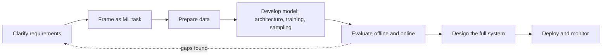

The opening chapter does two jobs. It sets up the vocabulary the rest of the book assumes (what makes a model generative, why today's models got so capable, what training them costs), and it gives you a repeatable outline for a design interview. The hard part of a GenAI design question is rarely the model itself. It is keeping the answer organized while you cover data, training, sampling, evaluation and serving, each with its own trade-offs.

## Generative models learn the data, not just the boundary

A discriminative model estimates P(Y | X): given features, which label or value is most likely. Fraud scoring, click prediction and sentiment classification live here, built with logistic regression, SVMs, tree ensembles, k-NN or neural classifiers. None of them can produce a new transaction or a new face, because they never modeled what inputs look like.

A generative model estimates P(X), or P(X, Y) when there is conditioning such as a prompt, and then samples from it. Older methods (naive Bayes, Gaussian mixtures, HMMs, Boltzmann machines) suit small structured problems. The modern families are the ones interviews ask about:

- VAEs compress inputs into a latent distribution and decode samples from it. Stable to train, often blurry.
- GANs pit a generator against a discriminator. Sharp images, fragile training, mode collapse.
- Diffusion models learn to undo gradual noising. Excellent image and video quality, many denoising steps.
- Autoregressive models emit one element at a time conditioned on the past. This is how LLMs write.

To place a problem on one side of the split, look at the output. A class or a score means discriminative; text, pixels, audio or video means generative.

## Capacity has two measures, and compute pays for both

Parameter count says how much a model can store. FLOPs per forward pass say how much work each prediction costs. They usually move together but not always: a mixture-of-experts layer holds many parameters while activating few per token. For a dense layer with n inputs and m outputs, the cost is roughly 2nm operations.

Training compute is the total FLOPs spent over a run, commonly estimated as about 6 x parameters x tokens. Divide by sustained accelerator throughput to get GPU-days. A 10^22 FLOP run on one GPU sustaining 6 x 10^13 FLOP/s would take more than five years, which is why frontier training uses thousands of GPUs for weeks and costs tens of millions of dollars.

Three things made this scale possible: self-supervised objectives that turn raw web text and image-caption pairs into training signal without labels, hardware built for matrix math, and distributed training. Llama 3, with up to 405B parameters and about 15 trillion training tokens, is a handy reference point.

## Scaling laws tell you how to spend a fixed budget

For a given compute budget, how big should the model be and how many tokens should it see? [Kaplan et al. (2020)](https://arxiv.org/abs/2001.08361) found loss falls as a smooth power law in model size, data and compute, and that scale outweighs architectural tweaks. [Hoffmann et al. (2022)](https://arxiv.org/abs/2203.15556) showed many large models were undertrained: parameters and tokens should grow roughly together, on the order of 20 tokens per parameter. Recent reasoning models hint that extra compute at inference time also pays off, which is still being studied.

This matters when you size a model in an interview. Choosing a smaller model trained on more tokens because inference cost recurs on every request shows you understand both training and serving economics.

## Data work shifts from features to volume, quality and safety

Classical ML spends its effort on ETL and feature engineering over tables. GenAI pipelines mostly handle unstructured data, so the effort moves elsewhere. Collection happens at web scale, sometimes topped up with synthetic data from an existing model; that adds coverage cheaply but inherits the teacher's errors and biases and can drift from the real distribution. Cleaning removes near-duplicates, low-quality pages, harmful or NSFW material and personal data while keeping the mix diverse. Throughput keeps training from waiting on I/O: object stores or HDFS for raw files, Parquet for metadata, sharding for parallel reads, indexes for lookup, caching for hot data.

## Training and sampling choices you should be able to defend

Each family has its own recipe: adversarial games for GANs, denoising for diffusion, next-token prediction for LLMs. LLMs usually go through pretraining on broad data, supervised finetuning on task data, then alignment to human preferences. Know which data feeds each stage and which loss it optimizes.

Three efficiency techniques show up in almost every large-scale design:

- Gradient checkpointing stores only some activations and recomputes the rest in the backward pass, trading compute for memory.
- Mixed precision does most math in 16-bit and keeps sensitive operations and master weights in 32-bit, with loss scaling to avoid underflow.
- Parallelism. Data parallelism replicates the model and splits batches, syncing gradients synchronously (consistent, gated by the slowest worker) or asynchronously (faster, stale weights). Pipeline parallelism splits layers across devices; tensor parallelism splits one layer's matrices. [ZeRO](https://arxiv.org/abs/1910.02054) and FSDP shard optimizer state, gradients and weights so nothing is stored twice.

A trained generator still needs a sampling strategy. Greedy and beam search give stable, likely outputs; top-k and top-p give variety. Which one fits depends on whether the product values predictability or creativity.

## Evaluation splits into offline quality and online impact

Discriminative models compare predictions to labels with precision, recall, F1, MSE or ranking metrics. Generative outputs have no single right answer, so offline evaluation relies on proxies: perplexity, n-gram overlap (BLEU, ROUGE, METEOR), distribution distances for images (FID, KID), text-image alignment (CLIPScore) and human ratings. Check more than one axis, such as image quality and prompt faithfulness, or a chatbot's math and coding separately.

Online evaluation ties the system to the business: acceptance or click-through, conversion, retention, latency, task completion, satisfaction. Picking two or three that match the stated goal, and saying why, signals product sense. Bias, resistance to adversarial inputs and human review belong here too.

## A seven-step structure keeps the answer organized

1. Clarify requirements. Separate what the system must do from how well it must do it: business goal, features, data and labels, cloud or on-device, user scale, latency versus quality.
2. Frame as an ML task. Input and output modalities, discriminative or generative, task type, then an algorithm and why the alternatives lose.
3. Prepare data. Sources, size, cleaning, safety filtering, privacy, tokenization.
4. Develop the model. Architecture options, training stages and losses, task-specific obstacles, sampling.
5. Evaluate. Offline metrics for quality, online metrics for impact.
6. Design the full system. The model is one box among input and output safety filters, pre- and post-processing, upscalers or rerankers, and feedback loops.
7. Deploy and monitor. The book keeps this short since it is not GenAI-specific.

Teams weight the steps differently. Infrastructure roles push on step 6 and parallelism, research-leaning roles on steps 2 and 4.

## Interview questions

**When is a discriminative model the better choice inside a GenAI product?**
Whenever a subtask has a fixed label set: language detection, safety classification, intent routing, reranking. These models are cheaper and easier to evaluate. Most GenAI systems pair one generator with several classifiers.

**How do parameters and FLOPs differ, and why does it matter for serving?**
Parameters set memory footprint; FLOPs set compute per token. A mixture-of-experts model can be large in parameters but modest in per-token FLOPs, which changes GPU sizing and throughput estimates.

**With a fixed compute budget, bigger model on less data or smaller model on more?**
Chinchilla-style results say grow both roughly in proportion. If inference volume is huge, lean smaller and train longer, because serving cost recurs and training cost is paid once.

**What are the risks of training on synthetic data?**
The generator's errors and biases get copied and can compound across generations, and synthetic sets tend to lack rare real-world cases. Mix with real data, filter with quality classifiers, and evaluate on real-only held-out sets.

**A 70B model does not fit on one GPU. What are your options?**
Start with mixed precision and gradient checkpointing. Then shard: tensor parallelism within a node where bandwidth is high, pipeline parallelism across nodes, data parallelism on top. FSDP or ZeRO removes duplicated optimizer state, often the biggest memory cost.

**Synchronous or asynchronous gradient updates?**
Synchronous keeps workers on identical weights and converges predictably, but stragglers slow every step. Asynchronous keeps hardware busy at the cost of stale gradients. Most large LLM training is synchronous with straggler mitigation.

**Why isn't accuracy enough for a generative model?**
Many outputs can be valid, so exact match punishes good alternatives. You need proxies for fluency, faithfulness, diversity and safety, plus human judgment, and then confirmation from online behavior.

**How would you choose online metrics for a new GenAI feature?**
Pick one primary metric that reflects the stated business goal, such as acceptance rate for suggestions. Add guardrails for latency, safety incidents and retention so a primary-metric win cannot hide damage, and validate with A/B tests.

**Which clarifying questions change the architecture most?**
On-device versus cloud caps model size. Latency targets decide between beam search, sampling or a distilled model. Data availability decides whether you finetune or rely on prompting a pretrained model.

**Where do safety measures belong?**
On both sides of the model: screen inputs for abuse and prompt injection, check outputs for harmful, biased or private content. Training-data cleaning is a third layer, and logging plus human review catch what filters miss.
