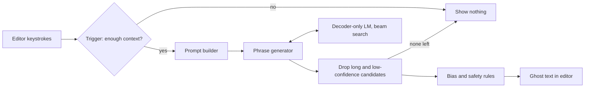

Smart Compose shows grey ghost text after the cursor while someone writes an email, and the Tab key accepts it. The model part sounds easy: predict the next few words. The setting is what makes it hard. The suggestion must appear faster than the user types, it runs for an enormous user base at every pause, and a wrong or awkward suggestion is worse than none. The core tension is between suggesting often enough to be useful and suggesting only when the model is fast and very likely to be right.

## Requirements that change the design

- Personalized or global? A shared model avoids per-user training. Personalization means user history in the prompt or per-user adapters, plus stronger privacy controls. The chapter stays global.
- What context is allowed? Only the body so far, or also subject, recipient and the thread. More context fixes things like greeting names but lengthens the input and raises latency.
- How much email data, under what privacy rules? About a billion messages is plenty to finetune, but private mail forces aggressive scrubbing.
- Which languages? English only keeps the tokenizer and evaluation simple.
- Latency budget? Around 100 ms rules out big models and long decoding. This one number shapes model size, beam width and suggestion length.
- Bias expectations? If the product must never assume gender, you need a post-processing layer, not just cleaner data.
- Scale? With well over a billion users, per-request cost dominates, so when to trigger becomes a real design component.

## Framing it as next-token generation

Input: the partial email plus allowed context. Output: a short continuation, or nothing. That is conditional text generation with a language model trained on next-token prediction.

RNNs can do this and are cheap per step, but they train strictly in order and lose long-range context. Transformers train in parallel across positions and attend to any earlier token directly. Their quadratic attention cost is acceptable for short email context, and grouped-query attention or FlashAttention reduce it further.

Of the Transformer variants, encoder-only models like BERT do not generate naturally and encoder-decoder models suit mapping one sequence to a different one. Completion continues the same text, so decoder-only fits: context and partial body form one stream that the model extends.

## Data, tokenization and training

General web and book text teaches grammar and world knowledge. The email corpus teaches the email register: greetings, sign-offs, scheduling phrases. Email data needs language-ID filtering, replacement of names, addresses, phone and card numbers with placeholders (so nothing personal can surface in another user's draft), removal of meaningless symbols, format normalization, and deduplication so newsletters and templates do not dominate.

Tokenization is worth defending. Character vocabularies are tiny but each token carries little meaning and sequences get long. Word vocabularies explode past hundreds of thousands and still hit unknown words. Subword methods like [BPE](https://arxiv.org/abs/1508.07909) and [SentencePiece](https://arxiv.org/abs/1808.06226) keep common words whole and split rare ones into reusable pieces, giving tens of thousands of tokens and no out-of-vocabulary failures. Libraries such as tiktoken or SentencePiece handle it.

The model is a standard decoder-only stack. Token IDs map to learned dense embeddings that place related words close together. Positional encodings add order, since attention alone ignores position; the chapter uses fixed sine-cosine encodings because they add no parameters and extend to unseen lengths, whereas learned position tables may fit better but generalize poorly past trained lengths. Masked self-attention and feed-forward blocks follow, then a softmax over the vocabulary.

Training runs in two stages with the same objective, next-token prediction under cross-entropy loss: pretraining on general text for language ability, then finetuning on email for style. Causal masking lets every position contribute a loss term in one pass. Email alone would overfit and miss general knowledge.

Extra context is merged with a prompt template: tagged sections for subject, recent thread and body in one sequence, with some training examples leaving fields empty so the model copes with partial input. That is what lets it suggest the right name after "Dear".

## Picking a decoding strategy

Stochastic sampling (temperature, top-k, top-p) adds variety, the opposite of what autocomplete wants. Users expect the same suggestion for the same text, and randomness raises the odds of something strange. Decoding should be deterministic.

Greedy decoding takes the top token each step; it is fast but can commit to a weak path. Beam search keeps the best *k* partial sequences and returns the highest-scoring finished one, recovering from tokens that look good locally but lead nowhere. Its known weaknesses, low diversity and cost growing with length, barely matter for a few-word suggestion. Beam width becomes a latency knob.

## Evaluation: offline proxies, online acceptance

Perplexity on held-out email measures how much probability the model assigns to real continuations. It is good for comparing checkpoints but does not tell you whether the top suggestion matches what users type. ExactMatch@N checks whether the first N predicted words equal the real text, averaged over several N. It is closer to the product but strict, since a valid paraphrase scores zero. BLEU or ROUGE give partial credit when exact match is too harsh.

Online, acceptance rate (accepted over shown) matters most, alongside suggestions shown, share of emails using the feature, compose time, p50 and p99 latency, and user feedback. High acceptance with very few suggestions shown can mean the system is too timid, so read coverage and acceptance together.

## The serving path

The trigger service fires only when there is enough context, such as a few words in or after a pause, which saves cost and avoids distracting guesses. The phrase generator runs beam search and returns scored candidates. Filtering drops anything too long (hard to read mid-sentence, less likely to match intent) or below a confidence threshold; if nothing survives, nothing is shown. That threshold is the main precision versus coverage dial. Post-processing applies rules: neutral pronouns and job titles when gender is unknown, replacement of flagged sensitive terms, NSFW blocking. Rules are fast and auditable, which suits a latency-bound path, though they miss subtle bias.

To meet the latency target you would also use a distilled model, quantization, and a KV cache reused across keystrokes.

## Interview questions

**Why decoder-only instead of encoder-decoder?**
The output continues the input text, so there is no separate source to encode. A decoder-only model treats context and completion as one stream and can reuse its KV cache as the user types.

**Which context would you add first, and what does it cost?**
The thread and recipient, since they unlock names and topic phrases. The cost is a longer prompt, more latency and more personal data in the request path, so truncate or summarize older messages.

**Beam search or greedy under 100 ms?**
A small beam usually gives better completions at modest cost because outputs are short, and beams batch well on accelerators. Measure p99 latency, since slow tails feel worse in an editor than a slightly weaker suggestion.

**How do you set the confidence threshold?**
Sweep it offline against ExactMatch and estimated acceptance, then confirm with A/B tests on acceptance and suggestions shown per email. Separate thresholds per suggestion length are reasonable.

**Perplexity improved but acceptance dropped. Why?**
Perplexity averages over every token, while users only see a short top continuation at trigger points. The new model may be less confident or slower exactly where suggestions fire. Check ExactMatch at trigger points, latency and filter pass rate.

**How do you keep private data out of suggestions?**
Scrub PII into placeholders, deduplicate so rare strings are not memorized, and consider differentially private finetuning. At serving time, block outputs matching number or address patterns and run extraction tests for memorization.

**How would you add personalization?**
User history in the prompt is quickest but costs latency. Per-user adapters cost storage and training pipelines; a light per-user reranker over global candidates is a cheap middle path. Opt-out and privacy controls must be part of it.

**Rules or a learned classifier for bias filtering?**
Rules are fast, explainable and easy to audit but miss context. A classifier catches more at extra latency and with its own errors. Rules in the request path plus offline auditing of outputs is a practical mix.

**How do you add new languages?**
A multilingual subword tokenizer, multilingual pretraining data and per-language email finetuning data, with language detection on the draft. Evaluate each language separately, since quality will differ.

**What causes repetitive suggestions and how do you stop them?**
Deterministic decoding tends to repeat likely phrases on longer outputs. A short maximum length, length-normalized beam scores and n-gram repetition blocking handle it, and the length cap alone removes most cases.
