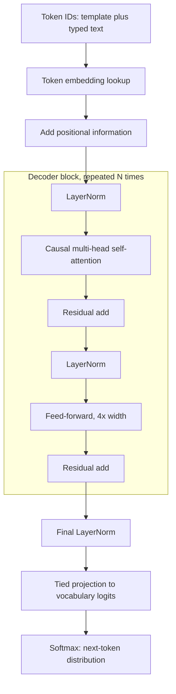
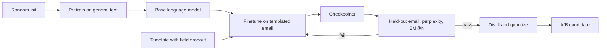
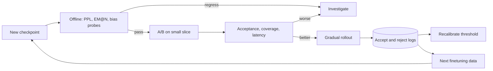
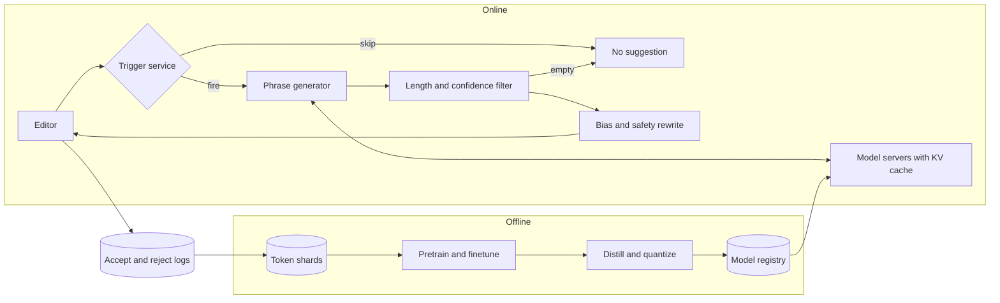
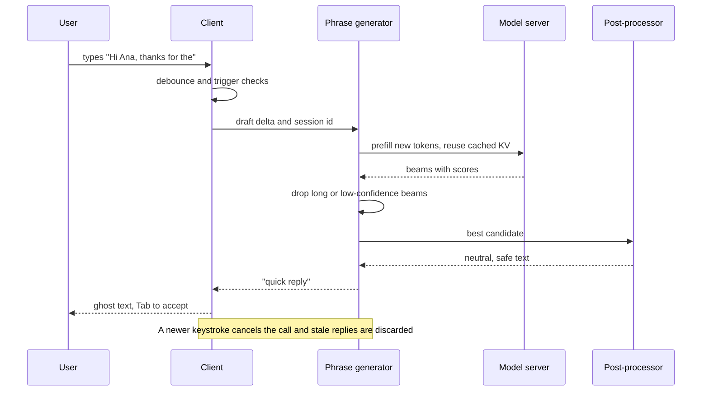

Smart Compose is the grey ghost text that appears after the cursor while someone writes an email. Tab accepts it; any other keystroke makes it vanish. The ML core is ordinary language modeling: given the words so far, guess the next few. What makes it a system design problem is everything around the model. The suggestion has to arrive before the next keystroke, requests fire at nearly every pause for a user base in the billions, the training data is the most private text people produce, and a wrong or tone-deaf suggestion costs more trust than a missing one.

The central tension is coverage against precision under a hard latency ceiling. Suggest too rarely and nobody notices the feature. Suggest too eagerly and users learn to ignore grey text, or accept something that assumes the wrong gender. Model size, beam width and the confidence threshold are all ways of moving along that curve.

The notes follow the book's seven-step framework, then add follow-ups, interview questions, a 45-minute walkthrough and review questions.

## 1. Clarifying requirements

Listing requirements is easy. The useful skill is saying what each one does to the architecture.

- **Personalization.** A global model means one pipeline and one fleet. Personal suggestions need user history in the prompt, per-user parameters or a per-user reranker, each adding storage, privacy review and latency. Start global.
- **Confidence gating.** "Only suggest when likely right" needs a calibrated score and a threshold, so the output contract becomes "a continuation or nothing".
- **Context scope.** Subject, recipient and the previous message fix obvious failures, such as not knowing whom "Hi" addresses, but lengthen prefill and put more personal data in flight.
- **Data and privacy.** A billion emails is plenty for a small model. The binding constraint is what you may learn: names and numbers must never surface in a stranger's draft.
- **Fairness.** A model trained on real email will predict "he" after "the engineer said". Cleaner data is not enough; you need an explicit rewrite layer and audits.
- **Latency and scale.** Roughly 100 ms end to end caps model size, prompt length and beam width. With over a billion accounts, cost per request dominates, so deciding when not to call the model matters as much as the model.

| Requirement | Design consequence |
|---|---|
| ~100 ms end to end | Small decoder-only model (40M to 120M parameters), narrow beam, KV cache reuse, regional serving |
| Suggest only when confident | Calibrated sequence score, tunable threshold, explicit empty output |
| Huge user base | Trigger gating, batching, quantization, distillation |
| Private training data | Typed PII placeholders, dedup, memorization tests, optional DP finetuning |
| No biased assumptions | Rule-based rewrite on outputs plus offline audits |
| English, body-only first | One subword vocabulary; prompt template with slots for later context |

## 2. Framing the problem as an ML task

Input: the text typed so far plus allowed context. Output: a short continuation of one to six words, or nothing. This is conditional text generation trained with next-token prediction, learning \(P(x_t \mid x_{<t})\) and decoding a likely continuation.

Recurrent networks (LSTM, GRU) are cheap per generated token because their state is fixed size, but training runs sequentially over time steps, which wastes accelerators, and signal from distant tokens must survive many steps. Transformers let each position attend to every earlier position directly and train all positions in parallel. Attention cost grows with the square of sequence length, which hardly matters for a few hundred tokens of email and can be cut further with grouped-query attention or fused kernels like [FlashAttention](https://arxiv.org/abs/2205.14135).

| Option | How it would work here | Verdict |
|---|---|---|
| n-gram model | Count-based next-word lookup | Tiny and fast, no long context; fine as a cascade tier or trigger feature |
| LSTM language model | Update hidden state per keystroke | Cheap inference, but slow to train at scale and weak at distant context |
| Encoder-only (BERT style) | Fill a mask at the end | No natural left-to-right generation loop |
| Encoder-decoder (T5 style) | Encode prefix, decode continuation | Works, but two stacks, encoder reruns on every edit, cross-attention cost per step |
| Decoder-only (GPT style) | Prefix and continuation are one stream | Matches the task; the cache of past keys and values just grows as the user types |

Decoder-only wins because the output is literally the continuation of the input. One subtlety: the model emits subword tokens while the product shows whole words, so decoding must stop on word boundaries.

## 3. Data preparation

### Sources and cleaning

Public text (web, books, forums) teaches grammar and broad vocabulary. The email corpus teaches the register: greetings, scheduling phrases, polite requests, sign-offs. Email alone gives a model that is fluent at "Thanks for" and lost on anything uncommon; web text alone sounds like a blog post.

Email is noisy in its own ways: quoted replies, signatures, legal footers, notifications, marketing templates sent to millions. The pipeline handles each:

- **Language ID** with a fast classifier removes non-English messages and segments.
- **Structure stripping** removes quoted history, signatures and footers, or the model learns to suggest "Sent from my iPhone".
- **PII replacement** swaps names, addresses, URLs, phone and card numbers for typed placeholders like `<NAME>` or `<PHONE>`. Typed placeholders beat deletion: the model still learns that a name follows "Hi", and at serving time the slot can be filled from the recipient field.
- **Normalization** maps equivalent forms (Unicode variants, quotes, whitespace, date and number formats) to one canonical form, and decorative symbols and most emoji are dropped.
- **Deduplication** with exact hashes plus MinHash near-duplicate detection collapses templates. Otherwise one bulk mail to ten million people becomes the most memorized text in the corpus.
- **Quality filters** drop spam, phishing and abuse so the model never learns to complete them.

Dedup and PII scrubbing are privacy controls first and quality controls second. Models memorize text seen many times and rare, structured strings such as numbers; removing repetition and identifiers attacks both.

### Tokenization

Character vocabularies are tiny but make sequences several times longer and give each token little meaning. Word vocabularies run to hundreds of thousands and still miss names and typos. Subword methods sit in between. [Byte-pair encoding](https://arxiv.org/abs/1508.07909) starts from characters or bytes and repeatedly merges the most frequent adjacent pair until the vocabulary reaches its target size, so common words become single tokens and rare ones split into reusable pieces with no unknown-word failures. [SentencePiece](https://arxiv.org/abs/1808.06226) runs BPE or a unigram model directly on raw text, treating whitespace as a symbol. For a small English model, about 32k tokens is a good balance: the embedding table is 32k by 512, about 16M parameters, and common email words stay whole.

Two product details. Train the tokenizer on the cleaned email mix so email phrases tokenize compactly. And handle the cursor sitting mid-word: if the draft ends in "Thank yo", the last token is a fragment and conditioning on it misbehaves. Back off to the last complete word and constrain the first generated tokens to match the typed characters, or trigger only at word boundaries in v1.

Tokenized data is stored as packed integer arrays in sharded files with end-of-document separators, plus a metadata table for filtering and audits. Packing several short emails into each fixed-length training sequence avoids padding waste.

```mermaid
flowchart LR
  accTitle: Training data pipeline for Smart Compose
  accDescr: Public text and email are collected separately. Email has quotes and signatures stripped and PII replaced with typed placeholders. Both then pass language identification, deduplication, quality filters and normalization, are tokenized with a subword tokenizer, packed into fixed-length sequences and written to sharded storage, with a held-out email split kept for evaluation.
  W["Public web and book text"] --> LID[Language ID filter]
  E["Email corpus"] --> STR["Strip quotes, signatures, footers"]
  STR --> PII["Typed PII placeholders"]
  PII --> LID
  LID --> DED["Exact and near-duplicate removal"]
  DED --> QF["Spam, abuse, quality filters"]
  QF --> NRM[Normalize text]
  NRM --> TOK["Subword tokenizer"]
  TOK --> PK["Pack fixed-length sequences"]
  PK --> SH[("Sharded token files")]
  NRM --> EV[("Held-out email split")]
```



Pitfalls worth naming: splitting train and test by message rather than by user or thread leaks near-identical text and inflates offline scores; one coarse `<ENTITY>` placeholder teaches nothing about which slot follows "Call me at"; and overly aggressive cleaning deletes the short informal replies you want to learn.

## 4. Model development

### Architecture

A latency-sized decoder: 8 to 12 layers, width 512 to 768, 8 to 12 heads, a 256 to 512 token window. That is 40M to 120M parameters, a few milliseconds per forward pass on one accelerator.



#### Embeddings and positions

Each token ID selects a row of a learned matrix \(E \in \mathbb{R}^{V \times d}\). Tokens used in similar contexts drift toward similar vectors, which is why the model generalizes from "see you Friday" to "see you Thursday".

Attention alone ignores order, so position must be injected. The original fixed scheme uses sinusoids at geometrically spaced frequencies:

$$
PE_{(p,\,2i)} = \sin\!\left(\frac{p}{10000^{2i/d}}\right), \qquad PE_{(p,\,2i+1)} = \cos\!\left(\frac{p}{10000^{2i/d}}\right)
$$

\(p\) is the position, \(i\) indexes dimension pairs and \(d\) is model width; each position gets a unique pattern and a fixed offset corresponds to a fixed rotation. Fixed encodings add no parameters and exist for any length; learned tables can fit slightly better but have nothing for positions beyond training. Modern models mostly use rotary embeddings ([RoPE](https://arxiv.org/abs/2104.09864)), which rotate queries and keys so scores depend on relative distance. At 256 tokens any of them works; I would pick RoPE because it suits KV caching.

#### Causal self-attention

$$
\mathrm{Attention}(Q,K,V) = \mathrm{softmax}\!\left(\frac{QK^\top}{\sqrt{d_k}} + M\right)V
$$

\(Q\), \(K\), \(V\) are linear projections of the layer input; \(d_k\) is the per-head key size, and dividing by its square root keeps the softmax from saturating. \(M\) is the causal mask, zero for earlier or equal positions and \(-\infty\) for later ones. Multiple heads run in parallel on slices of the width, so different heads can track the greeting name, the tense or an open parenthesis. The mask is also what makes training efficient: one pass over \(T\) tokens yields \(T\) next-token predictions.

#### Rest of the block and the knobs

Each position then goes through a two-layer MLP about four times wider than the model (GELU or SwiGLU), which holds most parameters and much of the phrase knowledge. Pre-layer-norm and residual connections keep the stack stable. The output projection reuses the embedding matrix (weight tying), saving \(V \times d\) parameters.

The knobs trade quality against latency in predictable ways. More layers and width improve quality but every decode step gets slower. A longer window lets the model use thread context but raises prefill time and cache memory. A bigger vocabulary shortens sequences but enlarges the softmax and leaves rare tokens undertrained. Fewer key-value heads (grouped-query or multi-query attention) shrink the KV cache, which turns out to be the binding resource in serving.

### Training

#### Objective

Both stages minimize the same loss over a sequence \(x_1, \dots, x_T\):

$$
\mathcal{L}(\theta) = -\frac{1}{T}\sum_{t=1}^{T} \log P_\theta\left(x_t \mid x_{<t}\right)
$$

\(\theta\) are the weights and \(P_\theta(x_t \mid x_{<t})\) is the probability the model gives the true next token after seeing everything before it; this is cross-entropy against one-hot targets. The true prefix is fed at every position (teacher forcing), which is what allows full parallelism.

Two alternatives come up. Masked language modeling predicts hidden tokens from both sides; it builds strong representations but not a left-to-right generator. [Multi-token prediction](https://arxiv.org/abs/2404.19737) adds heads that predict several future tokens from one hidden state; it can improve sample efficiency and enables self-speculative decoding, which is attractive for a product emitting a few tokens per call.

#### Two stages and the prompt template



Pretraining gives grammar and vocabulary and is reusable across products such as reply suggestions or query completion. Finetuning on email teaches the register with far fewer steps and a lower learning rate; mixing a little general text into the stream limits forgetting.

To use context beyond the body, each training example becomes one tagged sequence:

```text
<subject> Lunch plans <thread> Are you free Thursday? <body> Hi <NAME>, Thursday works. How about
```

Loss is applied only to body tokens, since the model never generates the subject. Optional fields are dropped at random during training so the model copes with drafts that lack a subject or thread. At serving time the same template is filled from the compose window, which is how a name appears after "Hi".

#### Efficiency

At this size the model fits on one device, so plain data parallelism with sharded optimizer state (ZeRO style) is enough; tensor and pipeline parallelism are unnecessary. bf16 mixed precision roughly halves memory and doubles matmul throughput without loss scaling. Sequence packing removes padding waste, and fused attention kernels cut memory traffic. Activation checkpointing only becomes worthwhile if the window grows to hold long threads.

#### Worked example: training compute

Use the rule of thumb of about \(6ND\) FLOPs, with \(N\) parameters and \(D\) tokens.

- \(N = 10^8\), pretraining \(D = 10^{11}\): \(6 \times 10^{8} \times 10^{11} = 6 \times 10^{19}\) FLOPs.
- An A100 peaks near \(3.1 \times 10^{14}\) bf16 FLOP/s; at 40 percent utilization, \(1.25 \times 10^{14}\).
- \(6 \times 10^{19} / 1.25 \times 10^{14} = 4.8 \times 10^{5}\) s, about 133 GPU-hours, or 4 hours on 32 GPUs.
- Finetuning: \(10^9\) emails at ~150 tokens is \(1.5 \times 10^{11}\) tokens, \(9 \times 10^{19}\) FLOPs per epoch, about 200 GPU-hours.

Training is cheap. Serving is where the money goes, which is why the rest of the design is about inference.

#### Failure modes

- Suggestions sound like newsletters: templates survived dedup. Tighten near-duplicate removal and cap per-sender contribution.
- The model regurgitates rare strings: memorization. Improve scrubbing, run canary extraction tests, consider DP-SGD for finetuning.
- General vocabulary degrades after finetuning: catastrophic forgetting. Mix in general text, lower the learning rate.
- Good loss but weak suggestions on short drafts: training rarely saw short prefixes or empty fields. Sample short prefixes and use field dropout.
- Loss spikes: warmup, gradient clipping, bf16, and logging and skipping bad shards.

### Decoding

The product wants the single most likely short continuation, identical every time for the same text.

Sampling methods are a poor fit. Temperature divides logits by \(\tau\); top-k keeps the k likeliest tokens; top-p keeps the smallest set whose mass reaches p. All inject randomness on purpose, which suits creative writing and hurts here: a user who deletes and retypes a character should see the same ghost text, and each random draw is a chance to show something odd.

Greedy decoding takes the argmax at each step. It is cheapest and often fine but can commit to a locally attractive token that leads to a weak phrase. Beam search keeps the \(k\) best partial sequences, expands each, and keeps the top \(k\) by score:

$$
s(y_{1:L}) = \frac{1}{L^{\alpha}} \sum_{t=1}^{L} \log P_\theta\left(y_t \mid x, y_{<t}\right)
$$

\(x\) is the prompt, \(y_{1:L}\) a candidate of length \(L\), and \(\alpha\) a length-normalization exponent; \(\alpha = 0\) favors short outputs, values near 0.6 to 1 offset that. A beam ends at an end-of-phrase token, a punctuation boundary or the length cap. The usual complaints about beam search (bland, repetitive, costly for long outputs) barely apply to a few bland-is-good tokens, and width becomes a latency knob.

The score doubles as confidence. Raw joint probability shrinks with length, so set thresholds per length bucket or on the normalized score, and calibrate once against logged accepts (isotonic regression works) so the score reads as probability of acceptance.

| Strategy | Deterministic | Latency | Quality on 1 to 6 words | Use here |
|---|---|---|---|---|
| Greedy | Yes | Lowest | Good, occasional dead ends | Fallback under load |
| Beam, width 2 to 4 | Yes | Moderate, beams batch together | Best | Default |
| Beam, width 8+ | Yes | High | Negligible extra gain | Not worth it |
| Top-k / top-p sampling | No | Low | Varied, more odd outputs | Wrong objective |
| Speculative decoding | Matches the verifier | Lower wall-clock | Same as verifier | If the main model grows |

For mid-word cursors, mask any first token whose text does not begin with the remaining typed characters, which prevents outputs like "Thank yoyou".

## 5. Evaluation

### Offline

**Perplexity** on held-out email:

$$
\mathrm{PPL} = \exp\!\left(-\frac{1}{T}\sum_{t=1}^{T}\log P_\theta(x_t \mid x_{<t})\right)
$$

It is the exponentiated per-token loss; 20 means the model is as unsure as a uniform pick among 20 tokens. Cheap and smooth for comparing checkpoints with the same tokenizer, but it averages over every token while users only see the top continuation at trigger points.

**ExactMatch@N** simulates the product: sample trigger points in held-out emails, generate, and check whether the first \(N\) predicted words equal what the author wrote next:

$$
\mathrm{EM@}N = \frac{1}{|S|}\sum_{s \in S} \mathbb{1}\left[\hat{w}^{(s)}_{1:N} = w^{(s)}_{1:N}\right]
$$

\(S\) is the set of trigger points, \(\hat{w}\) the predicted words and \(w\) the true ones. Report the curve for N from 1 to 5 and an average. Computing EM only on suggestions that pass the threshold, alongside the pass rate, gives offline precision and coverage.

BLEU or ROUGE-L give partial credit for near misses but also reward text a user would not accept, so they are secondary. **Characters saved**, simulated by accepting every exactly matching suggestion, estimates value directly. **Bias probes** vary names, roles and pronouns in templated prompts; **canary strings** planted in training data measure memorization.

### Online and human

Acceptance rate (accepted over shown) is the headline. Coverage (suggestions per email) must be read alongside it, since a timid model scores high acceptance with no impact. Add usage rate (share of emails with an accepted suggestion), characters saved and compose time, latency percentiles plus the share of suggestions that arrived too late, and explicit feedback or feature opt-outs. Human raters judge fluency, appropriateness and bias on samples before launches.

| Metric | Catches | Misses |
|---|---|---|
| Perplexity | Modeling regressions, data bugs | Trigger-point behavior, thresholds, latency |
| ExactMatch@N | Whether the top suggestion matches real writing | Valid paraphrases |
| BLEU / ROUGE-L | Near misses | Whether a near miss is acceptable |
| Bias probes | Gendered and stereotyped completions | Subtle tone outside templates |
| Acceptance rate | Usefulness of what is shown | Opportunities where nothing was shown |
| Coverage | How often the feature helps | Quality |
| p99 latency | Late or flickering ghost text | Quality |



## 6. Overall ML system design

Three services surround the model, and much of the product quality lives in them.

1. **Trigger service**, in or near the client, decides whether to ask at all: the user paused past a debounce interval, the cursor is at the end, there are a few words of context, the language is supported, and a suggestion was not just rejected at this spot. A tiny classifier over these signals can predict likely acceptance. Every blocked request is free.
2. **Phrase generator** fills the prompt template, runs prefill and beam search, and returns scored candidates.
3. **Filter and post-processing** drops candidates that are too long (hard to read in passing, less likely to match intent) or below the threshold, then applies rewrite rules: neutral pronouns when gender is unknown, neutral role words, a sensitive-term blocklist and an NSFW filter. If nothing survives, nothing is shown.





### Worked example: request volume

My own assumptions, to show the method:

- 500 million daily writers at 5 emails each: \(2.5 \times 10^{9}\) emails per day.
- Firing at every word boundary, ~60 per email: \(1.5 \times 10^{11}\) requests per day, \(1.5 \times 10^{11} / 86{,}400 \approx 1.7\) million per second on average, 4 to 5 million at peak.
- A trigger service that cuts this to ~10 per email gives about 290 thousand per second, removing over 80 percent of serving cost.
- Per request at \(N = 10^8\): prefill of 50 new tokens is \(2N \times 50 = 10^{10}\) FLOPs; 6 decode steps on 3 beams add \(2N \times 18 \approx 3.6 \times 10^{9}\). About \(1.4 \times 10^{10}\) total.
- Fleet: \(2.9 \times 10^{5} \times 1.4 \times 10^{10} \approx 4 \times 10^{15}\) FLOP/s. At an effective \(5 \times 10^{13}\) per accelerator that is ~80 devices of compute; memory-bandwidth limits, redundancy and peaks push the plan to several hundred.

### Worked example: latency and KV cache

A plausible 100 ms split: 5 ms client, 30 ms network round trip, 10 ms queueing and batching, 10 ms prefill, 18 ms for 6 decode steps at 3 ms, 2 ms filtering and rules, 5 ms render, 20 ms slack for the tail. Decode dominates model time and each step is memory-bound, since it reads every weight to emit one token per beam.

Per token the cache stores a key and a value per layer:

$$
\text{bytes per token} = 2 \cdot L \cdot h_{kv} \cdot d_h \cdot b = 2 \cdot 12 \cdot 12 \cdot 64 \cdot 2 = 36{,}864
$$

The leading 2 counts keys and values, \(L\) is layers, \(h_{kv}\) key-value heads, \(d_h\) head size and \(b\) bytes per value (bf16). A 256-token draft takes about 9.4 MB, so 10,000 warm sessions per server would need 94 GB. Grouped-query attention with 4 KV heads cuts that threefold to ~3.1 MB, and an int8 cache halves it to ~1.6 MB, so 10,000 sessions fit in 16 GB. That arithmetic is the case for GQA and short windows here.

### Optimizations

| Technique | Latency | Cost | Quality risk |
|---|---|---|---|
| Trigger gating | Unchanged per call | Far fewer calls | Missed chances if too strict |
| Session KV cache reuse | Prefill only new tokens | Less compute | Needs sticky routing and eviction |
| Distillation | Fewer layers | Cheaper | Some loss; train student on teacher beams |
| int8 weights | Less memory traffic per step | More sessions per device | Small; verify EM@N |
| Dynamic batching | Adds a few ms wait | Much higher utilization | None |
| Prefix result cache | Instant for common openers | Cheap | Key must include context fields |
| Cascade: n-gram or tiny model first | Very fast on easy cases | Cheaper | Router must know when to escalate |
| Cancel stale requests | Frees capacity | Avoids wasted work | None |

## 7. Deployment and monitoring

### Rollout and feedback

A new model, distilled student or threshold ships behind a version flag. It first runs in shadow on a slice of traffic: candidates are generated, filtered and logged but never shown, so latency, filter pass rate and safety-block rate can be compared with production before any user sees a change. It then moves to a canary of about 1 percent of users per locale and widens only if acceptance stays within a point of the control, coverage does not fall, and p99 latency stays inside the 100 ms budget. Thresholds are set per locale at this stage because calibration differs between languages.

Accept, reject and ignore events are the feedback signal, logged with model version and trigger features and with draft text kept only as far as the privacy policy allows. They retrain the trigger classifier and recalibrate the confidence threshold often, since both are cheap. The language model is refreshed on a slower schedule, or sooner when acceptance on recent mail declines for several weeks or perplexity on a fresh held-out slice rises because of new names and topics.

### Safety and monitoring

Rules run in the request path because they are fast and auditable; an offline classifier sweeps logged suggestions for patterns the rules miss. An output guard blocks anything shaped like a phone or card number unless it comes from the user's own context. Dashboards track acceptance and coverage per locale and model version, latency per region, filter pass rate and safety-block rate. A jump in blocks usually means a bad push, so keep a kill switch and fast rollback.

## Follow-ups and extensions

- **Personalization** in three tiers: a per-user phrase table (frequent sign-offs, contacts) as a reranking feature; recent sent mail in the prompt; per-user LoRA adapters or federated on-device finetuning. Each step adds quality and cost. Opt-out, retention limits and deletion are part of the design.
- **More context**: subject, recipients, the last message in the thread, locale, time of day. Truncate threads to keep prefill bounded.
- **Multilingual**: retrain the tokenizer on a multilingual mix, add per-language email data, detect language at trigger time, set thresholds per language. Grammatical gender in languages like Spanish makes pronoun neutralization much harder.
- **On-device**: a quantized model of tens of millions of parameters removes the network from the budget and keeps drafts local, at the cost of smaller models and slow updates.
- **Privacy guarantees**: DP-SGD on finetuning bounds any single email's influence on the weights, at some quality cost.

## Interview questions

### Clarifying

**Which latency number do you design against, and where is it measured?**
I would ask whether 100 ms is server time or keystroke to rendered text, since the network can take a third of it, and which percentile. If it is end to end at p95, the model gets maybe 30 to 40 ms. That caps it near a 100M-parameter decoder with a narrow beam. The answer sets model size, beam width, context length, and whether on-device inference is worth exploring.

**What context may the model see?**
Body only is simplest and safest. Subject, recipients and the previous message unlock names and topic words, but lengthen the prompt and move more personal data through the serving path. I would start with body plus recipient name, design the template with slots for more, and train with field dropout so adding context later needs no new architecture.

**Is personalization in scope, and under what privacy rules?**
If yes, I need to know whether per-user data can be stored server side and for how long. That decides between in-prompt history, a per-user reranker, adapters, or on-device learning. If no, a global model that fills the recipient name slot covers most visible personalization at no extra cost.

**What counts as success?**
I would propose acceptance rate and characters saved as primary metrics. Coverage guards against a timid system, while p99 latency and the safety block rate are hard guardrails. Agreeing on these early avoids optimizing an offline metric that does not move the product.

### Design and trade-offs

**Why a decoder-only Transformer instead of an LSTM, which is cheaper per token?**
Per-token cost does favor the LSTM. But the Transformer trains in parallel across positions, so it reaches better quality for the same budget, and it attends directly to the greeting or subject far back. With a KV cache, incremental decoding of a small Transformer is close enough in cost that latency stays in budget. An LSTM or n-gram model remains a sensible cheap first tier in a cascade.

**Greedy or beam search, and what width?**
Beam with width 2 to 4. Outputs are a few tokens, so extra beams are just extra rows in the same batched pass, and they rescue greedy's dead ends. Beyond 4 the gain on short outputs is negligible while KV memory grows. Under load the service can fall back to greedy, a clean lever for protecting tail latency.

**How do you set the confidence threshold?**
Calibrate the beam score against logged accepts so it reads as acceptance probability. Sweep the threshold offline with EM@N on trigger points to trace precision against coverage, let product choose a point, and confirm in an A/B test on acceptance and characters saved. Use different thresholds per suggestion length, since longer correct suggestions are worth more and naturally score lower.

**Rules or a learned classifier for bias filtering online?**
Rules online. Pronoun neutralization, role-word mapping and blocklists are fast, deterministic and auditable by a policy team. Their weakness is context, so they miss subtle stereotypes. A classifier catches more but adds latency and its own errors. Run it offline over logs and turn findings into rules and training data fixes.

**Server-side or on-device inference?**
Server-side allows larger models, quick iteration and central monitoring. On-device removes the round trip, keeps drafts local and moves cost to user hardware, but forces a much smaller model, slow updates and many device classes. A hybrid is common: simple completions on device, context-rich ones on the server. The latency budget and privacy stance decide.

**Quantization or distillation first?**
Quantization first: int8 weights cost almost nothing in quality at this size and roughly halve memory traffic, which is what decode steps are bound by. Distillation needs a training pipeline but can halve the layer count. In practice you distill a student on the teacher's beam outputs, then quantize the student, and check EM@N and latency after each step.

### Deep dives

**How is the KV cache reused as the user types?**
The first request prefills the whole prompt and stores keys and values for every layer and position. On later keystrokes only new tokens run through the model, attending to the cache. That needs sticky routing so a session returns to the same server, plus eviction for idle drafts. If the user edits earlier text, truncate the cache at the first changed position and recompute from there.

**Offline perplexity improved but online acceptance dropped. Why?**
Perplexity averages over all tokens, but users only see the top continuation at trigger points after filtering. The new model may be calibrated differently, so the fixed threshold now passes worse suggestions or blocks good ones. Latency may have risen so more suggestions arrive late, or the gain may be on tokens where suggestions never fire. Compare EM@N at trigger points, pass rate and latency percentiles before touching the model.

**How do you keep private data from leaking into suggestions?**
Layered defenses. Before training: typed placeholders, structure stripping, aggressive dedup. During training: optionally DP-SGD on the email stage. After training: canary insertion and extraction attacks to measure memorization. At serving: block outputs that look like identifiers unless they appear in the user's own context.

**Estimate the accelerator fleet.**
Emails per day times requests per email after gating gives requests per second. Multiply by FLOPs per request, about \(2N\) per processed token, and divide by effective device throughput. My numbers above gave ~290 thousand requests per second and ~\(4 \times 10^{15}\) FLOP/s: tens of devices of raw compute, a few hundred after bandwidth, redundancy and peaks. Trigger gating moves the total by 5x, more than any model tweak.

**Estimate KV cache memory per server.**
At 12 layers and 12 heads of size 64 in bf16, the cache costs ~37 KB per token, ~9 MB per 256-token draft, and ~94 GB for 10,000 concurrent drafts. Grouped-query attention with 4 KV heads plus an int8 cache brings that to ~16 GB. The same math argues for a short window and sizes how many sessions each server holds.

### Operations and failure modes

**Suggestions arrive late or flicker. How do you debug?**
Break p99 latency down by region and stage: network, queue, prefill, decode. Rising queue time points to batching that is too aggressive or short capacity, or broken cancellation of stale calls. Rising prefill time usually means the KV cache hit rate fell, for example after a routing change broke stickiness. The client should drop any response older than the latest keystroke.

**A user reports a suggestion that assumed a colleague's gender. What changes?**
Reproduce it and find the gap: a role noun missing from the list, or a pronoun form the rewrite did not cover. Fix the rule and add the case to the bias probe suite so every future model is tested on it. Then check whether the training mix amplifies the stereotype and add counterfactual examples with gendered terms swapped. Watch rewrite and block rates afterward.

**How do you roll out a new model safely?**
Offline gates first: perplexity, EM@N, bias probes, memorization tests and latency on production hardware. Then shadow traffic to verify latency and filter pass rates without showing anything. Then a small A/B slice with automated rollback on guardrail breaches, ramping gradually by region.

**Acceptance slowly drifts down over months. Why?**
Writing habits and topics shift, client changes alter how drafts are composed, and a threshold calibrated on old data stops matching. Segment acceptance by locale, client and email type to localize the drop. Refresh finetuning data on a schedule, recalibrate on recent logs, and monitor input statistics such as token frequency shifts.

## A 45-minute walkthrough

| Minutes | Focus | Draw or write |
|---|---|---|
| 0 to 5 | Latency target, context scope, personalization, language, bias policy, scale | Requirement list with a consequence next to each |
| 5 to 9 | Next-token framing; decoder-only vs RNN and encoder-decoder | Input/output box, short comparison |
| 9 to 15 | Data sources, PII placeholders, dedup, subword tokenizer, prompt template | Data pipeline |
| 15 to 21 | Embeddings, positions, causal attention, sizing for latency | Decoder block, attention formula |
| 21 to 25 | Next-token loss, pretrain then finetune, field dropout, \(6ND\) estimate | Two-stage flow |
| 25 to 29 | No sampling; beam width, length normalization, calibrated threshold | Small beam tree |
| 29 to 34 | Perplexity, EM@N, bias probes; acceptance with coverage, latency | Metric table |
| 34 to 41 | Trigger, generator, filter, rewrite; KV cache, quantization, batching; QPS and latency budget | End-to-end architecture |
| 41 to 45 | Personalization, multilingual, on-device, privacy | Next-steps list |

Keep the trigger service and the confidence threshold visible throughout. They are where this problem differs from generic text generation, and interviewers probe exactly there.

## Review questions

Answer each question in your own words first, then open the answer to check.

### Concepts and definitions

**1. What output contract does confidence gating give the phrase generator?**


The service returns either one continuation or nothing at all. An empty answer is a normal, expected result whenever the calibrated score falls below the threshold or every candidate is filtered out. This makes the threshold the main dial between how often a suggestion appears and how often it is right.


**2. Why does the pipeline replace personal data with typed placeholders such as `<NAME>` or `<PHONE>` instead of deleting it?**


Deletion leaves broken sentences and hides the pattern that some kind of entity belongs at that spot. A typed placeholder keeps the structure, so the model still learns that a name tends to follow "Hi" or a number follows a request to call. At serving time the slot can be filled from safe context such as the recipient field, while the real identifiers never enter the weights.


**3. What is weight tying in this decoder, and how many parameters does it save at the note's sizes?**


The output projection that turns the final hidden state into vocabulary logits reuses the input embedding matrix instead of learning a separate one. It saves \( V \times d \) parameters. With a 32k vocabulary and width 512 that is about \( 32{,}000 \times 512 \approx 16\text{M} \), a large share of a model with only 40M to 120M parameters.


**4. What is teacher forcing?**


During training, the model receives the true previous tokens at every position, not its own earlier predictions. Combined with the causal mask, this means one forward pass over a sequence produces a next-token prediction at every position at the same time. It is what lets training run in parallel across the whole sequence.


**5. What does ExactMatch@N measure that perplexity does not?**


EM@N samples trigger points in held-out emails, runs the real decoding, and checks whether the first \( N \) suggested words equal what the author actually wrote next. Perplexity averages the loss over every token in the text, including positions where no suggestion would ever be shown. EM@N therefore tracks the product behavior, and when computed only on suggestions that pass the threshold it also gives offline precision and coverage.


### Mechanisms and math

**6. What values does the causal mask \( M \) hold, and what happens to masked positions after the softmax?**


\( M \) is 0 where the key position is at or before the query position and \( -\infty \) where it lies in the future. Adding \( -\infty \) to a score makes its exponential zero, so future tokens get exactly zero attention weight. Each position can therefore use only the text to its left, matching how the model will generate.


**7. Why are attention scores divided by \( \sqrt{d_k} \)?**


Dot products of vectors with \( d_k \) dimensions grow in magnitude as \( d_k \) grows. Large scores push the softmax toward a one-hot output, where gradients become tiny and learning stalls. Dividing by \( \sqrt{d_k} \) keeps the scores in a range where the softmax stays smooth.


**8. In the beam score, what does the exponent \( \alpha \) do, and what happens at \( \alpha = 0 \)?**


The score sums log-probabilities and divides by \( L^{\alpha} \):

$$
s(y_{1:L}) = \frac{1}{L^{\alpha}} \sum_{t=1}^{L} \log P_\theta\left(y_t \mid x, y_{<t}\right)
$$

Every added token contributes a negative log-probability, so longer candidates score lower by default. With \( \alpha = 0 \) there is no correction and short candidates are favored; values around 0.6 to 1 offset that bias.


**9. Why is the loss computed only on body tokens, and what does field dropout teach the model?**


The subject and thread fields are context that the model reads but never writes, so training it to predict them would spend capacity on a task it will not perform. Field dropout randomly removes optional fields during training. The model then learns to cope with drafts that have no subject or no thread, which are common in real use.


**10. How does decoding handle a cursor that sits in the middle of a word, such as after "Thank yo"?**


The last token is a partial fragment, so conditioning on it directly gives odd results. The system backs off to the last complete word and restricts the first generated tokens to those whose text starts with the characters already typed. This prevents outputs like "Thank yoyou". A simpler first version can fire only at word boundaries.


### Numbers and estimates

**11. Compute the KV cache per token and per 256-token draft for a model with 8 layers, 8 key-value heads of size 64, in bf16.**


Use \( 2 \cdot L \cdot h_{kv} \cdot d_h \cdot b \), where the leading 2 counts keys and values.

- Per token: \( 2 \times 8 \times 8 \times 64 \times 2 = 16{,}384 \) bytes, about 16 KB.
- Per 256-token draft: \( 256 \times 16{,}384 \approx 4.2 \) MB.
- For 10,000 warm sessions: about 42 GB.


**12. Estimate GPU-hours to train a 60M-parameter model on 50B tokens with the note's A100 assumptions.**


- Compute: \( 6 \times 6 \times 10^{7} \times 5 \times 10^{10} = 1.8 \times 10^{19} \) FLOPs.
- Sustained rate: 40% of \( 3.1 \times 10^{14} \) is about \( 1.25 \times 10^{14} \) FLOP/s.
- Time: \( 1.8 \times 10^{19} / 1.25 \times 10^{14} = 1.44 \times 10^{5} \) GPU-seconds, which is 40 GPU-hours.


**13. With \( N = 10^8 \), estimate the FLOPs of one request that prefills 30 new tokens and decodes 5 steps with a beam of 4.**


Each processed token costs about \( 2N = 2 \times 10^8 \) FLOPs.

- Prefill: \( 30 \times 2 \times 10^8 = 6 \times 10^9 \).
- Decode: \( 5 \times 4 = 20 \) beam-tokens, so \( 20 \times 2 \times 10^8 = 4 \times 10^9 \).
- Total: about \( 10^{10} \) FLOPs, slightly below the note's example because the prefill is shorter.


### Design reasoning and trade-offs

**14. Why are temperature, top-k and top-p sampling a poor fit for this product?**


They add randomness on purpose, which helps creative writing but not autocomplete. A user who deletes and retypes a character should see the same ghost text, and every random draw is another chance to show something strange. The product wants the single most likely short phrase, which beam search or greedy decoding gives deterministically.


**15. Why must acceptance rate be read together with coverage?**


Acceptance is accepted suggestions over shown suggestions, so a system that only fires on near-certain phrases can post a very high rate while helping almost nobody. Coverage, the number of suggestions per email, shows how often the feature actually appears. Only the pair tells you whether a change made the feature more useful or just more timid.


**16. Why is the trigger service such a large cost lever?**


Every request it blocks costs nothing on the model fleet. In the note's estimate, firing at every word boundary gives about 60 requests per email, while gating down to about 10 removes over 80% of serving load. No change to the model itself, such as quantization or a narrower beam, cuts cost by that factor.


**17. Why does the number of key-value heads matter so much in serving even though it changes quality only a little?**


Decode steps are bound by memory traffic, and the KV cache for many warm sessions is the resource that runs out first on each server. Cache size scales directly with the number of key-value heads. Going from 12 to 4 KV heads with grouped-query attention cuts the cache threefold, so each server can hold many more drafts at a small quality cost.


### Common mistakes

**18. What goes wrong if near-duplicate removal misses bulk templates?**


One marketing email sent to millions of people becomes some of the most repeated text in the corpus. The model then suggests phrases that sound like newsletters, and it is more likely to memorize and reproduce those exact strings. Tighter near-duplicate detection and a cap on how much any one sender contributes address both problems.


**19. What goes wrong if the train and test split is done by message instead of by user or thread?**


Messages from the same thread or person share quoted text, greetings and phrasing, so near-identical text lands on both sides of the split. Offline perplexity and EM@N then look better than the model really is. The gap only shows up later, when online acceptance fails to match the offline gains.


**20. What goes wrong if finetuning on email uses only email data and a high learning rate?**


The model forgets part of the broad vocabulary and grammar it learned in pretraining, a problem known as catastrophic forgetting. Suggestions become narrow and weaker on less common topics. Mixing some general text into the finetuning stream and using a lower learning rate keep the base knowledge while the model learns the email register.

