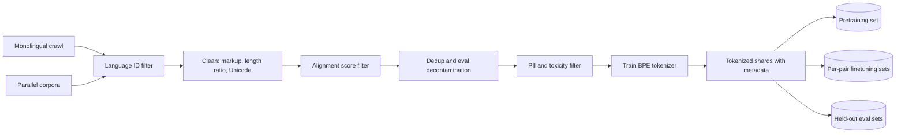
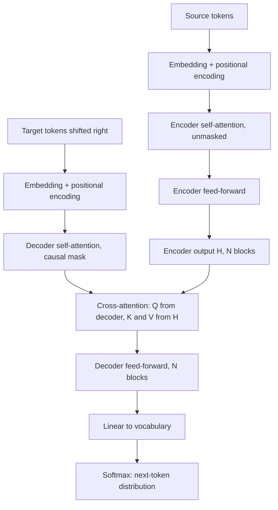
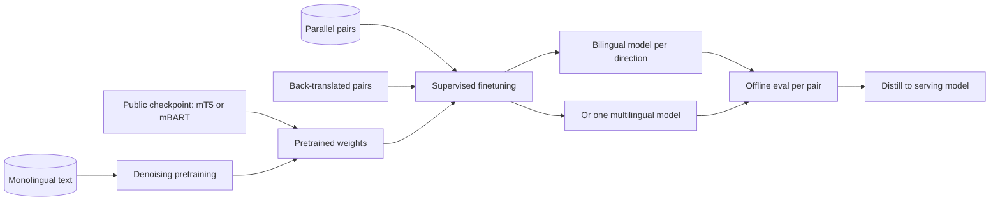
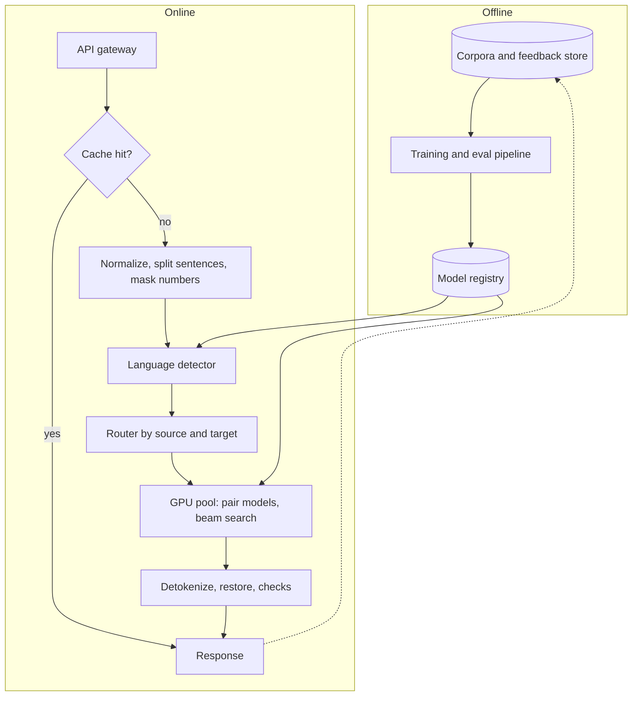
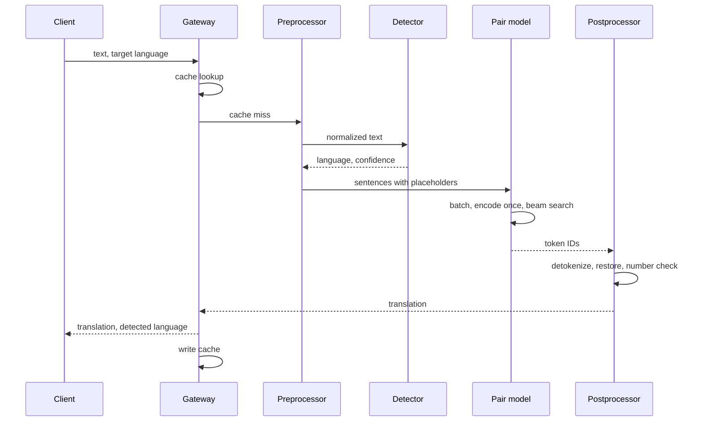

A translation service takes text in one language and returns the same meaning in another. Names, numbers and register have to survive while the two languages disagree on word order, morphology, gender and politeness. Korean puts the verb last and drops subjects; French inflects adjectives for gender. Word substitution fails on both.

Unlike autocomplete or chat, the whole source is available before any output is written. That favors a reader with two-sided context, a separate left-to-right writer, and a link letting each output word consult the source words it depends on.

The core tension is per-pair quality against the cost of owning many models. Every direction wants the best accuracy, but each extra model is another thing to train, evaluate, deploy and monitor. How many languages you support and how much parallel data each pair has decide where you land.

## Requirements that change the design

Language count is the biggest lever: four languages give 12 directed pairs, fifty give 2,450. Whether the source is detected matters because detector mistakes become translation mistakes, and streaming would change the encoder entirely. Assumed setup for the rest of this note: English, Spanish, French and Korean; about 300 million aligned pairs; plenty of monolingual text; automatic detection; inputs up to about 1,000 words; cloud serving; no streaming in v1.

| Requirement | Assumed value | Design decision |
|---|---|---|
| Languages | 4, may grow | Bilingual models now, keep a path to multilingual |
| Parallel data | ~300M pairs | Supervised finetuning is the main quality lever |
| Monolingual data | Abundant | Public pretrained checkpoint; back-translation |
| Source language | Detected | Language-ID classifier with confidence and fallback |
| Max input | ~1,000 words | Full attention; sentence splitting for batching efficiency |
| Deployment | Cloud GPU | Beam search affordable; fp16 or int8 inference |
| Real time | No | Fully bidirectional encoder, no wait-k policy |

## Framing as an ML task

Input: source tokens plus a target-language identifier. Output: target tokens whose length is not tied to the input length. This is sequence-to-sequence generation, trained to maximize

$$
P(y \mid x) = \prod_{t=1}^{T} P(y_t \mid y_{<t}, x)
$$

where \(x\) is the full source sequence, \(y_t\) the target token at step \(t\), \(y_{<t}\) the tokens already produced, and \(T\) the output length, ended when the model emits an end-of-sequence token. That asks for an encoder summarizing \(x\) and a decoder predicting from that summary plus its own history.

| Option | Strengths | Why it loses here |
|---|---|---|
| Phrase-based statistical MT | Interpretable, cheap | Brittle with long-distance reordering such as English to Korean |
| RNN encoder-decoder with attention | First neural approach that worked well | Sequential training, weaker on long sentences |
| Encoder-decoder Transformer | Parallel training, strong reordering, cheap to serve | Chosen |
| Decoder-only LLM with a prompt | Broad coverage, zero-shot pairs, follows instructions | Needs far more parameters for the same quality; higher cost; may answer instead of translate |
| Encoder-only (BERT style) | Strong classifier | Cannot generate; reused as the language detector |

Attention was invented for translation ([Bahdanau et al., 2014](https://arxiv.org/abs/1409.0473)) so a recurrent decoder would not have to squeeze the source into one vector. The Transformer ([Vaswani et al., 2017](https://arxiv.org/abs/1706.03762)) kept attention, dropped recurrence and made training parallel.

## Data

### Sources

- **Monolingual text** per language: filtered web crawl, Wikipedia, news. Used for pretraining and back-translation.
- **Parallel corpora**: public proceedings and subtitle collections, mined web pairs (ParaCrawl, CCMatrix style), licensed human translations, and later vetted user corrections.

Parallel data is uneven: English-Spanish is rich, Korean-French scarce, and that gap reappears as a quality gap.

### Cleaning parallel pairs

Models learn to copy misalignments, so noise hurts. Watch also for benchmark sentences leaking in through crawls, and for over-filtering that leaves only literal translations.

1. Drop pairs with an empty side or an extreme length ratio.
2. Run language ID on both sides; drop wrong-language pairs and identical source-target copies, which teach the model to echo input.
3. Strip markup and encoding garbage; apply Unicode NFC so composed and decomposed Hangul match.
4. Deduplicate, and remove anything that appears in evaluation sets.
5. Score alignment with a cross-lingual sentence embedding (LASER or LaBSE style) and drop low-similarity pairs.
6. Mask personal data and filter toxic content.

Skip classic normalization. Lowercasing, removing punctuation or stop words, and stemming all erase information the model must reproduce, such as capitalized names and gender or tense endings.

**Entities and numbers.** One option is to replace names, numbers and URLs with numbered placeholders before translation and restore them afterward. It protects rare strings but can break grammar: Korean particles change depending on whether a name ends in a consonant, so a restored raw name may get the wrong particle. A practical split is placeholders for numbers, URLs and code, inline translation for names, and a post-check that every entity survived.

### Tokenization with BPE

A word vocabulary across four languages and two scripts would be enormous and still miss inflected forms. Characters avoid that but make sequences four to five times longer. Byte-pair encoding ([Sennrich et al., 2016](https://arxiv.org/abs/1508.07909)) sits in between:

1. Split words into characters plus an end-of-word marker, so a trailing piece differs from the same letters mid-word.
2. Count adjacent symbol pairs, weighted by word frequency.
3. Merge the most frequent pair into a new symbol and record the merge.
4. Repeat until the vocabulary reaches its target (32k to 64k per pair is common).

My own toy example: "run" appears 6 times, "runs" 3 times, "running" 4 times. The pair (r, u) occurs 13 times and merges first, then (ru, n) also 13 times, giving `run`. Later merges build `ning</w>`. An unseen word like "rerunning" still splits into known pieces, `re` + `run` + `ning</w>`. Nothing becomes unknown; rare words just cost more tokens.

A joint vocabulary helps same-script pairs (shared names, tied embeddings) but gains little for English-Korean. Byte fallback covers emoji and rare Hanja. Check token fertility: if Korean needs twice the tokens, it pays twice the attention cost.

Store tokenized shards per direction with metadata (corpus, alignment score, domain), plus raw text for re-tokenization.

## Model architecture

Every attention layer computes

$$
\mathrm{Attention}(Q, K, V) = \mathrm{softmax}\!\left(\frac{QK^\top}{\sqrt{d_k}} + M\right)V
$$

where \(Q\), \(K\), \(V\) are linear projections of the inputs, \(d_k\) is the key dimension that keeps dot products in a stable range, and \(M\) adds \(-\infty\) at forbidden positions.

The three uses differ in where \(Q\), \(K\), \(V\) come from and what \(M\) blocks:

- **Encoder self-attention**: all from the source, no mask. "bank" can see "river" three words later.
- **Decoder self-attention**: all from the target prefix, future positions masked so training matches left-to-right generation.
- **Cross-attention**: \(Q\) from the decoder, \(K\) and \(V\) from encoder output \(H\). This is where alignment happens; when the decoder writes a Korean sentence-final verb, its weights concentrate on the English verb near the start.

Blocks add residuals, layer norm and a feed-forward layer; only the decoder has a prediction head.

**Design knobs.**

- **Depth split.** Quality leans on the encoder; latency on the decoder, which runs once per output token. A 12-layer encoder with a 2-layer decoder keeps most of the quality and decodes much faster ([Kasai et al., 2020](https://arxiv.org/abs/2006.10369)).
- **Size.** Transformer-base (~65M params) is a solid bilingual baseline; with 300M pairs, a "big" model or a 400-600M pretrained checkpoint is justified.
- **Length.** 1,000 words is roughly 1,300 to 2,000 subwords, fine for full attention. You still split by sentence to batch efficiently, carrying one or two previous sentences as context.

## Training

### Stage 1: denoising pretraining

Next-token prediction on monolingual text fails for an encoder-decoder: if the encoder sees the sentence the decoder must produce, cross-attention just copies it. So the encoder input is corrupted and the decoder must recover the original. T5 masks spans and predicts only them ([Raffel et al., 2019](https://arxiv.org/abs/1910.10683)); BART and mBART mask spans, shuffle sentences and reconstruct everything ([Lewis et al., 2019](https://arxiv.org/abs/1910.13461); [Liu et al., 2020](https://arxiv.org/abs/2001.08210)).

$$
\mathcal{L}_{\text{denoise}} = -\sum_{t \in \mathcal{S}} \log P_\theta\!\left(x_t \mid \tilde{x}, x_{<t}\right)
$$

\(\tilde{x}\) is the corrupted encoder input, \(x_t\) an original token, and \(\mathcal{S}\) the positions the loss counts (masked spans for T5, the whole sequence for BART). Pretraining from scratch costs thousands of GPU-days, so for four languages start from mT5 or mBART-50.

### Stage 2: supervised finetuning

The encoder reads the source; the decoder gets the reference shifted right behind a start token (teacher forcing) and predicts every next token in parallel, usually with label smoothing:

$$
\mathcal{L}_{\text{MT}} = -\sum_{t=1}^{T} \sum_{v \in V} q_t(v) \log P_\theta(v \mid y_{<t}, x), \quad q_t(v) = (1-\epsilon)\,\mathbb{1}[v = y_t] + \frac{\epsilon}{|V|}
$$

\(V\) is the vocabulary, \(y_t\) the reference token and \(\epsilon\) (typically 0.1) the probability mass spread evenly. Smoothing slightly raises perplexity but improves BLEU, because an overconfident model makes beam search worse. The target language is signaled with a tag such as `<2ko>` on the source or as the decoder start token.

### Bilingual or multilingual

| Criterion | Bilingual per direction | One multilingual model | English pivot |
|---|---|---|---|
| Models for 4 languages | 12 | 1 | 6 |
| High-resource quality | Best | Slightly lower | Lower, errors compound |
| Low-resource quality | Weak without transfer | Better via sharing | Depends on both legs |
| Zero-shot directions | None | Possible, often mediocre | Always |
| Fixing one pair | Isolated retrain | Touches all pairs | Two models to inspect |
| Scales to 50+ languages | No | Yes | Yes, English-centric |

Four languages, plenty of data and an accuracy priority justify bilingual models with contained regressions. As languages grow, owning \(n(n-1)\) models dominates cost and low-resource pairs gain more from sharing than top pairs lose, which is why large systems went multilingual ([Johnson et al., 2017](https://arxiv.org/abs/1611.04558); [NLLB, 2022](https://arxiv.org/abs/2207.04672)). A multilingual model samples pair \(i\) with probability proportional to \(D_i^{1/\tau}\), where \(D_i\) is the pair's data size; \(\tau = 5\) up-samples small pairs compared with \(\tau = 1\).

**Back-translation** ([Sennrich et al., 2016b](https://arxiv.org/abs/1511.06709)) turns monolingual target text into training pairs: a reverse Korean-to-English model translates real Korean, and the (synthetic English, real Korean) pairs train English-to-Korean. The decoder always sees fluent real text; the noise sits on the encoder side. Tag synthetic pairs and start around a 1:1 ratio with real data.

**Efficiency.** bf16 mixed precision, token-budget batching by length, sharded data parallelism (enough below a billion parameters), gradient checkpointing for long documents, checkpoint averaging.

### Worked example: finetuning compute

A 400M-parameter model, 300M pairs over 12 directions, so 25M pairs per direction at about 65 tokens per pair (30 source, 35 target): \(1.6 \times 10^9\) tokens per epoch.

Using \(6ND\): \(6 \times 4 \times 10^8 \times 1.6 \times 10^9 \approx 3.9 \times 10^{18}\) FLOPs. This overestimates an encoder-decoder, since a source token only passes through the encoder, but serves as an upper bound. An A100 at 40% of 312 TFLOP/s gives \(1.25 \times 10^{14}\) FLOP/s, so one epoch takes about 31,000 s, or 9 GPU-hours. Three epochs for 12 directions is \(9 \times 3 \times 12 \approx 320\) GPU-hours, under two days on one 8-GPU node. Finetuning is cheap; pretraining is what the checkpoint saves you.

### Failure modes

- **Hallucination** (fluent text unrelated to the source) from noisy pairs or out-of-domain input: stricter alignment filtering, copy-style training examples for numbers and code.
- **Echoing the source** from untranslated pairs: filter identical pairs.
- **Off-target language** in multilingual models: stronger language tags, more direct non-English data, output language check.
- **Overfitting small pairs**: early stopping, dropout, more back-translation.

## Decoding

The encoder runs once; the decoder generates step by step until end-of-sequence or a length cap such as 1.5 times the source length. Translation usually has one right meaning, so the goal is the most probable faithful output.

Greedy decoding can commit early to a dead end, such as an article whose gender clashes with a later noun. Beam search keeps the \(k\) best partial hypotheses each step. Since log-probabilities are negative and add up, short hypotheses win unless scores are length-normalized, for example with the GNMT penalty ([Wu et al., 2016](https://arxiv.org/abs/1609.08144)):

$$
s(y \mid x) = \frac{\log P(y \mid x)}{lp(y)}, \qquad lp(y) = \frac{(5 + |y|)^{\alpha}}{6^{\alpha}}
$$

\(|y|\) is hypothesis length and \(\alpha\) sets how strongly length is rewarded; 0 means no normalization and 0.6 to 1.0 works well in practice.

| Strategy | Deterministic | Relative latency | MT quality | Use |
|---|---|---|---|---|
| Greedy | Yes | 1x | Good, occasional dead ends | On-device, distilled students |
| Beam k=4 to 6, normalized | Yes | ~1.3x to 2x batched | Best default | Production |
| Wide beam k=20+ | Yes | Much higher | Often worse, short and generic | Rarely |
| Top-p or temperature sampling | No | ~1x | Lower adequacy | Diverse back-translation data |
| Beam then rerank with QE or reverse model | Yes | 2x to 3x | Higher | Premium or offline documents |

Constrained decoding forces glossary terms into the beam; a `<formal>` tag controls register.

## Evaluation

### Offline metrics

**BLEU** ([Papineni et al., 2002](https://aclanthology.org/P02-1040/)):

$$
\mathrm{BLEU} = \mathrm{BP} \cdot \exp\!\left(\sum_{n=1}^{4} w_n \log p_n\right), \qquad \mathrm{BP} = \min\!\left(1,\; e^{\,1 - r/c}\right)
$$

\(p_n\) is clipped n-gram precision (a candidate n-gram counts at most as often as it appears in the reference), \(w_n = 1/4\), \(c\) is candidate length and \(r\) reference length; the brevity penalty stops a system from scoring by emitting only safe words.

Worked example with my own sentences. Reference "the cat sat on the mat", candidate "the cat is on the mat". Unigrams match 5 of 6, bigrams 3 of 5 ("the cat", "on the", "the mat"), trigrams 1 of 4 ("on the mat"), 4-grams 0 of 3. The zero makes the geometric mean zero, so this decent translation scores 0. That is why BLEU is computed at corpus level, summing n-gram counts over thousands of sentences, and why sentence-level BLEU needs smoothing. Use SacreBLEU so tokenization is standardized, which matters a lot for Korean.

**chrF** is an F-score over character n-grams up to length 6:

$$
\mathrm{chrF}_\beta = (1 + \beta^2)\,\frac{\mathrm{chrP} \cdot \mathrm{chrR}}{\beta^2\,\mathrm{chrP} + \mathrm{chrR}}
$$

with character precision \(\mathrm{chrP}\), recall \(\mathrm{chrR}\) and \(\beta = 2\) weighting recall double. It gives partial credit for a right stem with a wrong ending, which suits inflected languages and Korean.

**ROUGE** is the recall counterpart of BLEU. **METEOR** aligns words by exact form, then stem, then synonym, combines precision and recall, and penalizes scattered matches; it tracks humans better than BLEU but needs stemmers and synonym lists many languages lack. **COMET** ([Rei et al., 2020](https://arxiv.org/abs/2009.09025)) and BLEURT encode source, output and reference with a multilingual model trained to predict human scores, and reward correct paraphrase.

| Metric | Catches | Misses | Cost |
|---|---|---|---|
| BLEU | Wrong words, omissions, length errors | Paraphrase, synonyms; noisy per sentence | Trivial |
| chrF | Partially right morphology | Meaning-preserving rewording | Trivial |
| ROUGE | Omitted content | Hallucinated additions, paraphrase | Trivial |
| METEOR | Synonyms, word-order fragmentation | Languages without lexical resources | Low |
| COMET / BLEURT | Meaning errors, fluent paraphrase | Out-of-domain behavior; can be gamed | GPU |
| Human MQM | Everything, including tone and terminology | Slow, expensive, rater variance | High |

### Human and online evaluation

Launch decisions rest on human judgment: adequacy and fluency scores or MQM-style error-span annotation, sampled per pair and domain. Cheap targeted suites cover numbers, gender agreement, entities, idioms, formality and code-mixed input.

Online, track ratings, suggested edits, copy rate, re-translation rate, retention and per-pair latency. Implicit signals are noisy (people copy bad output they cannot judge), so use them for A/B trends, not ground truth.

## Serving system

### Language detection

A small encoder-only Transformer with mean-pooled outputs and a softmax over languages, or a fastText/CLD3-style character n-gram model that runs in microseconds on CPU. Short inputs are the hard case ("No" is English and Spanish); see the operations questions below.

### Latency and cost levers

- **Sentence splitting plus dynamic batching** across users, grouped by pair and length.
- **Encode once**: encoder output and cross-attention keys and values are shared by all beams and steps; a **KV cache** covers decoder self-attention.
- **int8 quantization** for 2x to 4x CPU speedups and less GPU memory, checked per pair because low-resource pairs degrade first.
- **Sequence-level distillation** ([Kim and Rush, 2016](https://arxiv.org/abs/1606.07947)): train a small student on the teacher's beam outputs; the student often does well with greedy decoding.
- **Vocabulary shortlisting** shrinks the output softmax.
- **Caching** keyed on normalized source, languages and model version.
- **Placement**: dedicated GPUs for busy pairs, a shared pool for the rest.

### Worked example: fleet sizing

50 million requests per day, 40 source and 45 target tokens on average, 3x peak.

- Average QPS \(= 50 \times 10^6 / 86{,}400 \approx 580\); peak about 1,750.
- One GPU serving a 400M model at batch 64 with beam 4 takes about 15 ms per step, so 45 steps plus encoding is about 0.7 s per batch, or \(64 / 0.7 \approx 90\) requests/s.
- Peak needs \(1{,}750 / 90 \approx 20\) GPUs; add 50% for batch fragmentation across 12 models and failover, about 30.
- A distilled greedy student roughly halves that.

### Worked example: memory for a long input

A 12-layer decoder, width 1,024, fp16: keys plus values per token per layer are \(2 \times 1{,}024 \times 2 = 4{,}096\) bytes, about 49 KB across layers. A 1,500-token source costs \(1{,}500 \times 49\) KB \(\approx 74\) MB of cross-attention cache, shared by beams. A 1,500-token output with beam 4 costs \(4 \times 1{,}500 \times 49\) KB \(\approx 295\) MB. About 370 MB per long document, so thirty concurrent long documents take around 11 GB. Long inputs belong in their own queue so they do not inflate p99 for short ones.

### Safety and monitoring

Verify numbers and placeholders survive, run the detector on the output, fall back when length ratio or a reference-free quality score suggests hallucination, flag outputs more toxic than their source, and show both forms when a neutral source forces a gendered target. Monitor per-pair latency, batch fill, cache hits, detector confidence and QE scores; domain shifts appear there first.

## Follow-ups and extensions

- **Forty more languages**: one multilingual model, temperature sampling, a ~250k shared vocabulary, back-translation for low-resource pairs, chrF and human raters where references are scarce.
- **Document-level**: previous sentences as context or document-chunk training for pronoun and terminology consistency.
- **Speech, real time**: cascaded ASR, MT, TTS or end-to-end speech translation; a wait-k policy trades quality for lag.
- **Enterprise glossaries, on-device, LLMs**: constrained decoding or adapters per customer; a 20-50M int8 distilled student for phones; a large LLM offline for data generation and judging, or in a cascade for hard requests.

## Interview questions

### Clarifying

**Which requirement would most change the architecture if it flipped?**
The language count. With four languages I can own one model per direction, tune each independently and roll back a single pair. With fifty there are 2,450 directions, so only a shared multilingual model works, which changes the tokenizer, model size, evaluation budget and serving layout. Streaming is the runner-up.

**Why ask whether users supply the source language?**
Detection adds a component whose errors produce confident nonsense that clean benchmarks never reveal. It needs calibration, a fallback for short or mixed inputs and monitoring. If users always choose the source, the piece disappears and so do misroutes. I would still log the language users pick to measure how often a detector would have disagreed.

### Design and trade-offs

**Encoder-decoder or decoder-only LLM?**
For a fixed set of four languages, encoder-decoder. Bidirectional encoding plus cross-attention matches the task, and a few hundred million parameters trained on clean pairs reach strong quality cheaply. An LLM needs to be much larger for the same pairs, costs more per request and can drift into answering the text. I would switch if an LLM is already served, long-tail language coverage matters, or users want instruction-style control.

**Bilingual models or one multilingual model?**
Bilingual gives the best per-pair accuracy and isolated fixes, at quadratic growth in models and no transfer. Multilingual is one artifact and helps low-resource pairs, at a small cost on top pairs and harder debugging. For four languages with accuracy first I start bilingual, but keep tokenizer and data formats compatible so switching is a training change.

**Pivot through English or train Korean to French directly?**
Pivoting doubles latency, compounds errors and loses what English does not mark, such as Korean honorifics. Direct data is scarce, so I would create it offline by translating the English side of English-French pairs into Korean, then train a direct model so the online path is one hop. Pivoting stays as a fallback for pairs without a model. Quality on the synthetic data gets checked by bilingual Korean-French raters.

**Beam search or sampling?**
Beam search with width 4 to 6 and length normalization. Users expect fidelity and the same output for the same input; sampling adds variety that here means drift. Very wide beams favor short, bland outputs. Sampling still helps offline for diverse back-translations.

**The p99 budget is halved. What do you give up?**
Free wins first: latency-tuned batching, int8, vocabulary shortlisting, caching. Then a distilled deep-encoder, shallow-decoder student that decodes greedily. If still short, beam 2 and a separate queue for long documents. Measure each step per pair, since low-resource pairs degrade first.

### Deep dives

**Why not pretrain with next-token prediction?**
If the encoder sees the full sentence the decoder must produce, cross-attention copies it and nothing useful is learned. Corrupting the encoder input forces the decoder to infer missing content from context, training understanding and generation together. T5 predicts only masked spans, which is cheaper; BART reconstructs the whole sequence, closer to how translation generates.

**Why is BLEU insufficient, and what do you report?**
It counts exact n-gram overlap, so correct paraphrases score low and fluent mistranslations sharing words score high; one missing 4-gram can zero a sentence. It is also tokenization-sensitive, which hurts Korean. I report corpus SacreBLEU for continuity, chrF, COMET as the main automatic signal, targeted suites, and MQM human evaluation before launch.

**How does back-translation help, and what can go wrong?**
It turns monolingual target text into pairs whose target side is real and fluent, helping low-resource pairs and domain adaptation most. Too much synthetic data drowns real signal and imports the reverse model's errors and translationese. Tagging synthetic pairs, capping the ratio and sampling rather than beam-decoding the back-translations mitigate it.

**Estimate the GPU fleet for 50 million requests a day.**
About 580 QPS average, 1,750 at a 3x peak. A GPU running a 400M model at batch 64, beam 4, finishes a batch in about 0.7 s, roughly 90 requests/s, so about 20 GPUs at peak. With 50% headroom for fragmentation across 12 models and failover, about 30. Distillation with greedy decoding roughly halves it.

**Estimate memory for a 1,000-word document with beam 4.**
At about 1,500 tokens each way and 49 KB of keys and values per token (12 layers, width 1,024, fp16), the source cache is about 74 MB, shared by beams, and four beams of output take about 295 MB. Around 370 MB per document caps a 24 GB GPU at a few dozen concurrent long documents after weights. Hence sentence splitting or a dedicated long-input queue.

### Operations and failure modes

**The detector fails on short inputs. What do you do?**
Return calibrated confidence and, below a threshold, combine it with locale, session history and the target language (people rarely translate into the language they typed). Show the detected language with a one-tap correction and log corrections as labels. Train on short and code-mixed examples and report accuracy by input length.

**How do you turn user edits into training data safely?**
Treat them as candidates. Require agreement across users, weight by editor reputation, and keep only pairs a QE model scores above the original. Guard against coordinated poisoning with rate limits, anomaly detection and human review, and tag accepted edits so they can be rolled back.

**A new model improves BLEU but users rate it worse. Why?**
The model may have become more literal, the test set may not match live domains, or one category such as formality or long inputs regressed while the average rose. Slice human ratings and online metrics by pair, domain and length, compare COMET and chrF, and read side-by-side samples. The launch gate should require human and online evidence, not BLEU alone.

## A 45-minute walkthrough

| Minutes | Cover | Draw |
|---|---|---|
| 0-5 | Languages, data, detection, length, cloud vs device, real time; state assumptions | Requirements list |
| 5-9 | Seq2seq framing, \(P(y \mid x)\), encoder-decoder vs LLM vs RNN | Input/output box |
| 9-15 | Data sources, cleaning filters, no lowercasing, entities, BPE | Data pipeline |
| 15-21 | Encoder, causal decoder, cross-attention, depth split | Block diagram |
| 21-27 | Checkpoint or denoising pretraining, finetuning loss, bilingual vs multilingual, back-translation | Training flow |
| 27-30 | Beam search with length normalization, why not sampling | Small beam tree |
| 30-35 | BLEU and its limits, chrF, COMET, human MQM, online metrics | Metric table |
| 35-42 | Detector, router, batching, caching, distillation, quantization, fleet estimate | Serving architecture |
| 42-45 | Hallucination, short-input detection, scaling to 50 languages | None |

## Review questions

Answer each question in your own words first, then open the answer to check.

### Concepts and definitions

**1. What property of translation, compared with autocomplete, favors an encoder-decoder design?**


The full source text is available before any output is produced. An encoder can therefore read it with context from both sides, while a separate decoder writes the target left to right. Cross-attention then lets each output step look back at whichever source words it needs.


**2. In cross-attention, where do the queries, keys and values come from?**


Queries come from the decoder's current target-side states. Keys and values come from the encoder output \( H \), which summarizes the source. Each target position thus asks which source positions are relevant to it, and this is where the model learns alignment between the two languages.


**3. What is token fertility, and why should you check it per language?**


Fertility is how many subword tokens a language needs for the same content. If Korean text splits into twice as many tokens as English, every Korean request runs longer sequences, so attention, cache memory and decode steps all cost more. A tokenizer that serves one language poorly creates a hidden cost and quality gap for that language.


**4. In back-translation, which side of each training pair is synthetic, and why does that matter?**


A reverse model translates real target-language text into the source language, so the source side is synthetic and the target side is real. The decoder therefore always learns to produce fluent human text, and the noise from the reverse model only affects what the encoder reads. That is why back-translated pairs help even though they are machine-made.


**5. What does "clipped" mean in BLEU's n-gram precision?**


A candidate n-gram is credited at most as many times as it appears in the reference. Without clipping, a candidate that repeated "the the the the" could score perfect unigram precision against a reference with one "the". Clipping stops a system from gaining score by repeating safe words.


### Mechanisms and math

**6. What does BLEU's brevity penalty prevent, and what is its value for an 8-token candidate against a 10-token reference?**


Precision alone rewards short outputs that contain only words the system is sure of. The penalty lowers the score when the candidate is shorter than the reference, and is 1 otherwise:

$$
\mathrm{BP} = \min\!\left(1,\; e^{\,1 - r/c}\right) = e^{\,1 - 10/8} = e^{-0.25} \approx 0.78
$$

So this candidate keeps only about 78% of its precision-based score.


**7. How does label smoothing change the training target, and why can it raise BLEU while raising perplexity?**


Instead of a one-hot target, the true token gets \( 1-\epsilon \) of the probability plus a share of \( \epsilon \) spread evenly over the vocabulary, with \( \epsilon \) around 0.1. The model can no longer be fully confident in the reference token, so its likelihood on held-out text gets a little worse. Its probabilities are less overconfident, though, and beam search makes better choices with them, which shows up as higher BLEU.


**8. Why does beam search for translation need a length penalty?**


A hypothesis score is the sum of log-probabilities, each of which is negative, so every extra token lowers the score. Without correction, beam search prefers short hypotheses and drops content. The GNMT-style penalty divides the log-probability by a term that grows with length, and \( \alpha \) between 0.6 and 1.0 sets how strongly length is rewarded.


**9. In multilingual training, what does raising the sampling temperature \( \tau \) do to the mix of language pairs?**


Pair \( i \) is drawn with probability proportional to \( D_i^{1/\tau} \). At \( \tau = 1 \) pairs are sampled in proportion to their data size, so large pairs dominate. A higher \( \tau \) flattens the distribution, so small pairs are seen more often than their raw share and benefit more from shared training.


**10. Why does a deep encoder with a shallow decoder decode faster without losing much quality?**


The encoder runs once per request over the whole source, in parallel. The decoder runs once per output token, so its depth is paid again at every step. Moving layers from the decoder to the encoder keeps most of the model's capacity for understanding the source while cutting the per-step cost that drives latency.


### Numbers and estimates

**11. Pair A has 100M sentence pairs and pair B has 1M. What is the sampling ratio of A to B at \( \tau = 1 \) and at \( \tau = 5 \)?**


- At \( \tau = 1 \): ratio \( = 100\text{M} / 1\text{M} = 100 \), so B gets about \( 1/101 \approx 1\% \) of samples.
- At \( \tau = 5 \): ratio \( = 100^{1/5} = e^{\ln 100 / 5} = e^{0.92} \approx 2.5 \).
- B's share becomes \( 1 / (1 + 2.5) \approx 28\% \).

The small pair goes from almost invisible to more than a quarter of the training mix.


**12. Using the note's per-GPU throughput of about 90 requests per second, how many GPUs does a service with 20 million requests per day and a 3x peak need?**


- Average QPS: \( 2 \times 10^7 / 86{,}400 \approx 231 \).
- Peak QPS: \( 3 \times 231 \approx 694 \).
- GPUs at peak: \( 694 / 90 \approx 7.7 \), so 8.
- With 50% headroom for batch fragmentation across models and failover: about 12 GPUs.


**13. How many models are needed for 6 languages with bilingual models per direction, with an English pivot, and with one multilingual model?**


- Bilingual: one model per directed pair, \( n(n-1) = 6 \times 5 = 30 \).
- English pivot: each of the 5 other languages needs a model into English and one out of it, \( 2 \times 5 = 10 \).
- Multilingual: 1.

For the note's four languages the same formulas give 12, 6 and 1.


### Design reasoning and trade-offs

**14. Why does the cleaning pipeline skip lowercasing, stop-word removal and stemming?**


Translation output must reproduce exactly what those steps would erase. Capital letters mark names, and endings carry tense, number and gender that the target sentence has to express. Classic normalization helps tasks such as retrieval but here it deletes information the model needs to learn and copy.


**15. Why does the note use placeholders for numbers, URLs and code but translate names inline?**


Numbers, URLs and code must pass through unchanged, and placeholders guarantee that. Names interact with grammar in the target language. In Korean, the correct particle depends on whether the name ends in a consonant, so restoring a raw name into a slot can produce the wrong particle. A check afterward confirms every entity survived either way.


**16. Why is BLEU computed over a whole test corpus rather than averaged per sentence?**


BLEU takes a geometric mean of n-gram precisions, so a single sentence with no matching 4-gram scores zero even when the translation is good. Summing n-gram counts across thousands of sentences before computing precision avoids these zeros and gives a stable number. Sentence-level BLEU is only usable with smoothing.


**17. Why does chrF suit Korean and other inflected languages better than BLEU?**


chrF compares character n-grams up to length 6, so a word with the right stem but a wrong ending still earns partial credit. BLEU works on whole tokens and gives nothing for a near miss, and it is sensitive to how text is tokenized. chrF with \( \beta = 2 \) also weights recall twice as much as precision, so dropped content is penalized more.


### Common mistakes

**18. What goes wrong if pairs where the source and target are identical stay in the training data?**


The model learns that copying the input is sometimes the correct answer. At serving time it then echoes untranslated text back, especially for inputs that look unusual. The cleaning step that drops identical source-target pairs exists for this failure.


**19. What goes wrong if the beam width is raised to 20 or more?**


Latency and memory grow with every extra hypothesis, but quality often drops instead of rising. Very wide beams find high-probability outputs that are short and generic, because the search becomes good at exploiting the model's bias toward safe text. Widths of 4 to 6 with length normalization are the practical default.


**20. What goes wrong in a multilingual model if the target-language signal is weak?**


The model can produce fluent text in the wrong language, often English or the source language, which is called off-target translation. It is most common in directions with little direct training data. Stronger language tags, more direct non-English pairs and an output language check before returning the result reduce it.

