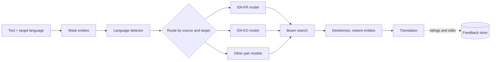

A translation service takes text in one language and returns the same meaning in another, across several language pairs, and figures out on its own what language the user typed. Meaning, names and tone must survive even when word order and grammar differ completely. Unlike autocomplete, the whole source sentence is available before any output is written, which pushes the design toward an architecture that reads first and writes second. The main tension is accuracy per language pair versus the cost of running and maintaining many models.

## Requirements that change the design

- How many languages? A handful of pairs makes per-pair models affordable; hundreds push you to one multilingual model.
- How much parallel data, and is there monolingual text? Plenty of sentence pairs supports supervised finetuning. Large monolingual corpora make pretraining worthwhile and help low-resource pairs.
- Does the user name the source language? If not, a language detector sits in front, and its mistakes become translation mistakes.
- Maximum input length? About a thousand words fits standard attention. Whole documents need chunking or efficient attention.
- Cloud or on-device? On-device means a small quantized model.
- Real time? Live speech needs streaming decoding; a text box does not.

The chapter settles on four languages (English, Spanish, Korean, French), about 300 million sentence pairs, plenty of monolingual text, automatic detection, inputs up to 1,000 words, and cloud serving without real-time needs.

## Framing as sequence-to-sequence

Input: source tokens plus the requested target language. Output: target tokens of any length. This is seq2seq, the same shape as summarization or speech recognition.

An encoder-decoder Transformer fits. The encoder reads the full source with bidirectional attention, so each token sees context on both sides. The decoder writes left to right and uses cross-attention to look back at whichever source tokens matter for the current word. Attention was first proposed for this exact problem ([Bahdanau et al., 2014](https://arxiv.org/abs/1409.0473)), and Transformers displaced LSTM and GRU encoders by handling long-range reordering better and training in parallel.

A prompted decoder-only LLM can translate too, but encoder-decoder splits understanding from generation, handles differing lengths naturally and reaches strong quality at a far smaller size. Encoder-only models do not generate; they return later as the language detector.

## Data preparation and BPE across languages

Monolingual web text such as C4 and Wikipedia is filtered to keep only the supported languages and used for pretraining. Parallel pairs are used for finetuning and need their own cleaning: drop pairs with an empty side, markup or the wrong language, deduplicate, and swap named entities for numbered placeholders that get restored after translation, so rare names are not mangled.

Skip classic NLP normalization. Lowercasing, stop-word or punctuation removal, stemming and lemmatizing all strip information the model has to reproduce in its output.

Tokenization matters more than in a single-language system, since a word-level vocabulary across four languages and two scripts would be huge and still miss inflected forms. Byte-Pair Encoding starts from characters plus an end-of-word marker, counts adjacent symbol pairs across the corpus, merges the most frequent pair into a new symbol, and repeats until it hits a target vocabulary size. Common words become single tokens, rare ones split into known pieces, and the end-of-word marker distinguishes a whole word from the same letters inside a longer one. The result is one table per language pair, each row a pair of token-ID sequences.

## Model and two-stage training

Both halves use token embeddings, sine-cosine positional encodings, and stacked attention and feed-forward blocks. They differ in three places: encoder self-attention is unmasked while the decoder's is causal; each decoder block adds cross-attention with queries from the decoder and keys and values from the encoder; only the decoder has a prediction head. At 1,000 words, standard attention suffices.

Pretraining cannot use plain next-token prediction: if the encoder sees the whole sentence, the decoder can simply copy it. Instead some encoder input tokens are masked and the decoder must reconstruct the original, with cross-entropy computed on the masked positions. This is the denoising idea behind [T5](https://arxiv.org/abs/1910.10683) and [BART](https://arxiv.org/abs/1910.13461). Pretraining is expensive, so in practice you start from a public checkpoint such as T5, BART, mT5 or mBART.

Finetuning is supervised on parallel pairs. The encoder reads the source; the decoder receives the target shifted right behind a start token and predicts each next target token, with cross-entropy over all positions at once.

The decision worth discussing is how many models to finetune. Per-pair (bilingual) models give the best accuracy per pair and can be fixed in isolation, but their count grows quadratically with languages. One multilingual model is a single deployment, helps low-resource languages and enables zero-shot pairs, at some cost on top pairs. The chapter picks bilingual since accuracy is the priority and there are only four languages; with dozens, the economics flip.

## Decoding

Translation wants the most faithful output, every time. Beam search keeps several candidate translations alive, returns the highest-scoring one and is deterministic. Sampling methods add diversity translation does not need. Length normalization in the beam score is worth mentioning, since raw log-probability favors short outputs.

## Evaluation: overlap metrics and their blind spots

Offline metrics compare output with human reference translations. BLEU is n-gram precision (usually up to 4-grams) combined with a geometric mean and a brevity penalty so terse outputs cannot score well. It is cheap and standard but punishes correct translations that use other words. ROUGE is the recall counterpart, the share of reference n-grams found in the output, with the same synonym blind spot. METEOR aligns words by exact form, stem and synonym (for example via WordNet), blends precision and recall, and penalizes scrambled order; it tracks human judgment better but is slower and needs linguistic resources some languages lack. Learned metrics such as COMET and human ratings cover the rest, reported per pair and domain.

Online, collect ratings and suggested edits, and track translation volume, return rate and copy rate.

## The serving path

The language detector is a sequence classifier: an encoder-only Transformer whose outputs are average-pooled (or read from one designated token) and fed to a softmax over languages. Very short inputs are its hardest case.

The translation service routes to the pair model, runs beam search, detokenizes and restores entities. Without a direct pair model, pivoting through English is a fallback. Caching frequent phrases and batching per model cut cost.

## Interview questions

**Why encoder-decoder rather than a decoder-only LLM?**
Bidirectional encoding plus cross-attention suits a task that maps one sequence to another, and it reaches strong quality at a much smaller size for a fixed language set. A decoder-only LLM makes sense if you already serve one and want broad coverage through prompting.

**Bilingual models or one multilingual model?**
Bilingual wins on per-pair accuracy and isolated debugging when pairs are few. Multilingual wins on operating cost, low-resource transfer and zero-shot pairs as languages grow. Four languages with an accuracy priority justify bilingual; fifty do not.

**Why not pretrain with next-token prediction?**
The decoder could copy the sentence the encoder already saw. Masking encoder input forces reconstruction from context, which trains both halves.

**How does BPE handle a word it never saw?**
It applies its learned merges, falling back to smaller known pieces and at worst single characters. There is no unknown token, only a longer sequence; byte-level BPE extends this to any script.

**What are BLEU's limits and what would you add?**
It rewards surface overlap, penalizes valid paraphrase and correlates weakly with human judgment per sentence. Add METEOR or a learned metric like COMET, plus regular human evaluation per pair.

**How do you handle names and numbers?**
Detect entities with NER, swap in placeholders before translation and restore them afterward, which keeps numbers exact. In languages where names inflect, restoring the raw form can break grammar, so test those cases.

**The detector fails on short inputs. What now?**
Return a confidence score and, when it is low, fall back to user locale or ask the user. Train on many short examples and report accuracy by input length.

**How would you support a low-resource language?**
Use a multilingual model to borrow from related languages, and create extra parallel data by back-translating monolingual text. Rely on human raters, since references are scarce.

**How do you turn user feedback into improvements?**
Filter ratings and edits for spam and low agreement, then add trusted edits as new pairs for periodic finetuning, watching for deliberate poisoning.

**What changes for full-document input?**
Sentence-level translation loses pronoun and terminology consistency. Chunk with overlapping context, use a document-level model, or adopt efficient attention, and consider streaming partial output to hide latency.
