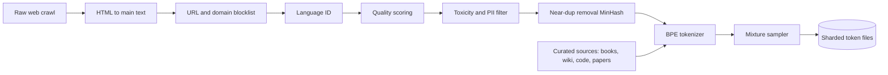
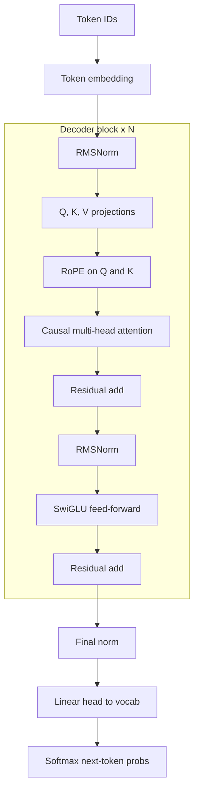
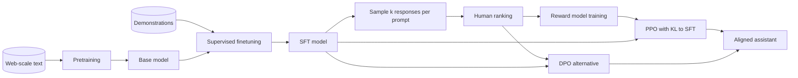
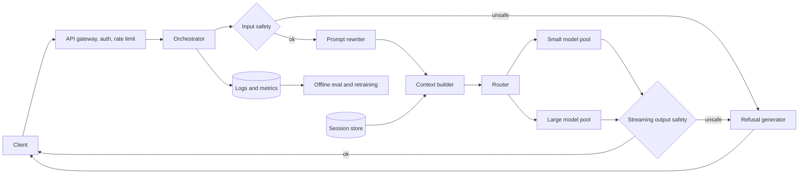
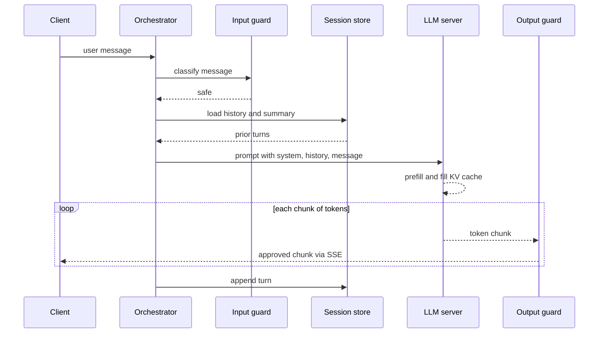

A general-purpose assistant accepts free-form text, answers questions, explains concepts, drafts documents and tracks a multi-turn conversation. Under the hood it is a large decoder-only Transformer, an architecture that is close to settled. The design quality comes from everything around it: turning a text continuer into an instruction follower, teaching it which of two plausible answers people prefer, decoding so replies read naturally, and serving it fast, cheaply and safely.

The core tension is that every capability gain also makes harmful or confidently wrong output easier. Tune only for helpfulness and the model explains dangerous things; tune only for harmlessness and it refuses ordinary questions. Most of the interview is about where you place the controls between those forces and how you measure them.

The notes follow the book's seven-step framework, then add follow-ups, interview questions, a 45-minute walkthrough and review questions.

## 1. Clarifying requirements

Pin down scope first. These are the assumptions I would make for a first version.

- **Functional.** Text in, text out, so one language model suffices (images would add a vision encoder, speech would add ASR and TTS). Multi-turn conversation, so session storage, a context window of several thousand tokens and a policy for overflow. No browsing or tools in v1, so knowledge is frozen at the pretraining cutoff. English only, no personalization.
- **Non-functional.** A consumer-grade safety bar. Time-to-first-token (TTFT) and steady streaming matter more than total response time. Decoding is memory-bandwidth bound, so throughput per GPU is a first-class cost requirement. Millions of daily users means thousands of concurrent streams.

| Requirement | Design decision it forces | What breaks if ignored |
|---|---|---|
| Multi-turn memory | Session store, context builder, long-context positional encoding | Model forgets what "it" refers to two turns later |
| Safety bar for public users | RLHF or DPO stage plus input and output classifiers | Jailbreaks, toxic output, legal exposure |
| Streaming UX, TTFT under ~1 s | Token streaming, prefill optimization, small pre-model checks | Users abandon before the reply appears |
| Cost per conversation | KV cache, GQA, quantization, continuous batching, model routing | Serving bill grows linearly with every new user |
| Frozen knowledge | Clear cutoff messaging, later RAG extension | Confident answers about events the model never saw |

## 2. Framing the problem as an ML task

Input is the system prompt, earlier turns and the new message; output is a reply generated one token at a time from a learned conditional distribution:

$$
p_\theta(y \mid x) = \prod_{t=1}^{T} p_\theta(y_t \mid x, y_{<t})
$$

Here \(x\) is the tokenized context, \(y_t\) is the reply token at step \(t\), \(y_{<t}\) are the reply tokens already generated, and \(\theta\) are the model weights.

This is autoregressive text generation, and the family is a decoder-only Transformer.

| Family | How it generates | Strength | Why it loses here |
|---|---|---|---|
| Decoder-only Transformer (GPT, Llama, Gemini) | Left to right, causal attention | Scales on raw text; one stream for prompt and reply; KV cache | Quadratic attention in context length |
| Encoder-decoder (T5, BART) | Encoder reads, decoder writes | Fixed input-to-output tasks like translation | Chat is one growing stream; splitting it forces re-encoding |
| Encoder-only (BERT) | Does not generate; fills masks | Strong classifier and embedder | No natural generation loop |
| State-space models (Mamba, RWKV) | Recurrent state, parallel training | Linear cost in length | Weaker in-context recall at equal size; less mature tooling |

All three training phases then operate on the same model through the same token interface.

## 3. Data preparation

Three very different datasets feed the three training phases, and their sizes differ by orders of magnitude.

1. Pretraining corpus: trillions of tokens of general text. Quantity and diversity matter most.
2. Demonstration data: tens of thousands to a few hundred thousand prompt and ideal-response pairs written or vetted by people. Quality matters most.
3. Preference data: prompts with several model responses ranked by annotators. Consistency of judgments matters most.

### Pretraining sources

Filtered web crawl (Common Crawl) dominates, with cleaner sources upsampled: Wikipedia, books, arXiv, GitHub code and Stack Exchange. The original Llama paper reported about 1.4 trillion tokens from such a mix, roughly two thirds web. Code helps structured reasoning even for a non-coding assistant. Mixing weights are a knob: small clean sources can be repeated two or three times, but more epochs than that drift into memorization.

### Cleaning the web

Raw crawl is mostly boilerplate, spam and near duplicates. Each filtering stage is cheap compared with the GPU time wasted training on junk.

- **Extraction and URL filtering.** Keep main text only; drop blocklisted adult, malware and spam domains.
- **Language ID and quality.** A fastText classifier keeps the target language. Quality comes from heuristics (symbol ratio, line-ending punctuation, repeated n-grams) plus a small classifier that separates reference-grade pages from random crawl.
- **Safety and privacy.** Toxicity classifiers drop the worst pages; regex and NER mask emails, phones and IDs.
- **Deduplication.** Exact hashes plus MinHash LSH for near copies. Duplicates overweight a few pages and raise memorization and leakage risk.
- **Tokenization.** BPE with a 32K to 128K vocabulary and byte fallback. A bigger vocabulary shortens sequences at the cost of a larger embedding table.

Output is pre-tokenized integer shards, so the loader only memory-maps and packs fixed-length sequences.

### Demonstrations and preferences

Demonstrations cover answering, explaining, summarizing, coding, refusing politely and asking a clarifying question. Public sets such as Alpaca, Dolly and FLAN help, but production needs contractor-written data under a style guide, with diversity of intents valued over count. Preference data comes from sampling several responses per prompt and having annotators rank them, because raters agree far more on "A beats B" than on "A is a 7".

### Pitfalls

- Benchmark contamination: run n-gram overlap checks against every eval set.
- Toxicity filters disproportionately remove dialects and minority-group discussions, which surfaces later as bias.
- Long, hedged demonstrations teach verbosity, and reward models amplify it.

## 4. Model development

### Architecture

The model is a stack of identical decoder blocks between an embedding layer and a prediction head.

#### Attention

Each head computes scaled dot-product attention with a causal mask so a position can only attend to itself and earlier positions:

$$
\text{Attn}(Q, K, V) = \text{softmax}\!\left(\frac{QK^\top}{\sqrt{d_k}} + M\right) V
$$

\(Q, K, V\) are the query, key and value matrices for the sequence, \(d_k\) is the per-head dimension used to keep the dot products in a stable range, and \(M\) is a mask with 0 on and below the diagonal and \(-\infty\) above it.

Grouped-query attention (GQA) lets several query heads share one key/value head. Quality barely moves and the KV cache shrinks by the group factor, which matters more for serving than any other architecture choice.

#### Positional information

Attention is permutation invariant, so position must be injected. Absolute sinusoidal or learned embeddings are simple but extrapolate poorly past the training length. Relative schemes (T5 bias buckets, ALiBi) encode distance directly; ALiBi extrapolates well but hard-codes a recency bias. [Rotary position embedding (RoPE)](https://arxiv.org/abs/2104.09864) rotates each two-dimensional slice of the query and key vectors by an angle proportional to position.

For one 2D slice with frequency \(\omega_i\):

$$
f(\mathbf{x}, m) = \begin{pmatrix} \cos m\omega_i & -\sin m\omega_i \\ \sin m\omega_i & \cos m\omega_i \end{pmatrix} \mathbf{x},
\qquad
\langle f(\mathbf{q}, m), f(\mathbf{k}, n) \rangle = g(\mathbf{q}, \mathbf{k}, m - n)
$$

\(m\) and \(n\) are the positions of the query and key, \(\omega_i = 10000^{-2i/d}\) is the frequency for slice \(i\) of a \(d\)-dimensional head, and \(g\) says the attention score depends only on the offset \(m-n\), not on absolute positions. You get relative behavior while keeping ordinary dot-product attention, so FlashAttention kernels and KV caching work unchanged. Context can later be extended by rescaling the frequencies (position interpolation, NTK scaling, YaRN) with a short finetune.

#### Other components and knobs

Pre-normalization with RMSNorm stabilizes deep stacks; SwiGLU feed-forward layers (hidden size about \(\tfrac{8}{3}\) of model width) beat ReLU MLPs at equal compute; the output head is a linear map to the vocabulary. Depth adds reasoning but raises latency linearly. Longer context grows the KV cache linearly and prefill attention quadratically. Chinchilla suggests about 20 training tokens per parameter for compute-optimal training, but production models usually train far longer because a smaller model is cheaper to serve.

### Training

Training happens in three phases. Each fixes a gap the previous one leaves.

#### Phase 1: pretraining

The objective is next-token cross-entropy on the token stream:

$$
\mathcal{L}_{\text{LM}}(\theta) = -\frac{1}{N} \sum_{t=1}^{N} \log p_\theta(x_t \mid x_{<t})
$$

\(x_t\) is the token at position \(t\) in a packed training sequence, \(x_{<t}\) is everything before it, and \(N\) is the number of tokens averaged over.

The result is a base model with broad knowledge but no assistant behavior; asked a quiz question, it may simply continue with more quiz questions.

**Worked example: pretraining compute.** Training costs about \(6ND\) FLOPs for \(N\) parameters and \(D\) tokens. For 7B parameters on 2T tokens: 6 × 7×10⁹ × 2×10¹² = 8.4×10²² FLOPs. An A100 at 312 TFLOP/s BF16 and 40% utilization delivers about 1.25×10¹⁴ FLOP/s, so the run needs about 6.7×10⁸ GPU-seconds, or 187,000 GPU-hours. On 1,024 GPUs that is about 7.6 days before restarts.

**Efficiency.** BF16 mixed precision with FP32 master weights (FP8 on newer hardware); FSDP or ZeRO sharding plus tensor parallelism inside a node and pipeline parallelism across nodes; FlashAttention; activation checkpointing; sequence packing; and frequent asynchronous checkpoints, because at this scale some node fails every few hours.

**Failure modes.** Loss spikes from bad batches or overflow (gradient clipping, lower learning rate, skipping the batch, QK-norm, logit z-loss), data loader bugs that repeat shards, and silent hardware faults. Watch gradient norm and per-source loss continuously.

#### Phase 2: supervised finetuning

SFT keeps the same loss but trains on prompt and ideal-response pairs wrapped in a chat template, masking the loss to the response:

$$
\mathcal{L}_{\text{SFT}}(\theta) = -\sum_{t \in \mathcal{R}} \log p_\theta(y_t \mid x, y_{<t})
$$

\(\mathcal{R}\) is the set of positions belonging to the assistant's response, so the model is not trained to imitate user text.

SFT takes hours, not weeks, and teaches format, tone and when to refuse or ask back. Its structural limit is one demonstration per prompt: the model learns a plausible answer but never which of several is better, and every example needs an expert to write a full response.

#### Phase 3a: reward modeling

The reward model \(r_\phi\) is usually the SFT model with a scalar head on the final token. A ranking of \(k\) responses expands into \(\binom{k}{2}\) (preferred, rejected) pairs, trained with a Bradley-Terry loss:

$$
\mathcal{L}_{\text{RM}}(\phi) = -\,\mathbb{E}_{(x, y_w, y_l)} \left[ \log \sigma\big( r_\phi(x, y_w) - r_\phi(x, y_l) \big) \right]
$$

\(y_w\) is the preferred response, \(y_l\) the rejected one, and \(\sigma\) is the logistic function; only the score gap matters. A margin ranking loss \(\max(0, m - (r_w - r_l))\) is a common alternative. Held-out pair accuracy of 65 to 75% is typical and mostly reflects annotator disagreement.

#### Phase 3b: policy optimization

The policy \(\pi_\theta\), initialized from SFT, answers fresh prompts, the reward model scores them, and PPO updates the policy under a KL leash:

$$
\max_{\theta} \; \mathbb{E}_{x \sim \mathcal{D},\, y \sim \pi_\theta(\cdot \mid x)} \big[ r_\phi(x, y) \big] - \beta \, \mathbb{D}_{\text{KL}}\big( \pi_\theta(\cdot \mid x) \,\|\, \pi_{\text{ref}}(\cdot \mid x) \big)
$$

\(\pi_{\text{ref}}\) is the SFT model, \(\beta\) controls how far the policy may drift, and the KL term stops the policy from finding odd text that fools the reward model.

PPO holds four models in memory (policy, reference, reward, value), which makes it the most expensive and fragile phase. Reward hacking shows up as rising reward with flat or falling human ratings, growing length and sycophancy.

[DPO](https://arxiv.org/abs/2305.18290) uses the closed-form optimum of that objective to train on preference pairs directly:

$$
\mathcal{L}_{\text{DPO}}(\theta) = -\,\mathbb{E} \left[ \log \sigma\!\left( \beta \log \frac{\pi_\theta(y_w \mid x)}{\pi_{\text{ref}}(y_w \mid x)} - \beta \log \frac{\pi_\theta(y_l \mid x)}{\pi_{\text{ref}}(y_l \mid x)} \right) \right]
$$

The implicit reward is the \(\beta\)-scaled log-ratio between policy and reference. DPO is offline, stable and needs two models, but cannot explore past the collected pairs, so teams iterate: sample, label, retrain.

**Worked example: labeling cost.** 40,000 prompts with 4 responses each, ranked at about 4 minutes per prompt, is 160,000 minutes or about 2,670 annotator-hours (roughly 80,000 USD at 30 USD per hour) and yields 6 pairs per prompt, 240,000 pairs in total. Writing 40,000 demonstrations at 15 minutes each would take 10,000 hours, nearly four times as much. Comparisons are the cheaper signal.

### Sampling and decoding

At each step the model outputs logits \(z\) over the vocabulary. Temperature rescales them before softmax:

$$
p_i = \frac{\exp(z_i / \tau)}{\sum_j \exp(z_j / \tau)}
$$

\(\tau\) below 1 sharpens the distribution toward the top token; above 1 flattens it toward uniform.

Top-p (nucleus) sampling then keeps the smallest set of tokens whose cumulative probability reaches \(p\):

$$
V^{(p)} = \arg\min_{V' \subseteq V} |V'| \quad \text{s.t.} \sum_{w \in V'} P(w \mid \text{context}) \ge p
$$

Sampling renormalizes over \(V^{(p)}\), so the pool is tiny when the model is confident and wide when it is not. [Holtzman et al.](https://arxiv.org/abs/1904.09751) show why likelihood-maximizing decoding degenerates.

| Strategy | Behavior | Good for | Failure mode |
|---|---|---|---|
| Greedy | Always the argmax token | Short deterministic outputs, extraction | Bland, repetitive loops in long text |
| Beam search (width b) | Keeps b best partial sequences | Translation, captioning with short targets | Generic answers in open dialogue; b times the compute |
| Top-k | Samples from k most likely | Simple, fast | Fixed k is wrong for both peaked and flat distributions |
| Top-p | Samples from nucleus covering mass p | Default for chat, p around 0.9 | Still drifts at high temperature |
| Best-of-n with reward rerank | Sample n replies, return highest RM score | Quality-critical traffic | n times the generation cost |

Typical temperatures: 0 to 0.3 for code and extraction, 0.6 to 0.8 for chat, near 1 for brainstorming. Repetition and frequency penalties catch loops that sampling alone misses, and the end-of-turn token from the chat template stops generation.

## 5. Evaluation

No single number describes a chatbot; each evaluation layer has a blind spot. Perplexity measures fit to held-out text:

$$
\text{PPL} = \exp\!\left( -\frac{1}{N} \sum_{t=1}^{N} \log p_\theta(x_t \mid x_{<t}) \right)
$$

It is the exponential of the average next-token loss. It tracks pretraining well but says nothing about helpfulness, and it often worsens after RLHF even when users prefer the model.

| Layer | Examples | Catches | Misses |
|---|---|---|---|
| Capability benchmarks | MMLU, HellaSwag, TriviaQA, GSM8K, HumanEval, SQuAD | Knowledge, commonsense, math, code, reading | Contamination, saturation, chat-style answers |
| Safety suites and red team | RealToxicityPrompts, ToxiGen, BBQ, TruthfulQA, adversarial testers | Toxicity, bias, falsehoods, novel attacks | Coverage limited by tester creativity |
| Model-as-judge | Strong LLM grading pairwise with a rubric | Fast, cheap proxy for human preference | Judge favors longer answers and its own style |
| Human evaluation | Raters score helpfulness, honesty, harm side by side | Real quality on realistic prompts | Expensive, slow, rater disagreement |
| Online | Thumbs up/down, regeneration rate, retention, Chatbot Arena Elo | What users actually value | Rewards flattery and length; noisy and delayed |

Pairwise human or arena votes are summarized as Elo ratings, where a 100-point gap means about a 64% expected win rate.

Use the layers as a gated funnel: benchmarks choose checkpoints cheaply, safety suites and human side-by-side gate a release, and a 1 to 5% online A/B picks between candidates already known to be safe. Flagged chats and losing prompts flow back into new eval sets and training data. An online win never overrides a safety gate.

## 6. Overall ML system design

Most of the safety, cost and latency engineering happens around the model.

### Request sequence

### Components

- **Input guard.** A small classifier such as Llama Guard flags harmful and jailbreak prompts in tens of milliseconds and can be retrained weekly without touching the main model.
- **Prompt rewriter.** Optional typo and abbreviation cleanup; it must never change intent, and many systems drop it.
- **Context builder.** Keeps recent turns verbatim under a token budget and folds older ones into a rolling summary.
- **Router.** Sends easy traffic to a small model and hard traffic to the large one.
- **Output guard.** Checks streamed chunks every 30 to 50 tokens, since a harmless prompt can still produce harmful text; on a hit it cuts the stream and hands off to a refusal generator that writes a short, non-preachy decline.

### Latency and cost optimizations

| Technique | Effect on latency | Effect on cost | Quality risk |
|---|---|---|---|
| KV cache | Decode reuses past keys and values instead of recomputing | Large saving | None |
| Grouped-query attention | Smaller cache, more sequences per GPU | Higher throughput | Very small, fixed at training |
| Continuous batching with paged KV | Short requests stop waiting for long ones | 2 to 5 times throughput | None |
| Prefix caching | Shared system prompt prefilled once | Saves prefill | None |
| INT8 or INT4 weight quantization | Faster memory-bound decode | Fewer GPUs per replica | Small; check on reasoning and code |
| Speculative decoding | Draft model proposes tokens, large model verifies in one pass; 2 to 3 times faster decode | Neutral to positive | None, output distribution is preserved |
| Distillation and routing | Small model answers easy queries quickly | Big saving on head traffic | Must measure quality per route |

**Worked example: KV cache memory.** A 70B-class model has 80 layers and head dimension 128, with an FP16 cache holding a key and a value per layer per KV head. With 64 KV heads (full multi-head attention) that is 2 × 80 × 64 × 128 × 2 bytes ≈ 2.5 MiB per token, or about 10 GiB for a 4,096-token chat. With GQA and 8 KV heads it is 327,680 bytes ≈ 320 KiB per token, about 1.25 GiB per chat. FP16 weights take about 140 GB, leaving roughly 480 GB of an 8×80 GB node for cache: about 360 concurrent 4K chats with GQA and about 45 without.

**Worked example: fleet sizing.** 10 million daily users × 10 messages = 10⁸ messages per day, or about 1,160 per second on average and about 3,500 at a 3× peak. At 300 output tokens each, peak demand is about 1.05 million tokens per second. If one 8-GPU node running the large model sustains 2,500 tokens per second with continuous batching, that is about 420 nodes. Routing 70% of traffic to a small model doing 15,000 tokens per second per node leaves about 126 large nodes plus about 49 small ones, less than half the fleet.

**Latency budget for TTFT under one second.** Gateway 20 ms, input guard 30 ms, history fetch 20 ms, context build 10 ms, peak queueing up to 200 ms, prefill of 2,000 tokens 150 to 300 ms, first output check 30 ms. A few hundred milliseconds of headroom remain, which an LLM-based prompt rewriter could consume on its own.

## 7. Deployment and monitoring

### Release and rollback

The policy model, the reward-trained checkpoint behind it, the system prompt, the guard classifiers and the router thresholds are versioned separately, because any one of them can change behavior. A new policy first passes the offline gates from step 5, then replays a sample of logged prompts in shadow so its refusal rate, answer length and judge scores can be compared with production. It reaches users through a 1 to 5% canary that is stopped automatically if guard trigger rates, over-refusals or TTFT p95 move past preset limits. Rollback swaps the model pool behind the router; guard and system-prompt changes roll back on their own and faster.

### Monitoring

Track TTFT and inter-token latency percentiles, KV cache occupancy and queue depth; thumbs ratio, regeneration rate and judge scores; guard trigger rates split into correct refusals and over-refusals; and topic drift. Logged chats used for training must follow consent and retention rules and pass the same PII scrubbing as pretraining data.

## Follow-ups and extensions

- **Retrieval and browsing.** Fresh, citable answers; adds query rewriting, ranking and grounding checks.
- **Tools and agents.** Function calling for code, math and APIs, with tool-call demonstrations in training and sandboxed loops with timeouts at serving.
- **Personalization.** Short user facts stored and retrieved into context, with view and delete controls. Avoid per-user finetuning.
- **Multilingual.** Extend the tokenizer, rebalance the mix, and build per-language demonstrations and safety evals, since toxicity classifiers transfer poorly.
- **Long context.** RoPE scaling with a long-document finetune, sliding-window attention, quantized KV cache; evaluate with needle-in-a-haystack and multi-document QA.
- **Hallucination.** Grounding, training the model to admit ignorance, and verifiable citations.

## Interview questions

### Clarifying

**What do you ask first, and why does each answer matter?**
Modalities, tools or browsing, languages, conversation length, user scale, safety bar and latency targets. Modalities decide whether one text model suffices, and browsing turns the problem into retrieval with grounding. Conversation length sets the context window and memory policy. Scale and safety set fleet size and how strict the guards must be. If the interviewer leaves something open, I state an assumption and move on.

**Should the assistant remember users across sessions?**
Not in v1. Cross-session memory needs a memory store, retrieval into context and a privacy surface for viewing and deleting facts. It also adds a failure mode where one wrong memory pollutes many later answers. I would keep the context builder modular so memory slots in later as one more retrieved block.

### Design and trade-offs

**Trade-off: decoder-only versus encoder-decoder for chat.**
Chat history and reply form one stream that grows every turn. A decoder-only model caches keys and values for everything seen, so a new turn only prefills the new tokens. An encoder-decoder would re-encode history or need extra caching machinery, and it pretrains less naturally on raw text. Encoder-decoders still win on short fixed-input tasks like translation, which is not this product.

**Trade-off: PPO versus DPO.**
PPO samples from the current policy, so it can explore behaviors the preference data never covered, and its reward model doubles as a reranker. It costs four models in memory, many hyperparameters and a real risk of reward hacking. DPO is supervised training on fixed pairs with two models, cheaper and more stable, but bounded by the pairs. I would start with iterated DPO and add PPO only with mature RL infrastructure and a measured gap.

**Trade-off: top-k versus top-p, and where temperature fits.**
A fixed k admits bad tokens when the model is confident and cuts good ones when it is unsure. Top-p sizes the pool to the distribution, which is what we want. Temperature is applied before the cut, so raising it both flattens and widens the nucleus. Tune both per use case: low temperature for code, moderate for chat, p near 0.9.

**Trade-off: safety in training or at runtime?**
Both, because they fail differently. Alignment lowers the base rate and teaches graceful refusals, but cannot anticipate every jailbreak. Runtime classifiers can be retrained in days and leave an audit trail, at the cost of latency and over-blocking. I track harmful-output rate and false-refusal rate together so neither side wins silently.

**Trade-off: one big model or a cascade?**
One model is simple and consistent. A cascade sends easy traffic to a small model and, per the fleet estimate, can cut GPUs by more than half. The risks are misrouted hard questions and a persona that shifts between models. I would launch with one model, collect traffic, train a router and measure quality per route before moving traffic.

### Deep dives

**Why rank responses rather than score them?**
Absolute scales drift across raters and over a shift, while pairwise judgments are far more consistent. One ranking of k responses yields k choose 2 training pairs. The loss is that ranks hide how much better one answer is, and ties need explicit handling.

**What keeps PPO from producing high-reward gibberish?**
The KL penalty toward the SFT reference makes unusual text expensive. A reward model large enough not to be trivially fooled helps; InstructGPT paired a 6B reward model with a 175B policy. Refreshing the reward model on current-policy samples closes holes as they appear. I would also compare reward to periodic human ratings and stop when they diverge.

**How does RoPE stretch to longer contexts than it was trained on?**
Scores depend only on relative offset, but beyond the training length some rotation angles are unseen and quality drops. Position interpolation compresses new positions into the trained range, and NTK or YaRN scaling adjust frequencies unevenly to keep local detail. A short finetune on long documents finishes the job.

**Estimate GPU memory for a 32K-token conversation on a 70B model.**
At 320 KiB per token with GQA (80 layers, 8 KV heads, dimension 128, FP16), 32K tokens need about 10 GiB of cache, versus about 80 GiB with full multi-head attention. Weights are 140 GB in FP16 or about 35 GB in INT4. Long-context serving is bound by cache, and an INT8 cache halves it again.

**Estimate pretraining time for 13B parameters on 3T tokens with 2,048 H100s.**
Compute is 6 × 13×10⁹ × 3×10¹² ≈ 2.3×10²³ FLOPs. At about 990 TFLOP/s dense BF16 and 40% utilization, each GPU delivers about 4×10¹⁴ FLOP/s, so the cluster delivers 8.1×10¹⁷. That is about 2.9×10⁵ seconds, roughly 3.3 days of compute. With restarts and evals I would plan a week.

### Operations and failure modes

**MMLU rose but users are less happy. Why?**
Benchmarks are multiple choice and possibly contaminated, while users judge tone, length, refusals and follow-ups. Slice feedback by intent, check for over-refusal, and compare response length. A side-by-side human study on recent real prompts confirms the cause, and those prompts become a new eval set.

**The model agrees with whatever users claim. Fix?**
That is sycophancy, usually learned from raters who liked agreeable answers. Build an eval where users assert false facts and measure agreement. Add preference pairs where correct pushback wins, audit the reward model, and tighten rater guidelines so correctness beats politeness.

**A new jailbreak goes viral. What do you do?**
Add the pattern to the guard classifiers and redeploy within days, since that is the fastest lever. Cluster recent flagged prompts by embedding to find variants. Feed the cases into red-team suites and the next alignment round, and watch false-refusal rates so the patch does not block normal users.

## A 45-minute walkthrough

1. **0-5 min, clarifying requirements.** Modalities, tools, languages, session length, scale, safety, latency; write assumptions down.
2. **5-9, framing the problem as an ML task.** Next-token factorization, decoder-only, why encoder-decoder loses.
3. **9-15, data preparation.** Draw the cleaning funnel; three datasets for three phases.
4. **15-20, architecture.** One decoder block with causal attention, RoPE and GQA.
5. **20-28, training.** Three-phase diagram; LM, reward and KL-regularized losses; DPO; 6ND estimate.
6. **28-31, decoding.** Temperature plus top-p with per-use-case defaults.
7. **31-36, evaluation.** Layer table and gating order.
8. **36-43, overall ML system design, deployment and monitoring.** Guarded pipeline, KV cache and fleet estimates, batching, quantization, speculative decoding, routing.
9. **43-45, extensions.** RAG, tools, memory, multilingual, day-one dashboards.

## Review questions

Answer each question in your own words first, then open the answer to check.

### Concepts and definitions

**1. Asked a factual question, how does a base model's behavior differ from an SFT model's, and why?**


A base model has only learned to continue text, so it treats the question as the start of a document and may carry on with more questions or unrelated prose. The SFT model has been trained on prompt and response pairs inside a chat template, so it has learned that a user turn should be followed by an assistant answer in a certain format and tone.


**2. Name the three datasets used in training and the property that matters most for each.**


The pretraining corpus has trillions of tokens, and volume and diversity matter most. Demonstration data has tens of thousands to a few hundred thousand written prompt and response pairs, and quality matters most. Preference data holds several model responses per prompt ranked by annotators, and consistency of the judgments matters most.


**3. What is grouped-query attention, and what does it change at serving time?**


In GQA several query heads share a single key and value head instead of each query head having its own. The number of query heads, and so the model's expressiveness, stays about the same, but the KV cache shrinks by the group size. A smaller cache means more concurrent conversations or longer contexts per GPU, which is why the note calls it the architecture choice with the largest serving impact.


**4. What does perplexity measure, and why is it a poor tool for choosing between two chat models?**


Perplexity is the exponential of the average next-token loss on held-out text, so it measures how well the model predicts that text. It is useful for tracking pretraining. It does not measure whether replies are helpful, safe or well formatted, and alignment often makes perplexity worse because the model moves away from the raw text distribution toward what people prefer. A model can win on perplexity and lose with users.


**5. What is reward hacking, and what does it look like in training curves?**


Reward hacking is the policy learning to exploit flaws in the reward model rather than getting better at what people want. The reward score keeps rising while periodic human ratings stay flat or drop. Typical symptoms are longer and longer answers, flattering agreement with the user, and odd phrasings the reward model happens to like. Comparing reward against fresh human judgments is the way to catch it.


### Mechanisms and math

**6. Why is the SFT loss summed only over response positions?**


The training sequence contains the system prompt, the user turn and the assistant reply. If every position contributed to the loss, the model would also be trained to produce user-style text and to predict the template itself. Restricting the sum to the set \(\mathcal{R}\) of response positions keeps the gradient focused on how the assistant should answer, given everything before it. The loss function itself is the same cross-entropy as in pretraining.


**7. In the Bradley-Terry reward loss, why does only the difference between two scores matter?**


The loss is \(-\log \sigma(r_w - r_l)\), so adding the same constant to both scores leaves it unchanged. The reward model therefore learns a ranking scale with no fixed zero, which fits human data because people judge "A is better than B" far more reliably than absolute quality. The loss falls as the preferred response's score pulls ahead of the rejected one and saturates once the gap is large. A ranking of \(k\) responses supplies \(\binom{k}{2}\) such pairs.


**8. How does rotating queries and keys make attention depend on relative position?**


RoPE rotates each 2D slice of the query at position \(m\) by angle \(m\omega_i\) and of the key at position \(n\) by \(n\omega_i\). The dot product of two rotated vectors depends only on the angle between them, which is \((m-n)\omega_i\), so the score sees the offset rather than the absolute positions. Because the rotation is applied to Q and K before an ordinary dot product, standard attention kernels and the KV cache need no changes.


**9. What does \(\beta\) control in the KL-regularized objective and in DPO, and what happens at either extreme?**


\(\beta\) sets how strongly the policy is pulled back toward the reference SFT model. With \(\beta\) near zero the policy chases the reward freely, drifts far from fluent text and is prone to reward hacking. With a very large \(\beta\) the policy barely moves, so alignment adds little over SFT. In DPO the same \(\beta\) scales the log-ratio that acts as the implicit reward, so it plays the same role of limiting how far training moves the model.


### Numbers and estimates

**10. Estimate the FP16 KV cache per token and for a 4,096-token chat for a model with 32 layers, 8 KV heads and head dimension 128.**


Each layer stores one key and one value vector per KV head, at 2 bytes per number:

$$
2 \times 32 \times 8 \times 128 \times 2 = 131{,}072 \text{ bytes} = 128 \text{ KiB per token}
$$

For 4,096 tokens: \(4{,}096 \times 128 \text{ KiB} = 524{,}288 \text{ KiB} = 512 \text{ MiB}\). With 32 KV heads (no grouping) it would be four times larger, about 2 GiB per chat.


**11. Using \(6ND\), how long does it take to train a 1B-parameter model on 100B tokens on 64 A100s at the note's effective rate? How does that compare with Chinchilla's suggestion?**


Compute is \(6 \times 10^{9} \times 10^{11} = 6 \times 10^{20}\) FLOPs. At about \(1.25 \times 10^{14}\) FLOP/s per GPU (312 TFLOP/s at 40% utilization), that is \(6 \times 10^{20} / 1.25 \times 10^{14} = 4.8 \times 10^{6}\) GPU-seconds, or about 1,333 GPU-hours. Split over 64 GPUs it is about 20.8 hours. Chinchilla's rule of about 20 tokens per parameter would suggest only 20B tokens, so this run trains five times longer than compute-optimal, which is normal when a small model is meant to be cheap to serve.


**12. Logits for three tokens are \([2, 1, 0]\). Compute the probabilities at \(\tau = 1\) and \(\tau = 0.5\), and the size of the top-p pool for \(p = 0.85\).**


At \(\tau = 1\): \(e^2 = 7.39\), \(e^1 = 2.72\), \(e^0 = 1\), sum 11.11, giving about 0.665, 0.245 and 0.090. The top token alone (0.665) is below 0.85, and the top two reach 0.91, so the pool has two tokens.

At \(\tau = 0.5\) the logits become \([4, 2, 0]\): \(e^4 = 54.6\), \(e^2 = 7.39\), \(e^0 = 1\), sum 62.99, giving about 0.867, 0.117 and 0.016. The top token alone passes 0.85, so the pool has one token and decoding becomes greedy for this step.


### Design reasoning and trade-offs

**13. Why does PPO need four models in memory while DPO needs two?**


PPO trains the policy, keeps a frozen reference copy for the KL term, runs the reward model to score each sampled reply, and trains a value model that estimates expected reward to reduce gradient variance. DPO works from fixed preference pairs, so there is no online sampling to score and no value estimate; it only needs the policy and the frozen reference for the log-ratios.


**14. Why does the output guard check every 30 to 50 tokens rather than every token or only at the end?**


Checking only at the end would mean harmful text has already streamed to the user. Checking every token would add a classifier call per token and slow streaming, while single tokens carry too little context to judge. A chunk of a few dozen tokens is long enough to classify and short enough that little reaches the user before a hit cuts the stream and hands off to the refusal generator.


**15. Why does the context builder keep recent turns verbatim but fold older ones into a summary?**


Recent turns hold the references the next reply most likely needs, such as what "it" points to, so exact wording matters there. Every token kept costs KV cache memory linearly and prefill attention quadratically, and the window has a hard limit. A rolling summary keeps the gist of older turns at a fraction of the tokens.


**16. Why are evaluation layers run as a gated funnel, and why can an online win not override a safety gate?**


The layers differ in cost by orders of magnitude: benchmarks run on every checkpoint, human side-by-side studies only on a few candidates, and online tests only on what is already believed safe. Ordering them cheapest first spends expensive judgment where it matters. Online signals such as thumbs and retention reward flattery and length and are blind to rare harmful outputs, so a candidate that users like more can still be one that fails the safety suite.


**17. Speculative decoding and INT4 quantization both speed up decoding. Why does only one carry quality risk?**


In speculative decoding the large model verifies every token the draft proposes and rejects the ones it would not have produced with the right probability, so the output distribution is the large model's own. The draft model only affects speed. Quantization changes the weights themselves, so the model being served is slightly different from the one evaluated, and the damage tends to show first on reasoning and code.


### Common mistakes

**18. What goes wrong if pretraining data is not deduplicated?**


Pages that appear many times get the weight of many examples, so the effective mixture is skewed toward whatever was copied most. The model memorizes those passages, which raises the chance of reproducing private or copyrighted text verbatim. Copies of benchmark questions inflate evaluation scores, so the team believes the model is better than it is.


**19. What goes wrong if demonstrations are long and full of hedges?**


SFT copies the style it sees, so the model learns to pad answers with caveats. Annotators then often rate the longer replies higher, the reward model learns that length pays, and policy optimization pushes length further. The result is verbose answers that cost more tokens to serve and frustrate users.


**20. What goes wrong if toxicity filters on the pretraining corpus are tuned too aggressively?**


The classifiers remove more than toxic pages: they disproportionately drop dialects and discussions about minority groups, because those texts share vocabulary with abusive content. The model then sees less of that language and those topics, understands them worse and may treat them as sensitive. The harm appears later as bias in evaluation, far from its cause.

