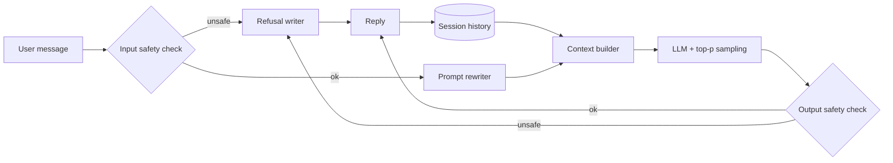

A general-purpose assistant takes free-form text, answers questions, explains things and keeps track of a multi-turn conversation. The model is a large decoder-only Transformer, so the architecture rarely decides the interview. The hard parts are turning a model that only continues text into one that follows instructions, keeping it safe, and decoding in a way that sounds natural without drifting. Every stage pulls between helpfulness and harm, since each gain in capability also makes dangerous or confidently wrong output easier.

## Requirements that move the design

- Modalities. Text in, text out keeps you on one LLM. Images or audio add encoders and change the training mix.
- Conversation memory. Follow-ups within a session mean session state and a context window of a few thousand tokens or more, which favors a positional scheme that handles long sequences.
- Tools and browsing. Search or API calls turn this into an agent or RAG problem (chapter 6). Without them, knowledge is frozen in the weights.
- Safety bar. A consumer chatbot needs both an alignment stage and runtime filters on input and output.
- Instruction data. Tens of thousands of curated prompt-answer pairs are enough for supervised finetuning; without them you budget for labeling. English only and no personalization keep everything else simpler.

## Framing: one decoder-only LLM, three training stages

Input is the new message plus earlier turns; output is a reply generated token by token. A decoder-only Transformer is the default because next-token prediction scales on unlabeled text, and GPT, Gemini and Llama all use it.

The one architecture detail worth raising is position handling. Absolute encodings (sinusoidal or learned) give each index its own vector, so the model learns little about distance and extrapolates badly past its training length. Relative schemes (T5, DeBERTa) model distance directly but complicate attention. [Rotary position embedding (RoPE)](https://arxiv.org/abs/2104.09864) rotates queries and keys by a position-dependent angle, so their dot product depends only on the offset between them. You get relative behavior while keeping plain dot-product attention, at the cost of slightly more math. Llama uses it.

## Data and training: each stage fixes what the last could not

Web crawl dominates the token budget and is noisy. Cleaning extracts main text from HTML, drops bad domains via lists or a classifier, identifies language (fastText), scores quality with heuristics or a small model, removes toxic content, masks personal data, deduplicates near-identical pages and tokenizes with BPE. Dedup matters: repeats bias the model toward memorization. Cleaner sources (Wikipedia, books, arXiv, code, Q&A sites) are upsampled; Llama 1 used about 1.4 trillion tokens from such a mix.

Pretraining runs next-token prediction with cross-entropy for weeks on thousands of GPUs. Asked a question, the resulting base model may just continue it with more questions.

Supervised finetuning (SFT) keeps the same loss on very different data: roughly 10K to 100K expert-written prompt-response demonstrations, with loss usually computed on the response tokens only. It teaches format and intent. Its limit is one demonstration per prompt, so the model learns a plausible answer, not which of several answers people prefer.

RLHF closes that gap in two steps. First, sample several responses per prompt from the SFT model and have annotators rank them, because people agree on comparisons far more than on absolute scores. Expand rankings into (prompt, better, worse) pairs and train a reward model, often the SFT model with a scalar head, so the better answer scores higher via a margin ranking or Bradley-Terry style loss. Second, let the SFT model answer fresh prompts, score the answers with the reward model, and update it with PPO, keeping a KL penalty toward the SFT model so it cannot game the reward with odd text. [DPO](https://arxiv.org/abs/2305.18290) skips the reward model and optimizes directly on preference pairs, which is simpler to run.

The short version: pretraining buys knowledge with compute, SFT buys behavior with expensive demonstrations, and RLHF buys preference alignment with comparison labels and a fragile RL loop.

## Decoding: top-p plus temperature

Greedy and beam search chase likelihood, which in open dialogue yields bland, looping text, and beam search costs extra compute. Sampling from the whole distribution goes the other way and picks up junk from the tail. Top-k trims the tail at a fixed count, which is wrong when the distribution is peaked (bad tokens still admitted) or flat (good ones cut). [Nucleus (top-p) sampling](https://arxiv.org/abs/1904.09751) keeps the smallest set of tokens whose probabilities sum past p, so the pool tracks the model's confidence. It is the usual default.

Temperature divides logits before softmax. Below 1 sharpens toward deterministic output for code or extraction; above 1 flattens toward creative and eventually incoherent text. APIs usually allow 0 to 2, and chat tends to sit near 0.5 to 0.8. Frequency penalties or n-gram blocking handle loops that sampling alone misses.

## Evaluation: layers, each with its own blind spot

| Layer | Tells you | Misses |
|---|---|---|
| Perplexity | Fit to held-out text; tracks pretraining | Usefulness, reasoning, safety |
| Capability benchmarks (HellaSwag, TriviaQA, SQuAD, GSM8K, HumanEval, MMLU) | Reasoning, knowledge, reading, math, code | Contamination, saturation, chat format |
| Safety suites (RealToxicityPrompts, ToxiGen, CrowS-Pairs, BBQ, TruthfulQA, adversarial sets) | Toxicity, bias, truthfulness, leakage, jailbreak resistance | New attacks outpace fixed tests |
| Human review | Helpfulness and harm on realistic prompts | Cost, speed, rater disagreement |
| Online (thumbs, retention, conversion, Chatbot Arena) | Real satisfaction | Rewards flattery and length; arena voter bias |

Say which layer gates what: benchmarks pick checkpoints, safety suites and human review gate a release, online metrics choose between candidates already judged safe.

## Serving: the model sits inside a guarded pipeline

Input and output are checked separately because a harmless prompt can still produce a harmful answer; refusals come from a dedicated path. The prompt rewriter fixes typos and abbreviations but must never change intent. The session manager assembles prior turns and truncates or summarizes past the window. The generator can keep the best of several candidates by reward score, trading cost for quality. For latency and cost: KV cache, grouped-query attention, streaming, quantization, batching and a distilled model for easy traffic.

## Interview questions

**Why not stop after SFT?**
SFT shows one acceptable answer per prompt and cannot express that one answer beats another. Preference data captures that and is cheaper to collect, since comparing is easier than writing. RLHF or DPO then push the model toward preferred answers, including appropriate refusals.

**Why rank responses instead of scoring them?**
Absolute scores drift between raters; relative judgments are far more consistent and plug straight into a pairwise loss. The cost is more comparisons per prompt.

**What keeps PPO from producing high-scoring gibberish?**
A KL penalty toward the SFT model, a reward model with enough capacity not to be trivially exploited (InstructGPT used 6B for a 175B policy), refreshes on samples from the current policy, and spot checks of reward against human ratings.

**Trade-off: PPO versus DPO.**
PPO needs a reward model, online sampling and careful tuning, but it can explore new prompts and the reward model doubles as a reranker. DPO trains offline on fixed pairs with a simple loss, cheaper and more stable, but limited to what the collected pairs cover.

**Trade-off: top-k versus top-p, and where temperature fits.**
Top-k keeps a fixed count regardless of confidence; top-p adapts to the distribution. Temperature reshapes the distribution before either cut, so tune them together: low for code, higher for creative writing.

**How do you handle a conversation longer than the window?**
Keep recent turns verbatim, summarize older ones into a running memory, and optionally retrieve old turns by embedding similarity. Summaries are cheap but can drop details the user refers to later.

**Strong MMLU scores, unhappy users. Why?**
Benchmarks are multiple-choice and may be contaminated; users judge tone, length, refusals and follow-ups. Slice feedback by intent and check for over-refusal.

**Safety in training or at inference?**
Both. Data filtering and alignment lower the base rate, but jailbreaks get through, so runtime classifiers act as a backstop you can update without retraining. Red-team findings feed both layers.

**How would you cut serving cost?**
Start with KV cache, grouped-query attention, quantization and batching. Then route easy queries to a distilled model and hard ones to the large model, measuring quality per route so savings do not quietly cost users.
