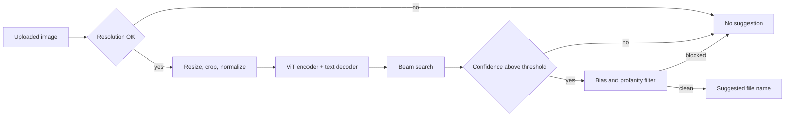

The product here is modest: when a designer uploads an image, suggest a short, clear name for it. The same capability feeds moderation and cold-start recommendations behind the scenes. It is the first multimodal design in the book. The tension is between descriptive and safe. A caption that names specific details is more useful, but every extra detail is another chance to be wrong, biased or offensive, and for an auto-suggested file name a wrong guess is worse than no guess.

## Requirements that move the design

- Image domain. Everyday images and icons are a different problem from X-rays or circuit diagrams. General images let you reuse public pretrained vision models.
- Caption length. File names should be a few words. This drives data prep, since the model copies the caption length it trains on.
- Data. Hundreds of millions of raw pairs with mixed languages and wrong or missing captions means most effort goes into filtering.
- Latency. One or two seconds is acceptable, so beam search and a mid-sized model are affordable; real-time on-device would push you toward a small model and greedy decoding.
- Ambiguous images. If the system may stay silent, you need a confidence signal and a threshold.
- Fairness and safety. Captions must not contain slurs or biased descriptions of people, so you need a post-generation filter. A minimum resolution (say 256x256) works as both a training filter and a serving rule.

## Framing: an image encoder feeding a text decoder

Input is an image, output is a short English caption. The standard design treats the image like a source language in translation: an encoder turns pixels into embeddings and a decoder generates text conditioned on them.

The decision that matters most is what the encoder hands over. One pooled vector per image is cheap and fine for coarse, generic captions, but it squeezes out local detail. A sequence of patch embeddings keeps spatial information and lets the decoder attend to different regions as it writes each word. The sequence is the better fit for a Transformer decoder, so use it.

For the encoder, CNNs capture local texture well but relate distant regions only through depth. A [Vision Transformer](https://arxiv.org/abs/2010.11929) splits the image into fixed-size patches, flattens and projects each one to an embedding, adds position information and runs self-attention, so every patch can relate to every other from the first layer. Position can be 1D (index in the flattened patch list) or 2D (row and column), and learned or fixed sinusoidal; ViT itself uses learned 1D, and in practice you try a few. The decoder is a decoder-only Transformer that reads the image embeddings as a prefix (or through cross-attention) and emits caption tokens.

Alternatives worth naming: [BLIP-2](https://arxiv.org/abs/2301.12597) freezes both the image encoder and the LLM and trains only a small bridge, which is much cheaper. Large vision-language models such as InternVL caption out of the box but cost more to serve than this feature justifies.

## Data: filtering is most of the work

Caption side:

- Drop pairs whose caption is not English.
- Deduplicate. Perceptual hashes or CLIP image embeddings catch near-duplicate images; exact match or CLIP text embeddings catch repeated captions.
- Filter by image-text agreement. Score each pair with [CLIP](https://arxiv.org/abs/2103.00020) and drop pairs below a threshold (around 0.25 cosine similarity is a common choice). This drops captions such as "image1.jpg".
- Shorten long captions with an LLM into the brief style the product wants.
- Tokenize with BPE.

Image side:

- Remove images below the resolution floor and those with poor quality (blur, bad exposure), using a quality or aesthetic scorer such as the LAION aesthetic predictor.
- Resize so the short side matches the target, then center-crop to a square. This avoids squashing at the cost of cropped edges.
- Scale pixel values to a fixed range for stable training.

A pitfall: aggressive CLIP filtering inherits CLIP's own biases and blind spots. Spot-check what gets thrown away, not just what stays.

## Training: reuse pretrained halves, then finetune together

Start from a pretrained image encoder (a CLIP or ViT image tower) and a pretrained language model (GPT-2 class is plenty for short captions). Then finetune on the cleaned image-caption pairs with next-token prediction and cross-entropy on caption tokens, conditioned on the image embeddings.

Choices to discuss: freeze the encoder at first or not, how to project encoder outputs into the decoder's embedding size, and a lower learning rate for pretrained parts. Freezing more is cheaper and more stable; full finetuning adapts better to the asset domain.

For decoding, beam search fits this product better than sampling. Asset names should be stable (the same image yields the same name), grammatical and conservative, and creativity has no value here. Beam search also returns a sequence log-probability, which the serving layer reuses as a confidence score.

## Evaluation: n-gram overlap against several references

Offline evaluation uses a held-out set where each image has several human-written captions, since one image can be described many ways. Multiple references make metrics fairer.

- BLEU, ROUGE and METEOR measure n-gram overlap with references. They penalize valid paraphrases.
- [CIDEr](https://arxiv.org/abs/1411.5726) was built for captioning. Captions become TF-IDF weighted n-gram vectors, so words distinctive for this image count more than filler, and the candidate's cosine similarity to each reference is averaged, rewarding agreement with the consensus. It is still lexical: a correct but unusual phrasing is punished, the same words in a different order can score alike, and weak references give misleading scores.
- Embedding-based scores such as CLIPScore compare the caption to the image directly and need no references. They complement CIDEr but can be fooled by captions that merely list objects.

Online signals are usually weak because captioning hides inside other products, but this feature has a clean one: how often designers accept the suggested name unchanged, how much they edit it, and how often the suggestion is suppressed.

## Serving: preprocess, generate, gate, clean

Preprocessing must match training exactly, or quality drops in ways no offline metric shows. The generator gates on the length-normalized sequence probability so short captions are not unfairly favored; ambiguous images fall below the threshold. Post-processing swaps biased terms for neutral ones, suppresses the suggestion if a blocked word appears, and formats the result as a file name. The decoder dominates latency; a small decoder and batching keep it well within budget.

## Interview questions

**Why output a sequence of patch embeddings instead of one image vector?**
A single vector summarizes the scene but drops spatial detail, which leads to generic captions. A sequence lets the decoder attend to different regions per word.

**Trade-off: CNN versus ViT encoder.**
CNNs have strong locality priors and are data-efficient and fast. ViTs model global relationships from the first layer and scale better with data. With hundreds of millions of pairs and pretrained ViT weights available, ViT is the better default; on a tiny dataset or edge device a CNN can win.

**Why beam search here when chatbots use top-p?**
The product wants one stable, conservative name per image, not variety. Beam search is deterministic, avoids incoherent word choices and returns a score you can threshold. Diverse sampling would only help if you showed several alternatives.

**How do you decide when not to suggest a name?**
Threshold the length-normalized log-probability of the best beam, tuned on a labeled set to trade coverage against error rate. You can add a CLIP similarity check between the caption and the image as a second gate.

**Trade-off: freeze the pretrained encoder or finetune it?**
Freezing is cheaper, more stable and keeps general visual knowledge, but may underfit icons and design assets. Full finetuning adapts better but risks forgetting and needs more memory. A common middle path freezes first, then unfreezes the top layers.

**What does CIDEr capture that BLEU does not, and what does it miss?**
CIDEr weights distinctive n-grams via TF-IDF and rewards agreement with the consensus of several references, which suits captioning. It still ignores meaning and word order beyond the n-gram, so pair it with an embedding-based score and human review.

**What online metric would you track?**
Acceptance rate of the suggested name without edits, edit distance when users change it, and suppression rate. A rising suppression rate with a stable acceptance rate usually means the threshold is too strict.

**How would you extend this to more languages?**
Either generate in English and translate, which is simple but compounds errors, or train a multilingual decoder on multilingual pairs and use cross-lingual transfer for languages with little data.
