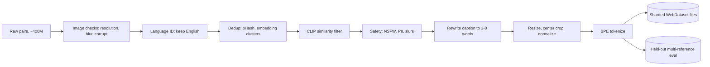
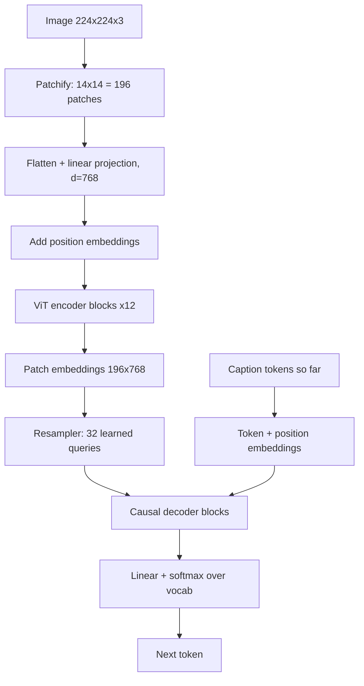
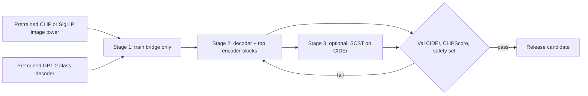
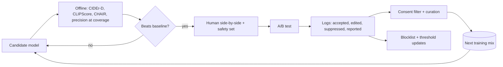
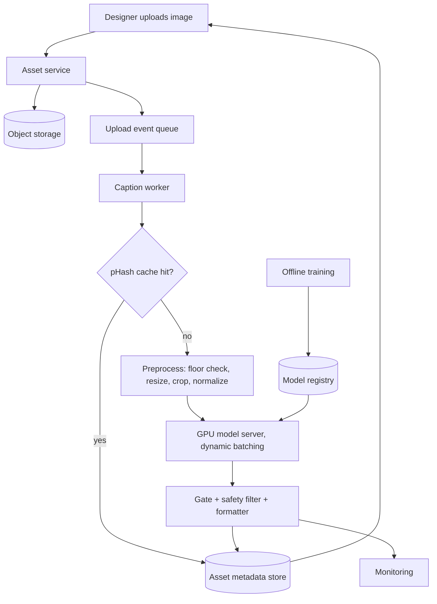
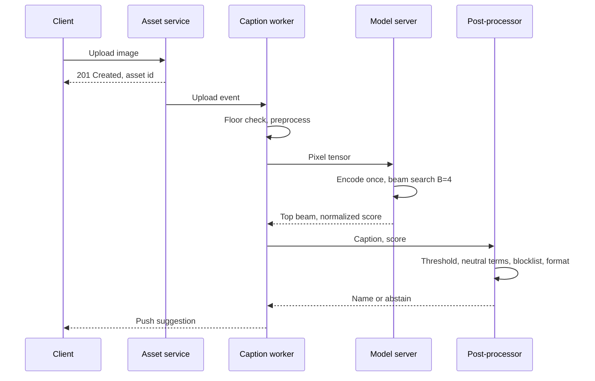

The product looks small. A designer drops an image into a shared asset library and the tool proposes a name like "red bicycle line icon" instead of "IMG_4471.png". The same captioner tends to feed other systems as well: search indexing, moderation, alt text and cold-start signals for recommendation. It is the first design in the series where input and output are different modalities, so it is a good place to get the encoder-decoder pattern straight before the diffusion chapters.

Generating a sentence is not the hard part; any modern vision-language model can do it. The hard part is the tension between specific and safe. A name that mentions object, color and style is far more useful than "image", but each extra word is another chance to be wrong, to describe a person in a biased way, or to be offensive. For a suggestion that appears unasked in someone's file browser, a confident wrong name costs more than no name. So the design has two halves of equal weight: a model that writes short, accurate captions, and a policy layer that decides when to stay quiet.

## Requirements that change the design

**Functional.**

- Image domain. General photos, illustrations and icons let you start from public pretrained encoders. X-rays or circuit schematics would need domain data and look more like classification.
- Output form. Three to eight words, lowercase, no punctuation. Models copy the length distribution of their training captions, so this reaches back into data prep.
- One name or several. A single name favors deterministic decoding; three alternatives favor diverse beam search.
- Permission to abstain. If silence is allowed, you need a calibrated confidence score, a threshold and a metric that values silence correctly.

**Non-functional.**

- Latency of one to two seconds after upload. Generous enough for beam search and a mid-sized model on a GPU; an on-device feature would push toward greedy decoding and a tiny model.
- Scale. I assume tens of millions of uploads per day, which sets the GPU fleet.
- Safety and fairness. No slurs, no guesses about ethnicity, religion or health, neutral terms for people.
- Input quality. A resolution floor such as 256 by 256 works as both a training filter and a serving rule.
- Training data. A few hundred million scraped pairs of mixed quality, so filtering is most of the work.

| Requirement | Design decision |
|---|---|
| Names of 3 to 8 words | Rewrite long captions in data prep; cap decoding at ~16 tokens |
| One stable suggestion | Beam search, fixed width, no sampling |
| May abstain | Length-normalized log-probability as confidence; threshold tuned for precision |
| 1 to 2 s latency | Server GPU, mid-sized decoder, dynamic batching, async delivery |
| No offensive or biased names | Neutral rewriting and blocklist after generation; curated people labels in data |
| Noisy web pairs | Language ID, dedup, CLIP-score filtering before training |

## Framing as an ML task

Input is an RGB image, output is a short English token sequence. The model learns a conditional distribution and factorizes it left to right:

$$
p_\theta(y \mid x) = \prod_{t=1}^{T} p_\theta(y_t \mid y_{<t}, x)
$$

\(x\) is the image, \(y_1, \dots, y_T\) are caption tokens, \(y_{<t}\) is the prefix so far and \(\theta\) the parameters. It is conditional text generation, shaped like machine translation with pixels as the source language.

| Approach | Strength | Why it loses here |
|---|---|---|
| Object detector + template, or nearest-neighbor caption retrieval | Cheap, controllable vocabulary | Robotic names; retrieval copies neighbors' errors and fails on novel content |
| CNN encoder + LSTM decoder | Small, fast | Pooled vector loses detail; weaker language modeling; low quality ceiling |
| ViT encoder + Transformer decoder | Reuses pretrained halves, trainable on our data, cheap to serve | Chosen |
| Large instruction-tuned VLM | Best zero-shot quality | Serving cost far above what a file-name hint is worth; harder to control length and tone |

A large VLM still earns a place offline, as a caption rewriter and as a distillation teacher.

**What the encoder hands over** is the most consequential interface decision. One pooled vector per image (CLS token or average pool) is cheap and enough for "a dog on grass", but it compresses away where things are and what color the small object is. A sequence of patch embeddings keeps spatial detail, and the decoder can attend to different regions for different words. The sequence fits a Transformer decoder naturally; its cost is a longer prefix, which shows up in the KV-cache estimate later.

**CNN or ViT.** A CNN builds features from local windows and relates distant regions only after many layers. A [Vision Transformer](https://arxiv.org/abs/2010.11929) cuts the image into patches and lets every patch attend to every other from layer one. CNN locality priors make them data-efficient; ViTs scale better with data and pretraining. With hundreds of millions of pairs and strong pretrained ViTs (CLIP, SigLIP, DINOv2), ViT is the default. A CNN or ConvNeXt hybrid wins on small devices or tiny datasets.

## Data

Sources, roughly from noisiest to closest to the target: scraped web pairs (alt text, nearby text), public sets such as COCO and Conceptual Captions (clean, good for validation), names designers typed for their own assets (on-distribution but needs consent, and many are "final_v2_REAL"), and synthetic captions from a large VLM rewritten into file-name style.

### Caption side

1. **Language ID.** A fastText-style classifier drops non-English captions.
2. **Dedup.** Perceptual hashes and image-embedding clusters catch resized or recompressed copies; frequency counts on normalized text catch boilerplate ("click to enlarge"). Dedup stops popular images from dominating and, run across splits, prevents train-test leakage.
3. **Agreement filter.** Score every pair with [CLIP](https://arxiv.org/abs/2103.00020) and drop low scores, which removes pairs like a sunset captioned "DSC_0042".
4. **Rewrite.** An LLM shortens long alt text into a noun phrase: main subject, one or two attributes, style (photo, icon, illustration), and no guesses about people's identity.
5. **Tokenize** with the BPE vocabulary of the pretrained decoder so embeddings line up.

The agreement score is cosine similarity between CLIP embeddings:

$$
s(x, c) = \frac{f_I(x)^\top f_T(c)}{\lVert f_I(x) \rVert \, \lVert f_T(c) \rVert}
$$

\(f_I\) and \(f_T\) are CLIP's image and text encoders, \(x\) the image and \(c\) the caption. For ViT-B CLIP, matched pairs typically land around 0.28 to 0.32 and LAION used 0.28 as a cut, so start in the mid-0.2s and set the line by inspecting samples on both sides of it.

### Image side

Drop images under the resolution floor, corrupt files, and the worst tail by blur (variance of the Laplacian) and watermark or aesthetic scores. Resize so the short side matches the model input (224 or 384) and center-crop to square; for icons and banners, padding to square can beat cropping because subjects touch the border. Normalize with the encoder's channel mean and standard deviation. Whatever you choose, serving must run the identical code.

Store results as sharded tar files (WebDataset) of a few hundred MB, holding the resized JPEG, token ids and metadata (CLIP score, source, license). Shards stream well to many GPU workers and let you re-filter by dropping shards.

### Worked example: clean set size and filtering cost

Start with 400M pairs. Assume survival rates of 80% (image checks), 60% (English), 85% (dedup), 50% (CLIP) and 97% (safety):

\(400\text{M} \times 0.8 \times 0.6 \times 0.85 \times 0.5 \times 0.97 \approx 79\text{M}\) clean pairs.

At about 20 KB per 224-pixel JPEG, storage is \(79\text{M} \times 20\,\text{KB} \approx 1.6\,\text{TB}\).

CLIP scoring runs on the 163M pairs left after dedup. A ViT-B/16 image forward is about 17.6 GFLOPs, so \(163\text{M} \times 17.6 \times 10^{9} \approx 2.9 \times 10^{18}\) FLOPs; at 100 TFLOP/s effective per GPU that is about 29,000 s, roughly 8 GPU-hours. JPEG decoding and I/O on CPUs are the real bottleneck. The LLM rewrite is the expensive step, so only rewrite captions that are too long.

### Pitfalls

- CLIP filtering inherits CLIP's blind spots: text-heavy images, dialects, some cultural content. Audit what gets dropped by source and topic.
- Alt text often describes people by appearance or gender. Neutralize it before training rather than relying on the output filter.
- Captions from one teacher model narrow the vocabulary. Mix in human captions.

## Model architecture

### Encoder

An image of \(224 \times 224\) with patch size \(P = 16\) gives \(N = (224/16)^2 = 196\) patches of \(16 \times 16 \times 3 = 768\) values each. Each flattened patch is projected and tagged with its position:

$$
z_0^{(i)} = E\,\mathrm{vec}\big(x_p^{(i)}\big) + p^{(i)}, \qquad i = 1, \dots, N
$$

\(x_p^{(i)}\) is the \(i\)-th patch, \(E\) is a learned \(d \times 768\) projection (implemented as a strided convolution) and \(p^{(i)}\) its position embedding. Positions can be 1D (raster index) or 2D (row plus column), learned or sinusoidal. The ViT paper saw little difference among these at fixed resolution; the choice matters when you change resolution at inference, because learned 1D tables must be interpolated.

Each block applies self-attention and an MLP with pre-norm residuals:

$$
\mathrm{Attention}(Q, K, V) = \mathrm{softmax}\!\left(\frac{QK^\top}{\sqrt{d_k}}\right) V
$$

\(Q, K, V\) are linear projections of the token matrix and \(d_k\) is the head dimension. The encoder uses no mask, so every patch sees every other.

### Bridge and decoder

The encoder and decoder widths differ, so a bridge maps between them. Options: a linear or 2-layer MLP on every patch (LLaVA style, keeps 196 tokens), a resampler or Q-Former where 32 learned queries cross-attend over patches ([BLIP-2](https://arxiv.org/abs/2301.12597), about six times fewer tokens), or a pooled vector mapped to a single prefix token (ClipCap style, cheapest and weakest on detail).

The decoder conditions on the image in one of two ways. **Prefix:** image tokens are placed before text tokens in a standard causal LM; text attends to all image tokens and causally to earlier text. No new layer types, so a pretrained GPT-2 or small Llama-class model is reused as is. **Cross-attention:** each decoder block gets an extra sub-layer whose keys and values come from image tokens. The text sequence stays short, but new randomly initialized weights go into a pretrained LM. For short captions, prefix plus a 32-token resampler is my default.

Other knobs: raising resolution from 224 to 448 helps small objects and text but quadruples patch count; larger patches do the opposite; ViT-L over ViT-B helps rare objects at about 3x encoder cost; decoder size beyond a few hundred million parameters buys little for 3 to 8 word outputs.

## Training

**Reuse pretrained halves.** A contrastively trained image tower already places a bicycle picture near the word "bicycle"; a pretrained LM already knows grammar. Training either from scratch buys nothing.

**Stage 1, alignment.** Freeze both, train only the bridge on the large filtered set. Few trainable parameters, stable, and if the encoder is frozen you can precompute patch embeddings once and train against the cache.

**Stage 2, finetuning.** Unfreeze the decoder and the top few encoder blocks and train on clean short-name data. Use a lower learning rate on pretrained weights (about 1e-5) than on new ones (about 1e-4), with warmup and cosine decay.

**Stage 3, optional.** Self-critical sequence training (SCST) uses CIDEr as a reward with the greedy caption as baseline and typically adds several CIDEr points. It can also teach metric gaming, so keep it only if human ratings agree.

The main loss is next-token cross-entropy on caption positions, with teacher forcing:

$$
\mathcal{L}_{\mathrm{CE}}(\theta) = -\frac{1}{T} \sum_{t=1}^{T} \log p_\theta\big(y_t^{*} \mid y_{<t}^{*}, x\big)
$$

\(y_t^{*}\) is the reference token at step \(t\), \(y^{*}_{<t}\) the reference prefix fed in, and \(T\) the caption length; image prefix positions are excluded from the loss. Label smoothing of 0.1 helps calibration a bit, which matters because the confidence gate reads these probabilities. For SCST the gradient estimate is

$$
\nabla_\theta \mathcal{L} \approx -\big(r(y^{s}) - r(\hat{y})\big)\, \nabla_\theta \log p_\theta(y^{s} \mid x)
$$

where \(y^{s}\) is a sampled caption, \(\hat{y}\) the greedy caption and \(r\) the CIDEr reward; samples that beat greedy are pushed up.

**Efficiency.** bf16 mixed precision with fp32 master weights; data parallelism with sharded optimizer state (FSDP or ZeRO), since the model is too small to need tensor parallelism; activation checkpointing in the encoder when training at 384 or above; many CPU loader workers per GPU because JPEG decoding is the usual bottleneck.

### Worked example: training compute

ViT-B/16 encoder (86M parameters, 197 tokens) and a 124M decoder seeing 32 image plus 16 text tokens. Using about 6 FLOPs per parameter per token for forward plus backward:

- Encoder: \(6 \times 86\text{M} \times 197 \approx 1.0 \times 10^{11}\)
- Decoder: \(6 \times 124\text{M} \times 48 \approx 3.6 \times 10^{10}\)
- Per sample: about \(1.4 \times 10^{11}\) FLOPs

Two epochs over 79M pairs is 158M samples, so \(1.4 \times 10^{11} \times 1.58 \times 10^{8} \approx 2.2 \times 10^{19}\) FLOPs. At 100 TFLOP/s effective that is about 61 GPU-hours, under 8 hours on one 8-GPU node, and this assumes everything is unfrozen. The model is cheap; the data pipeline is the project.

| Symptom | Likely cause | Fix |
|---|---|---|
| Generic captions | Pooled vector; low-agreement pairs | Patch tokens; stricter CLIP threshold |
| Hallucinated objects | LM prior beats weak visual signal ("fork" implies "plate") | More image tokens, cleaner pairs, CHAIR tracking, CLIPScore gate |
| Too long or chatty | Training captions longer than target | Rewrite captions; hard max length |
| Repetition | Exposure bias | n-gram blocking in beam search |
| Loss falls, CIDEr flat | Overfitting to teacher style | Mix sources; early stop on CIDEr and CLIPScore |
| Overconfident wrong names | Poor calibration | Label smoothing; temperature scaling before setting the gate |

## Inference and decoding

There is no reference prefix at inference, so the model feeds back its own tokens. Greedy decoding takes the argmax each step and can lock in an early mistake. Beam search keeps the \(B\) best partial sequences and approximates the most probable full caption. Top-k and top-p sampling add variety, which a file name does not want. Diverse beam search adds a dissimilarity penalty between beam groups, useful only if the UI shows alternatives.

Raw beam scores favor short outputs because each token multiplies in a probability below one. Normalize by length:

$$
\mathrm{score}(y) = \frac{1}{|y|^{\alpha}} \sum_{t=1}^{|y|} \log p_\theta(y_t \mid y_{<t}, x)
$$

\(|y|\) is the token count and \(\alpha \in [0, 1]\) sets the strength; \(\alpha = 1\) is a per-token average. Exponentiated, this is a geometric-mean token probability, and it is the number the serving gate compares with its threshold.

| Strategy | Deterministic | Quality on short captions | Cost vs greedy | Use here |
|---|---|---|---|---|
| Greedy | Yes | Good, occasional early errors | 1x | Overload fallback |
| Beam, B = 3 to 5 | Yes | Best CIDEr | ~1.3x to 2x | Default |
| Beam, B = 10+ | Yes | Often blander and shorter | 2x to 4x | No |
| Top-p sampling | No | Varied, sometimes odd | ~1x | No |
| Diverse beam | Yes | Several distinct names | 1.5x to 3x | If showing options |

Other knobs: max length 16, min length 2, 2-gram blocking against repetition, and forbidden token ids set to \(-\infty\) as a cheap first safety layer.

## Evaluation

The offline set has about five human references per image, stratified over photos, illustrations, icons and images of people. One image has many correct names, so a single reference punishes valid answers.

**BLEU** is clipped n-gram precision with a brevity penalty:

$$
\mathrm{BLEU} = \mathrm{BP} \cdot \exp\!\Big(\sum_{n=1}^{4} w_n \log p_n\Big), \qquad \mathrm{BP} = \min\big(1, e^{1 - r/c}\big)
$$

\(p_n\) is clipped n-gram precision, \(w_n\) weights (usually 1/4), \(c\) candidate length and \(r\) reference length. ROUGE-L uses the longest common subsequence; METEOR adds stem and synonym matching so "bike" can match "bicycle".

**[CIDEr](https://arxiv.org/abs/1411.5726)** turns each caption into a TF-IDF weighted n-gram vector computed over the reference corpus, so filler words count little and words specific to this image count a lot:

$$
\mathrm{CIDEr}_n(c, S) = \frac{1}{m} \sum_{j=1}^{m} \frac{g^n(c) \cdot g^n(s_j)}{\lVert g^n(c) \rVert\, \lVert g^n(s_j) \rVert}, \qquad \mathrm{CIDEr} = \frac{1}{4}\sum_{n=1}^{4} \mathrm{CIDEr}_n
$$

\(c\) is the candidate, \(s_1, \dots, s_m\) the references and \(g^n\) the TF-IDF vector over n-grams. CIDEr-D adds a length penalty and count clipping so repeating a heavy word cannot inflate the score.

**CLIPScore** needs no references: \(w \cdot \max(\cos(f_I(x), f_T(c)), 0)\) with \(w = 2.5\). **CHAIR** counts mentioned objects absent from the image's annotations; naming something that is not there is this product's worst error. Since the system may abstain, also plot **precision against coverage** as the threshold moves.

| Metric | Catches | Misses | Role |
|---|---|---|---|
| BLEU-4 | Exact phrase overlap | Synonyms; unstable on 4-word outputs | Legacy comparison |
| CIDEr-D | Distinctive consensus words | Paraphrase; weak references mislead | Primary offline |
| CLIPScore | Image-text agreement, reference-free | Fluency; rewards keyword lists; CLIP bias | Paired with CIDEr |
| CHAIR | Object hallucination | Wrong attributes such as color | Guardrail |
| Precision at coverage | Gate quality | Style | Launch criterion |
| Human side-by-side | Usefulness, tone, bias | Cost and speed | Per release |

Human raters see image and name and answer: accurate, would you keep it, anything offensive or presumptuous about people. Side-by-side comparisons beat absolute scores, which drift across rater pools. Oversample images of people for the safety question.

Online: acceptance rate (kept unchanged), edit distance when changed, suppression rate, search success on model-named assets, and user reports per million suggestions. Acceptance can rise just because users stop reading, so pair it with sampled audits of accepted names.

## Serving system

The caption path is asynchronous on purpose: uploads never wait on the model, and a failure only means no suggestion.

Post-processing runs in a fixed order. First the **gate**: abstain if the normalized score is below \(\tau\), with \(\tau\) tuned on a labeled set for, say, 95% acceptable names among those shown; a second gate on CLIPScore catches fluent but off-target captions. Then **neutral rewriting** of person terms and removal of guessed ages or ethnicities. Then a **blocklist and toxicity classifier**; if either fires, drop the whole suggestion rather than masking a word. Finally **formatting**: lowercase, workspace separator style, length cap, original extension, and de-duplication against names already in the folder.

### Worked example: latency, KV cache and fleet

Single request on one GPU: about 10 ms CPU decode and resize; a few ms for the 17.6-GFLOP encoder; 12 decode steps at beam 4. Reading 124M fp16 weights (248 MB) at ~2 TB/s takes 0.12 ms, but at this size kernel launch overhead dominates, so budget ~4 ms per step, 48 ms total. With post-processing, about 70 ms end to end, far inside the budget. That slack pays for batching.

KV cache per request with 12 layers, width 768, 48 positions, 4 beams, fp16:

\(2 \times 12 \times 768 \times 48 \times 4 \times 2\ \text{bytes} \approx 7\,\text{MB}\)

With all 196 patches as prefix (212 positions) it is about 31 MB. A batch of 64 fits either way, but the resampler cuts memory and decode time by a large factor.

Fleet at 50M uploads per day: \(50\text{M} / 86{,}400 \approx 580\) QPS average, ~1,750 at a 3x peak. With batch 32 completing in ~100 ms, one GPU handles ~320 images/s, so peak needs \(1{,}750 / 320 \approx 6\) GPUs; 8 to 10 with redundancy across zones. The pHash cache cuts this further because stock images and icons are uploaded repeatedly.

| Optimization | Latency | Cost | Quality risk |
|---|---|---|---|
| Dynamic batching | Slightly up (queue wait) | Large drop | None |
| pHash result cache | Near zero on hits | Down with duplicate rate | Stale after model update; version the key |
| 32-token resampler | Down | Lower memory | Some fine detail lost |
| INT8 or FP8 weights | 1.3x to 2x faster | Down | Re-tune the gate after quantizing |
| Distilled smaller decoder | Down | Down | Slight fluency loss, fine for short names |
| Small-then-large cascade | Down on average | Down | Two thresholds to calibrate |

Speculative decoding is not worth its complexity for outputs of a dozen tokens.

**Monitoring.** Per-stage latency, suppression rate and mean confidence (a sudden shift usually means a preprocessing mismatch or a new upload type), CLIP embedding drift, blocklist hits and reports, plus a kill switch.

## Follow-ups and extensions

- **Personalization.** Learn a workspace's naming conventions (prefixes, project codes, case) from existing files. Cheap: a formatting template. Richer: a style embedding or small per-tenant LoRA.
- **Multilingual.** Caption in English and translate (simple, compounds errors) or train a multilingual decoder with a language token (better, needs per-language references).
- **Text in images.** Logos and screenshots are named by their text; add OCR tokens to the decoder input or use a higher-resolution encoder.
- **Halving cost.** Cache, resample to 32 tokens, quantize, and send the easy majority to a distilled model.
- **Adversarial uploads.** Images with embedded text that tries to steer the caption. The output filter must run on the final string regardless of input.

## Interview questions

### Clarifying

**What do you need to know about the images before choosing an encoder?**
Whether they are everyday images, design assets or a specialist domain. General photos and icons are well covered by public pretrained encoders, so the work is filtering and finetuning. Medical or engineering images need domain data and expert references, and maybe a domain encoder. I also ask how many images contain text, since that pushes toward OCR or higher resolution.

**Why does the expected caption length matter so much?**
The model learns its length distribution from training data, so web alt text produces chatty names. It decides whether I rewrite captions during data prep, which is the cheapest place to fix it. It sets max decode length and therefore latency and KV-cache size. It also changes metric choice, because BLEU-4 is unstable on four-word outputs.

**Is the system allowed to suggest nothing?**
That turns the objective into "show a name only when it is likely acceptable". It requires a calibrated confidence score, a labeled set to tune a threshold, and a precision-at-coverage metric. If silence is not allowed, the fallback needs to be something safe and generic like a detected category. Most product teams prefer silence to a wrong name in someone's library.

### Design and trade-offs

**Trade-off: patch sequence versus one pooled vector.**
A pooled vector is cheap and gives a one-token prefix, enough for category-level captions. It loses layout and small details, which are what make a name useful. A sequence lets the decoder look at the relevant region per word, at the cost of a longer prefix, more decoder compute and a larger KV cache. A 32-token resampler sits between the two and is what I would ship.

**Trade-off: CNN versus ViT encoder.**
CNN locality priors make them data-efficient and fast on small devices. ViTs relate distant regions from the first layer and keep improving with data and pretraining. With 79M clean pairs and strong pretrained ViTs, ViT is the default. On a phone or with a few thousand images, a CNN or hybrid can win, and the decoder side does not change because both emit token sequences.

**Trade-off: prefix conditioning versus cross-attention.**
Prefix reuses an unmodified causal LM, so no new layer types and all pretrained weights carry over. Its cost grows with image token count because those tokens sit in every self-attention call and the KV cache. Cross-attention keeps the text sequence short but inserts randomly initialized layers that need more data. With 32 image tokens, prefix is simpler and cheap enough; with hundreds of tokens, cross-attention scales better.

**Trade-off: freeze the encoder or finetune it?**
Freezing is cheap, stable, preserves general vision and allows precomputed features. It may underfit design-specific content like flat icons and UI mockups. Full finetuning adapts best but risks forgetting and costs more memory. I stage it: bridge only, then decoder plus top encoder blocks at a lower learning rate, watching general-image CIDEr for forgetting.

**Why beam search here when chat products sample with top-p?**
The product wants one stable, conservative name, and the same image should get the same name. Beam search is deterministic, avoids odd word choices and yields a normalized score that doubles as the confidence. Sampling's variety has no value for a file name and makes the confidence noisier. Widths of 3 to 5 work best; very wide beams produce bland, short captions.

**How do you decide when not to suggest a name?**
Use the length-normalized log-probability of the top beam, temperature-scaled on validation data so it is calibrated. Label a few thousand outputs as acceptable or not, pick the threshold that hits target precision, and report the resulting coverage. Add a CLIPScore check to catch fluent captions that drifted from the image. Re-tune after any model or quantization change, since both shift the score distribution.

### Deep dives

**Walk through how an image becomes decoder input.**
Resize the short side to 224, center-crop, normalize with the encoder's channel statistics. Split into 196 patches of 16 by 16, flatten each to 768 values, project and add position embeddings. Twelve self-attention blocks produce 196 contextual embeddings. A resampler with 32 learned queries cross-attends over them and outputs 32 vectors at decoder width, which become the prefix before the caption tokens.

**What does CIDEr capture that BLEU does not, and what does it miss?**
BLEU weights every n-gram equally, so matching "a" counts like matching "bicycle". CIDEr applies TF-IDF over the reference corpus so distinctive words dominate, and averages cosine similarity over several references, rewarding consensus. It still compares surface forms, so a valid synonym the references lack scores badly, and poor references mislead it. I pair it with CLIPScore, CHAIR and human review.

**Estimate the training cost.**
Forward plus backward is about \(6 \times (86\text{M} \times 197 + 124\text{M} \times 48) \approx 1.4 \times 10^{11}\) FLOPs per sample. Two epochs over 79M pairs is 158M samples, about \(2.2 \times 10^{19}\) FLOPs. At 100 TFLOP/s effective per GPU that is around 61 GPU-hours, under a day on one 8-GPU node. Freezing the encoder cuts it by more than half, so compute is not the constraint; data is.

**Estimate serving capacity for 50M uploads a day.**
That averages about 580 QPS and about 1,750 at a 3x peak. One request takes around 70 ms, mostly 12 decode steps at beam 4. With batch 32 at about 100 ms per batch, a GPU serves roughly 320 images per second, so six GPUs cover peak and eight to ten give zone redundancy. A pHash cache and a small-model cascade lower it further.

**Why does the model hallucinate objects, and what reduces it?**
The decoder is a language model whose prior completes familiar patterns, such as "plate" after "fork", when visual evidence is weak. Few image tokens or low resolution make the visual signal weaker. Fixes: more image tokens, cleaner high-agreement data, tracking CHAIR so the problem is visible, and a CLIPScore gate at serving. Short names also hallucinate less simply because they say less.

### Operations and failure modes

**Suppression rate doubled overnight. What do you check?**
First, what shipped: model, quantization, threshold or preprocessing. A resize or normalization mismatch lowers confidence on every image while offline metrics look perfect. If nothing shipped, look at inputs: a customer importing screenshots or scans would legitimately lower confidence. Embedding drift dashboards and a sample of suppressed images usually settle it; the response is a rollback or a finetuning task for the new content.

**A user reports an offensive name. What happens next?**
Disable the feature for that workspace if needed and find how the term passed the blocklist and classifier. Add the term and variants to the filter as the immediate fix. Then trace upstream: find similar training captions and remove or rewrite them. Add the case to a safety regression set that every future release must pass, and track reports per million suggestions.

**How do you roll out a new model safely?**
Shadow it on live traffic without showing results and compare confidence distributions, suppression and blocklist hits with production. Recalibrate the threshold on its scores. Then A/B test on a small share of workspaces, watching acceptance, edits and reports. Version cache keys by model and keep the previous model warm for rollback.

**What breaks if training and serving preprocessing differ?**
The encoder sees a shifted input distribution: squashed instead of cropped images, or different normalization constants. Captions degrade and confidence drops, so suppression rises, while offline metrics computed with the training pipeline stay perfect. Share one versioned preprocessing library between training and serving, and run a canary set of fixed images through the serving path at each deploy.

## A 45-minute walkthrough

| Minutes | Cover | Draw |
|---|---|---|
| 0 to 5 | Domain, length, language, abstain policy, latency, volume, safety | Requirements and the decision each implies |
| 5 to 10 | Conditional generation framing; family comparison; pick ViT plus decoder | \(p(y \mid x)\) factorization |
| 10 to 16 | Sources, language ID, dedup, CLIP filter, rewrite, resize; size the clean set | Data pipeline |
| 16 to 23 | Patchify, ViT blocks, resampler, prefix versus cross-attention, knobs | Encoder-decoder diagram |
| 23 to 28 | Stages, cross-entropy, compute estimate, hallucination | Stage flow and loss |
| 28 to 32 | Beam with length normalization, why not sampling, confidence gate | Decoding table |
| 32 to 37 | CIDEr-D, CLIPScore, CHAIR, precision at coverage, human and online | Metric table |
| 37 to 43 | Async serving, batching, cache, safety filter, latency and fleet math, monitoring | Architecture and sequence |
| 43 to 45 | Personalization, multilingual, OCR, cost cuts | Bullets |
