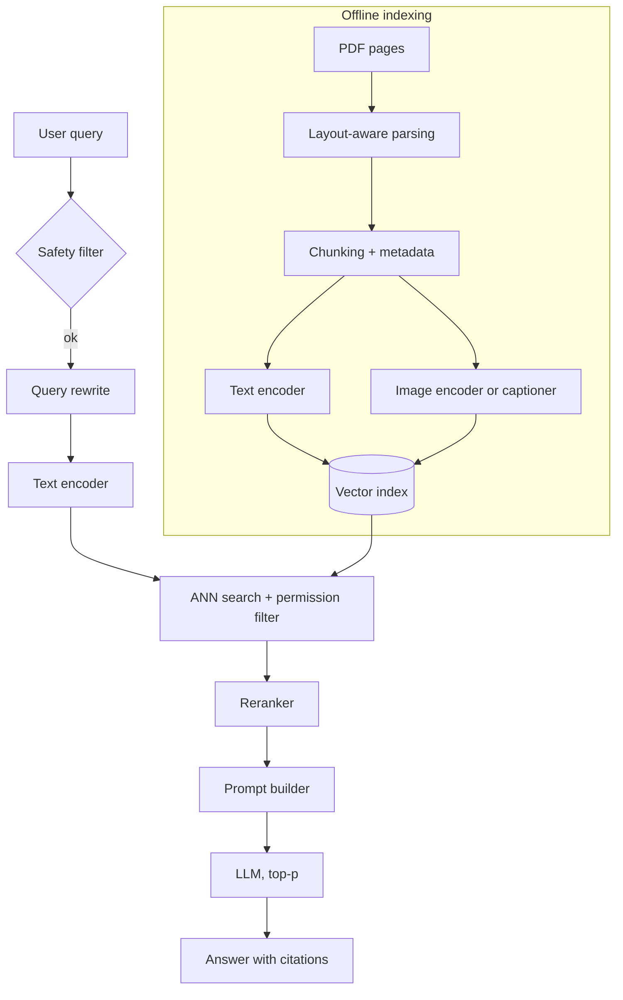

Employees want to ask a question and get an answer drawn from the company wiki and internal Q&A forum, with links to the pages it came from. A model relying on its weights alone has never seen those documents and cannot cite. Retrieval-augmented generation (RAG) fixes both by looking up relevant passages at query time and handing them to the LLM as context. The catch is that answer quality is now capped by retrieval quality. Feed a strong generator the wrong chunks and you get a fluent, cited, wrong answer, so most of the design effort goes into parsing, chunking and search rather than the model.

## Requirements that move the design

- Change rate. Slowly changing wiki and forum pages allow incremental re-indexing; live data would need its own freshness path.
- Formats. PDFs with mixed column layouts, tables and diagrams rule out naive text extraction.
- Scale. About 5 million pages growing 20% a year makes approximate search mandatory and sets index size.
- Citations. Required sources favor RAG over finetuning.
- Latency. A few seconds leaves room for query rewriting and reranking, not multi-round agentic search.
- Follow-ups. Not needed yet; later, rewrite each follow-up into a standalone query using the conversation.
- Access control. Ask even if the interviewer does not: restricted pages must be filtered at retrieval time or the bot leaks them.

## Framing: why RAG beats finetuning and prompt stuffing

Finetuning bakes documents into the weights. It picks up terminology but is expensive, must be repeated as content changes, needs a large clean dataset and cannot cite. Prompt engineering alone pastes material into the prompt; it is cheap and flexible, but 5 million pages fit in no context window. RAG retrieves a handful of chunks per query and puts only those in the prompt: knowledge stays fresh through re-indexing, sources are known, and nothing needs training to start. The price is a second system whose errors flow straight into the answer. RAG is the base, prompts sit on top, finetuning waits.

## Data: parse, chunk, embed, index

Rule-based PDF extraction breaks on varied layouts, for example interleaving two columns. AI-based parsers such as [LayoutParser](https://arxiv.org/abs/2103.15348) detect regions (title, paragraph, table, figure), OCR each box, and output blocks in reading order with coordinates. Keep page numbers and headings as metadata so citations can be precise.

Whole documents make blurry embeddings and overflow the prompt, so they are chunked. Fixed-length chunks with overlap are simple but split sentences. Sentence or regex splitting respects boundaries. Structure-aware splitters cut at headings, list items or code blocks, which suits wikis. Chunk size trades precision against context (see the questions below).

A quick size estimate: around 1,500 characters and a few figures per page, 500-character chunks with overlap, gives roughly five text chunks and three image chunks per page, about 40 million vectors. At 768 float32 dimensions that is around 120 GB of raw vectors before index overhead.

For the retrieval method, BM25-style keyword search is fast but misses synonyms, full-text engines add phrase matching at higher cost, and knowledge graphs answer relational questions but are costly to build from PDFs. Dense vector retrieval matches meaning and scales with ANN indexes, so it is the main path. Adding keyword scores (hybrid search) catches exact identifiers such as error codes that embeddings blur.

## Models: encoders, an LLM, and finetuning only if needed

Chunks and queries go through the same text encoder, usually an encoder-only Transformer. Images must land in the same space. Either use a shared text-image model like [CLIP](https://arxiv.org/abs/2103.00020), or caption each image (chapter 5) and embed the caption.

The generator is any capable LLM, hosted or via API. Finetune only when retrieval returns the right chunks and answers are still poor. Then [RAFT](https://arxiv.org/abs/2403.10131) is the method to name: training examples pair each question with its relevant document plus distractors, and the model learns to answer from the relevant one and ignore the rest, which matches the noisy retrieval it sees in production.

## Evaluation: score retrieval and generation separately

Think of a triangle of query, retrieved context and answer, with a check per edge plus one against ground truth:

- Context relevance (query to context): did the right chunks come back near the top? Hit rate, MRR, NDCG, precision@k on labeled question-chunk pairs.
- Faithfulness (context to answer): is each claim supported by the retrieved text? Human review, an LLM judge checking claim by claim, or fact-checking tools.
- Answer relevance (query to answer): does it address the question fully without padding? Usually LLM-judged.
- Answer correctness (answer to reference): does it match a known answer? BLEU or ROUGE, or an LLM judge for paraphrases.

The split tells you where to fix things. Poor context relevance points at chunking, embeddings or search; poor faithfulness with good context points at the prompt or finetuning. [RAGAS](https://arxiv.org/abs/2309.15217) automates these with LLM judges, which carry their own biases. Online, watch thumbs up or down, citation clicks and how often users rephrase.

## Serving: an offline indexer and an online query path

Exact search costs O(N·d) per query, too slow at 40 million vectors, so use approximate nearest neighbor (ANN) search. Trees (k-d, Annoy) and locality-sensitive hashing exist but suit high-dimensional text embeddings less well. Clustering (IVF) compares the query to centroids first and searches only the nearest clusters, which is simple and shards well. Graph methods such as [HNSW](https://arxiv.org/abs/1603.09320) walk a layered proximity graph with excellent recall but heavy memory use. FAISS, ScaNN and Elasticsearch implement these, and product quantization can shrink the vectors several times. A cross-encoder reranker over the top few dozen hits buys precision cheaply.

Query rewriting fixes typos and adds synonyms, raising recall on short queries. The prompt puts instructions first, separates retrieved chunks with delimiters, asks for citations by chunk index and says to admit when the context lacks the answer. Few-shot examples fix the format, a role line sets tone, user context helps policy questions, and [chain-of-thought](https://arxiv.org/abs/2201.11903) helps when an answer spans several chunks. On the indexing side, re-embed only changed pages, delete stale vectors so old policies do not resurface, and version the index because a new encoder means re-embedding everything.

## Interview questions

**Why RAG instead of finetuning on the documents?**
Finetuning would need repeating whenever documents change and still could not cite sources. An index updates in minutes and records which chunk backed each claim.

**Trade-off: small chunks or large chunks?**
Small chunks embed sharply but lose context such as a condition stated a paragraph away. Large chunks keep context but blur the embedding and cost prompt tokens. A common compromise retrieves small chunks and expands to the parent section before generation.

**How would you parse two-column PDFs with tables?**
Run a layout detector to find regions and reading order, extract or OCR text per region, and serialize tables to Markdown or one row per line so they embed and read sensibly.

**How do you make images searchable by text?**
Embed both modalities with a shared model like CLIP, or caption images and embed the captions. CLIP is one pass; captions work with any text encoder and are easier to debug but add cost and can miss details.

**Trade-off: HNSW versus IVF.**
HNSW gives high recall at low latency but holds a large graph in memory and is slow to build and update. IVF with quantization is compact and shards easily, with recall tuned by how many clusters you probe.

**Retrieval looks fine but answers are wrong. What next?**
Check faithfulness: the model may ignore context or mix in its own knowledge. Tighten the prompt, cut distractors with a reranker, and if that fails, finetune with RAFT-style examples.

**How do you evaluate without a big labeled set?**
Have an LLM write question-answer pairs from sampled chunks and have humans verify a subset. Use them for retrieval metrics and LLM-judged faithfulness.

**How do you stop users seeing documents they are not allowed to read?**
Store access groups on every chunk and filter the ANN search by the user's groups. Filtering after generation is too late, since restricted text already shaped the answer.

**How do you keep the index fresh as the corpus grows?**
Detect changed pages and re-index only those, process deletions, and shard for growth. Full re-embedding happens only on an encoder change, into a new index you switch to after validation.
