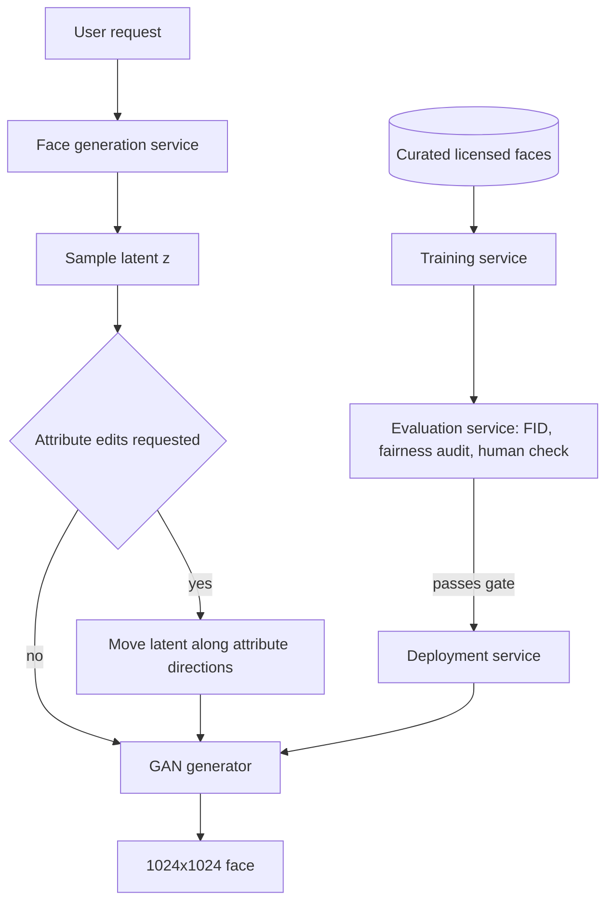

The product is a service that returns a photorealistic face of nobody in particular, on demand, at 1024x1024 and in under a second. Nobody types a prompt. The model starts from a random vector and has to turn it into skin, hair and lighting that survive inspection at full resolution. The catch is that the model family that is cheap at inference (a GAN) is also the hardest to train, while the families that train calmly (autoregressive, diffusion) are too slow for the latency target. Most of the design is about living with that choice.

## Latency and control requirements pick the model family

The questions I would ask first, and what each answer changes:

- **What the faces are for.** Entertainment tolerates the odd artifact. If the faces later become synthetic training data, diversity and demographic balance turn into hard requirements.
- **Attribute control.** "Make this person older, keep the identity" needs a latent space you can walk through, which favors a GAN with a structured latent.
- **Data size and licensing.** Tens of thousands of licensed, aligned faces (FFHQ has 70k) is plenty for a GAN and far too little for a large text-conditioned model.
- **Resolution and latency.** 1024px in under a second rules out anything that needs dozens of sequential network passes.
- **Fairness.** If outputs must span ages, genders and skin tones, the dataset needs an audit and rebalancing first, because GANs copy their training distribution and drop rare modes.

## A GAN wins on speed and an editable latent

Input is a noise vector, plus optional attribute targets. Output is an RGB face. The four candidate families:

- **VAE.** Encoder and decoder with a Gaussian latent. Easy to train and fast to sample, but outputs are soft and blurry. A good compressor, a weak face generator.
- **GAN.** A generator maps noise to an image in one pass while a discriminator learns to spot fakes. Sharp output, fast sampling, and latent directions that often line up with age or smile. The price is unstable training and little novelty beyond the training domain.
- **Autoregressive.** Predict image tokens one by one with a Transformer. Stable and flexible, but slow and without an easy latent to edit.
- **Diffusion.** Iterative denoising. Top quality and diversity, many sequential steps, big models, no simple latent.

For a narrow domain, a sub-second budget and possible attribute editing, a GAN is the sensible pick. StyleGAN is the practical reference because its mapping network yields a fairly disentangled latent.

## Small datasets punish bad samples

With tens of thousands of images, every bad one carries weight:

- Drop low-resolution and blurry images with a quality classifier.
- Align and crop faces the same way so the generator does not spend capacity on framing.
- Resize to the target size and scale pixels to [-1, 1] to match a tanh output.
- Keep augmentation light (horizontal flips). Heavier transforms can leak into outputs; adaptive discriminator augmentation (StyleGAN2-ADA) is the cleaner fix for scarce data.
- Tag age, gender and skin tone with classifiers and resample so minority groups survive. Mode dropping hits them first.

## Adversarial training needs constant balancing

The generator stacks upsampling blocks (transposed convolution, normalization, ReLU) and ends in tanh. The discriminator mirrors it with strided convolutions and a small sigmoid head. Normalization keeps activations in range so neither network runs away; batch norm is the DCGAN default, while instance or group norm suit small batches.

Training alternates a few discriminator steps with the generator frozen, then a few generator steps against a frozen discriminator. The discriminator minimizes binary cross-entropy on real versus fake, and the original paper combines both sides into one minimax objective. Three failure modes come up in every interview:

- **Vanishing generator gradients.** A discriminator that wins too easily saturates and the generator learns nothing. The non-saturating loss (maximize log D(G(z)) rather than minimize log(1 - D(G(z)))) fixes most of it. A Wasserstein critic, which outputs an unbounded realness score, gives smoother gradients still.
- **Mode collapse.** The generator settles on a few outputs that fool the current discriminator. Wasserstein loss with gradient penalty, unrolled GANs and minibatch statistics push back.
- **Non-convergence.** As the generator improves, discriminator accuracy drifts toward chance and its feedback becomes noise. Separate learning rates, spectral normalization or weight decay, and noise on discriminator inputs keep the game balanced. Checkpoint often and select by FID, not by the last step.

At inference only the generator runs. Sampling z from a standard Gaussian maximizes variety. The truncation trick pulls latents toward the mean, which raises average realism and lowers diversity. Given the fairness goal I would default to plain sampling.

## Measure distribution distance, then ask people

- **Inception Score** rewards confident ImageNet predictions per image and a spread of classes across the set. For faces it is nearly useless: all faces fall into a few ImageNet classes and real data is never consulted.
- **FID** compares the mean and covariance of Inception features for generated and real images, so it reflects both fidelity and coverage. It needs tens of thousands of samples and inherits ImageNet bias; CLIP features reportedly track human judgment better. KID is an unbiased alternative for small samples.
- **Human pairwise preference**: two images from different models, pick the more photorealistic. The final word on realism, silent on diversity.
- **Fairness audit**: classify attributes over a large sample batch and compare with the target distribution.

Online, watch ratings, regenerate rate and latency percentiles. None of them reveal a slow loss of diversity, so the offline audit runs on every candidate model.

## The request path is short; the release loop does the work

One generator pass is cheap, so latency mostly comes down to GPU batching and keeping the model warm. Attribute control lives in the latent: learn directions for age, smile or hair with linear probes on labeled samples (as in InterFaceGAN) and shift the vector before decoding. The training service retrains on fresh licensed data and possibly user-approved outputs, though feeding outputs back narrows diversity. The evaluation service gates on FID and the fairness audit, and deployment rolls out gradually. Safety here is mostly provenance: watermark outputs and keep training data licensed, since synthetic faces are an obvious deepfake ingredient.

## Interview questions

**Why a GAN rather than a diffusion model?**
Sub-second latency and a narrow domain decide it. A GAN draws a 1024px face in one pass and offers an editable latent; diffusion needs many steps and has no simple latent to steer.

**Explain mode collapse and how you would detect it.**
The generator converges on a small set of outputs that reliably fool the discriminator. It shows up as worse FID despite nice samples, low pairwise LPIPS between samples, or a skewed attribute histogram. Wasserstein loss with gradient penalty and minibatch discrimination help.

**Why does the generator's gradient vanish, and what fixes it?**
When the discriminator confidently rejects fakes, log(1 - D(G(z))) is almost flat, so the generator gets no signal. The non-saturating loss is steep exactly where the generator is losing. Wasserstein critics avoid saturation by design.

**Trade-off: random sampling versus truncation.**
Truncation makes faces cleaner on average but more alike, and rare attributes fade. Random sampling keeps diversity and fairness at the cost of occasional artifacts. I would default to random and expose truncation for curated use.

**How do you keep the two networks balanced?**
Alternate updates, use separate learning rates, normalize the discriminator (spectral norm), and add noise or adaptive augmentation to its inputs. Discriminator accuracy pinned near 100% or wandering at 50% for long both signal trouble.

**FID or Inception Score for faces?**
FID, because it compares against real faces and captures coverage. IS ignores real data and relies on ImageNet classes, which barely distinguish one face from another. Back either with human preference tests.

**How would you add attribute control without retraining?**
Label generated samples with attribute classifiers, fit linear directions in latent space, and shift the latent along them at request time. Projecting out correlated directions stops an age edit from also adding glasses.

**Trade-off: augmentation versus fidelity.**
Augmentation stretches small datasets and slows discriminator overfitting, but visible transforms can leak into outputs. Adaptive augmentation applies them only as much as overfitting requires.

**How do you keep outputs demographically balanced?**
Rebalance training data with attribute tags, check per-group FID, audit large sample batches before each release, and avoid aggressive truncation, which shrinks the tails where minority groups often sit.
