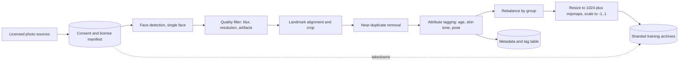
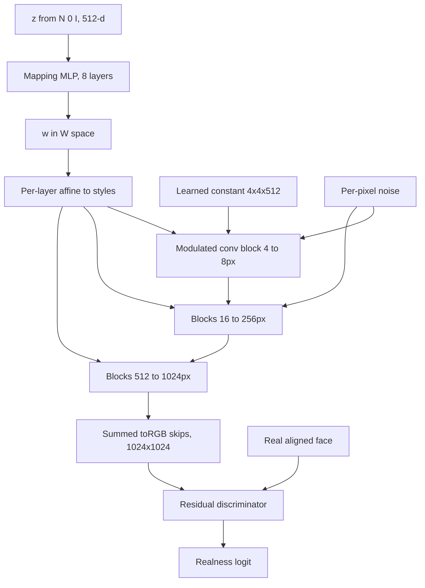
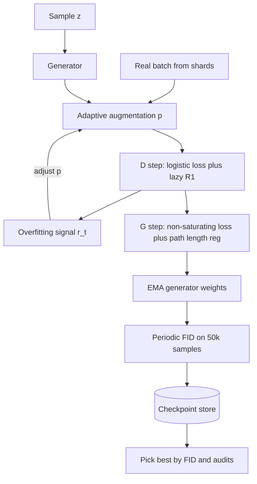
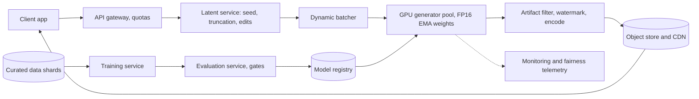
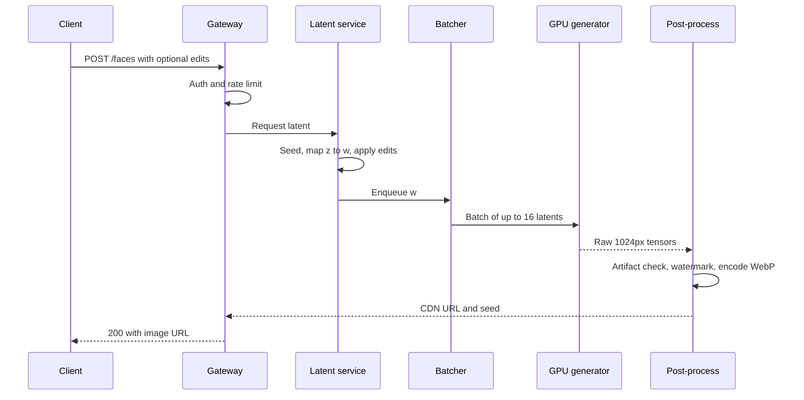

The product returns a photorealistic 1024x1024 portrait of a person who does not exist, with no prompt, in under a second. Later the same model may produce synthetic training data, so faces must span ages, genders and skin tones in a controlled way and must not copy anyone in the training set.

The tension: the families that train calmly and cover a distribution best (diffusion, autoregressive) need many sequential network passes per image, while the one that renders a megapixel in a single pass (the GAN) trains through an unstable two-player game and drops rare modes, exactly where fairness problems live. This design takes the GAN for speed and its editable latent, then spends its effort on stable training, honest coverage measurement and release gates.

## Requirements that change the design

Functionally, the input is just "give me a face", so all variation comes from a random latent, which becomes the real product interface. The domain is aligned faces at 1024x1024, narrow enough for a 30M-parameter generator. Attribute control (age, smile, pose with identity fixed) may follow and needs a latent where directions mean something. The demographic mix of outputs is a requirement in its own right.

Non-functionally: under one second end to end, about 70k licensed and consented images (FFHQ scale), watermarking and no regurgitated identities, and a per-image cost fit for an entertainment feature.

| Requirement | Design decision it forces |
|---|---|
| Sub-second, 1024px | Single-pass generator |
| 70k images, one domain | Domain-specific GAN, not a large text-to-image model |
| Attribute editing | Disentangled intermediate latent (mapping network) |
| Demographic coverage | Tagging and rebalancing, per-group metrics, little truncation |
| No identity leakage | Deduplication, memorization checks before release |
| Abuse resistance | Watermark, provenance metadata, rate limits |

## Framing as an ML task

Input: \( z \in \mathbb{R}^{512} \sim \mathcal{N}(0, I) \), plus optional attribute targets later. Output: a 3x1024x1024 tensor in \([-1, 1]\). The task is unconditional generative modeling: learn \( p_\theta(x) \approx p_{data}(x) \) and sample it cheaply.

### Four candidate families

A **VAE** trains an encoder \( q_\phi(z \mid x) \) and decoder \( p_\theta(x \mid z) \) by maximizing the evidence lower bound:

$$
\mathcal{L}_{\text{ELBO}} = \mathbb{E}_{q_\phi(z \mid x)}\big[\log p_\theta(x \mid z)\big] - D_{KL}\big(q_\phi(z \mid x)\,\|\,p(z)\big)
$$

The first term rewards reconstruction and the second keeps the posterior near the prior \( p(z) = \mathcal{N}(0, I) \) so random samples decode sensibly. A Gaussian decoder makes reconstruction a pixel-wise L2 loss, which averages away high-frequency detail; that is where VAE blur comes from.

A **GAN** swaps the likelihood for a learned critic: \( G \) maps \( z \) to an image, \( D \) scores realness, and \( G \) learns by fooling \( D \). With no pixel-wise loss there is no averaging, so textures stay sharp.

An **autoregressive** model tokenizes the image (say, a VQ-VAE 64x64 code grid) and predicts tokens one by one: stable cross-entropy training, but 4,096 sequential steps per image. A **diffusion** model reverses a gradual noising process: best coverage, but 20 to 1,000 denoiser calls per sample and no semantic latent.

| Criterion | VAE | GAN (StyleGAN2) | Autoregressive | Diffusion |
|---|---|---|---|---|
| Network passes per image | 1 | 1 | thousands of tokens | 20-1000 steps |
| Sharpness at 1024px | Soft | Very sharp | Good, tokenizer-limited | Very sharp |
| Mode coverage | Good | Weakest; drops rare modes | Good | Best |
| Training behavior | Stable | Fragile, needs regularizers | Stable | Stable |
| Semantic latent for edits | Smooth but entangled | W space, quite disentangled | None | Weak; needs inversion |
| Fit for 70k-image single domain | Fine | Excellent | Data-hungry | Good |

The GAN wins because one-pass latency and an editable latent both point at it, and the narrow domain blunts its main weakness. VAE output is not photoreal at this resolution, autoregressive decoding is two orders of magnitude too slow, and diffusion would need few-step distillation, which usually borrows adversarial losses anyway. If latency relaxes to several seconds, latent diffusion becomes the better choice for coverage.

## Data

### Sources and consent

Use licensed collections where subjects agreed to reuse, or commission shoots with model releases and demographic quotas. Keep a per-image manifest (source, license, consent scope, takedown status) that drives the data loader, so a takedown automatically drops out of the next run.

### Filtering and alignment

1. **Face detection**: exactly one face, filling at least about 30% of the frame.
2. **Quality filtering**: reject sub-resolution crops, blur (low Laplacian variance or a learned score), compression artifacts and watermarks.
3. **Landmark alignment**: a similarity transform puts the eyes at fixed pixels, so the generator spends capacity on appearance rather than framing. The cost is a model that struggles with tilted or off-center faces.
4. **Deduplication**: perceptual hashes plus embedding similarity remove burst shots. Duplicates drive memorization.
5. **Attribute tagging**: classifiers for perceived age, gender presentation, skin tone (Monk scale), glasses, pose. Noisy, so audit a sample by hand.
6. **Rebalancing**: resample toward target group rates. A group at 2% of the data can fall to 0.5% of outputs because GANs drop rare modes first.

### Preprocessing and storage

Resize with Lanczos to 1024x1024 and scale pixels to \([-1, 1]\). Augment carefully: whatever the discriminator accepts as "real", the generator learns to produce. Flips are safe. Beyond that, adaptive discriminator augmentation (ADA) applies color, geometric and cutout transforms to both reals and fakes before the discriminator, with a probability tuned online by an overfitting signal, so the transforms do not leak. Store images as sharded archives (WebDataset tar or TFRecord) with metadata in a separate table.

**Worked example: storage.** Raw pixels are \( 1024 \times 1024 \times 3 = 3.15 \) MB per image, so \( 70{,}000 \times 3.15 \text{ MB} \approx 220 \) GB. PNG roughly halves that to about 100 GB, and mipmaps for lower resolutions add a third (\( 1/4 + 1/16 + \dots \approx 0.33 \)), so about 150 GB. That fits on local NVMe, which matters because a GAN rereads the dataset hundreds of times.

Pitfalls: tag classifiers carry their own bias, so validate them per group; aggressive quality filters quietly remove older photos and darker exposures, which correlates with demographics; and licensing is per image, so one non-commercial subset taints a commercial model.

## Model architecture

### Baseline: a DCGAN-style pair

The whiteboard baseline reshapes \( z \) into a 4x4 map and doubles resolution eight times with upsampling blocks (transposed convolution, normalization, ReLU), ending in a tanh RGB layer. The discriminator mirrors it with strided convolutions and a one-logit head. This works at 64px, falls apart at 1024px and leaves checkerboard artifacts. Batch norm also couples samples in a batch, handing the discriminator a shortcut, so StyleGAN drops it in favor of style modulation.

### StyleGAN2: the practical reference

Three ideas make StyleGAN work at megapixel scale.

**Mapping network.** An 8-layer MLP maps \( z \) to \( w \in \mathcal{W} \). Because \( w \) is not forced to be Gaussian, it can match the data's shape and ends up far more disentangled.

**Style modulation.** A learned affine layer turns \( w \) into per-layer styles. StyleGAN1 applied them with adaptive instance normalization:

$$
\text{AdaIN}(x_i, y) = y_{s,i}\,\frac{x_i - \mu(x_i)}{\sigma(x_i)} + y_{b,i}
$$

Here \( x_i \) is feature channel \( i \), \( \mu \) and \( \sigma \) are its spatial mean and standard deviation, and \( y_{s,i}, y_{b,i} \) are the scale and bias produced from \( w \). StyleGAN2 moved the same effect into the weights to remove "droplet" artifacts:

$$
w'_{ijk} = s_i \cdot w_{ijk}, \qquad w''_{ijk} = \frac{w'_{ijk}}{\sqrt{\sum_{i,k} (w'_{ijk})^2 + \epsilon}}
$$

The kernel weight \( w_{ijk} \) connects input channel \( i \) to output channel \( j \) at spatial tap \( k \), \( s_i \) is the style scale for input channel \( i \), and the second step (demodulation) rescales each output channel to unit expected variance, which replaces explicit normalization.

**Per-pixel noise**, scaled per channel, is added after each convolution to supply stochastic detail (hair strands, pores) so the latent need not encode it.

A learned 4x4 constant input, toRGB skips and a residual discriminator replace progressive growing. Coarse layers (4 to 8px) end up controlling pose and face shape, middle layers features and hair, fine layers color and microtexture.

Main knobs: mapping depth (2 layers often suffice on small data), channel width at 512 and 1024px (dominates compute) and discriminator capacity (better feedback, faster overfitting).

## Training

### The objective

The original GAN game:

$$
\min_G \max_D \; V(D, G) = \mathbb{E}_{x \sim p_{data}}\big[\log D(x)\big] + \mathbb{E}_{z \sim p(z)}\big[\log\big(1 - D(G(z))\big)\big]
$$

\( D(x) \) is the probability that \( x \) is real and \( p(z) \) is the latent prior. Plugging in the optimal discriminator \( D^*(x) = p_{data}(x) / (p_{data}(x) + p_g(x)) \) shows the generator minimizes \( 2\,\text{JSD}(p_{data} \| p_g) - \log 4 \), and Jensen-Shannon divergence saturates when the distributions barely overlap. In practice \( D \) minimizes binary cross-entropy on real and fake batches, while the generator uses the **non-saturating** loss over a batch of \( m \) latents:

$$
\mathcal{L}_G = -\frac{1}{m}\sum_{i=1}^{m}\log D(G(z_i))
$$

Early in training, \( D(G(z)) \approx 0 \), where \( \log(1 - D) \) is nearly flat but \( -\log D \) is steep. Same fixed point, far stronger gradients when the generator is losing.

### Regularizers that make it work

The **Wasserstein** formulation replaces the probability with an unbounded critic \( f \) and estimates earth mover's distance, which gives useful gradients even when supports do not overlap. WGAN-GP enforces the 1-Lipschitz constraint with a gradient penalty:

$$
\mathcal{L}_{\text{critic}} = \mathbb{E}\big[f(G(z))\big] - \mathbb{E}\big[f(x)\big] + \lambda\,\mathbb{E}_{\hat{x}}\Big[\big(\|\nabla_{\hat{x}} f(\hat{x})\|_2 - 1\big)^2\Big]
$$

\( \hat{x} \) is a random interpolation between a real and a fake image, and \( \lambda \) (often 10) weights the penalty.

StyleGAN2 keeps the non-saturating loss and uses the simpler **R1 penalty** on real images only:

$$
R_1 = \frac{\gamma}{2}\,\mathbb{E}_{x \sim p_{data}}\big[\|\nabla_x D(x)\|_2^2\big]
$$

It flattens the discriminator around real data, damping oscillation; \( \gamma \approx 10 \) suits 1024px faces, and applying it every 16 minibatches ("lazy regularization") saves compute. A **path length regularizer** makes equal steps in \( w \) produce equal image changes, which helps editing. **Spectral normalization** is the other common way to bound the discriminator.

### Schedule and efficiency

Alternate one \( D \) step (with \( G \) frozen) and one \( G \) step (with \( D \) frozen), Adam with \( \beta_1 = 0 \), \( \beta_2 = 0.99 \), learning rate around 0.002. Serve an **exponential moving average** of generator weights; it beats the raw weights. FP16 is safe only in the high-resolution layers, so restrict it there and clamp activations. Plain data parallelism on 8 GPUs suffices for a model this small. Select the release checkpoint by FID, not by recency.

**Worked example: training compute.** A typical 1024px run shows the discriminator about 25 million real images. Assume 8 V100-class GPUs take 32 seconds per thousand images: \( 25{,}000 \times 32 \text{ s} = 800{,}000 \text{ s} \approx 9.3 \) days, so \( 8 \times 9.3 \approx 74 \) GPU-days or about 1,800 GPU-hours. At $2 per GPU-hour that is about $3,600 per run before sweeps, so tune \( \gamma \), learning rate and augmentation targets at 256px first.

### Failure modes and fixes

| Symptom | Likely cause | Fixes |
|---|---|---|
| D accuracy near 100%, G stops improving | Vanishing gradients | Non-saturating or Wasserstein loss, higher \( \gamma \), lower D learning rate |
| Samples look alike; FID worsens | Mode collapse | Minibatch std layer, R1 or GP, check data balance |
| Losses oscillate, styles cycle | Non-convergence | Two time-scale learning rates, EMA, spectral norm |
| D accuracy on held-out reals falls | Discriminator overfitting | ADA, more data, early stop by FID |
| NaNs after enabling FP16 | Low-res overflow | FP16 only at high resolutions, clamping |

The minibatch standard deviation layer appends the batch's average feature spread as an extra discriminator channel, so a batch of near-identical fakes is easy to flag.

## Inference and sampling

Only the mapping and synthesis networks run at serving time.

### Random sampling

Draw \( z \sim \mathcal{N}(0, I) \), map, synthesize. This reproduces the full learned distribution, rare attributes and rare broken samples included. Store the seed with every output for debugging and takedowns.

### Truncation

Low-density regions of the latent space are poorly trained. The truncation trick pulls each latent toward the average:

$$
w' = \bar{w} + \psi\,(w - \bar{w})
$$

\( \bar{w} \) is the mean mapped latent and \( \psi \in [0, 1] \) sets strength (\( \psi = 1 \) means none, \( \psi = 0 \) gives the average face). Around 0.7 removes most artifacts, but rare skin tones, ages and accessories sit far from \( \bar{w} \) and get pulled toward the majority. With a fairness requirement, prefer per-group centers or no truncation plus an artifact classifier that rejects bad samples.

### Attribute editing

Fit a linear classifier for an attribute in \( \mathcal{W} \) (the InterFaceGAN recipe), take its unit normal \( n \), and shift:

$$
w_{\text{edit}} = w + \alpha\, n
$$

\( \alpha \) is signed edit strength. Correlated directions (age and glasses) are fixed by projection, \( n_1' = n_1 - (n_1^\top n_2)\,n_2 \), and applying the edit only to the relevant layers preserves identity. Mixing \( w_1 \) in coarse layers with \( w_2 \) in fine layers gives cheap "variations". Editing a user's own photo needs GAN inversion and raises consent questions, so keep it out of scope unless asked.

| Knob | Speed | Quality | Diversity | Default |
|---|---|---|---|---|
| Truncation \( \psi \) | None | Up as \( \psi \) drops | Down, minority groups first | 1.0 or per-group center |
| Artifact rejection | +1 small CNN, retries | Up | Neutral if classifier unbiased | On, 2 retries |
| Edit strength \( \alpha \) | None | Artifacts when large | N/A | Clamped per attribute |
| Output resolution | Lower skips top blocks | Less detail | None | 1024, 256 preview |

**Worked example: latency budget.** The generator has about 30M parameters but convolves large maps; call it 150 GFLOPs per 1024px image. At a sustained 100 TFLOPS in FP16, that is \( 150 \times 10^9 / 10^{14} = 1.5 \) ms per image, about 25 ms for a batch of 16. PNG encoding costs 30 to 60 ms per image and yields ~1.5 MB; WebP at quality 90 takes ~10 ms and ~200 KB. On a 20 Mbit/s mobile link, 1.5 MB needs 600 ms and 200 KB needs 80 ms. Budget: 15 ms batching wait, 25 ms GPU, 10 ms encode, 10 ms watermark, 80 to 150 ms network, roughly 250 ms total. The output format matters more than GPU tuning.

## Evaluation

### Offline metrics

**Inception Score** rewards confident ImageNet predictions that are spread across classes:

$$
\text{IS} = \exp\Big(\mathbb{E}_{x \sim p_g}\big[D_{KL}\big(p(y \mid x)\,\|\,p(y)\big)\big]\Big)
$$

\( p(y \mid x) \) is the classifier's label distribution for one image and \( p(y) \) its average over all samples. Faces occupy a handful of ImageNet classes and real data never enters, so IS is nearly meaningless here.

**Fréchet Inception Distance** compares Gaussians fitted to Inception-v3 features:

$$
\text{FID} = \|\mu_r - \mu_g\|_2^2 + \operatorname{Tr}\Big(\Sigma_r + \Sigma_g - 2\big(\Sigma_r \Sigma_g\big)^{1/2}\Big)
$$

\( \mu_r, \Sigma_r \) are the mean and covariance of 2048-d features of real images and \( \mu_g, \Sigma_g \) those of generated ones. StyleGAN2 reaches about 3 on FFHQ-1024. FID is biased by sample count (compare at 50k), and ImageNet features can reward textures while missing facial geometry errors; the same distance on DINOv2 or CLIP features tracks human judgment better. **KID** swaps the Gaussian fit for an unbiased kernel MMD that behaves at a few thousand samples.

**Precision and recall** split what FID mixes: the share of fakes inside the real manifold, and the share of reals covered by the fake manifold (both via k-NN balls in feature space). Truncation raises precision and cuts recall. **Perceptual path length** measures latent smoothness. A **memorization check** finds each sample's nearest training face by recognition embedding and flags identity matches. A **fairness audit** compares attribute histograms of 10k+ samples with the target and computes per-group FID.

| Metric | Catches | Misses |
|---|---|---|
| IS | Confident, varied ImageNet classes | Any comparison to real faces |
| FID | Joint fidelity and coverage shifts | Which one moved; ImageNet bias |
| Precision / recall | Quality and coverage separately | Single-image artifacts |
| Memorization NN check | Copied training identities | Partial feature copying |
| Per-group FID and histogram | Dropped demographics | Bias in attribute classifiers |
| Human 2AFC | Perceived realism | Diversity; cost |

### Human and online evaluation

Pairwise tests ask raters which of two images (models A and B) looks like a real photo; single-image real-or-fake tests count how often raters are fooled, with 50% meaning indistinguishable. Fix viewing time and zoom, because teeth, ears and earrings fail only at full size, and use a diverse rater pool. Online, track success rate, latency percentiles, ratings, immediate-regenerate rate, downloads and abuse reports. None of these see a slow loss of diversity, since users judge one face at a time, so offline audits gate every release.

## Serving system

The request path is a gateway with quotas, a latent service (seed, truncation, edits), a dynamic batcher in front of a stateless GPU pool running the FP16 EMA generator, and post-processing (artifact check, watermark, C2PA manifest, WebP encode) writing to an object store behind a CDN. Training, evaluation and a model registry sit off the path.

### Cost and latency optimizations

- **Dynamic batching** with a 10 to 20 ms window multiplies throughput at little latency cost.
- **FP16 and compiled kernels** help a convolution-heavy model directly. INT8 can blur fine texture at 1024px, so gate it on FID and human checks.
- **Pre-generated pool** for plain random faces turns a request into a lookup; keep the pool's attribute histogram on target and never hand one face to two users.
- **Pruning or a student generator** for the high-resolution layers can halve compute.
- **Preview cascade**: return the 256px toRGB output first. Storing \( w \) with each image lets edits skip the mapping step.

**Worked example: fleet sizing.** Peak 2,000 requests per second. With about 4 ms effective per image (model plus batching overhead and the artifact classifier), one GPU serves ~250 images per second, so \( 2{,}000 / 250 = 8 \) GPUs, about 12 per region with headroom and N+1. Encoding at 10 ms per image needs \( 2{,}000 \times 0.01 = 20 \) busy cores. At an average 500 requests per second, a day is 43 million images, and at 200 KB each that is 8.6 TB per day, so without a retention policy storage soon costs more than GPUs.

### Safety and monitoring

Embed an invisible watermark that survives resizing and recompression, attach C2PA credentials, and rate-limit bulk generation, since fake-profile farms need thousands of faces. Log seed and model version per image. Watch the attribute histogram of served images daily and run the memorization check on production samples. Honor takedowns by retraining without the removed images.

## Follow-ups and extensions

- **Conditioning on text or attributes**: conditional mapping network, or a small latent diffusion model plus few-step distillation.
- **Editing real photos**: inversion, identity loss, consent and strict retention of uploads.
- **Synthetic training data**: generate per group and verify downstream models do not regress per group on real test sets.
- **Video and 3D**: StyleGAN3's alias-free layers stop texture sticking to the screen; EG3D-style tri-plane GANs give multi-view consistency.
- **One-step diffusion**: adversarial diffusion distillation is a credible modern alternative if diffusion infrastructure already exists.

## Interview questions

### Clarifying

**What would you ask first, and which answers change the architecture most?**
Latency and resolution first, because they pick the model family. Then attribute control, which favors an architecture with a disentangled intermediate latent. Then data size and licensing: 70k images argues for a domain-specific GAN, not a large general model. Finally the intended use, since faces destined for training data turn diversity targets and memorization checks into release gates.

**Should fairness be measured on the data, the model or the outputs?**
All three, because each stage can add skew. A data audit catches imbalance at the source. The model can still drop minority modes from balanced data, so per-group FID and attribute histograms on samples are needed. Serving choices such as truncation or a pool can distort what users receive, so monitor the served distribution too, with attribute classifiers that are themselves validated per group.

### Design and trade-offs

**Why a GAN over a diffusion model here?**
One pass at 1024px fits the budget with room to spare, and W space gives linear edit directions. Faces are narrow and aligned, so GANs reach FID near 3 and their open-domain weaknesses matter less. Diffusion offers better coverage and calmer training but needs many steps or distillation, and editing requires inversion. With a multi-second budget or text prompts in scope, I would switch.

**Trade-off: truncation versus diversity.**
Truncation raises precision and removes most artifacts, but it cuts recall, and the first samples lost are the rare ones: darker skin tones in imbalanced data, older ages, unusual accessories. For a fairness-sensitive product I default to \( \psi = 1 \) with a rejection classifier, or truncate toward per-group centers. A curated marketing set could accept global truncation.

**Trade-off: augmentation versus fidelity.**
Without augmentation the discriminator memorizes 70k reals and its feedback degrades. With naive augmentation on reals only, the generator learns to reproduce the transforms. ADA applies the same transforms to reals and fakes and tunes their probability from an overfitting signal, keeping the benefit without leakage. The gain is modest at 70k images and decisive at 5k.

**Trade-off: WGAN-GP versus non-saturating loss with R1.**
WGAN-GP gives gradients even without distribution overlap but costs an extra backward pass on interpolated samples every step. Non-saturating loss with lazy R1 is cheaper and proven on faces. I would ship NS plus R1 and keep WGAN-GP as a fallback for a new, unstable dataset.

### Deep dives

**Derive why the generator's gradient vanishes and how the non-saturating loss fixes it.**
With logit \( a \) and \( D = \sigma(a) \), the loss \( \log(1 - \sigma(a)) \) has gradient \( -\sigma(a) \), which goes to zero when the discriminator confidently rejects fakes. The non-saturating loss \( -\log \sigma(a) \) has gradient \( -(1 - \sigma(a)) \), close to \(-1\) in the same regime. The fixed point is unchanged; only the dynamics improve.

**Why is W space more disentangled than Z space?**
Z must be an isotropic Gaussian, so if the data lacks some attribute combination, the generator has to warp a full Gaussian onto a distribution with a hole, bending attribute directions. The mapping network learns a \( w \) shaped like the data, so attribute boundaries are closer to linear. Path length regularization further evens out image change per latent step.

**What does FID measure and how can it mislead you?**
It is the Fréchet distance between Gaussians fitted to Inception features of real and fake images. It cannot say whether quality or coverage moved, it depends on sample count and resize settings, and ImageNet features underweight facial geometry. A model can improve FID by matching background texture while faces get worse, so pair it with precision, recall and human tests.

**How do you detect memorization?**
Embed all training images with a face-recognition model; 70k vectors fit in memory. For each release sample, find the top identity similarity and flag anything above the same-person threshold for LPIPS and human review. The usual causes are duplicates and over-long training on small data, fixed by deduplication, early stopping and augmentation.

**How would you add attribute editing without retraining?**
Generate about 100k samples, label them with attribute classifiers and fit a linear boundary per attribute in W; its normal is the edit direction. Orthogonalize against attributes that must stay fixed and apply the edit only to the layers that govern that attribute. Clamp \( \alpha \) where an identity-similarity score starts dropping.

### Operations and failure modes

**Estimate the GPU fleet for 2,000 generations per second.**
About 150 GFLOPs per image at 100 sustained TFLOPS is 1.5 ms; with batching overhead and an artifact classifier, say 4 ms, or 250 images per second per GPU. That is 8 GPUs at peak and about 12 per region with headroom. The point worth saying aloud is that storage and egress for 40M+ daily images likely cost more than the GPUs.

**Estimate training cost and how to cut it.**
Twenty-five million images at 32 seconds per thousand on 8 GPUs is about 9 days, roughly 1,800 GPU-hours or a few thousand dollars per run, multiplied by sweeps. Tune at 256px, use FP16 in the top layers, newer GPUs and lazy regularization, and fine-tune from an existing face checkpoint when the data changes only slightly.

**After a release, users say the faces "all look similar". What do you check?**
First the serving config: a lower \( \psi \), a new truncation center, or a pool refilled from a narrow batch. Then the checkpoint's recall and per-group histograms, not just FID, and pairwise LPIPS diversity on production samples against the previous version. If the checkpoint collapsed, roll back and look for a learning-rate or data change in that run.

**Training diverged at 60% of the run. How do you recover?**
Inspect discriminator accuracy on held-out reals, R1 magnitude and the ADA probability near the divergence. Resume from the last good checkpoint with a lower learning rate or higher \( \gamma \), and check for FP16 NaNs in low-resolution layers. Divergence at the same step twice points to a corrupted shard. The best-FID EMA checkpoint remains the release candidate either way.
## A 45-minute walkthrough

| Minutes | Cover | Draw |
|---|---|---|
| 0-5 | Use case, resolution, latency, data and license, editing, diversity | Requirement to decision table |
| 5-10 | Compare four families, pick GAN, say when you would not | Family comparison |
| 10-15 | Consent manifest, filtering, alignment, dedup, tagging, ADA | Data pipeline |
| 15-22 | DCGAN baseline, then mapping net, modulation, noise | Generator and discriminator |
| 22-29 | Minimax, non-saturating loss, R1, EMA, failure modes, compute | Loss equations, training loop |
| 29-33 | Random sampling, truncation and its fairness cost, editing | Truncation formula |
| 33-38 | FID and its gaps, precision and recall, memorization, per-group audit, human tests | Metric table |
| 38-43 | Batching, FP16, pool, watermark, CDN, latency and fleet math | Serving diagram and sequence |
| 43-45 | Conditioning, real-photo edits, video, one-step diffusion | Short list |
