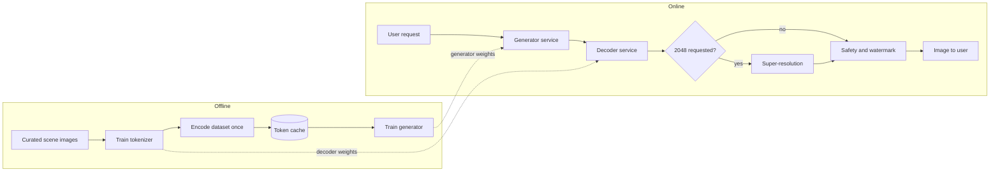
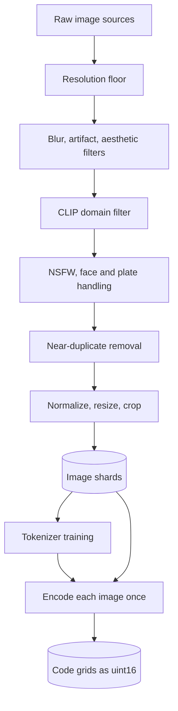
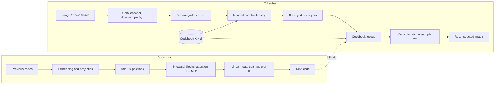
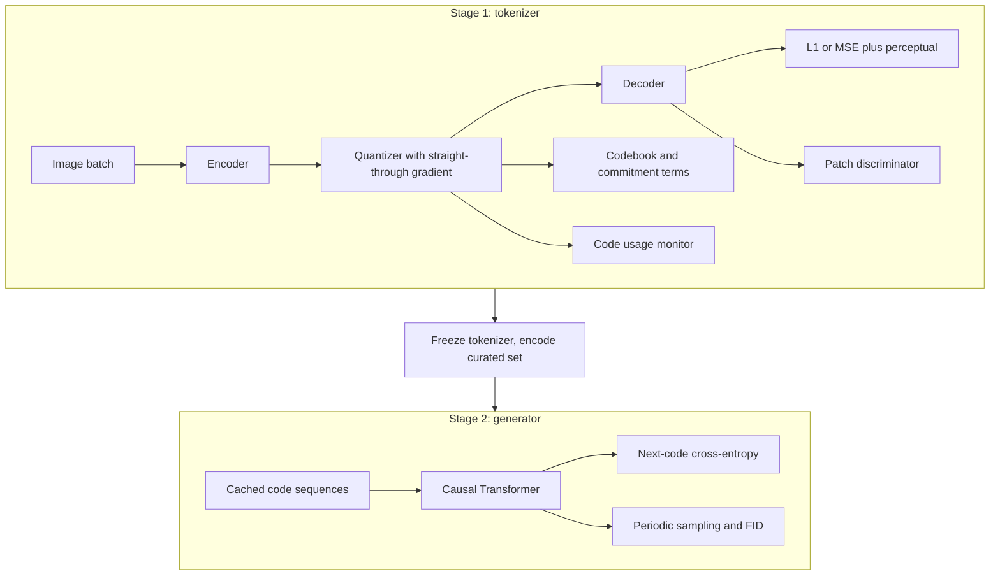
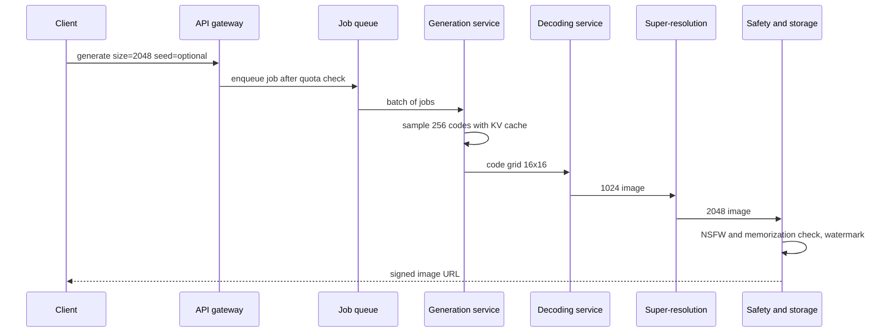

The product is a button that returns a fresh, photorealistic picture of a mountain valley or a rainy city street, at 1024x1024 or 2048x2048, in about five seconds. There is no prompt in version one, but text prompts are on the roadmap. The hard part is arithmetic. A 2048px RGB image holds about 12.6 million numbers, and any model that treats each of them as a decision either runs out of memory or runs for minutes. Everything in this design follows from one move: compress the picture into a short grid of discrete symbols, learn to write that grid with a Transformer, and let a separate decoder paint the pixels back.

The core tension is how hard to compress. Every halving of the token grid side cuts generation work by four or more, but whatever detail the tokenizer drops at encode time can never come back. A good answer in an interview spends most of its time on that dial and on the system pieces that let you turn it without rebuilding everything.

The notes follow the book's seven-step framework, then add follow-ups, interview questions, a 45-minute walkthrough and review questions.

## 1. Clarifying requirements

Functional: scenery only (forgiving, since foliage and water hide small errors and no identity must be preserved), unconditional now with text prompts later, two output sizes a factor of 4 apart in area, and about 5 million curated scenes plus unlabeled public images. Non-functional: about five seconds per image with a user watching a spinner, low GPU cost per image for a consumer feature, real diversity (ten presses should give ten different scenes, so mode collapse is a product bug), and safety and provenance, since even scenery models can memorize copyrighted photos.

| Requirement | Design decision it forces |
|---|---|
| 1024 and 2048 outputs | Generate natively at 1024, add a 2x super-resolution stage for 2048 |
| About 5 s per image | Keep the token grid at 256 to 1,024 tokens; use KV cache and batching |
| Text prompts later | Decoder-only Transformer that can take a prefix of condition tokens |
| Scenery only | Coarse tokenizer with large patches is acceptable |
| 5M curated images, more unlabeled | Train the tokenizer on the large unlabeled pool, the generator on the curated set |
| Diversity matters | Sample stochastically with top-p and temperature; monitor code usage and FID |

## 2. Framing the problem as an ML task

Input: a request, optionally carrying a seed and a size. Output: an RGB image. The ML category is unconditional generative modeling: learn \( p(x) \) over scene images and sample from it.

Four model families are on the table. The useful question for each is what it costs per image at 1024px and whether its latent stays meaningful at that size.

| Family | Unit of generation | Cost at 1024px | Main weakness here | Verdict |
|---|---|---|---|---|
| VAE | One latent vector, one decoder pass | Very low | Blurry samples; strong decoders learn to ignore the latent | Too blurry |
| GAN (e.g. StyleGAN) | One latent, one generator pass | Very low | Unstable training, partial mode coverage on diverse scenes, hard to add text later | Fast but narrow |
| Pixel-space diffusion | Every pixel, for each of T steps | Very high | Each step touches all pixels; attention at full resolution is infeasible | Too slow without a latent space |
| Autoregressive over pixels | One pixel value per step | Absurd | 3 million sequential steps | Infeasible |
| Autoregressive over visual tokens | One code per patch | Moderate | Sequential decoding; quality capped by the tokenizer | Chosen |

The VAE failure is **posterior collapse**: the KL term pulls \( q(z \mid x) \) toward the prior, and once the decoder is strong enough to model images alone, the cheapest move is to make the latent carry nothing. High resolution needs a big decoder, so it bites exactly where the latent matters most. Latent diffusion (Stable Diffusion style) removes most of the pixel-diffusion cost and deserves a benchmark slot, but the token route wins here because it reuses the language-model stack end to end and text conditioning later is just a longer prefix.

So the system is two separately trained models:

1. An **image tokenizer** (VQ-VAE with VQGAN losses) that turns an image into a grid of integer codes and back.
2. An **image generator** (decoder-only Transformer) that models the probability of a code sequence.

### How many tokens is an image

The token count is \( L = (H/f) \times (W/f) \) for downsampling factor \( f \). At 1024px, \( f = 16 \) gives a 64 x 64 grid (4,096 tokens), \( f = 32 \) gives 1,024 tokens and \( f = 64 \) gives 256; each count quadruples at 2048px. VQGAN used \( f = 16 \) at 256px. Holding 256 tokens at 1024px means each code stands for a 64x64 block, about 12,000 numbers in one integer, which only works because a GAN-trained decoder invents plausible texture. Fine for scenery, bad for text-in-image.

## 3. Data preparation

### Sources

The curated 5M set (known licenses) trains the generator, because it defines what outputs should look like. The tokenizer learns reconstruction, not taste, so it benefits from breadth: a web-scale pool such as LAION-400M gives a richer codebook, after license review and removal of known-bad content. The generator then learns the target distribution without inheriting web noise like memes, watermarks and screenshots.

### Filtering and cleaning

- **Resolution floor.** Drop images whose short side is below the native size; upsampled inputs teach blur.
- **Quality.** Variance-of-Laplacian blur score, JPEG artifact detection, and a CLIP-based aesthetic regressor.
- **Domain.** Zero-shot CLIP against prompts like "a scenery photo" and "a city street" removes screenshots and product shots.
- **Watermarks and text.** Otherwise the generator learns to draw stock-photo logos.
- **Deduplication** by perceptual hash or embedding search, which cuts memorization and stops famous spots from dominating.
- **Safety and privacy.** NSFW classifier, blur bystander faces and license plates.
- **Balance.** Cluster embeddings and resample by scene type, season, time of day and region, or the model paints only sunsets.

### Modality-specific preprocessing

Scale pixels to \([-1, 1]\), resize the short side to 1024 and crop square (random crops for the tokenizer). Horizontal flips are safe for scenery; vertical flips and strong color jitter are not, since skies are blue and up. Fix EXIF orientation before cropping.

### Storage

Raw images go to object storage as sharded tar or WebDataset files so training reads large sequential blobs. After the tokenizer is trained, each image is encoded once and its code grid stored as compact integer arrays. The generator never sees pixels during training.

**Worked example: storage for the token cache.** With 256 codes per image and a codebook of 8,192 entries, each code fits in a 16-bit integer. 5,000,000 images x 256 codes x 2 bytes = 2.56 GB. The raw JPEGs at about 500 KB each total about 2.5 TB. The token cache is a thousand times smaller and fits in host RAM on one training node, which removes the data loader as a bottleneck. At \( f = 32 \) (1,024 codes) it is still only 10 GB.

### Pitfalls

- **Ordering trap.** The token cache depends on the tokenizer weights; retraining the tokenizer invalidates every cached sequence and generator checkpoint. Version them together.
- **Crop skew.** If training used center crops and the FID reference set uses full frames, FID shifts for reasons unrelated to the model.

## 4. Model development

### Architecture

#### Tokenizer: encoder, quantizer, decoder

The **encoder** is a convolutional network (residual blocks with downsampling, often with one self-attention block at the lowest resolution) that maps an image \( x \in \mathbb{R}^{H \times W \times 3} \) to a grid of vectors \( z_e \in \mathbb{R}^{h \times w \times d} \), with \( h = H/f \).

The **quantizer** holds a codebook \( \mathcal{Z} = \{e_k\}_{k=1}^{K} \) of \( K \) learned vectors in \( \mathbb{R}^{d} \). Each grid vector is snapped to its nearest entry:

$$
k^{*}_{ij} = \arg\min_{k} \lVert z_e(x)_{ij} - e_k \rVert_2^2, \qquad z_q(x)_{ij} = e_{k^{*}_{ij}}
$$

Here \( z_e(x)_{ij} \) is the encoder vector at grid position \( (i, j) \), \( e_k \) is codebook entry \( k \), and \( k^{*}_{ij} \) is the integer token stored for that position. The quantizer has no weights other than the codebook itself.

Discretization buys two things: the decoder sees only one of \( K \) vectors per position, so it cannot route around the bottleneck, and the generator gets a \( K \)-way classification target instead of regressing continuous vectors toward a blurry mean.

The **decoder** mirrors the encoder with upsampling blocks and is the only tokenizer part deployed for serving.

#### Generator: decoder-only Transformer

The generator reads codes in raster order and predicts the next one: code embedding, projection to \( d_{\text{model}} \), position information, \( N \) pre-norm causal blocks of attention plus MLP, and a linear head over \( K \) codes. A 1D learned position works for a fixed grid, but row-plus-column embeddings or 2D rotary embeddings tell the model that token \( t \) and token \( t + w \) are vertical neighbors. Each attention head computes

$$
\text{Attention}(Q, K, V) = \text{softmax}\left( \frac{Q K^{\top}}{\sqrt{d_k}} + M \right) V
$$

where \( Q, K, V \) are the query, key and value projections of the token states, \( d_k \) is the per-head width, and \( M \) is the causal mask with \( -\infty \) above the diagonal so position \( t \) sees only positions before it.

#### Design knobs

Raising \( f \) cuts tokens but makes the decoder hallucinate more. A larger codebook \( K \) is more expressive but leaves more dead entries and a harder softmax. Lower code dimension \( d \) (ViT-VQGAN uses 32 or less) often improves usage. A deeper generator fixes global layout first, at a per-step latency cost, and a bigger decoder sharpens texture from the same codes. Rule of thumb: take the largest \( f \) whose reconstruction FID (rFID) is well below the target generation FID, since the generator can never beat its decoder.

### Training

Training runs in two stages that share nothing but the code format.

#### Stage 1: tokenizer objectives

The loss is a weighted sum of four parts.

**Reconstruction.** Pixel MSE or L1 between the image and its reconstruction:

$$
\mathcal{L}_{\text{rec}} = \frac{1}{n} \sum_{i=1}^{n} \left( x_i - \hat{x}_i \right)^2
$$

with \( x_i \) and \( \hat{x}_i \) the original and reconstructed pixel values and \( n \) the number of pixel values. L1 is often preferred because MSE punishes outliers and pushes toward blur.

**Codebook and commitment.**

$$
\mathcal{L}_{\text{vq}} = \lVert \text{sg}[z_e(x)] - z_q(x) \rVert_2^2 + \beta \, \lVert z_e(x) - \text{sg}[z_q(x)] \rVert_2^2
$$

The first term moves the selected codebook entries toward the encoder outputs, with \( \text{sg}[\cdot] \) (stop-gradient) freezing the encoder for that term; the second, weighted by \( \beta \) (about 0.25), keeps encoder outputs committed to their codes. An exponential moving average codebook update is a more stable replacement for the first term.

**Straight-through gradient.** The argmin has no useful gradient, so the backward pass treats quantization as the identity:

$$
z_q^{\text{st}} = z_e + \text{sg}\left[ z_q - z_e \right]
$$

The value equals \( z_q \), but its gradient with respect to \( z_e \) is the identity, so the decoder's gradient reaches the encoder. Only selected entries are updated, which is why dead codes appear.

**Perceptual loss.**

$$
\mathcal{L}_{\text{perc}} = \sum_{l} \frac{1}{C_l H_l W_l} \lVert \phi_l(x) - \phi_l(\hat{x}) \rVert_2^2
$$

where \( \phi_l \) is the layer-\( l \) activation map of a frozen network such as VGG and \( C_l H_l W_l \) its size (LPIPS adds learned channel weights). A one-pixel shift costs a lot of MSE but almost nothing here, so this term rewards right texture over exact alignment.

**Patch adversarial loss.** A convolutional discriminator \( D \) scores overlapping patches as real or reconstructed, and the tokenizer minimizes

$$
\mathcal{L}_{\text{adv}} = -\mathbb{E}\left[ \log D(\hat{x}) \right]
$$

where \( \hat{x} \) is the reconstruction. Judging patches focuses the critic on local texture, exactly what the other losses leave soft.

**Total and balancing.**

$$
\mathcal{L} = \lambda_{\text{rec}} \mathcal{L}_{\text{rec}} + \lambda_{\text{vq}} \mathcal{L}_{\text{vq}} + \lambda_{\text{perc}} \mathcal{L}_{\text{perc}} + \lambda_{\text{adv}} \mathcal{L}_{\text{adv}}
$$

The \( \lambda \) values are tuned. VQGAN sets \( \lambda_{\text{adv}} \) adaptively from the ratio of reconstruction and adversarial gradient norms at the decoder's last layer, and the discriminator is usually switched on only after tens of thousands of steps, since an early critic wins too easily.

#### Stage 2: generator objective

The image distribution is factored over the raster-ordered code sequence \( s = (s_1, \dots, s_L) \):

$$
p_\theta(s) = \prod_{t=1}^{L} p_\theta(s_t \mid s_{<t}), \qquad \mathcal{L}_{\text{CE}} = -\frac{1}{L} \sum_{t=1}^{L} \log p_\theta(s_t \mid s_{<t})
$$

where \( s_t \) is the code at position \( t \), \( s_{<t} \) all earlier codes, and \( \theta \) the Transformer weights. Teacher forcing scores all \( L \) positions in one forward pass. Prepend a learned start token so the first code is modeled too, and once text arrives, drop the caption about 10 percent of the time to enable classifier-free guidance.

#### Efficiency techniques

- **bf16 mixed precision**, but keep codebook distances in fp32, where underflow flips assignments.
- **FSDP or ZeRO** sharding for a 0.5 to 3B generator; tensor parallelism only above that.
- **Activation checkpointing** in the tokenizer, whose full-resolution feature maps dominate memory.
- **FlashAttention** in the generator once sequences reach 1,024 tokens.

**Worked example: generator training compute.** Take a 1B-parameter generator and 256 tokens per image. One pass over 5M images is \( 1.28 \times 10^{9} \) tokens. Train for 20 epochs: \( N = 10^{9} \), \( D = 2.56 \times 10^{10} \) tokens. Using the standard estimate

$$
C \approx 6 N D = 6 \times 10^{9} \times 2.56 \times 10^{10} \approx 1.5 \times 10^{20} \text{ FLOPs}
$$

An H100 at about 990 TFLOP/s dense bf16 peak and 40 percent utilization delivers about \( 4 \times 10^{14} \) FLOP/s, so this is \( 3.8 \times 10^{5} \) GPU-seconds, about 105 GPU-hours, or under a day on 8 GPUs. The tokenizer is the heavier job, since its convolutions run at full resolution over possibly hundreds of millions of web images. Twenty epochs is also a lot of repetition, so watch validation loss for memorization.

#### Failure modes and fixes

- **Codebook collapse** (few codes used, flat perplexity): EMA updates, restart dead codes from encoder outputs, normalized low-dimensional codes.
- **Smeared reconstructions**: perceptual and patch adversarial losses were missing or too weak.
- **Checkerboard texture or loss spikes once the critic starts**: adaptive weight, later critic start, upsample plus conv instead of transposed conv.
- **Broken global layout**: generator too shallow or missing 2D positions.
- **Copied training images**: duplicates or too many epochs; deduplicate, stop early, audit with nearest-neighbor search.

### Sampling

Start from a start token, then for \( t = 1 \dots L \) run the Transformer on the prefix, adjust the logits, sample one code and append it. Reshape the result to \( h \times w \) and run the decoder once. Temperature rescales logits \( z \):

$$
p_\tau(k) = \frac{\exp(z_k / \tau)}{\sum_{j=1}^{K} \exp(z_j / \tau)}
$$

where \( \tau < 1 \) sharpens toward likely codes and \( \tau > 1 \) flattens. **Top-k** keeps the \( k \) most likely codes; **top-p** keeps the smallest set reaching cumulative probability \( p \), so the candidate set is narrow for sky and wide for foliage. Greedy and beam search pick maximum-likelihood codes, which in images means flat, repetitive regions.

| Knob or method | Quality | Diversity | Speed |
|---|---|---|---|
| Lower temperature | Cleaner | Lower | Same |
| Top-p around 0.9 | Removes garbage tail adaptively | Moderate | Same |
| Greedy or beam | Flat, washed out | Very low | Beam slower |
| Rejection sampling with a scorer | Higher average | Slightly lower | Several times slower |
| Classifier-free guidance, with text | Better prompt adherence | Lower at high scale | 2x passes |
| MaskGIT parallel decoding | Slightly below AR | Similar | 8 to 16 steps instead of L |

**Worked example: latency budget at 1024px.** Use a 1B-parameter generator in bf16 (2 GB of weights) on one H100 with about 3.35 TB/s of memory bandwidth. Decoding one token at batch size 1 must read all weights, so the floor is about 2 GB / 3.35 TB/s = 0.6 ms per step. Real kernels with launch overhead, sampling and the KV cache run closer to 5 ms per step.

| Grid | Tokens | Generation at 5 ms/step | Decoder pass | 2x upscaler | Total |
|---|---|---|---|---|---|
| 16 x 16 (f = 64) | 256 | 1.3 s | 0.2 s | 0.4 s | about 1.9 s |
| 32 x 32 (f = 32) | 1,024 | 5.1 s | 0.2 s | 0.4 s | about 5.7 s |
| Native 64 x 64 at 2048 (f = 32) | 4,096 | 20.5 s | 0.6 s | none | about 21 s |

The 256-token grid fits the 5-second target with headroom for queueing; the 1,024-token grid is borderline; native 2048 generation is out. This is the quantitative argument for "generate at 1024, upscale to 2048."

**Worked example: KV cache size.** For a model with 24 layers and width 2048, each token stores a key and a value per layer: \( 2 \times 24 \times 2048 \times 2 \) bytes = 196,608 bytes, about 0.19 MB. A 256-token image needs about 50 MB of cache; a 1,024-token image about 200 MB. On an 80 GB GPU with 2 GB of weights you could hold a few hundred concurrent 1,024-token sequences, so batch size is limited by latency targets, not memory.

## 5. Evaluation

### Offline metrics

**Fréchet Inception Distance** fits a Gaussian to Inception-v3 features of real and generated images and measures the distance between them:

$$
\text{FID} = \lVert \mu_r - \mu_g \rVert_2^2 + \text{Tr}\left( \Sigma_r + \Sigma_g - 2 \left( \Sigma_r \Sigma_g \right)^{1/2} \right)
$$

where \( \mu_r, \Sigma_r \) and \( \mu_g, \Sigma_g \) are the means and covariances of real and generated features. The mean term catches systematic shifts (everything too dark), the covariance term lost variety. Use 10,000 to 50,000 samples, since FID is biased upward on small sets, and compute it on delivered 2048 outputs too, because Inception downsizes to 299px and hides fine-detail problems.

**Inception Score** uses only generated images:

$$
\text{IS} = \exp\left( \mathbb{E}_{x \sim p_g} \left[ D_{\text{KL}}\left( p(y \mid x) \,\Vert\, p(y) \right) \right] \right)
$$

where \( p(y \mid x) \) is the classifier's label distribution for one image and \( p(y) \) its average over samples. It rewards confident, varied classes ("valley", "lakeside" and "streetcar" exist in ImageNet) but never compares against real data. **Precision and recall** for generative models split fidelity from coverage, the clearest view of a temperature change.

**Tokenizer metrics**: rFID, PSNR and LPIPS on held-out reconstructions, plus code perplexity:

$$
\text{PPL}_{\text{code}} = \exp\left( -\sum_{k=1}^{K} \bar{p}_k \log \bar{p}_k \right)
$$

where \( \bar{p}_k \) is the share of validation positions assigned to code \( k \); a value far below \( K \) signals collapse. Add a **memorization audit**: nearest-neighbor search of generations against the training set.

| Metric | What it catches | What it misses |
|---|---|---|
| FID | Shifted statistics, lost variety | Local artifacts, per-image failures |
| Inception Score | Blurry or unrecognizable images | Mismatch with real data |
| Precision and recall | Fidelity versus coverage separately | Fine texture |
| rFID, LPIPS | Tokenizer quality ceiling | Generator quality |
| Code perplexity | Codebook collapse | Whether used codes are good |
| Human pairwise preference | Realism, aesthetics, odd artifacts | Diversity, unless raters see grids |
| Latency, cost per image | Requirement violations | Quality |

### Human evaluation

Raters see randomized side-by-side pairs and pick the more photographic and the more pleasing image. Report win rates with confidence intervals over a few hundred pairs, mix in real photos as a sanity check, and show grids of eight samples to judge diversity.

### Online metrics

Regeneration rate (an immediate second press signals disappointment), downloads and shares, thumbs up or down, subscription conversion, churn, and p50 and p95 latency. They lag and are noisy, so they confirm launches rather than diagnose regressions.

## 6. Overall ML system design

Three stages with different hardware profiles sit behind one API. The **generation service** runs the Transformer: sequential, memory-bandwidth bound, latency linear in token count, throughput from batching. The **decoding service** runs one compute-bound convolutional pass in a fraction of a second; the encoder is never deployed. The **super-resolution service** runs a 2x upscaler (Real-ESRGAN style or a small diffusion upscaler) only for 2048 requests. Separate services pick their own GPU types, autoscale on their own queues and ship independently. The hop between them is cheap: a code grid is 512 bytes.

### Latency and cost optimizations

| Optimization | Latency | Cost | Quality risk |
|---|---|---|---|
| KV cache | Each step processes one token, not the prefix | Lower | None |
| Continuous batching | Slightly higher per request | Much lower per image | None |
| int8 or fp8 weights | Faster memory-bound steps | Lower | Small; check FID |
| Speculative decoding with a draft model | Fewer large-model steps | Neutral to lower | None in theory |
| Larger f or MaskGIT-style decoding | Big cut | Big cut | Moderate |
| Pre-generated pool | Near zero when pooled | Lower, uses off-peak GPUs | Less freshness |

Because there is no prompt, any image answers any request, so off-peak capacity can fill a pool that serves most traffic instantly, with each pooled image consumed once.

**Worked example: fleet sizing.** 2 million images a day is 2,000,000 / 86,400 = 23 per second, about 70 at a 3x peak. One H100 batching 32 sequences of 256 tokens at 6 ms per step finishes 32 images every \( 256 \times 6 \) ms = 1.5 s, about 21 per second, so peak needs 4 generator GPUs (plan 6 to 8). The decoder at 32 images per 0.5 s batch needs 2 GPUs. If 30 percent ask for 2048, the upscaler sees 21 per second; at about 20 per second per GPU that is 2 to 3 GPUs. Roughly a dozen GPUs, dominated by the generator.

## 7. Deployment and monitoring

### Safety and monitoring

- Output NSFW and violence classifiers before return; log and drop failures.
- Memorization check against an embedding index of the training set for a sampled fraction of outputs.
- Invisible watermark plus C2PA content credentials so images are labeled as AI-generated.
- Dashboards per stage: queue depth, p95 latency, GPU utilization, error rate. Model health: rolling FID on a daily sample, code-usage histogram of generated grids (a shift signals a bad deploy), safety-filter hit rate.

### Rollout and feedback

Ship the tokenizer, its token cache and the generator as one versioned bundle, and route each request to a single bundle end to end, since codes from one tokenizer mean nothing to another decoder. A new bundle first runs in shadow on a copy of traffic to compare latency and the code-usage histogram, then takes a small canary share. Promotion requires rolling FID on daily samples and the regeneration rate to hold within a set margin of the current version. The previous bundle stays warm for rollback, and the pre-generated pool is refilled from the new bundle only after promotion.

Regenerate presses, downloads and thumbs feed a preference log. Frequently downloaded images can seed a small curated fine-tuning set, and repeated regenerations on one kind of scene point to gaps in the curated data. A retrain is triggered when rolling FID drifts upward for several days or when the curated set has grown enough to matter.

## Follow-ups and extensions

- **Text-to-image.** Prefix caption tokens to the image codes and train on pairs, as Parti and the first DALL-E did; drop captions sometimes to enable classifier-free guidance.
- **Aspect ratios.** Variable grids with 2D positions and a size token make 16:9 just a 12 x 21 grid.
- **Inpainting and outpainting.** Generate only the missing codes; holes in the middle suit masked bidirectional models better than raster order.
- **Better tokenizers.** Residual quantization, lookup-free or finite scalar quantization without dead codes, ViT-based encoders.
- **Faster generation.** MaskGIT iterative parallel decoding, or VAR-style next-scale prediction from coarse to fine grids.
- **Interactive refinement and personalization.** Lock a region and resample the rest; bias seeds or adapters from regenerate and download signals.

## Interview questions

### Clarifying

**Which content categories and resolutions must version one support?**
I would ask because both set the tokenizer's downsampling factor. Scenery tolerates large patches, so a 16 x 16 code grid at 1024px is defensible; faces or text would push me toward 32 x 32 or finer, which quadruples generation time. The two output sizes tell me whether to train two generators or one plus an upscaler. With a factor of two between them, one native size plus super-resolution is the cheaper plan.

**How much training data exists, and can we use unlabeled public images?**
The two models want different data. The tokenizer only learns to reconstruct, so it benefits from hundreds of millions of diverse images with no labels. The generator defines the output distribution, so it should train on the curated set. If licensing forbids web data, I would train the tokenizer on the curated 5M and accept a slightly worse codebook.

**Is conditioning on text coming soon?**
It changes the architecture choice. If it is, I want a decoder-only Transformer that can take a prefix of condition tokens now, and I want condition dropout baked into the training recipe so guidance works later. If conditioning is never coming, a GAN or a small latent diffusion model becomes more competitive. I would also ask whether five seconds is a p50 or a hard p99, since the latter forces fewer tokens or a pre-generated pool.

### Design and trade-offs

**Trade-off: autoregressive tokens versus latent diffusion.**
Both run in a compressed space, so the gap is smaller than with pixel diffusion. Autoregressive models reuse LLM infrastructure, give exact likelihoods, and add text conditioning naturally, but they decode sequentially and suffer from exposure bias. Latent diffusion uses a fixed number of steps independent of resolution, often wins on sample quality, and parallelizes over pixels, but needs more steps for quality and its guidance math is more complex. For this chapter's constraints I would ship the token model and keep a diffusion baseline in the benchmark suite.

**Trade-off: downsampling factor f.**
Doubling \( f \) cuts tokens by 4 and attention cost by up to 16, which is the difference between 20 seconds and 1.3 seconds at 1024px. The price is information: each code must stand for 4 times as many pixels, so the decoder invents more and fine structure like thin branches or window grids degrades. I choose by plotting rFID against \( f \) and taking the largest \( f \) whose rFID is well under the target generation FID.

**Trade-off: native 2048 generation versus 1024 plus 2x upscaling.**
Native generation gives globally coherent fine detail but needs 4 times the tokens and roughly 4 to 16 times the compute. A super-resolution model sharpens and adds plausible texture but cannot fix composition errors at the small scale and sometimes invents repeated textures. With a 5-second budget and scenery content, upscaling wins; for print-quality products I would revisit.

**Why quantize instead of predicting continuous latents?**
Discrete codes give the generator a categorical target where cross-entropy can express multi-modal uncertainty: the next patch might be sky or tree, and softmax can put mass on both. Regressing a continuous vector with MSE averages those modes into a muddy mix. Quantization also prevents the decoder from ignoring the latent. Recent work does model continuous tokens with diffusion heads, but that adds complexity.

### Deep dives

**Walk through the straight-through estimator and why codes die.**
Nearest-neighbor lookup has no useful gradient, so in the backward pass we treat quantization as the identity and pass the decoder's gradient straight to the encoder output. The codebook itself only learns through the codebook term, and only for the entries actually selected. An entry that no encoder output is near never gets selected and never moves, so it stays dead. Fixes are EMA updates, reinitializing dead entries from recent encoder outputs, and normalizing codes and features so distances are comparable.

**What does each tokenizer loss contribute, and what breaks without it?**
Pixel loss keeps color and layout right but alone produces blur. The codebook and commitment terms keep encoder outputs and codes close; without commitment, encoder outputs drift and assignments become unstable. Perceptual loss rewards matching texture and structure; without it, edges are soft. The patch adversarial loss removes the residual mush; without it, 1024px reconstructions look painted. Too much adversarial weight causes artifacts and instability, so its weight is balanced by gradient norms.

**How would you add 2D awareness to a raster-order Transformer?**
Raster order makes the token directly above position \( t \) sit \( w \) steps back, and a 1D position embedding does not tell the model that. I would use separate row and column embeddings summed together, or 2D rotary embeddings that rotate query and key by row and column angles. Local attention windows that include the previous row help both quality and speed. Some systems also try alternative scan orders, but raster with 2D positions is the simple default.

**Estimate generation latency for a 1,024-token grid on one H100.**
A 1B bf16 model is 2 GB, and at 3.35 TB/s reading it takes 0.6 ms, the floor for one decoding step. Realistic per-step time with overhead is around 5 ms, so 1,024 steps take about 5 seconds before decoding and upscaling. That busts a 5-second budget, which pushes me to 256 tokens, int8 weights to halve memory traffic, or parallel decoding. Batching does not reduce single-request latency, it only raises throughput.

**Estimate the GPU fleet for 2 million images per day.**
That is 23 per second on average and about 70 at a 3x peak. One H100 batching 32 sequences of 256 tokens at about 6 ms per step finishes 32 images in about 1.5 seconds, around 21 per second, so peak needs 4 generator GPUs, 6 to 8 with headroom. The decoder and upscaler need 2 to 3 GPUs each. Roughly a dozen GPUs total, and a pre-generated pool could shave the peak further.

### Operations and failure modes

**After a deploy, users say images look repetitive. How do you debug?**
First check sampling configuration: a temperature or top-p change is the most common cause. Then compare the histogram of generated codes against the training distribution; a collapse to fewer codes points at the generator, while normal histograms with bad images point at the decoder. Compute precision and recall on a fresh sample; precision up and recall down confirms a diversity loss. Roll back if confirmed, then add a code-entropy alarm to prevent a repeat.

**How do you detect and reduce memorization?**
Deduplicate training data aggressively, since duplicated images are the main source of verbatim copies. Limit epochs and watch the train-validation gap. At evaluation and in production, embed a sample of outputs and search the training index for near matches above a threshold, and block outputs that match. Low temperature raises copy risk, so check it at the operating point actually used.

**You retrained the tokenizer. What else must change?**
Every cached code sequence is now meaningless because code IDs map to different vectors. The generator has to be retrained on newly encoded data, and the decoding service has to deploy the new decoder at the same moment as the new generator. I version tokenizer, token cache and generator as one bundle and route traffic by bundle version so a half-upgraded state cannot occur.

## A 45-minute walkthrough

| Minutes | What to cover | What to draw |
|---|---|---|
| 0 to 5 | Clarify domain, data size, conditioning roadmap, resolutions, latency in p50 and p95 | Requirements list and the decisions they force |
| 5 to 10 | Compare VAE, GAN, pixel diffusion, latent diffusion, AR over tokens; pick tokenizer plus Transformer | Family comparison and token-count arithmetic |
| 10 to 15 | Data: two pools, filters, dedup, safety, token cache and its versioning | Data pipeline |
| 15 to 23 | Tokenizer internals and losses; quantizer, straight-through, codebook collapse; then the Transformer | Tokenizer and generator diagram, VQ loss |
| 23 to 28 | Training stages, 6ND estimate, efficiency choices, failure modes | Two-stage training flow |
| 28 to 32 | Sampling: temperature, top-p, why not beam; latency budget per token count | Latency table |
| 32 to 37 | Evaluation: FID, precision and recall, rFID, perplexity, human study, online metrics | Metric table with blind spots |
| 37 to 43 | Serving: three services, sequence, KV cache, batching, upscaler, pre-generated pool, fleet estimate, safety | Serving sequence |
| 43 to 45 | Extensions: text prefix and guidance, parallel decoding, inpainting | None |

## Review questions

Answer each question in your own words first, then open the answer to check.

### Concepts and definitions

**1. What is the downsampling factor \( f \), and how does it set the number of tokens per image?**


\( f \) is how many pixels along each side the tokenizer encoder folds into one grid cell. The token count is \( L = (H/f) \times (W/f) \), so at 1024px, \( f = 16 \) gives 4,096 tokens, \( f = 32 \) gives 1,024 and \( f = 64 \) gives 256. Doubling \( f \) divides the token count by four, and doubling the image side multiplies it by four.


**2. What does the quantizer do, and what are its trainable parameters?**


For each position in the encoder's output grid, the quantizer finds the nearest of \( K \) codebook vectors by squared Euclidean distance and replaces the encoder vector with it. The index of that entry is the integer token stored for the position. Its only parameters are the codebook vectors themselves; the lookup is a fixed nearest-neighbor rule.


**3. What is code perplexity, and what does a value far below \( K \) mean?**


Take the share \( \bar{p}_k \) of validation positions assigned to each code and compute

$$
\text{PPL}_{\text{code}} = \exp\Big(-\sum_k \bar{p}_k \log \bar{p}_k\Big)
$$

It reads as the effective number of codes in use: it equals \( K \) when usage is uniform. A value far below \( K \) means most entries are dead and the tokenizer is working with a much smaller vocabulary than it was given, which is codebook collapse.


**4. What is rFID, and why does it set a ceiling for the whole system?**


rFID is FID computed between held-out real images and their tokenizer reconstructions (encode, quantize, decode), with no generator involved. Every generated image also passes through the same decoder, so generation FID cannot be better than what the decoder can produce from perfect codes. That is why the rule of thumb picks the largest \( f \) whose rFID stays well below the target generation FID.


**5. How do top-k and top-p differ, and why does top-p suit images with both sky and foliage?**


Top-k always keeps a fixed number \( k \) of the most likely codes. Top-p keeps the smallest set of codes whose probabilities add up to \( p \), so its size changes with the shape of the distribution. In a patch of clear sky a few codes carry most of the mass and the set is small; in foliage many codes are plausible and the set is large. A fixed \( k \) would be too loose for the sky or too tight for the leaves.


### Mechanisms and math

**6. Explain the two terms of \( \mathcal{L}_{\text{vq}} \) and the role of the stop-gradient.**



$$
\mathcal{L}_{\text{vq}} = \lVert \text{sg}[z_e(x)] - z_q(x) \rVert_2^2 + \beta \, \lVert z_e(x) - \text{sg}[z_q(x)] \rVert_2^2
$$

The first term pulls the chosen codebook entries toward the encoder outputs; the stop-gradient on \( z_e \) means only the codebook moves. The second term, weighted by \( \beta \approx 0.25 \), pulls the encoder outputs toward their chosen codes while the codebook is frozen, so the encoder commits to codes instead of drifting. An EMA update can replace the first term for stability.


**7. Why does VQGAN switch on the discriminator late and set its weight adaptively?**


Early reconstructions are poor, so a patch critic would separate them from real images with no effort and its gradients would overwhelm the other losses, causing artifacts or loss spikes. Waiting tens of thousands of steps lets the reconstruction, codebook and perceptual terms establish a reasonable image first. The adaptive weight compares the gradient norms of the reconstruction and adversarial losses at the decoder's last layer, keeping the adversarial push at a comparable size instead of a hand-tuned constant.


**8. Why can the generator score every position in one forward pass during training but needs \( L \) passes at sampling time?**


During training the whole real code sequence is known, so with teacher forcing each position can be fed the true earlier codes. The causal mask (\( -\infty \) above the diagonal) stops any position from seeing later ones, so all \( L \) next-code predictions are valid in one pass. At sampling time the earlier codes do not exist until they are sampled, so each code depends on the previous step's output and the loop must run \( L \) times.


**9. How does temperature reshape the next-code distribution, and what happens in the limit of very low temperature?**


Logits are divided by \( \tau \) before the softmax:

$$
p_\tau(k) = \frac{\exp(z_k / \tau)}{\sum_j \exp(z_j / \tau)}
$$

\( \tau < 1 \) widens gaps between logits and concentrates mass on likely codes, \( \tau > 1 \) narrows them and spreads mass out. As \( \tau \) approaches 0 the distribution puts all mass on the top code, which is greedy decoding. For images that gives flat, repetitive regions and identical outputs for every press.


**10. What does the KV cache store, and why does it change the cost of each decoding step?**


For every token already generated, each layer stores that token's key and value vectors. When a new token arrives, only its own query, key and value are computed; attention reads the stored keys and values for the prefix instead of recomputing them. Each step therefore processes one token rather than the whole prefix, at the price of memory that grows linearly with sequence length.


### Numbers and estimates

**11. How big is the token cache for 5 million images at 256 codes, and at 1,024 codes?**


A codebook of 8,192 entries fits in 16 bits, so 2 bytes per code.
At 256 codes: \( 5{,}000{,}000 \times 256 \times 2 = 2.56 \times 10^9 \) bytes, about 2.56 GB.
At 1,024 codes (\( f = 32 \)): four times more, about 10 GB.
The raw JPEGs at about 500 KB each are about 2.5 TB, so the cache is roughly a thousand times smaller and fits in one node's RAM.


**12. Use \( C \approx 6ND \) to estimate generator training compute for 1B parameters, 256 tokens per image, 5M images and 20 epochs.**


Tokens per epoch: \( 5 \times 10^6 \times 256 = 1.28 \times 10^9 \).
Total tokens: \( D = 20 \times 1.28 \times 10^9 = 2.56 \times 10^{10} \).
Compute: \( 6 \times 10^9 \times 2.56 \times 10^{10} \approx 1.5 \times 10^{20} \) FLOPs.
An H100 at 40 percent of about 990 TFLOP/s gives about \( 4 \times 10^{14} \) FLOP/s, so \( 1.5 \times 10^{20} / 4 \times 10^{14} \approx 3.8 \times 10^5 \) GPU-seconds, about 105 GPU-hours, under a day on 8 GPUs.


**13. How much KV cache does one image take for a model with 24 layers and width 2048 in 16-bit precision?**


Per token: key and value (2) times layers (24) times width (2048) times 2 bytes \( = 2 \times 24 \times 2048 \times 2 = 196{,}608 \) bytes, about 0.19 MB.
For 256 tokens: \( 256 \times 0.19 \approx 50 \) MB.
For 1,024 tokens: about 200 MB.
With 2 GB of weights on an 80 GB GPU, hundreds of 1,024-token sequences fit, so memory is not what limits the batch size.


### Design reasoning and trade-offs

**14. Why run generation, decoding and super-resolution as three separate services?**


They have different hardware profiles. The Transformer is sequential and limited by memory bandwidth, the decoder is a single compute-heavy convolutional pass, and the upscaler runs only for 2048 requests. Separate services can each pick a GPU type, scale on their own queue depth and be deployed independently. The cost of the split is tiny, since what crosses from generator to decoder is a 512-byte code grid.


**15. Why can this product serve most traffic from a pre-generated pool, and what rule keeps that safe?**


There is no prompt, so any good image is a valid answer to any request. Spare GPU capacity at off-peak hours can fill a pool, and peak requests become near-instant lookups. Each pooled image must be handed out only once, otherwise two users would get the same "fresh" picture, and the pool trades some freshness (it reflects the model version and settings at fill time) for cost and latency.


**16. Why are horizontal flips allowed in preprocessing but vertical flips and strong color jitter are not?**


A mirrored mountain valley is still a realistic scene, so horizontal flips add variety without teaching anything false. An upside-down landscape or a green sky is not a plausible photo, and whatever the model sees in training it will learn to generate. Augmentations must stay inside the distribution of outputs you want. EXIF orientation should be fixed first so the remaining images are actually upright.


**17. Why compute FID on the delivered 2048px outputs as well as at 1024px?**


The Inception network resizes inputs to 299px, so fine-detail problems such as repeated textures invented by the upscaler are mostly invisible to it at any input size. The upscaler is a separate model that can still shift color or overall statistics, and only measuring what users receive catches that. FID at 1024px tells you about the generator and decoder; FID on 2048 outputs tells you whether the last stage made things worse.


### Common mistakes

**18. What goes wrong if the codebook distance computation runs in bf16?**


Small differences between squared distances can underflow or round to the same value in bf16. The nearest-neighbor choice then flips between entries, so the same input can map to different codes from step to step and training becomes noisy. Running the distance computation in fp32 while the rest of the model uses bf16 avoids this at negligible cost.


**19. What goes wrong if training used center crops but the FID reference set uses full frames?**


The generator learns to produce center-cropped compositions, while the reference statistics describe full, wider frames. FID then reports a gap that comes from framing, not from model quality, and changes in preprocessing can move the score more than changes in the model. The reference set should be prepared with the same crop and resize policy as training data.


**20. What goes wrong if images below the resolution floor are upsampled and kept in training?**


An upsampled small image has the pixel count of a 1024px photo but the detail of a thumbnail. The tokenizer and generator learn that blur is normal at full resolution and reproduce it. Dropping images whose short side is below the native size costs some data but keeps the model's idea of sharpness honest.

