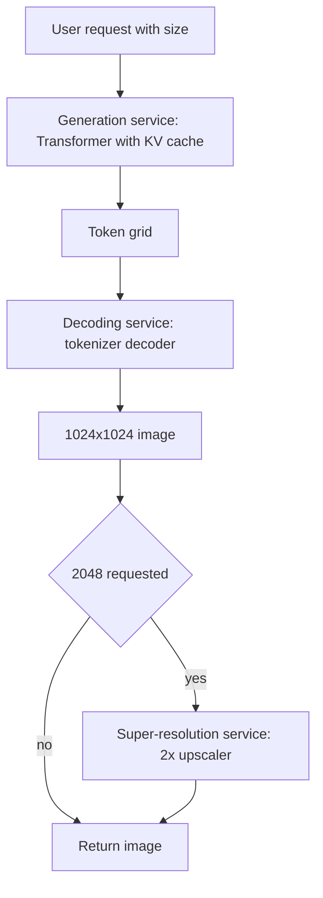

This system produces unconditioned images of natural scenery and city streets at 1024x1024 or 2048x2048, with a budget of a few seconds per image. Pixel count is the enemy. A model that reasons about every pixel either runs out of memory or takes minutes, so the design compresses the image into a short grid of discrete codes, generates that grid with a Transformer, and decodes it back to pixels. The core tension is how hard to compress: fewer tokens means faster generation, but every bit of detail the tokenizer throws away is gone for good.

## Requirements that change the design

- **Content domain.** Starting with natural and urban scenes keeps the codebook focused. Faces or text-in-image would need a tokenizer that preserves fine structure.
- **Training data.** A few million high-resolution scenes is enough for the generator. The tokenizer is self-supervised, so it can also learn from a much larger unlabeled public set such as LAION.
- **Conditioning later.** If text prompts are on the roadmap, pick an architecture that accepts extra input tokens without redesign. A decoder-only Transformer does.
- **Output sizes.** Supporting two resolutions suggests generating at one native size and upscaling, rather than training two generators.
- **Latency.** Seconds, not milliseconds. That rules in sequential token generation as long as the sequence stays short.

## Framing: tokenize the image, then predict tokens

Input is just a request (optionally a seed); output is an image. The choice is between families:

- **VAEs and GANs** run into trouble at 512px and above. The decoder needs so much capacity that it can learn to produce plausible images while largely ignoring the latent code, known as posterior collapse, and sample diversity drops.
- **Pixel-space diffusion** scales badly: every denoising step touches every pixel, and large images tend to need more steps. Without latent-space tricks this lands in minutes per image.
- **Autoregressive over visual tokens** generates a grid of codes instead of pixels. If each token stands for a 64x64 patch, a 1024x1024 image is 256 tokens, which is a short sequence for a Transformer.

So the system has two models trained separately. An image tokenizer (VQ-VAE, improved as VQGAN) maps images to token grids and back. An image generator (decoder-only Transformer) learns the distribution over token sequences. The same Transformer recipe used for text applies almost unchanged, and conditioning on text later just means prepending text tokens.

## Data and training: two stages, two objectives

Data preparation is plain but has one ordering trap. Filter out low-resolution, noisy or off-topic images, normalize, and resize to the native generation size. The tokenized dataset only exists after the tokenizer is trained, so: clean images, train tokenizer, encode every image once, cache the token sequences, then train the generator from the cache.

**Tokenizer.** A convolutional encoder turns the image into a small grid of feature vectors. The quantizer is just a learned embedding table (the codebook); each vector is replaced by its nearest entry by Euclidean distance, giving integer IDs. Discretizing does two things: the decoder can no longer bypass the latent, and the generator faces a finite classification problem instead of regressing continuous vectors. The decoder uses transposed convolutions to return to pixel space. Nearest-neighbor lookup has no gradient, so training uses a straight-through estimator that copies the decoder's input gradient to the encoder's output.

The loss is a weighted sum:

- pixel reconstruction (MSE or L1),
- a codebook and commitment term that pulls codebook entries and encoder outputs toward each other, with stop-gradients so each side moves separately,
- a perceptual loss on VGG features so textures and structure match, not just pixel averages,
- a patch-level adversarial loss from a discriminator, which is what VQGAN added to remove the smeared look at high resolution.

The weights need tuning. Too much adversarial weight destabilizes training; too little leaves blur.

**Generator.** Token IDs are embedded, projected to the model width, given 2D-aware positional encodings, and passed through causal Transformer blocks with a softmax head over the codebook. The objective is next-token prediction with cross-entropy, exactly as in a language model. Raster order is the usual choice.

**Sampling.** Pick a first token (random or a learned start token), then repeatedly sample the next token from the predicted distribution using top-k or top-p and a temperature, append it, and continue until the grid is full. Reshape to 2D and run the tokenizer's decoder. The encoder is not needed at inference.

## Evaluation: quality, diversity, latency and cost

Offline:

- **FID** against held-out real scenes is the main quality-plus-coverage number. Compute it at the delivered resolution, since upscaling artifacts matter.
- **Inception Score** is a secondary signal; scene images map to ImageNet classes better than faces do, but it still ignores real data.
- **Tokenizer reconstruction quality** (PSNR, LPIPS, rFID) sets a ceiling on the whole system. A generator cannot be better than what its decoder can draw.
- **Human pairwise comparisons** for photorealism and aesthetics.
- **Latency per image and cost per image** at each resolution, because the requirement is stated in seconds and the GPU bill grows with sequence length.

Online: ratings, surveys, subscriptions and churn. These lag, so they confirm a change rather than diagnose it.

## Serving: split generation, decoding and upscaling

The three stages have different shapes. The Transformer is memory-bandwidth bound and sequential, benefits from a KV cache and continuous batching, and its latency grows with token count. The decoder is a single convolutional pass, compute bound, and batches well. The super-resolution model (an ESRGAN-style or diffusion upscaler) runs only for the larger size. Putting them in separate services lets each scale on its own and lets you swap the upscaler without touching the generator.

Generating natively at 1024 and upscaling to 2048 is a deliberate cost decision: doubling the side length quadruples the token count, and attention cost grows faster still. Other levers are larger patches per token, parallel decoding schemes like MaskGIT, and weight quantization.

## Interview questions

**Why not generate pixels directly with a Transformer?**
A 1024px RGB image is about three million values, so attention cost and sampling time explode. A tokenizer reduces it to a few hundred codes: the Transformer handles layout and semantics, the decoder handles texture.

**Why quantize the latent instead of keeping it continuous?**
Discrete codes stop the decoder from ignoring the latent and give the generator a classification target over a fixed vocabulary, which cross-entropy handles well. Predicting continuous vectors sequentially tends to regress to the mean and blur.

**Trade-off: patch size per token.**
Bigger patches mean fewer tokens and faster, cheaper generation, but the decoder has to invent more detail per code and reconstructions lose fine structure. Smaller patches preserve detail and grow cost quickly. I would pick the largest patch whose reconstruction FID is still well below the target generation FID.

**What does each tokenizer loss contribute?**
Reconstruction keeps colors and layout right, the codebook and commitment terms keep encoder outputs and codes close, perceptual loss keeps textures that look right to a feature extractor, and the adversarial loss removes residual blur. Dropping the last two is fine at low resolution but shows up as mush at 1024.

**What is codebook collapse and how would you notice it?**
Only a small subset of codes gets used, so the effective vocabulary shrinks. Track code usage and perplexity during training; fix with dead-code restarts or EMA codebook updates.

**Autoregressive versus diffusion for this requirement.**
Pixel-space diffusion struggles to hit seconds at 2048px. Autoregressive over a few hundred tokens does. Latent diffusion removes most of that gap, so in a real product I would benchmark both. The token approach is attractive when you also want one Transformer to handle text and images.

**Why separate generation and decoding services?**
Sequential, memory-bound Transformer steps and one parallel convolutional pass have different hardware profiles. Separate services batch and autoscale independently and can be upgraded without touching each other.

**Trade-off: native 2048 generation versus 1024 plus super-resolution.**
Native generation gives coherent fine detail but needs four times the tokens. Upscaling is cheap but only sharpens what exists and can invent texture. For a few-second budget the upscaler wins.

**How would you control diversity versus fidelity at sampling time?**
Temperature and top-k or top-p over the codebook distribution. Lower temperature gives cleaner but more repetitive images; higher temperature gives variety and more artifacts. Tune on FID and human ratings, not by eye.

**How would you add text conditioning later?**
Prepend text tokens and train on image-caption pairs so image tokens are predicted given the text. Dropping the text occasionally during training enables classifier-free guidance.
