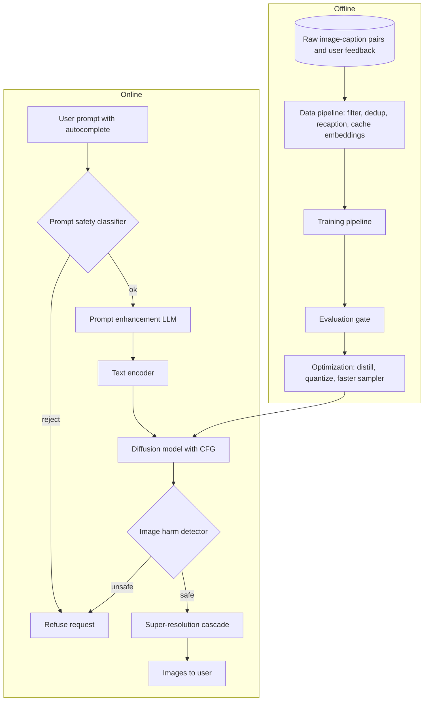

The product takes a prompt of up to a long paragraph and returns a high-resolution image within about ten seconds, across photos, portraits and abstract art. Unlike the earlier chapters, the user now steers content, so the model has to follow language, and the system has to refuse some requests. The heavy part is a diffusion model with billions of parameters that needs many sequential denoising passes. The design tension sits between three things: image quality and prompt faithfulness, latency and GPU cost per image, and safety and fairness checks that add their own latency.

## Requirements that change the design

- **Resolution.** At around 1024px, the base model should generate small or in a latent space, then upscale.
- **Prompt length and language.** Long, detailed English prompts favor a strong language encoder such as T5 over CLIP's short-context text tower; a multilingual encoder keeps other languages open.
- **Data.** Hundreds of millions of images with captions of uneven quality, so recaptioning is part of the plan.
- **Latency.** Ten seconds forces fewer sampling steps, distillation or latent diffusion.
- **Fairness and safety.** Agree which attributes to audit and what content is disallowed. Both add components to the data pipeline and the request path.

## Diffusion over autoregressive, for quality and step control

Two families are realistic. **Autoregressive** models (DALL-E, Parti, Muse) map text tokens to image tokens and decode them; they are simple to train, since every position gives a learning signal in one pass. **Diffusion** models (Imagen, DALL-E 2 and 3, Stable Diffusion) denoise from random noise, guided by a CLIP or T5 text embedding. Both are big and slow. Diffusion wins here because it currently gives the most detailed images and its step count is a dial: one trained model can trade quality for speed at inference.

## Data: filter images, then fix the captions

For images: drop tiny ones, deduplicate exact and near-duplicates (less memorization and skew), remove NSFW and violent content with classifiers, filter by a learned aesthetic score, then resize the short side, center-crop and normalize.

Captions matter as much. Web and user captions are often missing, wrong or in another language. Generate captions for those with a BLIP-style captioner, score every pair with CLIP similarity, replace weak captions with generated ones, and drop pairs that still score low. DALL-E 3 showed that dense synthetic recaptioning noticeably improves prompt following. Cache text-encoder embeddings for every caption so training never reruns a large T5.

## Training: predict the noise, conditioned on text and timestep

The denoiser takes a noisy image, the timestep and the text embedding, and predicts the noise that was added. Two backbones:

- **U-Net.** Convolutional downsampling and upsampling paths with skip connections. Text enters through cross-attention layers in each block: queries from image features, keys and values from text token embeddings. Used by Imagen and Stable Diffusion 1.x and 2.x.
- **DiT.** Patchify the (usually latent) image, add positional encodings, run a Transformer that also takes timestep and text conditioning, and unpatchify back to a noise map. It scales more predictably with compute, which is why newer systems such as Stable Diffusion 3 moved to Transformer backbones.

One training step: sample a pair and a timestep t between 1 and T (often 1,000), jump straight to the noisy version with the closed-form mix of clean image and Gaussian noise set by the noise schedule, encode caption and timestep, predict the noise, and take MSE against the true noise. Predicting noise rather than the clean image is the easier, better-behaved target ([DDPM](https://arxiv.org/abs/2006.11239)). Blank the caption for a small fraction of steps so the model also learns an unconditional prediction, which guidance needs later.

At this scale, plan for memory: bf16 mixed precision, sharded parallelism (FSDP, DeepSpeed ZeRO), and preferably latent diffusion, where an autoencoder shrinks the image about 8x per side.

## Sampling: guidance for faithfulness, fewer steps for speed

Sampling starts from Gaussian noise and repeatedly subtracts the predicted noise. Naively it is slow and drifts away from the prompt. Two techniques fix most of this:

- **Classifier-free guidance.** Run the denoiser with and without the text at each step and push further toward the conditional prediction. Higher scales follow the prompt more closely but cut diversity and can oversaturate colors.
- **Faster samplers.** DDIM and ODE solvers such as DPM-Solver cut 1,000 steps to 20 to 50 with little loss. Distillation (progressive, consistency models) goes down to one to four steps.

Other speed levers: weight quantization, parallel sampling, and a low-resolution base followed by a super-resolution cascade (64 to 256 to 1024 in Imagen).

## Evaluation: quality, diversity and alignment

Use a fixed prompt benchmark such as DrawBench or PartiPrompts, which covers counting, spatial relations, text rendering and rare combinations.

- **FID and IS** for quality and diversity on a standard set like COCO captions. Neither says whether the image matches its prompt.
- **CLIPScore**, the cosine similarity between CLIP embeddings of prompt and image, for alignment. Cheap, but weak on counting, spatial relations and negation, and fooled by prompt words written into the image.
- **Human evaluation**: side-by-side photorealism preference against reference images, plus a graded rating of whether the caption describes the image.
- **Bias audits**: generate many images for neutral prompts ("a doctor") and measure the attribute distribution.

Online: latency percentiles, throughput, GPU utilization, engagement (downloads, click-through, time spent), thumbs up or down, conversion and cost per user. Regenerations per prompt are a quiet but telling signal: unhappy users reroll seeds, which costs money.

## The system around the model

Each request-path component earns its place. Autocomplete helps users write useful prompts. The prompt safety classifier rejects disallowed requests before any GPU time is spent. A prompt enhancement LLM expands terse prompts into the detailed style the model saw after recaptioning, as DALL-E 3's rewriter does. The image harm detector catches what slipped through, since benign prompts can still yield unsafe images. Offline, prompts, outputs and feedback flow back into the data pipeline, and each retrained model passes the evaluation gate before optimization prepares it for serving.

## Interview questions

**Why diffusion rather than an autoregressive model here?**
Diffusion gives the best detail today, and its step count is adjustable at inference, so one model can serve a fast preview and a slow high-quality mode. Autoregressive models are simpler and share LLM infrastructure, which matters for a single multimodal model.

**How does the text actually influence the image?**
The prompt is encoded into a sequence of token embeddings. Cross-attention layers inside the denoiser use image features as queries and text embeddings as keys and values, so each spatial region can attend to relevant words at every step.

**Trade-off: guidance scale.**
Higher guidance improves prompt adherence but reduces diversity and can oversaturate images; lower values give variety but drift from the prompt. Sweep it and plot FID against CLIPScore to pick the operating point.

**Trade-off: sampling steps versus latency.**
Returns diminish after a few dozen steps. Good solvers get most of the quality at 20 to 30; distilled models reach one to four steps with some diversity loss. For ten seconds, a solver plus latent diffusion plus a cascade usually fits without distillation.

**Why bother recaptioning the training data?**
The model only learns what captions describe. Short, noisy captions teach it to ignore details, so long prompts fail. Dense synthetic captions fix that, paired with prompt enhancement so user prompts match the training style.

**How would you put safety into this system?**
Layer it: filter unsafe data before training, classify prompts before generation, check generated images after, and watermark outputs. Each layer catches failures of the others, and rejected prompts and images are logged to improve the classifiers.

**How would you reduce bias in generated people?**
Rebalance training data, measure attribute distributions for neutral prompts, and correct with reweighting, fine-tuning or prompt diversification when attributes are unspecified. Rerun the audit every release.

**How do you train a multi-billion-parameter denoiser that does not fit on one GPU?**
Shard parameters, gradients and optimizer state with FSDP or ZeRO, use bf16 and activation checkpointing, cache text embeddings, train in latent space, and start at low resolution before fine-tuning higher.

