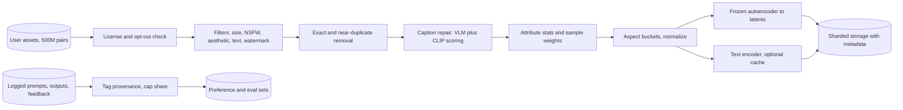
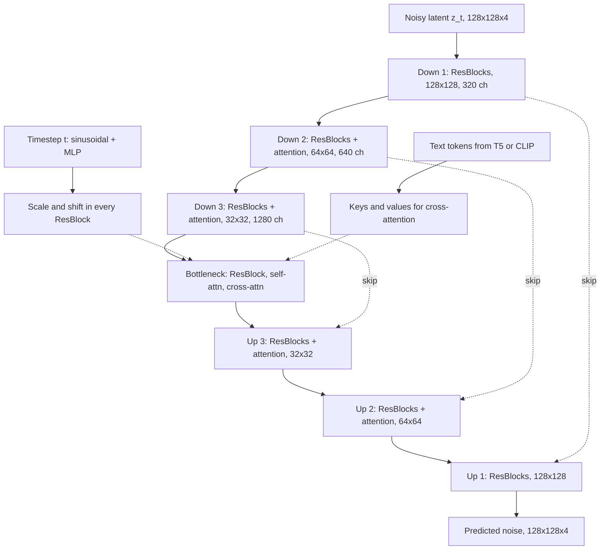
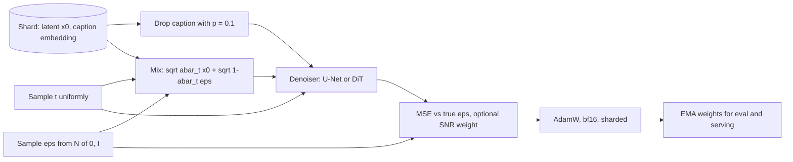
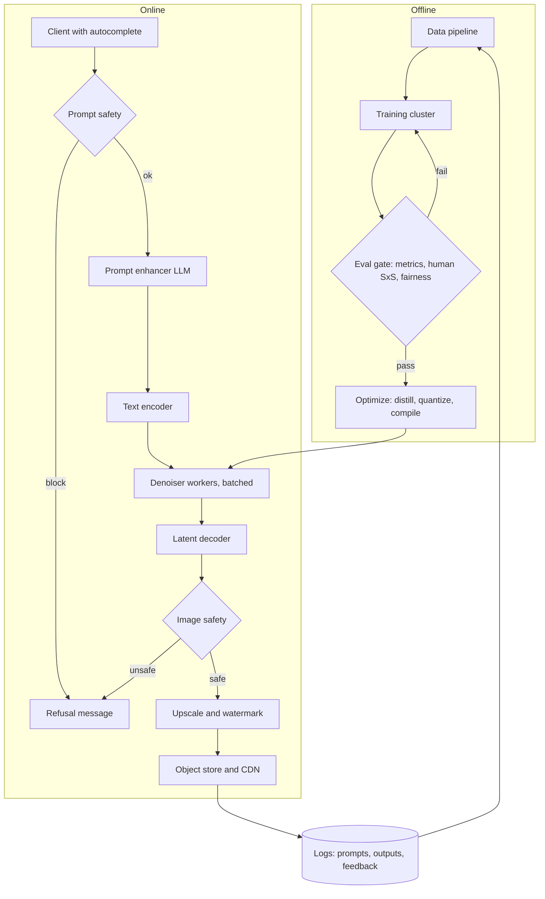
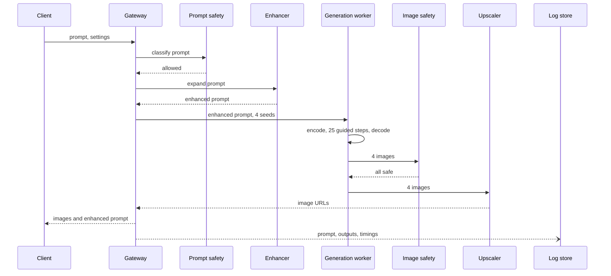

A user types up to about 128 words describing a scene and, within roughly ten seconds, gets back a 1024 by 1024 image that looks good and contains what was asked for: the right objects, counts, colors, layout and style. The face generator in an earlier chapter started from noise with no user control. Here language steers content, which brings three new problems. The model has to read long, compositional prompts and respect every clause. The system has to refuse some requests and catch unsafe outputs from harmless prompts. And the generator is a multi-billion-parameter network that runs tens of sequential passes per image, so every quality gain shows up on the GPU bill.

The core tension is a triangle. **Fidelity** (realism plus prompt adherence) pulls toward bigger models, more steps and stronger guidance. **Latency and cost** pull toward fewer steps, distilled models and smaller tensors. **Safety and fairness** add classifiers before and after generation and constrain the training data. Most decisions below move a point inside that triangle; a good answer names which corner each one gives up.

The notes follow the book's seven-step framework, then add follow-ups, interview questions, a 45-minute walkthrough and review questions.

## 1. Clarifying requirements

Functional: English prompts up to 128 words (about 160 to 200 tokens), other languages later; one to four 1024px images per request across photos, portraits, illustration and abstract art; training on roughly 500M user-asset images whose captions vary in quality; no sexual, violent or hateful imagery; outputs audited for skew in age, gender and skin tone when the prompt leaves them unspecified.

Non-functional: about 10 seconds at p95 for the batch; bounded GPU-seconds per image, because unhappy users reroll and every reroll costs as much as the first try; regular retraining without breaking the safety stack.

| Requirement | Design consequence | If relaxed |
|---|---|---|
| 1024px output | Generate in a compressed latent, or at 64px plus an upsampling cascade | At 256px one pixel-space model is fine |
| Long, detailed prompts | T5-class text encoder with a 256-token context, not only CLIP's 77 | A CLIP text tower suffices |
| English now, more later | Swappable text encoder; embeddings versioned per encoder | Multilingual from day one costs some English quality |
| Noisy captions | Recaption with a vision-language model, filter by image-text similarity | Skip the captioning cluster |
| 10 s p95 | 20 to 30 solver steps, latent space, low precision, batched samples | 60 s allows pixel cascades and 100+ steps |
| Fairness on three attributes | Attribute stats in data and eval; diversify unspecified attributes | Outputs mirror the web's skew |
| Disallowed content | Data filters, prompt classifier, output classifier, watermark | An internal tool might keep only output checks |

## 2. Framing the problem as an ML task

The task is conditional generation: learn \( p(x \mid c) \) for image \(x\) and prompt \(c\), then sample from it. Input is a string, output a pixel tensor, and there is no single correct answer. Training uses image-caption pairs as samples from the joint distribution.

| Family | Generation | Detail at 1024px | Speed knob | Training signal | Main weakness |
|---|---|---|---|---|---|
| Autoregressive image tokens (DALL-E 1, Parti) | Transformer emits VQ tokens one by one | Good, capped by tokenizer | Almost none | Every token, one pass | Thousands of sequential steps |
| Masked tokens (Muse) | Fill masked tokens in 10 to 20 parallel rounds | Good | Rounds | Many tokens per pass | Tokenizer cap, fewer recipes |
| Diffusion, pixel or latent (Imagen, Stable Diffusion, DALL-E 2 and 3) | Iteratively denoise Gaussian noise | Best in practice | Steps, solver, guidance | One noise level per example | Many network calls per image |
| GAN (GigaGAN) | One generator pass | Good, weaker composition | Already one step | Adversarial | Unstable at scale, mode collapse |

I would pick latent diffusion. It wins on visible detail, and its step count is a dial on one set of weights: the same model can serve a two-second draft and a ten-second final. Autoregressive models train more efficiently (every token is supervised per pass, while diffusion supervises one noise level per sample) and reuse LLM infrastructure, a strong argument for a unified chat-and-draw assistant but not for a dedicated service with a hard latency target. GANs are fastest but scale poorly on compositional prompts, and distillation lets diffusion recover most of that speed anyway.

## 3. Data preparation

### Sources and consent

Confirm the license allows training, honor opt-outs and deletions, and record per-image provenance so a removal can be traced to every shard and model. Logged prompts, generations and feedback are useful for preference tuning and eval sets, but cap generated images in pretraining: a generator trained on its own outputs narrows its distribution over rounds.

### Image filtering

- **Resolution floor.** Around 256px short side for high-resolution stages, lower for early low-resolution pretraining. Upscaled thumbnails teach blur.
- **Deduplication.** File hashes for exact copies; perceptual hashes or embedding clusters with a cosine threshold near 0.95 for near copies. Duplicates over-weight popular images and drive memorization, a quality and legal risk.
- **Safety.** NSFW, gore and hate-symbol classifiers, with per-category thresholds audited by hand so benign images of people are not discarded wholesale.
- **Aesthetics.** A small regressor on CLIP image embeddings predicts human ratings. The threshold shapes the model's default style, so it is a product decision.
- **Junk.** Text-dominated images (by OCR coverage), screenshots, heavy watermarks. If many training images carry watermarks, the model learns to draw them.

### Caption repair

The model only learns concepts its captions mention. User captions are often absent, foreign-language, filenames or tag lists. Run a vision-language captioner (BLIP-family or larger) on every image to get dense descriptions of objects, attributes, counts, positions, style and visible text. Score the original caption with CLIP similarity; keep it when relevant because it carries proper nouns and user vocabulary, replace it when weak, and drop pairs still below a floor. Train on a mix of dense synthetic and short original captions. The [DALL-E 3 report](https://cdn.openai.com/papers/dall-e-3.pdf) found prompt following rises sharply with a high synthetic share, while a model trained only on long captions handles terse prompts poorly, which is why serving rewrites prompts. Captioner hallucinations are the main hazard: an object named but absent teaches the model to ignore words.

### Fairness and preprocessing

Run attribute classifiers on images with people and log distributions per role word ("nurse", "CEO") in the captions. Rebalance with sampling weights rather than deletion; it is cheap and reversible. Validate those classifiers on hand-labeled data, since their errors are themselves skewed.

Square center crops cut off heads and teach the model to center everything. Aspect-ratio bucketing (a handful of resolutions such as 1024x1024, 1152x896, 896x1152, batched within bucket) avoids that and enables non-square outputs. Pixels go to \([-1, 1]\) to match the noise scale. Each image passes once through the frozen autoencoder and is stored as a latent in tar or Parquet shards with metadata columns (scores, attributes, license, flags) so later stages can re-filter without reprocessing.

**Worked example: caching cost for 500M pairs.** A 1024px image in an 8x, 4-channel latent is \(128 \times 128 \times 4 = 65{,}536\) values, 128 KB in fp16, so about 64 TB in total. T5-XXL token embeddings are 4,096-wide: at 120 real tokens in bf16, \(120 \times 4096 \times 2 \approx 0.98\) MB per caption, close to 490 TB. So many teams cache latents but compute text embeddings online (roughly 10 to 20 percent more step time), or cache them only for the smaller high-resolution subset, or in fp8.

Pitfalls: over-aggressive face filtering degrades portraits, aesthetic filters skew toward one look, and a hallucinating captioner spreads its errors everywhere.

## 4. Model development

### Architecture

Four parts: a frozen text encoder, a frozen autoencoder between pixels and latents, a trainable denoiser in latent space, and optionally an upscaler.

**Text encoder.** CLIP's text tower is visually grounded but limited to 77 tokens and weak on word order. T5-XXL (about 4.7B encoder parameters) reads long prompts and handles syntax and negation better; Imagen found scaling the text encoder helped adherence more than scaling the image model. Many systems concatenate both. Keep it frozen so cached embeddings stay valid.

**Autoencoder.** A convolutional VAE maps \(1024 \times 1024 \times 3\) to \(128 \times 128 \times c\), \(c\) of 4 or 16. The input to every denoising step shrinks by \(3{,}145{,}728 / 65{,}536 = 48\) times, the largest single saving in the design. Latent channels cap fine detail; small text and faces need 16.

#### U-Net denoiser

The U-Net halves spatial size and widens channels per level on the way down, mirrors that on the way up, and passes skip connections across so high-frequency detail survives. Each level stacks residual conv blocks; lower levels add self-attention and cross-attention to text.

Cross-attention is where language touches pixels. Flatten a feature map into \(N = h \times w\) vectors as queries; the \(M\) text token embeddings supply keys and values:

$$
\mathrm{CrossAttn}(H, E) = \mathrm{softmax}\!\left(\frac{(H W_Q)(E W_K)^\top}{\sqrt{d}}\right) E W_V
$$

\(H \in \mathbb{R}^{N \times d_h}\) are image features, \(E \in \mathbb{R}^{M \times d_e}\) text embeddings, \(W_Q, W_K, W_V\) project both to width \(d\), and each softmax row is one spatial position's distribution over prompt tokens. Averaging those maps per token shows where "red" or "cat" lands, which editing methods such as prompt-to-prompt exploit.

The timestep is embedded with sinusoids and an MLP, then scales and shifts normalized activations in each residual block. Without it the network cannot tell light noise from near-total noise, and the correct action differs a lot. Group or layer norm is preferred over batch norm because per-sample statistics behave better with small per-GPU batches whose noise levels vary.

#### DiT alternative

A Diffusion Transformer patchifies the latent (patch 2 turns \(128 \times 128\) into 4,096 tokens), adds 2D position embeddings, runs a Transformer stack, and unpatchifies back to a noise map. Timestep and pooled text modulate each block via adaptive layer norm; the full text enters by cross-attention or, in Stable Diffusion 3's MM-DiT, by joint attention over concatenated text and image tokens. DiTs scale predictably with compute ([Peebles and Xie](https://arxiv.org/abs/2212.09748)), reuse LLM kernels and parallelism, and treat aspect ratios as variable token counts; U-Nets converge faster on small budgets. Patch 1 instead of 2 means 4x the tokens and about 16x the attention cost. For a new large build I would choose DiT.

**Upscaling.** Pixel systems like Imagen chain 64 to 256 to 1024 diffusion upsamplers, trained on deliberately corrupted low-resolution inputs so they repair artifacts instead of enlarging them. A latent system decodes at 1024px directly.

### Training

#### Forward process and objective

With a variance schedule \(\beta_1, \dots, \beta_T\), \(T = 1000\), one noising step is

$$
x_t = \sqrt{1-\beta_t}\, x_{t-1} + \sqrt{\beta_t}\, \epsilon, \qquad \epsilon \sim \mathcal{N}(0, I)
$$

where \(\beta_t\) is the fresh noise variance at step \(t\). Gaussians compose, so any step is reachable in one shot:

$$
x_t = \sqrt{\bar\alpha_t}\, x_0 + \sqrt{1-\bar\alpha_t}\, \epsilon, \qquad \bar\alpha_t = \prod_{s=1}^{t} (1-\beta_s)
$$

\(x_0\) is the clean latent and \(\bar\alpha_t\) the remaining signal variance, sliding from near 1 to near 0. Think of schedules in terms of \(\mathrm{SNR}(t) = \bar\alpha_t / (1-\bar\alpha_t)\). Higher resolutions need schedules shifted toward more noise, because correlated neighboring pixels leak signal. A schedule that never reaches zero SNR at \(t = T\) mismatches sampling, which starts from pure noise, and the model then struggles with very dark or bright images.

The network learns to recover the noise:

$$
\mathcal{L} = \mathbb{E}_{x_0, c, t, \epsilon}\left[\, \big\| \epsilon - \epsilon_\theta(x_t, t, \tau(c)) \big\|_2^2 \,\right]
$$

\(\epsilon_\theta\) is the denoiser, \(\tau(c)\) the text encoding of caption \(c\), and \(t\) is uniform. This MSE is a reweighted variational bound ([DDPM](https://arxiv.org/abs/2006.11239)); the noise target has unit variance at every \(t\), unlike \(x_0\), which is nearly unrecoverable at high noise. Variants: v-prediction (target \(\sqrt{\bar\alpha_t}\epsilon - \sqrt{1-\bar\alpha_t}x_0\)) behaves well at both ends and distills better; min-SNR weighting stops easy low-noise steps dominating; flow matching regresses a velocity along a straight path from data to noise and needs fewer sampling steps.

For classifier-free guidance, replace the caption with the empty string for about 10 percent of examples, so one network learns both conditional and unconditional predictions.

#### Stages

1. Autoencoder: reconstruction, perceptual and light adversarial losses; then frozen.
2. Low-resolution pretraining at 256px on the full set, where most concepts are learned at a sixteenth of the 1024px token cost.
3. High-resolution training at 512 then 1024 with aspect buckets on a cleaner subset.
4. Aesthetic fine-tuning on thousands of hand-curated images; Meta's Emu showed this small stage moves human preference a lot.
5. Preference tuning with Diffusion-DPO or reward-weighted fine-tuning on pairwise judgments, fed by logged thumbs and rerolls.
6. Distillation for serving (next section).

#### Efficiency

bf16 compute with fp32 master weights. FSDP or ZeRO-3 to shard parameters, gradients and optimizer state: a 3B denoiser with AdamW needs about \(3\text{B} \times 16\) bytes \(= 48\) GB before activations. Activation checkpointing in attention blocks costs about a third more compute and frees memory for larger batches. Keep an EMA of weights (decay near 0.9999) for evaluation and serving; it samples noticeably cleaner.

**Worked example: training compute.** A 2B DiT on 4,096 tokens costs about \(6N\) FLOPs per token for forward plus backward:

$$
6 \times (2 \times 10^{9}) \times 4096 \approx 4.9 \times 10^{13} \ \text{FLOPs per sample}
$$

300M samples at 1024px is \(1.5 \times 10^{22}\) FLOPs. An H100 at 40 percent of about \(10^{15}\) bf16 FLOP/s does \(4 \times 10^{14}\) per second, giving \(3.7 \times 10^{7}\) GPU-seconds: about 10,000 GPU-hours, or five days on 1,024 GPUs before attention overhead. At 256px there are 256 tokens, 16x cheaper per sample, which is why the bulk of samples are seen at low resolution.

#### Failure modes

- **Flat loss, improving samples.** Diffusion loss is dominated by the noise level; track FID and alignment on a fixed prompt set instead.
- **Attribute leakage** ("red cube, blue sphere" both red). Denser captions, a stronger text encoder, compositional data.
- **Garbled text.** Character-aware encoders, more latent channels, captions that transcribe visible text.
- **Memorization.** Stricter dedup; compare outputs to training embeddings.
- **Loss spikes.** QK normalization, gradient clipping, lower learning rate, restart from a good checkpoint.

### Sampling

Sampling starts from \(x_T \sim \mathcal{N}(0, I)\) and walks backward. The DDPM step is

$$
x_{t-1} = \frac{1}{\sqrt{1-\beta_t}}\left(x_t - \frac{\beta_t}{\sqrt{1-\bar\alpha_t}}\, \hat\epsilon\right) + \sigma_t z, \qquad z \sim \mathcal{N}(0, I)
$$

with \(\hat\epsilon\) the predicted noise and \(\sigma_t\) the injected randomness. Naively that is 1,000 network calls, and samples under-follow the prompt.

**Classifier-free guidance** runs the denoiser with and without the prompt and extrapolates:

$$
\hat\epsilon = \epsilon_\theta(x_t, t, \varnothing) + w \big(\epsilon_\theta(x_t, t, c) - \epsilon_\theta(x_t, t, \varnothing)\big)
$$

\(w\) is the guidance scale; \(w = 1\) is plain conditional sampling, and 4 to 9 is typical. The difference term points toward "more like the text". Costs: two evaluations per step (batched), lower diversity, and oversaturated, plastic-looking images at high \(w\). A negative prompt replaces \(\varnothing\) with text to steer away from ([Ho and Salimans](https://arxiv.org/abs/2207.12598)).

**Fewer steps.** DDIM treats the trained model as a deterministic sampler that skips timesteps: estimate \(\hat x_0 = (x_t - \sqrt{1-\bar\alpha_t}\,\hat\epsilon)/\sqrt{\bar\alpha_t}\), then jump to \(x_s = \sqrt{\bar\alpha_s}\,\hat x_0 + \sqrt{1-\bar\alpha_s}\,\hat\epsilon\) for an earlier \(s\). Twenty to fifty steps stay close to full quality; higher-order solvers (DPM-Solver++, UniPC) reach it in 15 to 25. Determinism also makes seeds reproducible, which "vary this image" features need. Distillation goes further: progressive distillation halves steps repeatedly, consistency models map any noisy point straight to a clean one, adversarial distillation (SDXL Turbo) adds a discriminator for crisp one-to-four-step output, and guidance distillation folds CFG into a single evaluation.

| Knob or method | Typical | Quality | Latency | Watch for |
|---|---|---|---|---|
| DPM-Solver++ steps | 20 to 30 | Near full | Linear in steps | Smearing below about 12 |
| DDPM ancestral | 250 to 1000 | Most diverse | Far too slow | Offline use only |
| Guidance scale \(w\) | 4 to 9 | Adherence up, diversity down | 2x compute unless distilled | Oversaturation |
| Guidance distillation | 1 call per step | Close to CFG | About 2x faster | Narrow \(w\) range |
| Consistency or adversarial distillation | 1 to 4 steps | Good, less variety | 5 to 20x faster | Long compositional prompts |
| Four seeds per prompt | 4 | Covers interpretations | Batched, about 1.5 to 2x one | Rerolls if all miss |

## 5. Evaluation

### Offline

Use fixed prompt suites that isolate skills: DrawBench and PartiPrompts (counting, color, spatial relations, rare combinations, text rendering), GenEval (detector-checked presence, count, color, position), T2I-CompBench (attribute binding). Use several seeds per prompt.

**FID** compares Inception feature statistics of real and generated images, typically on 30k COCO captions:

$$
\mathrm{FID} = \|\mu_r - \mu_g\|_2^2 + \mathrm{Tr}\!\left(\Sigma_r + \Sigma_g - 2(\Sigma_r \Sigma_g)^{1/2}\right)
$$

\(\mu\) and \(\Sigma\) are feature means and covariances for real (\(r\)) and generated (\(g\)) sets. It covers realism and diversity but ignores the prompt. Inception Score saturates on modern models.

**CLIPScore** rescales cosine similarity between CLIP image embedding \(v\) and prompt embedding \(u\): \(\mathrm{CLIPScore} = 2.5 \cdot \max(\cos(u, v), 0)\). CLIP was trained contrastively over a batch of \(B\) pairs:

$$
\mathcal{L}_{\text{CLIP}} = -\frac{1}{2B}\sum_{i=1}^{B}\left[\log\frac{e^{s_{ii}/\tau}}{\sum_j e^{s_{ij}/\tau}} + \log\frac{e^{s_{ii}/\tau}}{\sum_j e^{s_{ji}/\tau}}\right]
$$

\(s_{ij}\) is the cosine similarity of image \(i\) and text \(j\), and \(\tau\) a learned temperature. Random batches almost never contain near-miss negatives like "dog left of cat" against "cat left of dog", so CLIP learns something close to bag-of-words matching and CLIPScore misses composition errors. VQA-based metrics (TIFA, DSG) help: an LLM turns the prompt into yes/no questions and a VQA model answers them on the image.

**Fairness:** for neutral prompts ("a photo of a nurse"), generate a few hundred images, classify the three attributes, and report total variation distance from a target distribution.

**Human evaluation:** side-by-side preference against the current model on the same prompts (win rate with confidence interval), a 3-level adherence rating per image, and photorealism comparisons against real photos. Use trained raters, several per item, and track agreement. Preference models (PickScore, ImageReward, HPS) approximate this cheaply between releases.

| Metric | Catches | Misses | Cost |
|---|---|---|---|
| FID | Realism and diversity shifts, collapse | Adherence; fine taste | Cheap, 10k+ samples |
| CLIPScore | Wrong or missing main subject | Counts, positions, binding, negation; fooled by drawn text | Cheap |
| VQA-based (TIFA, GenEval) | Specific compositional errors | Aesthetics; VQA model errors | Moderate |
| Preference model | Taste trends | Reward hacking, rater bias | Cheap |
| Human side-by-side | What users notice | Rare failures | Expensive |
| Attribute audit | Demographic skew | Stereotyped context and setting | Moderate |

### Online

Engagement: save or download rate, shares, click-through on results, thumbs. Friction: reroll rate (same prompt, new seed), immediate prompt edits, abandonment while waiting. Business: paid conversion and GPU cost per active user per month. System: per-stage p50 and p95 latency, throughput, GPU utilization, refusal rate by category. Reroll rate deserves its own dashboard because it is a quality signal and a cost multiplier at once.

## 6. Overall ML system design

- **Autocomplete:** a small LM suggests continuations, steering users toward descriptive prompts.
- **Prompt safety:** a classifier or small LLM judge blocks disallowed requests before any GPU work; it must handle misspellings and euphemisms.
- **Prompt enhancer:** an LLM expands terse prompts into the dense style seen after recaptioning, keeps every user constraint, and can diversify unspecified demographics across the four samples. Show the rewrite.
- **Image safety:** harmless prompts can still produce unsafe pixels; blocks are logged for retraining.
- **Finishing:** upscale, invisible watermark plus C2PA provenance metadata, store, return URLs.

**Worked example: latency budget.** 2B DiT, 4,096 tokens, 25 steps, four images with CFG, so 8 sequences per step. One sequence forward is \(2 \times 2\times10^{9} \times 4096 \approx 1.6\times10^{13}\) FLOPs, about \(2.1\times10^{13}\) with attention. Total: \(8 \times 25 \times 2.1\times10^{13} = 4.2\times10^{15}\) FLOPs, or 8.4 s on one H100 at 50 percent of \(10^{15}\) FLOP/s. Too tight. Guidance distillation halves it to 4.2 s (or split across two GPUs). Budget: prompt safety 50 ms, enhancer 600 ms, text encode 80 ms, denoise 4.2 s, decode 400 ms, image safety 80 ms, upscale and watermark 500 ms, network and queueing 1 s. About 7 s, leaving p95 headroom.

**Worked example: fleet size.** 2M requests/day is \(2\times10^{6}/86{,}400 \approx 23\)/s, about 70/s at a 3x peak. At 4.5 GPU-seconds each, peak needs \(70 \times 4.5 \approx 315\) busy GPUs, or about 450 at 70 percent utilization, plus a few dozen for the enhancer, safety models and upscalers. A 15 percent reroll rate multiplies this by 1.15; moving 30 percent of traffic to a four-step fast tier saves roughly a quarter.

| Technique | Latency | Cost | Quality risk |
|---|---|---|---|
| Better solver, fewer steps | Large drop | Large drop | Low down to about 20 steps |
| Guidance distillation | About 2x | About half | Low |
| Step distillation (LCM, adversarial) | 5 to 20x | Large drop | Medium on complex prompts |
| int8 or fp8 weights | 1.3 to 2x | Lower | Low with calibration; check faces and text |
| Compiled graphs, fused attention | 1.2 to 1.5x | Lower | None |
| Dynamic batching by resolution bucket | Small queue wait | Much higher throughput | None |
| Router: small model for easy prompts | Lower average | Lower | Low if router is accurate |

## 7. Deployment and monitoring

**Safety and monitoring.** Layers: filtered data, prompt classifier, output classifier, watermark, per-account rate limits, and a human review queue for appeals. Watch refusal rate by category (spikes mean a regression or a new jailbreak), output block rate (generator or enhancer drift), per-stage latency, and attribute distributions on a canary prompt set after each deploy. Ship behind a traffic split and compare save and reroll rates first.

**Rollout.** Every candidate passes the offline eval gate, then the distilled and quantized build is compared with its full-precision parent on a fixed prompt set, because optimization can quietly break text rendering and faces. Start with 1 to 5 percent of traffic, keep the old denoiser warm, and widen only when save, reroll and refusal rates hold. Version the enhancer and safety classifiers separately from the denoiser, since a prompt-rewrite change can shift outputs as much as a new model.

**Feedback and retraining.** Logged prompts show what users actually ask for; prompts with high reroll rates become an adherence test set and candidates for recaptioned training data. Saves and side-by-side choices supply preference pairs for reward modeling. Blocked outputs and newly found jailbreaks return to the safety classifiers' training sets on a shorter cycle than the generator, which retrains only when audits or adherence metrics show a gap worth a new stage.

## Follow-ups and extensions

- **Personalization:** DreamBooth or LoRA adapters learned from a few user photos, served as small weight deltas on the shared base (Chapter 10).
- **Editing:** inpainting and outpainting with masked image and mask as extra input channels; instruction editing trained on before-instruction-after triples.
- **Spatial control:** ControlNet, a trainable encoder copy consuming edges, depth or pose.
- **Multilingual:** translate in the enhancer for a quick win, or fine-tune with a multilingual encoder for culture-specific concepts.
- **RLHF:** reward model on preference pairs plus Diffusion-DPO, with a KL tie to the base to resist reward hacking.
- **Video:** add temporal attention to the same latent design (Chapter 11).

## Interview questions

### Clarifying

**Which requirements would you pin down first?**
Resolution and latency together decide between pixel cascades and latent diffusion, and how many steps fit. Prompt length and language decide the text encoder and its context. Data size and caption quality decide whether recaptioning is a first-class component. Safety and fairness scope add models to both the data pipeline and the request path. Traffic and images per request size the fleet.

**Is "10 seconds" p50 or p95, and for how many images?**
I would assume p95 for a batch of four, since that is how results are usually shown. If it meant p50 for one image, a 25-step latent model fits on one GPU easily and step distillation would be unnecessary quality loss. If it meant p95 for four images including queueing, guidance distillation becomes nearly mandatory. It also tells me whether queueing sits inside the budget, which sets how hot I can run GPUs.

**What does "unbiased across age, gender and race" mean operationally?**
For prompts that leave those attributes unspecified, results should vary, and over many generations the distribution should stay within a set distance of an agreed target. Prompts that specify attributes must be followed exactly. The target itself (uniform or a reference population) is a policy choice I would ask the interviewer to own. That gives an audit number, a release threshold, and two places to act: data weighting and prompt diversification.

### Design and trade-offs

**Trade-off: diffusion versus autoregressive.**
Diffusion gives the best detail and a step-count dial that trades speed for quality without retraining. Autoregressive models supervise every token per pass and fit an LLM stack, which suits one model that both chats and draws. Their cost here is thousands of sequential token steps per 1024px image and tokenizer-limited detail. For a dedicated service with a 10 second target, diffusion wins.

**Trade-off: pixel cascade versus latent diffusion.**
A cascade keeps every stage in pixel space, which helps small text and faces, but runs three diffusion models in sequence and the upsamplers are expensive. Latent diffusion runs one denoiser on a 48x smaller tensor, so training and serving are far cheaper, with detail capped by the autoencoder. Sixteen latent channels recover most of that. Under 10 seconds I would choose latent diffusion plus a light upscaler.

**Trade-off: guidance scale.**
Raising \(w\) increases adherence and contrast but reduces seed diversity and eventually oversaturates. Lowering it gives variety and natural color but drifts from the prompt. Sweep \(w\), plot FID against a VQA or CLIP alignment score, and set the default at the knee, usually 5 to 7. A "creativity" slider can expose it to power users.

**Trade-off: U-Net or DiT?**
U-Nets are proven at 1 to 3B parameters and converge faster on small budgets thanks to convolutional priors. DiTs scale more predictably, share kernels and parallelism with LLM infrastructure, and handle aspect ratios as variable token counts. Attention cost grows with the square of tokens, so patch size is the main lever. For a new large build I would pick DiT while noting a U-Net also meets the requirements.

**Trade-off: cache text embeddings or compute online?**
Caching removes an encoder pass from every step, but T5-XXL embeddings are near a megabyte per caption, hundreds of terabytes for 500M. Online encoding costs 10 to 20 percent more step time and lets you change caption mixes freely. A middle path caches for the high-resolution subset that sees many epochs, possibly in fp8. I would decide by comparing the storage bill with the extra GPU-hours, which usually favors online encoding for the big low-resolution pass.

### Deep dives

**Walk through one training step.**
Load latent \(x_0\) and caption embedding, dropping the caption with 10 percent probability. Sample \(t\) uniformly and \(\epsilon\) from a standard normal, and form \(x_t\) in closed form. Run the denoiser on \(x_t\), the timestep embedding and text tokens. Take MSE against \(\epsilon\), optionally SNR-weighted, backpropagate under bf16 and sharding, and update the EMA copy.

**Why predict noise instead of the clean image?**
At high noise the clean image is nearly unrecoverable, so an \(x_0\) target yields blurry averages and badly scaled errors across timesteps. The noise target has unit variance everywhere, balancing the loss and stabilizing optimization, and it relates directly to the score the sampler needs. At very low noise the roles flip, which is why v-prediction blends the two. Either target is a reparameterization of the same information, so the choice is about optimization, not expressiveness.

**Estimate denoising latency for four 1024px images.**
A 2B DiT on 4,096 tokens costs about \(2.1\times10^{13}\) FLOPs per sequence forward including attention. Four images with CFG is 8 sequences per step; 25 steps make \(4.2\times10^{15}\) FLOPs. At 50 percent of an H100's \(10^{15}\) FLOP/s that is 8.4 s. Guidance distillation or a second GPU brings it to about 4 s, within budget.

**Estimate the GPU fleet for 2M requests a day.**
About 23 requests per second on average, 70 at a 3x peak. At 4.5 GPU-seconds each, that is 315 busy GPUs, about 450 at 70 percent utilization, plus a few dozen for the enhancer, safety and upscalers, times the reroll factor. At 2 to 3 dollars per GPU-hour, provisioning for peak all day costs roughly 22,000 to 32,000 dollars a day. Steps per image and the fast-tier share are the biggest levers.

### Operations and failure modes

**A new model has better FID but users reroll more. Why?**
FID rewards realism on COCO-style prompts and says nothing about adherence on long user prompts. The model likely got prettier but less faithful, perhaps from an aesthetic stage pulling toward a house style. Compare VQA-based adherence and run a side-by-side on real logged prompts. Then rebalance or weaken the aesthetic stage, and add real-prompt adherence to the release gate.

**Users bypass the prompt classifier. What now?**
Add the discovered patterns to its training data, raise sensitivity in the affected category, and lean on the output classifier, which ignores phrasing. Red-team regularly with generated adversarial prompts and route borderline cases to an LLM judge. Per-account rate limits slow down systematic probing. Track false positives as you tighten, since over-blocking art and medical content hurts users.

**People in outputs skew after a release. What do you do?**
Confirm with the canary audit against the previous model and the target. Check likely causes: a skewed fine-tuning set, an aesthetic filter correlated with an attribute, or an enhancer change. Mitigate quickly by diversifying unspecified attributes in the enhancer. Then fix the data weighting and make the audit a blocking release check.

**p95 latency doubled while GPU utilization is low. Where do you look?**
Low utilization with high latency points away from the denoiser, toward queueing or other stages. Check per-stage timings for the enhancer LLM, safety services and storage uploads, and check whether the batcher waits too long to fill batches at low traffic. Mixed resolution buckets fragmenting batches is another usual cause. Per-stage timeouts, a capped batching wait and per-bucket queues fix most of it.

## A 45-minute walkthrough

| Minutes | Cover | Draw |
|---|---|---|
| 0 to 5 | Resolution, latency percentile, prompt length, languages, data and captions, safety and fairness scope, traffic | Requirements with numbers |
| 5 to 9 | \(p(x \mid c)\); diffusion versus autoregressive versus GAN; pick latent diffusion and name the cost | Small comparison table |
| 9 to 16 | Filters, dedup, recaptioning, fairness weights, caching with storage estimate | Data pipeline |
| 16 to 23 | Text encoder, autoencoder, U-Net or DiT, cross-attention, timestep conditioning | Denoiser diagram |
| 23 to 29 | Forward process, noise loss, caption dropout, resolution stages, bf16 and FSDP, compute estimate | Training step and two equations |
| 29 to 33 | CFG, solvers, distillation, knob trade-offs | Guidance equation |
| 33 to 37 | FID, CLIPScore and its blind spots, VQA metrics, human side-by-side, fairness audit, reroll rate | Metric list with gaps |
| 37 to 43 | Request path with both safety checks and enhancer, latency budget, fleet size, optimizations | End-to-end architecture |
| 43 to 45 | Personalization, editing, ControlNet, RLHF; the biggest risk | Point at the diagram |

## Review questions

Answer each question in your own words first, then open the answer to check.

### Concepts and definitions

**1. Name the four model parts in the chosen design and say which ones are trained during the main training run.**


A text encoder (T5-class, CLIP, or both) turns the prompt into token embeddings. A convolutional autoencoder maps 1024px images to a small latent and back. A denoiser (U-Net or DiT) predicts noise in that latent, conditioned on time and text. An optional upscaler finishes the image. Only the denoiser is trained in the main run; the autoencoder is trained once beforehand and then frozen, and the text encoder stays frozen so cached embeddings remain valid.


**2. What is \( \mathrm{SNR}(t) \) in the forward process, and how does it change from \( t = 0 \) to \( t = T \)?**


It is the ratio of signal variance to noise variance in \( x_t \):

$$
\mathrm{SNR}(t) = \frac{\bar\alpha_t}{1 - \bar\alpha_t}
$$

where \( \bar\alpha_t \) is the cumulative product of \( (1 - \beta_s) \). Near \( t = 0 \), \( \bar\alpha_t \) is close to 1 and SNR is very large; near \( t = T \) it approaches 0 and the latent is almost pure noise. Thinking in SNR rather than step index makes schedules comparable across resolutions.


**3. What is caption repair, and why are some original captions kept?**


Many user captions are missing, filenames, tag lists or in another language, and the model can only learn concepts that captions mention. A vision-language model writes a dense description of every image, and CLIP similarity scores the original caption. Relevant originals are kept because they carry proper nouns and the vocabulary real users type; weak ones are replaced and hopeless pairs are dropped. Training on a mix keeps the model able to handle both long and short prompts.


**4. What is aspect-ratio bucketing, and which problem does it fix?**


Images are grouped into a few fixed resolutions with different shapes (for example 1024x1024, 1152x896, 896x1152), and each batch draws from one bucket. Forcing everything into square center crops cuts off heads and the edges of scenes and teaches the model to center every subject. Bucketing keeps more of each image and also lets the model generate non-square outputs.


**5. In cross-attention, what do the queries, keys and values come from, and what does one row of the attention matrix mean?**


Queries are projections of the flattened image feature map, one per spatial position. Keys and values are projections of the text token embeddings. One softmax row is a single position's distribution over prompt tokens, telling how much that location draws on each word. Averaging those weights for one token over positions gives a map of where, for example, "cat" is being painted, which prompt-to-prompt style editing uses.


### Mechanisms and math

**6. Why can \( x_t \) be produced from \( x_0 \) in one step during training?**


Each forward step scales the previous latent and adds independent Gaussian noise, and a sum of independent Gaussians is Gaussian. Chaining the steps multiplies the signal scales and accumulates the noise variances, giving

$$
x_t = \sqrt{\bar\alpha_t}\, x_0 + \sqrt{1 - \bar\alpha_t}\, \epsilon
$$

So a training example needs just one sampled \( t \) and one noise draw, not \( t \) sequential steps, which is what makes training on random timesteps cheap.


**7. How does dropping the caption 10 percent of the time make classifier-free guidance possible, and what does the guidance scale \( w \) do?**


With the empty caption in some examples, one network learns both a conditional prediction \( \epsilon_\theta(x_t, t, c) \) and an unconditional one \( \epsilon_\theta(x_t, t, \varnothing) \). At sampling time their difference points toward images that fit the text better. Guidance starts from the unconditional prediction and adds \( w \) times that difference: \( w = 1 \) reproduces plain conditional sampling and larger \( w \) pushes harder toward the prompt. No separate classifier is needed.


**8. How does DDIM jump from step \( t \) to an earlier step \( s \) without visiting every step in between?**


It first uses the predicted noise to estimate the clean latent:

$$
\hat x_0 = \frac{x_t - \sqrt{1 - \bar\alpha_t}\,\hat\epsilon}{\sqrt{\bar\alpha_t}}
$$

Then it rebuilds a latent at step \( s \) by mixing \( \hat x_0 \) and \( \hat\epsilon \) with the coefficients for \( s \): \( x_s = \sqrt{\bar\alpha_s}\,\hat x_0 + \sqrt{1 - \bar\alpha_s}\,\hat\epsilon \). No fresh noise is injected, so the path is deterministic and a fixed seed reproduces the same image, and 20 to 50 such jumps come close to full quality.


**9. Why do higher resolutions need noise schedules shifted toward more noise, and what goes wrong when the schedule never reaches zero SNR?**


Neighboring pixels in a large image are strongly correlated, so at a given noise level more of the image's structure survives than at low resolution; the same schedule therefore looks "too easy" and the model under-trains at the hard, global-layout end. If SNR at \( t = T \) stays above zero, training never sees pure noise, but sampling starts from pure noise. That mismatch shows up as difficulty generating very dark or very bright images, since some average brightness always leaks through in training.


**10. Why does CLIPScore miss errors like "dog left of cat" versus "cat left of dog"?**


CLIP is trained contrastively: each image must match its own caption better than the other captions in a random batch. Random batches almost never contain two captions that differ only in word order or attribute binding, so CLIP gets no pressure to encode those differences. It ends up behaving close to a bag-of-words matcher, and CLIPScore rewards having the right objects regardless of their arrangement. VQA-based metrics such as TIFA or DSG check those relations directly.


### Numbers and estimates

**11. How much smaller is the latent than the image, and how much storage do 500M cached latents need?**


Image values: \( 1024 \times 1024 \times 3 = 3{,}145{,}728 \).
Latent values (8x downsampling, 4 channels): \( 128 \times 128 \times 4 = 65{,}536 \).
Ratio: \( 3{,}145{,}728 / 65{,}536 = 48 \).
In fp16 a latent is \( 65{,}536 \times 2 = 131{,}072 \) bytes, 128 KB, so \( 500 \times 10^6 \times 128 \text{ KB} \approx 64 \) TB.


**12. Why does a 3B-parameter denoiser trained with AdamW need about 48 GB before activations?**


Mixed-precision AdamW keeps about 16 bytes per parameter: bf16 weights (2) and gradients (2), plus fp32 master weights (4) and two fp32 Adam moments (4 + 4).
Total: \( 3 \times 10^9 \times 16 = 48 \times 10^9 \) bytes, about 48 GB.
That alone fills most of an 80 GB GPU, which is why FSDP or ZeRO-3 shards these states across GPUs.


**13. How do patch size and training resolution change the DiT token count and attention cost?**


At 1024px the latent is \( 128 \times 128 \). Patch 2: \( (128/2)^2 = 4{,}096 \) tokens. Patch 1: \( 128^2 = 16{,}384 \) tokens, four times more, and attention grows with the square of tokens, so about \( 4^2 = 16 \) times the attention cost.
At 256px the latent is \( 32 \times 32 \), so patch 2 gives \( 16^2 = 256 \) tokens, 16 times fewer than at 1024px. Per-token cost being roughly constant, each low-resolution sample is about 16 times cheaper, which is why most samples are seen at 256px.


### Design reasoning and trade-offs

**14. Why have a prompt enhancer at serving time when the training captions were already improved?**


Recaptioning makes the model expect dense, detailed descriptions, and a model trained mostly on those handles short user prompts worse. The enhancer closes that gap by expanding terse prompts into the style the model learned, while keeping every constraint the user wrote. It is also a place to vary unspecified demographic attributes across the four samples. Showing the rewritten prompt keeps the behavior transparent.


**15. Why check safety both before and after generation?**


The prompt check is cheap and runs before any GPU work, so clearly disallowed requests cost almost nothing to refuse. It can be evaded with misspellings and euphemisms, and a harmless prompt can still produce unsafe pixels. The image check looks at what was actually generated, independent of wording. Each layer covers the other's blind spot, and blocks from both feed retraining.


**16. Why cap the share of the product's own generated images in pretraining data?**


Generated images come from the model's own distribution, which is already narrower and more stylized than real data. Training on them repeatedly reinforces the model's preferences, so variety shrinks with each round. Logged prompts, outputs and feedback are still valuable for preference tuning and evaluation sets, where they reflect what users actually ask for.


**17. Why rebalance demographic skew with sampling weights instead of deleting images?**


Weights change how often each image is seen without losing any data, so the change is cheap and can be undone or retuned in the next run. Deleting images discards information permanently and can remove useful variety along other dimensions. Weighting depends on attribute classifiers, so those must be checked against hand labels, because their own errors are skewed.


### Common mistakes

**18. What goes wrong if the captioner hallucinates objects that are not in the image?**


The model sees captions that name things it cannot find in the pixels. It learns that some words do not need to appear in the output, which is the opposite of prompt adherence. Because the captioner runs on every image, its errors spread across the whole dataset rather than staying in a small corner, so caption quality has to be audited before large-scale use.


**19. What goes wrong if you judge diffusion training progress by the loss curve alone?**


The loss is an average over random noise levels and is dominated by how hard each level is, so it can stay almost flat while samples keep getting better, or move for reasons unrelated to quality. Stopping or tuning by it misleads you. Track FID and alignment metrics on a fixed prompt set, with fixed seeds, across checkpoints instead.


**20. What goes wrong if the guidance scale is set very high?**


Prompt adherence and contrast keep rising at first, but samples from different seeds start to look alike, and eventually colors oversaturate and surfaces look plastic. Undistilled guidance also costs two denoiser evaluations per step at any scale. A sweep that plots FID against an alignment score and picks the knee avoids both extremes.

