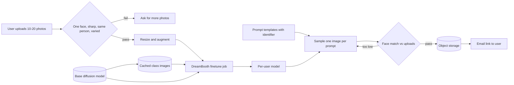

A user uploads a dozen casual photos and later receives studio-style headshots that still look like them. A generic text-to-image model has never seen this face, so the system must teach it a new identity from very little data. Push hard enough to capture the exact face and the model forgets how to draw anything else; hold back and you get a pleasant stranger. Most decisions are about that line and about which personalization method fits the latency and storage budget.

## Requirements that pick the method

- Who is the output for? Business profile photos mean a narrow set of scenes, so you can write the prompts yourself.
- How many photos? One points to a tuning-free encoder method. Ten to twenty from different angles makes per-user finetuning realistic and more faithful.
- What about bad uploads? Blur, sunglasses, group shots or a second person quietly poison training, so validate before spending GPU time.
- Synchronous or not? Results by email within an hour allow a 10 to 20 minute finetune; a user watching a spinner rules it out.
- Do we keep the personalized model? Repeat orders mean per-user storage, and its size starts to matter.
- Resolution and count (say 1024x1024, fifty images) set the base model and inference bill.

## Framing: inject an identity into a pretrained diffusion model

Input is a small set of face photos of one person; output is a set of varied, high-quality headshots that preserve identity. The generator is a pretrained diffusion model. The question is how to get the identity in.

Tuning-free methods train a visual encoder alongside the generator once, then turn a reference photo into conditioning features at request time. One deployed model serves everyone and one photo suffices, but a single embedding misses angles and expressions it never saw, and building such a system needs specialized encoders and paired data. Meta's Imagine Yourself is one example.

Tuning-based methods adjust the model per person, and three are worth knowing:

- [Textual inversion](https://arxiv.org/abs/2208.01618) learns only a new token embedding. Tiny and harmless to the base model, but one vector can't hold a face well.
- [DreamBooth](https://arxiv.org/abs/2208.12242) updates all diffusion weights. Best fidelity from few images, but each user costs a full model copy (gigabytes) and more GPU memory, and the model can forget its prior.
- [LoRA](https://arxiv.org/abs/2106.09685) freezes the base and trains small low-rank adapters. A d_out by d_in weight gets an additive update built from two thin matrices of rank r, so trainable parameters fall to r(d_in + d_out). Adapters are megabytes and quality is usually close to full finetuning.

DreamBooth is the sensible pick here. Faithfulness to the face is the product, training fits inside the hour, and since the weights are discarded after delivery, the per-user storage cost never shows up. If users kept a model for repeat orders, LoRA would win.

DreamBooth relies on two ideas. The subject is bound to a rare-token identifier such as "sks": a common word brings its existing meaning along, and a random string splits into sub-tokens that each carry associations, while a rare single token is close to a blank slot. And a class-specific prior preservation loss keeps the model's sense of what a generic person looks like.

## Data and training: a tiny dataset plus an anchor

Preparation is short. Crop and resize uploads to the model's resolution, and augment lightly with flips, small rotations and scale changes, avoiding anything that alters facial features. Then build a class set: a few hundred images of generic people sampled from the frozen base model with plain prompts like "a photo of a person". They come from the model's own prior, which is what we want to protect.

Training is the usual diffusion loop on the U-Net: sample a timestep, add noise, predict the noise given caption and timestep. User photos are captioned with the identifier ("a photo of sks person"); class images get the plain caption. The loss adds a reconstruction term on the user's photos, which pulls the identifier toward this face, and a prior term on the class images, which penalizes drift in how the model draws people generally. Their relative weight is the main knob: too little prior weight and every person starts to resemble the user while poses collapse; too much and the face comes out soft. A dozen images overfit within a few hundred steps, so use a fixed step budget validated on held-out users.

## Evaluation: only one similarity metric measures identity

Offline checks cover three things. CLIPScore between image and prompt measures prompt following. FID and Inception Score catch artifacts and collapse but know nothing about who is pictured. Subject fidelity compares outputs to the real photos: CLIP image embeddings give a coarse semantic match, and self-supervised DINO or DINOv2 embeddings are more sensitive to color and texture. Neither is a face matcher, since two people with similar hair and lighting score high on both. A face recognition embedding with cosine similarity is what tracks "same person".

The blind spot is that fidelity fights diversity: a model that copies a training photo scores perfectly on similarity. Add a diversity measure across the fifty outputs or human review.

Online, the signals are business ones: post-delivery ratings, the share of orders with complaints or regeneration requests, and conversion from trial to paid. Ratings skew toward unhappy users, so pair them with downloads per order.

## The system: validate, finetune, generate, filter, deliver

Upload validation checks for exactly one face, the same person across the set, sharpness and exposure; rejecting early is far cheaper than a wasted finetune. Class images depend only on the base model, so generate them once.

Hand-written prompt templates replace user prompts. Each fixes background, lighting, clothing and head angle and includes the identifier; one sample per template with classifier-free guidance gives fifty varied outputs. A face-match filter regenerates any output that drifts from the uploads, using the same prompt and a new seed. Training jobs run from a queue on a GPU pool, and results land in object storage behind a signed link.

These are biometric data. Delete uploads and weights after delivery, try to confirm the uploader is the person pictured, and watermark outputs.

## Interview questions

**Why not a tuning-free encoder and skip per-user training?**
It is cheaper to serve and can respond instantly, but one embedding from one photo misses detail at other angles and expressions. When "it looks exactly like me" is the product and an hour of latency is acceptable, per-user finetuning gives better fidelity. I'd revisit if results had to come back in seconds.

**DreamBooth or LoRA, and when does the answer flip?**
DreamBooth wins on identity detail, and its main cost, a full model per user, vanishes when the model is discarded. If users return for more styles, megabyte-scale LoRA adapters on a shared base become far more attractive, and their quality is often close enough.

**Why a rare token rather than a word like "John"?**
An existing word has meaning the model must unlearn, and the face inherits some of it. A random string splits into several sub-tokens with their own associations. A rare single token has almost no prior, so the identity attaches cleanly.

**What breaks without prior preservation loss?**
The model overfits: generic "person" prompts start producing the user, outputs lose pose and background variety, and prompt control weakens. Class images sampled from the frozen base model anchor its original idea of a person.

**Two of a user's 18 photos show a different person. What happens?**
The model learns a blend and every output looks slightly wrong. Cluster face embeddings across the set and drop outliers or ask the user to confirm.

**Why isn't CLIP or DINO similarity enough for identity?**
They capture general visual or semantic similarity, so lighting, hair and clothes dominate, and two different people in similar settings score high. A face recognition model is trained to separate identities, so it is the right primary check, with CLIP and DINO as supporting signals.

**How do you keep fifty headshots from looking alike?**
Vary templates deliberately across background, angle, expression and attire, use different seeds, and keep prior weight high enough that poses haven't collapsed. Measure pairwise distance between outputs and drop near-duplicates before delivery.

**Where does the cost go, and how would you cut it?**
The finetune dominates, then fifty samples plus regenerations. Cache class images, use mixed precision, a fixed step budget and a faster sampler. LoRA cuts training memory if the quality drop is acceptable.

**What safety and privacy controls are needed?**
Treat face photos as biometric data: encrypt, keep retention short, delete weights after delivery. Guard against people uploading someone else's photos, filter outputs for unsafe content, and watermark images as synthetic.
