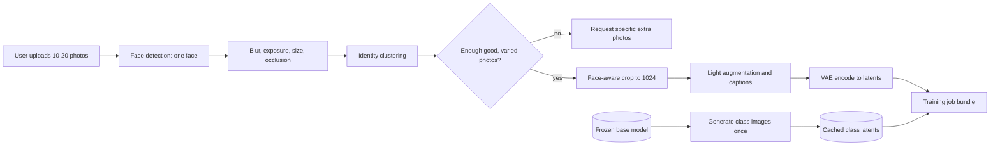
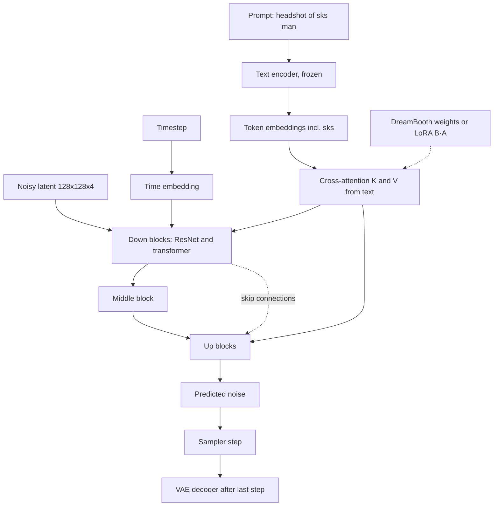
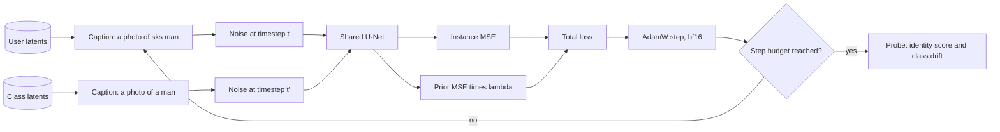
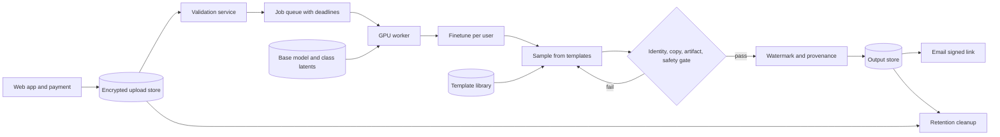
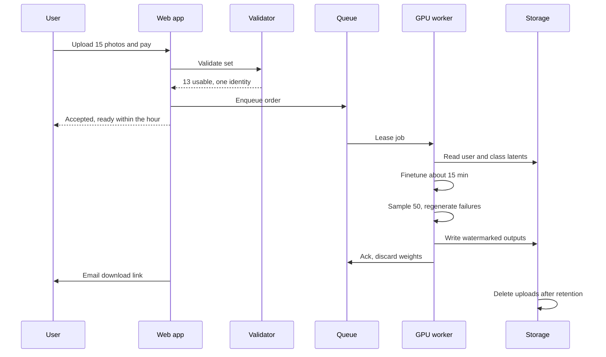

A user uploads a dozen phone photos and later receives fifty studio-style headshots of themselves in a suit, under soft light, against a blurred office. A pretrained text-to-image model can draw "a professional headshot of a man" all day, but it has never seen this face, and no prompt describes a face precisely enough to recover it. The system has to teach the model a new identity from a tiny, noisy dataset, once per customer.

The core tension: train hard enough to reproduce the exact jawline and eye spacing, and the model forgets how to draw anything else. Every "person" turns into the customer, poses freeze into the selfies, and text control over the scene fades. Hold back and you get a well-lit stranger who resembles the customer the way a sibling does, which customers spot instantly. The design is about where that line sits, which personalization method reaches it inside the time and cost budget, and how every output gets checked before a human sees it.

## Requirements that change the design

Outputs go on LinkedIn, so the scene vocabulary is small. What I'd settle first:

- **Photo count.** One reference forces a tuning-free encoder. Ten to twenty varied photos make per-user finetuning practical.
- **Who writes prompts.** If users don't, the team owns a template library, which removes input-side prompt safety problems and can be tuned offline.
- **Attribute control.** Out of scope means no editing models or attribute encoders.
- **Count and resolution.** Fifty images at 1024x1024 fixes an SDXL-class base and dominates the sampling bill.
- **Bad uploads.** Dark, blurry, occluded or multi-person photos must be caught before training.
- **Latency.** "Email within the hour" makes this a batch job and allows a 15 minute finetune. "Results in 10 seconds" would rule per-user training out.
- **Retention.** If the personalized model is deleted after delivery, per-user storage is close to free.
- **Privacy.** Face photos are biometric data under GDPR and laws like Illinois BIPA, so consent, retention and deletion are hard requirements.

| Requirement | Design decision it drives |
|---|---|
| 10 to 20 photos per user | Per-user finetuning; tuning-free only as fallback |
| Delivery within an hour | Queue-based batch pipeline, email notification |
| Model discarded after delivery | Full-weight DreamBooth is affordable |
| No user prompts | Curated templates containing an identifier token |
| 1024x1024, 50 images | SDXL-class base; step budget and regeneration rate matter |
| Reject bad uploads | Validation service: face detection, blur, identity clustering |
| Biometric data | Encryption, short TTL, uploader verification, watermarking |

## Framing as an ML task

Input: photos \( \{x_1,\dots,x_n\} \) of one person, \( n\approx 10\text{–}20 \). Output: 50 images that are photorealistic, match a professional scene description, depict the same person, and differ in pose, lighting and setting. It is conditional image generation with one condition, identity, that text cannot express.

A pretrained latent diffusion model is the natural generator. StyleGAN-type GANs draw sharp aligned portraits but follow free-form text poorly, and autoregressive image-token models are slower at 1024px. The real question is how to inject identity into the diffusion model.

### Tuning-free versus tuning-based

**Tuning-free** methods train an image encoder once, offline, and inject its output (often a face-recognition embedding plus CLIP image features) through extra cross-attention or adapter layers. Public examples: IP-Adapter-FaceID, [InstantID](https://arxiv.org/abs/2401.07519), PhotoMaker, Meta's Imagine Yourself. One shared model answers in seconds, but one embedding drops details seen only at other angles, and the encoder needs large same-person paired data.

**Tuning-based** methods modify the model per user. They differ in which parameters move:

- [Textual inversion](https://arxiv.org/abs/2208.01618) learns one new token embedding \( v_* \). Kilobytes, base untouched, but a single vector in word-embedding space can't carry fine facial geometry.
- [DreamBooth](https://arxiv.org/abs/2208.12242) finetunes all U-Net weights (optionally the text encoder) and binds the subject to an identifier token. Best fidelity from few images; a full model copy per user.
- [LoRA](https://arxiv.org/abs/2106.09685) freezes the base and learns low-rank updates on chosen linear layers. Megabyte adapters, far less training memory, face quality close to full DreamBooth. The DreamBooth objective and LoRA parameterization combine freely, and "DreamBooth-LoRA" is common in production.

| Method | Trained per user | Artifact | Identity fidelity | Time on one A100 | Risk to base behaviour |
|---|---|---|---|---|---|
| Tuning-free encoder | Nothing | None | Medium, single view | Seconds | None |
| Textual inversion | One embedding | KB | Low for faces | 30 to 60 min | None |
| LoRA, rank 16 to 64 | 0.5 to 3% of U-Net | 10 to 200 MB | High | 5 to 15 min | Low |
| DreamBooth, full | All U-Net weights | ~5 GB fp16 | Highest | 10 to 20 min | High without prior loss |

I'd pick full DreamBooth. Identity is the product, an hour fits a 15 minute finetune, and discarding weights erases the storage penalty. If the product later offered "come back for new styles", I'd switch to DreamBooth-LoRA and keep a small adapter per user.

### The identifier token

Prompts need a word for the subject. A common word ("john") already has meaning that leaks into images. A random string ("x7qzp9") gets split by the BPE tokenizer into pieces that each carry associations. A token that is a single vocabulary unit but was rare in pretraining ("sks" in CLIP's tokenizer is the community default) has a weak prior and behaves like an empty slot. Pairing it with a class noun ("a photo of sks man") lets the model reuse what it knows about the class and learn only the difference.

## Data

There is no corpus to curate. The data work is gatekeeping uploads, building a class prior set, and keeping an evaluation panel.

### Upload validation

A wasted finetune costs GPU time, so validation runs on cheap hardware first:

- **Face detection** (RetinaFace or MTCNN): exactly one prominent face. Group photos are the classic silent poison.
- **Quality heuristics:** variance of the Laplacian on the face crop for blur, luminance histogram for exposure, a minimum face width of about 256 px, an occlusion classifier for sunglasses, masks and hands.
- **Identity consistency:** embed faces with an ArcFace-style recognition model, compute pairwise cosine similarity, keep the dominant cluster. Outliers are another person or an extreme angle.
- **Diversity:** estimate head yaw and pitch; flag sets of near-identical frontal selfies.
- **Policy:** age estimate, nudity check, and a live selfie match to confirm the uploader is the subject.

If fewer than 10 to 15 images survive, the user gets a specific request ("4 more, at least one in profile").

### Preprocessing and class images

Crop around the detected face with headroom and shoulders and resize to 1024; blind center crops cut chins. Augment lightly (small rotations, scale and color jitter). Captioning incidental content ("red hoodie") tells the model the hoodie is not identity. The VAE is frozen, so encode each image to a latent once.

Prior preservation needs a few hundred to a thousand generic images sampled from the **frozen base model** with "a photo of a man". Sampling from the base, rather than using real photos, anchors the finetuned model to its own earlier behaviour, which is what we want to keep. These depend only on base version and class noun, so generate them once and cache the latents.

Pitfalls: an accessory in every photo becomes part of the identity, and a face detector that is weaker on darker skin or older faces rejects those users more often, so track acceptance by subgroup.

## Model architecture

The base is latent diffusion with three parts:

1. A frozen **VAE** maps 1024x1024x3 images to 128x128x4 latents and back. Working in latent space is what makes 1024px affordable.
2. A **text encoder** (CLIP ViT-L, plus OpenCLIP ViT-bigG in SDXL) turns the prompt into token embeddings. Frozen by default.
3. A **U-Net** \( \epsilon_\theta(z_t,t,c) \): residual conv blocks at several resolutions with skip connections, transformer blocks holding spatial self-attention and cross-attention to text, and a sinusoidal timestep embedding fed to every block. SDXL's U-Net has about 2.6B parameters. This is what DreamBooth trains.

The identifier acts through cross-attention:

$$
\mathrm{Attn}(Q,K,V)=\mathrm{softmax}\!\left(\frac{QK^\top}{\sqrt{d}}\right)V,\quad Q=hW_Q,\; K=cW_K,\; V=cW_V
$$

\( h \) are spatial features, \( c \) the text token embeddings, and \( d \) the head dimension. The key and value of "sks" decide what gets written into the image positions that attend to it, so tuning \( W_K \), \( W_V \) and the following layers is how the token comes to mean this face. It is also why LoRA restricted to attention projections captures most of the gain.

For a frozen weight \( W_0\in\mathbb R^{d_{out}\times d_{in}} \), LoRA learns

$$
W=W_0+\frac{\alpha}{r}BA,\quad B\in\mathbb R^{d_{out}\times r},\; A\in\mathbb R^{r\times d_{in}}
$$

\( r \) is the rank, \( \alpha \) a scale, \( A \) starts random and \( B \) starts at zero so training begins from the exact base model. Trainable parameters per layer fall from \( d_{out}d_{in} \) to \( r(d_{in}+d_{out}) \), and the update can be merged into \( W_0 \) for zero inference overhead.

**Worked example: adapter versus checkpoint.** A 1280x1280 projection has 1,638,400 weights. At \( r=16 \), LoRA trains \( 16\times(1280+1280)=40{,}960 \), or 2.5%. Over all attention projections an SDXL adapter at rank 16 to 32 is tens of MB in fp16, against \( 2.6\text{B}\times 2 \) bytes \( \approx 5.2 \) GB for the full U-Net. For 100,000 returning users that is a few TB of adapters versus about 520 TB of checkpoints.

Knobs: training the text encoder too (tighter binding, faster overfitting, needs a lower LR), LoRA rank and targets (rank 4 to 8 on attention misses detail; 32 to 64 plus convs nears full finetuning), and above all the base model, since one that draws teeth badly still does after DreamBooth.

## Training

Each order runs a short finetune with the standard diffusion objective. A clean latent is noised in closed form:

$$
z_t=\sqrt{\bar\alpha_t}\,z_0+\sqrt{1-\bar\alpha_t}\,\epsilon,\quad \epsilon\sim\mathcal N(0,I)
$$

\( \bar\alpha_t \) is the cumulative product of the noise schedule, near 1 at small \( t \) (almost clean) and near 0 at large \( t \) (almost pure noise). The full DreamBooth loss is

$$
\mathcal L=\mathbb E\left\|\epsilon-\epsilon_\theta(z_t,t,c_{\text{sks}})\right\|_2^2+\lambda\,\mathbb E\left\|\epsilon'-\epsilon_\theta(z^{pr}_{t'},t',c_{\text{cls}})\right\|_2^2
$$

The first term uses latents of the user's photos with \( c_{\text{sks}} \), the encoding of "a photo of sks man", and pulls the identifier toward the face. The second uses cached class latents \( z^{pr} \) with \( c_{\text{cls}} \), the encoding of "a photo of a man", and \( \lambda \) (often 1) sets how much the model is penalized for changing how it draws generic men. Because the class images came from the frozen model, the second term is self-distillation toward the original behaviour.

The two failure directions map onto \( \lambda \) and step count. Too little prior or too many steps causes language drift ("a man" returns the customer) and mode collapse (outputs repeat training poses, background prompts stop working). Too much prior or too few steps gives soft faces that look related but not identical.

### Settings and efficiency

- **Steps:** overfitting starts within a few hundred steps at 15 images. A common heuristic is around 80 to 100 steps per image at batch 1 to 2, then a fixed budget tuned on held-out users, plus a cheap end-of-run probe (4 samples, identity score, one class prompt).
- **Learning rate:** about 1e-6 to 5e-6 for full U-Net, around 1e-4 for LoRA, lower still for the text encoder.
- **Precompute** VAE latents and text embeddings; prompts are fixed per run, so steps only run the U-Net.
- **Parallelism:** a single job is small, so throughput comes from one job per GPU, not data parallelism. Keep base weights warm on the GPU and restore them from pinned host memory after each job instead of re-reading 5 GB from storage.

**Worked example: memory for full DreamBooth.** Mixed-precision AdamW holds fp32 master weights (4 B), gradients (2 to 4 B) and two moments (8 B), roughly 16 bytes per parameter: \( 2.6\text{B}\times16\approx42 \) GB before activations. Attention activations on 128x128 latents add tens of GB, so gradient checkpointing is needed on an 80 GB card. 8-bit Adam drops moments from 8 to 2 bytes, saving about 15 GB. LoRA keeps a frozen bf16 U-Net (5.2 GB) and a tiny optimizer state, so a 24 GB GPU suffices.

Symptoms and fixes: copied selfies (fewer steps, higher \( \lambda \)); a face like a relative (more steps, train the text encoder); a hoodie in every output (caption it); burnt colors (lower LR and guidance).

## Inference and sampling

Users don't write prompts. A versioned library of about fifty templates fixes scene, lighting, attire, expression and head angle, each containing the identifier ("professional headshot of sks man, charcoal suit, soft window light, slight smile, blurred office"). Templates are the main lever for diversity and the first place to fix systematic defects: if outdoor templates keep warping ears, rewrite or drop them.

Sampling starts from Gaussian noise in latent space, runs a solver such as DPM-Solver++ for \( N \) steps, and decodes with the VAE. Classifier-free guidance mixes conditional and unconditional predictions each step:

$$
\tilde\epsilon=\epsilon_\theta(z_t,t,\varnothing)+w\left(\epsilon_\theta(z_t,t,c)-\epsilon_\theta(z_t,t,\varnothing)\right)
$$

\( \varnothing \) is the empty or negative prompt and \( w \) the guidance scale. Higher \( w \) enforces the prompt and identity more strongly but saturates color and reduces variety. Personalized models usually want a lower \( w \) than the base, around 4 to 7, because finetuning already pushes hard toward the subject.

| Knob | Raising it | Cost | Setting here |
|---|---|---|---|
| Steps \( N \) | Finer detail | Linear latency | 25 to 40 |
| Guidance \( w \) | Stronger adherence | Saturation, less variety | 4 to 7 |
| Seeds per template | More candidates | Linear GPU time | 1 plus retries |
| Negative prompt | Suppresses known defects | Can over-constrain | Short curated list |
| LoRA scale | More identity | Overfit look | 0.7 to 1.0 |
| Face refinement pass | Sharper eyes and teeth | Extra pass, identity can drift | Optional, gated |

Each candidate then passes a **quality gate**: one face at reasonable pose, identity cosine to the reference embeddings above a calibrated threshold, maximum similarity to any upload below a copy threshold, an artifact classifier for hands, teeth and eyes, and a safety classifier. Failures regenerate with the same template and a new seed, capped at about 3 tries, after which a reserve template replaces it.

**Worked example: sampling time per order.** On an A100 an SDXL-class U-Net at 1024px takes about 60 to 80 ms per step with CFG batched as two. At 30 steps that is about 2 to 2.5 s per image plus 0.3 s VAE decode. Fifty images take about 2 minutes; with 20% regenerations, about 2.5 minutes. Batching four prompts per forward pass adds 20 to 40% throughput.

## Evaluation

Personalization adds an axis that generic metrics ignore. I score four properties separately because they trade off: prompt alignment, image quality, identity, and diversity.

**Prompt alignment** uses CLIPScore against the template:

$$
\text{CLIPScore}(I,T)=w\cdot\max\left(\cos(E_I(I),E_T(T)),0\right)
$$

\( E_I \), \( E_T \) are CLIP's image and text encoders, and \( w \) rescales (2.5 in the original paper). It checks that "blurred office" happened, nothing about who is in it.

**Image quality** uses FID between Inception features of generated and real sets:

$$
\text{FID}=\|\mu_g-\mu_r\|_2^2+\operatorname{Tr}\left(\Sigma_g+\Sigma_r-2(\Sigma_g\Sigma_r)^{1/2}\right)
$$

\( \mu \), \( \Sigma \) are feature means and covariances for generated (\( g \)) and real (\( r \)) images. FID needs thousands of samples, so it is a system-level metric: pool outputs across an evaluation panel and compare to real professional headshots. It cannot judge a single user's 50 images.

**Identity** is the cosine similarity \( \frac{f(g)\cdot f(r)}{\|f(g)\|\|f(r)\|} \) between embeddings of generated and real photos, and the encoder \( f \) defines what "similar" means. CLIP embeddings match semantics, so two men in suits look alike. DINOv2 is more sensitive to color and texture but still dominated by lighting and clothing. Face recognition embeddings (ArcFace, trained with an angular margin loss to separate identities) are built for "same person", so they are the primary metric.

**Diversity and copying.** A model that pastes training photos scores perfectly on identity. Track mean pairwise LPIPS across the 50 outputs and each output's maximum similarity to any upload.

| Metric | Catches | Misses |
|---|---|---|
| CLIPScore | Ignored scene or attire instructions | Identity, anatomy, aesthetics |
| FID, system-level | Artifacts, regressions after base or sampler change | Per-user failures, identity |
| CLIP image similarity | Gross subject mismatch | Different person with similar hair and clothes |
| DINO similarity | Hair or skin tone drift | Identity under new lighting |
| Face-embedding cosine | Identity drift, blended faces | Quality, copying, flattering vs not |
| Pairwise LPIPS | Collapse to one pose | Whether variety is useful |
| Human panel | "Would I post this?", uncanny details | Slow, costly, raters disagree |

For human evaluation, consenting panelists rate "this is me" while other raters judge quality; side-by-side comparisons beat absolute scores. Online, ratings skew toward unhappy users, so pair them with downloads per order, refund and regeneration-request rates, and trial-to-paid conversion.

## Serving system

Three asynchronous stages joined by a queue: intake and validation, per-user training, then generation and delivery. It is a throughput and cost problem with a one-hour SLA, not a millisecond latency problem.

Train and sample on the same worker, since shipping a 5 GB checkpoint costs more than sampling. Autoscale on queue age, not GPU utilization; spot GPUs are fine if jobs checkpoint after training. Make jobs idempotent so a crashed worker's order can be re-leased without double charging, and run validation on cheap hardware.

Cost levers in order of payoff: cached class and VAE latents (free), batching prompts, a better solver with fewer steps (detail drops below about 20), DreamBooth-LoRA on cheaper GPUs, and fp8 or int8 inference after a quality check. Step-distilled 4 to 8 step bases are tempting but personalize less reliably.

**Worked example: fleet and storage.** Training 15 min plus sampling and overhead 3 min is 0.3 GPU-hours per order, about \$0.60 at \$2 per GPU-hour. At 20,000 orders per day that is \( 20{,}000\times0.3=6{,}000 \) GPU-hours, or 250 GPUs if load were flat. With a peak-to-average ratio near 2 and jobs needing to start quickly, plan for 400 to 500 at peak. Storage per order is about 15 uploads x 3 MB plus 50 outputs x 1.5 MB, roughly 120 MB, so a 7 to 30 day retention keeps tens of TB live. Keeping full checkpoints would add 5 GB x 20,000 = 100 TB per day, which is why "discard after delivery" carries so much weight.

**Safety and privacy.** Match a live selfie against the upload cluster to stop impersonation, block public figures and minors, run a safety classifier on outputs, and add a watermark plus C2PA credentials. Encrypt at rest, never train shared models on customer photos without opt-in, and log deletions.

**Monitoring.** SLA attainment, rejection rate by reason and subgroup, identity score and regenerations per order, queue age, and safety hit rate.

## Follow-ups and extensions

- **Results in seconds:** a tuning-free encoder gives an instant preview; the finetuned set is the paid tier.
- **Returning users:** store a LoRA adapter with consent and ship new template packs.
- **Group photos:** identifiers bleed into each other; use separate adapters with regional prompting.
- **Aspect ratios:** SDXL's size and crop conditioning handles 4:5 or 16:9.
- **Forgetting:** add an L2 penalty toward base weights, or default to LoRA.

## Interview questions

### Clarifying

**Which clarifying answer changes the design most?**
Latency. An hour allows per-user finetuning and the highest-fidelity method. Seconds forces a tuning-free encoder and weaker identity. Next come photo count, model retention and user prompts, which decide DreamBooth versus LoRA and whether prompt filtering is needed.

**Why does it matter whether the personalized model is stored?**
Full DreamBooth makes a 5 GB checkpoint per user. Deleted after delivery, it costs only GPU time. Kept, it becomes a large recurring storage bill, and adapters a hundred times smaller win. A stored model is also a biometric artifact that can generate the person forever, so retention changes the privacy story too.

**What photos should users upload?**
Ten to twenty, chosen for variety rather than count. Different days, lighting, expressions and head angles, one face per photo, nothing covering it. Fewer photos overfit fast and cover too few angles. Showing good and bad examples at upload time is cheap and improves output more than most model changes.

### Design and trade-offs

**Tuning-free encoder or per-user finetuning?**
An encoder serves everyone from one model in seconds and costs little to run. It compresses identity into an embedding from one or a few photos, so details from other angles are lost, and training it needs large same-person paired data. Finetuning sees all the user's photos and captures the face better, for 10 to 20 GPU-minutes per order. With an hour allowed and identity as the product, I finetune and keep the encoder for previews.

**DreamBooth or LoRA, and when does the answer flip?**
Full DreamBooth gives the most detail, and its main cost disappears when weights are discarded. LoRA needs far less memory and produces megabyte adapters with close fidelity. The answer flips when users keep models, when budget pushes training onto 24 GB cards, or when many users must share one warm base. I'd settle it with an offline comparison on a held-out panel, since the gap depends on the base model.

**Why a rare token instead of a name or random string?**
A real word has meaning the model must unlearn, and some of it leaks into images. A random string splits into several sub-tokens with their own associations. A rare single-unit token has a weak prior, so the face attaches to it cleanly. Adding the class noun lets the model reuse everything it knows about people.

**What does prior preservation buy, and what does it cost?**
It keeps "a man" from collapsing onto the customer and preserves pose and background variety by training on the frozen model's own class samples. It roughly doubles compute per step and needs a one-time class set. Too high a \( \lambda \) and the face stays soft; too low and variety and prompt control fade. I tune \( \lambda \) and step count together.

### Deep dives

**Why isn't CLIP or DINO similarity enough for identity?**
CLIP encodes semantics, so two men in suits on gray backdrops score high. DINO responds to color and texture, catching hair or skin changes, but lighting and clothes still dominate. Neither was trained to separate people. A face recognition model trained with a margin loss keeps the same person close across pose and lighting, so it is the primary identity metric and the others are secondary.

**How do you set the identity threshold in the gate?**
Collect generated-versus-real pairs labeled same or different person, ideally by the people themselves. Pick the threshold for a target false-accept rate, because delivering a stranger is worse than regenerating. Check rejection rates by subgroup, since face models are uneven across groups. Recalibrate whenever the base or recognition model changes.

**How do you detect memorization of training photos?**
Compare each output to its nearest upload using both a face embedding and a full-image metric like LPIPS or DINO. Matching pose, background and expression almost exactly means a copy, even with a perfect identity score. Track the share of copies per order. A rise after a hyperparameter change points to too many steps or too little prior weight.

**Estimate GPU memory for full DreamBooth on a 2.6B-parameter U-Net.**
Weights, gradients and two Adam moments in mixed precision come to about 16 bytes per parameter, so about 42 GB. Attention activations at 128x128 latents add tens of GB, so gradient checkpointing is needed on an 80 GB GPU. 8-bit Adam saves about 15 GB. LoRA needs roughly 5 GB of frozen weights plus activations and fits a 24 GB card.

**Estimate the fleet for 20,000 orders a day.**
At 0.3 GPU-hours per order, that is 6,000 GPU-hours a day, or 250 GPUs at flat load. Peaks around twice the average and the need to start jobs quickly push it to 400 to 500 GPUs at peak with autoscaling. At \$2 per GPU-hour compute is about \$0.60 per order. LoRA training at 8 minutes would cut this by about a third.

### Operations and failure modes

**Two of eighteen photos show someone else. What happens?**
The model learns a blend, and every output looks subtly wrong. Embedding all faces and keeping the dominant cluster catches it before training. If the cluster is ambiguous, ask the user to confirm which photos are them. That check costs milliseconds; the failure costs a training run and a refund.

**Regeneration rates jump after a base model upgrade. How do you debug?**
Split by template, subgroup and gate reason. If a few templates dominate, they render differently on the new base and need rewriting. If identity failures rise everywhere, the step count and \( \lambda \) tuned for the old base no longer fit, so rerun the sweep. Also confirm class latents were regenerated with the new base, because stale ones anchor to the wrong prior.

**A user says the headshots look like someone else. What do you check?**
The validation record: accepted photo count, cluster tightness, pose spread. Then per-image identity scores and how many retries occurred. Typical causes are near-duplicate uploads, an outlier that slipped through, or a threshold too lenient for this user's subgroup. Rerun with better photos for the user, and tighten the check that failed for the system.

## A 45-minute walkthrough

| Minutes | Cover | Draw |
|---|---|---|
| 0 to 5 | Photo count, latency, model retention, prompts, output count, bad uploads | Requirements and the decision each drives |
| 5 to 10 | Diffusion base; tuning-free vs tuning-based; textual inversion, DreamBooth, LoRA; pick | Comparison table |
| 10 to 15 | Upload validation, cropping, augmentation, class prior set | Data pipeline |
| 15 to 21 | Latent diffusion, U-Net cross-attention, identifier token, LoRA math | Architecture sketch |
| 21 to 27 | Noise-prediction loss, prior preservation and \( \lambda \), steps, memory estimate | Training step and loss |
| 27 to 31 | Templates, CFG and steps, quality gate with regeneration | Gate loop |
| 31 to 37 | CLIPScore, system FID, CLIP/DINO/face similarity, diversity, copy check, online metrics | Metrics table |
| 37 to 43 | Queue, GPU workers, deletion, fleet sizing, safety and privacy | End-to-end architecture |
| 43 to 45 | Instant preview, LoRA for returning users, group photos, deepfake safeguards | Short list |

## Review questions

Answer each question in your own words first, then open the answer to check.

### Concepts and definitions

**1. Why can't a well-written prompt alone produce headshots of a specific customer?**


The pretrained model has never seen this person, and words cannot pin down a face precisely enough (eye spacing, jawline, nose shape) to recover one specific individual. Identity is a condition that text cannot express, so it has to be injected another way: either an image encoder that turns photos into conditioning, or a per-user change to the model's weights.


**2. What are language drift and mode collapse in a personalized model?**


Language drift means the class word itself changes meaning: after finetuning, "a man" starts producing the customer instead of a generic man. Mode collapse means outputs stop varying and repeat the poses, framing and backgrounds of the training selfies, so scene prompts lose their effect. Both come from training too long or with too little prior preservation.


**3. Which parameters change per user in textual inversion, DreamBooth and LoRA?**


Textual inversion learns a single new token embedding and leaves the network untouched. DreamBooth updates all U-Net weights (and optionally the text encoder) so an identifier token comes to mean the subject. LoRA freezes the base and learns small low-rank matrices added to selected linear layers. The artifact sizes follow: kilobytes, a full multi-gigabyte copy, and tens to hundreds of megabytes.


**4. Why are the prior-preservation class images generated by the frozen base model instead of collected from real photos?**


The goal of the prior term is to keep the finetuned model behaving like the original model on the generic class. Images the base model drew itself are exactly that behaviour, so training on them is self-distillation toward the starting point. Real photos would pull the model toward a different distribution. Because these images depend only on the base version and class noun, they are generated once and cached as latents.


**5. Why is a face-recognition embedding the primary identity metric rather than CLIP or DINO features?**


Face-recognition models such as ArcFace are trained with an angular margin loss whose explicit job is to keep the same person close and different people apart across pose and lighting. CLIP features encode semantic content, and DINO features react to color and texture, so clothing, hair and lighting dominate both. The metric's meaning of "similar" is set by the encoder, and only the face model was built for "same person".


**6. What does the per-image quality gate check before an output is delivered?**


It checks for one face at a reasonable pose, identity cosine to the reference embeddings above a calibrated threshold, maximum similarity to any upload below a copy threshold, absence of artifacts in hands, teeth and eyes, and a pass from the safety classifier. A failed image is redrawn with the same template and a new seed, and after a few attempts a reserve template takes its place.


### Mechanisms and math

**7. How does the identifier token end up controlling what is drawn at each image location?**


In cross-attention the queries come from spatial features \( h \), while keys and values come from the text tokens \( c \). Positions whose queries align with the key of "sks" receive a weighted share of its value vector, which is written into those positions. Finetuning \( W_K \), \( W_V \) and the layers after them changes what that token contributes, so the token comes to carry the face. This also explains why LoRA on attention projections captures most of the benefit.


**8. Why is LoRA's \( B \) matrix initialized to zero, and why does LoRA add no inference cost?**


With \( B=0 \) the product \( BA \) is zero, so at step one \( W=W_0 \) and training starts from the exact base model rather than a randomly perturbed one. \( A \) is random so gradients can flow into \( B \). After training, \( \frac{\alpha}{r}BA \) can be added into \( W_0 \) once, giving an ordinary weight matrix of the original shape, so sampling runs at base-model speed.


**9. What does each term of the DreamBooth loss do, and what does \( \lambda \) control?**


Both terms are noise-prediction errors. The first uses the user's latents with the "sks man" caption and pulls the identifier toward the face. The second uses cached class latents with the plain "a man" caption and penalizes the model for changing how it draws generic members of the class.

$$
\mathcal L=\mathcal L_{\text{instance}}+\lambda\,\mathcal L_{\text{prior}}
$$

Raising \( \lambda \) protects variety and prompt control but can leave the face soft; lowering it sharpens identity at the risk of drift and collapse.


**10. In classifier-free guidance, what does \( w=1 \) mean, and why do personalized models usually run with a lower \( w \) than the base?**


At \( w=1 \) the formula reduces to the plain conditional prediction \( \epsilon_\theta(z_t,t,c) \), with no extrapolation. Larger \( w \) pushes further along the difference between conditional and unconditional predictions, strengthening adherence but saturating color and reducing variety. Finetuning already biases the model hard toward the subject, so stacking a high guidance scale on top tends to overcook images; around 4 to 7 is typical.


**11. Why is FID used only as a system-level metric in this design?**


FID compares the mean and covariance of Inception features between two sets, and those statistics are only stable with thousands of samples. One order produces 50 images, far too few for a meaningful covariance estimate. So outputs are pooled across an evaluation panel of users and compared against real professional headshots, which makes FID useful for catching regressions after a base or sampler change but silent about any single user.


### Numbers and estimates

**12. How many trainable parameters does rank-16 LoRA add to one 1280x1280 projection, and what fraction is that?**


Full matrix: \( 1280\times1280=1{,}638{,}400 \) weights.

LoRA: \( r(d_{in}+d_{out})=16\times(1280+1280)=16\times2560=40{,}960 \).

Fraction: \( 40{,}960/1{,}638{,}400=0.025 \), or 2.5%.


**13. Estimate sampling time for one order of 50 images on an A100.**


Per step with batched CFG: about 70 ms. Per image: \( 30\times0.07=2.1 \) s, plus 0.3 s VAE decode, about 2.4 s.

50 images: \( 50\times2.4=120 \) s, about 2 minutes.

With 20% regenerations: \( 60\times2.4=144 \) s, about 2.5 minutes. Training at about 15 minutes, not sampling, dominates the order.


**14. Estimate per-order storage and compare it with keeping full checkpoints at 20,000 orders per day.**


Uploads: \( 15\times3 \) MB \( =45 \) MB. Outputs: \( 50\times1.5 \) MB \( =75 \) MB. Total about 120 MB per order.

Per day: \( 20{,}000\times120 \) MB \( =2.4 \) TB, so a 30-day retention holds about 72 TB.

Full checkpoints: \( 20{,}000\times5 \) GB \( =100 \) TB per day, which is why deleting weights after delivery matters so much.


### Design reasoning and trade-offs

**15. Why do training and sampling run on the same GPU worker?**


The finetuned model is a multi-gigabyte checkpoint, and moving it to another machine costs more time and bandwidth than the two or three minutes of sampling. Keeping both on one worker means the weights never leave GPU memory and can be discarded right after delivery.


**16. Why autoscale the GPU fleet on queue age instead of GPU utilization?**


The service promises delivery within an hour, so the quantity that matters is how long orders wait before a worker picks them up. Utilization can sit near 100% both when the fleet is just right and when a backlog is growing toward an SLA breach. Queue age measures the user-facing risk directly and triggers scale-up before deadlines slip.


**17. What does a curated template library give the team compared with letting users type prompts?**


It removes input-side prompt safety problems and gives the team one place to control scene, lighting, attire, expression and head angle. Templates are the main lever for variety across the 50 outputs, and they can be tested offline and versioned. When a class of defects appears, such as warped ears in outdoor scenes, the fix is to rewrite or drop the offending templates rather than retrain anything.


**18. Why cap regenerations at about three tries and then switch to a reserve template?**


Some template and identity combinations fail repeatedly, and unbounded retries would blow the per-order GPU budget and the one-hour deadline. A cap bounds the worst-case cost of an order. Swapping in a reserve template keeps the delivered count at 50 while avoiding a scene that this particular finetuned model cannot render well.


### Common mistakes

**19. What goes wrong if the same accessory, such as glasses or a red hoodie, appears in every uploaded photo?**


The model has no example of the person without it, so it treats the accessory as part of the identity and paints it into every headshot, even under a suit prompt. Captioning incidental items during preprocessing tells the model they are separate from the face, and the upload step can ask for more varied photos.


**20. What goes wrong if outputs are ranked by identity score alone?**


A model that reproduces the training selfies almost pixel for pixel gets the best identity score, so ranking on it rewards memorization and collapse. The order would contain near-copies of the uploads in the same poses and backgrounds. Identity has to be paired with a copy check against the uploads, pairwise LPIPS for diversity, and CLIPScore for scene adherence.

