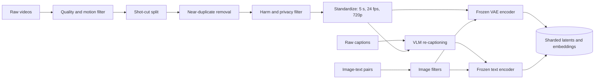
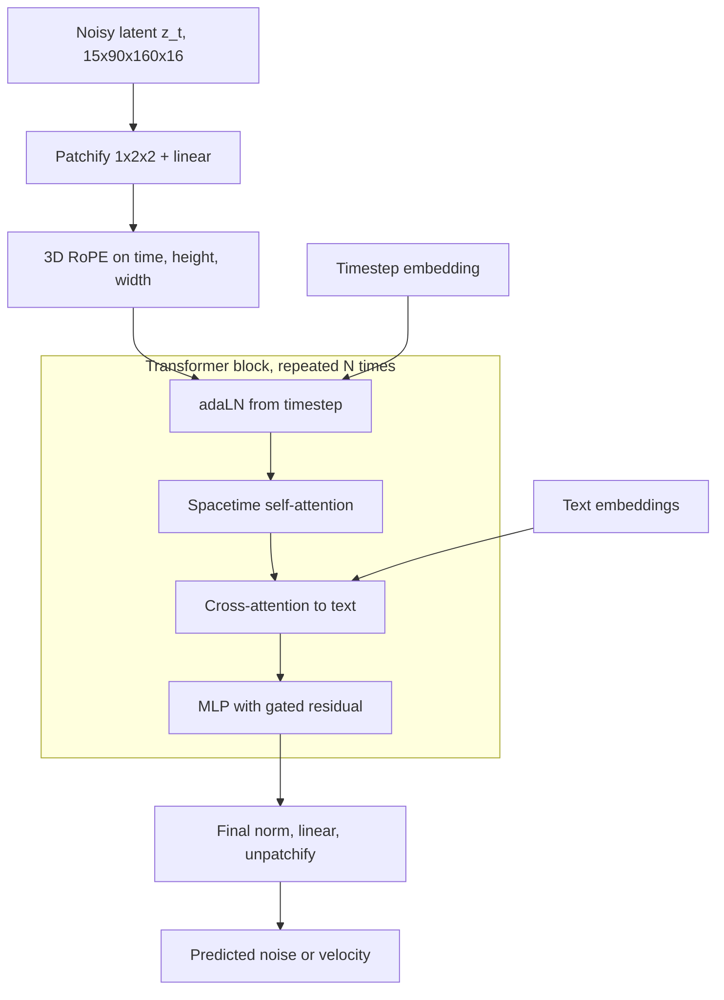
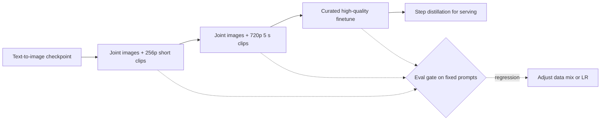
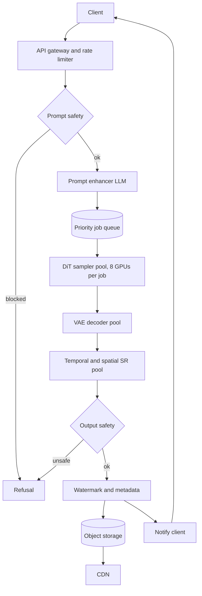
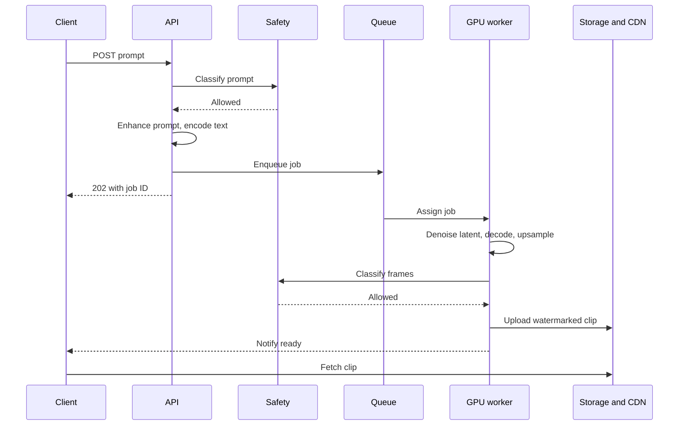

A text-to-video system takes a sentence and returns a short clip that shows what the sentence describes and moves in a believable way. The product looks like a small step from text-to-image: same prompt box, same diffusion machinery, same safety concerns. The difference is time. Five seconds at 24 fps is 120 frames, and those frames have to agree with each other about which objects exist, what they look like, where the light comes from and where everything is heading. A model that produces 120 individually beautiful frames with a dog whose fur changes color every quarter second has failed.

Time also multiplies cost. Nearly every choice below buys coherent motion without paying for pixels times frames at full price: compress before diffusing, tokenize what the transformer can afford, generate small and slow then upsample, cache whatever does not change between epochs. The second pressure is data: captioned images number in the billions, clean well-described clips far fewer, so the design borrows from images wherever it can.

The working assumptions: five-second 720p clips at 24 fps, silent, English prompts, minutes of latency at launch, about 100 million captioned videos with noisy captions, a pretrained text-to-image model, about 6,000 H100-class GPUs, and a hard safety requirement.

## Requirements that change the design

Read each requirement as a number, because each fixes a tensor dimension or a slice of the budget. 120 frames and 0.92 MP per frame (3.5x a 512x512 image) set the token count; open domain means data and evals must cover people, animals, scenery, animation and camera moves; silent English output keeps version one to a single modality and text encoder.

| Requirement | Number it fixes | Design decision it drives |
|---|---|---|
| 5 s at 24 fps | 120 frames | Temporal compression in the VAE, temporal super-resolution |
| 720p | 0.92 MP per frame | Latent diffusion, optional spatial super-resolution |
| Minutes of latency | 1 to 10 min per job | Job queue plus notification, no streaming connection |
| 100M noisy captions | Caption quality varies | Re-captioning with a video VLM, prompt enhancer at inference |
| Pretrained image model | Free visual prior | Initialize the video model from image weights, mix image data |
| 6,000 GPUs | Roughly 10^24 to 10^25 FLOPs | DiT size in the low tens of billions, resolution curriculum |
| Safety | Zero tolerance classes | Two classifier gates, filtered training set, watermarking |

## Framing as an ML task

The input is a free-form English prompt; the output is a 5 s, 720p, 24 fps RGB clip judged on frame quality, prompt fidelity and temporal coherence. The task is conditional generative modeling: learn \( p(\text{video} \mid \text{text}) \) well enough to sample from it.

### Model family

| Family | How it generates | Strengths | Weak spots |
|---|---|---|---|
| Video GAN | One forward pass from noise | Very fast sampling | Unstable, mode collapse, scales poorly to open-domain text |
| Autoregressive tokens | VQ tokenizer, next-token prediction | Reuses LLM stack | Tens of thousands of sequential steps, tokenizer artifacts |
| Pixel-space diffusion | Denoise raw frames | No VAE ceiling | 332 million values per clip, out of budget |
| Latent diffusion | Denoise a compressed latent | Best quality per FLOP, parallel per step | VAE caps detail, many network calls |

Latent diffusion wins because it keeps the quality advantage of diffusion and moves the work into a space roughly two orders of magnitude smaller. It is the recipe behind [Latent Diffusion / Stable Diffusion](https://arxiv.org/abs/2112.10752), Stable Video Diffusion, Sora and Movie Gen.

### Worked example 1: what compression buys

Pixel tensor for one clip:

$$
120 \times 720 \times 1280 \times 3 = 331{,}776{,}000 \text{ values}
$$

A video VAE that downsamples by 8 in time and 8 in each spatial axis turns 120 frames into 15 latent frames and 1280x720 into 160x90. That is \( 8^3 = 512 \) times fewer spatiotemporal positions: 216,000 instead of 110.6 million. The latent has more channels than RGB, though. With 16 latent channels:

$$
15 \times 90 \times 160 \times 16 = 3{,}456{,}000 \text{ values}, \quad \frac{331.8\text{M}}{3.46\text{M}} \approx 96
$$

So the compression in raw values is about 96x, while the reduction in positions, which drives attention cost, is 512x.

## Data

The sources are the 100M captioned clips (motion), a much larger image-text corpus (rare concepts and visual detail), VLM-written captions, and a small curated high-aesthetic subset for the final finetune.

### Filtering and standardization

Bad video teaches bad motion, so filtering is stricter than for images.

- Technical quality: resolution floor, minimum length, compression blocking, letterboxing. A mean optical-flow score catches both static slideshows and shaky footage.
- Scene cuts: shot-boundary detection, keep single-shot windows. A cut inside a clip teaches that objects teleport.
- Overlays: OCR-detected subtitles and watermarks get dropped or cropped, or the model learns to paint them.
- Duplicates: perceptual hashes or clip embeddings, clustered, so reuploads are not memorized.
- Harm and privacy: NSFW, violence and minor-safety classifiers, face blurring where policy requires, opt-outs.

Then cut 5 s windows at shot boundaries, resample to 24 fps (never upsample low-fps sources, which creates duplicated frames the model will imitate), and resize and crop to 1280x720, or bucket by aspect ratio if other shapes come later.

### Captions

Raw captions are titles, hashtags and alt text that rarely say what moves or what the camera does. A video-capable VLM rewrites each into a dense description: subjects, actions in order, setting, lighting and camera motion such as "slow dolly forward". The [DALL-E 3 report](https://cdn.openai.com/papers/dall-e-3.pdf) showed the effect for images; Sora's report extended it to video. Keep 5 to 10 percent of the original short captions so terse prompts still work. Since users type eight words, not ninety, an LLM prompt enhancer at inference rewrites prompts into the training style, and it needs its own eval for adding details nobody asked for.

### Precomputation and worked example 2: cache size

The VAE encoder and text encoder are frozen during diffusion training, so encode once and stream latents and embeddings from sharded files keyed by clip ID. Latent per clip in bf16 with 16 channels:

$$
3{,}456{,}000 \times 2 \text{ bytes} \approx 6.9 \text{ MB}
$$

For 100M clips that is about 690 TB (about 173 TB with a 4-channel VAE). The text side is easy to forget: a T5-XXL-style encoder emits 4,096-dim vectors, so 256 tokens in bf16 is \( 256 \times 4096 \times 2 \approx 2.1 \) MB per caption, another 210 TB. Truncating to 128 tokens or storing 8-bit halves that. Under a petabyte of object storage is cheap next to the GPU time it saves.

## Model architecture

The model has three parts: a video VAE (trained separately), a frozen text encoder, and a denoiser that does all the generative work in latent space.

### Video VAE

3D (or factorized 2D plus 1D) convolutional blocks downsample time by 4 or 8 and space by 8. Encoding the first frame on its own makes a single image a valid one-frame video, which keeps joint image-video training clean. Training combines reconstruction, LPIPS, a small KL term and usually an adversarial loss. The decoder bounds final quality (fine text, small faces, thin fast objects), so measure its reconstruction PSNR and FVD before building on it.

### Option A: U-Net with temporal layers

Inside each resolution block of the image U-Net, add a temporal convolution (1D along frames at each position: cheap, local smoothing) and temporal attention (each position attends to itself across all frames: longer-range motion, cost quadratic in frame count only). Zero-initialize their residual outputs so step one behaves exactly like the image model applied per frame. This is the [Video LDM](https://arxiv.org/abs/2304.08818), Stable Video Diffusion and Emu Video recipe.

### Option B: diffusion transformer over spacetime patches

The [DiT](https://arxiv.org/abs/2212.09748) route treats the latent video as a token sequence.

1. Patchify: cut the \( T' \times H' \times W' \times C \) latent into \( p_t \times p_h \times p_w \) patches, flatten, project to width \( d \).
2. Position: 3D [RoPE](https://arxiv.org/abs/2104.09864) splits each head's dimensions into three groups rotated by the time, row and column coordinates, so scores depend on relative offsets per axis and new sizes extrapolate better than learned absolute embeddings.
3. Blocks: self-attention over video tokens, cross-attention to text tokens, MLP. The timestep enters through adaLN, which maps its embedding to per-channel scale, shift and gate.
4. Unpatchify: norm, linear back to \( p_t p_h p_w C \) values per token, reshape. Output is predicted noise or velocity.

Self-attention in each block is the standard

$$
\text{Attn}(Q,K,V) = \text{softmax}\left(\frac{QK^\top}{\sqrt{d_k}}\right)V
$$

where \( Q, K, V \in \mathbb{R}^{N \times d_k} \) are projections of the \( N \) tokens and \( d_k \) is the head dimension. In cross-attention, \( Q \) comes from video tokens and \( K, V \) from the text encoder output, which is how the prompt steers every token.

### Attention patterns and their cost

With 1x2x2 patches the 15x90x160 latent becomes \( 15 \times 45 \times 80 = 54{,}000 \) tokens, and attention over them is the dominant cost. Full 3D attention costs \( O((T'H'W')^2) \) per layer and gives the best object permanence; the strongest current models use it with [FlashAttention](https://arxiv.org/abs/2205.14135). Factorized attention (within each frame, then across frames at each location) costs \( O(T'(H'W')^2 + H'W'\,T'^2) \), far less, but objects that cross the frame have to be tracked through two hops. Windowed or sparse spacetime attention sits in between.

### U-Net or DiT

Given 100M clips, a large image corpus and 6,000 GPUs, the DiT is the better bet: it keeps improving with scale, handles any duration or aspect ratio through token count, and shares the LLM parallelism stack. The U-Net's locality bias and direct image warm start win only at much smaller budgets.

Other knobs: 2x2x2 patches halve tokens and quarter attention cost at some motion fidelity loss; stronger VAE compression trades tokens for a lower quality ceiling; a large T5-style text encoder (often concatenated with CLIP) follows long prompts better; 5 to 15B parameters is a reasonable first build (Movie Gen is about 30B).

## Training

### Objective

Diffusion training corrupts a clean latent \( z_0 \) with Gaussian noise at a random level and teaches the network to undo it. The forward process is

$$
z_t = \sqrt{\bar\alpha_t}\, z_0 + \sqrt{1-\bar\alpha_t}\,\epsilon, \qquad \epsilon \sim \mathcal{N}(0, I)
$$

where \( \bar\alpha_t \) is the cumulative signal-retention coefficient that goes from about 1 at \( t=0 \) to about 0 at \( t=T \). The noise-prediction loss is

$$
\mathcal{L} = \mathbb{E}_{z_0, c, t, \epsilon}\left[ \left\lVert \epsilon - \epsilon_\theta(z_t, t, c) \right\rVert_2^2 \right]
$$

where \( c \) is the text embedding and \( \epsilon_\theta \) is the DiT. Many recent video models, Movie Gen included, use flow matching instead, which interpolates linearly between data and noise and regresses a velocity:

$$
z_t = (1-t)\, z_0 + t\,\epsilon, \qquad \mathcal{L}_{\text{FM}} = \mathbb{E}\left[\left\lVert (\epsilon - z_0) - v_\theta(z_t, t, c)\right\rVert_2^2\right]
$$

with \( t \in [0,1] \) and \( v_\theta \) the predicted velocity. Straighter paths tend to need fewer sampling steps.

Two details matter. Drop the text for about 10 percent of samples so the model learns the unconditional distribution that guidance needs. And shift timesteps toward high noise for large, long inputs: correlated neighboring tokens let coarse structure survive noise that would erase an image, so global layout is never learned unless high-noise steps are oversampled.

### Stages

Scarce video-text pairs are offset by image data, either jointly (each image is a one-frame video, mixed into every batch, so image knowledge never fades) or sequentially (image pretraining, then video, simpler to debug but prone to forgetting unless images stay in the mix). Large systems effectively do both: start from image weights, train jointly through a resolution and duration curriculum, then finetune on a curated set.

### Worked example 3: training compute

Take a 10B-parameter DiT, 48 layers of width 3,072, at 54,000 tokens per clip. Linear layers cost about \( 2PN \) forward and 3x that for training:

$$
6 \times 10^{10} \times 5.4\times10^{4} \approx 3.2\times10^{15} \text{ FLOPs per clip}
$$

Attention scores and weighted sums per layer, forward: \( 4N^2 d = 4 \times (5.4\times10^4)^2 \times 3072 \approx 3.6\times10^{13} \). Over 48 layers and times 3 for training: about \( 5.2\times10^{15} \). Total is about \( 8.4\times10^{15} \) FLOPs per clip, with attention already the larger part.

Three passes over 100M clips is \( 3\times10^8 \) samples, so roughly \( 2.5\times10^{24} \) FLOPs. 6,000 H100s at about 40 percent utilization of 989 dense bf16 TFLOP/s deliver \( 6000 \times 4\times10^{14} = 2.4\times10^{18} \) FLOP/s, which gives about \( 10^6 \) s, or 12 days. Real schedules spend most steps at low resolution with 10x to 50x fewer tokens, and the budget must also cover image data, ablations and failed runs.

### Efficiency techniques

- Cascades: a base model at low frame rate and resolution plus separate temporal (frame interpolation) and spatial super-resolution models, as in [Imagen Video](https://arxiv.org/abs/2210.02303).
- Curriculum: short low-resolution clips early, while the model learns layout and coarse motion.
- bf16 mixed precision, FlashAttention, and activation checkpointing, since activations for 54k tokens dominate memory.
- Parallelism: sharded data parallel for weights and optimizer state, tensor parallel within a node, and sequence parallel to split one sample's tokens across GPUs.
- Mixture of experts for capacity at fixed per-token compute; sequence packing and aspect-ratio buckets to avoid padding.

## Inference and sampling

Sampling starts from latent-shaped Gaussian noise. With classifier-free guidance each step runs the model with and without the prompt and extrapolates:

$$
\hat\epsilon = \epsilon_\theta(z_t, t, \varnothing) + w\left(\epsilon_\theta(z_t, t, c) - \epsilon_\theta(z_t, t, \varnothing)\right)
$$

where \( \varnothing \) is the empty prompt and \( w \) is the guidance scale. \( w=1 \) is plain conditional sampling; values of 5 to 10 trade diversity and realism for stronger prompt adherence. The two passes can share one batch, so guidance doubles compute but not latency on an underused GPU.

An ODE solver (DDIM, DPM-Solver, or Euler for flow matching) reaches the final latent in 25 to 50 steps. The VAE decodes it in overlapping temporal chunks to bound memory, then temporal (12 to 24 fps) and spatial super-resolution models run.

| Knob | Typical range | Raising it does | Cost of raising it |
|---|---|---|---|
| Sampling steps | 4 (distilled) to 50 | Finer detail, fewer artifacts | Linear in latency |
| Guidance scale \( w \) | 4 to 10 | Better prompt match | Oversaturation, less motion, less diversity |
| Base frame rate before temporal SR | 8 to 24 fps | Smoother true motion | Tokens grow linearly |
| Base resolution before spatial SR | 256p to 720p | Real detail instead of hallucinated | Attention cost grows quadratically in tokens |

### Worked example 4: per-clip latency

A forward pass of the 10B model on 54k tokens is \( 2PN + 4N^2 d L \approx 1.1\times10^{15} + 1.7\times10^{15} = 2.8\times10^{15} \) FLOPs. Fifty steps with guidance is 100 passes, \( 2.8\times10^{17} \) FLOPs. At 400 TFLOP/s effective, one GPU needs about 700 s, close to 12 minutes. Sequence-parallel across 8 GPUs brings it to roughly 1.5 to 2 minutes after communication overhead. Generating at 12 fps and 640x360, then upsampling, cuts tokens to about 7,400 and the attention term by about 50x, which is why the cascade matters as much for serving as for training. A 4-step distilled student would cut the step count another 10x or more.

## Evaluation

Frame quality, motion coherence and prompt match are separate questions with separate metrics. A fixed prompt suite such as [VBench](https://arxiv.org/abs/2311.17982) or Movie Gen Bench makes numbers comparable across checkpoints and covers categories like human actions, animals, camera motion and multiple objects.

### Frame quality

FID compares the Inception-feature distributions of generated and real frames:

$$
\text{FID} = \lVert \mu_r - \mu_g \rVert_2^2 + \operatorname{Tr}\left(\Sigma_r + \Sigma_g - 2(\Sigma_r \Sigma_g)^{1/2}\right)
$$

where \( \mu \) and \( \Sigma \) are the mean and covariance of features for real (\( r \)) and generated (\( g \)) samples. Lower is better. Inception Score, KID (an unbiased kernel variant that behaves better on small samples) and LPIPS fill in. All of them treat frames as an unordered bag.

### Temporal coherence

[FVD](https://arxiv.org/abs/1812.01717) applies the same Fréchet formula to clip-level features from I3D, an action-recognition network, so it notices unnatural motion statistics that FID cannot. It also weighs per-frame appearance heavily and depends on clip length and the reference set, so sharper frames can lower it while motion stays bad. Add direct checks: optical-flow warping error between consecutive frames, and subject identity consistency via DINO or face embeddings across frames.

### Prompt alignment

CLIP score per frame:

$$
s_i = \cos\left(f_{\text{img}}(x_i), f_{\text{txt}}(c)\right), \qquad S = \frac{1}{F}\sum_{i=1}^{F} s_i
$$

where \( x_i \) is frame \( i \), \( F \) is the frame count and \( f \) are the CLIP encoders. Max aggregation rewards a clip if any frame matches. Neither catches action order or counts; a VLM judge answering yes/no questions derived from the prompt covers more.

### Human evaluation

Side-by-side preference between two models on identical prompts and seeds, rated separately for alignment, visual quality, motion and overall. Report win rates with confidence intervals per prompt category.

| Metric | Catches | Misses |
|---|---|---|
| FID, KID, IS | Blurry or unrealistic frames | Flicker, frozen motion, prompt mismatch |
| FVD | Unnatural motion statistics | Physical plausibility, prompt match, depends on reference set |
| Flow warping error | Flicker and texture boiling | Penalizes legitimate fast motion |
| CLIP score | Wrong objects or scene | Actions, order, counts, motion |
| VLM question answering | Attributes, counts, some actions | Judge bias, cost |
| Human side-by-side | Overall preference | Slow, expensive, rater drift |

### Online

Generation completion rate, regenerate rate on the same prompt (a strong dissatisfaction signal), download and share rate, explicit thumbs, paid conversion, and safety report rate. Read them per prompt category, since a regression in human motion can hide inside a global average.

## Serving system

Generation takes minutes and ties up several GPUs, so the API is a job system. The client submits a prompt and gets a job ID; it polls or receives a push notification when the clip is ready.

### Latency and cost levers

| Optimization | Latency effect | Cost effect | Quality risk |
|---|---|---|---|
| Step distillation (progressive, consistency, adversarial) | 5x to 12x fewer steps | Same factor | Less diversity, occasional artifacts |
| Cascade: low-res, low-fps base plus SR | Large, attention shrinks quadratically | Large | SR cannot fix base composition errors |
| Guidance distillation | Removes the unconditional pass | About 2x | Fixed guidance scale |
| Sequence parallelism across GPUs | Near-linear up to about 8 GPUs | Neutral or slightly worse | None |
| FP8 matmuls and attention | 1.3x to 2x | Same | Small, needs calibration |
| Cache text K/V across steps | Small | Small | None, the prompt does not change |
| Feature caching across adjacent steps | 1.5x to 2x | Same | Some detail loss at high reuse |
| Batching same-shape jobs | Higher throughput, small queueing delay | Better utilization | None |
| Cheap preview first | Fast feedback at low res | Spends compute only on chosen clips | Preview may not match final |

The preview pattern is worth proposing: a low-resolution draft in 15 to 30 seconds, then super-resolution only for the clip the user keeps.

### Worked example 5: fleet sizing

Assume 1M clips per day, and after distillation and the cascade, 120 GPU-seconds per clip including decoding and super-resolution.

$$
\frac{10^6}{86{,}400} \approx 11.6 \text{ clips/s}, \qquad 11.6 \times 120 \approx 1{,}390 \text{ GPUs busy on average}
$$

With a 2x peak-to-average ratio and 80 percent target utilization, provision about \( 1390 \times 2 / 0.8 \approx 3{,}500 \) GPUs. Without distillation (700 GPU-seconds) the same traffic needs about 20,000. This is the arithmetic that justifies the distillation project.

### Safety and monitoring

The prompt classifier runs before any GPU time, tuned for recall on high-severity classes and precision elsewhere. The output classifier checks sampled frames, because innocent prompts can still yield unsafe frames. Prompts naming private individuals are blocked, outputs carry an invisible watermark and C2PA metadata. Monitor queue wait, GPU utilization, per-stage latency, refusal rate by category and regenerate rate; a jump in regenerations for one category usually means a model or prompt-enhancer regression.

## Follow-ups and extensions

- **Variable duration and aspect ratio.** 3D RoPE plus aspect-ratio and duration buckets; condition on target size.
- **Longer clips.** Generate overlapping windows conditioned on the previous window's last frames. Identity and color drift are the enemy.
- **Image-to-video.** Feed the conditioning image latent as the first frame and train with first-frame conditioning.
- **Motion and camera control.** Condition on a motion score, camera trajectory or flow maps through ControlNet-style adapters.
- **Audio.** A second model conditioned on video latents, with its own sync metrics.
- **Personalization.** LoRA or reference-image conditioning, gated by consent and likeness checks.
- **Multilingual.** A multilingual text encoder, or translation inside the prompt enhancer.

## Interview questions

### Clarifying

**What do you ask first, and why those questions?**
Duration, resolution and frame rate, because together they fix the output tensor and therefore almost every cost number. Then latency, which decides between a full sampler with a cascade and a distilled small model. Then data size, caption quality and whether a pretrained image model exists, which decide how much can be borrowed from images. Last, compute budget, safety scope, audio and languages, each of which can double the scope.

**Why does it matter whether a pretrained text-to-image model exists?**
Image weights already encode objects, textures, lighting and the word-to-visual mapping, which scarce captioned video teaches poorly. Starting from them lets the video run spend its budget on motion. The checkpoint type also steers architecture: a U-Net checkpoint toward inserted temporal layers, a DiT toward spacetime tokens. Without one, I would plan joint image-video training from scratch and a bigger budget.

**How does "a few minutes of latency is fine" change the system?**
It allows 30 to 50 steps with full guidance and a three-stage cascade, so quality comes first at launch. The API becomes asynchronous, with a queue and notifications. Both safety checks fit without latency pressure. Cost per clip is still high, so distillation is the second milestone.

### Design and trade-offs

**Pixel-space or latent diffusion?**
Latent. Pixel space for this clip is 332 million values, which is out of budget for both training and serving. An 8x8x8 VAE cuts positions 512x and turns the problem from impossible into expensive. The price is a quality ceiling set by the VAE and an extra decode stage. I would evaluate the VAE on its own and add latent channels if fine detail suffers.

**U-Net with temporal layers or a DiT?**
A U-Net warm-started from an image checkpoint with zero-initialized temporal layers is the cheaper, safer choice at modest scale. A DiT scales better with parameters and data, handles variable length and aspect ratio by changing token count, and reuses the LLM training stack. With 100M clips and 6,000 GPUs I pick the DiT. With a strong U-Net and a tenth of the compute I would not.

**Full spacetime attention or factorized attention?**
Full attention lets every token see every other token across frames, which keeps an object's identity stable while it moves. It costs \( O(N^2) \) over 54k tokens, the dominant term at 720p. Factorized attention is far cheaper but routes information through two hops, so moving objects suffer. I would use full attention with FlashAttention and sequence parallelism in the base model and accept factorized attention in super-resolution stages, where motion is already decided.

**Joint image-video training or image pretraining then video finetuning?**
Joint training is one stage, keeps image concepts alive and lets rare concepts transfer into video. Sequential training reuses a checkpoint directly and is easier to debug, but forgets unless images stay in the mix, at which point it converges to joint training. I would start from the image checkpoint and train jointly. The mixing ratio becomes a tuned hyperparameter, watched through image and video evals together.

**One large base model at full resolution, or a cascade?**
A cascade lets the expensive model decide composition and motion at 12 fps and 360p, with about 7x fewer tokens and about 50x cheaper attention, while small models add frames and pixels. Its risks are error propagation (super-resolution cannot fix a wrong hand) and more components to run. A single full-resolution model has cleaner detail and simpler ops but costs far more per clip. I would cascade at launch and revisit once distillation lowers base-model cost.
### Deep dives

**Estimate the size of the training cache.**
A latent is 15 x 90 x 160 positions; at 16 channels in bf16 that is about 6.9 MB, so 100M clips need about 690 TB. T5-XXL-class text embeddings at 256 tokens add about 2 MB each, another 200 TB. Roughly 0.9 PB of object storage is cheap next to running two encoders on every sample every epoch. Truncating text to 128 tokens or storing 8-bit embeddings brings it under 700 TB.

**Estimate per-clip generation time on H100s.**
A 10B, 48-layer DiT on 54k tokens needs about \( 2.8\times10^{15} \) FLOPs per forward pass, more than half of it attention, and 50 guided steps make 100 passes, about \( 2.8\times10^{17} \) FLOPs. At an effective 400 TFLOP/s that is about 12 minutes on one GPU and about 2 minutes on 8 with sequence parallelism. Generating the base at lower frame rate and resolution plus a 4-step distilled student brings it well under a minute.

**Why shift the noise schedule for video?**
Adjacent latent tokens in a video are highly correlated across space and time. At a given noise level, the model can average over many correlated tokens to recover the signal, so noise that would erase an image leaves the video's coarse structure readable. If you keep the image schedule, the model rarely trains on states where global layout and motion are truly unknown, and samples show weak composition. Shifting timesteps toward higher noise, scaled by token count, fixes this; SD3 and Movie Gen both do a version of it.

**How does FVD work, and when does it lie?**
It extracts features from real and generated clips with an I3D action-recognition network, fits a Gaussian to each set, and computes the Fréchet distance between them. Because the network was trained to classify actions, its features carry some motion information, so it penalizes frozen or erratic clips that FID ignores. It can lie when per-frame appearance improves while motion stays bad, when the reference set differs in content, and when clip lengths differ from what I3D saw. I would never ship on FVD alone and always pair it with human side-by-side.

### Operations and failure modes

**How do you debug user reports of flicker?**
First run real videos through the VAE alone; if reconstructions flicker, no denoiser change will help. Otherwise decode the base output before temporal super-resolution to see which stage introduces it. Quantify with flow warping error on a fixed prompt set so fixes can be compared. The fix follows the stage: a temporally aware VAE decoder, full attention or more training at final length, or an interpolation model retrained on high-motion footage.

**The output safety classifier blocks 3 percent of clips and users are angry. What do you do?**
Label a sample of blocks to get the false-positive rate per category. Recalibrate thresholds per category, keeping high-severity classes conservative while relaxing benign ones such as swimwear or medical. Move more filtering to the prompt classifier so users get an instant explanation instead of a failed job after minutes. Refund credits on blocks while the classifier improves.

**Queue wait times spike every evening. What are the options?**
Short term, priority tiers keep a latency target for paid users, and a fast preview tier runs the distilled low-resolution path. Medium term, batch same-shape jobs, move to FP8 and add a spot pool for the free tier. Show the expected wait in the UI so users do not resubmit and inflate the queue. Long term, distillation cuts GPU-seconds per clip more than any scheduling change.

**A new checkpoint wins on FVD and CLIP but loses on human eval. Which do you trust?**
Human eval, after confirming a fair comparison: same prompts, same seeds, enough ratings for a tight interval. Break the loss down by category; often the model wins on scenery and loses on people, which averages hide. Then add automatic checks for the losing category, such as face identity consistency or hand detectors. That way the next regression shows up before human review.
## A 45-minute walkthrough

| Minutes | Cover | Draw |
|---|---|---|
| 0 to 5 | Duration, resolution, fps, latency, audio, language, data, image checkpoint, GPUs, safety | Requirements with numbers |
| 5 to 9 | Model family choice, 512x compression arithmetic | Input and output box |
| 9 to 15 | Filtering, shot splits, re-captioning, cached latents, cache size | Data pipeline |
| 15 to 24 | Video VAE, U-Net vs DiT, patchify, 3D RoPE, attention pattern, adaLN | DiT block, token count |
| 24 to 30 | Loss, CFG dropout, joint image-video, curriculum, parallelism, compute | Training stages |
| 30 to 34 | Steps, guidance, cascade, latency estimate | Knob table |
| 34 to 39 | FID, FVD, CLIP score, human side-by-side, online metrics | Metric table |
| 39 to 45 | Async queue, safety gates, distillation, fleet sizing, extensions | Serving architecture |
