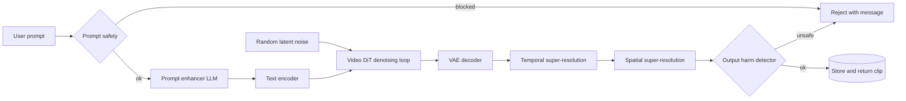

A text-to-video system turns a sentence into a short clip that matches it and moves plausibly. It borrows almost everything from text-to-image generation, but time multiplies the problem: five seconds at 24 fps is 120 frames, and consecutive frames must agree on what every object is and where it is going. Paired video-caption data is also scarcer than image-caption data. The central tension is compute: nearly every choice here is about getting coherent motion without a bill that grows with pixels times frames.

## Requirements that change the design

- Clip length, resolution and frame rate set the raw tensor size. Five seconds of 720p at 24 fps is over 100 million pixel values per sample, which is what forces latent diffusion and cascades.
- Latency. Minutes per clip allows many denoising steps and a multi-stage pipeline; near-real-time would push toward distillation and smaller models from day one.
- Audio? Silent video keeps it single-modality. Sound means a second generator plus synchronization.
- How much data, and how clean are the captions? Large but noisy caption sets point to re-captioning.
- Is there a pretrained text-to-image model, and how many GPUs? Image weights save a lot, and cluster size decides model size and native resolution.
- Safety. A public prompt box needs prompt and output moderation.

## Framing: latent diffusion with a video backbone

Input is a text prompt; output is a five-second 720p clip aligned with it in content and motion. Diffusion is the default for visual detail, with autoregressive token models as the alternative. Pixel-space diffusion is impractical for video, so the system uses latent diffusion, as Stable Diffusion, Sora and Movie Gen do.

A separately trained video VAE compresses clips in space and time. With 8x reduction on each axis, 120 frames of 1280x720 become 15 latent frames of 160x90, about 512 times fewer values. Diffusion denoises in that space and the decoder maps the result back to pixels. The VAE also caps quality: whatever it can't reconstruct, such as fine text, the generator can't produce.

For the denoiser there are two families.

- A U-Net extended for video keeps the 2D spatial convolutions and cross-attention from image models and interleaves temporal layers: 1D convolutions across frames and attention over the same spatial location in different frames. It can be initialized from an image U-Net, which is how Stable Video Diffusion and Emu Video were built.
- A diffusion transformer ([DiT](https://arxiv.org/abs/2212.09748)) cuts the latent video into spacetime patches, projects each to a token, adds position information, runs transformer blocks with cross-attention to the text, and maps tokens back to latent shape. Rotary embeddings ([RoPE](https://arxiv.org/abs/2104.09864)) over time, height and width are a common position scheme and handle variable sizes well.

DiT is the better bet at this compute level: transformers keep improving with scale, and tokens handle images, videos and aspect ratios with one code path. U-Net is more mature and cheaper at small scale.

## Data and training: clean clips, better captions, cached latents

Filtering drops low-resolution, very short, slow-motion and badly compressed clips, near-duplicates, harmful content, and clips with scene cuts that would teach incoherent motion. Standardization cuts clips to five seconds, re-encodes to 24 fps and crops to a fixed frame size.

Captions need more help than video. A video-capable vision-language model writes captions where they are missing or not in English, and rewrites existing ones into dense descriptions of subjects, actions and camera movement; Sora's report credits this with large gains in prompt following. Users write short prompts, though, so inference needs a prompt enhancer that expands them into the same style.

Running the VAE and text encoder every epoch would waste the cluster, so latents and caption embeddings are cached once. At roughly 2 MB per clip, 100 million clips is about 200 TB.

The objective is standard: sample a timestep, noise the latent, have the DiT predict the noise given the text and timestep, and minimize mean squared error. Two problems dominate.

Video-text pairs are scarce next to image-text pairs. Either train jointly, treating each image as a one-frame video, or pretrain on images and finetune on video. Both work.

Cost grows with resolution and frame count. Beyond latents and caching, the levers are cascades and systems work: have the base model produce fewer frames at lower resolution, then add frames with temporal super-resolution and pixels with spatial super-resolution, as in [Imagen Video](https://arxiv.org/abs/2210.02303). Add memory-efficient attention, perhaps mixture-of-experts layers, and shard across devices with data, tensor and sequence parallelism. A resolution curriculum, short and small first, also saves compute.

## Evaluation: frames, motion and prompt match are separate questions

Use a fixed prompt suite such as VBench or Movie Gen Bench so results compare across runs, and measure three things separately.

- Per-frame quality. FID, Inception Score, KID or LPIPS averaged over frames. These ignore time, so flickering clips of good frames score well.
- Temporal coherence. [FVD](https://arxiv.org/abs/1812.01717) applies the FID idea to whole clips, using features from a pretrained action-recognition network (I3D) and the Fréchet distance between real and generated distributions. Lower is better. It depends on the feature extractor and rewards motion statistics more than physical plausibility.
- Prompt alignment. Cosine similarity between each frame's CLIP embedding and the prompt, averaged or maxed. It can't verify actions or their order.

Because each metric has holes, pairwise human preference between two models on the same prompts is the final call. Online, track click-through, viewing time, downloads and shares, ratings, regeneration rate and paid conversion.

## Serving: prompt in, several models and safety gates out

Generation takes minutes, so requests go through a job queue with notifications rather than a held connection. The denoising loop is the hot spot: fewer steps through better solvers or distillation, and batching jobs of the same shape. Safety appears twice because each check has gaps: the prompt classifier blocks obvious requests before any GPU time is spent, and the video classifier catches harmful output from innocent-looking prompts. Watermark outputs for provenance.

## Interview questions

**Why latent diffusion instead of pixel diffusion for video?**
Pixel-space video is enormous; 8x compression on time and both spatial axes gives around 500x fewer values, which turns an impossible training run into an expensive one. The price is that the VAE bounds quality and adds decode time, so the VAE deserves its own evaluation.

**U-Net or DiT for the denoiser? Defend the choice.**
U-Net with temporal layers is proven and can start from an image model, which is attractive with modest compute. DiT scales better with data and parameters and handles variable durations and aspect ratios through tokens. With thousands of GPUs and 100 million clips, I'd pick DiT.

**How do temporal attention and temporal convolution differ?**
Temporal convolution mixes features from neighboring frames at the same position: cheap and local. Temporal attention lets each position see all frames, capturing longer-range motion at quadratic cost in frame count. Video U-Nets interleave both.

**Joint image-video training or image pretraining then video finetuning?**
Joint training is one stage and keeps image knowledge alive throughout. Staged training reuses an existing image checkpoint and is easier to debug, but risks forgetting. I'd choose based on whether a strong image model already exists.

**Why re-caption the dataset, and what does it break?**
Dense captions describing subjects, actions and camera motion teach finer control and improve prompt following. Users then write short prompts that look nothing like training captions, so you need a prompt enhancer at inference, plus monitoring that it doesn't add details the user didn't ask for.

**Where do you spend compute: a bigger base model or a cascade with super-resolution stages?**
A cascade lets the base model handle composition and motion at low resolution and frame rate while cheaper models add pixels and frames. But each stage can add artifacts and can't fix base-model errors. Under a tight budget the cascade usually wins.

**Why can't you evaluate with FID alone?**
FID scores frames independently, so flicker, identity drift and broken motion go unnoticed. FVD covers temporal statistics, CLIP similarity covers prompt match, and human pairwise preference resolves what metrics disagree on.

**Generation takes seven minutes per clip. How do you bring it down?**
Cut sampling steps with distillation or better solvers, generate at lower frame rate and resolution and upscale, use efficient attention kernels and lower precision, and run the denoiser across several GPUs. Then measure quality loss at each step.

**What safety measures belong in this system?**
Filter harmful training data, classify prompts before spending GPU time, classify clips before returning them, and watermark outputs. Review blocked cases to tune thresholds.
