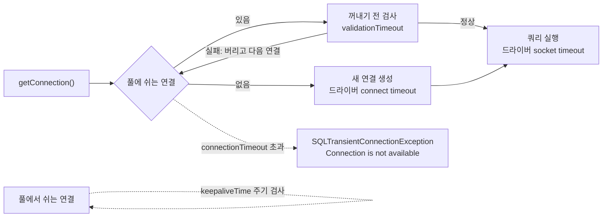
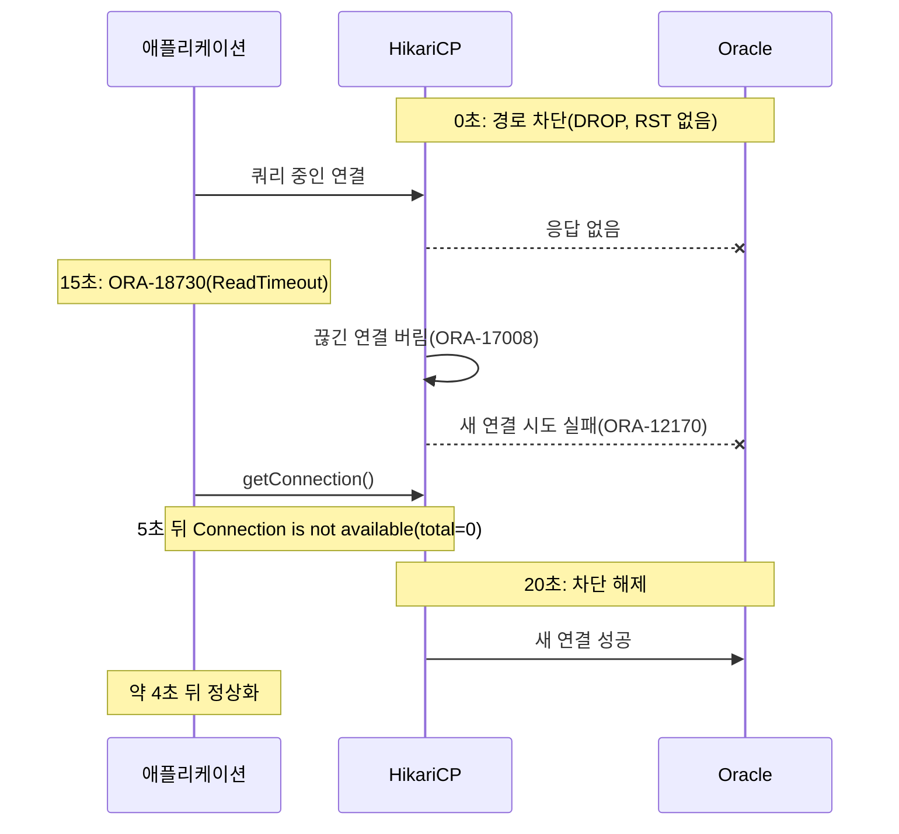

DB와의 연결이 RST(연결 끊김 신호) 없이 사라지면 애플리케이션은 아무 오류도 받지 못한다. 방화벽이 유휴 연결을 버리거나, 네트워크 장비가 재시작되거나, 클라우드 호스트 유지보수 뒤 기존 연결 상태가 사라지는 경우가 그렇다. 이때 HikariCP가 무엇을 해 주고 무엇을 하지 못하는지 정리했다. 기준 버전은 HikariCP 6~7, Java 21, Oracle JDBC(ojdbc11)이다.

## 1. HikariCP가 복구할 수 있는 범위

HikariCP 위키(Rapid Recovery)는 범위를 이렇게 정의한다.

> HikariCP는 DB 재시작이나 네트워크 단절에서 복구하도록 설계됐다. 다만 복구할 수 있는 것은 **풀 안에 있는 연결**뿐이다. 애플리케이션이 빌려 간 연결은 HikariCP가 빠르게 복구할 방법이 거의 없다.

이유는 TCP에 있다. 상대가 사라진 연결에서 보낸 패킷은 응답(ACK)을 영영 받지 못한다. 운영체제는 재전송을 이어 가다가 자기 timeout이 끝나야 연결을 끊는데, 리눅스 기본값으로는 15분이 넘게 걸릴 수 있다. 그동안 그 연결을 쓰던 스레드는 멈춰 있다.

그래서 연결이 어디에 있느냐에 따라 감지하는 주체와 시간이 다르다.

| 연결 상태 | 끊긴 것을 누가 알아채나 | 걸리는 시간을 정하는 설정 |
| --- | --- | --- |
| 애플리케이션이 쓰는 중(쿼리 실행 중) | JDBC 드라이버의 소켓 읽기 timeout | 드라이버 socket timeout(Oracle `oracle.jdbc.ReadTimeout` 등) |
| 풀에서 쉬는 중 | HikariCP의 주기 검사 | `keepaliveTime`(기본 2분) |
| 풀에서 꺼낼 때 | HikariCP의 꺼내기 전 검사 | `validationTimeout`(기본 5초) |
| 새 연결을 맺을 때 | 드라이버의 연결 timeout | 드라이버 connect timeout |
| 쓸 연결이 없어 기다릴 때 | HikariCP | `connectionTimeout`(기본 30초) |

## 2. 설정별 동작

### 꺼내기 전 검사: validationTimeout

HikariCP는 연결을 넘겨주기 전에 JDBC4 `Connection.isValid()`로 살아 있는지 확인한다. 다만 매번 하지는 않는다. 마지막 사용 뒤 500ms(`com.zaxxer.hikari.aliveBypassWindowMs` 시스템 속성)가 지난 연결만 검사한다. 이 검사에 쓰는 시간이 `validationTimeout`이다.

- 기본 5,000ms, 최소 250ms, `connectionTimeout`보다 작아야 한다.
- 검사에 실패한 연결은 버리고 다음 연결을 꺼낸다. 죽은 연결이 여러 개면 검사가 이어지고, 전체 시간이 `connectionTimeout`을 넘으면 `Connection is not available, request timed out after …ms` 오류가 난다.
- 그래서 이 오류가 났다고 해서 풀이 꽉 찬 것은 아니다. 죽은 연결을 걸러 내는 데 시간을 다 쓴 경우도 같은 메시지가 나온다.

### 쉬는 연결 주기 검사: keepaliveTime

풀에서 쉬는 연결을 주기적으로 꺼내 `isValid()`로 확인하고 다시 넣는다. 죽은 연결을 사용자가 꺼내기 전에 걸러 낸다.

- 기본 120,000ms, 최소 30,000ms, `maxLifetime`보다 작아야 한다.
- 쉬는 연결에만 적용된다. 쓰는 중인 연결에는 효과가 없다.
- 주기 사이에 끊기면 다음 검사 전까지는 꺼내기 전 검사(`validationTimeout`)가 대신 걸러 낸다.

### 쓰는 중인 연결: 드라이버 socket timeout

쿼리 실행 중에 연결이 끊기면 HikariCP는 개입하지 못한다. 드라이버의 소켓 읽기 timeout만이 대기를 끝낸다. HikariCP는 이 값을 반드시 설정하라고 권하며, 기준으로 **가장 긴 SQL 트랜잭션의 2~3배 또는 30초 중 큰 값**을 제시한다. 실제 값은 복구 목표 시간에 맞춰 정한다.

| 드라이버 | 속성 |
| --- | --- |
| Oracle(ojdbc) | `oracle.jdbc.ReadTimeout`(ms), 연결은 `oracle.net.CONNECT_TIMEOUT` |
| PostgreSQL | `socketTimeout`(초) |
| MySQL Connector/J | `socketTimeout`(ms) |
| SQL Server(mssql-jdbc) | `socketTimeout`(ms) |

값을 짧게 잡을수록 빨리 복구하지만, 정상인 긴 쿼리도 끊긴다. 오래 걸리는 배치나 보고서 쿼리가 섞여 있으면 쿼리별 timeout(`Statement.setQueryTimeout`)을 따로 두는 편이 낫다.

### TCP keepalive

HikariCP README는 드문 경우 풀이 0까지 줄어 회복하지 못하는 문제를 막으려면 TCP keepalive를 켜라고 안내한다. 드라이버 속성(Oracle `oracle.net.KEEPALIVE=true`, PostgreSQL `tcpKeepAlive=true`)으로 켜도, 탐지 주기는 운영체제 설정(`net.ipv4.tcp_keepalive_time`, 리눅스 기본 7,200초)을 따른다. 기본값 그대로면 사실상 효과가 없으므로 OS 값도 함께 조정해야 한다. keepalive 역시 보낼 데이터가 없는 쉬는 연결에만 동작한다.

### 오류가 난 연결의 처리

HikariCP는 쿼리에서 연결 오류(SQLState가 `08`로 시작하는 경우 등)가 나면 **그 연결 하나만** 풀에서 버린다. 같은 시각에 맺은 다른 연결도 함께 죽었을 가능성이 높아도, 그 연결들은 각자 쓰이거나 검사될 때까지 남는다. 네트워크 단절처럼 연결이 한꺼번에 죽는 상황이 예상되면 두 가지를 쓸 수 있다.

- `HikariPoolMXBean.softEvictConnections()`: 쉬는 연결은 바로, 쓰는 중인 연결은 반납될 때 버린다. 첫 네트워크 오류를 잡았을 때 호출하면 풀 전체를 새 연결로 바꾼다.
- `exceptionOverrideClassName`(`SQLExceptionOverride` 구현): 어떤 예외에서 연결을 버릴지 직접 정한다.

## 3. 실험: DB 경로를 20초 끊었을 때

Oracle 23ai(VM의 컨테이너)와 Java 21 애플리케이션(HikariCP, ojdbc11) 사이에서 DB 쪽 방화벽(iptables)으로 애플리케이션 노드가 보내는 tcp/1521 패킷을 20초 동안 버렸다(DROP). RST를 보내지 않으므로 연결이 조용히 사라진 상황과 같다.

| 설정 | 값 |
| --- | --- |
| `maximumPoolSize` / `minimumIdle` | 10 / 10 |
| `connectionTimeout` | 5,000ms |
| `validationTimeout` | 3,000ms |
| `keepaliveTime` | 120,000ms |
| `oracle.jdbc.ReadTimeout` | 15,000ms |
| `oracle.net.KEEPALIVE` | true(OS 기본 주기) |
| 부하 | 초당 10건, 요청마다 DB 쓰기 2회와 외부 HTTP 호출 1회 |

결과는 다음과 같다.

| 관찰 | 내용 |
| --- | --- |
| 쿼리 중이던 연결 | `ORA-18730: Interrupted IO error.: Socket read timed out`이 15,001~15,018ms에 발생. `ReadTimeout`과 정확히 같다 |
| 새로 빌리려던 요청 | `Connection is not available, request timed out after 5000ms`. 그때 풀은 `total=0`, 대기 스레드 최대 39 |
| 풀이 0이 된 이유 | 끊긴 연결이 `ORA-17008 Closed connection`으로 버려졌고, 새 연결은 경로가 막혀 `ORA-12170 TCP connect timeout`으로 실패했다. 풀이 가득 찬 것이 아니다 |
| 요청 결과 | 1,100건 중 성공 893건, 실패 207건 |
| 회복 | 차단을 푼 뒤 약 4.1초 만에 새 연결로 정상화 |

읽을 점은 두 가지다.

- 오류 시간은 설정이 정한다. 15초는 `ReadTimeout`, 5초는 `connectionTimeout`이다. 애플리케이션은 설정대로 정확히 동작했다.
- 차단이 풀린 뒤 회복은 빨랐다. 풀이 죽은 연결을 이미 버렸기 때문이다. 반대로 차단 없이 **기존 연결만** 죽고 새 연결은 정상인 경우라면, 첫 오류에서 풀 전체를 비우는 방식(`softEvictConnections`)이 회복 시간을 크게 줄인다.

## 4. 설정 정리

| 목적 | 설정 | 기준 |
| --- | --- | --- |
| 쿼리 중 끊김의 최대 대기 | 드라이버 socket timeout | 가장 긴 트랜잭션의 2~3배 또는 30초 중 큰 값에서 시작해 복구 목표에 맞춤 |
| 꺼낼 때 죽은 연결 걸러 내기 | `validationTimeout` | 1~3초. `connectionTimeout`보다 충분히 작게 |
| 쉬는 연결 미리 걸러 내기 | `keepaliveTime` | 수 분 단위(최소 30초). DB·방화벽 유휴 timeout보다 짧게 |
| 연결 대기 상한 | `connectionTimeout` | 요청 SLA에 맞춤. 너무 길면 스레드가 쌓인다 |
| 연결 수명 | `maxLifetime` | DB·인프라의 연결 시간 제한보다 몇 초 짧게 |
| 쉬는 연결 탐지 | OS TCP keepalive | 드라이버에서 켜고 OS 주기도 줄임 |
| 일괄 사망 대응 | `softEvictConnections()` 또는 `SQLExceptionOverride` | 네트워크 오류를 처음 잡았을 때 풀 전체 교체 |
| 주소 변경 대응 | JVM DNS 캐시 TTL | DB 주소가 바뀔 수 있으면 `networkaddress.cache.ttl`을 짧게 |

## 5. 한계

- 쓰는 중인 연결은 socket timeout까지 기다릴 수밖에 없다. 연결이 소리 없이 사라지면 애플리케이션이 알 수 있는 것은 "응답이 없다"는 사실뿐이고, 이를 판단하는 방법은 시간밖에 없다.
- timeout을 줄이면 복구는 빨라지지만 정상인 느린 요청도 끊긴다. 값은 장애 주입 시험으로 확인한 뒤 정한다.
- 이 설정들은 기다리는 시간을 줄일 뿐, 끊긴 순간 처리 중이던 요청을 살리지는 못한다. 끊긴 요청의 정합성(중복 처리, 기록 불일치)은 멱등 키와 대사처럼 별도 설계로 다룬다.

## 참고

- [HikariCP README: Configuration](https://github.com/brettwooldridge/HikariCP#gear-configuration-knobs-baby)
- [HikariCP Wiki: Rapid Recovery](https://github.com/brettwooldridge/HikariCP/wiki/Rapid-Recovery)
- [HikariCP Wiki: Setting Driver or OS TCP Keepalive](https://github.com/brettwooldridge/HikariCP/wiki/Setting-Driver-or-OS-TCP-Keepalive)
- [HikariCP Wiki: Bad Behavior: Handling Database Down](https://github.com/brettwooldridge/HikariCP/wiki/Bad-Behavior:-Handling-Database-Down)
- [AWS Builders' Library: Timeouts, retries, and backoff with jitter](https://aws.amazon.com/builders-library/timeouts-retries-and-backoff-with-jitter/)
