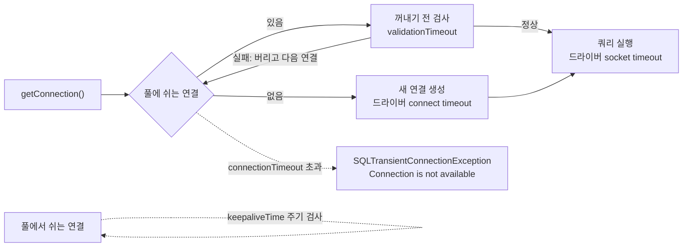
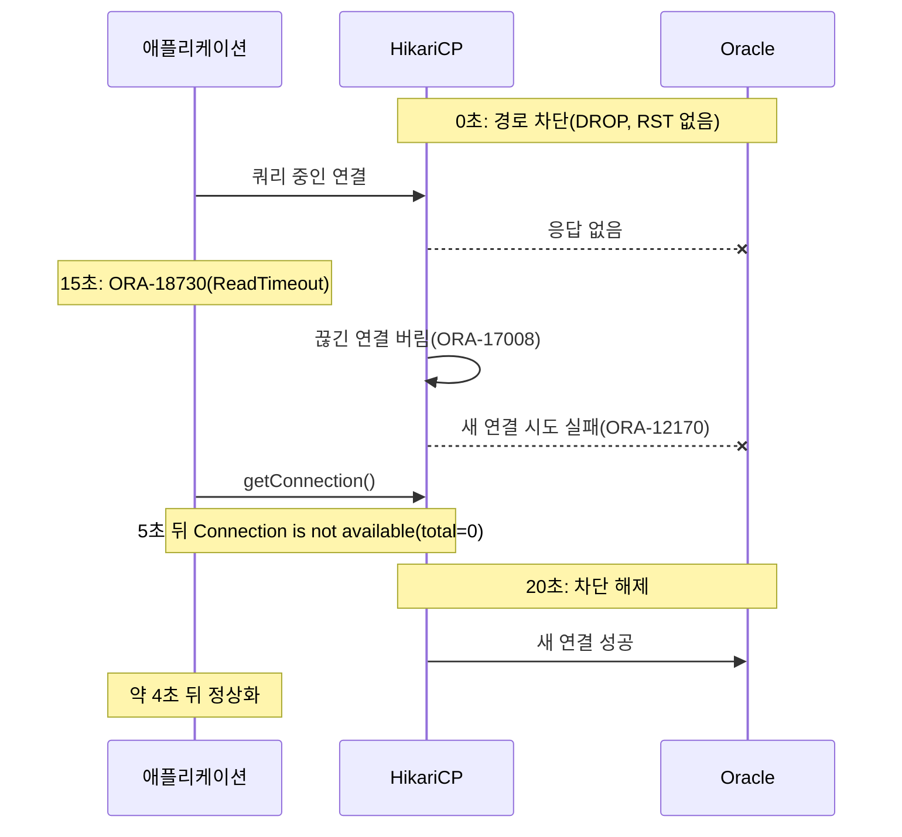
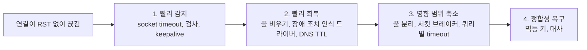

DB와의 연결이 RST(연결 끊김 신호) 없이 사라지면 애플리케이션은 아무 오류도 받지 못한다. 방화벽이 유휴 연결을 버리거나, 네트워크 장비가 재시작되거나, 클라우드 호스트 유지보수 뒤 기존 연결 상태가 사라지는 경우가 그렇다. 이때 HikariCP가 무엇을 해 주고 무엇을 하지 못하는지 정리했다. 기준 버전은 HikariCP 6~7, Java 21, Oracle JDBC(ojdbc11)이다.

## 1. HikariCP가 복구할 수 있는 범위

HikariCP 위키(Rapid Recovery)는 범위를 이렇게 정의한다.

> HikariCP는 DB 재시작이나 네트워크 단절에서 복구하도록 설계됐다. 다만 복구할 수 있는 것은 **풀 안에 있는 연결**뿐이다. 애플리케이션이 빌려 간 연결은 HikariCP가 빠르게 복구할 방법이 거의 없다.

이유는 TCP에 있다. 상대가 사라진 연결에서 보낸 패킷은 응답(ACK)을 영영 받지 못한다. 운영체제는 재전송을 이어 가다가 자기 timeout이 끝나야 연결을 끊는데, 리눅스 기본값으로는 15분이 넘게 걸릴 수 있다. 그동안 그 연결을 쓰던 스레드는 멈춰 있다.

그래서 연결이 어디에 있느냐에 따라 감지하는 주체와 시간이 다르다.

| 연결 상태 | 끊긴 것을 누가 알아채나 | 걸리는 시간을 정하는 설정 |
| --- | --- | --- |
| 애플리케이션이 쓰는 중(쿼리 실행 중) | JDBC 드라이버의 소켓 읽기 timeout | 드라이버 socket timeout(Oracle `oracle.jdbc.ReadTimeout` 등) |
| 풀에서 쉬는 중 | HikariCP의 주기 검사 | `keepaliveTime`(기본 2분) |
| 풀에서 꺼낼 때 | HikariCP의 꺼내기 전 검사 | `validationTimeout`(기본 5초) |
| 새 연결을 맺을 때 | 드라이버의 연결 timeout | 드라이버 connect timeout |
| 쓸 연결이 없어 기다릴 때 | HikariCP | `connectionTimeout`(기본 30초) |



## 2. 설정별 동작

### 꺼내기 전 검사: validationTimeout

HikariCP는 연결을 넘겨주기 전에 JDBC4 `Connection.isValid()`로 살아 있는지 확인한다. 다만 매번 하지는 않는다. 마지막 사용 뒤 500ms(`com.zaxxer.hikari.aliveBypassWindowMs` 시스템 속성)가 지난 연결만 검사한다. 이 검사에 쓰는 시간이 `validationTimeout`이다.

- 기본 5,000ms, 최소 250ms, `connectionTimeout`보다 작아야 한다.
- 검사에 실패한 연결은 버리고 다음 연결을 꺼낸다. 죽은 연결이 여러 개면 검사가 이어지고, 전체 시간이 `connectionTimeout`을 넘으면 `Connection is not available, request timed out after …ms` 오류가 난다.
- 그래서 이 오류가 났다고 해서 풀이 꽉 찬 것은 아니다. 죽은 연결을 걸러 내는 데 시간을 다 쓴 경우도 같은 메시지가 나온다.

### 쉬는 연결 주기 검사: keepaliveTime

풀에서 쉬는 연결을 주기적으로 꺼내 `isValid()`로 확인하고 다시 넣는다. 죽은 연결을 사용자가 꺼내기 전에 걸러 낸다.

- 기본 120,000ms, 최소 30,000ms, `maxLifetime`보다 작아야 한다.
- 쉬는 연결에만 적용된다. 쓰는 중인 연결에는 효과가 없다.
- 주기 사이에 끊기면 다음 검사 전까지는 꺼내기 전 검사(`validationTimeout`)가 대신 걸러 낸다.

### 쓰는 중인 연결: 드라이버 socket timeout

쿼리 실행 중에 연결이 끊기면 HikariCP는 개입하지 못한다. 드라이버의 소켓 읽기 timeout만이 대기를 끝낸다. HikariCP는 이 값을 반드시 설정하라고 권하며, 기준으로 **가장 긴 SQL 트랜잭션의 2~3배 또는 30초 중 큰 값**을 제시한다. 실제 값은 복구 목표 시간에 맞춰 정한다.

| 드라이버 | 속성 |
| --- | --- |
| Oracle(ojdbc) | `oracle.jdbc.ReadTimeout`(ms), 연결은 `oracle.net.CONNECT_TIMEOUT` |
| PostgreSQL | `socketTimeout`(초) |
| MySQL Connector/J | `socketTimeout`(ms) |
| SQL Server(mssql-jdbc) | `socketTimeout`(ms) |

값을 짧게 잡을수록 빨리 복구하지만, 정상인 긴 쿼리도 끊긴다. 오래 걸리는 배치나 보고서 쿼리가 섞여 있으면 쿼리별 timeout(`Statement.setQueryTimeout`)을 따로 두는 편이 낫다.

### TCP keepalive

HikariCP README는 드문 경우 풀이 0까지 줄어 회복하지 못하는 문제를 막으려면 TCP keepalive를 켜라고 안내한다. 드라이버 속성(Oracle `oracle.net.KEEPALIVE=true`, PostgreSQL `tcpKeepAlive=true`)으로 켜도, 탐지 주기는 운영체제 설정(`net.ipv4.tcp_keepalive_time`, 리눅스 기본 7,200초)을 따른다. 기본값 그대로면 사실상 효과가 없으므로 OS 값도 함께 조정해야 한다. keepalive 역시 보낼 데이터가 없는 쉬는 연결에만 동작한다.

### 오류가 난 연결의 처리

HikariCP는 쿼리에서 연결 오류(SQLState가 `08`로 시작하는 경우 등)가 나면 **그 연결 하나만** 풀에서 버린다. 같은 시각에 맺은 다른 연결도 함께 죽었을 가능성이 높아도, 그 연결들은 각자 쓰이거나 검사될 때까지 남는다. 네트워크 단절처럼 연결이 한꺼번에 죽는 상황이 예상되면 두 가지를 쓸 수 있다.

- `HikariPoolMXBean.softEvictConnections()`: 쉬는 연결은 바로, 쓰는 중인 연결은 반납될 때 버린다. 첫 네트워크 오류를 잡았을 때 호출하면 풀 전체를 새 연결로 바꾼다.
- `exceptionOverrideClassName`(`SQLExceptionOverride` 구현): 어떤 예외에서 연결을 버릴지 직접 정한다.

## 3. 실험: DB 경로를 20초 끊었을 때

Oracle 23ai(VM의 컨테이너)와 Java 21 애플리케이션(HikariCP, ojdbc11) 사이에서 DB 쪽 방화벽(iptables)으로 애플리케이션 노드가 보내는 tcp/1521 패킷을 20초 동안 버렸다(DROP). RST를 보내지 않으므로 연결이 조용히 사라진 상황과 같다.

| 설정 | 값 |
| --- | --- |
| `maximumPoolSize` / `minimumIdle` | 10 / 10 |
| `connectionTimeout` | 5,000ms |
| `validationTimeout` | 3,000ms |
| `keepaliveTime` | 120,000ms |
| `oracle.jdbc.ReadTimeout` | 15,000ms |
| `oracle.net.KEEPALIVE` | true(OS 기본 주기) |
| 부하 | 초당 10건, 요청마다 DB 쓰기 2회와 외부 HTTP 호출 1회 |

결과는 다음과 같다.

| 관찰 | 내용 |
| --- | --- |
| 쿼리 중이던 연결 | `ORA-18730: Interrupted IO error.: Socket read timed out`이 15,001~15,018ms에 발생. `ReadTimeout`과 정확히 같다 |
| 새로 빌리려던 요청 | `Connection is not available, request timed out after 5000ms`. 그때 풀은 `total=0`, 대기 스레드 최대 39 |
| 풀이 0이 된 이유 | 끊긴 연결이 `ORA-17008 Closed connection`으로 버려졌고, 새 연결은 경로가 막혀 `ORA-12170 TCP connect timeout`으로 실패했다. 풀이 가득 찬 것이 아니다 |
| 요청 결과 | 1,100건 중 성공 893건, 실패 207건 |
| 회복 | 차단을 푼 뒤 약 4.1초 만에 새 연결로 정상화 |



읽을 점은 두 가지다.

- 오류 시간은 설정이 정한다. 15초는 `ReadTimeout`, 5초는 `connectionTimeout`이다. 애플리케이션은 설정대로 정확히 동작했다.
- 차단이 풀린 뒤 회복은 빨랐다. 풀이 죽은 연결을 이미 버렸기 때문이다. 반대로 차단 없이 **기존 연결만** 죽고 새 연결은 정상인 경우라면, 첫 오류에서 풀 전체를 비우는 방식(`softEvictConnections`)이 회복 시간을 크게 줄인다.

## 4. 설정 정리

| 목적 | 설정 | 기준 |
| --- | --- | --- |
| 쿼리 중 끊김의 최대 대기 | 드라이버 socket timeout | 가장 긴 트랜잭션의 2~3배 또는 30초 중 큰 값에서 시작해 복구 목표에 맞춤 |
| 꺼낼 때 죽은 연결 걸러 내기 | `validationTimeout` | 1~3초. `connectionTimeout`보다 충분히 작게 |
| 쉬는 연결 미리 걸러 내기 | `keepaliveTime` | 수 분 단위(최소 30초). DB·방화벽 유휴 timeout보다 짧게 |
| 연결 대기 상한 | `connectionTimeout` | 요청 SLA에 맞춤. 너무 길면 스레드가 쌓인다 |
| 연결 수명 | `maxLifetime` | DB·인프라의 연결 시간 제한보다 몇 초 짧게 |
| 쉬는 연결 탐지 | OS TCP keepalive | 드라이버에서 켜고 OS 주기도 줄임 |
| 일괄 사망 대응 | `softEvictConnections()` 또는 `SQLExceptionOverride` | 네트워크 오류를 처음 잡았을 때 풀 전체 교체 |
| 주소 변경 대응 | JVM DNS 캐시 TTL | DB 주소가 바뀔 수 있으면 `networkaddress.cache.ttl`을 짧게 |

## 5. 극복 방안

연결이 소리 없이 끊기는 것 자체는 애플리케이션이 막을 수 없다. 할 수 있는 것은 **빨리 알아채기, 빨리 회복하기, 영향 범위 줄이기, 끊긴 거래 바로잡기** 네 가지다. 위로 갈수록 설정만으로 되고, 아래로 갈수록 구조나 코드 변경이 필요하다.



| 단계 | 방안 | 효과 | 비용·주의 |
| --- | --- | --- | --- |
| 1. 감지 | 드라이버 socket timeout을 복구 목표에 맞춤 | 쿼리 중 끊김의 최대 대기 시간을 정한다 | 정상인 긴 쿼리도 끊긴다. 긴 쿼리는 쿼리별 timeout으로 분리 |
| 1. 감지 | `validationTimeout` 단축(1~3초) | 꺼낼 때 죽은 연결 하나당 대기를 줄인다 | 죽은 연결이 많으면 `connectionTimeout`에 걸릴 수 있다 |
| 1. 감지 | `keepaliveTime`과 OS TCP keepalive 단축 | 쉬는 연결을 사용자보다 먼저 걸러 낸다 | 쓰는 중인 연결에는 효과 없음 |
| 1. 감지 | 네트워크 장비의 유휴 timeout 확인(LB, NAT, 방화벽) | 장비가 연결을 조용히 버리는 것을 막거나 RST를 받게 한다 | keepalive 주기를 장비 timeout보다 짧게. Azure LB는 TCP reset 옵션 제공 |
| 2. 회복 | 첫 네트워크 오류에서 풀 전체 교체(`softEvictConnections`, `SQLExceptionOverride`) | 같은 시각에 함께 죽은 연결을 한 번에 정리한다 | 정상 연결도 다시 맺는다. 짧은 시간에 연결이 몰리지 않게 조절 |
| 2. 회복 | `maxLifetime`을 DB·인프라 제한보다 짧게 | 오래된 연결이 장비 timeout에 걸리기 전에 교체한다 | 쓰는 중인 연결은 반납 뒤에 교체된다 |
| 2. 회복 | JVM DNS 캐시 TTL 단축 | 장애 조치 뒤 새 주소로 빨리 붙는다 | DB 엔드포인트가 DNS로 바뀌는 구조에서만 의미 |
| 2. 회복 | 장애 조치를 아는 드라이버·프록시 | DNS 전파나 timeout을 기다리지 않고 새 대상을 찾는다 | AWS Advanced JDBC Wrapper, RDS Proxy처럼 DB 서비스에 종속된다 |
| 2. 회복 | DB 쪽 장애 알림(Oracle FAN, UCP Fast Connection Failover) | DB가 노드 상태 변화를 풀에 알려 죽은 연결을 바로 버린다 | Oracle RAC와 UCP(또는 FAN 연동) 구성이 필요하다 |
| 3. 범위 | 용도별 풀 분리(벌크헤드) | 한 경로의 장애가 다른 기능의 연결까지 막지 않게 한다 | 전체 연결 수가 늘어난다 |
| 3. 범위 | 서킷 브레이커, 짧은 `connectionTimeout` | 장애 중 스레드가 쌓이는 것을 막고 빨리 실패한다 | 실패 응답에 대한 상위 처리 필요 |
| 4. 정합성 | 멱등 키, 상태 기록 후 외부 호출, 대사 | 끊긴 쓰기가 중복되거나 어긋나도 바로잡는다 | 설계 변경이 필요하다. 대기 시간은 줄이지 않는다 |
| 4. 정합성 | DB 재실행 기능(Oracle Application Continuity) | 조건이 맞으면 끊긴 작업을 DB가 다시 실행한다 | 지원 데이터 소스와 연결 상태 초기화 조건이 필요하다 |

아래는 방안별 세부 내용이다.

### 5.1 빨리 감지하기

#### 드라이버 socket timeout

쿼리를 보내고 응답을 기다리는 동안 연결이 끊기면, 이 값이 대기를 끝내는 유일한 장치다. 운영체제의 TCP 재전송 한도(리눅스 `tcp_retries2=15`, 15분 이상)를 기다리지 않게 한다.

```properties
# Oracle(ojdbc). 단위 ms
oracle.jdbc.ReadTimeout=15000
oracle.net.CONNECT_TIMEOUT=5000
```

```java
HikariConfig c = new HikariConfig();
c.addDataSourceProperty("oracle.jdbc.ReadTimeout", "15000");
c.addDataSourceProperty("oracle.net.CONNECT_TIMEOUT", "5000");
```

- 값은 "가장 긴 정상 쿼리보다 충분히 길게, 복구 목표보다 짧게"로 정한다. HikariCP는 가장 긴 트랜잭션의 2~3배 또는 30초 중 큰 값을 출발점으로 제시한다.
- 배치나 보고서처럼 긴 쿼리가 섞이면 전체 값을 늘리지 말고, 긴 쿼리만 `Statement.setQueryTimeout()`이나 별도 풀로 분리한다.
- 이 timeout이 나면 Oracle은 `ORA-18730`(소켓 읽기 timeout)을 던지고, HikariCP는 그 연결을 버린다.

#### validationTimeout

연결을 꺼내 줄 때 `isValid()` 검사에 쓰는 최대 시간이다. 검사는 마지막 사용 뒤 500ms가 지난 연결에만 한다.

```java
c.setConnectionTimeout(5000);   // 연결을 얻기까지 기다리는 최대 시간
c.setValidationTimeout(1000);   // 검사 한 번의 최대 시간. connectionTimeout보다 작게
```

- 죽은 연결 하나를 걸러 내는 데 최대 `validationTimeout`이 걸린다. 풀에 죽은 연결이 N개면 최악의 경우 N × `validationTimeout`이 걸려 `connectionTimeout`을 넘는다. 3초에서 1초로 줄이면 같은 시간 안에 세 배 많은 연결을 걸러 낸다.
- 너무 짧으면(250ms 근처) 순간적인 지연에도 정상 연결을 버린다. 네트워크 왕복 시간의 수십 배 이상으로 둔다.

#### keepaliveTime

풀에서 쉬는 연결을 주기적으로 꺼내 `isValid()`로 확인한다. 사용자가 꺼내기 전에 죽은 연결을 걸러 내므로, 장애 뒤 첫 요청들이 검사 시간을 떠안지 않는다.

```java
c.setKeepaliveTime(60_000);    // 최소 30초. maxLifetime보다 작게
c.setMaxLifetime(1_500_000);
```

- 쓰는 중인 연결에는 효과가 없다.
- 주기가 짧을수록 빨리 걸러 내지만 DB에 검사 쿼리가 늘어난다. 연결 수 × (1 / 주기)만큼 늘어난다.

#### OS TCP keepalive

쉬는 연결에 운영체제가 작은 검사 패킷을 보내 상대가 살아 있는지 확인한다. HikariCP README는 풀이 0으로 줄어 회복하지 못하는 경우를 막으려면 켜라고 안내한다.

```properties
# 드라이버에서 keepalive 사용
oracle.net.KEEPALIVE=true
# ojdbc 21c 이상은 소켓별 주기를 지정할 수 있다(버전별 지원 여부 확인)
oracle.net.TCP_KEEPIDLE=60
oracle.net.TCP_KEEPINTERVAL=10
oracle.net.TCP_KEEPCOUNT=3
```

```yaml
# Kubernetes: Pod 단위로 OS 값을 낮춘다(1.29부터 safe sysctl)
securityContext:
  sysctls:
    - { name: net.ipv4.tcp_keepalive_time,   value: "60" }
    - { name: net.ipv4.tcp_keepalive_intvl,  value: "10" }
    - { name: net.ipv4.tcp_keepalive_probes, value: "3" }
```

- 리눅스 기본값은 7,200초 뒤 첫 검사라, 켜기만 하고 주기를 줄이지 않으면 효과가 거의 없다.
- 위 값이면 쉬는 연결이 끊긴 뒤 약 60 + 10 × 3 = 90초 안에 감지한다.
- 보낼 데이터가 남아 있는 연결(쿼리 중)에는 keepalive가 아니라 재전송 한도와 socket timeout이 적용된다.

#### 네트워크 장비의 유휴 timeout

LB, NAT 게이트웨이, 방화벽은 일정 시간 트래픽이 없는 연결 상태를 지운다. 많은 장비가 이때 RST를 보내지 않아, 다음 쿼리가 응답 없이 멈춘다. 예를 들어 Azure Standard Load Balancer는 기본 4분 유휴 뒤 흐름을 조용히 버린다.

- 경로에 있는 장비의 유휴 timeout을 모두 찾고, `keepaliveTime`과 OS keepalive 주기를 그중 가장 짧은 값보다 짧게 둔다.
- 장비가 지원하면 유휴 종료 때 RST를 보내도록 켠다(Azure LB의 TCP reset). 그러면 애플리케이션이 바로 오류를 받는다.
- `maxLifetime`도 장비와 DB의 연결 시간 제한보다 몇 초 짧게 둔다.

### 5.2 빨리 회복하기

#### 첫 네트워크 오류에서 풀 전체 교체

네트워크 단절은 같은 경로의 연결을 한꺼번에 죽인다. HikariCP는 오류가 난 연결 하나만 버리므로, 나머지 죽은 연결은 각자 검사나 timeout을 거쳐야 정리된다. 첫 오류를 신호로 풀 전체를 교체하면 이 대기가 사라진다.

```java
// 연결 오류(SQLRecoverableException 등)를 잡는 공통 위치에서 호출
private final AtomicLong lastEvict = new AtomicLong();

void onConnectionFailure(HikariDataSource ds, SQLException e) {
    if (!(e instanceof SQLRecoverableException)) return;   // 연결 계열 오류만
    long now = System.currentTimeMillis();
    long prev = lastEvict.get();
    if (now - prev > 10_000 && lastEvict.compareAndSet(prev, now)) {   // 10초에 한 번만
        ds.getHikariPoolMXBean().softEvictConnections();   // 쉬는 연결은 즉시, 쓰는 중인 연결은 반납 때 교체
    }
}
```

- `softEvictConnections()`는 쓰는 중인 연결을 강제로 끊지 않는다. 진행 중인 쿼리는 자기 timeout까지 간다.
- 정상 연결까지 다시 맺으므로, 짧은 시간에 여러 번 호출되지 않게 간격을 둔다.
- 어떤 예외에서 연결을 버릴지 바꾸려면 `exceptionOverrideClassName`에 `SQLExceptionOverride` 구현을 지정한다.

#### maxLifetime

연결을 일정 시간마다 새로 맺는다. 장비나 DB가 오래된 연결을 끊기 전에 먼저 교체해, 끊긴 연결을 쓸 확률을 줄인다.

- 경로의 가장 짧은 연결 시간 제한보다 몇 초 짧게 둔다. 기본값 30분.
- 쓰는 중인 연결은 반납될 때 교체된다. HikariCP는 연결마다 약간씩 다르게 적용해 한꺼번에 끊기지 않게 한다.

#### JVM DNS 캐시 TTL

장애 조치 때 DB 주소(DNS)가 새 노드로 바뀌는 구조라면, JVM이 옛 주소를 캐시해 회복이 늦어질 수 있다.

```java
// 애플리케이션 시작 시 가장 먼저(첫 이름 조회 전에)
java.security.Security.setProperty("networkaddress.cache.ttl", "30");
```

- 주소가 바뀌지 않는 구조(고정 IP, 같은 이름의 VIP)라면 효과가 없다.

#### 장애 조치를 아는 드라이버와 프록시

DB 서비스가 노드 구성 정보를 제공하면, 드라이버가 DNS 전파나 timeout을 기다리지 않고 새 기본 노드로 바로 연결한다.

- AWS Advanced JDBC Wrapper: Aurora 클러스터 구성 정보로 새 writer를 찾는다. HikariCP와 함께 쓸 수 있다.
- Amazon RDS Proxy: 애플리케이션과 DB 사이에서 연결을 유지하고, 장애 조치 때 대상만 바꾼다.
- 특정 DB 서비스에 종속되며, 진행 중인 트랜잭션은 보통 실패한다.

#### DB 쪽 장애 알림(Oracle FAN, UCP)

Oracle RAC는 노드나 서비스 상태가 바뀌면 FAN(Fast Application Notification) 이벤트를 보낸다. Oracle UCP의 Fast Connection Failover는 이 이벤트를 받아 해당 노드의 연결을 바로 버린다. 풀이 timeout으로 알아챌 때까지 기다리지 않는다.

- RAC와 ONS(알림 서비스) 구성이 필요하다. 서드파티 풀은 Oracle이 안내하는 방식으로 FAN을 연동해야 한다.
- 단일 인스턴스 DB나 네트워크 경로만 끊기는 경우(DB는 정상)에는 이벤트가 나지 않는다.

### 5.3 영향 범위 줄이기

#### 용도별 풀 분리(벌크헤드)

한 풀이 죽은 연결을 기다리는 동안 그 풀을 쓰는 모든 기능이 함께 멈춘다. 결제 승인, 조회, 배치처럼 중요도와 쿼리 성격이 다른 경로는 풀을 나눈다.

```java
HikariDataSource paymentPool = new HikariDataSource(paymentConfig); // 짧은 timeout, 작은 풀
HikariDataSource queryPool   = new HikariDataSource(queryConfig);   // 조회용
HikariDataSource batchPool   = new HikariDataSource(batchConfig);   // 긴 쿼리용, 긴 timeout
```

- 경로마다 timeout을 다르게 줄 수 있어, 짧은 timeout과 긴 쿼리의 충돌도 함께 해결된다.
- 전체 연결 수가 늘어나므로 DB의 최대 연결 수를 함께 본다.

#### 서킷 브레이커와 짧은 connectionTimeout

장애 중에는 요청마다 `connectionTimeout`만큼 기다렸다 실패한다. 그동안 스레드와 요청이 쌓여 애플리케이션 전체가 느려진다. 서킷 브레이커는 실패가 이어지면 일정 시간 바로 실패시키고, 가끔 시험 요청으로 회복을 확인한다.

```java
CircuitBreaker db = CircuitBreaker.of("db", CircuitBreakerConfig.custom()
    .failureRateThreshold(50)
    .slowCallDurationThreshold(Duration.ofSeconds(3))
    .waitDurationInOpenState(Duration.ofSeconds(10))
    .build());   // Resilience4j
```

- 실패를 빨리 돌려주므로 상위(클라이언트, Gateway)가 재시도나 다른 경로를 고를 수 있다.
- 바로 실패한 요청에 대한 처리(재시도 여부, 사용자 안내)가 상위에 있어야 한다.

### 5.4 끊긴 거래 바로잡기

#### 멱등 키, 상태 기록, 대사

위 방안은 기다리는 시간을 줄일 뿐, 끊긴 순간 처리 중이던 쓰기의 결과는 알 수 없다. 쓰기는 결과가 불명확해도 정합성이 맞도록 설계한다.

```sql
-- 외부 호출 전에 먼저 기록하고, 결과로 확정한다
INSERT INTO payment (tx_id, status) VALUES (:txId, 'PENDING');   -- tx_id는 멱등 키(UNIQUE)
-- 외부 승인 호출(같은 tx_id를 멱등 키로 전달)
UPDATE payment SET status = 'APPROVED' WHERE tx_id = :txId;
```

- 같은 요청이 다시 오면 `tx_id` 중복으로 한 번만 처리된다.
- `PENDING`으로 남은 거래는 다시 결제하지 않고, 외부 시스템 상태 조회와 정기 대사로 확정한다.

#### DB 재실행(Oracle Application Continuity)

Oracle Application Continuity는 연결이 끊기면 DB가 그 요청의 작업을 다시 실행해, 애플리케이션이 오류를 보지 않게 한다. UCP 같은 지원 데이터 소스와 요청 경계 표시, 재실행 가능한 연결 상태 같은 조건이 맞아야 한다. 외부 시스템 호출은 재실행 대상이 아니므로, 결제처럼 DB 밖 부작용이 있는 흐름에는 멱등 키 설계가 여전히 필요하다.

모든 값은 장애 주입 시험으로 확인한 뒤 정한다. 이 글의 3장처럼 DB 쪽에서 패킷을 버리면(DROP) RST 없는 끊김을 재현할 수 있다. AWS도 Aurora 빠른 장애 조치 가이드에서 같은 방식(패킷 차단 시험)을 권한다.

## 6. 한계

- 쓰는 중인 연결은 socket timeout까지 기다릴 수밖에 없다. 연결이 소리 없이 사라지면 애플리케이션이 알 수 있는 것은 "응답이 없다"는 사실뿐이고, 이를 판단하는 방법은 시간밖에 없다.
- timeout을 줄이면 복구는 빨라지지만 정상인 느린 요청도 끊긴다. 값은 장애 주입 시험으로 확인한 뒤 정한다.
- 이 설정들은 기다리는 시간을 줄일 뿐, 끊긴 순간 처리 중이던 요청을 살리지는 못한다. 끊긴 요청의 정합성(중복 처리, 기록 불일치)은 멱등 키와 대사처럼 별도 설계로 다룬다.

## 참고

- [HikariCP README: Configuration](https://github.com/brettwooldridge/HikariCP#gear-configuration-knobs-baby)
- [HikariCP Wiki: Rapid Recovery](https://github.com/brettwooldridge/HikariCP/wiki/Rapid-Recovery)
- [HikariCP Wiki: Setting Driver or OS TCP Keepalive](https://github.com/brettwooldridge/HikariCP/wiki/Setting-Driver-or-OS-TCP-Keepalive)
- [HikariCP Wiki: Bad Behavior: Handling Database Down](https://github.com/brettwooldridge/HikariCP/wiki/Bad-Behavior:-Handling-Database-Down)
- [AWS Builders' Library: Timeouts, retries, and backoff with jitter](https://aws.amazon.com/builders-library/timeouts-retries-and-backoff-with-jitter/)

### 관련 사례와 문서

- [Red Hat: Configure HikariCP for Spring Boot on OpenShift 4](https://developers.redhat.com/articles/2026/11/20/configure-hikaricp-spring-boot-red-hat-openshift-4): 장애 뒤 연결 추가 스레드가 소켓 읽기에서 멈춘 사례와 keepalive·수명 설정
- [우아한형제들: 절대적 Rule을 지켜 – Config Checker 개발기](https://techblog.woowahan.com/7242/): 설정 원인 장애를 검토한 뒤 Hikari `maxLifetime`을 RDS `wait_timeout`보다 짧게 두도록 설정 검사기를 만든 사례
- [AWS: Fast failover with Amazon Aurora PostgreSQL](https://docs.aws.amazon.com/AmazonRDS/latest/AuroraUserGuide/AuroraPostgreSQL.BestPractices.FastFailover.html): 패킷 차단 시험, TCP keepalive, JDBC `socketTimeout`/`connectTimeout`, JVM DNS TTL 권장
- [AWS China: 从分钟到秒级 — Amazon Advanced JDBC Wrapper 插件最佳实践](https://aws.amazon.com/cn/blogs/china/amazon-advanced-jdbc-wrapper-plugin-best-practices/): HikariCP와 Aurora 시험에서 장애 조치 플러그인 유무에 따른 회복 시간 비교
- [AWS: Unlock Amazon Aurora's Advanced Features with Standard JDBC Driver using AWS Advanced JDBC Wrapper](https://aws.amazon.com/blogs/database/unlock-amazon-auroras-advanced-features-with-standard-jdbc-driver-using-aws-advanced-jdbc-wrapper/): HikariCP와 함께 쓰는 장애 조치 인식 드라이버
- [AWS: Improving application availability with Amazon RDS Proxy](https://aws.amazon.com/blogs/database/improving-application-availability-with-amazon-rds-proxy/): 장애 조치 때 응답 없는 TCP 연결 문제와 프록시로 쉬는 연결을 유지하는 방식
- [AWS: Using RDS Proxy with Amazon RDS Multi-AZ to improve planned failover time](https://aws.amazon.com/blogs/database/using-rds-proxy-with-amazon-rds-multi-az-db-instance-deployment-to-improve-planned-failover-time/): OS 업그레이드 같은 계획된 유지보수 중 장애 조치 시간 측정
- [Microsoft: Load Balancer TCP Reset and idle timeout](https://learn.microsoft.com/azure/load-balancer/load-balancer-tcp-reset): Azure Standard Load Balancer가 유휴 흐름을 기본 4분 뒤 조용히 버리는 동작과 TCP reset 옵션
- [Microsoft: Connection resiliency, JDBC Driver for SQL Server](https://learn.microsoft.com/sql/connect/jdbc/connection-resiliency): 끊긴 쉬는 연결을 드라이버가 복원하는 기능과 그 범위(열린 트랜잭션은 재실행하지 않음)
- [Microsoft: Handle transient connectivity errors, Azure Database for PostgreSQL](https://learn.microsoft.com/azure/postgresql/troubleshoot/concepts-connectivity): 재시도와 지수 백오프, 커밋 결과가 불명확한 쓰기의 처리
- [Oracle: Configuring FAN for Specific Drivers and Pools](https://docs.oracle.com/en/database/oracle/oracle-database/26/haovw/configuring-fan-specific-drivers-and-pools.html): RAC 노드 상태 변화를 풀에 알리는 FAN과 UCP Fast Connection Failover
- [Oracle: Ensuring Application Continuity](https://docs.oracle.com/en/database/oracle/oracle-database/26/jjucp/application-continuity-using-ucp.html): UCP와 Application Continuity로 끊긴 작업을 재실행하는 조건
- [CYBERTEC: TCP keepalive for a better PostgreSQL experience](https://www.cybertec-postgresql.com/en/tcp-keepalive-for-a-better-postgresql-experience/): HikariCP README가 안내하는 OS 수준 keepalive 설정
