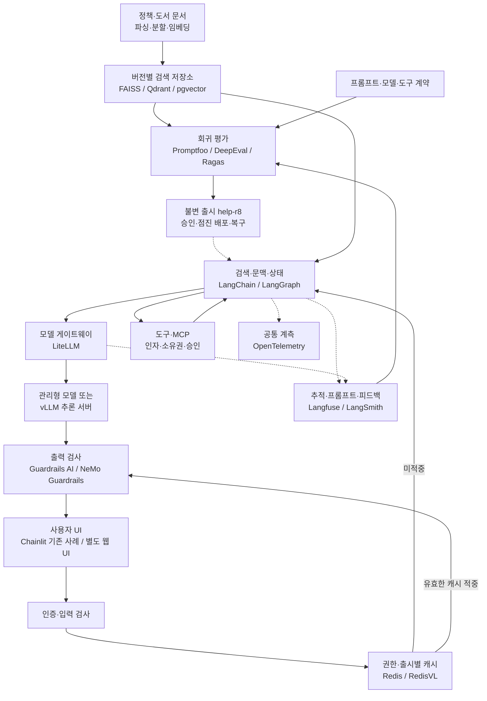

서점 직원이 안내서를 읽고 답한다고 생각하면, 말솜씨만 좋아서는 부족합니다. 현재 정책을 찾아야 하고, 다른 고객의 주문을 보지 않아야 하며, 잘못 안내했을 때 어떤 안내서를 사용했는지 돌아볼 수 있어야 합니다. LLMOps는 이 **검색·생성·행동의 변경과 운영**을 관리합니다.

가상 온라인 서점 **Bookway**의 안내 도우미를 공통 예제로 사용합니다. 도서 추천은 [MLOps의 추천 모델](../mlops/)이 담당하고, 도우미는 `policy-v3`에서 배송·반품 조건을 찾습니다. 주문 상태는 인증된 고객의 주문 API로 조회하며 반품 신청처럼 부작용이 있는 도구는 별도 승인을 거칩니다.

## MLOps와 다른 책임, 공유하는 기반

LLMOps가 학습을 하지 않고 MLOps가 항상 직접 학습하는 것은 아닙니다. 둘 다 데이터·평가·배포·권한·관측을 다룹니다. 여기서 차이는 출시 단위입니다. 추천은 데이터·피처·모델·서비스의 조합이고, 안내 도우미는 **문서·임베딩·검색·프롬프트·모델·도구 계약**까지 함께 바뀝니다.

| 요청 | 경로 | 정답과 권한의 기준 |
| --- | --- | --- |
| 반품 기간 안내 | 정책 검색 → 근거 기반 답변 | 정책 버전, 적용 조건, 출처 |
| 추천 도서 설명 | 추천 API → 도서 설명 조회 → 답변 | 추천 release, 판매 상태, 설명의 사실성 |
| 내 주문 배송 상태 | 인증 → 소유권 검사 → 주문 도구 | 서버가 확인한 고객·주문 관계 |
| 반품 신청 | 대상·조건 확인 → 승인 → 실행 | 승인한 인자, 멱등 키, 거래 결과 |

아래의 `help-r8` 등은 설명용 출시 ID입니다. 실제 고객 정보나 외부 시스템의 실행 기록이 아닙니다.

## 구축·평가·운영을 잇는 도식

그림의 `/`는 모두 설치한다는 뜻이 아니라 선택지입니다. FAISS·Qdrant·pgvector 중 운영 조건에 맞는 저장소를 고르고, Langfuse·LangSmith도 우선 한 추적 경로를 정합니다. vLLM은 자체 모델 운영이 필요할 때 추가하고, 관리형 API만 쓰는 서비스에 GPU 서버를 억지로 넣지 않습니다.

## 도구별 실무 가이드

| 계층 | 하위 아티클 | Bookway에서 연결하는 값 |
| --- | --- | --- |
| 문서·검색 | [문서 파이프라인과 FAISS](ingestion-faiss/) | `policy-v3` → 청크·원문 ID·임베딩 계약 |
| 벡터 서비스 | [Qdrant](qdrant/) | 컬렉션, payload 필터, 색인 교체 |
| 관계형 검색 | [pgvector](pgvector/) | 정책 행, 권한 조건, 벡터 질의 |
| 앱·에이전트 | [LangChain·LangGraph·MCP](application/) | 질문 → 검색 → 도구 → 승인·재개 |
| 사용자 접점 | [Chainlit과 대화 UI](conversation-ui/) | 세션, 스트리밍, 출처·오류 표시 |
| 추적·프롬프트 | [Langfuse](langfuse/) | 프롬프트 버전, trace, 품질 score |
| 추적·실험 | [LangSmith](langsmith/) | 실행 트리, 데이터셋, 실험 비교 |
| 회귀 평가 | [Promptfoo](promptfoo/) | 고정 질문·assertion → CI 판정 |
| 의미 평가 | [DeepEval](deepeval/) | 응답·문맥 → 근거성·업무 기준 |
| 검색 진단 | [Ragas](ragas/) | 기대 근거·검색 문맥·답변의 분리 |
| 모델 접속 | [LiteLLM](litellm/) | 모델 alias, 라우팅·예산·호출 제한 |
| 자체 추론 | [vLLM](vllm/) | 고정 가중치·토크나이저 → 생성 API |
| 재사용 | [Redis·RedisVL](redis/) | 권한·정책·출시에 묶인 캐시 |
| 입출력 검증 | [Guardrails AI](guardrails/) | 구조·도메인 규칙·검증 실패 |
| 대화 통제 | [NeMo Guardrails](nemo-guardrails/) | 입력·검색·행동·출력 경계의 정책 |
| 공통 관측 | [OpenTelemetry](opentelemetry/) | API·검색·모델·도구 span 연결 |
| 출시 운영 | [평가·승인·배포·복구 계약](release/) | `help-r8`의 불변 명세와 복구 절차 |

책에 등장하는 Langfuse·DeepEval·Promptfoo·Guardrails AI·RedisVL을 기본 축으로 두고, **Ragas, Qdrant, pgvector, LiteLLM, vLLM, NeMo Guardrails, OpenTelemetry**를 빠진 계층의 보완 도구로 연결했습니다. LangSmith와 LangGraph·MCP는 [AI Agents 독서노트](../ai-agents-and-applications/)의 실행·관측 구조와 이어집니다.

Chainlit은 책의 UI를 이해하는 사례로 다루되, 공식 문서에서 유지보수 중단을 안내하므로 신규 운영의 기본 선택으로 권하지 않습니다. 패키지 이름뿐 아니라 유지보수·보안 업데이트·데이터 반출 조건도 도입 판단에 포함합니다.

## 도구가 많아져도 지켜야 할 경계

프롬프트 레지스트리는 승인 절차가 아니고, trace 수집은 사실 검증이 아닙니다. 평가자의 높은 점수도 권한 위반을 면제하지 않습니다. 결과가 없는 상황과 검색기 장애를 구분하고, guardrail 장애를 “문제없음”으로 처리하지 않습니다.

비용은 생성 토큰뿐 아니라 검색·재정렬·평가자·가드레일 호출까지 합산합니다. 지연은 첫 토큰 시간과 전체 응답 시간으로 나눕니다. 모델의 temperature를 0으로 고정해도 버전·실행 환경 차이를 없애는 것은 아니므로 반복 평가와 실패 사례를 함께 보관합니다.

운영 trace에서 재현 가능한 합성 사례를 만들고 회귀 데이터셋에 추가한 뒤 새 후보를 평가합니다. 동의 없이 고객 대화를 외부 추적·평가 서비스로 전송하지 않습니다. 이 가이드의 설정 예시는 합성 입력과 로컬·승인된 엔드포인트를 전제로 합니다.

## 기존 글에서 이어지는 내용

기존 LLMOps 글의 모델 선택, 프롬프트 버전, 품질·비용·지연 평가, 추적과 팀 책임은 이 상위 글과 하위 가이드에 통합했습니다. 기존 `/docs/tech/llmops/` 주소는 유지합니다. 당시 Observatory 분석은 [관측에서 개선 루프로 이어지는 사례](observatory/)로 분리해 시점을 표시했습니다.

[MLOps 전체 흐름](../mlops/) / [실행했던 RAG 출시 기록](../ml-platform-engineering-labs/ml-platform-labs-10-rag-release/)
