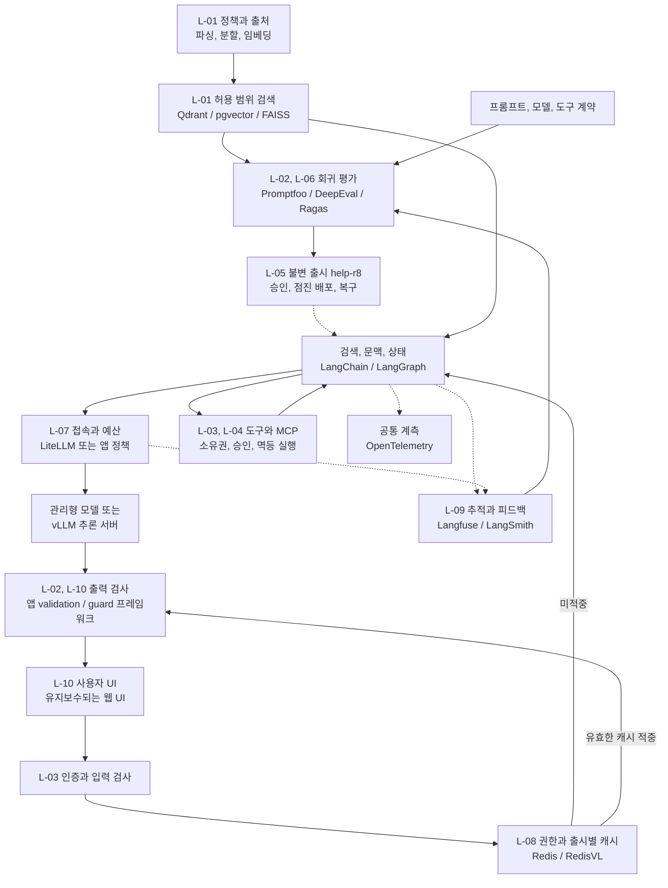

서점 직원이 안내서를 읽고 답한다고 생각하면, 말솜씨만 좋아서는 부족합니다. 현재 정책을 찾아야 하고, 다른 고객의 주문을 보지 않아야 하며, 잘못 안내했을 때 어떤 안내서를 사용했는지 돌아볼 수 있어야 합니다. LLMOps는 이 **검색, 생성, 행동의 변경과 운영**을 관리합니다.

가상 온라인 서점 **Bookway**의 안내 도우미를 공통 예제로 사용합니다. 도서 추천은 [MLOps의 추천 모델](../mlops/)이 담당하고, 도우미는 `policy-v3`에서 배송, 반품 조건을 찾습니다. 주문 상태는 인증된 고객의 주문 API로 조회하며 반품 신청처럼 부작용이 있는 도구는 별도 승인을 거칩니다.

## 시나리오와 범위 {#scenario}

Bookway 도우미는 **공개 정책 안내, 내 주문 조회, 승인한 반품 신청**을 지원합니다. 정책을 설명하는 것과 주문을 변경하는 것은 같은 대화 안에서도 다른 권한과 실행 경로를 가집니다. 환불 금액 계산, 결제 취소, 실제 송금은 이번 범위에서 제외합니다.

합성 정책 `policy-v3`는 “수령 후 7일 이내의 조건을 만족한 종이책은 반품 신청 가능, 전자책은 제외”입니다. 파손 등 별도 예외는 임의로 만들어 답하지 않습니다. 적용 국가와 언어는 한국, `ko-KR` 하나로 제한하며 범위를 늘리면 평가와 캐시 계약도 바꿉니다.

| 상황 | 입력과 전제 | 기대하는 동작 | 허용하지 않는 동작 |
| --- | --- | --- | --- |
| 정책 문의 | “종이책 반품은 언제까지인가요?” | 적용 정책 검색 후 7일 조건과 출처 안내 | 기억에 의존해 기간 생성 |
| 전자책 문의 | “전자책도 7일 안에 반품되나요?” | 종이책 규칙과 구분하고 제외 조건 설명 | 비슷한 질문의 종이책 캐시 재사용 |
| 내 주문 조회 | 로그인 `c-001`, 자신의 주문 `o-101` | 서버가 소유권 확인 후 최신 주문 API 조회 | 질문에 적힌 고객 ID로 접근 범위 변경 |
| 다른 고객 주문 | `c-001`이 `c-002`의 주문 요청 | 원문과 상태를 노출하지 않고 접근 거절 | 조회 결과를 모델 문맥에 먼저 전달 |
| 반품 신청 | 조건을 만족한 `o-101`의 `b-101` 1권 | 대상을 제시하고 승인 후 신청 1건 생성 | 안내만 요청했는데 자동 신청 |
| 정책이나 도구 장애 | 검색 timeout 또는 주문 API 오류 | 장애와 근거 부족을 구분해 표시 | 장애를 “주문 없음”이나 “반품 불가”로 해석 |

`o-101`은 설명용 주문입니다. 반품 예제는 서버가 수령일과 조건을 확인한 경우를 전제로 하며, 정책 문장만 검색했다고 개별 주문의 반품 자격이 확정되지는 않습니다.

기본 경로는 유지보수되는 웹 UI, LangChain 기반 RAG, LangGraph의 승인 상태, MCP 주문 어댑터, 관리형 모델입니다. 검색 저장소는 필터 기반 서버 검색을 설명하기 위해 Qdrant를 기본안으로 놓고 pgvector와 FAISS를 대안으로 비교합니다. 추적은 Langfuse를 기본안, LangSmith를 대안으로 둡니다. Redis, LiteLLM과 자체 vLLM은 요구가 생길 때 추가하는 계층이지 모두 설치해야 하는 전제가 아닙니다.

## 요구사항과 인수 기준 {#requirements}

아래 수치는 도구 비교와 검증 설계를 위한 **가상 프로젝트 목표**이며 측정 결과가 아닙니다. 품질 평가는 검토된 합성 사례 100개를 고정하고 정책 일반형, 예외, 근거 없음, 주문 권한, 승인, 의존성 장애를 구분합니다.

| ID | 요구사항 | 충족 여부를 판단할 기준 | 주요 담당 |
| --- | --- | --- | --- |
| L-01 | 유효하고 접근 가능한 문서만 검색 | 청크에 source와 적용 정책, embedding revision을 보존. 평가집에서 만료되거나 권한 밖인 source 노출 0건 | 수집 코드, 검색 저장소 |
| L-02 | 근거를 지키고 모르면 답을 만들지 않음 | 정책 답변 100%에 유효 source 또는 명시적 근거 부족 상태. 검토 판정 기준의 정책 정답률 95% 이상, 전자책 예외 위반 0건 | RAG 앱, 의미 평가, 검토 |
| L-03 | 고객과 주문의 접근 범위를 서버가 결정 | 다른 고객의 주문과 thread 접근 시험에서 조회와 노출 0건. 모델 인자가 서버 고객 ID를 변경하지 못함 | 인증, 앱, 주문 API |
| L-04 | 반품은 정확히 승인한 대상으로만 실행 | 승인 전 거래 0건. 대상과 수량 변경 시 재승인. 같은 업무 키의 재연결과 응답 유실 시험에서 신청 1건만 존재 | LangGraph, 업무 API |
| L-05 | 평가한 실행 조합을 재현하고 복구 | 문서, 색인, embedding, prompt 12, 모델, 도구와 guard 설정을 `help-r8`에 고정. 호환되고 정책상 유효한 이전 조합으로 10분 안에 복구 시험 | release 명세, CI, 배포 |
| L-06 | 회귀와 평가 실패가 출시를 막음 | 모든 필수 권한과 승인 시험 통과, 정책 정답률 기준 충족, 평가 미완료와 호출 오류도 차단. 후보와 보고서 지문 일치 | Promptfoo, 평가 코드 |
| L-07 | 지연과 요청당 비용을 예산 안에 유지 | 준비된 서비스의 동시 요청 10개, 15분 부하에서 성공 생성 응답의 p95 TTFT 2초 이하, 전체 8초 이하. 요청당 합산 모델 비용 상한 US$0.02 | gateway, 앱, 추론 서버 |
| L-08 | 재사용 답변이 권한과 정책을 넘지 않음 | 다른 권한, 다른 release, 만료 source의 cache hit 0건. 개인 주문과 거래 결과는 완성 답변 공용 캐시에서 제외 | 앱, Redis |
| L-09 | 실패를 추적하되 고객 원문을 무단 수집하지 않음 | API부터 검색, 모델, 도구까지 trace와 release 연결. 수집 시험에서 비밀과 주문 원문 외부 전송 0건. 관측 전송 실패도 계측 | OTel, Langfuse 또는 LangSmith |
| L-10 | 오류와 검증 상태를 사용자에게 정확히 전달 | 근거 부족, 접근 거절, 의존성 오류, 승인 대기, 완료를 구분. 검증 전 값을 거래 실행이나 확정 결과로 표시하지 않음 | UI, 앱, validator |

L-07의 TTFT는 요청 수신부터 첫 사용자용 생성 토큰까지이며 대기 애니메이션은 토큰으로 세지 않습니다. 비용에는 답변 생성뿐 아니라 질의 embedding, 재정렬과 실시간 guard 모델 호출을 포함합니다. 오프라인 평가 비용과 GPU 고정비는 별도 예산입니다. 짧은 거절 응답만 빨라서 목표를 달성한 것처럼 보이지 않게 요청 유형별 성공률과 지연을 같이 봅니다.

토큰 한도, 호출 횟수와 남은 예산으로 상한 초과가 예상되는 호출을 사전에 막습니다. provider 정산 지연이 있는 사후 대시보드만으로 L-07의 엄격한 요청 예산을 충족했다고 보지 않습니다.

## 요구사항이 실제 경로에 적용되는 순서

정책 질문은 서버가 허용 범위를 정한 뒤 L-08 캐시를 조회합니다. 미적중이면 L-01 검색으로 `returns-v3#1` 같은 근거를 얻고 L-02 생성과 검사를 거칩니다. source가 없으면 근거 부족, 검색기가 고장 나면 의존성 오류로 L-10에 전달합니다. 두 경우 모두 정상 답변을 임의 생성하지 않습니다.

주문 질문은 RAG 문서에서 주문 상태를 찾지 않습니다. L-03의 소유권 검사를 통과한 도구 결과만 모델에 전달합니다. 반품은 같은 경로에서 L-04의 승인 대기로 멈추며, 서버가 고정한 대상과 수량의 지문에 대해서만 재개합니다. 모든 경로는 L-09 trace에 연결되고 L-07 호출 예산을 공유합니다.

출시 자료에는 source별 검색 결과, case별 판정과 검토 결과, 권한과 멱등 시험, 부하와 비용 보고서, release manifest를 남깁니다. 이 자료가 L-06 게이트를 통과해야 L-05 배포를 진행합니다. 하위 글은 도구가 그중 어느 자료를 만들고 어디까지 책임지는지를 설명합니다. 작은 SDK 조각 하나의 실행은 서비스 전체 인수 통과와 다릅니다.

## MLOps와 다른 책임, 공유하는 기반

LLMOps가 학습을 하지 않고 MLOps가 항상 직접 학습하는 것은 아닙니다. 둘 다 데이터, 평가, 배포, 권한, 관측을 다룹니다. 여기서 차이는 출시 단위입니다. 추천은 데이터, 피처, 모델, 서비스의 조합이고, 안내 도우미는 **문서, 임베딩, 검색, 프롬프트, 모델, 도구 계약**까지 함께 바뀝니다.

| 요청 | 경로 | 정답과 권한의 기준 |
| --- | --- | --- |
| 반품 기간 안내 | 정책 검색 → 근거 기반 답변 | 정책 버전, 적용 조건, 출처 |
| 추천 도서 설명 | 추천 API → 도서 설명 조회 → 답변 | 추천 release, 판매 상태, 설명의 사실성 |
| 내 주문 배송 상태 | 인증 → 소유권 검사 → 주문 도구 | 서버가 확인한 고객, 주문 관계 |
| 반품 신청 | 대상, 조건 확인 → 승인 → 실행 | 승인한 인자, 멱등 키, 거래 결과 |

아래의 `help-r8` 등은 설명용 출시 ID입니다. 실제 고객 정보나 외부 시스템의 실행 기록이 아닙니다.

## 구축, 평가, 운영을 잇는 도식

그림의 `/`는 모두 설치한다는 뜻이 아니라 선택지입니다. FAISS, Qdrant, pgvector 중 운영 조건에 맞는 저장소를 고르고, Langfuse, LangSmith도 우선 한 추적 경로를 정합니다. vLLM은 자체 모델 운영이 필요할 때 추가하고, 관리형 API만 쓰는 서비스에 GPU 서버를 억지로 넣지 않습니다.

## 도구별 실무 가이드

| 계층 | 하위 아티클 | Bookway에서 연결하는 값 |
| --- | --- | --- |
| 문서, 검색 | [문서 파이프라인과 FAISS](ingestion-faiss/) | `policy-v3` → 청크, 원문 ID, 임베딩 계약 |
| 벡터 서비스 | [Qdrant](qdrant/) | 컬렉션, payload 필터, 색인 교체 |
| 관계형 검색 | [pgvector](pgvector/) | 정책 행, 권한 조건, 벡터 질의 |
| 앱, 에이전트 | [LangChain, LangGraph, MCP](application/) | 질문 → 검색 → 도구 → 승인, 재개 |
| 사용자 접점 | [Chainlit과 대화 UI](conversation-ui/) | 세션, 스트리밍, 출처, 오류 표시 |
| 추적, 프롬프트 | [Langfuse](langfuse/) | 프롬프트 버전, trace, 품질 score |
| 추적, 실험 | [LangSmith](langsmith/) | 실행 트리, 데이터셋, 실험 비교 |
| 회귀 평가 | [Promptfoo](promptfoo/) | 고정 질문, assertion → CI 판정 |
| 의미 평가 | [DeepEval](deepeval/) | 응답, 문맥 → 근거성, 업무 기준 |
| 검색 진단 | [Ragas](ragas/) | 기대 근거, 검색 문맥, 답변의 분리 |
| 모델 접속 | [LiteLLM](litellm/) | 모델 alias, 라우팅, 예산, 호출 제한 |
| 자체 추론 | [vLLM](vllm/) | 고정 가중치, 토크나이저 → 생성 API |
| 재사용 | [Redis, RedisVL](redis/) | 권한, 정책, 출시에 묶인 캐시 |
| 입출력 검증 | [Guardrails AI](guardrails/) | 구조, 도메인 규칙, 검증 실패 |
| 대화 통제 | [NeMo Guardrails](nemo-guardrails/) | 입력, 검색, 행동, 출력 경계의 정책 |
| 공통 관측 | [OpenTelemetry](opentelemetry/) | API, 검색, 모델, 도구 span 연결 |
| 출시 운영 | [평가, 승인, 배포, 복구 계약](release/) | `help-r8`의 불변 명세와 복구 절차 |

책에 등장하는 Langfuse, DeepEval, Promptfoo, Guardrails AI, RedisVL을 기본 축으로 두고, **Ragas, Qdrant, pgvector, LiteLLM, vLLM, NeMo Guardrails, OpenTelemetry**를 빠진 계층의 보완 도구로 연결했습니다. LangSmith와 LangGraph, MCP는 [AI Agents 독서노트](../ai-agents-and-applications/)의 실행, 관측 구조와 이어집니다.

Chainlit은 책의 UI를 이해하는 사례로 다루되, 공식 문서에서 유지보수 중단을 안내하므로 신규 운영의 기본 선택으로 권하지 않습니다. 패키지 이름뿐 아니라 유지보수, 보안 업데이트, 데이터 반출 조건도 도입 판단에 포함합니다.

## 도구가 많아져도 지켜야 할 경계

프롬프트 레지스트리는 승인 절차가 아니고, trace 수집은 사실 검증이 아닙니다. 평가자의 높은 점수도 권한 위반을 면제하지 않습니다. 결과가 없는 상황과 검색기 장애를 구분하고, guardrail 장애를 “문제없음”으로 처리하지 않습니다.

비용은 생성 토큰뿐 아니라 검색, 재정렬, 평가자, 가드레일 호출까지 합산합니다. 지연은 첫 토큰 시간과 전체 응답 시간으로 나눕니다. 모델의 temperature를 0으로 고정해도 버전, 실행 환경 차이를 없애는 것은 아니므로 반복 평가와 실패 사례를 함께 보관합니다.

운영 trace에서 재현 가능한 합성 사례를 만들고 회귀 데이터셋에 추가한 뒤 새 후보를 평가합니다. 동의 없이 고객 대화를 외부 추적, 평가 서비스로 전송하지 않습니다. 이 가이드의 설정 예시는 합성 입력과 로컬, 승인된 엔드포인트를 전제로 합니다.

## 기존 글에서 이어지는 내용

기존 LLMOps 글의 모델 선택, 프롬프트 버전, 품질, 비용, 지연 평가, 추적과 팀 책임은 이 상위 글과 하위 가이드에 통합했습니다. 기존 `/docs/tech/llmops/` 주소는 유지합니다. 당시 Observatory 분석은 [관측에서 개선 루프로 이어지는 사례](observatory/)로 분리해 시점을 표시했습니다.

[MLOps 전체 흐름](../mlops/) / [실행했던 RAG 출시 기록](../ml-platform-engineering-labs/ml-platform-labs-10-rag-release/)
