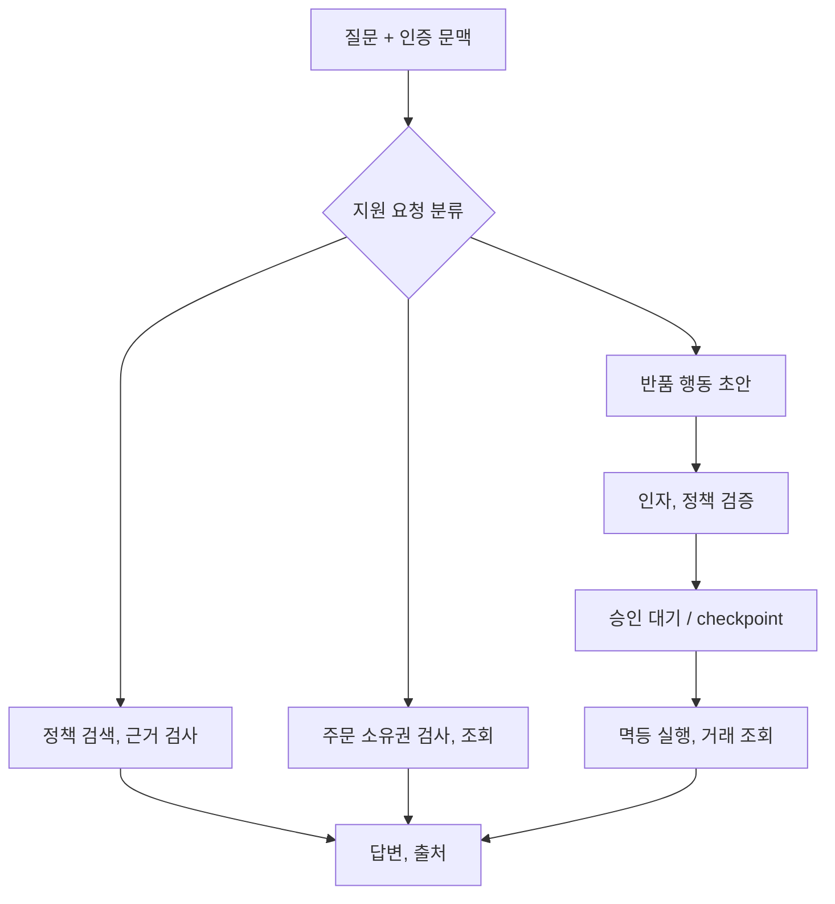

LangChain은 검색기, 프롬프트, 모델 같은 부품을 연결하는 인터페이스, LangGraph는 상태, 분기, 재개를 드러내는 실행 구조, MCP는 외부 기능의 발견과 호출 규약입니다. 세 가지 모두 권한 시스템이나 모델의 정확성을 대신하지 않습니다.

## Bookway 요청별로 다른 흐름

정책 안내는 검색 후 생성하는 고정 체인으로 충분할 수 있습니다. 주문 상태는 소유권을 검사하는 도구가 필요하고, 반품 신청은 실행 전 승인, 재개, 중복 방지가 필요합니다. 모든 질문을 자율 에이전트 루프로 보내지 않습니다.

## 상태와 도구의 계약

| 값 | 출처 | 사용 경계 |
| --- | --- | --- |
| 고객 식별자, 권한 | 인증 서버 | 모델 출력으로 덮어쓰지 않음 |
| 원래 질문, 독립 검색 질의 | 요청, 이력 재작성 | 둘을 따로 보관 |
| 정책 근거 | release의 검색기 | source ID, 적용 조건 유지 |
| 도구 요청 | 모델 또는 코드 | schema, 허용 목록, 소유권 재검사 |
| 승인 대상 | 고정 실행 인자 | 가격, 대상 변경 시 재승인 |
| 거래 키, 결과 | 업무 시스템 | checkpoint와 별도 중복 방지 |

LangChain의 메시지 조립은 모델 호출 이전 단계입니다. 검색 결과 `Document`를 출처가 있는 문맥으로 직렬화하고, JSON parser 이후 업무 schema를 검사합니다. 프레임워크를 연결했다는 사실이 이 검사를 자동 추가하지는 않습니다.

## LangGraph의 저장과 재개

개발 메모리 checkpointer는 프로세스 종료 시 사라집니다. 운영은 지원되는 영속 저장소, 마이그레이션, 접근 제어를 구성합니다. thread ID는 인증 사용자와 연결하되 업무 거래 키와 동일하다고 가정하지 않습니다.

`interrupt()`가 있는 노드는 재개 시 다시 시작될 수 있습니다. 환불, 이메일, 반품 생성 같은 행동을 중단 앞에 두지 않습니다. 외부 거래 성공 후 checkpoint 저장 전에 장애가 나면 거래 키로 원천 결과를 조회한 뒤 복구합니다.

## MCP 서버를 붙이는 위치

MCP 서버는 `get_order_status` 같은 도구의 이름, 설명, 인자를 노출하고 원천 API를 감쌉니다. 앱이 tool call을 실제로 실행하고 ToolMessage와 호출 ID를 연결합니다. `list_tools` 성공은 모델이 올바른 도구를 선택한다는 증거가 아닙니다.

원격 MCP에 토큰을 보낼 때 대상 audience, 최소 권한, 전송 보안을 확인합니다. 같은 서버에 연결됐다고 모든 도구 실행을 허용하지 않습니다. timeout, 업무 오류, 프로토콜 오류를 각각 반환합니다.

모델 호출 예산, 전체 deadline, 도구별 timeout을 함께 두고 trace에는 경로, 상태, release를 기록합니다. 환불 같은 업무는 이 가이드에서 실제 외부 실행하지 않으며 승인, 소유권 검증 없는 예제 호출도 만들지 않습니다.

[LangGraph persistence](https://docs.langchain.com/oss/python/langgraph/persistence) / [기존 도구 실행 코드](../../ai-agents-and-applications/11-tool-agents/) / [MCP 실행 기록](../../ai-agents-and-applications/13-mcp-servers/) / [승인 예제](../../ai-agents-and-applications/14-production-agents/)
